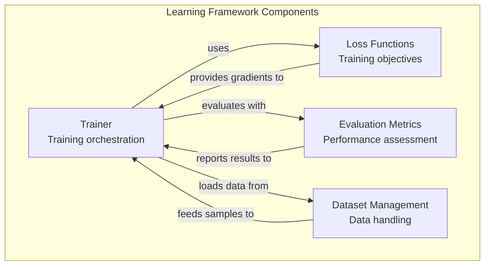
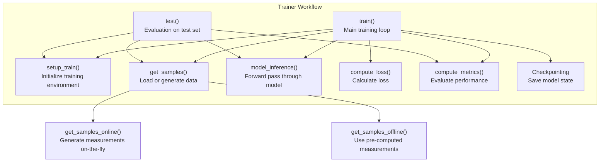
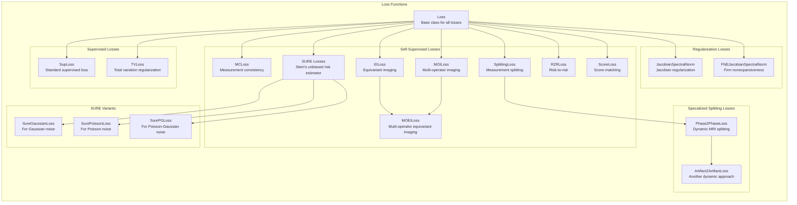
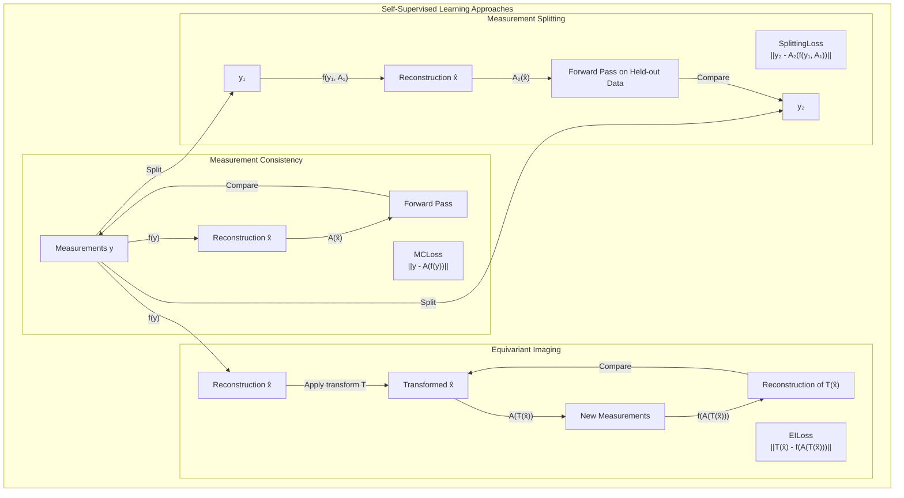
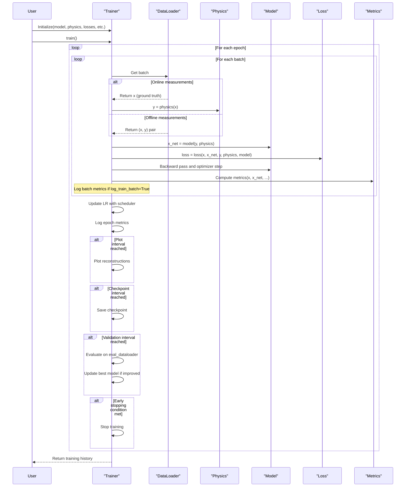

<!-- source: DeepWiki mcp.deepwiki.com · repo deepinv/deepinv · page 4 Learning Framework · fetched 2026-10-21 -->

# Learning Framework

<details>
<summary>Relevant source files</summary>

The following files were used as context for generating this wiki page:

- [CHANGELOG.rst](CHANGELOG.rst)
- [deepinv/loss/ei.py](deepinv/loss/ei.py)
- [deepinv/loss/mc.py](deepinv/loss/mc.py)
- [deepinv/loss/measplit.py](deepinv/loss/measplit.py)
- [deepinv/loss/moi.py](deepinv/loss/moi.py)
- [deepinv/loss/regularisers.py](deepinv/loss/regularisers.py)
- [deepinv/loss/score.py](deepinv/loss/score.py)
- [deepinv/loss/sup.py](deepinv/loss/sup.py)
- [deepinv/loss/sure.py](deepinv/loss/sure.py)
- [deepinv/loss/tv.py](deepinv/loss/tv.py)
- [deepinv/tests/test_loss.py](deepinv/tests/test_loss.py)
- [deepinv/training/trainer.py](deepinv/training/trainer.py)

</details>


The Learning Framework in DeepInv provides the infrastructure and components for training models to solve inverse problems. It encompasses the training process, loss functions (supervised and self-supervised), metrics, and dataset management utilities. This framework is designed to be flexible, supporting various learning paradigms from fully supervised learning with ground truth data to fully self-supervised learning with measurements only.

For information about the actual model architectures, see [Model Zoo](#3).

## Core Components



Sources: [deepinv/training/trainer.py:20-234]()

## The Trainer Class

The `Trainer` class is the central orchestration component for model training in DeepInv. It handles all aspects of the training process from setting up the environment to executing training loops, saving checkpoints, and evaluating models.



Sources: [deepinv/training/trainer.py:236-731]()

### Key Features

- **Flexible Measurement Acquisition**: Supports both online (generate measurements during training) and offline (use pre-computed measurements) modes
- **Physics Parameter Generators**: Can randomly sample physics parameters during training for data augmentation
- **Comprehensive Logging**: Tracks losses and metrics with support for Weights & Biases integration
- **Early Stopping**: Automatically stops training when performance plateaus
- **Model Checkpointing**: Saves models at regular intervals and when performance improves
- **Multi-Dataset Support**: Can train on multiple datasets simultaneously
- **Custom Metrics**: Supports user-defined evaluation metrics

### Basic Usage Example

```python
trainer = dinv.Trainer(
    model=model,                      # Reconstruction model
    physics=physics,                  # Forward operator
    optimizer=optimizer,              # PyTorch optimizer
    train_dataloader=train_dataloader,# Training data
    eval_dataloader=eval_dataloader,  # Validation data
    losses=dinv.loss.SupLoss(),       # Loss function
    metrics=dinv.loss.metric.PSNR(),  # Evaluation metric
    device='cuda',                    # Device
    epochs=100,                       # Number of epochs
    early_stop=True,                  # Enable early stopping
    ckp_interval=10,                  # Save every 10 epochs
    save_path='./checkpoints',        # Checkpoint directory
)

# Train the model
trainer.train()

# Evaluate on test set
test_metrics = trainer.test(test_dataloader)
```

Sources: [deepinv/training/trainer.py:20-193]()

## Loss Functions Taxonomy

DeepInv provides a comprehensive set of loss functions for training reconstruction models, categorized into supervised, self-supervised, and regularization losses.



Sources: [deepinv/loss/sup.py:8-41](), [deepinv/loss/measplit.py:20-417](), [deepinv/loss/ei.py:10-89](), [deepinv/loss/mc.py:9-43](), [deepinv/loss/moi.py:15-196](), [deepinv/loss/sure.py:8-440](), [deepinv/loss/score.py:7-185](), [deepinv/loss/tv.py:5-47](), [deepinv/loss/regularisers.py:5-301]()

### Supervised Losses

- **`SupLoss`**: Standard supervised loss that computes the error between reconstructions and ground truth
- **`TVLoss`**: Total variation regularization for promoting piecewise smoothness

### Self-Supervised Losses

Self-supervised losses enable training without ground truth images:

- **`MCLoss`**: Measurement consistency loss ensuring reconstructions match observed measurements
- **`EILoss`**: Equivariant imaging loss leveraging signal invariance to transformations
- **`MOILoss`**: Multi-operator imaging loss using multiple forward operators
- **`MOEILoss`**: Combines multi-operator and equivariant approaches
- **`SplittingLoss`**: Splits measurements into training and validation sets
- **`Phase2PhaseLoss`**: Specialized splitting for dynamic MRI data
- **`Artifact2ArtifactLoss`**: Another dynamic MRI approach
- **`SureGaussianLoss`**, **`SurePoissonLoss`**, **`SurePGLoss`**: SURE-based losses for different noise models
- **`R2RLoss`**: Risk-to-risk loss that minimizes a surrogate risk
- **`ScoreLoss`**: Score-matching loss for denoising

### Regularization Losses

- **`JacobianSpectralNorm`**: Regularizes the spectral norm of the Jacobian
- **`FNEJacobianSpectralNorm`**: Promotes firm nonexpansiveness in networks

Sources: [deepinv/tests/test_loss.py:16-31](), [deepinv/tests/test_loss.py:94-122]()

## Self-Supervised Learning Workflows

Self-supervised learning enables training without ground truth data. DeepInv implements several key approaches:



Sources: [deepinv/loss/mc.py:9-43](), [deepinv/loss/ei.py:10-89](), [deepinv/loss/measplit.py:20-417]()

### Measurement Splitting Example

The measurement splitting approach divides measurements into two parts: one used for reconstruction and one used for validation.

```python
# Create a measurement splitting loss
loss = dinv.loss.SplittingLoss(split_ratio=0.9)

# Adapt the model to handle splitting
model = loss.adapt_model(model)

# Create trainer
trainer = dinv.Trainer(
    model=model,
    physics=physics,
    optimizer=optimizer,
    train_dataloader=train_dataloader,
    losses=loss,
)

# Train the model
trainer.train()
```

Sources: [deepinv/loss/measplit.py:82-96](), [deepinv/loss/measplit.py:162-185]()

## SURE-Based Loss Functions

Stein's Unbiased Risk Estimator (SURE) allows training without ground truth by providing an unbiased estimate of the reconstruction error using only noisy measurements.

### SURE Variants

| Loss Class | Noise Model | Risk Estimate Formula |
|------------|-------------|----------------------|
| `SureGaussianLoss` | Gaussian | ‖B(y - A𝑓(y))‖² - σ² + 2σ²/m · div(A𝑓) |
| `SurePoissonLoss` | Poisson | ‖y - A𝑓(y)‖² - γ·1ᵀy + 2γ/m · div(A𝑓·y) |
| `SurePGLoss` | Poisson-Gaussian | Complex formula for mixed noise |

Sources: [deepinv/loss/sure.py:98-440]()

## Evaluation Metrics

DeepInv provides several metrics for evaluating reconstruction quality:

- **`PSNR`**: Peak Signal-to-Noise Ratio (higher is better)
- **`SSIM`**: Structural Similarity Index Measure (higher is better)
- **`LPIPS`**: Learned Perceptual Image Patch Similarity (lower is better)
- **`MSE`**: Mean Squared Error (lower is better)
- **`NMSE`**: Normalized Mean Squared Error (lower is better)

All metrics inherit from a common `Metric` base class, which ensures consistent interfaces.

### Metrics Usage

```python
# Using multiple metrics
trainer = dinv.Trainer(
    model=model,
    physics=physics,
    optimizer=optimizer,
    train_dataloader=train_dataloader,
    metrics=[
        dinv.loss.metric.PSNR(),  # Higher is better
        dinv.loss.metric.SSIM(),  # Higher is better
        dinv.loss.metric.MSE()    # Lower is better
    ],
)
```

Sources: [deepinv/training/trainer.py:108-111](), [deepinv/training/trainer.py:314-323]()

## Training Process Flow

The following diagram illustrates the training process flow in DeepInv's Learning Framework:



Sources: [deepinv/training/trainer.py:586-646](), [deepinv/training/trainer.py:649-692](), [deepinv/training/trainer.py:732-793]()

## Online vs Offline Measurements

DeepInv supports two modes of obtaining measurements for training:

1. **Offline Measurements**: Measurements are pre-computed and stored in a dataset
2. **Online Measurements**: Measurements are generated on-the-fly during training

### Online Measurements with Physics Generators

Physics generators allow random sampling of physics parameters during training:

```python
# Create a physics generator
physics_generator = dinv.physics.generator.MaskGenerator(
    tensor_size=(1, 256, 256),
    mask_type='random',
    acceleration=4
)

# Configure trainer for online measurements
trainer = dinv.Trainer(
    model=model,
    physics=physics,
    physics_generator=physics_generator,
    online_measurements=True,
    train_dataloader=train_dataloader,  # Only x is needed
    # ... other params
)
```

Sources: [deepinv/training/trainer.py:126-145](), [deepinv/training/trainer.py:433-477]()

## Conclusion

The Learning Framework in DeepInv provides a flexible and comprehensive system for training models to solve inverse problems. With support for both supervised and self-supervised approaches, a wide range of loss functions, and comprehensive evaluation metrics, it enables researchers and practitioners to easily implement and experiment with different training strategies for various inverse problems.

Through the `Trainer` class and specialized loss functions, DeepInv makes it straightforward to implement complex training pipelines, whether using ground truth data or only measurement data for training.

Sources: [CHANGELOG.rst:31-63](), [deepinv/training/trainer.py:20-40]()

---

