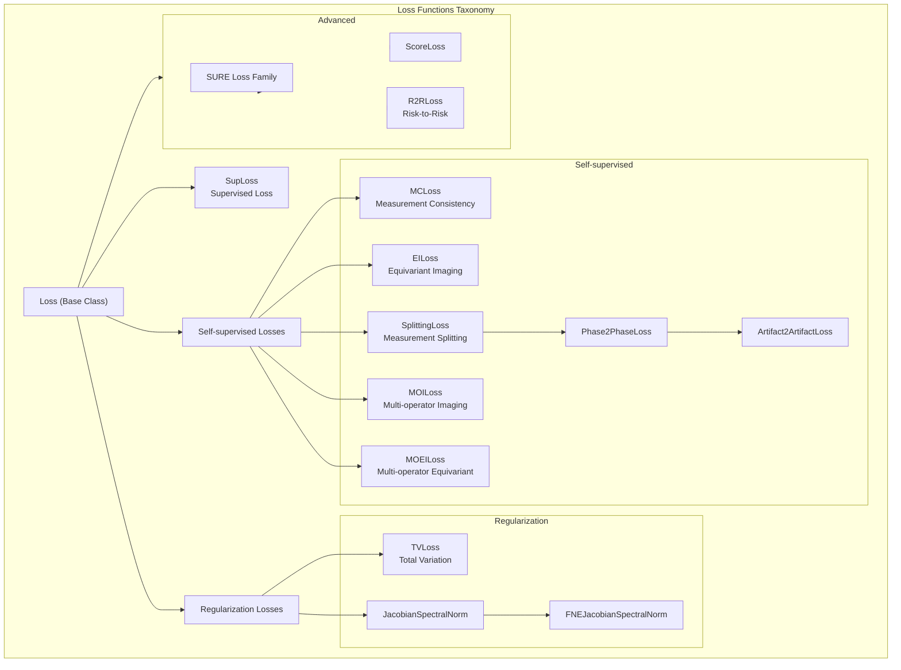
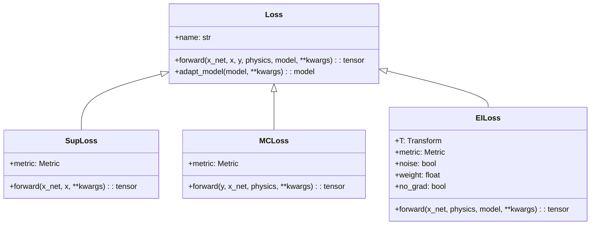
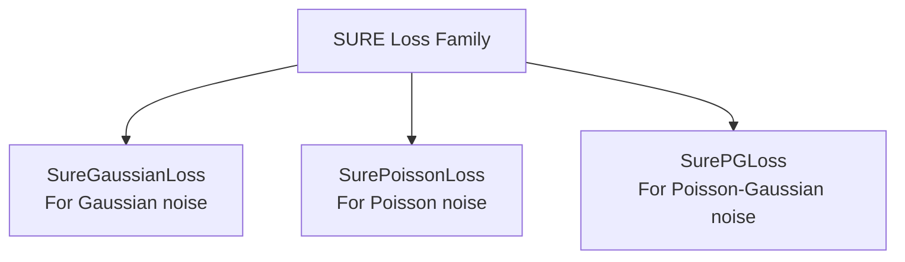
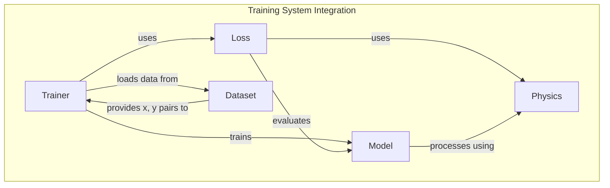

<!-- source: DeepWiki mcp.deepwiki.com · repo deepinv/deepinv · page 4.1 Loss Functions · fetched 2026-10-21 -->

# Loss Functions

<details>
<summary>Relevant source files</summary>

The following files were used as context for generating this wiki page:

- [CHANGELOG.rst](CHANGELOG.rst)
- [deepinv/loss/ei.py](deepinv/loss/ei.py)
- [deepinv/loss/mc.py](deepinv/loss/mc.py)
- [deepinv/loss/measplit.py](deepinv/loss/measplit.py)
- [deepinv/loss/moi.py](deepinv/loss/moi.py)
- [deepinv/loss/regularisers.py](deepinv/loss/regularisers.py)
- [deepinv/loss/score.py](deepinv/loss/score.py)
- [deepinv/loss/sup.py](deepinv/loss/sup.py)
- [deepinv/loss/sure.py](deepinv/loss/sure.py)
- [deepinv/loss/tv.py](deepinv/loss/tv.py)
- [deepinv/tests/test_loss.py](deepinv/tests/test_loss.py)
- [deepinv/training/trainer.py](deepinv/training/trainer.py)

</details>


This page covers the Loss Functions module of DeepInv, which provides various loss functions for training neural networks to solve inverse problems. Loss Functions are a fundamental component of the learning framework in DeepInv, used by the [Training System](#2.5) to optimize models for image reconstruction tasks.

## Overview

Loss functions in DeepInv are used to quantify the quality of reconstructions and guide the optimization of models. The library offers various loss functions, ranging from standard supervised losses to advanced self-supervised and regularization losses.



Sources: [deepinv/loss/sup.py](), [deepinv/loss/mc.py](), [deepinv/loss/ei.py](), [deepinv/loss/measplit.py](), [deepinv/loss/moi.py](), [deepinv/loss/tv.py](), [deepinv/loss/regularisers.py](), [deepinv/loss/sure.py](), [deepinv/loss/score.py]()

## Loss Base Class

All loss functions in DeepInv inherit from the `Loss` base class, which defines the common interface for implementing loss functions. The core method that all loss functions must implement is the `forward` method, which computes the loss value.



Sources: [deepinv/loss/loss.py](), [deepinv/loss/sup.py:8-41](), [deepinv/loss/mc.py:9-43](), [deepinv/loss/ei.py:10-89]()

## Supervised Losses

### SupLoss

The standard supervised loss computes the error between the reconstructed signal and the ground truth.

```python
loss = dinv.loss.SupLoss(metric=torch.nn.MSELoss())
```

The loss is defined as:

$$\frac{1}{n}\|x-\mathcal{R}(y)\|^2$$

where $\mathcal{R}(y)$ is the reconstructed signal, $x$ is the ground truth target, and $n$ is the number of elements in the signal.

Sources: [deepinv/loss/sup.py:8-41]()

## Self-supervised Losses

Self-supervised losses enable training without ground truth data by leveraging the properties of the measurement process or the signal itself.

### MCLoss (Measurement Consistency)

Enforces that reconstructions are measurement-consistent by computing the error between the forward model applied to the reconstruction and the original measurements.

```python
loss = dinv.loss.MCLoss(metric=torch.nn.MSELoss())
```

The loss is defined as:

$$\|y-A\mathcal{R}(y)\|^2$$

where $\mathcal{R}(y)$ is the reconstructed signal and $A$ is the forward operator.

Sources: [deepinv/loss/mc.py:9-43]()

### EILoss (Equivariant Imaging)

Assumes that signals are invariant to a group of transformations and uses this property to learn from incomplete measurement data.

```python
loss = dinv.loss.EILoss(transform=dinv.transform.Shift(), 
                       metric=torch.nn.MSELoss(),
                       apply_noise=True)
```

The loss is defined as:

$$\| T_g \hat{x} - \mathcal{R}(A(T_g \hat{x}))\|^2$$

where $\hat{x}=\mathcal{R}(y)$ is a reconstructed signal, $T_g$ is a transformation sampled at random from a group $g\sim\mathcal{G}$, and $A$ is the forward operator.

Sources: [deepinv/loss/ei.py:10-89]()

### SplittingLoss

Splits the measurement and forward operator into two pairs to compute a self-supervised loss. Used in methods like SSDU for MRI and Noise2Inverse for CT.

```python
loss = dinv.loss.SplittingLoss(split_ratio=0.9, 
                              eval_n_samples=5,
                              metric=torch.nn.MSELoss())
model = loss.adapt_model(model)  # Important step!
```

The loss is defined as:

$$\frac{m}{m_2}\| y_2 - A_2 \mathcal{R}(y_1, A_1)\|^2$$

where $\mathcal{R}$ is the trainable network, $A_1 = M_1 A, A_2 = M_2 A$, and $M_i$ are randomly generated masks such that $M_1+M_2=I_m$.

#### Phase2PhaseLoss and Artifact2ArtifactLoss

These are specialized versions of SplittingLoss for dynamic data, particularly for free-breathing MRI.

Sources: [deepinv/loss/measplit.py:20-1091]()

### MOILoss (Multi-operator Imaging)

Used when signals are observed via multiple forward operators. The loss encourages consistency across different forward operators.

```python
loss = dinv.loss.MOILoss(physics=[physics1, physics2],
                        metric=torch.nn.MSELoss(),
                        apply_noise=True)
```

The loss is defined as:

$$\| \hat{x} - \mathcal{R}(A_g\hat{x},A_g) \|^2$$

where $\hat{x}=\mathcal{R}(y,A_s)$ is a reconstructed signal and $A_g$ is a forward operator sampled at random from a set $\{A_g\}_{g=1}^{G}$.

### MOEILoss (Multi-operator Equivariant Imaging)

Extends EILoss to the case where signals are observed via multiple forward operators.

```python
loss = dinv.loss.MOEILoss(transform=dinv.transform.Shift(),
                         physics=[physics1, physics2],
                         metric=torch.nn.MSELoss(),
                         apply_noise=True)
```

The loss is defined as:

$$\| T_g \hat{x} - \mathcal{R}(A_2 T_g \hat{x}, A_2)\|^2$$

where $\hat{x}=\mathcal{R}(y,A_1)$ is a reconstructed signal, $A_2$ is a forward operator sampled at random, and $T_g$ is a transformation.

Sources: [deepinv/loss/moi.py:15-197]()

## Advanced Self-supervised Losses

### SURE (Stein's Unbiased Risk Estimator) Losses

SURE losses provide unbiased estimates of the mean squared error using only noisy measurements, without requiring ground truth. DeepInv provides SURE losses for different noise models.



#### SureGaussianLoss

For data with Gaussian noise: $y \sim\mathcal{N}(u,\sigma^2 I)$ with $u= A(x)$.

```python
loss = dinv.loss.SureGaussianLoss(sigma=0.1, tau=1e-2)
```

#### SurePoissonLoss

For data with Poisson noise: $y = \gamma z$ with $z\sim \mathcal{P}(\frac{u}{\gamma})$, $u=A(x)$.

```python
loss = dinv.loss.SurePoissonLoss(gain=0.1, tau=1e-3)
```

#### SurePGLoss

For data with Poisson-Gaussian noise: $y = \gamma z + \epsilon$ where $u = A(x)$, $z \sim \mathcal{P}\left(\frac{u}{\gamma}\right)$, and $\epsilon \sim \mathcal{N}(0, \sigma^2 I)$.

```python
loss = dinv.loss.SurePGLoss(sigma=0.1, gain=0.1, tau1=1e-3)
```

Sources: [deepinv/loss/sure.py:8-441]()

### ScoreLoss

Approximates the score of the measurement distribution in the context of Noise2Score. It enables training score-based models for denoising.

```python
loss = dinv.loss.ScoreLoss(noise_model=dinv.physics.GaussianNoise(0.1),
                          total_batches=1000,
                          delta=(0.001, 0.1))
model = loss.adapt_model(model)  # Important step!
```

The loss is defined as:

$$\| \epsilon + \sigma S(y+ \sigma \epsilon) \|^2$$

where $y$ is the noisy measurement, $S$ is the model approximating the score of the noisy measurement distribution $\nabla \log p(y)$, $\epsilon$ is sampled from $N(0,I)$, and $\sigma$ is annealed during training.

Sources: [deepinv/loss/score.py:7-185]()

### R2RLoss (Risk-to-Risk)

The Risk-to-Risk loss enables training without ground truth by leveraging multiple noise distributions. The implementation in DeepInv supports various noise models including Gaussian, Poisson, and Gamma.

```python
loss = dinv.loss.R2RLoss(noise_model=dinv.physics.GaussianNoise(0.1),
                        alpha=0.999)
model = loss.adapt_model(model)  # Important step!
```

Sources: [deepinv/tests/test_loss.py:179-227]()

## Regularization Losses

### TVLoss (Total Variation)

Promotes piecewise smoothness in the reconstructed images.

```python
loss = dinv.loss.TVLoss(weight=1.0)
```

The loss is defined as:

$$\|D\hat{x}\|_2^2$$

where $D$ is a normalized linear operator that computes the vertical and horizontal first-order differences of the reconstructed image $\hat{x}$.

Sources: [deepinv/loss/tv.py:5-48]()

### JacobianSpectralNorm

Computes the spectral norm of the Jacobian of a function.

```python
loss = dinv.loss.JacobianSpectralNorm(max_iter=100, 
                                     tol=1e-4,
                                     eval_mode=False)
```

The loss computes:

$$\|\frac{df}{du}(x)\|_2$$

for a function $f:\mathbb{R}^n\to\mathbb{R}^n$.

### FNEJacobianSpectralNorm

Computes the Firm-Nonexpansiveness Jacobian spectral norm.

```python
loss = dinv.loss.FNEJacobianSpectralNorm(max_iter=100,
                                        tol=1e-4,
                                        eval_mode=False)
```

The loss computes:

$$\|\frac{d(2f-\operatorname{Id})}{du}(x)\|_2$$

where $\operatorname{Id}$ denotes the identity.

Sources: [deepinv/loss/regularisers.py:5-302]()

## Integration with Training System

Loss functions in DeepInv are designed to work seamlessly with the Trainer class, which handles the training loop, logging, and model evaluation.



### Using Loss Functions in Trainer

```python
loss = dinv.loss.SupLoss()  # Or any other loss function
trainer = dinv.Trainer(
    model=model,
    physics=physics,
    train_dataloader=train_dataloader,
    losses=loss,  # Can also be a list of losses
    optimizer=optimizer,
    epochs=100
)
trainer.train()
```

### Combining Multiple Losses

Loss functions can be combined by passing a list to the Trainer:

```python
losses = [
    dinv.loss.SupLoss(),
    dinv.loss.TVLoss(weight=0.01)
]
trainer = dinv.Trainer(
    model=model,
    physics=physics,
    train_dataloader=train_dataloader,
    losses=losses,
    optimizer=optimizer,
    epochs=100
)
```

Sources: [deepinv/training/trainer.py:21-1047]()

## Loss Schedulers

DeepInv provides loss schedulers that can be used to switch between different losses during training:

### RandomLossScheduler

Randomly selects a loss function from a list at each training step.

```python
scheduler = dinv.loss.RandomLossScheduler(
    dinv.loss.SupLoss(),
    dinv.loss.TVLoss(weight=0.01),
    generator=torch.Generator().manual_seed(0)
)
```

### InterleavedLossScheduler

Alternates between different loss functions in a predefined sequence.

```python
scheduler = dinv.loss.InterleavedLossScheduler(
    dinv.loss.SupLoss(),
    dinv.loss.TVLoss(weight=0.01)
)
```

Sources: [deepinv/tests/test_loss.py:440-490]()

## Specialized Usage Notes

### Models Requiring Adaptation

Some loss functions require model adaptation before training:

```python
# For SplittingLoss
loss = dinv.loss.SplittingLoss(split_ratio=0.9)
model = loss.adapt_model(model)

# For ScoreLoss
loss = dinv.loss.ScoreLoss(noise_model=dinv.physics.GaussianNoise(0.1))
model = loss.adapt_model(model)

# For R2RLoss
loss = dinv.loss.R2RLoss(noise_model=dinv.physics.GaussianNoise(0.1))
model = loss.adapt_model(model)
```

This adaptation process modifies the model to incorporate the specific requirements of the loss function.

### Loss Function Selection

The choice of loss function depends on:

1. Whether ground truth is available (supervised vs. self-supervised)
2. The noise model in the measurements
3. The specific inverse problem being solved
4. Whether multiple operators are involved
5. Whether the data is dynamic or static

For best results, combine task-specific losses with appropriate regularization losses.

---

