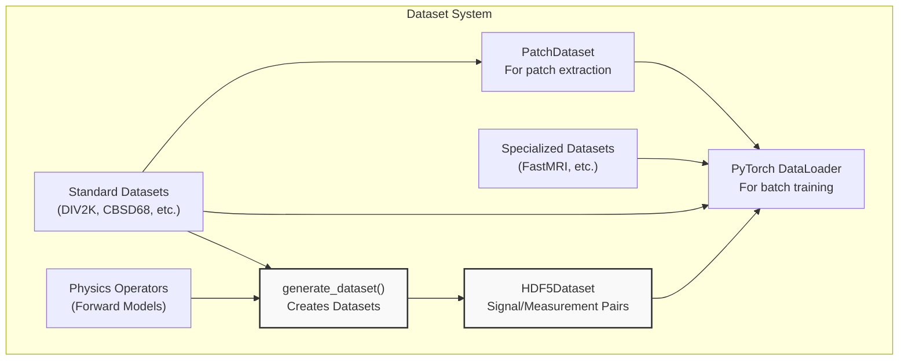
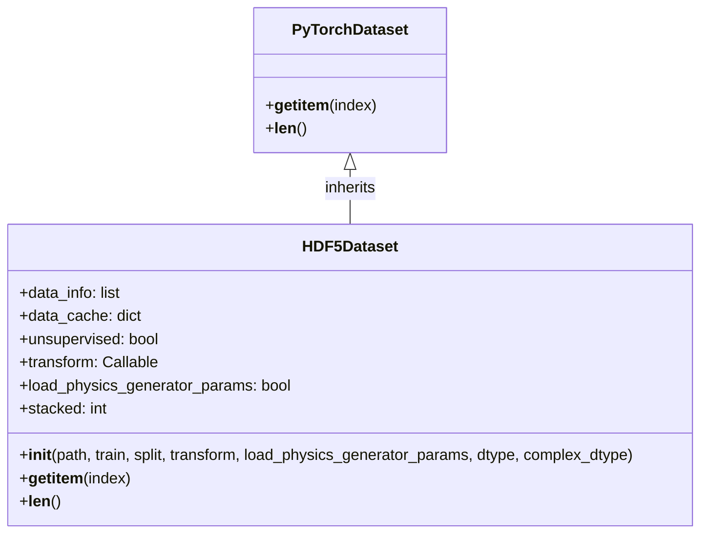
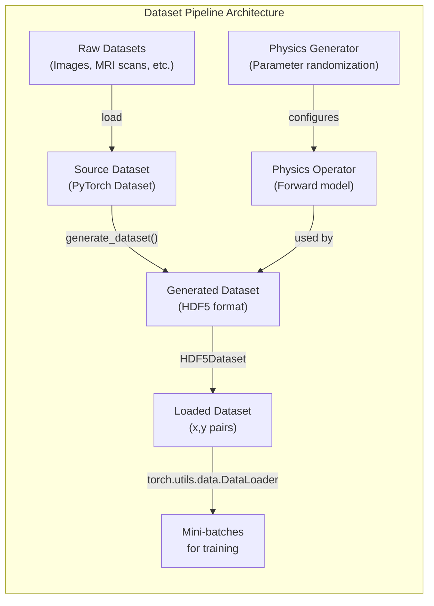
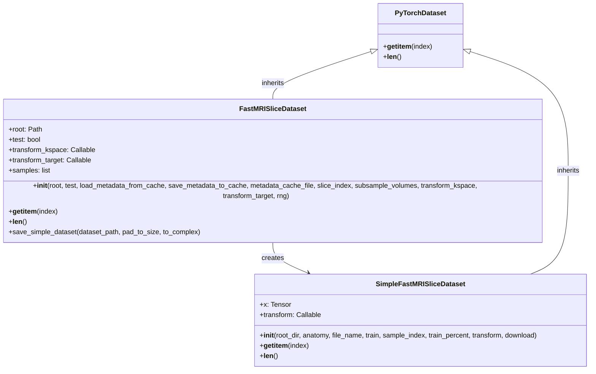

<!-- source: DeepWiki mcp.deepwiki.com · repo deepinv/deepinv · page 4.2 Dataset Management · fetched 2026-10-21 -->

# Dataset Management

<details>
<summary>Relevant source files</summary>

The following files were used as context for generating this wiki page:

- [deepinv/datasets/__init__.py](deepinv/datasets/__init__.py)
- [deepinv/datasets/datagenerator.py](deepinv/datasets/datagenerator.py)
- [deepinv/datasets/fastmri.py](deepinv/datasets/fastmri.py)
- [deepinv/tests/test_datasets.py](deepinv/tests/test_datasets.py)

</details>


## Purpose and Scope

This document explains how datasets are managed in DeepInv, covering how to create, load, and process datasets for inverse problems. The DeepInv framework provides functionality to generate datasets with measurement-signal pairs, load pre-existing datasets, and transform dataset elements for training and evaluation.

For information about physics operators used to generate measurements, see [Physics Operators Framework](#2.1).
For information about training with datasets, see [Training System](#2.5).

## Dataset Architecture Overview



Sources: [deepinv/datasets/__init__.py:1-16](), [deepinv/datasets/datagenerator.py:22-130](), [deepinv/datasets/datagenerator.py:132-486]()

## Built-in Datasets

DeepInv comes with several built-in datasets commonly used in image restoration and inverse problems:

| Dataset Class | Description | Type |
|---------------|-------------|------|
| `DIV2K` | High-quality 2K resolution images | Images |
| `Urban100HR` | 100 high-res urban images | Images |
| `Set14HR` | 14 commonly used test images | Images |
| `CBSD68` | 68 images from BSD dataset | Images |
| `FastMRISliceDataset` | MRI dataset with k-space data | Medical |
| `SimpleFastMRISliceDataset` | Simplified MRI images | Medical |
| `CMRxReconSliceDataset` | Cardiac MRI data | Medical |
| `FMD` | Fluorescence Microscopy Dataset | Scientific |
| `Kohler` | Motion blur dataset | Blur |
| `NBUDataset` | Satellite imagery | Remote Sensing |

These datasets can be downloaded automatically by setting `download=True` in their constructor:

```python
from deepinv.datasets import DIV2K
dataset = DIV2K(root="./data", download=True)
```

Sources: [deepinv/datasets/__init__.py:1-16](), [deepinv/tests/test_datasets.py:10-22]()

## Dataset Generation

### The HDF5Dataset Class

The `HDF5Dataset` is the core dataset class in DeepInv, designed to efficiently store and load signal/measurement pairs for inverse problems.



The `HDF5Dataset` stores pairs of clean signals `x` and measurements `y`, where `y` is the result of applying a forward model (physics operator) to `x`. It can also optionally store the parameters used to generate the measurements.

Key features:
- Supports both supervised (x, y) and unsupervised (y only) settings
- Handles complex data types needed for many inverse problems
- Can store multiple measurements per signal (stacked physics)
- Can store physics generator parameters

Sources: [deepinv/datasets/datagenerator.py:22-130]()

### Generating Datasets with `generate_dataset()`

The `generate_dataset()` function is the primary way to create datasets in DeepInv. It applies physics operators to existing datasets to generate measurement/signal pairs and saves them in HDF5 format.

```mermaid
flowchart TD
    subgraph "generate_dataset() Process"
        direction TB
        Input["Input Dataset<br>(e.g., DIV2K)"] --> |"For each sample"| 
        Apply["Apply Physics Operator<br>(Forward Model)"]
        Apply --> |"Generate measurement y"| Store
        Apply --> |"Store original signal x"| Store["Store in HDF5 Format"]
        PhysGen["Physics Generator<br>(Optional)"] --> |"Generate parameters"| Apply
        PhysGen --> |"Store parameters"| Store
        Store --> Output["Output HDF5 Dataset"]
    end
```

Usage example:
```python
from deepinv.datasets import generate_dataset, DIV2K
from deepinv.physics import Blur

# Load dataset
train_dataset = DIV2K("./data", download=True)

# Define physics operator
physics = Blur(kernel_size=15, sigma=1.5)

# Generate dataset with signal/measurement pairs
dataset_path = generate_dataset(
    train_dataset=train_dataset,
    physics=physics,
    save_dir="./datasets",
    dataset_filename="blur_dataset"
)
```

Key parameters:
- `train_dataset`: Source dataset (e.g., DIV2K, CBSD68)
- `physics`: Physics operator to generate measurements
- `test_dataset`: Optional test dataset
- `physics_generator`: Optional generator for randomizing physics parameters
- `save_physics_generator_params`: Whether to save generator parameters
- `supervised`: Set to `False` for unsupervised settings (only measurements for training)

Sources: [deepinv/datasets/datagenerator.py:132-486]()

## Dataset Pipeline Architecture

The dataset generation and loading pipeline in DeepInv follows this general workflow:



Sources: [deepinv/datasets/datagenerator.py:22-130](), [deepinv/datasets/datagenerator.py:132-486]()

## Special Dataset Types

### FastMRI Datasets

DeepInv provides specialized support for MRI datasets, with a focus on the FastMRI dataset.



The FastMRI dataset system consists of two main classes:

1. **FastMRISliceDataset**: Loads raw MRI data with k-space measurements and target reconstructions
   - Supports metadata caching for faster loading
   - Handles complex data types natively
   - Can select specific slices from 3D volumes
   - Compatible with MultiCoilMRI physics operators

2. **SimpleFastMRISliceDataset**: A lightweight in-memory dataset for processed MRI slices
   - Created by `save_simple_dataset()` method of FastMRISliceDataset
   - Faster loading times and simpler interface
   - Contains pre-processed, normalized images

Example usage:
```python
from deepinv.datasets import FastMRISliceDataset, SimpleFastMRISliceDataset

# Load full dataset with metadata caching
dataset = FastMRISliceDataset(
    root="path/to/fastmri/data",
    slice_index="middle",  # Only use middle slice of each volume
    save_metadata_to_cache=True
)

# Convert to simple dataset for faster loading
simple_dataset = dataset.save_simple_dataset("fastmri_simple.pt")

# Or load pre-existing simple dataset
simple_dataset = SimpleFastMRISliceDataset(
    root_dir="./data",
    anatomy="knee",
    download=True
)
```

Sources: [deepinv/datasets/fastmri.py:36-142](), [deepinv/datasets/fastmri.py:147-465]()

## Practical Dataset Usage

### Loading HDF5Datasets

After generating a dataset with `generate_dataset()`, you can load it using the `HDF5Dataset` class:

```python
from deepinv.datasets import HDF5Dataset

# Load training dataset
train_dataset = HDF5Dataset(
    path="./datasets/blur_dataset0.h5",
    train=True,
    dtype=torch.float32
)

# Load test dataset
test_dataset = HDF5Dataset(
    path="./datasets/blur_dataset0.h5",
    train=False,
    dtype=torch.float32
)

# Access data
x, y = train_dataset[0]  # x: signal, y: measurement
```

### Dataset with Physics Generator Parameters

When datasets are generated with a physics generator and `save_physics_generator_params=True`, the parameters are stored in the dataset and can be accessed:

```python
from deepinv.datasets import HDF5Dataset

# Load dataset with physics parameters
dataset = HDF5Dataset(
    path="./datasets/dataset_with_params.h5",
    train=True,
    load_physics_generator_params=True
)

# Access data with parameters
x, y, params = dataset[0]  # params is a dictionary of physics parameters
```

This is useful for tasks that require knowledge of the specific physics parameters used to generate each measurement, such as:
- Evaluating learned parameters in parameter estimation tasks
- Computing measurement consistency losses that need exact physics parameters
- Using parameters for data visualization or analysis

Sources: [deepinv/datasets/datagenerator.py:22-130](), [deepinv/datasets/datagenerator.py:132-486]()

## Best Practices

### Dataset Creation Workflow

1. **Choose a base dataset** of clean signals (DIV2K, CBSD68, etc.)
2. **Define physics operator(s)** that represent your inverse problem
3. **Optionally create a physics generator** for parameter randomization
4. **Generate the dataset** using `generate_dataset()`
5. **Load the dataset** using `HDF5Dataset` during training

### Performance Considerations

- Use `load_metadata_from_cache=True` and `save_metadata_to_cache=True` with MRI datasets to speed up initialization
- Consider using `SimpleFastMRISliceDataset` instead of `FastMRISliceDataset` for faster loading
- Set appropriate `batch_size` and `num_workers` in `generate_dataset()` to optimize dataset creation speed
- For complex-valued data, make sure to specify the correct `dtype` and `complex_dtype` parameters

Sources: [deepinv/datasets/datagenerator.py:132-486](), [deepinv/datasets/fastmri.py:147-465]()

---

