<!-- source: DeepWiki mcp.deepwiki.com · repo deepinv/deepinv · page 4.3 Sampling Methods · fetched 2026-10-21 -->

# Sampling Methods

<details>
<summary>Relevant source files</summary>

The following files were used as context for generating this wiki page:

- [deepinv/sampling/__init__.py](deepinv/sampling/__init__.py)
- [deepinv/sampling/diffusion.py](deepinv/sampling/diffusion.py)
- [deepinv/sampling/langevin.py](deepinv/sampling/langevin.py)
- [deepinv/tests/test_sampling.py](deepinv/tests/test_sampling.py)

</details>


## Introduction

Sampling Methods in DeepInv provide tools for uncertainty quantification and posterior sampling in inverse problems. This module enables sampling from posterior distributions to obtain not only reconstructions (posterior mean) but also uncertainty estimates (posterior variance) for solutions to inverse problems.

The sampling methods integrate with the [Physics Operators Framework](#2.1) and [Optimization Framework](#2.3) to perform Bayesian inference. Unlike deterministic reconstruction algorithms in the [Optimization Algorithms](#2.4) module, sampling methods generate multiple samples from the posterior distribution, providing information about the uncertainty in the reconstruction.

Sources: [deepinv/sampling/langevin.py:12-211](), [deepinv/sampling/diffusion.py:11-63]()

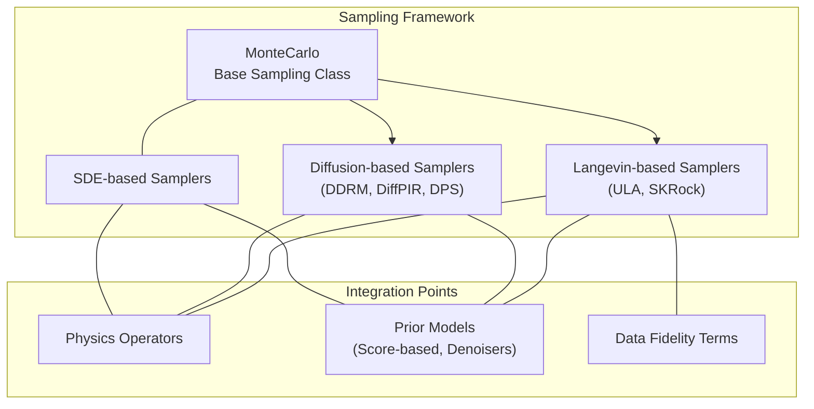

Sources: [deepinv/sampling/__init__.py:1-12](), [deepinv/sampling/langevin.py:12-211](), [deepinv/sampling/diffusion.py:11-63]()

## Monte Carlo Framework

The foundation of sampling methods in DeepInv is the `MonteCarlo` base class, which provides a framework for implementing different Monte Carlo sampling algorithms. This class handles the common functionality shared by all samplers, such as:

- Managing the sampling chain
- Computing posterior statistics (mean and variance) using Welford's algorithm
- Checking for convergence
- Handling burn-in periods and thinning

### Base Monte Carlo Class

The `MonteCarlo` class is extensible, allowing users to define custom samplers by implementing a specific sampling kernel.

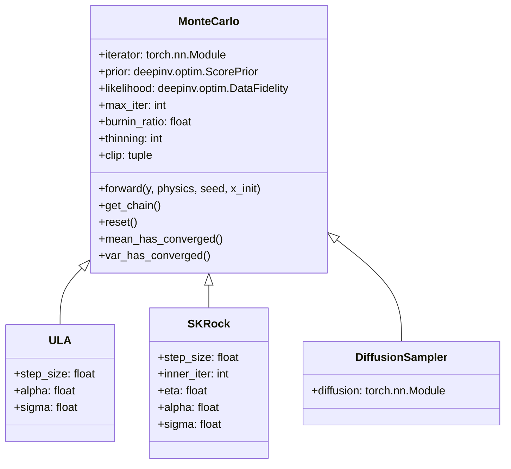

Sources: [deepinv/sampling/langevin.py:12-211](), [deepinv/sampling/diffusion.py:11-63]()

### Welford's Algorithm

The `MonteCarlo` class uses Welford's online algorithm to compute the mean and variance of the samples without storing the entire chain in memory. This is especially important for high-dimensional problems where storing all samples would be prohibitively expensive.

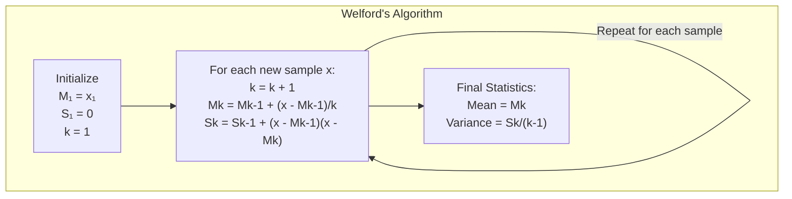

Sources: [deepinv/sampling/langevin.py:127-182](), [deepinv/sampling/utils.py]()

## Langevin-based Samplers

Langevin-based samplers use stochastic gradient dynamics to generate samples from the posterior distribution. DeepInv implements two main Langevin-based samplers:

1. **ULA (Unadjusted Langevin Algorithm)**: A first-order sampling method that uses gradient information of the posterior.
2. **SKRock (Stochastic Orthogonal Runge-Kutta-Chebyshev)**: An accelerated Langevin sampler using stabilized Runge-Kutta methods.

### ULA: Unadjusted Langevin Algorithm

ULA implements the following iterative scheme:

```
x_{k+1} = x_k + η∇log p(y|x_k) + η α∇log p(x_k) + √(2η)z_{k+1}
```

where:
- `x_k` is the current sample
- `η` is the step size
- `∇log p(y|x_k)` is the gradient of the log-likelihood
- `∇log p(x_k)` is the gradient of the log-prior
- `α` is the regularization parameter
- `z_{k+1}` is a standard Gaussian noise

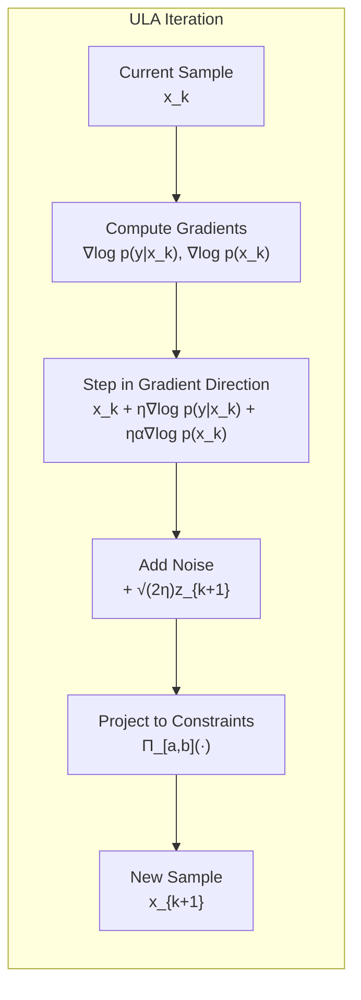

Sources: [deepinv/sampling/langevin.py:214-313]()

### SKRock: Stochastic Orthogonal Runge-Kutta-Chebyshev

SKRock is an accelerated version of the Langevin algorithm that uses orthogonal Runge-Kutta-Chebyshev methods for stability. It performs multiple internal iterations per sampling step, allowing larger step sizes and faster convergence.

The algorithm implements a stabilized explicit integration scheme that is particularly effective for stiff problems.

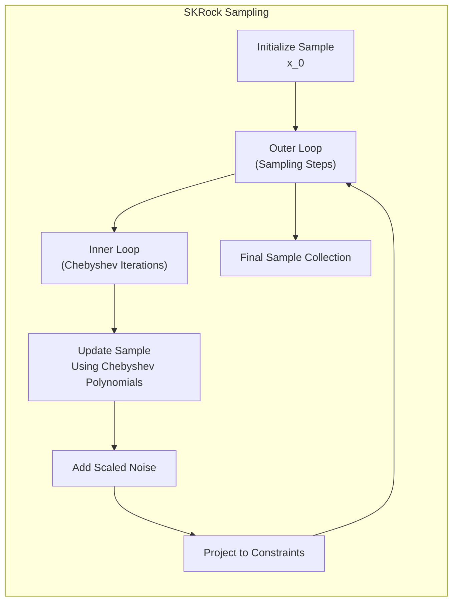

Sources: [deepinv/sampling/langevin.py:315-440]()

## Diffusion-based Samplers

Diffusion-based samplers leverage recent advances in diffusion models for image generation. DeepInv implements several diffusion-based sampling methods:

1. **DiffusionSampler**: A wrapper that adapts any diffusion model to the Monte Carlo sampling framework
2. **DDRM**: Denoising Diffusion Restoration Models
3. **DiffPIR**: Diffusion Plug-and-Play Image Restoration
4. **DPS**: Diffusion Posterior Sampling

### DiffusionSampler

The `DiffusionSampler` class wraps any diffusion model with a Monte Carlo interface, allowing it to be used for posterior sampling and uncertainty quantification.

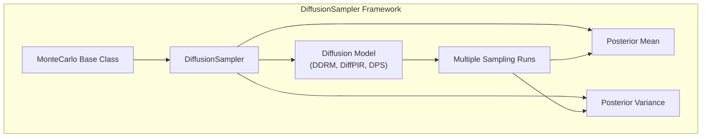

Sources: [deepinv/sampling/diffusion.py:11-63]()

### DDRM: Denoising Diffusion Restoration Models

DDRM adapts pre-trained diffusion models for inverse problems. It requires the physics operator to be a `DecomposablePhysics` class with a singular value decomposition (SVD).

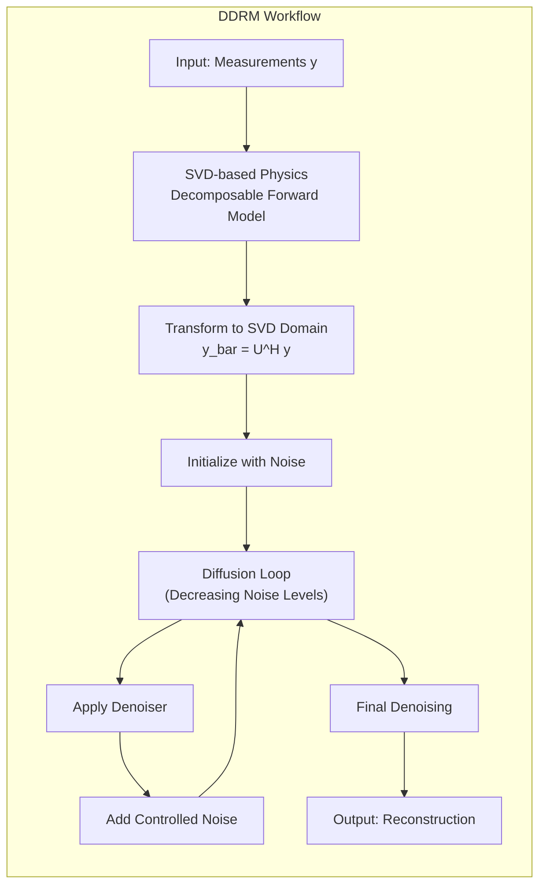

Sources: [deepinv/sampling/diffusion.py:66-202]()

### DiffPIR: Diffusion Plug-and-Play Image Restoration

DiffPIR combines Plug-and-Play with diffusion models for inverse problems. It is inspired by Half-Quadratic Splitting (HQS) algorithms but replaces the denoiser with a diffusion model.

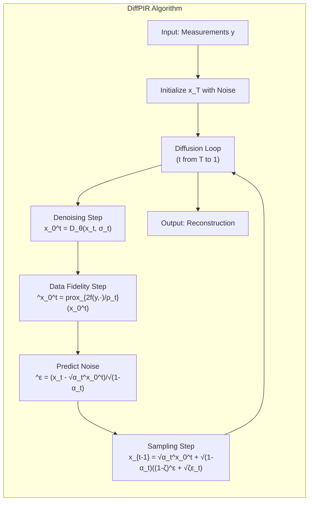

Sources: [deepinv/sampling/diffusion.py:205-500]()

### DPS: Diffusion Posterior Sampling

DPS is a gradient-based posterior sampling algorithm that has minimal assumptions on the forward model. It only requires the measurement model to be differentiable.

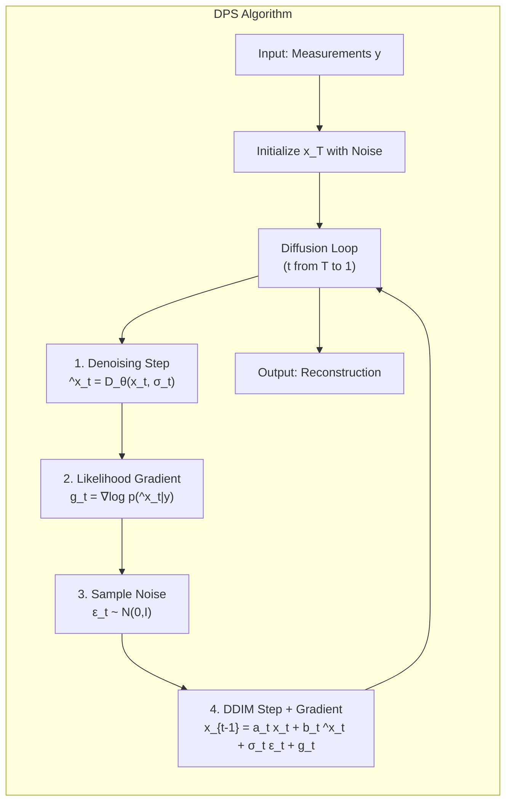

Sources: [deepinv/sampling/diffusion.py:503-663]()

## SDE-based Sampling

DeepInv also includes SDE (Stochastic Differential Equation) based sampling methods, which offer a continuous-time perspective on diffusion models.

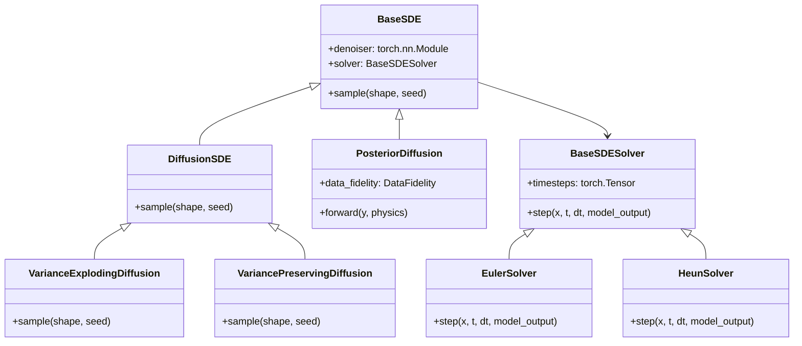

Sources: [deepinv/sampling/__init__.py:3-12](), [deepinv/tests/test_sampling.py:192-296]()

## Data Fidelity Terms for Sampling

Samplers require specialized data fidelity terms that are compatible with the sampling algorithms.

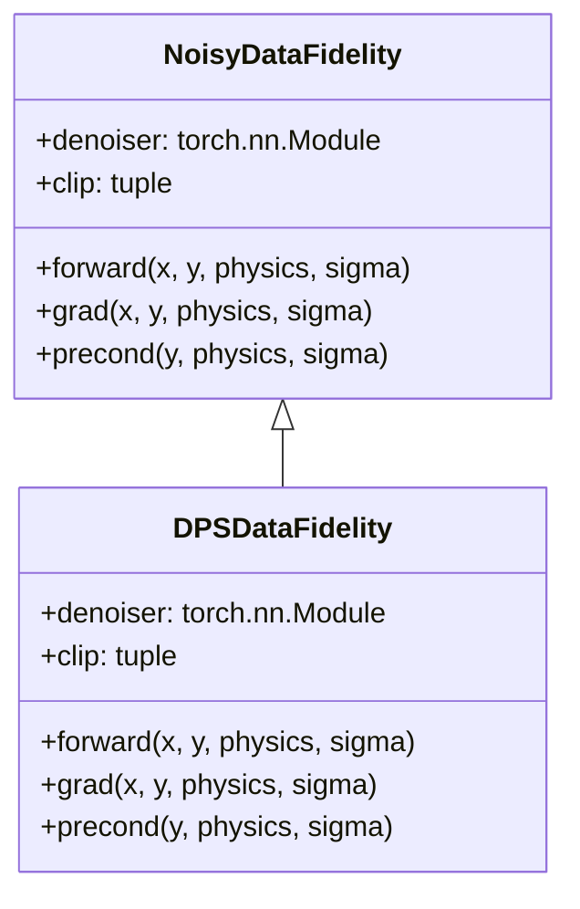

Sources: [deepinv/sampling/__init__.py:4](), [deepinv/tests/test_sampling.py:299-328]()

## Usage Examples

The sampling methods can be used to:

1. Obtain point estimates (posterior mean)
2. Quantify uncertainty (posterior variance)
3. Generate multiple plausible reconstructions

Here's a typical workflow for using a sampler:

```
# Create a prior (using a denoiser)
prior = deepinv.optim.ScorePrior(model_spec=model_spec)

# Create a data fidelity term based on noise model
likelihood = deepinv.optim.data_fidelity.L2(sigma=sigma)

# Create a sampler
sampler = deepinv.sampling.ULA(
    prior,
    likelihood,
    max_iter=1000,
    sigma=0.1,
    step_size=0.01,
    clip=(-1, 2),
    verbose=True
)

# Run the sampler to get posterior mean and variance
mean, var = sampler(y, physics)

# Get uncertainty information
std = var.sqrt()
```

Sources: [deepinv/sampling/langevin.py:85-184](), [deepinv/tests/test_sampling.py:67-107]()

## Summary of Available Samplers

| Sampler | Description | Requirements | Key Parameters |
|---------|-------------|--------------|---------------|
| ULA | Unadjusted Langevin Algorithm | Score prior, data fidelity | `step_size`, `alpha`, `sigma` |
| SKRock | Stochastic RK-Chebyshev | Score prior, data fidelity | `step_size`, `inner_iter`, `alpha`, `sigma` |
| DiffusionSampler | Monte Carlo with diffusion | Diffusion model | `max_iter`, `clip` |
| DDRM | Denoising Diffusion Restoration Model | Denoiser, decomposable physics | `sigmas`, `eta`, `etab` |
| DiffPIR | Diffusion PnP Image Restoration | Denoiser, data fidelity | `max_iter`, `zeta`, `lambda_` |
| DPS | Diffusion Posterior Sampling | Denoiser, data fidelity | `max_iter`, `eta` |

Sources: [deepinv/sampling/__init__.py:1-12](), [deepinv/tests/test_sampling.py:10-44]()

---

