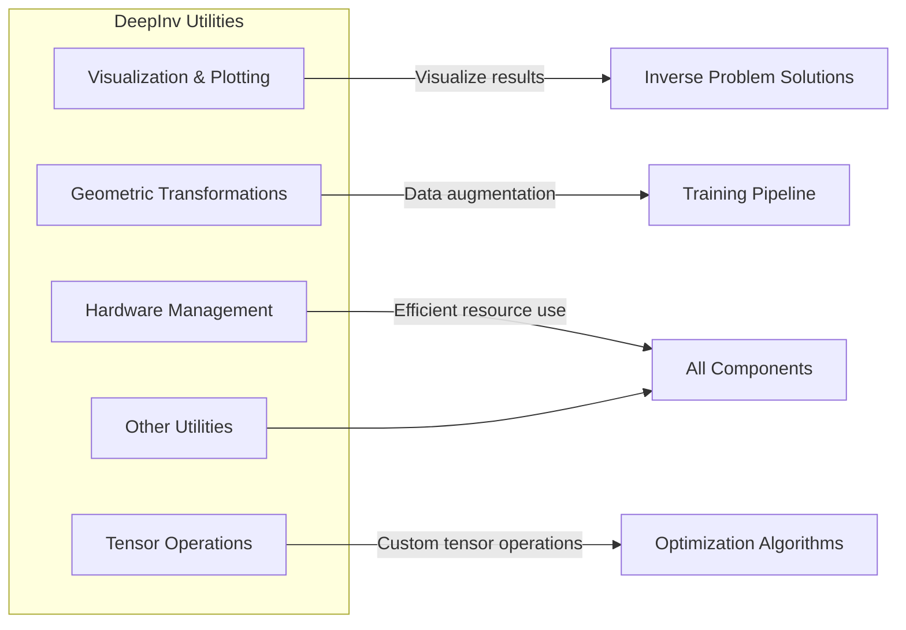
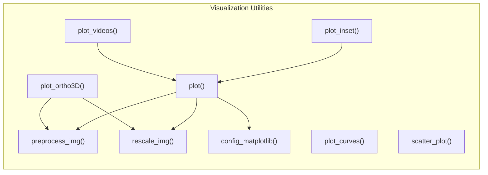
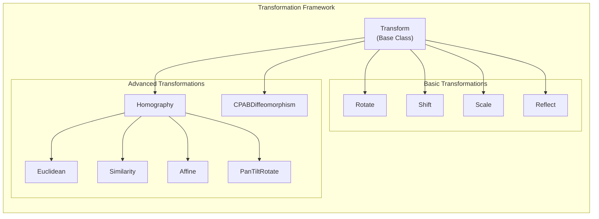
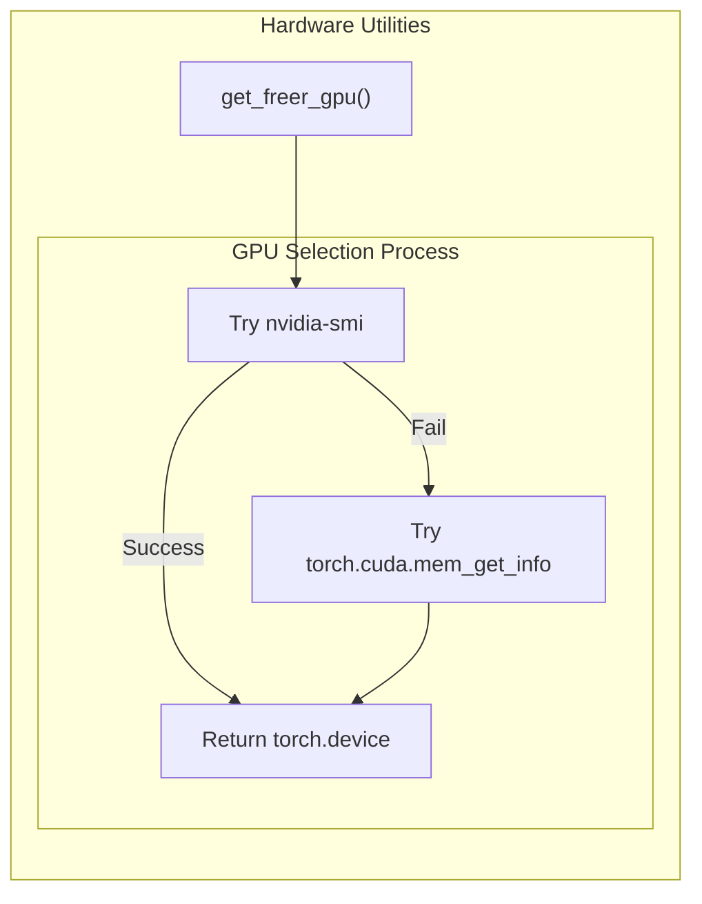
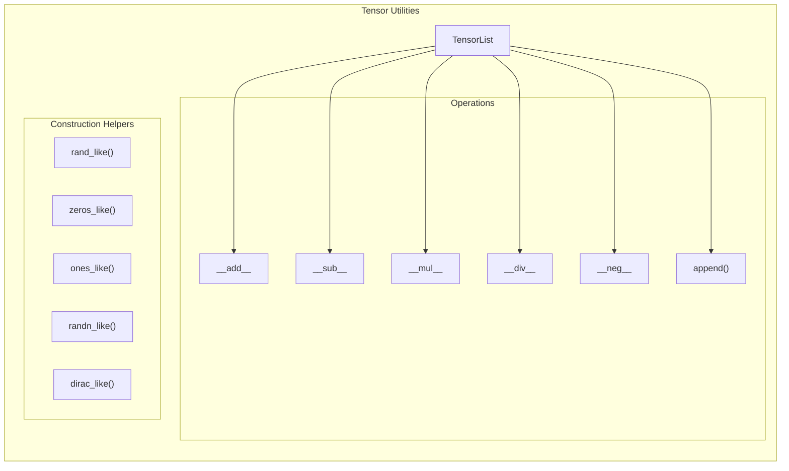

<!-- source: DeepWiki mcp.deepwiki.com · repo deepinv/deepinv · page 5 Utilities · fetched 2026-10-21 -->

# Utilities

<details>
<summary>Relevant source files</summary>

The following files were used as context for generating this wiki page:

- [deepinv/models/unet.py](deepinv/models/unet.py)
- [deepinv/tests/test_transform.py](deepinv/tests/test_transform.py)
- [deepinv/tests/test_utils.py](deepinv/tests/test_utils.py)
- [deepinv/transform/__init__.py](deepinv/transform/__init__.py)
- [deepinv/transform/diffeomorphism.py](deepinv/transform/diffeomorphism.py)
- [deepinv/transform/projective.py](deepinv/transform/projective.py)
- [deepinv/transform/reflect.py](deepinv/transform/reflect.py)
- [deepinv/transform/rotate.py](deepinv/transform/rotate.py)
- [deepinv/transform/scale.py](deepinv/transform/scale.py)
- [deepinv/transform/shift.py](deepinv/transform/shift.py)
- [deepinv/utils/__init__.py](deepinv/utils/__init__.py)
- [deepinv/utils/nn.py](deepinv/utils/nn.py)
- [deepinv/utils/plotting.py](deepinv/utils/plotting.py)
- [examples/unfolded/demo_vanilla_unfolded.py](examples/unfolded/demo_vanilla_unfolded.py)

</details>


The Utilities module in DeepInv provides a collection of helper functions and classes that support the framework's core functionality. These utilities include visualization tools, geometric transformations, tensor operations, and hardware management functions. This page documents the various utility components and how they can be used within the DeepInv framework.

For information about datasets and data loading utilities, see [Dataset Management](#4.2).

## Overview of Utilities

DeepInv's utility modules provide essential functionality that's used throughout the framework. The primary utility categories include:



Sources: [deepinv/utils/__init__.py]()

## Visualization Utilities

DeepInv provides comprehensive visualization tools for displaying and analyzing results from image-based inverse problems. These utilities support various image types including 2D images, image sequences, and 3D volumes.



Sources: [deepinv/utils/plotting.py:1-200](), [deepinv/utils/plotting.py:201-400](), [deepinv/utils/plotting.py:401-600]()

### Image Plotting

The core visualization function is `plot()`, which handles rendering of image tensors with various display options:

```python
dinv.utils.plot(
    images,                  # List of images or single image
    titles=["Image 1"],      # Optional titles
    cmap="gray",             # Colormap
    save_fn="output.png",    # Save path
    show=True                # Display immediately
)
```

Key features:
- Support for batched images (displayed as rows)
- Automatic handling of complex-valued images (displaying magnitude)
- Flexible rescaling modes (clip or min-max normalization)
- Support for publication-quality matplotlib settings

For more specialized visualization:
- `plot_inset()`: Displays zoomed-in regions of images
- `plot_curves()`: Visualizes optimizer metrics during PnP iterations
- `scatter_plot()`: Creates scatter plots from point data
- `plot_ortho3D()`: Visualizes orthogonal slices of 3D image volumes

Sources: [deepinv/utils/plotting.py:182-340](), [deepinv/utils/tests/test_utils.py:76-84]()

### Video Plotting

The video plotting utilities enable visualization of image sequences:

```python
dinv.utils.plot_videos(
    [video_tensor],      # Tensor with time dimension
    time_dim=2,          # Specify time dimension (default is 2)
    display=True,        # Interactive display in notebook
    save_fn="video.gif"  # Save animation
)
```

Key features:
- Support for multiple video tensors plotted side by side
- Interactive HTML playback in Jupyter notebooks
- Animation export to GIF or other formats
- Frame-by-frame saving with `save_videos()`

Sources: [deepinv/utils/plotting.py:716-896](), [deepinv/utils/tests/test_utils.py:104-116]()

## Transformation Utilities

DeepInv provides a comprehensive framework for geometric image transformations, which are particularly useful for data augmentation and implementing equivariant models. The transformation system builds on a common base class that enables transformation stacking, composition, and symmetrization.



Sources: [deepinv/transform/__init__.py](), [deepinv/transform/rotate.py](), [deepinv/transform/shift.py](), [deepinv/transform/scale.py](), [deepinv/transform/reflect.py](), [deepinv/transform/projective.py](), [deepinv/transform/diffeomorphism.py]()

### Basic Transformations

DeepInv provides several basic transformation classes:

1. **Rotate**: 2D rotations with control over angle range and interpolation
   ```python
   transform = dinv.transform.Rotate(limits=360.0, multiples=90)
   ```

2. **Shift**: Integer translations with circular padding
   ```python
   transform = dinv.transform.Shift(shift_max=0.2)
   ```

3. **Scale**: Image scaling with control over scaling factors
   ```python
   transform = dinv.transform.Scale(factors=[0.75, 0.5])
   ```

4. **Reflect**: Flipping along specified dimensions
   ```python
   transform = dinv.transform.Reflect(dim=[-2, -1])
   ```

Sources: [deepinv/transform/rotate.py:1-81](), [deepinv/transform/shift.py:1-73](), [deepinv/transform/scale.py:1-129](), [deepinv/transform/reflect.py:1-73]()

### Advanced Transformations

More sophisticated transformations include:

1. **Homography**: Full projective transformations with physical camera parameters
   ```python
   transform = dinv.transform.projective.Homography(
       theta_max=5,          # Pan/tilt angle range
       theta_z_max=20,       # 2D rotation angle range
       zoom_factor_min=0.85  # Minimum zoom factor
   )
   ```

2. **Diffeomorphism**: Continuous piecewise-affine diffeomorphisms using CPAB
   ```python
   transform = dinv.transform.CPABDiffeomorphism(n_tesselation=3)
   ```

Specialized homography subclasses include `Euclidean`, `Similarity`, `Affine`, and `PanTiltRotate`, each corresponding to different subgroups of projective transformations.

Sources: [deepinv/transform/projective.py:19-441](), [deepinv/transform/diffeomorphism.py:1-95]()

### Transformation Operations

The transformation framework supports several operations for combining transformations:

```python
# Composition (apply transforms sequentially)
combined = transform1 * transform2

# Stacking (apply transforms independently and concatenate results)
stacked = transform1 + transform2

# Random selection (apply either transform with equal probability)
choice = transform1 | transform2

# Symmetrization (apply forward and inverse transforms)
result = transform.symmetrize(lambda x: model(x))
```

These operations make it easy to create complex transformation pipelines for data augmentation or equivariant learning.

Sources: [deepinv/tests/test_transform.py:40-69](), [deepinv/tests/test_transform.py:220-236]()

## Hardware Utilities

DeepInv provides utilities for efficient GPU management, particularly useful for training deep learning models.



The main function is `get_freer_gpu()`, which:
1. Attempts to use `nvidia-smi` to query available GPU memory
2. Falls back to PyTorch's `torch.cuda.mem_get_info()` if `nvidia-smi` is unavailable
3. Returns the CUDA device with the most available memory

Example usage:
```python
device = dinv.utils.get_freer_gpu() if torch.cuda.is_available() else "cpu"
model = model.to(device)
```

This is particularly helpful when running jobs on multi-GPU systems or shared computing resources.

Sources: [deepinv/utils/nn.py:1-52](), [examples/unfolded/demo_vanilla_unfolded.py:32-34]()

## TensorList and Tensor Operations

DeepInv includes a `TensorList` class for managing collections of tensors with similar arithmetic operations:



The `TensorList` class enables:
- Element-wise operations between lists of tensors
- Scalar operations applied to all tensors in the list 
- List-level operations like appending

This utility is particularly useful for optimization algorithms that need to maintain and update multiple tensors with similar operations.

Sources: [deepinv/utils/__init__.py:29-36](), [deepinv/tests/test_utils.py:6-73]()

## Common Use Cases

Here are some common use patterns for the utility functions:

### Visualizing Reconstruction Results

```python
# After running reconstruction
dinv.utils.plot(
    [measurement, reconstruction, ground_truth], 
    titles=["Measurement", "Reconstruction", "Ground Truth"]
)
```

### Plotting Optimization Metrics

```python
# After running an iterative algorithm
dinv.utils.plot_curves(
    {"psnr": psnr_values, "residual": residual_values}
)
```

### Data Augmentation with Transformations

```python
# Create a transformation
transform = dinv.transform.Rotate(n_trans=4) + dinv.transform.Shift(n_trans=2)

# Apply to image batch
augmented_batch = transform(image_batch)
```

### Using the Freest GPU

```python
device = dinv.utils.get_freer_gpu() if torch.cuda.is_available() else "cpu"
model = YourModel().to(device)
```

Sources: [examples/unfolded/demo_vanilla_unfolded.py:210-220](), [examples/unfolded/demo_vanilla_unfolded.py:230-233]()

## Summary

The DeepInv Utilities module provides a comprehensive set of helper functions that support the core functionality of the framework. These include:

- **Visualization tools** for inspecting and saving results
- **Transformation classes** for geometric image manipulations
- **Hardware utilities** for efficient GPU utilization
- **Tensor operations** for specialized tensor manipulations

These utilities are designed to integrate seamlessly with the rest of the DeepInv framework, making it easier to develop, test, and deploy inverse problem solutions.

---

