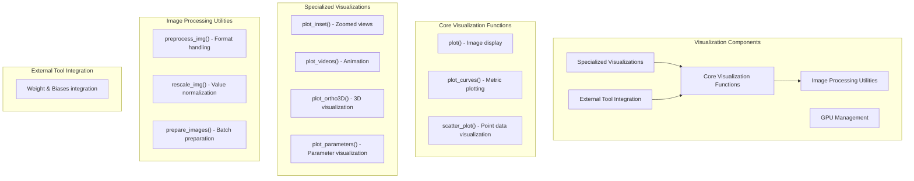
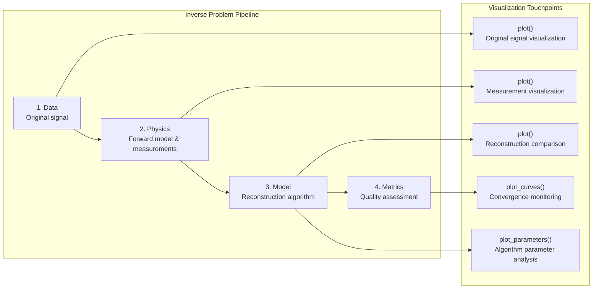

<!-- source: DeepWiki mcp.deepwiki.com · repo deepinv/deepinv · page 5.1 Visualization and Plotting · fetched 2026-10-21 -->

# Visualization and Plotting

<details>
<summary>Relevant source files</summary>

The following files were used as context for generating this wiki page:

- [deepinv/tests/test_utils.py](deepinv/tests/test_utils.py)
- [deepinv/utils/__init__.py](deepinv/utils/__init__.py)
- [deepinv/utils/nn.py](deepinv/utils/nn.py)
- [deepinv/utils/plotting.py](deepinv/utils/plotting.py)
- [examples/unfolded/demo_vanilla_unfolded.py](examples/unfolded/demo_vanilla_unfolded.py)

</details>


The DeepInv framework provides comprehensive visualization and plotting utilities to help users analyze and present results from inverse problem solving. This page documents the visualization capabilities available in the `deepinv.utils` module, focusing on image display, metric plotting, parameter visualization, and GPU management.

For information about data transformations, see [Transformations](#5.2). For dataset management and visualization, see [Dataset Management](#4.2).

## Overview

The visualization system in DeepInv is organized into several functional areas:



Sources: [deepinv/utils/plotting.py:182-340](), [deepinv/utils/plotting.py:436-488](), [deepinv/utils/plotting.py:343-433]()

## Integration with Inverse Problem Workflow

The visualization tools are designed to integrate seamlessly with the inverse problem solving workflow:



Sources: [deepinv/utils/plotting.py:72-118](), [deepinv/utils/plotting.py:436-488](), [deepinv/utils/plotting.py:521-579]()

## Core Visualization Functions

### Image Plotting with `plot()`

The `plot()` function is the primary tool for visualizing images in DeepInv:

```python
from deepinv.utils import plot
import torch

img = torch.rand(1, 3, 256, 256)  # Single RGB image
plot([img, img], titles=["Input", "Output"])
```

Key features:
- Handles various image formats (RGB, grayscale, complex-valued)
- Supports batch visualization
- Automatic rescaling of values
- Customizable display options
- Supports saving as individual images or side-by-side comparisons

Sources: [deepinv/utils/plotting.py:182-340]()

### Metric Plotting with `plot_curves()`

For visualizing algorithm convergence metrics:

```python
from deepinv.utils import plot_curves

metrics = {
    "psnr": [[30.5, 31.2, 32.0, 32.5]],  # PSNR values per iteration
    "residual": [[0.1, 0.05, 0.02, 0.01]]  # Residual values per iteration
}
plot_curves(metrics)
```

Specialized handling for common metrics:
- Residual plots (shown in log scale)
- PSNR (Peak Signal-to-Noise Ratio)
- Cost function values

Sources: [deepinv/utils/plotting.py:436-488]()

### Scatter Plots with `scatter_plot()`

For visualizing point distributions:

```python
from deepinv.utils import scatter_plot
import torch

points = torch.randn(100, 2)  # 100 points in 2D space
scatter_plot([points], titles=["Point Distribution"])
```

Sources: [deepinv/utils/plotting.py:343-433]()

## Image Processing Utilities

DeepInv provides several utility functions for preparing images for visualization:

### Image Preprocessing (`preprocess_img()`)

Handles different image types:
- Complex-valued images (computes magnitude)
- Multi-channel images
- Standard RGB/grayscale images

Sources: [deepinv/utils/plotting.py:121-141]()

### Image Rescaling (`rescale_img()`)

Two rescaling modes:
- `min_max`: Linearly rescales to [0,1] using min and max values
- `clip`: Clips values to [0,1]

Sources: [deepinv/utils/plotting.py:156-179]()

### Batch Preparation (`prepare_images()`)

Prepares multiple images for side-by-side comparison:
- Ground truth
- Measurements
- Reconstructions
- Non-learning baseline

Sources: [deepinv/utils/plotting.py:72-118]()

## Specialized Visualization Tools

### Zoomed-In Views with `plot_inset()`

Creates plots with magnified insets to highlight details:

```python
from deepinv.utils import plot_inset
import torch

img = torch.rand(1, 3, 256, 256)
plot_inset([img], extract_loc=(0.3, 0.3), extract_size=0.2, inset_loc=(0.0, 0.5))
```

Sources: [deepinv/utils/plotting.py:582-714]()

### Video Animation with `plot_videos()`

For visualizing time-varying inverse problems:

```python
from deepinv.utils import plot_videos
import torch

video = torch.rand(1, 3, 10, 256, 256)  # B,C,T,H,W format
plot_videos([video], save_fn="animation.gif")
```

Sources: [deepinv/utils/plotting.py:716-833]()

### 3D Volume Visualization with `plot_ortho3D()`

Displays orthogonal slices of 3D volumes:

```python
from deepinv.utils import plot_ortho3D
import torch

volume = torch.rand(1, 1, 32, 256, 256)  # B,C,D,H,W format
plot_ortho3D(volume)
```

Sources: [deepinv/utils/plotting.py:902-1005]()

### Algorithm Parameter Visualization with `plot_parameters()`

Visualizes learned parameters in unfolded algorithms:

```python
from deepinv.utils import plot_parameters

# Assumes model is a trained unfolded algorithm with params_algo dictionary
plot_parameters(model, init_params=initial_params)
```

Sources: [deepinv/utils/plotting.py:521-579]()

## GPU Management

DeepInv provides a utility for automatically selecting the GPU with the most available memory:

```python
from deepinv.utils import get_freer_gpu
import torch

if torch.cuda.is_available():
    device = get_freer_gpu()
else:
    device = "cpu"
```

This function:
- First attempts to use `nvidia-smi` for memory information
- Falls back to PyTorch's memory reporting if necessary
- Returns the torch.device with the most available memory

Sources: [deepinv/utils/nn.py:8-51]()

## Weight & Biases Integration

For users of the Weight & Biases experiment tracking platform, DeepInv provides specialized functions:

### Image Logging with `wandb_imgs()`

```python
from deepinv.utils.plotting import wandb_imgs
import wandb

# Log a batch of images to W&B dashboard
wandb_imgs([img1, img2], ["Input", "Output"], n_plot=4)
```

Sources: [deepinv/utils/plotting.py:491-500]()

### Metric Logging with `wandb_plot_curves()`

```python
from deepinv.utils.plotting import wandb_plot_curves

# Log optimization metrics to W&B
wandb_plot_curves(metrics, batch_idx=0, step=epoch)
```

Sources: [deepinv/utils/plotting.py:503-518]()

## Common Usage Patterns

### Comparing Original, Measurement, and Reconstruction

```python
import torch
from deepinv.utils import plot

# Ground truth, measurement, and reconstruction
x = torch.rand(1, 3, 256, 256)  # Original image
y = physics(x)                  # Measurement
x_rec = model(y, physics)       # Reconstruction

# Plot side-by-side comparison
plot([x, y, x_rec], titles=["Original", "Measurement", "Reconstruction"])
```

Sources: [deepinv/utils/plotting.py:72-118](), [deepinv/utils/plotting.py:182-340]()

### Monitoring Optimization Progress

```python
from deepinv.utils import plot_curves

# Dictionary of metrics to track
metrics = {
    "psnr": [[values_per_iteration]],  # Quality metric
    "residual": [[values_per_iteration]],  # Convergence metric
    "cost": [[values_per_iteration]]  # Objective function
}

# Plot convergence curves
plot_curves(metrics)
```

Sources: [deepinv/utils/plotting.py:436-488]()

## Configuration Options

The visualization system provides several configuration options:

### Matplotlib Configuration

The `config_matplotlib()` function sets up consistent styling for plots:

```python
from deepinv.utils.plotting import config_matplotlib

config_matplotlib(fontsize=17)  # Set default font size
```

Sources: [deepinv/utils/plotting.py:27-32]()

### Plot Customization

Most visualization functions accept parameters for customization:
- `figsize`: Control figure dimensions
- `cmap`: Specify colormap for display
- `rescale_mode`: Control value scaling ('min_max' or 'clip')
- `save_fn` / `save_dir`: Save plots to disk
- `dpi`: Set resolution for saved images

Sources: [deepinv/utils/plotting.py:182-340]()

## Conclusion

The visualization and plotting utilities in DeepInv provide a comprehensive toolset for analyzing and presenting results from inverse problem solving. From basic image display to specialized visualizations for time-varying data, 3D volumes, and algorithm parameters, these utilities support the entire workflow from data preparation to evaluation.

---

