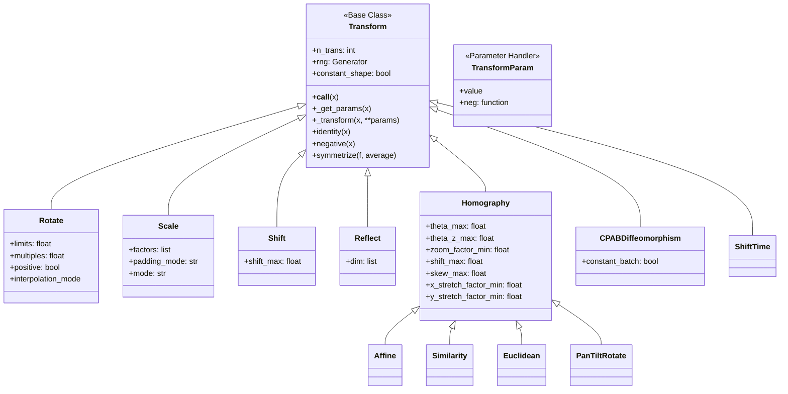
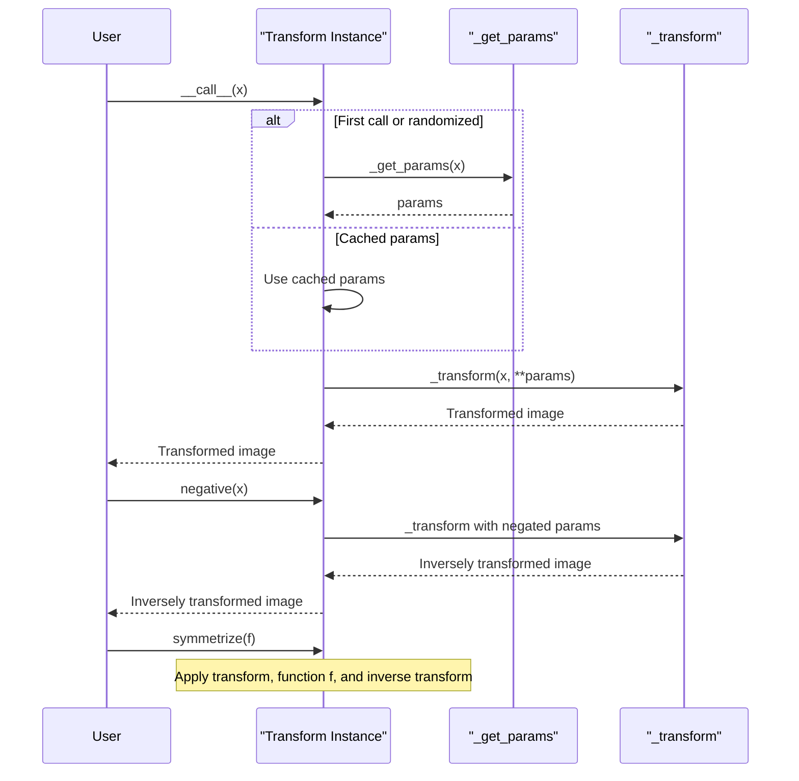
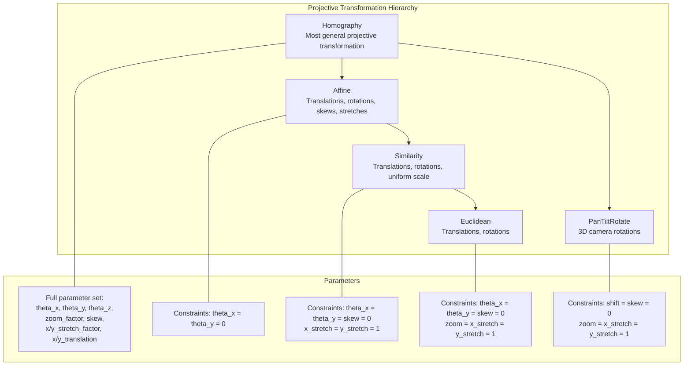

<!-- source: DeepWiki mcp.deepwiki.com · repo deepinv/deepinv · page 5.2 Transformations · fetched 2026-10-21 -->

# Transformations

<details>
<summary>Relevant source files</summary>

The following files were used as context for generating this wiki page:

- [deepinv/models/unet.py](deepinv/models/unet.py)
- [deepinv/tests/test_transform.py](deepinv/tests/test_transform.py)
- [deepinv/transform/__init__.py](deepinv/transform/__init__.py)
- [deepinv/transform/diffeomorphism.py](deepinv/transform/diffeomorphism.py)
- [deepinv/transform/projective.py](deepinv/transform/projective.py)
- [deepinv/transform/reflect.py](deepinv/transform/reflect.py)
- [deepinv/transform/rotate.py](deepinv/transform/rotate.py)
- [deepinv/transform/scale.py](deepinv/transform/scale.py)
- [deepinv/transform/shift.py](deepinv/transform/shift.py)

</details>


This page documents the transformation utilities in DeepInv, which provide a flexible framework for applying various geometric operations to images. These transformations are primarily used for data augmentation and equivariant learning in the context of inverse problems.

The transformation system serves as a foundation for implementing data consistency mechanisms and handling different types of geometric variations in imaging data. Unlike the physics operators which model the forward measurement process, transformations focus on geometric manipulations that preserve the underlying signal structure.

## Transform Architecture

The transformation system in DeepInv is built around a modular architecture with a base `Transform` class that all specific transformations extend. The system supports complex transformation compositions and includes methods for performing forward and inverse operations.



Sources: [deepinv/transform/__init__.py:1-9](), [deepinv/transform/rotate.py:7-81](), [deepinv/transform/scale.py:31-129](), [deepinv/transform/shift.py:7-72](), [deepinv/transform/reflect.py:10-72](), [deepinv/transform/projective.py:158-440](), [deepinv/transform/diffeomorphism.py:6-94]()

## Common Design Pattern

All transformations in DeepInv follow a consistent design pattern:

1. **Parameter Generation**: Each transform implements a `_get_params` method that randomly generates transformation parameters
2. **Transformation Application**: A `_transform` method applies the transformation using the generated parameters
3. **Identity and Inverse Operations**: The base class provides methods to apply identity transformations and inverse operations

This design enables both deterministic application of transformations with specific parameters and random generation of transformations for data augmentation.



Sources: [deepinv/transform/rotate.py:44-57](), [deepinv/transform/rotate.py:59-81](), [deepinv/transform/scale.py:62-86](), [deepinv/transform/scale.py:88-129]()

## Spatial Transformations

### Rotate

The `Rotate` class implements 2D rotations with configurable parameters:

- Rotation angles can be randomly sampled from a specified range
- Supports exact pixel rotations (0°, 90°, 180°, 270°) by setting `multiples=90`
- Controls output shape consistency with `constant_shape` parameter

```python
# Example: Create a rotation transform with 90° multiples
rotate_transform = dinv.transform.Rotate(limits=180, multiples=90, n_trans=4)
```

Sources: [deepinv/transform/rotate.py:8-81]()

### Scale

The `Scale` class implements 2D scaling with:

- Configurable scale factors (e.g., [0.75, 0.5])
- Control over interpolation mode (bicubic by default)
- Padding mode options for handling boundaries

```python
# Example: Create a scaling transform with factors 0.75 and 0.5
scale_transform = dinv.transform.Scale(factors=[0.75, 0.5], n_trans=2)
```

Sources: [deepinv/transform/scale.py:31-129]()

### Shift

The `Shift` class provides fast integer 2D translations with circular padding:

- Maximum shift can be specified as a fraction of the total image dimensions
- Uses efficient `torch.roll` operation for integer shifts

```python
# Example: Create a shift transform with maximum shift of 50% of image size
shift_transform = dinv.transform.Shift(shift_max=0.5, n_trans=4)
```

Sources: [deepinv/transform/shift.py:7-72]()

### Reflect

The `Reflect` class implements reflections along specified axes:

- Can reflect along multiple axes
- Supports generating all possible reflections by setting appropriate `n_trans`

```python
# Example: Create a reflection transform for all possible 2D reflections
reflect_transform = dinv.transform.Reflect(dim=[-2, -1], n_trans=4)
```

Sources: [deepinv/transform/reflect.py:10-72]()

## Projective Transformations

DeepInv provides a comprehensive set of projective transformations through the `Homography` class and its subclasses. These transformations model a range of camera movements and perspective effects.



Sources: [deepinv/transform/projective.py:158-440]()

### Homography

The `Homography` class provides general projective transformations parametrized by:

- Pan/tilt angles (`theta_x`, `theta_y`)
- 2D rotation angle (`theta_z`)
- Zoom factor
- Translation parameters
- Skew and stretch factors

```python
# Example: Create a general homography transform
homography = dinv.transform.projective.Homography(
    theta_max=10, zoom_factor_min=0.8, shift_max=0.2, n_trans=2
)
```

Sources: [deepinv/transform/projective.py:158-291]()

### Specialized Projective Transforms

DeepInv provides specialized subclasses for common transformation groups:

1. **Affine**: Translations, rotations, reflections, skews, and stretches
2. **Similarity**: Translations, rotations, reflections, and uniform scale
3. **Euclidean**: Translations, rotations, and reflections
4. **PanTiltRotate**: 3D camera rotation transformations

Each specialized class constrains certain parameters of the general homography to match the mathematical properties of the corresponding transformation group.

Sources: [deepinv/transform/projective.py:293-440]()

## Advanced Transformations

### Diffeomorphism

The `CPABDiffeomorphism` class implements continuous piecewise-affine based diffeomorphisms:

- Requires the external `libcpab` library
- Creates smooth, invertible spatial transformations
- Supports GPU acceleration

```python
# Example: Create a diffeomorphism transform (requires libcpab)
diffeomorphism = dinv.transform.CPABDiffeomorphism(n_trans=2, device="cuda")
```

Sources: [deepinv/transform/diffeomorphism.py:6-94]()

## Transform Composition

One of the most powerful features of the transformation system is the ability to compose different transformations using arithmetic operations:

- `*` (multiplication): Compose transformations (apply one after another)
- `+` (addition): Stack transformations (apply each independently and concatenate results)
- `|` (OR): Randomly select between transformations

```python
# Example: Compose rotation followed by scaling
transform = dinv.transform.Rotate(n_trans=2) * dinv.transform.Scale(n_trans=1)

# Example: Stack rotation and scaling alternatives
transform = dinv.transform.Rotate(n_trans=2) + dinv.transform.Scale(n_trans=2)

# Example: Randomly choose between rotation and scaling
transform = dinv.transform.Rotate(n_trans=2) | dinv.transform.Scale(n_trans=2)
```

Sources: [deepinv/tests/test_transform.py:41-69]()

## Integration with DeepInv Models

The transformation system is designed to integrate seamlessly with DeepInv's models and training pipelines. They are particularly useful for:

1. **Data Augmentation**: Expanding training datasets with geometrically transformed versions
2. **Equivariant Learning**: Training models that respect geometric transformations
3. **Test-Time Augmentation**: Improving reconstruction quality by averaging predictions over transformed inputs

These transformations can be applied to both the ground truth signals and measurements, depending on the specific learning task.

Sources: [deepinv/models/unet.py:56-359]()

## Performance Considerations

- Most transformations support both CPU and GPU execution
- Transformations can handle batched inputs efficiently
- Some specialized transformations (like exact 90° rotations) use optimized implementations

For optimal performance when applying multiple transformations, it's generally better to compose them using the arithmetic operators rather than applying them sequentially in a loop.

Sources: [deepinv/transform/rotate.py:71-81](), [deepinv/transform/scale.py:127-129](), [deepinv/transform/shift.py:66-72]()

---

