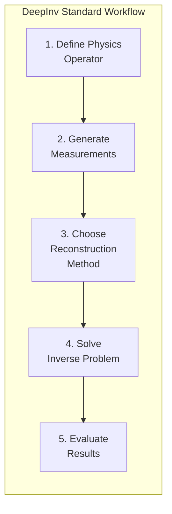
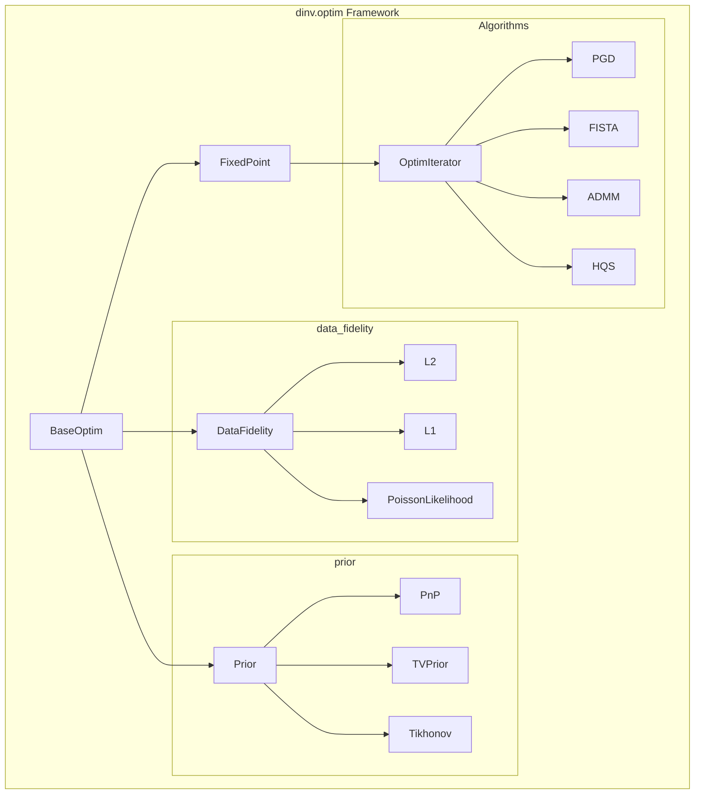
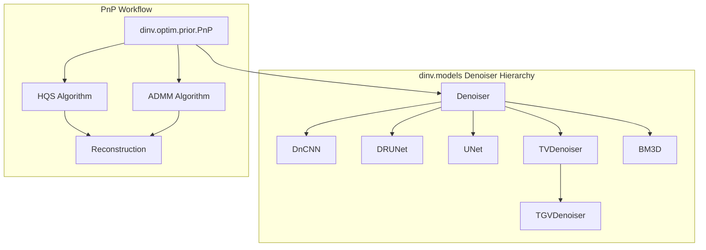
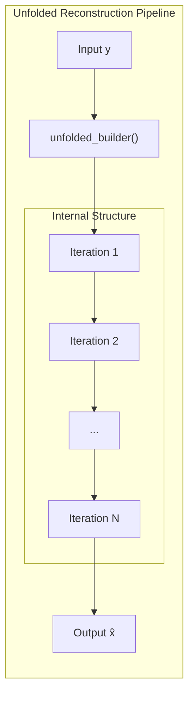
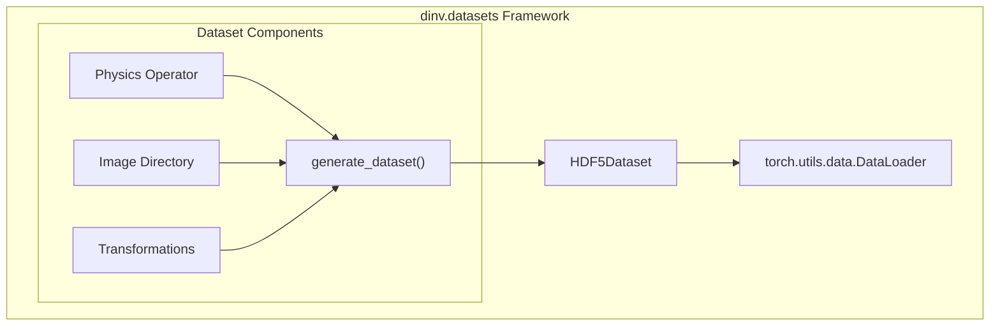
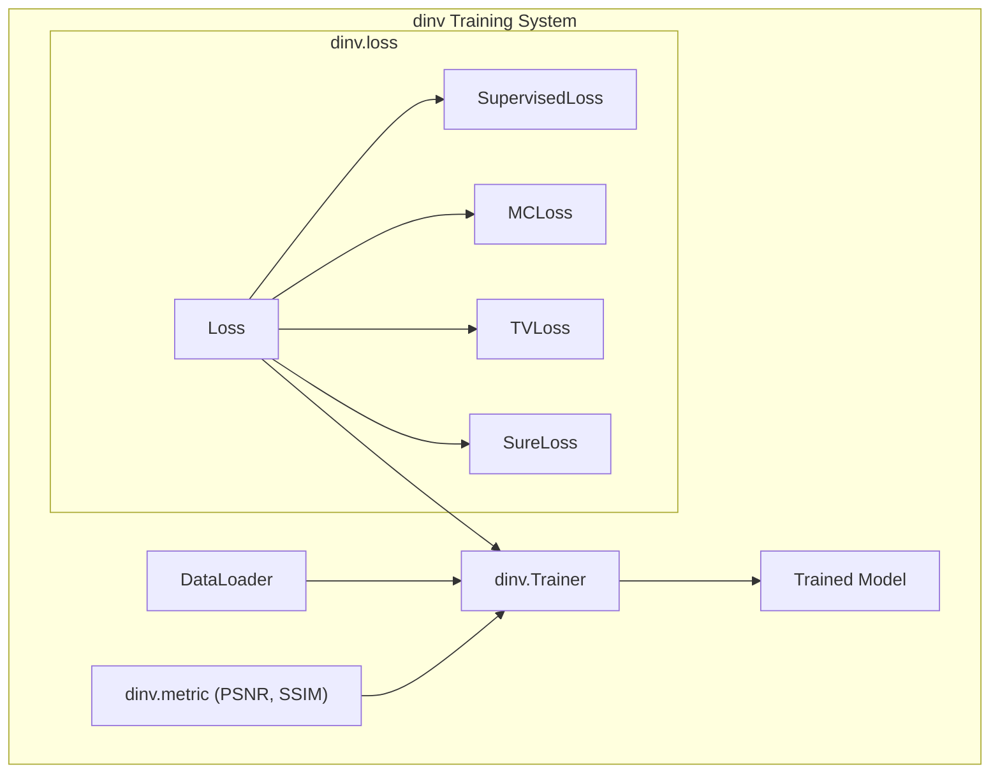
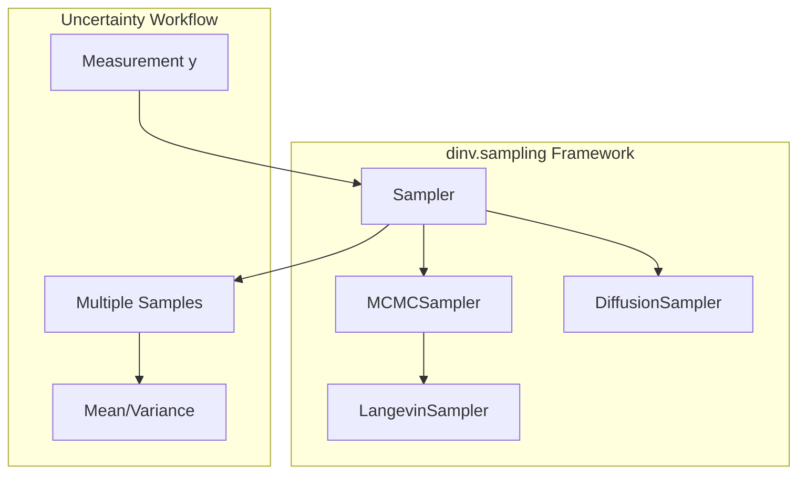
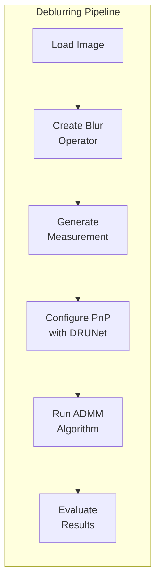

<!-- source: DeepWiki mcp.deepwiki.com · repo deepinv/deepinv · page 6 Examples and Usage Guide · fetched 2026-10-21 -->

# Examples and Usage Guide

<details>
<summary>Relevant source files</summary>

The following files were used as context for generating this wiki page:

- [README.rst](README.rst)
- [deepinv/models/tgv.py](deepinv/models/tgv.py)
- [deepinv/utils/metric.py](deepinv/utils/metric.py)

</details>


## Purpose and Scope

This guide provides practical examples and usage patterns for working with the DeepInv library. It illustrates how to implement and solve various imaging inverse problems using DeepInv's components, from basic setup to advanced techniques. The examples cover both optimization-based approaches and deep learning methods for inverse problems such as denoising, inpainting, deblurring, MRI reconstruction, and more.

For detailed information about the theoretical foundations and core architecture of DeepInv, see [Core Architecture](#2).

## DeepInv Workflow Overview

The typical workflow for solving an inverse problem with DeepInv consists of these key steps:



This workflow applies to most inverse problems in imaging and allows for flexible implementation of various reconstruction approaches.

Sources: [README.rst:12-23]()

## Quick Start Example

Here's a simple example demonstrating the complete workflow for an image inpainting task using DeepInv:

```python
import deepinv as dinv
from deepinv.utils import load_url_image

# 1. Define physics operator (inpainting with 50% random mask and noise)
physics = dinv.physics.Inpainting((1, 512, 512), mask=0.5, 
                                noise_model=dinv.physics.GaussianNoise(sigma=0.01))

# 2. Load image and generate measurement
x = load_url_image(url="https://huggingface.co/datasets/deepinv/images/resolve/main/cameraman.png?download=true", 
                  img_size=512, grayscale=True, device='cpu')
y = physics(x)  # Forward model to create measurement

# 3-4. Choose reconstruction method and solve inverse problem
data_fidelity = dinv.optim.data_fidelity.L2()
prior = dinv.optim.prior.PnP(denoiser=dinv.models.MedianFilter())
model = dinv.optim.optim_builder(iteration="HQS", prior=prior, data_fidelity=data_fidelity,
                               params_algo={"stepsize": 1.0, "g_param": 0.1})
x_hat = model(y, physics)  # Solve the inverse problem

# 5. Evaluate and visualize results
dinv.utils.plot([x, y, x_hat], ["signal", "measurement", "estimate"], rescale_mode='clip')
```

Sources: [README.rst:70-89]()

## Working with Physics Operators

Physics operators represent the forward model that transforms the unknown signal into measurements. DeepInv provides multiple pre-implemented operators for various imaging problems.

```mermaid
classDiagram
    class "Physics" {
        +forward(x)
        +adjoint(y)
        +Hty(y)
        +HTH(x)
        +get_y(x)
    }
    class "LinearPhysics" {
        +adjoint(y)
        +Hty(y)
        +HTH(x)
    }
    class "NoiseModel" {
        +forward(x)
        +Hty(y, physics)
    }
    
    Physics <|-- LinearPhysics
    Physics <|-- PhaseRetrieval
    LinearPhysics <|-- Blur
    LinearPhysics <|-- Inpainting
    LinearPhysics <|-- MRI
    LinearPhysics <|-- Downsampling
    LinearPhysics <|-- Tomography
    
    Physics --> NoiseModel
    NoiseModel <|-- GaussianNoise
    NoiseModel <|-- PoissonNoise
```

Sources: [README.rst:17]()

### Examples of Physics Operators

```python
# Inpainting with random mask
inpainting = dinv.physics.Inpainting(
    img_size=(1, 512, 512),  # (channels, height, width)
    mask=0.5,  # 50% of pixels randomly missing
    noise_model=dinv.physics.GaussianNoise(sigma=0.01)
)

# MRI with undersampling
mri = dinv.physics.MRI(
    img_size=(1, 320, 320),
    mask='random',  # Random k-space undersampling
    acceleration_factor=4  # 4x acceleration
)

# Blurring with Gaussian kernel
blur = dinv.physics.Blur(
    img_size=(3, 256, 256),  # RGB image
    kernel_size=15,
    kernel_type='gaussian',
    sigma=1.5,  # Blur intensity
    noise_model=dinv.physics.GaussianNoise(sigma=0.01)
)
```

## Reconstruction Methods

DeepInv offers multiple approaches for solving inverse problems, from classic optimization-based methods to deep learning and hybrid approaches.

### Optimization-based Reconstruction

The optimization framework in DeepInv provides a modular way to construct iterative algorithms by combining data fidelity terms and priors.



Sources: [README.rst:19]()

### Example: TV Prior for Deblurring

```python
# Define data fidelity term based on the noise model
data_fidelity = dinv.optim.data_fidelity.L2()  # For Gaussian noise

# Define Total Variation prior
prior = dinv.optim.prior.TVPrior(weight=0.1)  

# Create optimization algorithm
model = dinv.optim.optim_builder(
    iteration="PGD",  # Proximal Gradient Descent
    prior=prior,
    data_fidelity=data_fidelity,
    params_algo={"stepsize": 0.5, "max_iter": 100}
)

# Apply to solve inverse problem
x_hat = model(y, physics)
```

### Plug-and-Play Priors

Plug-and-Play (PnP) priors use pretrained denoisers as image priors within optimization algorithms. DeepInv offers multiple denoisers for this purpose.



Sources: [README.rst:19](), [deepinv/models/tgv.py:1-231]()

### Example: PnP with DRUNet Denoiser

```python
# Load a pretrained denoiser
denoiser = dinv.models.DRUNet(pretrained=True)

# Create PnP prior
prior = dinv.optim.prior.PnP(denoiser=denoiser)

# Use with Half-Quadratic Splitting algorithm
model = dinv.optim.optim_builder(
    iteration="HQS",
    prior=prior,
    data_fidelity=dinv.optim.data_fidelity.L2(),
    params_algo={"stepsize": 1.0, "g_param": 0.1, "max_iter": 20}
)

# Solve inverse problem
x_hat = model(y, physics)
```

### Example: Advanced Denoiser - TGV

The Total Generalized Variation (TGV) denoiser is a powerful tool for edge-preserving regularization that can be used as a PnP prior:

```python
# Create TGV denoiser
tgv_denoiser = dinv.models.TGVDenoiser(
    verbose=False, 
    n_it_max=100, 
    crit=1e-5
)

# Create PnP prior with TGV
prior = dinv.optim.prior.PnP(denoiser=tgv_denoiser)

# Use with ADMM algorithm
model = dinv.optim.optim_builder(
    iteration="ADMM",
    prior=prior,
    data_fidelity=dinv.optim.data_fidelity.L2(),
    params_algo={"stepsize": 1.0, "max_iter": 20}
)

# Solve inverse problem
x_hat = model(y, physics)
```

Sources: [deepinv/models/tgv.py:6-182]()

## Unfolded Networks

Unfolded networks are architectures that mimic iterative optimization algorithms but with learnable parameters. DeepInv provides tools to easily build and use unfolded networks.



Sources: [README.rst:21]()

### Example: Building an Unfolded Network

```python
# Create an unfolded network with 10 iterations of PGD
unfolded_model = dinv.models.unfolded_builder(
    iteration="PGD",  # Base algorithm
    data_fidelity=dinv.optim.data_fidelity.L2(),
    prior=dinv.optim.prior.PnP(denoiser=dinv.models.DnCNN(pretrained=True)),
    num_iter=10,  # Number of unfolded iterations
    params_algo={"stepsize": 0.5}
)

# Use the unfolded network for reconstruction
x_hat = unfolded_model(y, physics)
```

## Creating and Using Datasets

DeepInv provides tools for creating and managing datasets specifically for inverse problems.



Sources: [README.rst:20]()

### Example: Creating a Dataset for Training

```python
# Generate a dataset for training
dataset = dinv.datasets.generate_dataset(
    root="path/to/images",  # Directory with clean images
    physics=dinv.physics.Inpainting(img_size=(1, 256, 256), mask=0.5),
    patch_size=96,  # Extract patches of this size
    stride=48,      # Patch extraction stride
    batch_size=4,   # For efficient processing
    num_workers=4,  # Parallel processing
    download=True   # Download sample images if needed
)

# Use the dataset with a DataLoader
from torch.utils.data import DataLoader
data_loader = DataLoader(dataset, batch_size=4, shuffle=True)
```

## Training Models for Inverse Problems

DeepInv provides a training framework with various loss functions for supervised and self-supervised learning.



Sources: [README.rst:18](), [deepinv/utils/metric.py:1-41]()

### Example: Training with Supervised Loss

```python
# Define a model (e.g., UNet for inpainting)
model = dinv.models.UNet(in_channels=1, out_channels=1)

# Configure the trainer
trainer = dinv.Trainer(
    model=model,
    loss_fn=dinv.loss.SupervisedLoss(),  # MSE loss by default
    data_loader=data_loader,
    optimizer=torch.optim.Adam(model.parameters(), lr=1e-4),
    device="cuda" if torch.cuda.is_available() else "cpu",
    metrics=[dinv.metric.PSNR(), dinv.metric.SSIM()]  # Evaluation metrics
)

# Train the model
trainer.train(num_epochs=50)
```

### Example: Self-supervised Training

```python
# Define a self-supervised loss (Measurement Consistency)
loss_fn = dinv.loss.MCLoss()

# Configure the trainer (no ground truth needed)
trainer = dinv.Trainer(
    model=model,
    loss_fn=loss_fn,
    data_loader=data_loader,  # Contains only measurements
    optimizer=torch.optim.Adam(model.parameters(), lr=1e-4),
    device="cuda" if torch.cuda.is_available() else "cpu"
)

# Train the model
trainer.train(num_epochs=50)
```

## Sampling for Uncertainty Quantification

DeepInv provides sampling algorithms for uncertainty quantification in inverse problems.



Sources: [README.rst:22]()

### Example: MCMC Sampling

```python
# Define a denoiser for the prior
denoiser = dinv.models.DRUNet(pretrained=True)

# Create a Langevin sampler
sampler = dinv.sampling.LangevinSampler(
    denoiser=denoiser,
    noise_level=0.1,
    num_steps=1000,
    step_size=0.01
)

# Generate samples
samples = sampler.sample(y, physics, num_samples=10)

# Compute statistics
mean = torch.mean(samples, dim=0)
std = torch.std(samples, dim=0)

# Visualize uncertainty
dinv.utils.plot([mean, std], ["reconstruction", "uncertainty"])
```

## Complete Examples for Common Problems

### Deblurring Pipeline



```python
import deepinv as dinv
import torch
from deepinv.utils import load_url_image

# Load image
url = "https://huggingface.co/datasets/deepinv/images/resolve/main/peppers.png?download=true"
x = load_url_image(url=url, img_size=256, device='cpu')

# Create blur operator with Gaussian noise
physics = dinv.physics.Blur(
    img_size=x.shape,
    kernel_size=15,
    kernel_type='gaussian',
    sigma=1.5,
    noise_model=dinv.physics.GaussianNoise(sigma=0.01)
)

# Generate measurement
y = physics(x)

# Define reconstruction model with PnP prior
data_fidelity = dinv.optim.data_fidelity.L2()
denoiser = dinv.models.DRUNet(pretrained=True)
prior = dinv.optim.prior.PnP(denoiser=denoiser)
model = dinv.optim.optim_builder(
    iteration="ADMM",
    prior=prior,
    data_fidelity=data_fidelity,
    params_algo={"stepsize": 1.0, "max_iter": 20}
)

# Solve inverse problem
x_hat = model(y, physics)

# Evaluate metrics
psnr = dinv.metric.PSNR()(x, x_hat)
ssim = dinv.metric.SSIM()(x, x_hat)
print(f"PSNR: {psnr.item():.2f} dB, SSIM: {ssim.item():.4f}")

# Visualize results
dinv.utils.plot([x, y, x_hat], ["original", "blurred", "deblurred"], rescale_mode='clip')
```

### MRI Reconstruction Example

```python
# Create an MRI physics operator
physics = dinv.physics.MRI(
    img_size=(1, 320, 320),
    mask='random',
    acceleration_factor=4  # 4x acceleration
)

# Load a test image
x = load_url_image("https://huggingface.co/datasets/deepinv/images/resolve/main/brain.png?download=true", 
                  img_size=320, grayscale=True, device='cpu')

# Generate k-space measurement
y = physics(x)

# Use a pretrained model for reconstruction
model = dinv.models.MoDL(pretrained=True)
x_hat = model(y, physics)

# Evaluate and visualize
psnr = dinv.metric.PSNR()(x, x_hat)
dinv.utils.plot([x, physics.A_adjoint(y), x_hat], 
               ["ground truth", "zero-filled", "reconstruction"])
```

## Summary of Inverse Problems and DeepInv Components

This table summarizes common inverse problems and the recommended DeepInv components for solving them:

| Problem | Physics Operator | Recommended Methods | Key Parameters |
|---------|------------------|---------------------|----------------|
| Denoising | `GaussianNoise` | DnCNN, DRUNet, BM3D, TGVDenoiser | `sigma`: noise level |
| Inpainting | `Inpainting` | PnP methods, UNet | `mask`: missing pixel pattern |
| Deblurring | `Blur` | PnP + ADMM/HQS, TV regularization | `kernel_type`, `kernel_size` |
| MRI | `MRI` | VarNet, MoDL, unfolded networks | `mask`, `acceleration_factor` |
| CT | `Tomography` | PnP, unfolded networks | `angles`, `detector_width` |
| Super-resolution | `Downsampling` | PnP, deep learning models | `scale_factor` |
| Phase retrieval | `PhaseRetrieval` | HIO algorithm, deep learning | `mask` |

Sources: [README.rst:17-22]()

## Best Practices and Tips

1. **Physics operator selection**: Choose the physics operator that best models your imaging system, including proper noise models.

2. **Prior selection**: 
   - For sharp edges: TVPrior or TGVDenoiser 
   - For natural images: Pretrained DRUNet or DnCNN via PnP
   - For specialized domains: Train custom denoisers

3. **Algorithm selection**:
   - ADMM: Good for non-smooth priors
   - HQS: Often effective with PnP priors
   - FISTA: Faster convergence for L1-type problems

4. **Hyperparameter tuning**:
   - `stepsize`: Controls optimization stability (smaller for stability, larger for speed)
   - `g_param`: In HQS, controls the denoiser strength
   - `max_iter`: Number of iterations (20-100 typically sufficient)

5. **Memory considerations**: For large images, consider processing in patches or using models with lower memory requirements.

Sources: [README.rst:70-89]()

## Conclusion

DeepInv provides a comprehensive framework for solving inverse problems in imaging using a combination of classical optimization methods and deep learning approaches. The examples in this guide demonstrate how to use different components of the library for various applications.

For more detailed information on specific components, refer to:
- [Physics Operators Framework](#2.1) for details on forward models
- [Optimization Framework](#2.3) for information about optimization algorithms
- [Model Zoo](#3) for available deep learning models
- [Training System](#2.5) for model training
- [Loss Functions](#4.1) for supervised and self-supervised learning
- [Dataset Management](#4.2) for data preparation

---

