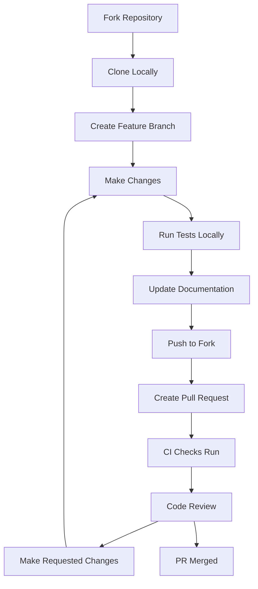
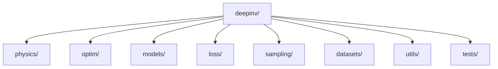
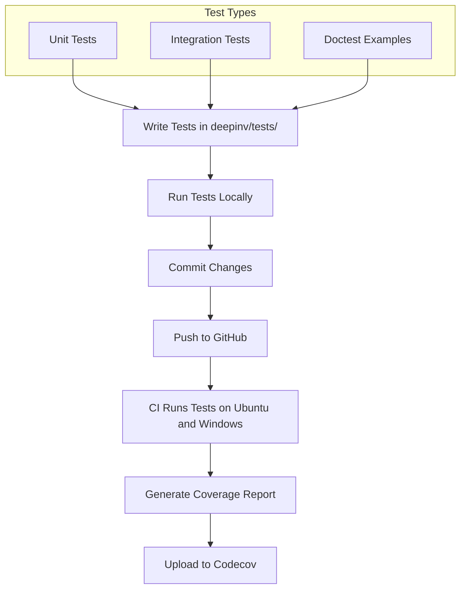
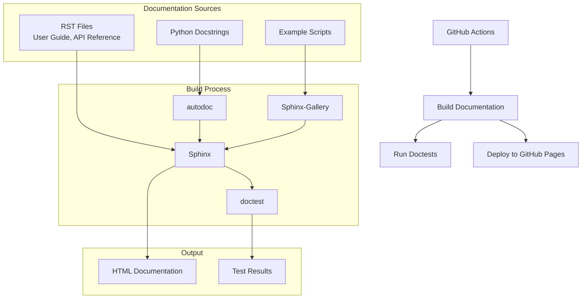
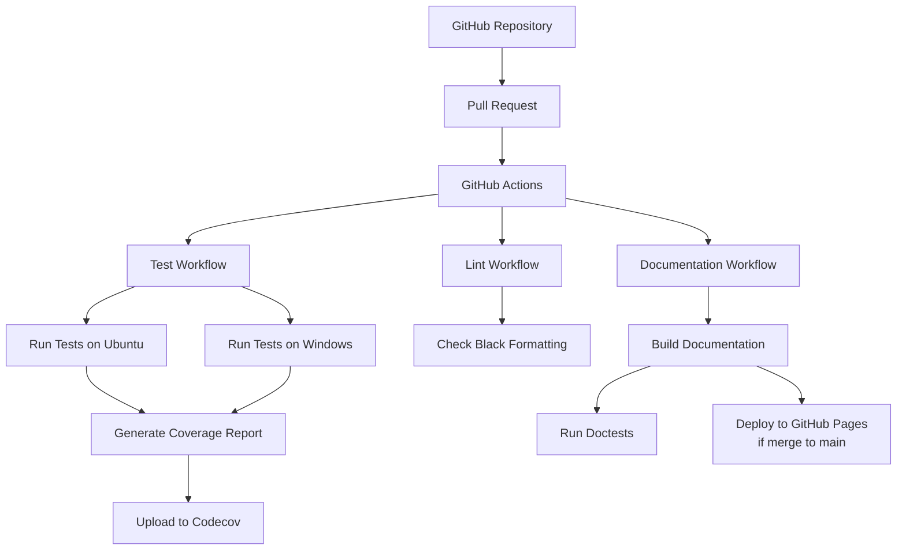
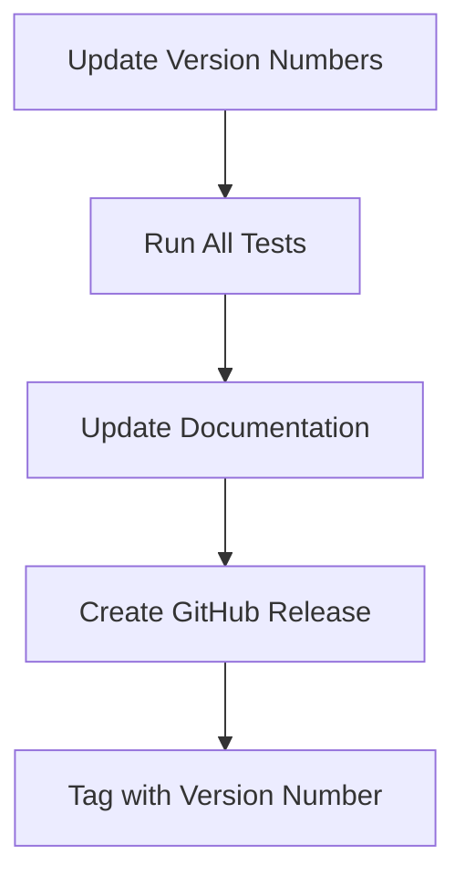

<!-- source: DeepWiki mcp.deepwiki.com · repo deepinv/deepinv · page 7 Development and Documentation · fetched 2026-10-21 -->

# Development and Documentation

<details>
<summary>Relevant source files</summary>

The following files were used as context for generating this wiki page:

- [.github/workflows/documentation.yml](.github/workflows/documentation.yml)
- [.github/workflows/lint.yml](.github/workflows/lint.yml)
- [.github/workflows/test.yml](.github/workflows/test.yml)
- [CITATION.cff](CITATION.cff)
- [deepinv/__about__.py](deepinv/__about__.py)
- [docs/source/conf.py](docs/source/conf.py)
- [docs/source/index.rst](docs/source/index.rst)
- [docs/source/user_guide/reconstruction/denoisers.rst](docs/source/user_guide/reconstruction/denoisers.rst)
- [pyproject.toml](pyproject.toml)

</details>


This page provides guidelines for developers who want to contribute to the DeepInv library. It covers development setup, coding standards, testing procedures, documentation practices, and contribution workflows. For information about using the library, see the [Overview](#1) page.

## Development Environment Setup

### Requirements

DeepInv requires Python 3.9+ and PyTorch. The core dependencies are specified in [pyproject.toml:23-35](), with several optional dependency groups:

- `test`: Testing libraries (pytest, pytest-cov, coverage)
- `doc`: Documentation tools (Sphinx and related extensions)
- `denoisers`: Libraries for specific denoiser implementations
- `dataset`: Libraries for handling dataset operations

### Installation for Development

To install DeepInv for development:

```bash
# Clone the repository
git clone https://github.com/deepinv/deepinv.git
cd deepinv

# Install in development mode with all dependencies
pip install -e .[dataset,denoisers,doc,test]
```

## Development Workflow

DeepInv follows a standard GitHub workflow for contributions:

Development Workflow


Sources: [.github/workflows/test.yml](), [.github/workflows/documentation.yml](), [.github/workflows/lint.yml]()

### Code Structure

DeepInv Code Organization


Each module corresponds to a major component in the library's architecture:
- `physics/`: Forward operators for imaging problems
- `optim/`: Optimization algorithms and components
- `models/`: Neural network models and denoisers
- `loss/`: Loss functions for training
- `sampling/`: Sampling methods for uncertainty quantification
- `tests/`: Unit and integration tests

Sources: Project directory structure

## Coding Standards

DeepInv follows the Black code style. This ensures consistency across the codebase and simplifies code reviews.

To format your code locally before committing:

```bash
# Install Black if you haven't already
pip install black

# Format the codebase
black .
```

The GitHub Actions workflow [.github/workflows/lint.yml]() automatically checks if the code conforms to the Black style on each pull request.

Sources: [.github/workflows/lint.yml]()

## Testing Framework

DeepInv uses pytest for testing. Tests are located in the `deepinv/tests` directory.

Testing System


Sources: [.github/workflows/test.yml](), [pyproject.toml:96-107]()

### Running Tests

To run the tests:

```bash
# Run all tests
pytest

# Run tests with coverage report
pytest --cov=deepinv

# Run a specific test file
pytest deepinv/tests/test_physics.py
```

The CI pipeline runs tests on both Ubuntu and Windows platforms to ensure cross-platform compatibility.

### Writing Tests

When adding new features, include appropriate tests that are:
- Comprehensive but focused on functional correctness
- Fast to execute
- Independent of each other

For DeepInv-specific components:
- **Physics operators**: Test forward and adjoint operations
- **Models**: Test initialization and forward pass
- **Optimization algorithms**: Test convergence on simple problems
- **Loss functions**: Test gradient computation and loss values

### Coverage Reporting

The project uses code coverage tools to ensure adequate test coverage. Coverage reports are automatically generated and uploaded to Codecov in the CI pipeline.

Sources: [.github/workflows/test.yml:49-57](), [pyproject.toml:102-107]()

## Documentation System

DeepInv uses Sphinx for documentation. The documentation source is in the `docs/source` directory.

Documentation System Architecture


Sources: [docs/source/conf.py](), [.github/workflows/documentation.yml]()

### Documentation Structure

The documentation is organized into the following sections:
- Quick start: A quick introduction to the library
- Examples: Auto-generated from example scripts using Sphinx-Gallery
- User guide: Detailed explanation of concepts and components
- API reference: Auto-generated from docstrings
- Help and contributing guidelines

Sources: [docs/source/index.rst:29-39]()

### Building Documentation Locally

To build the documentation locally:

```bash
# Install documentation dependencies
pip install -e .[doc]

# Build the documentation
cd docs
sphinx-build -b html source build/html
```

The generated HTML will be in `docs/build/html`.

To run doctests:

```bash
sphinx-build -M doctest docs/source/ docs/build/
```

Sources: [docs/source/conf.py:35-46](), [.github/workflows/documentation.yml:36-43]()

### Writing Documentation

1. **Docstrings**: Use the NumPy docstring format for all modules, classes, and functions.

   ```python
   def function(arg1, arg2=None):
       """
       Summary line.

       Extended description of function.

       Parameters
       ----------
       arg1 : type
           Description of arg1
       arg2 : type, optional
           Description of arg2, by default None

       Returns
       -------
       type
           Description of return value
       """
       return result
   ```

2. **Examples**: Include doctests in docstrings to provide executable examples.

   ```python
   def add(a, b):
       """
       Add two numbers.

       Examples
       --------
       >>> add(1, 2)
       3
       """
       return a + b
   ```

3. **Mathematics**: Use LaTeX for mathematical expressions. Common notation is defined in the Sphinx configuration.

   ```
   The forward model is defined as :math:`y = \forw{x} + \noise{e}`.
   ```

4. **Cross-references**: Use Sphinx's cross-referencing capabilities to link to other parts of the documentation.

   ```
   See :class:`deepinv.physics.Physics` for more details.
   ```

Sources: [docs/source/conf.py:192-218](), [docs/source/user_guide/reconstruction/denoisers.rst:1-20]()

### Example Gallery

DeepInv uses Sphinx-Gallery to generate examples from Python scripts. Example scripts should be placed in the `examples` directory and follow the Sphinx-Gallery format.

Example script structure:
```python
"""
Title of the example
===================

This is a description of the example.
"""

# %%
# This is a section header
# -----------------------
#
# This is a text cell that will be rendered as Markdown.

import deepinv as dinv
import torch

# Code cells will be executed and their output captured
```

Sources: [docs/source/conf.py:157-189]()

## CI/CD Pipelines

The project uses GitHub Actions for continuous integration:

CI/CD Pipeline Architecture


The workflow files are:
- Test workflow: [.github/workflows/test.yml]()
- Lint workflow: [.github/workflows/lint.yml]()
- Documentation workflow: [.github/workflows/documentation.yml]()

Sources: [.github/workflows/test.yml](), [.github/workflows/lint.yml](), [.github/workflows/documentation.yml]()

## Release Process

DeepInv follows semantic versioning (MAJOR.MINOR.PATCH):
- MAJOR: Incompatible API changes
- MINOR: New functionality in a backward compatible manner
- PATCH: Backward compatible bug fixes

The current version is maintained in [deepinv/__about__.py:12]() and [pyproject.toml:22]().

Release Process


When preparing a new release:
1. Update the version number in `deepinv/__about__.py`
2. Update the version number in `pyproject.toml`
3. Create a new release on GitHub
4. Tag the release with the version number

Sources: [deepinv/__about__.py:12](), [pyproject.toml:22](), [CITATION.cff]()

## Citation

If you use DeepInv in your research, please cite it using the information in [CITATION.cff]().

Sources: [CITATION.cff]()