# Page: Overview

# Overview

<details>
<summary>Relevant source files</summary>

The following files were used as context for generating this wiki page:

- [.github/workflows/documentation.yml](.github/workflows/documentation.yml)
- [.github/workflows/lint.yml](.github/workflows/lint.yml)
- [.github/workflows/test.yml](.github/workflows/test.yml)
- [README.rst](README.rst)
- [deepinv/__init__.py](deepinv/__init__.py)
- [docs/source/user_guide/reconstruction/denoisers.rst](docs/source/user_guide/reconstruction/denoisers.rst)
- [pyproject.toml](pyproject.toml)

</details>


DeepInv (DeepInverse) is an open-source PyTorch-based library for solving imaging inverse problems using deep learning. This document provides a high-level overview of the library's purpose, architecture, and main components.

## Purpose and Scope

DeepInv aims to accelerate the development of deep learning methods for imaging inverse problems by:

1. Combining popular learning-based reconstruction approaches in a common framework
2. Standardizing forward imaging models (physics operators)
3. Simplifying the creation of imaging datasets
4. Providing pretrained models and optimization algorithms

The library addresses various imaging inverse problems such as image deblurring, inpainting, MRI reconstruction, CT reconstruction, and more. For detailed guides on specific components, refer to other wiki pages in this documentation.

Sources: [README.rst:10-23]()

## Library Architecture

DeepInv is organized into several interconnected modules that work together to provide a comprehensive toolkit for solving inverse problems. The following diagram illustrates the main components and their relationships:

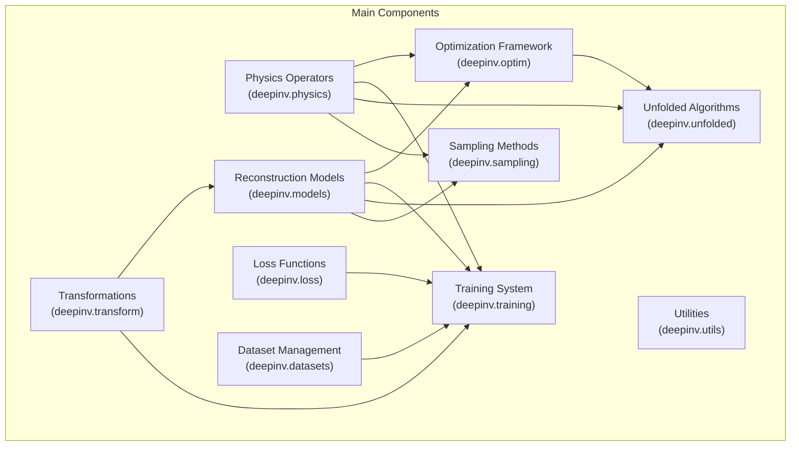

Sources: [deepinv/__init__.py:1-60](), [README.rst:12-23]()

## Core Components

### Physics Operators (`deepinv.physics`)

Physics operators define the forward model of inverse problems - they describe how measurements are generated from the original signal. The library provides implementations for common imaging operators such as:

- MRI sampling
- Blurring 
- Inpainting
- Tomography
- Denoising
- Phase retrieval
- And more

These operators also integrate with various noise models (Gaussian, Poisson, etc.) to simulate realistic measurement scenarios.

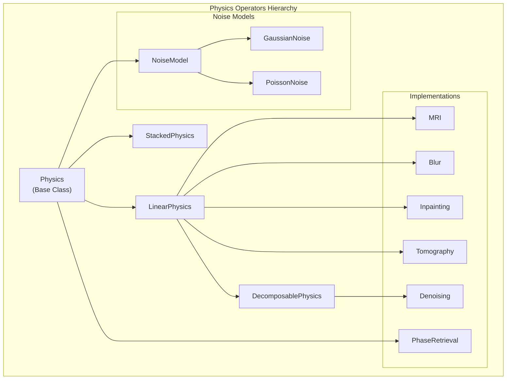

For a detailed explanation of physics operators, see [Physics Operators Framework](#2.1).

Sources: [README.rst:17]()

### Reconstruction Models (`deepinv.models`)

The library provides various models for image reconstruction, including:

- Deep denoisers (DRUNet, DnCNN, UNet, SwinIR, Restormer, etc.)
- Classical denoisers (BM3D, MedianFilter, TVDenoiser, WaveletDenoiser, etc.)
- Specialized reconstructors for specific inverse problems

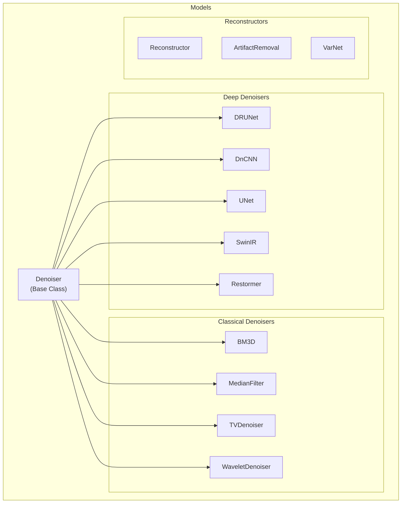

For more details on available models, see [Model Zoo](#3).

Sources: [docs/source/user_guide/reconstruction/denoisers.rst:1-170]()

### Optimization Framework (`deepinv.optim`)

The optimization framework provides iterative solvers for inverse problems, combining data fidelity terms with regularization priors:

- Data fidelity terms (L2, L1, Poisson likelihood, etc.)
- Priors (Plug-and-Play, Tikhonov, TV, Wavelet, etc.)
- Optimization algorithms (PGD, FISTA, ADMM, GD, etc.)

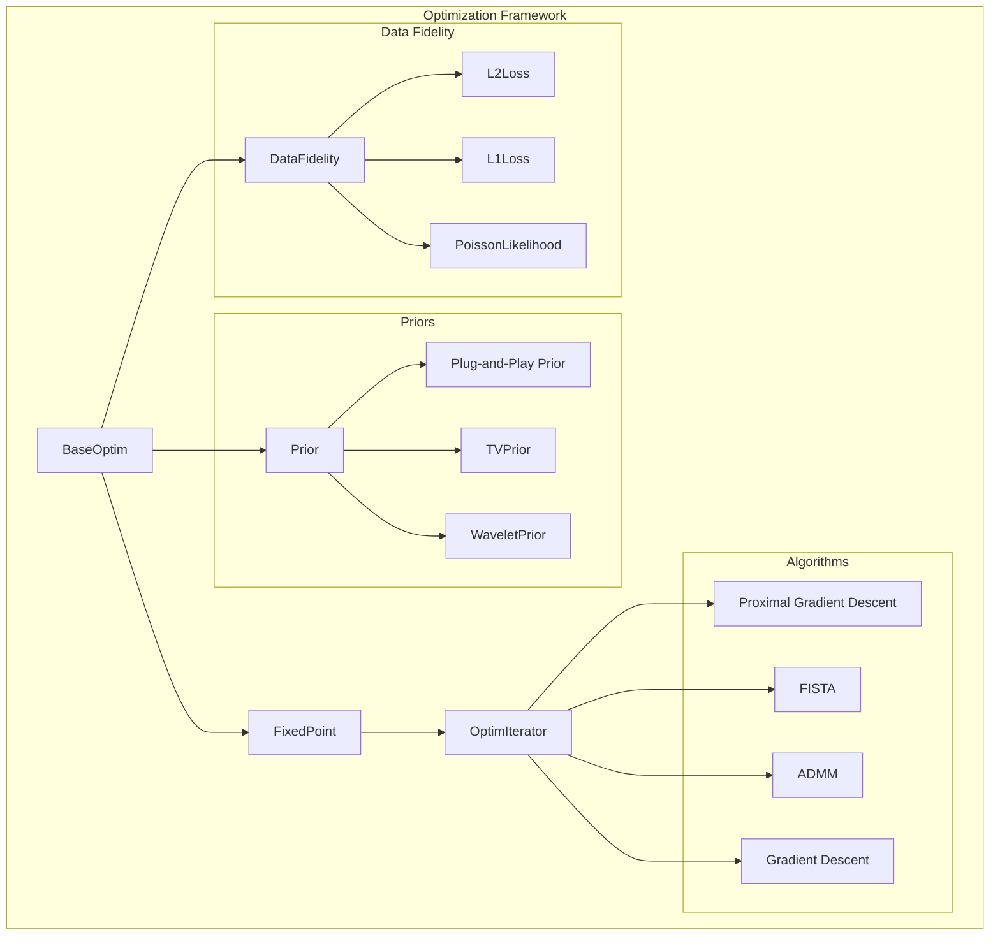

For more details on the optimization framework, see [Optimization Framework](#2.3).

Sources: [README.rst:19]()

### Training System (`deepinv.training`)

The training system provides tools for training reconstruction models:

- Supervised and self-supervised loss functions
- Dataset management
- Performance metrics (PSNR, SSIM, LPIPS)
- Trainer class for orchestrating the training process

For more details on training, see [Training System](#2.5).

Sources: [README.rst:18](), [deepinv/__init__.py:57-61]()

### Unfolded Algorithms (`deepinv.unfolded`)

Unfolded algorithms are neural networks that mimic the structure of iterative optimization algorithms:

- ADMM-based unfolded networks
- Forward-backward unfolded networks
- Deep equilibrium models (DEQ)

For more details on unfolded algorithms, see [Unfolded Algorithms](#3.2).

Sources: [README.rst:21]()

### Sampling Methods (`deepinv.sampling`)

Sampling methods for uncertainty quantification:

- Langevin sampling
- Diffusion models
- MCMC methods

For more details on sampling methods, see [Sampling Methods](#4.3).

Sources: [README.rst:22]()

## Workflow Example

The following diagram illustrates a typical workflow for solving an inverse problem using DeepInv:

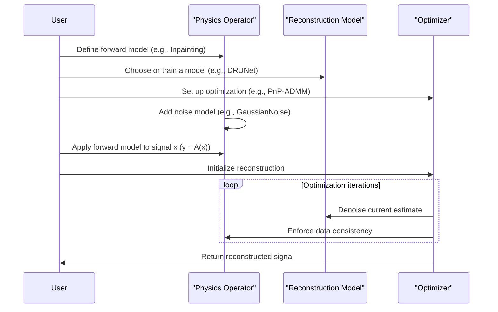

## Code Example

Here's a simplified example of using DeepInv for image inpainting, as shown in the README:

```python
import deepinv as dinv
from deepinv.utils import load_url_image

# Load image
url = "https://huggingface.co/datasets/deepinv/images/resolve/main/cameraman.png?download=true"
x = load_url_image(url=url, img_size=512, grayscale=True, device='cpu')

# Define physics operator (forward model)
physics = dinv.physics.Inpainting((1, 512, 512), mask=0.5,
                                 noise_model=dinv.physics.GaussianNoise(sigma=0.01))

# Set up optimization
data_fidelity = dinv.optim.data_fidelity.L2()
prior = dinv.optim.prior.PnP(denoiser=dinv.models.MedianFilter())
model = dinv.optim.optim_builder(iteration="HQS", prior=prior, data_fidelity=data_fidelity,
                                params_algo={"stepsize": 1.0, "g_param": 0.1})

# Apply forward model and reconstruction
y = physics(x)
x_hat = model(y, physics)
```

Sources: [README.rst:70-89]()

## Installation

DeepInv can be installed using pip:

```bash
# Install basic package
pip install deepinv

# Install with additional dependencies for datasets and denoisers
pip install deepinv[dataset,denoisers]
```

For development or latest features, install directly from GitHub:

```bash
pip install git+https://github.com/deepinv/deepinv.git#egg=deepinv
```

Sources: [README.rst:39-59](), [pyproject.toml:1-90]()

## Additional Resources

- For detailed documentation and examples, visit the [DeepInv website](https://deepinv.github.io/)
- For help, join the [Discord server](https://discord.gg/qBqY5jKw3p) or open an [issue](https://github.com/deepinv/deepinv/issues)
- For more information about specific components, see other sections of this wiki

Sources: [README.rst:31-111]()

---

# Page: Core Architecture

# Core Architecture

<details>
<summary>Relevant source files</summary>

The following files were used as context for generating this wiki page:

- [CHANGELOG.rst](CHANGELOG.rst)
- [README.rst](README.rst)
- [deepinv/__init__.py](deepinv/__init__.py)
- [deepinv/tests/test_loss.py](deepinv/tests/test_loss.py)
- [deepinv/training/trainer.py](deepinv/training/trainer.py)

</details>


This page provides an overview of DeepInv's core architectural components and their relationships. It serves as a foundation for understanding how the library is structured to solve imaging inverse problems using deep learning.

For specific implementations of physics operators, see [Physics Implementations](#2.2). For details on optimization algorithms, see [Optimization Algorithms](#2.4).

## System Overview

DeepInv is built around several interconnected components that work together to provide a flexible framework for solving inverse problems through deep learning. The core architecture establishes the relationships between these components while maintaining modularity.

### Core Components Diagram

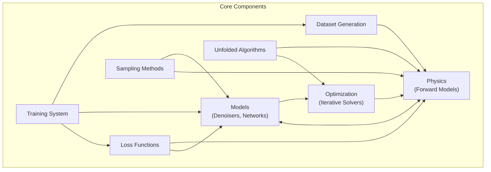

Sources: [deepinv/__init__.py:1-66](), [README.rst:10-28]()

## Module Structure

DeepInv is organized into several Python modules, each handling specific functionality in the inverse problem pipeline:

| Module | Description | Key Base Classes |
|--------|-------------|------------------|
| `deepinv.physics` | Forward operators and measurement models | `Physics`, `LinearPhysics` |
| `deepinv.optim` | Optimization algorithms and regularization | `BaseOptim`, `DataFidelity`, `Prior` |
| `deepinv.models` | Neural networks and reconstructors | `Denoiser`, `Reconstructor` |
| `deepinv.loss` | Loss functions for training | `Loss`, `Metric` |
| `deepinv.training` | Training pipeline | `Trainer` |
| `deepinv.datasets` | Dataset generation and management | `HDF5Dataset` |
| `deepinv.sampling` | Sampling methods | Various MCMC, SDE implementations |
| `deepinv.unfolded` | Unfolded optimization algorithms | `BaseUnfold`, `BaseDEQ` |
| `deepinv.transform` | Data transformations | `Transform` |
| `deepinv.utils` | Utility functions | Various plotting and helper functions |

Sources: [deepinv/__init__.py:1-66]()

## Physics Framework

The Physics framework provides base classes for modeling forward operators that transform clean signals into measurements. These operators can represent various imaging modalities and support the addition of noise.

### Physics Class Hierarchy

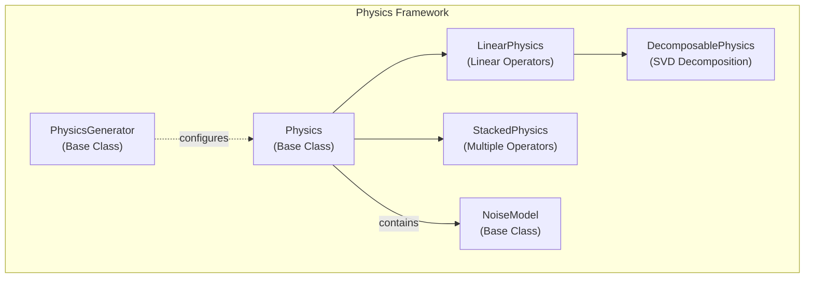

Sources: [README.rst:17]()

## Optimization Framework

The Optimization Framework provides algorithms for solving inverse problems based on regularization techniques. It includes various optimization algorithms, data fidelity terms, and prior terms.

### Optimization Framework Structure

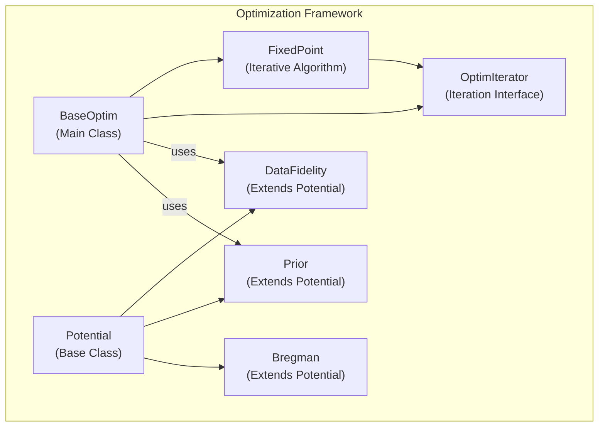

Sources: [CHANGELOG.rst:166-167]()

## Training System

The Training System coordinates the model training process, handling data loading, loss computation, metrics evaluation, and model saving.

### Trainer Class Diagram

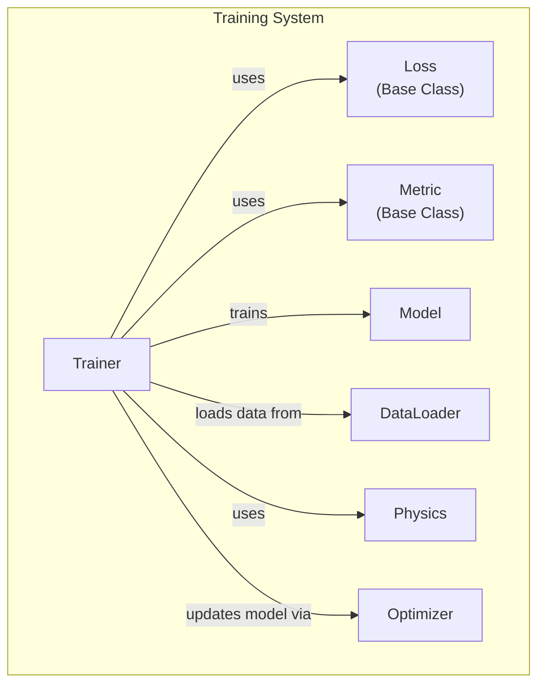

Sources: [deepinv/training/trainer.py:1-76](), [deepinv/training/trainer.py:196-234]()

### Trainer Workflow

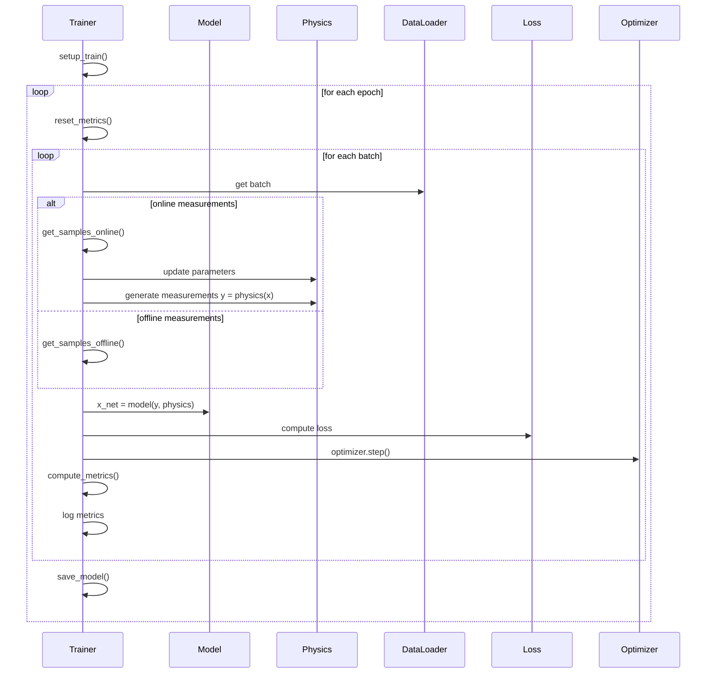

Sources: [deepinv/training/trainer.py:1016-1152]()

## Model Framework

The Model framework provides neural networks for image reconstruction, denoising, and other image processing tasks.

### Model Types

DeepInv provides several types of models:

1. **Denoisers**: Neural networks that remove noise from images (DnCNN, DRUNet, etc.)
2. **Reconstructors**: Models that reconstruct clean signals from measurements (ArtifactRemoval, VarNet, etc.)
3. **Unfolded Algorithms**: Models that unfold iterative optimization algorithms into neural networks

## Loss and Metric Framework

The Loss framework provides loss functions for training reconstruction models, while the Metric framework provides evaluation metrics.

### Loss Types

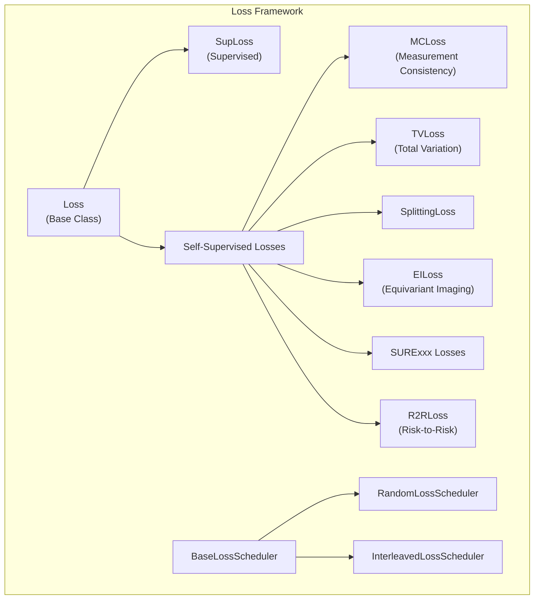

Sources: [deepinv/tests/test_loss.py:16-31](), [deepinv/tests/test_loss.py:440-442]()

## Integration Patterns

The core components in DeepInv are designed to work together through standardized interfaces, allowing for flexible combinations of different modules.

### Simplified Workflow

```mermaid
flowchart LR
    subgraph "Data Preparation"
        direction TB
        RawDataset["Raw Dataset"]
        Physics["Physics Operator"]
        Dataset["Training Dataset"]
        
        RawDataset -->|"generate_dataset()"| Dataset
        Physics -->|"Forward Model"| Dataset
    end
    
    subgraph "Model Training"
        direction TB
        Trainer["Trainer"]
        Model["Model"]
        Loss["Loss Functions"]
        
        Trainer -->|"train()"| Model
        Loss -->|"compute loss"| Trainer
    end
    
    subgraph "Inference"
        direction TB
        TrainedModel["Trained Model"]
        TestData["Test Measurements"]
        RecoveredSignal["Recovered Signal"]
        
        TrainedModel -->|"model(y, physics)"| RecoveredSignal
        TestData -->|"input"| TrainedModel
    end
    
    Data Preparation -->|"dataloader"| Model Training
    Model Training -->|"model"| Inference
```

Sources: [README.rst:70-89]()

## Code Example

Below is a simplified example that demonstrates how the core components interact:

```python
# Create a physics operator
physics = dinv.physics.Inpainting((1, 512, 512), mask=0.5, 
                                 noise_model=dinv.physics.GaussianNoise(sigma=0.01))

# Define data fidelity and prior terms
data_fidelity = dinv.optim.data_fidelity.L2()
prior = dinv.optim.prior.PnP(denoiser=dinv.models.MedianFilter())

# Build optimization model
model = dinv.optim.optim_builder(iteration="HQS", prior=prior, data_fidelity=data_fidelity,
                                params_algo={"stepsize": 1.0, "g_param": 0.1})

# Apply forward model to get measurements
y = physics(x)

# Recover the signal
x_hat = model(y, physics)
```

Sources: [README.rst:70-89]()

## Training Example

An example of how to use the training system:

```python
# Define model, physics, and optimizer
model = dinv.models.ArtifactRemoval(backbone)
physics = dinv.physics.Inpainting(tensor_size=imsize, mask=0.5)
optimizer = torch.optim.Adam(model.parameters(), lr=5e-4)

# Create dataloaders
train_dataloader = DataLoader(train_dataset, batch_size=16)
eval_dataloader = DataLoader(eval_dataset, batch_size=16)

# Define trainer
trainer = dinv.Trainer(
    model=model,
    physics=physics,
    optimizer=optimizer,
    train_dataloader=train_dataloader,
    eval_dataloader=eval_dataloader,
    epochs=100,
    losses=dinv.loss.SupLoss(),
    metrics=[dinv.metric.PSNR(), dinv.metric.SSIM()],
    device="cuda"
)

# Train the model
trained_model = trainer.train()
```

Sources: [deepinv/training/trainer.py:1228-1275](), [deepinv/tests/test_loss.py:276-323]()

## Summary

The core architecture of DeepInv provides a modular and extensible framework for solving inverse problems in imaging using deep learning. The main components are:

1. **Physics Operators**: Forward models that transform clean signals to measurements
2. **Optimization Framework**: Algorithms for solving inverse problems
3. **Models**: Neural networks for reconstruction and denoising
4. **Training System**: Orchestrates the training of models
5. **Loss Functions**: Define the training objectives
6. **Dataset Management**: Tools for creating and managing datasets

These components can be combined in various ways to implement different approaches to inverse problems, from traditional optimization methods to learning-based techniques and hybrid approaches.

---

# Page: Physics Operators Framework

# Physics Operators Framework

<details>
<summary>Relevant source files</summary>

The following files were used as context for generating this wiki page:

- [deepinv/physics/__init__.py](deepinv/physics/__init__.py)
- [deepinv/physics/blur.py](deepinv/physics/blur.py)
- [deepinv/physics/forward.py](deepinv/physics/forward.py)
- [deepinv/physics/generator/inpainting.py](deepinv/physics/generator/inpainting.py)
- [deepinv/physics/noise.py](deepinv/physics/noise.py)
- [deepinv/physics/range.py](deepinv/physics/range.py)
- [deepinv/physics/remote_sensing.py](deepinv/physics/remote_sensing.py)
- [deepinv/tests/test_noise_model.py](deepinv/tests/test_noise_model.py)
- [deepinv/tests/test_physics.py](deepinv/tests/test_physics.py)
- [docs/source/api/deepinv.physics.rst](docs/source/api/deepinv.physics.rst)
- [docs/source/user_guide/physics/physics.rst](docs/source/user_guide/physics/physics.rst)

</details>


## Purpose and Scope

The Physics Operators Framework in DeepInv provides a structured approach to modeling forward operators in computational imaging and inverse problems. It serves as a foundation for representing the mathematical transformations that map signals to measurements, including both the deterministic physical process and stochastic noise components.

This page focuses on the core architecture and base classes of the framework. For implementations of specific physics operators like MRI, blur, inpainting, etc., see [Physics Implementations](#2.2). For details on optimization algorithms that use these operators, see [Optimization Framework](#2.3).

## Core Framework Structure

The Physics Operators Framework consists of a hierarchy of classes that represent different types of forward operators, along with a complementary set of noise models.

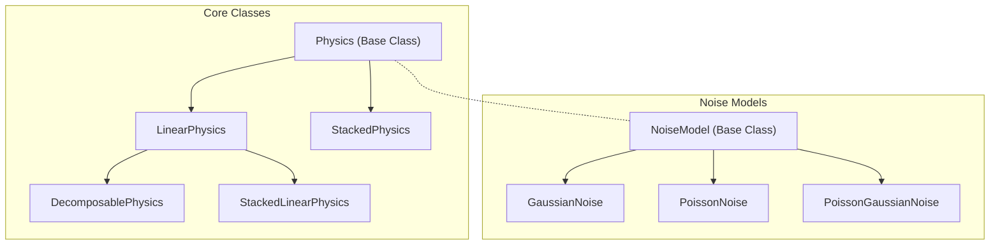

Sources: [deepinv/physics/forward.py:10-617](). [deepinv/physics/noise.py:7-493]().

## Base Classes and Their Roles

### Physics Class

The `Physics` class is the foundation of the framework, representing a general forward operator with the measurement process:

$$y = N(A(x))$$

where $x$ is the input signal, $A$ is the forward operator, $N$ is the noise model, and $y$ is the noisy measurement.

Key methods include:

| Method | Description |
|--------|-------------|
| `A(x)` | Applies the deterministic forward operator |
| `forward(x)` | Complete forward process including noise |
| `A_dagger(y)` | Computes the pseudoinverse (basic reconstruction) |
| `A_vjp(x, v)` | Vector-Jacobian product for autodifferentiation |
| `update(**kwargs)` | Updates operator parameters |

Sources: [deepinv/physics/forward.py:10-102](). [deepinv/physics/forward.py:109-117](). [deepinv/physics/forward.py:148-182]().

### LinearPhysics Class

The `LinearPhysics` class extends `Physics` for linear operators, which follow the form:

$$A(x) = Mx$$

where $M$ is a linear transformation matrix.

Additional methods include:

| Method | Description |
|--------|-------------|
| `A_adjoint(y)` | Applies the adjoint (transpose) of the forward operator |
| `compute_norm(x)` | Calculates the spectral norm of the operator |
| `prox_l2(z, y, gamma)` | Proximal operator for L2 data fidelity |
| `adjointness_test(u)` | Checks if A* is correctly implemented as the adjoint of A |

Sources: [deepinv/physics/forward.py:248-616](). [deepinv/tests/test_physics.py:452-470]().

### DecomposablePhysics Class

The `DecomposablePhysics` class represents linear operators that can be decomposed using singular value decomposition (SVD):

$$A = U \text{diag}(s) V^T$$

This structure allows for efficient computation of adjoints, pseudoinverses, and proximal operators.

Key methods include:

| Method | Description |
|--------|-------------|
| `U(x)`, `V(x)` | Apply the orthogonal transformations from the SVD |
| `U_adjoint(x)`, `V_adjoint(x)` | Apply the adjoints of U and V |
| `prox_l2(z, y, gamma)` | Efficient proximal operator via SVD |

Sources: [deepinv/physics/forward.py:619-802](). [deepinv/tests/test_physics.py:564-581]().

### Stacked Operators

The framework provides two ways to combine physics operators:

1. **Stacking (Parallel)**: Created via `stack()` method to apply multiple operators to the same input
2. **Composition (Sequential)**: Created via `__mul__` method to apply operators in sequence

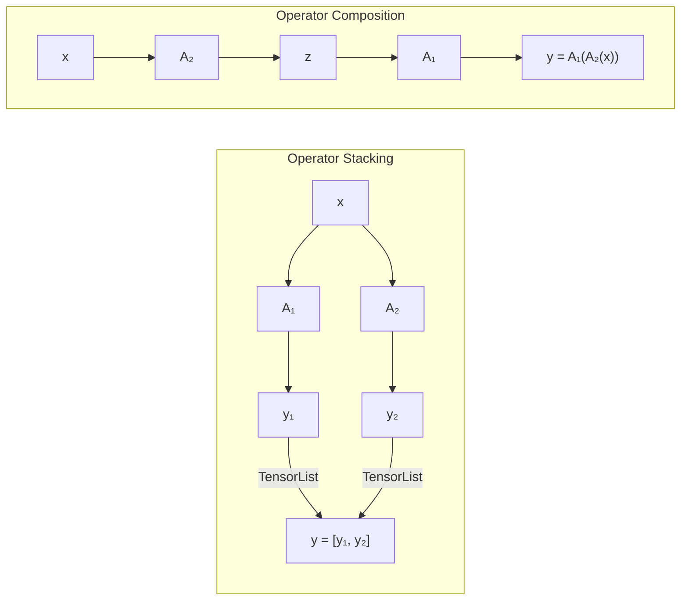

Sources: [deepinv/physics/forward.py:56-92](). [deepinv/physics/forward.py:410-433](). [deepinv/tests/test_physics.py:416-448]().

## Noise Models

Noise models represent the stochastic part of the measurement process. They inherit from the `NoiseModel` base class and can be combined via multiplication.

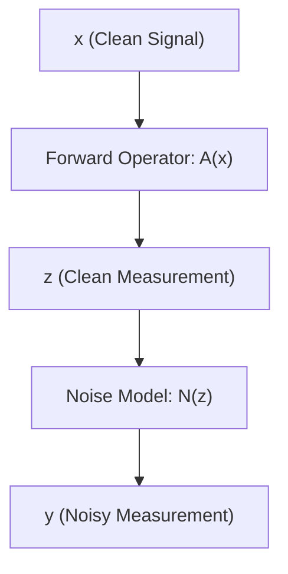

Common noise models include:

| Noise Model | Mathematical Form |
|-------------|-------------------|
| `GaussianNoise` | $y = z + \epsilon$ where $\epsilon \sim \mathcal{N}(0, \sigma^2I)$ |
| `PoissonNoise` | $y = \mathcal{P}(z/\gamma)$ |
| `PoissonGaussianNoise` | $y = \gamma\mathcal{P}(z/\gamma) + \epsilon$ |
| `UniformNoise` | $y = z + \epsilon$ where $\epsilon \sim \mathcal{U}(-a, a)$ |

Sources: [deepinv/physics/noise.py:7-83](). [deepinv/physics/noise.py:94-242](). [deepinv/physics/noise.py:299-368](). [deepinv/physics/noise.py:416-492]().

## Implementation Patterns

### Forward and Inverse Transformations

The complete measurement process involves multiple transformations:

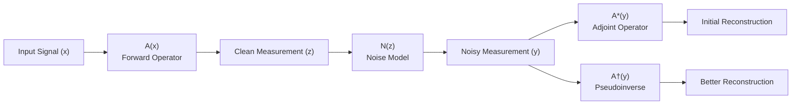

Sources: [deepinv/physics/forward.py:94-107](). [deepinv/physics/forward.py:148-182](). [deepinv/physics/forward.py:584-616]().

### Physics Parameters and Updates

Physics operators can have parameters that affect their behavior. These can be updated dynamically:

```python
# Update parameters example
physics.update(filter=new_filter, sigma=new_noise_level)
```

This is crucial for applications like unrolled optimization algorithms where physics parameters might change between iterations.

Sources: [deepinv/physics/forward.py:221-246](). [deepinv/physics/blur.py:298-311](). [deepinv/physics/noise.py:234-241]().

## Key Implementation Examples

### Linear Operators in the Framework

The framework provides specialized implementations for common linear operations:

| Operator | Description | Class |
|----------|-------------|-------|
| Blur | Convolution with a kernel | `Blur`, `BlurFFT` |
| Downsampling | Super-resolution forward model | `Downsampling` |
| Inpainting | Masked measurements | `Inpainting` |
| MRI | Fourier domain sampling | `MRI`, `MultiCoilMRI` |
| Compressed Sensing | Random projections | `CompressedSensing` |

Sources: [deepinv/physics/blur.py:20-204](). [deepinv/physics/blur.py:207-312](). [deepinv/physics/__init__.py:1-44]().

### Decomposable Physics Example

The `BlurFFT` class is an example of a decomposable physics operator that utilizes FFT for efficient computation:

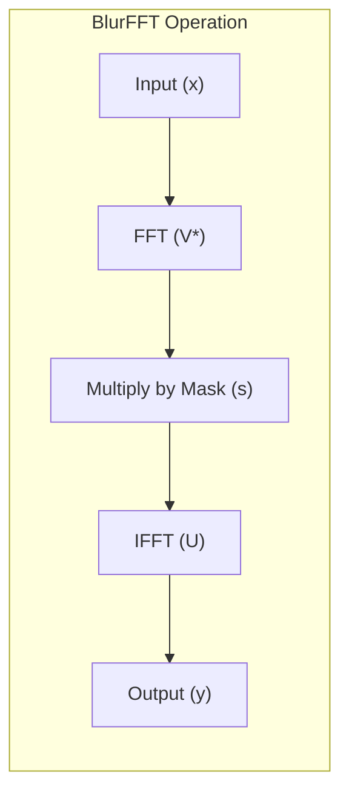

Sources: [deepinv/physics/blur.py:313-412](). [deepinv/tests/test_physics.py:910-946]().

## Testing and Validation

The framework provides methods to validate the correctness of operator implementations:

1. **Adjointness Test**: Verifies that `A_adjoint` is properly implemented
2. **Norm Computation**: Ensures the operator is properly normalized
3. **Pseudoinverse Test**: Checks that `A_dagger` correctly inverts the forward operation

Sources: [deepinv/tests/test_physics.py:452-470](). [deepinv/tests/test_physics.py:483-520](). [deepinv/tests/test_physics.py:540-561]().

## Conclusion

The Physics Operators Framework provides a flexible foundation for modeling forward processes in inverse problems. By separating the deterministic physics from the stochastic noise, it enables a modular approach to forward modeling while providing necessary tools for reconstruction algorithms.

---

# Page: Physics Implementations

# Physics Implementations

<details>
<summary>Relevant source files</summary>

The following files were used as context for generating this wiki page:

- [.gitignore](.gitignore)
- [deepinv/physics/__init__.py](deepinv/physics/__init__.py)
- [deepinv/physics/generator/__init__.py](deepinv/physics/generator/__init__.py)
- [deepinv/physics/generator/inpainting.py](deepinv/physics/generator/inpainting.py)
- [deepinv/physics/generator/mri.py](deepinv/physics/generator/mri.py)
- [deepinv/physics/generator/noise.py](deepinv/physics/generator/noise.py)
- [deepinv/physics/inpainting.py](deepinv/physics/inpainting.py)
- [deepinv/physics/mri.py](deepinv/physics/mri.py)
- [deepinv/physics/noise.py](deepinv/physics/noise.py)
- [deepinv/tests/test_generators.py](deepinv/tests/test_generators.py)
- [deepinv/tests/test_noise_model.py](deepinv/tests/test_noise_model.py)
- [deepinv/tests/test_physics.py](deepinv/tests/test_physics.py)
- [docs/source/api/deepinv.physics.rst](docs/source/api/deepinv.physics.rst)
- [docs/source/user_guide/physics/physics.rst](docs/source/user_guide/physics/physics.rst)

</details>


This page details the specific implementations of physics operators available in the DeepInv library. It covers the various forward models used in imaging inverse problems, including both linear and non-linear operators, along with their properties and usage. For information about the overall Physics Operators Framework architecture, see [Physics Operators Framework](#2.1).

## Physics Operator Overview

The DeepInv library provides a rich collection of physics operators for modeling various imaging modalities and degradation processes. These operators represent the forward model in inverse problems and are used to generate measurements from clean signals as well as to perform reconstruction.

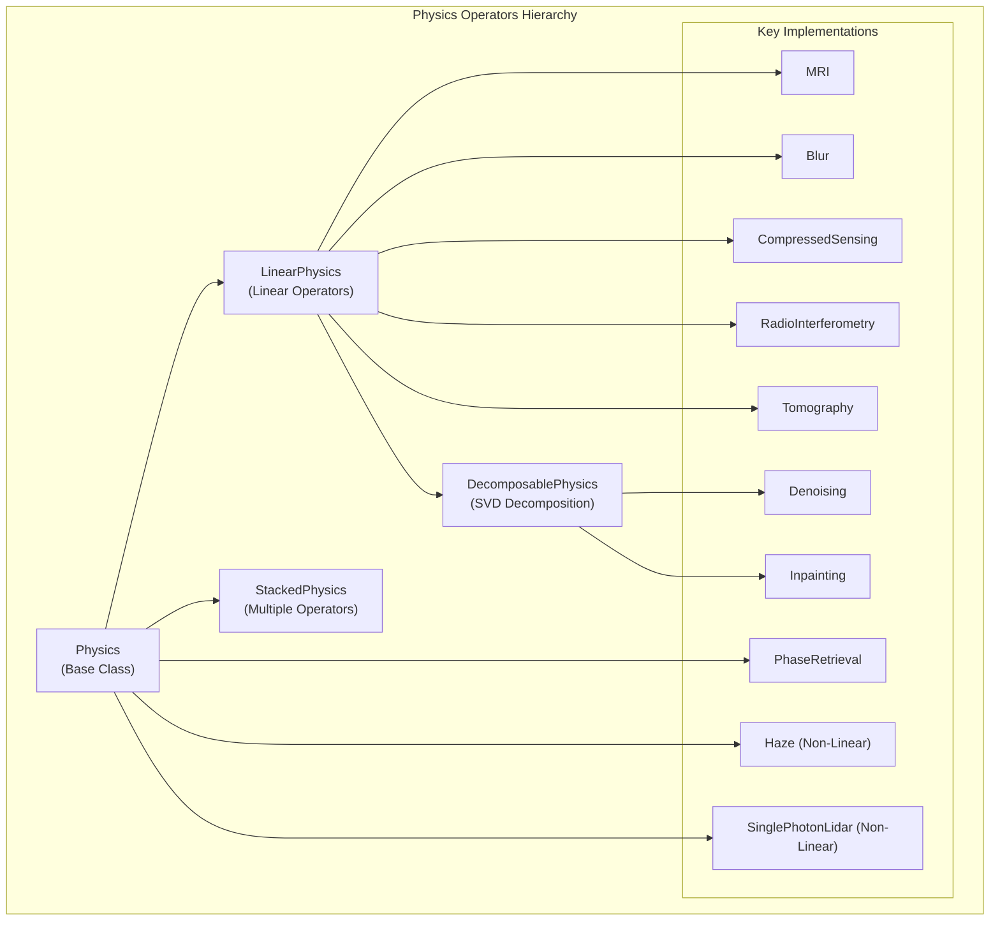

Sources:
- [deepinv/physics/__init__.py:1-47]()
- [deepinv/tests/test_physics.py:13-68]()

## Linear Physics Operators

Linear physics operators are the most common type of forward models in DeepInv. They represent linear transformations of the input signal.

### Decomposable vs Non-Decomposable Linear Operators

Linear operators in DeepInv are categorized as either decomposable or non-decomposable:

- **Decomposable Operators**: Have a known singular value decomposition (SVD), enabling fast computation of pseudo-inverse and proximal operators. They inherit from `DecomposablePhysics`.
- **Non-Decomposable Operators**: Don't have a readily available SVD. They inherit directly from `LinearPhysics`.

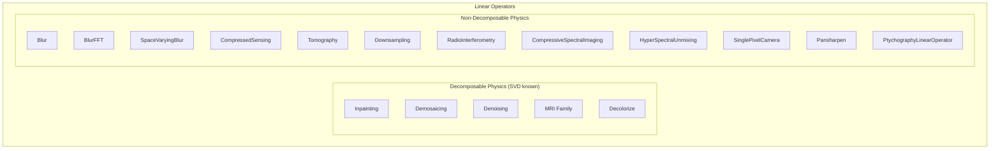

Sources:
- [deepinv/physics/__init__.py:1-47]()
- [deepinv/tests/test_physics.py:450-562]()

### MRI Operators

DeepInv provides a comprehensive set of MRI operators for various MRI acquisition scenarios:

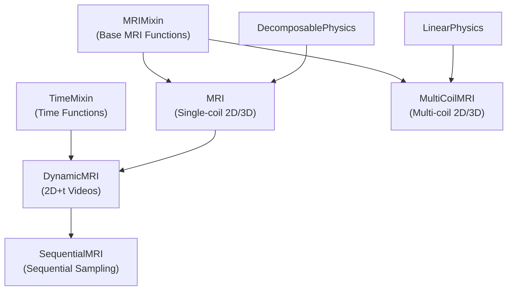

The MRI operators are implemented with the following key features:

- **MRI**: Single-coil accelerated 2D or 3D MRI with subsampling masks
- **MultiCoilMRI**: Multi-coil 2D or 3D MRI with coil sensitivity maps
- **DynamicMRI**: Single-coil accelerated dynamic (2D+t) MRI with time-varying masks
- **SequentialMRI**: Single-coil MRI with sequential sampling patterns

These operators support various mask patterns for k-space acceleration, coil simulations for parallel imaging, and can handle both 2D and 3D data.

Sources:
- [deepinv/physics/mri.py:12-647]()
- [deepinv/tests/test_physics.py:589-672]()

### Inpainting Operators

The `Inpainting` operator keeps a subset of entries from the input signal, determined by a binary mask:

```mermaid
graph TD
    DecomposablePhysics["DecomposablePhysics"]
    Inpainting["Inpainting<br>A = diag(m)"]
    Demosaicing["Demosaicing<br>(Color Filter Pattern)"]
    
    DecomposablePhysics --> Inpainting
    Inpainting --> Demosaicing
```

Key features:

- Masks can be created from Bernoulli distributions with specified probabilities
- Support for pixelwise masking (zeroing all channels at specific pixel locations)
- `Demosaicing` is a specialized inpainting operator for color filter arrays (e.g., Bayer pattern)

Sources:
- [deepinv/physics/inpainting.py:7-211]()
- [deepinv/physics/generator/inpainting.py:8-204]()

### Blur and Super-Resolution

DeepInv offers multiple blur implementations:

- **Blur**: Spatial domain convolution with various padding options
- **BlurFFT**: Efficient Fourier domain convolution
- **SpaceVaryingBlur**: Non-stationary blur that varies spatially
- **Downsampling**: Blur followed by subsampling, used for super-resolution

These operators can be configured with various filter types like Gaussian, bilinear, and bicubic.

Sources:
- [deepinv/tests/test_physics.py:224-255]()
- [deepinv/tests/test_physics.py:910-946]()

### Compressed Sensing

Compressed sensing implementations include:

- **CompressedSensing**: Random projection operator
- **SinglePixelCamera**: Simulates single-pixel camera acquisition
- **StructuredRandom**: Structured random measurements

These operators support both regular and fast implementations, with optional complex-valued signals.

Sources:
- [deepinv/tests/test_physics.py:102-117]()
- [deepinv/tests/test_physics.py:206-217]()

### Other Linear Operators

Additional linear operators in DeepInv include:

- **Tomography**: Radon transform for CT imaging
- **RadioInterferometry**: Non-uniform Fourier transform for radio astronomy
- **Pansharpen**: Multi-resolution sensing for remote sensing
- **CompressiveSpectralImaging**: Compressive sensing for hyperspectral imaging
- **HyperSpectralUnmixing**: Unmixing for hyperspectral data

Sources:
- [deepinv/tests/test_physics.py:980-1011]()
- [deepinv/tests/test_physics.py:302-340]()

## Nonlinear Physics Operators

DeepInv also supports nonlinear physics operators that don't follow linear transformations:

- **Haze**: Atmospheric scattering model for dehazing
- **SinglePhotonLidar**: Single-photon Lidar imaging model

These operators override standard methods like `A`, `A_adjoint`, and `A_dagger` to implement their nonlinear behavior.

Sources:
- [deepinv/tests/test_physics.py:361-383]()
- [deepinv/tests/test_physics.py:524-536]()

## Phase Retrieval Operators

Phase retrieval operators form a special class of operators that only measure the magnitude of complex-valued signals:

- **PhaseRetrieval**: Base class for phase retrieval
- **RandomPhaseRetrieval**: Random phase retrieval with Gaussian measurement matrices
- **StructuredRandomPhaseRetrieval**: Structured random phase measurements
- **Ptychography**: Implementation of ptychographic imaging
- **PtychographyLinearOperator**: Linear approximation of ptychography

These operators have special properties, such as producing the same output for inputs `x` and `-x`.

Sources:
- [deepinv/tests/test_physics.py:754-769]()
- [deepinv/tests/test_physics.py:771-788]()
- [deepinv/tests/test_physics.py:347-355]()

## Noise Models

Physics operators in DeepInv can be combined with various noise models to simulate realistic measurement processes:

```mermaid
graph TD
    NoiseModel["NoiseModel<br>(Base Class)"]
    
    GaussianNoise["GaussianNoise<br>y = x + ε, ε ~ N(0, σ²)"]
    PoissonNoise["PoissonNoise<br>y ~ P(x/γ)"]
    PoissonGaussianNoise["PoissonGaussianNoise<br>y = γz + ε, z ~ P(x/γ), ε ~ N(0, σ²)"]
    UniformNoise["UniformNoise<br>y ~ U(x-a, x+a)"]
    UniformGaussianNoise["UniformGaussianNoise<br>σ ~ U(σₘᵢₙ, σₘₐₓ)"]
    LogPoissonNoise["LogPoissonNoise<br>y = (1/μ)log(P(e^(-μx)N₀)/N₀)"]
    GammaNoise["GammaNoise<br>y ~ Γ(ℓ, x/ℓ)"]
    SaltPepperNoise["SaltPepperNoise<br>(Impulse Noise)"]
    
    NoiseModel --> GaussianNoise
    NoiseModel --> PoissonNoise
    NoiseModel --> PoissonGaussianNoise
    NoiseModel --> UniformNoise
    NoiseModel --> UniformGaussianNoise
    NoiseModel --> LogPoissonNoise
    NoiseModel --> GammaNoise
    NoiseModel --> SaltPepperNoise
```

Key features:

- Noise models can be attached to any physics operator via the `noise_model` attribute
- Multiple noise models can be combined using multiplication (`*` operator)
- Noise parameters can be updated on-the-fly
- Domain-specific noise handling (e.g., applying noise only where the mask is non-zero for inpainting)

Sources:
- [deepinv/physics/noise.py:7-638]()
- [deepinv/tests/test_noise_model.py:23-45]()
- [deepinv/tests/test_physics.py:884-907]()

## Physics Generators

DeepInv includes generators for creating random parameters for physics operators:

```mermaid
graph TD
    PhysicsGenerator["PhysicsGenerator<br>(Base Class)"]
    
    subgraph "Mask Generators"
        BernoulliSplittingMaskGenerator["BernoulliSplittingMaskGenerator"]
        GaussianSplittingMaskGenerator["GaussianSplittingMaskGenerator"]
        GaussianMaskGenerator["GaussianMaskGenerator<br>(MRI)"]
        RandomMaskGenerator["RandomMaskGenerator<br>(MRI)"]
        EquispacedMaskGenerator["EquispacedMaskGenerator<br>(MRI)"]
    end
    
    subgraph "Blur Generators"
        PSFGenerator["PSFGenerator"]
        MotionBlurGenerator["MotionBlurGenerator"]
        DiffractionBlurGenerator["DiffractionBlurGenerator"]
    end
    
    subgraph "Noise Generators"
        SigmaGenerator["SigmaGenerator<br>(Gaussian σ)"]
        GainGenerator["GainGenerator<br>(Poisson γ)"]
    end
    
    PhysicsGenerator --> BernoulliSplittingMaskGenerator
    PhysicsGenerator --> GaussianSplittingMaskGenerator
    PhysicsGenerator --> GaussianMaskGenerator
    PhysicsGenerator --> RandomMaskGenerator
    PhysicsGenerator --> EquispacedMaskGenerator
    PhysicsGenerator --> PSFGenerator
    PhysicsGenerator --> MotionBlurGenerator
    PhysicsGenerator --> DiffractionBlurGenerator
    PhysicsGenerator --> SigmaGenerator
    PhysicsGenerator --> GainGenerator
```

Physics generators provide a convenient way to create random parameters for physics operators:

1. **Mask Generators**:
   - **BernoulliSplittingMaskGenerator**: Generates binary masks with Bernoulli distribution
   - **GaussianSplittingMaskGenerator**: Generates masks with Gaussian spatial weighting
   - **MRI-specific generators**: Generate various k-space sampling patterns

2. **Blur Generators**:
   - **MotionBlurGenerator**: Generates motion blur kernels
   - **DiffractionBlurGenerator**: Generates diffraction blur kernels

3. **Noise Generators**:
   - **SigmaGenerator**: Generates noise levels for Gaussian noise
   - **GainGenerator**: Generates gain parameters for Poisson noise

Sources:
- [deepinv/physics/generator/__init__.py:1-24]()
- [deepinv/physics/generator/inpainting.py:8-204]()
- [deepinv/physics/generator/mri.py:15-280]()
- [deepinv/physics/generator/noise.py:5-116]()

## Usage Examples and Integration

Physics operators in DeepInv are designed to be composable and extensible. Here are common usage patterns:

### Basic Usage

Physics operators can be applied directly to input tensors:

```python
# Create a physics operator
physics = dinv.physics.MRI(img_size=(2, 320, 320))

# Apply forward operator to input tensor
y = physics(x)  # or physics.A(x)

# Apply adjoint operator
x_hat = physics.A_adjoint(y)

# Apply pseudo-inverse
x_hat = physics.A_dagger(y)
```

### Adding Noise

Noise models can be attached to physics operators:

```python
# Create a physics operator with Gaussian noise
physics = dinv.physics.Inpainting(tensor_size=(3, 256, 256), mask=0.8)
physics.noise_model = dinv.physics.GaussianNoise(sigma=0.1)

# Apply forward operator with noise
y = physics(x)  # Includes noise
```

### Using Generators

Generators can be used to create random parameters:

```python
# Create a mask generator
gen = dinv.physics.generator.BernoulliSplittingMaskGenerator(
    tensor_size=(3, 256, 256), 
    split_ratio=0.7
)

# Generate random mask
params = gen.step(batch_size=1)

# Apply physics with generated parameters
physics = dinv.physics.Inpainting(tensor_size=(3, 256, 256))
y = physics(x, **params)  # Using the generated mask
```

### Operator Composition

Physics operators can be composed using multiplication:

```python
# Create two physics operators
p1 = dinv.physics.Blur(filter=h)
p2 = dinv.physics.Inpainting(mask=m)

# Compose them (p = p2 ∘ p1)
p = p2 * p1

# Apply composed operator
y = p(x)  # Equivalent to p2(p1(x))
```

Sources:
- [deepinv/tests/test_physics.py:416-448]()
- [deepinv/tests/test_physics.py:733-751]()
- [deepinv/tests/test_physics.py:947-969]()

## Common Properties and Methods

All physics operators in DeepInv share common properties and methods:

- **A/forward**: Apply the forward operator
- **A_adjoint**: Apply the adjoint operator
- **A_dagger**: Apply the pseudo-inverse operator
- **compute_norm**: Compute the operator norm
- **prox_l2**: Compute the proximal operator for L2 data fidelity
- **update_parameters**: Update operator parameters on-the-fly

Additionally, `LinearPhysics` operators can be tested for:
- **Adjointness**: Verify that `<Ax,y> = <x,A^*y>`
- **Decomposability**: Check if SVD decomposition is available

Sources:
- [deepinv/tests/test_physics.py:452-519]()
- [deepinv/tests/test_physics.py:540-562]()
- [deepinv/tests/test_physics.py:566-581]()

This comprehensive set of physics implementations allows DeepInv to model a wide range of inverse problems in imaging, making it a versatile framework for developing and testing reconstruction algorithms.

---

# Page: Optimization Framework

# Optimization Framework

<details>
<summary>Relevant source files</summary>

The following files were used as context for generating this wiki page:

- [deepinv/optim/__init__.py](deepinv/optim/__init__.py)
- [deepinv/optim/data_fidelity.py](deepinv/optim/data_fidelity.py)
- [deepinv/optim/fixed_point.py](deepinv/optim/fixed_point.py)
- [deepinv/optim/optimizers.py](deepinv/optim/optimizers.py)
- [deepinv/optim/prior.py](deepinv/optim/prior.py)
- [deepinv/tests/test_optim.py](deepinv/tests/test_optim.py)

</details>


The DeepInv Optimization Framework provides a flexible and extensible system for solving inverse problems using optimization algorithms. It enables users to formulate and solve optimization problems in the form:

$$\min_x f(x, y) + \lambda g(x)$$

where $f(x, y)$ is a data fidelity term measuring the discrepancy between the forward model applied to $x$ and the measurements $y$, and $g(x)$ is a regularization prior. The framework implements various optimization algorithms such as Proximal Gradient Descent (PGD), Alternating Direction Method of Multipliers (ADMM), Half-Quadratic Splitting (HQS), and more.

For details on specific optimization algorithms, see [Optimization Algorithms](#2.4).

## Overview

The Optimization Framework is built around the concept of fixed-point iterations, which are used to solve optimization problems iteratively. It provides a modular design where different data fidelity terms, regularization priors, and optimization algorithms can be combined to solve specific inverse problems.

```mermaid
graph TD
    subgraph "Optimization Framework Architecture"
        BaseOptim["BaseOptim<br>(Main Optimization Class)"]
        FixedPoint["FixedPoint<br>(Iterative Algorithm)"]
        OptimIterator["OptimIterator<br>(Iteration Interface)"]
        
        DataFidelity["DataFidelity<br>(Base Class)"]
        Prior["Prior<br>(Base Class)"]
        
        Solvers["Optimization Solvers<br>(PGD, ADMM, HQS, etc.)"]
        
        BaseOptim --> FixedPoint
        FixedPoint --> OptimIterator
        OptimIterator --> Solvers
        
        BaseOptim --> DataFidelity
        BaseOptim --> Prior
    end
```

Sources: [deepinv/optim/optimizers.py:12-494](), [deepinv/optim/fixed_point.py:7-301]()

## Key Components

### BaseOptim Class

The `BaseOptim` class is the main entry point for using the optimization framework. It is a `Reconstructor` that solves the problem:

$$\min_x f(Ax, y) + \lambda g(x)$$

This class encapsulates:
- Fixed point iterations to solve the optimization problem
- Management of algorithm parameters (step sizes, regularization strengths)
- Convergence checking and early stopping
- Optional backtracking for stepsize selection
- Anderson acceleration for faster convergence

```mermaid
classDiagram
    class BaseOptim {
        +FixedPoint fixed_point
        +DataFidelity data_fidelity
        +Prior prior
        +dict params_algo
        +bool early_stop
        +bool has_converged
        +forward(y, physics, x_gt, compute_metrics)
        +update_params_fn(it)
        +update_prior_fn(it)
        +update_data_fidelity_fn(it)
        +init_iterate_fn(y, physics, F_fn)
        +check_iteration_fn(X_prev, X)
        +check_conv_fn(it, X_prev, X)
    }
    
    BaseOptim --|> Reconstructor : inherits
    BaseOptim --> FixedPoint : uses
    BaseOptim --> DataFidelity : uses
    BaseOptim --> Prior : uses
```

Sources: [deepinv/optim/optimizers.py:12-494]()

### Fixed Point Iterations

The `FixedPoint` class implements the iterative algorithm that converges to a fixed point. It repeatedly applies a fixed-point operator until convergence:

$$(x_{k+1}, u_{k+1}) = \text{FixedPoint}(x_k, u_k, f, g, A, y, ...)$$

Key features include:
- Support for various fixed-point operators through the `OptimIterator` interface
- Anderson acceleration for faster convergence
- Convergence criteria and early stopping
- Metric tracking (e.g., PSNR) during iterations

```mermaid
graph TD
    subgraph "Fixed Point Iterations"
        Init["Initialize<br>x0, u0"] --> Loop
        Loop["Apply iterator<br>for k=1...max_iter"] --> Update["xk+1, uk+1 = iterator(xk, uk)"]
        Update --> Check["Check<br>convergence"]
        Check -->|"Not converged"| Loop
        Check -->|"Converged"| Result["Return solution"]
    end
```

Sources: [deepinv/optim/fixed_point.py:7-301]()

### Data Fidelity Terms

The `DataFidelity` class hierarchy defines different ways to measure the discrepancy between the forward model output $Ax$ and the measurements $y$. The framework provides various implementations for different noise models and applications.

```mermaid
classDiagram
    class DataFidelity {
        +Distance d
        +fn(x, y, physics)
        +grad(x, y, physics)
        +prox(x, y, physics, gamma)
    }
    
    class L2 {
        +float sigma
        +fn(x, y, physics)
        +prox(x, y, physics, gamma)
    }
    
    class L1 {
        +fn(x, y, physics)
        +prox(x, y, physics, gamma)
    }
    
    class IndicatorL2 {
        +float radius
        +fn(x, y, physics)
        +prox(x, y, physics, radius, stepsize)
    }
    
    class PoissonLikelihood {
        +float gain
        +float bkg
        +fn(x, y, physics)
    }
    
    class AmplitudeLoss {
        +fn(x, y, physics)
    }
    
    DataFidelity <|-- L2
    DataFidelity <|-- L1
    DataFidelity <|-- IndicatorL2
    DataFidelity <|-- PoissonLikelihood
    DataFidelity <|-- AmplitudeLoss
```

The table below summarizes the main data fidelity terms:

| Data Fidelity Class | Description | Typical Noise Model |
|-----------------|-------------|------------------|
| `L2` | Squared Euclidean norm: $\frac{1}{2\sigma^2}\\|Ax-y\\|^2$ | Gaussian noise |
| `L1` | L1 norm: $\\|Ax-y\\|_1$ | Impulse noise |
| `IndicatorL2` | Indicator of L2 ball: $\iota_{B(y,r)}(Ax)$ | Bounded noise |
| `PoissonLikelihood` | $-y^T \log(Ax+\beta)+1^T(Ax)$ | Poisson noise (e.g., photon counting) |
| `AmplitudeLoss` | $\sum_i(\sqrt{\\|b_i x\\|^2}-\sqrt{y_i})^2$ | Phase retrieval |

Sources: [deepinv/optim/data_fidelity.py:15-561]()

### Prior Terms

The `Prior` class hierarchy defines different regularization terms that encode prior knowledge about the signal to be recovered. The framework provides both explicit priors (with a defined functional form) and implicit priors (defined through an operator, such as a denoiser).

```mermaid
classDiagram
    class Prior {
        +bool explicit_prior
        +fn(x)
        +grad(x)
        +prox(x, gamma)
    }
    
    class L1Prior {
        +fn(x)
        +prox(x, gamma)
    }
    
    class Tikhonov {
        +fn(x)
        +grad(x)
        +prox(x, gamma)
    }
    
    class TVPrior {
        +TVDenoiser TVModel
        +fn(x)
        +prox(x, gamma)
    }
    
    class WaveletPrior {
        +WaveletDenoiser WaveletDenoiser
        +fn(x)
        +prox(x, gamma)
    }
    
    class PnP {
        +Denoiser denoiser
        +prox(x, sigma_denoiser)
    }
    
    class RED {
        +Denoiser denoiser
        +grad(x, sigma_denoiser)
    }
    
    Prior <|-- L1Prior
    Prior <|-- Tikhonov
    Prior <|-- TVPrior
    Prior <|-- WaveletPrior
    Prior <|-- PnP
    Prior <|-- RED
```

The table below summarizes the main prior terms:

| Prior Class | Description | Type |
|-------------|-------------|------|
| `L1Prior` | L1 norm: $\\|x\\|_1$ | Explicit |
| `Tikhonov` | Squared L2 norm: $\frac{1}{2}\\|x\\|_2^2$ | Explicit |
| `TVPrior` | Total Variation: $\\|Dx\\|_{1,2}$ | Explicit |
| `WaveletPrior` | Wavelet sparsity: $\\|\Psi x\\|_p$ | Explicit |
| `PnP` | Plug-and-Play: $\text{prox}_{\gamma g}(x) = D_{\sigma}(x)$ | Implicit |
| `RED` | Regularization by Denoising: $\nabla g(x) = x - D_{\sigma}(x)$ | Implicit |

Sources: [deepinv/optim/prior.py:19-701]()

### Optimization Algorithms

The framework implements various optimization algorithms through different `OptimIterator` classes. These define how to update the variables in each iteration to minimize the objective function.

```mermaid
graph TD
    subgraph "Optimization Algorithms"
        OptimIterator["OptimIterator<br>(Abstract Base Class)"]
        PGD["PGDIteration<br>(Proximal Gradient Descent)"]
        FISTA["FISTAIteration<br>(Fast ISTA)"]
        ADMM["ADMMIteration<br>(ADMM)"]
        GD["GDIteration<br>(Gradient Descent)"]
        DRS["DRSIteration<br>(Douglas-Rachford Splitting)"]
        HQS["HQSIteration<br>(Half-Quadratic Splitting)"]
        CP["CPIteration<br>(Chambolle-Pock)"]
        
        OptimIterator --> PGD
        OptimIterator --> FISTA
        OptimIterator --> ADMM
        OptimIterator --> GD
        OptimIterator --> DRS
        OptimIterator --> HQS
        OptimIterator --> CP
    end
```

All these algorithms are exposed through the `optim_builder` function, which creates a `BaseOptim` instance with the specified algorithm:

```python
optimalgo = optim_builder(
    algorithm_name,
    prior=prior,
    data_fidelity=data_fidelity,
    max_iter=max_iter,
    params_algo=params_algo
)
```

Sources: [deepinv/optim/optimizers.py:497-614]()

## Usage Workflow

```mermaid
graph LR
    subgraph "Optimization Framework Usage"
        A["1. Define Physics Model<br>A, A_adjoint"] --> B["2. Define Data Fidelity<br>e.g., L2()"]
        B --> C["3. Define Prior<br>e.g., TVPrior()"]
        C --> D["4. Configure Optimizer<br>algorithm, parameters"]
        D --> E["5. Run Optimization<br>x = optimalgo(y, physics)"]
    end
```

A typical workflow for using the Optimization Framework involves:

1. **Define the physics model**: Create a `Physics` object that models the forward operation $A$ and its adjoint $A^*$.
2. **Choose a data fidelity term**: Select a `DataFidelity` subclass that matches your noise model.
3. **Choose a regularization prior**: Select a `Prior` subclass that encodes prior knowledge about your signal.
4. **Configure the optimization algorithm**: Choose an algorithm and set its parameters (step sizes, regularization strength, etc.).
5. **Run the optimization**: Apply the algorithm to your measurements to obtain the reconstructed signal.

Example:

```python
# 1. Define physics model
physics = dinv.physics.Blur(
    dinv.physics.blur.gaussian_blur(sigma=(2, 0.1)),
    noise_model=dinv.physics.GaussianNoise(0.1)
)

# 2. Choose data fidelity term
data_fidelity = dinv.optim.L2()

# 3. Choose regularization prior
prior = dinv.optim.TVPrior()

# 4. Configure optimization algorithm
params_algo = {
    "stepsize": 1.0,
    "lambda": 0.1
}

# 5. Create and run optimization algorithm
optimalgo = dinv.optim.optim_builder(
    "PGD",
    prior=prior,
    data_fidelity=data_fidelity,
    max_iter=100,
    params_algo=params_algo,
    verbose=True
)

# Apply to measurements
x = optimalgo(y, physics)
```

Sources: [deepinv/tests/test_optim.py:295-364]()

## Customization

The framework is designed to be highly customizable. Users can:

1. **Create custom data fidelity terms** by subclassing `DataFidelity` and implementing the required methods.
2. **Create custom priors** by subclassing `Prior` and implementing the required methods.
3. **Combine different data fidelity terms and priors** with various optimization algorithms.
4. **Set algorithm-specific parameters** through the `params_algo` dictionary.
5. **Monitor convergence** by specifying convergence criteria and thresholds.

This flexibility allows researchers and practitioners to implement and experiment with a wide range of optimization-based approaches for solving inverse problems.

Sources: [deepinv/optim/optimizers.py:12-494]()

---

# Page: Optimization Algorithms

# Optimization Algorithms

<details>
<summary>Relevant source files</summary>

The following files were used as context for generating this wiki page:

- [deepinv/optim/optim_iterators/__init__.py](deepinv/optim/optim_iterators/__init__.py)
- [deepinv/optim/optim_iterators/admm.py](deepinv/optim/optim_iterators/admm.py)
- [deepinv/optim/optim_iterators/drs.py](deepinv/optim/optim_iterators/drs.py)
- [deepinv/optim/optim_iterators/gradient_descent.py](deepinv/optim/optim_iterators/gradient_descent.py)
- [deepinv/optim/optim_iterators/hqs.py](deepinv/optim/optim_iterators/hqs.py)
- [deepinv/optim/optim_iterators/optim_iterator.py](deepinv/optim/optim_iterators/optim_iterator.py)
- [deepinv/optim/optim_iterators/pgd.py](deepinv/optim/optim_iterators/pgd.py)
- [deepinv/optim/utils.py](deepinv/optim/utils.py)
- [docs/source/api/deepinv.optim.rst](docs/source/api/deepinv.optim.rst)
- [docs/source/user_guide/physics/intro.rst](docs/source/user_guide/physics/intro.rst)

</details>


This page documents the optimization algorithms implemented in DeepInv for solving inverse problems. It provides a detailed overview of the iterative algorithms used to minimize objective functions of the form `f(x) + λg(x)`, where `f` represents a data fidelity term and `g` represents a regularization or prior term. For information about the overall optimization framework, see [Optimization Framework](#2.3).

## 1. Overview of Optimization Iterators

DeepInv implements optimization algorithms through a modular, component-based approach centered around the concept of optimization iterators. Each iterator represents a single iteration of an algorithm for minimizing the objective function.

```mermaid
flowchart TD
    subgraph "Base Iterator Structure"
        OptimIterator["OptimIterator"]
        fStep["fStep<br>(Data Fidelity Step)"]
        gStep["gStep<br>(Prior/Regularization Step)"]
        OptimIterator --> fStep
        OptimIterator --> gStep
    end

    subgraph "Optimization Algorithm Types"
        GradientBased["Gradient-Based<br>Methods"]
        ProximalMethods["Proximal<br>Methods"] 
        SplittingMethods["Splitting<br>Methods"]
    end

    OptimIterator --> GradientBased
    OptimIterator --> ProximalMethods
    OptimIterator --> SplittingMethods

    GradientBased --> GD["GDIteration<br>(Gradient Descent)"]
    GradientBased --> MD["MDIteration<br>(Mirror Descent)"]

    ProximalMethods --> PGD["PGDIteration<br>(Proximal Gradient Descent)"]
    ProximalMethods --> FISTA["FISTAIteration<br>(Fast ISTA)"]
    ProximalMethods --> PMD["PMDIteration<br>(Proximal Mirror Descent)"]

    SplittingMethods --> ADMM["ADMMIteration<br>(Alt. Direction Method of Multipliers)"]
    SplittingMethods --> DRS["DRSIteration<br>(Douglas-Rachford Splitting)"]
    SplittingMethods --> HQS["HQSIteration<br>(Half-Quadratic Splitting)"]
```

Sources: [deepinv/optim/optim_iterators/optim_iterator.py](), [deepinv/optim/optim_iterators/__init__.py]()

The `OptimIterator` base class defines a general fixed-point iteration structure for minimizing `f(x) + λg(x)` by alternating between steps on the data fidelity term `f` and the regularization term `g`. Each specific algorithm implements this structure differently.

## 2. Gradient-Based Methods

Gradient-based methods directly use the gradients of the objective function components to update the solution.

### 2.1 Gradient Descent (GD)

Gradient Descent is the most basic iterative optimization algorithm that updates the solution by moving in the direction of the negative gradient.

```mermaid
flowchart LR
    x0["x_k"] --> |"compute gradients"| grad["∇f(x_k) + λ∇g(x_k)"]
    grad --> |"step in negative direction"| x1["x_{k+1} = x_k - γ∇f(x_k) - γλ∇g(x_k)"]
```

**Implementation Details:**
- For the data fidelity term `f`, computes `∇f(x)` using `cur_data_fidelity.grad()`
- For the prior term `g`, computes `λ∇g(x)` using `cur_prior.grad()`
- Updates using `x = x_prev - γ(∇f(x_prev) + λ∇g(x_prev))`

Sources: [deepinv/optim/optim_iterators/gradient_descent.py:5-57]()

### 2.2 Mirror Descent (MD)

Mirror Descent generalizes gradient descent using a Bregman divergence, which is useful when the solution space has a non-Euclidean geometry.

```mermaid
flowchart LR
    x0["x_k"] --> |"compute gradients"| grad["∇f(x_k) + λ∇g(x_k)"]
    grad --> |"mirror step"| x1["x_{k+1} = ∇h*(∇h(x_k) - γ∇f(x_k) - γλ∇g(x_k))"]
    
    subgraph "Mirror Step"
        bregman["Bregman Potential h(x)"]
    end
```

**Implementation Details:**
- Builds on Gradient Descent but maps through a Bregman potential `h`
- Uses `bregman_potential.grad_conj(bregman_potential.grad(x_prev) - grad)` for the mirror step

Sources: [deepinv/optim/optim_iterators/gradient_descent.py:60-117]()

## 3. Proximal Methods

Proximal methods use the proximal operator, which combines a gradient step with a "proximal" regularization.

### 3.1 Proximal Gradient Descent (PGD)

PGD alternates between a gradient step on the differentiable term `f` and a proximal step on the potentially non-differentiable term `g`.

```mermaid
flowchart LR
    x0["x_k"] --> |"gradient step on f"| u["u_k = x_k - γ∇f(x_k)"]
    u --> |"proximal step on g"| x1["x_{k+1} = prox_{γλg}(u_k)"]
```

**Implementation Details:**
- First computes `u = x - γ∇f(x)` using the gradient of the data fidelity term
- Then applies the proximal operator of `g`: `x = prox_{γλg}(u)`

Sources: [deepinv/optim/optim_iterators/pgd.py:5-160]()

### 3.2 Fast Iterative Soft Thresholding Algorithm (FISTA)

FISTA accelerates the convergence of PGD using a momentum-like technique.

```mermaid
flowchart LR
    z0["z_k"] --> |"gradient step on f"| u["u_k = z_k - γ∇f(z_k)"]
    u --> |"proximal step on g"| x1["x_{k+1} = prox_{γλg}(u_k)"]
    x0["x_k"] --> |"momentum"| z1["z_{k+1} = x_{k+1} + α_k(x_{k+1} - x_k)"]
    x1 --> z1
```

**Implementation Details:**
- Similar to PGD but with an additional momentum step
- Uses acceleration parameter `α_k = (k+a-1)/(k+a)` where `a > 2`
- Stores and updates both primal variable `x` and extrapolated point `z`

Sources: [deepinv/optim/optim_iterators/pgd.py:36-104]()

### 3.3 Proximal Mirror Descent (PMD)

PMD combines the ideas of proximal methods and mirror descent.

```mermaid
flowchart LR
    x0["x_k"] --> |"mirror gradient step on f"| u["u_k = ∇h*(∇h(x_k) - γ∇f(x_k))"]
    u --> |"Bregman proximal step on g"| x1["x_{k+1} = prox^h_{γλg}(u_k)"]
    
    subgraph "Mirror/Bregman Steps"
        bregman["Bregman Potential h(x)"]
    end
```

**Implementation Details:**
- Like PGD but uses a Bregman divergence instead of Euclidean distance
- Requires Bregman proximal operators for both `f` and `g`

Sources: [deepinv/optim/optim_iterators/pgd.py:163-286]()

## 4. Splitting Methods

Splitting methods decompose the optimization problem into simpler subproblems that can be solved more efficiently.

### 4.1 Alternating Direction Method of Multipliers (ADMM)

ADMM solves problems by introducing an auxiliary variable and alternating between updates.

```mermaid
flowchart LR
    subgraph "ADMM Iteration"
        direction TB
        x0["x_k"] --> |"compute u"| u["u_{k+1} = prox_{γf}(x_k - z_k)"]
        u --> |"compute x"| x1["x_{k+1} = prox_{γλg}(u_{k+1} + z_k)"]
        x1 --> |"update multiplier"| z["z_{k+1} = z_k + β(u_{k+1} - x_{k+1})"]
    end
```

**Implementation Details:**
- Updates three variables in sequence: auxiliary variable `u`, primal variable `x`, and dual variable `z`
- Uses relaxation parameter `β` to control convergence
- Requires proximal operators for both `f` and `g`

Sources: [deepinv/optim/optim_iterators/admm.py]()

### 4.2 Douglas-Rachford Splitting (DRS)

DRS is another splitting method that is closely related to ADMM but with a different variable update sequence.

```mermaid
flowchart LR
    subgraph "DRS Iteration"
        direction TB
        z0["z_k"] --> |"compute u"| u["u_{k+1} = prox_{γf}(z_k)"]
        u --> |"compute x"| x1["x_{k+1} = prox_{γλg}(2u_{k+1} - z_k)"]
        x1 --> |"update z"| z1["z_{k+1} = z_k + β(x_{k+1} - u_{k+1})"]
    end
```

**Implementation Details:**
- Similar structure to ADMM but with modified update equations
- Uses a relaxation parameter `β` similar to ADMM
- The "dual" variable `z` in DRS lives in the primal space

Sources: [deepinv/optim/optim_iterators/drs.py]()

### 4.3 Half-Quadratic Splitting (HQS)

HQS is a simpler splitting method that alternates between two proximal steps without maintaining a dual variable.

```mermaid
flowchart LR
    x0["x_k"] --> |"data fidelity proximal step"| u["u_k = prox_{γf}(x_k)"]
    u --> |"regularization proximal step"| x1["x_{k+1} = prox_{σλg}(u_k)"]
```

**Implementation Details:**
- Simplest splitting method with just two proximal operations
- No dual variable or relaxation parameter
- Note that HQS doesn't generally converge to a minimizer of `f(x) + λg(x)` but rather to a minimizer of the Moreau envelope

Sources: [deepinv/optim/optim_iterators/hqs.py]()

## 5. Linear System Solvers

DeepInv provides several methods for solving linear systems of the form `Ax = b`, which arise in many inverse problems.

```mermaid
flowchart LR
    subgraph "Linear Solvers"
        CG["Conjugate Gradient<br>(for positive definite systems)"]
        BiCGStab["BiCGStab<br>(for general square systems)"]
        LSQR["LSQR<br>(for rectangular systems)"]
        MINRES["MINRES<br>(for symmetric systems)"]
    end
    
    LSQ["least_squares()"] --> CG
    LSQ --> BiCGStab
    LSQ --> LSQR
    LSQ --> MINRES
```

### 5.1 Conjugate Gradient (CG)

The Conjugate Gradient method solves positive definite systems iteratively using conjugate search directions.

**Implementation Details:**
- Designed for symmetric positive definite systems
- Efficiently computes the solution by searching along conjugate directions
- Convergence is guaranteed in at most n iterations for an n×n matrix (in exact arithmetic)

Sources: [deepinv/optim/utils.py:185-251]()

### 5.2 Biconjugate Gradient Stabilized (BiCGStab)

BiCGStab generalizes CG to non-symmetric systems with enhanced stability.

**Implementation Details:**
- Can solve general square linear systems, not just symmetric positive definite ones
- More stable than the basic Biconjugate Gradient method
- Supports preconditioning to improve convergence

Sources: [deepinv/optim/utils.py:254-337]()

### 5.3 LSQR

LSQR is specialized for solving least squares problems of the form `min ‖Ax-b‖² + η‖x-z‖²`.

**Implementation Details:**
- Designed for rectangular systems (overdetermined or underdetermined)
- Based on the bidiagonalization procedure of Golub and Kahan
- Provides good numerical stability and accuracy for ill-conditioned systems

Sources: [deepinv/optim/utils.py:369-577]()

### 5.4 MINRES

The Minimal Residual method is designed for symmetric systems but doesn't require positive definiteness.

**Implementation Details:**
- Minimizes the residual norm ‖Ax-b‖ for each iteration
- Particularly useful for indefinite systems where CG may struggle
- Supports preconditioning like other methods

Sources: [deepinv/optim/utils.py:580-744]()

## 6. Integration with the DeepInv Framework

Optimization algorithms in DeepInv are integrated into the larger framework through the `BaseOptim` and `FixedPoint` classes.

```mermaid
flowchart TD
    subgraph "Optimization Hierarchy"
        BaseOptim["BaseOptim<br>(Main Optimization Class)"]
        FixedPoint["FixedPoint<br>(Iterative Algorithm Runner)"]
        OptimIterator["OptimIterator<br>(Single Iteration)"]
        
        BaseOptim --> FixedPoint
        FixedPoint --> OptimIterator
    end
    
    subgraph "Integration Components"
        DataFidelity["DataFidelity<br>(f term)"]
        Prior["Prior<br>(g term)"]
        Physics["Physics<br>(Forward Operator)"]
    end
    
    BaseOptim --> DataFidelity
    BaseOptim --> Prior
    BaseOptim --> Physics
    
    Algorithm["Specific Algorithm<br>(e.g., PGD, ADMM)"] --> OptimIterator
```

The optimization algorithms are used by:

1. Selecting an appropriate iterator (e.g., `PGDIteration`, `ADMMIteration`)
2. Configuring it with appropriate parameters
3. Running it through the `FixedPoint` class which handles the iteration loop
4. Using results via the `BaseOptim` interface

Sources: [deepinv/optim/optim_iterators/optim_iterator.py](), [docs/source/api/deepinv.optim.rst]()

## 7. Table of Optimization Algorithms

| Algorithm | Class | Key Characteristics | Requirements |
|-----------|-------|---------------------|-------------|
| Gradient Descent | `GDIteration` | Basic algorithm using gradients | Both terms must be differentiable |
| Mirror Descent | `MDIteration` | GD in non-Euclidean spaces | Both terms must be differentiable, requires Bregman potential |
| Proximal GD | `PGDIteration` | Handles non-differentiable regularization | `f` must be differentiable, `g` needs proximal operator |
| FISTA | `FISTAIteration` | Accelerated PGD | Same as PGD, plus momentum term |
| Proximal Mirror Descent | `PMDIteration` | PGD in non-Euclidean spaces | Requires Bregman potential and proximal operators |
| ADMM | `ADMMIteration` | Handles complex constraints via splitting | Both terms need proximal operators |
| Douglas-Rachford | `DRSIteration` | Alternative to ADMM | Both terms need proximal operators |
| Half-Quadratic Splitting | `HQSIteration` | Simple alternating proximal steps | Both terms need proximal operators |

Sources: [deepinv/optim/optim_iterators/__init__.py]()

## 8. Utility Functions for Optimization

Besides the main optimization algorithms, DeepInv provides several utility functions to support the optimization process:

- `least_squares`: General interface for solving linear systems with various solvers
- `gradient_descent`: Simple implementation of gradient descent for minimizing a function
- `check_conv`: Function to check convergence of iterative methods
- `GaussianMixtureModel`: Implements a Gaussian mixture model for certain prior distributions

Sources: [deepinv/optim/utils.py:9-31](), [deepinv/optim/utils.py:32-169](), [deepinv/optim/utils.py:747-764](), [deepinv/optim/utils.py:767-1033]()

## Conclusion

The optimization algorithms in DeepInv provide a comprehensive toolkit for solving inverse problems with various characteristics. The modular design allows users to easily swap different algorithms to find the best approach for their specific problem. By leveraging the integration with the broader DeepInv framework, these algorithms enable effective and efficient solutions for a wide range of inverse problems in imaging and other domains.

---

# Page: Training System

# Training System

<details>
<summary>Relevant source files</summary>

The following files were used as context for generating this wiki page:

- [CHANGELOG.rst](CHANGELOG.rst)
- [deepinv/tests/test_loss.py](deepinv/tests/test_loss.py)
- [deepinv/training/trainer.py](deepinv/training/trainer.py)

</details>


The DeepInv Training System provides a comprehensive framework for training deep learning models for inverse problems. It handles the entire training pipeline, including data loading, loss computation, optimization, evaluation, and model saving. This page focuses on the `Trainer` class and its capabilities for training reconstruction networks across various inverse problems.

For details about specific loss functions used during training, see [Loss Functions](#4.1). For dataset management, see [Dataset Management](#4.2).

## Core Concepts

The Training System revolves around the `Trainer` class, which orchestrates the training process for inverse problem reconstruction models. It is designed to work with various types of physics operators, loss functions, and dataset configurations, providing flexibility for different training scenarios.

```mermaid
flowchart TD
    subgraph "Training System Overview"
        direction TB
        TR["Trainer"]
        DS["Datasets"]
        PH["Physics Operators"]
        MD["Models"]
        LS["Losses"]
        MT["Metrics"]
        OP["Optimizers"]
        TB["Logging/Visualization"]
        
        TR --> |"loads data from"| DS
        TR --> |"uses"| PH
        TR --> |"trains"| MD
        TR --> |"computes"| LS
        TR --> |"evaluates with"| MT
        TR --> |"optimizes with"| OP
        TR --> |"logs to"| TB
    end
```

Sources: [deepinv/training/trainer.py:20-193](deepinv/training/trainer.py:20-193)

## Trainer Class

The `Trainer` class is the central component of the training system. It's implemented as a Python dataclass that accepts numerous parameters to configure the training process.

```mermaid
classDiagram
    class Trainer {
        +model: nn.Module
        +physics: Physics
        +optimizer: Optimizer
        +train_dataloader: DataLoader
        +epochs: int
        +losses: Loss
        +metrics: Metric
        +device: str
        +setup_train()
        +train()
        +test()
        +step()
        +compute_loss()
        +compute_metrics()
        +save_model()
        +load_model()
    }
```

### Configuration Parameters

The Trainer accepts parameters in several categories:

| Category | Key Parameters | Description |
|----------|----------------|-------------|
| Basics | model, physics, train_dataloader, device | The model to train, physics operators, training data, and device (CPU/GPU) |
| Optimization | optimizer, epochs, losses, scheduler, grad_clip | Optimizer configuration, training duration, loss functions, and optional gradient clipping |
| Evaluation | eval_dataloader, metrics, eval_interval | Validation data, evaluation metrics, and how often to evaluate |
| Physics Generators | physics_generator, online_measurements | Optional generators for dynamic physics operators |
| Model Saving | save_path, ckp_interval | Where to save models and how often |
| Visualization | plot_images, wandb_vis | Options for visualizing results and logging to Weights & Biases |

Sources: [deepinv/training/trainer.py:196-234](deepinv/training/trainer.py:196-234)

## Training Workflow

The training process follows a structured workflow, managed by the `Trainer.train()` method:

```mermaid
flowchart TB
    subgraph "Training Workflow"
        direction TB
        SETUP["setup_train()"]
        EPOCH["For each epoch"]
        BATCH["For each batch"]
        STEP["step()"]
        EVAL["Evaluate if needed"]
        SAVE["Save checkpoint if needed"]
        
        SETUP --> EPOCH
        EPOCH --> BATCH
        BATCH --> STEP
        STEP --> EVAL
        EVAL --> BATCH
        BATCH --> |"End of epoch"| SAVE
        SAVE --> EPOCH
    end
```

The `step()` method is responsible for processing each batch during training:

1. Get samples from the dataloader
2. Perform model inference
3. Compute loss and backpropagate
4. Compute evaluation metrics
5. Update progress and visualize results

Sources: [deepinv/training/trainer.py:1017-1147](deepinv/training/trainer.py:1017-1147), [deepinv/training/trainer.py:732-826](deepinv/training/trainer.py:732-826)

## Data Handling

The Trainer supports various data handling modes:

### Online vs. Offline Measurements

The system supports two main approaches for obtaining measurement data:

1. **Offline measurements** (default): Measurements `y` are pre-computed and loaded from the dataset.
2. **Online measurements**: Measurements are generated on-the-fly during training by applying the physics operator to the ground truth.

```mermaid
flowchart TD
    subgraph "Data Handling Modes"
        direction TB
        DATA["Input Data"]
        
        subgraph "Offline Mode"
            PRE["Pre-computed measurements"]
            LOAD["Load (x, y) pairs"]
        end
        
        subgraph "Online Mode"
            GT["Ground truth x only"]
            GEN["Generate y = physics(x)"]
        end
        
        DATA --> PRE
        PRE --> LOAD
        DATA --> GT
        GT --> GEN
    end
```

Sources: [deepinv/training/trainer.py:433-552](deepinv/training/trainer.py:433-552)

### Physics Generators

When using online measurements, the system allows for dynamically generated physics operators through the `physics_generator` parameter. This enables training on a variety of different measurement settings.

For example, different mask patterns for MRI or different blur kernels can be generated during training. The `loop_random_online_physics` option controls whether the same physics parameters are used in each epoch.

Sources: [deepinv/training/trainer.py:126-147](deepinv/training/trainer.py:126-147), [deepinv/training/trainer.py:465-475](deepinv/training/trainer.py:465-475)

## Loss and Metrics Computation

The Trainer supports multiple loss functions and evaluation metrics:

### Loss Computation

Loss computation is handled by the `compute_loss()` method, which:

1. Performs model inference to get reconstructed images
2. Applies one or more loss functions
3. Combines losses and performs backward pass
4. Returns the loss value and reconstructed images

The system supports using multiple loss functions simultaneously, which are summed together for optimization.

Sources: [deepinv/training/trainer.py:586-647](deepinv/training/trainer.py:586-647)

### Metrics Evaluation

Metrics are computed by the `compute_metrics()` method:

1. Takes ground truth, reconstructed images, measurements, and physics operators
2. Applies one or more evaluation metrics
3. Optionally compares with non-learning baseline reconstructions
4. Returns metric values for logging and visualization

Metrics are computed on both training and validation data, but do not affect the optimization process.

Sources: [deepinv/training/trainer.py:649-692](deepinv/training/trainer.py:649-692)

## Model Saving and Checkpointing

The Trainer provides several options for saving models during training:

### Regular Checkpoints

Models are saved at regular intervals specified by the `ckp_interval` parameter. Each checkpoint contains:
- Model state dictionary
- Optimizer state
- Current epoch
- Loss history
- Evaluation metrics history

### Best Model Saving

When a validation dataset is provided, the Trainer automatically saves the best model based on the first evaluation metric. The default behavior can be customized by overriding the `save_best_model()` method.

### Early Stopping

The Trainer supports early stopping to prevent overfitting. By default, training stops when the first evaluation metric doesn't improve for 3 consecutive validations. This can be customized by overriding the `stop_criterion()` method.

```mermaid
flowchart TD
    subgraph "Model Saving Workflow"
        direction TB
        TRAIN["Train Epoch"]
        EVAL["Evaluate Model"]
        CHECK["Check Metrics"]
        SAVE_REG["Save Regular Checkpoint"]
        SAVE_BEST["Save Best Model"]
        STOP["Early Stopping Check"]
        NEXT["Continue Training"]
        END["End Training"]
        
        TRAIN --> EVAL
        EVAL --> CHECK
        CHECK --> SAVE_REG
        CHECK --> SAVE_BEST
        CHECK --> STOP
        STOP -->|"Not improving"| END
        STOP -->|"Still improving"| NEXT
        NEXT --> TRAIN
    end
```

Sources: [deepinv/training/trainer.py:892-1016](deepinv/training/trainer.py:892-1016)

## Visualization and Logging

The Trainer provides extensive visualization and logging capabilities:

### Image Plotting

Results can be visualized through the `plot()` method, which shows:
- Ground truth images
- Measurements
- Reconstructed images
- Optionally, non-learning baseline reconstructions

### Weights & Biases Integration

When `wandb_vis` is set to `True`, the Trainer logs metrics, images, and other information to Weights & Biases for monitoring and analysis.

### Progress Tracking

Training progress is tracked and displayed through:
- Progress bars (using tqdm)
- Printed metrics
- Loss curves
- Learning curves

Sources: [deepinv/training/trainer.py:828-891](deepinv/training/trainer.py:828-891), [deepinv/training/trainer.py:391-408](deepinv/training/trainer.py:391-408)

## Advanced Features

The Trainer includes several advanced features for more complex training scenarios:

### Multi-Dataset Training

Multiple training and evaluation datasets can be used simultaneously by providing lists of dataloaders.

### Multi-Physics Training

Multiple physics operators can be used by providing a list of physics objects, allowing for training across different inverse problems.

### Comparison with Baselines

The `compare_no_learning` option enables comparison with non-learning reconstruction methods like pseudoinverse reconstructions.

### Gradient Clipping

Gradient values can be clipped during training to prevent exploding gradients.

```mermaid
flowchart LR
    subgraph "Advanced Training Features"
        direction TB
        multi_dataset["Multiple Datasets"]
        multi_physics["Multiple Physics Operators"]
        baseline["Baseline Comparison"]
        grad_clip["Gradient Clipping"]
        check_grad["Gradient Checking"]
        
        multi_dataset --> TR
        multi_physics --> TR
        baseline --> TR
        grad_clip --> TR
        check_grad --> TR
        
        TR["Trainer"]
    end
```

Sources: [deepinv/training/trainer.py:409-431](deepinv/training/trainer.py:409-431), [deepinv/training/trainer.py:693-730](deepinv/training/trainer.py:693-730)

## Usage Examples

Here's a typical usage pattern for the Trainer class:

1. Create a model, physics operator, and dataset
2. Configure losses and optimizer
3. Initialize the Trainer with desired parameters
4. Call the `train()` method
5. Optionally test the model with the `test()` method

The Trainer can be used for various training scenarios:

- Supervised training with ground truth data
- Self-supervised training without ground truth
- Online training with dynamically generated measurements
- Training with multiple physics operators
- Training with multiple losses

Sources: [deepinv/tests/test_loss.py:276-323](deepinv/tests/test_loss.py:276-323)

## Recent Developments

According to the changelog, recent improvements to the Training System include:

- Added early-stopping callback and best model saving
- Support for logging train progress per batch or per epoch
- Online training with noisy physics now can repeat the same noise each epoch
- Trainer test can return unaggregated metrics
- Support for multi-physics/multi-dataset during training

Sources: [CHANGELOG.rst:30-33](CHANGELOG.rst:30-33), [CHANGELOG.rst:48-52](CHANGELOG.rst:48-52), [CHANGELOG.rst:55-62](CHANGELOG.rst:55-62)

## Integration with Other DeepInv Components

The Training System is designed to work seamlessly with other components of the DeepInv library:

```mermaid
flowchart TD
    subgraph "DeepInv Component Integration"
        direction TB
        TR["Trainer"]
        
        subgraph "Models"
            DEN["Denoisers"]
            REC["Reconstructors"]
            UNF["Unfolded Algorithms"]
        end
        
        subgraph "Physics"
            OP["Physics Operators"]
            GEN["Physics Generators"]
            NOISE["Noise Models"]
        end
        
        subgraph "Losses"
            SUP["Supervised Losses"]
            SELF["Self-supervised Losses"]
            REG["Regularization Losses"]
        end
        
        subgraph "Datasets"
            HDF5["HDF5Dataset"]
            GEN_DS["generate_dataset()"]
            BUILT["Built-in Datasets"]
        end
        
        TR --> DEN
        TR --> REC
        TR --> UNF
        TR --> OP
        TR --> GEN
        TR --> NOISE
        TR --> SUP
        TR --> SELF
        TR --> REG
        TR --> HDF5
        TR --> GEN_DS
        TR --> BUILT
    end
```

This integration makes the Training System a versatile component for developing and training models for various inverse problems.

Sources: [deepinv/training/trainer.py:1-19](deepinv/training/trainer.py:1-19)

---

# Page: Model Zoo

# Model Zoo

<details>
<summary>Relevant source files</summary>

The following files were used as context for generating this wiki page:

- [deepinv/models/GSPnP.py](deepinv/models/GSPnP.py)
- [deepinv/models/__init__.py](deepinv/models/__init__.py)
- [deepinv/models/ae.py](deepinv/models/ae.py)
- [deepinv/models/artifactremoval.py](deepinv/models/artifactremoval.py)
- [deepinv/models/dncnn.py](deepinv/models/dncnn.py)
- [deepinv/models/drunet.py](deepinv/models/drunet.py)
- [deepinv/tests/test_models.py](deepinv/tests/test_models.py)
- [deepinv/utils/parameters.py](deepinv/utils/parameters.py)

</details>


The DeepInv Model Zoo contains a comprehensive collection of models for solving inverse problems in imaging. This page provides an overview of the available model architectures, their capabilities, and guidance on how to use them effectively. For information on optimization algorithms that can be used with these models, see [Optimization Framework](#2.3) and [Optimization Algorithms](#2.4).

## Model Architecture Overview

The DeepInv library organizes models into a hierarchy with base classes that define common interfaces. The two fundamental base classes are:

1. `Denoiser`: Base class for all image denoising models
2. `Reconstructor`: Base class for models that reconstruct images from measurements

```mermaid
graph TD
    subgraph "Base Classes"
        Denoiser["Denoiser<br>(Base Class)"]
        Reconstructor["Reconstructor<br>(Base Class)"]
    end
    
    subgraph "Model Categories"
        DeepDenoisers["Deep Learning Denoisers"]
        ClassicalDenoisers["Classical Denoisers"]
        SpecialDenoisers["Special Denoisers"]
        MRIReconstructors["MRI Reconstructors"]
        GeneralReconstructors["General Reconstructors"]
    end
    
    Denoiser --> DeepDenoisers
    Denoiser --> ClassicalDenoisers
    Denoiser --> SpecialDenoisers
    Reconstructor --> MRIReconstructors
    Reconstructor --> GeneralReconstructors
```

Sources: [deepinv/models/__init__.py:1-2](), [deepinv/models/base.py]()

## Deep Learning Denoisers

DeepInv provides a variety of deep learning-based denoisers, all following the same interface for ease of use.

```mermaid
graph TD
    subgraph "Deep Learning Denoisers"
        DRUNet["DRUNet<br>(Deep Residual UNet)"]
        DnCNN["DnCNN<br>(Deep CNN)"]
        UNet["UNet<br>(U-Net Architecture)"]
        SCUNet["SCUNet<br>(Swin CNN UNet)"]
        SwinIR["SwinIR<br>(Swin Transformer IR)"]
        Restormer["Restormer<br>(Transformer-based)"]
        AutoEncoder["AutoEncoder<br>(Simple FC Network)"]
    end
    
    DRUNet --> PretrainedDRUNet["Pretrained Available:<br>Color/Grayscale"]
    DnCNN --> PretrainedDnCNN["Pretrained Available:<br>Color/Grayscale"]
```

Sources: [deepinv/models/__init__.py:2-36](), [deepinv/tests/test_models.py:10-30]()

### DRUNet

DRUNet is a U-Net-like architecture with convolutional blocks in the encoder and decoder parts. It was introduced in the paper "Plug-and-Play Image Restoration with Deep Denoiser Prior" and encodes the noise level as an additional input channel.

**Key features:**
- U-Net structure with residual blocks
- Takes noise level as input channel
- Supports both color and grayscale images
- Pretrained weights available

**Example usage:**
```python
from deepinv.models import DRUNet

# Create a DRUNet model for color images with pretrained weights
model = DRUNet(in_channels=3, out_channels=3, pretrained='download')

# Denoise an image
denoised_image = model(noisy_image, sigma=0.1)
```

Sources: [deepinv/models/drunet.py:11-203](), [deepinv/tests/test_models.py:56-66]()

### DnCNN

DnCNN is a convolutional denoiser introduced in "Beyond a Gaussian Denoiser: Residual Learning of Deep CNN for Image Denoising". It consists of a series of convolutional layers with ReLU activations.

**Key features:**
- Simple series of convolutional layers
- Residual learning approach
- Configurable depth
- Pretrained weights available

**Example usage:**
```python
from deepinv.models import DnCNN

# Create a DnCNN model with pretrained weights
model = DnCNN(in_channels=3, out_channels=3, depth=20, pretrained='download')

# Denoise an image
denoised_image = model(noisy_image, sigma=0.1)
```

Sources: [deepinv/models/dncnn.py:8-113](), [deepinv/tests/test_models.py:64-65]()

## Classical Denoisers

DeepInv includes various classical denoising algorithms that follow the same interface as deep learning models.

```mermaid
graph TD
    subgraph "Classical Denoisers"
        TVDenoiser["TVDenoiser<br>(Total Variation)"]
        TGVDenoiser["TGVDenoiser<br>(Total Generalized Variation)"]
        MedianFilter["MedianFilter"]
        BM3D["BM3D<br>(Non-local Method)"]
        EPLLDenoiser["EPLLDenoiser<br>(Expected Patch Log Likelihood)"]
        WaveletDenoiser["WaveletDenoiser"]
        WaveletDictDenoiser["WaveletDictDenoiser"]
    end
```

Sources: [deepinv/models/__init__.py:7-10](), [deepinv/tests/test_models.py:10-30]()

### TVDenoiser and TGVDenoiser

Total Variation (TV) and Total Generalized Variation (TGV) denoisers implement variational methods that promote piecewise smooth images.

**Example usage:**
```python
from deepinv.models import TVDenoiser, TGVDenoiser

# Create TV and TGV denoisers
tv_model = TVDenoiser(n_it_max=10)
tgv_model = TGVDenoiser(n_it_max=10)

# Denoise an image
tv_denoised = tv_model(noisy_image, reg_param=0.1)
tgv_denoised = tgv_model(noisy_image, reg_param=0.1)
```

Sources: [deepinv/tests/test_models.py:94-254]()

### Wavelet Denoisers

Wavelet-based denoisers apply thresholding in the wavelet domain to remove noise.

**Example usage:**
```python
from deepinv.models import WaveletDenoiser, WaveletDictDenoiser

# Create wavelet denoisers
wavelet_model = WaveletDenoiser(non_linearity="soft")
wavelet_dict_model = WaveletDictDenoiser(list_wv=["haar", "db3", "db8"])

# Denoise an image
wavelet_denoised = wavelet_model(noisy_image, threshold=0.1)
wavelet_dict_denoised = wavelet_dict_model(noisy_image, threshold=0.1)
```

Sources: [deepinv/tests/test_models.py:127-217]()

### BM3D

BM3D is a powerful non-local denoising algorithm that groups similar patches in the image.

**Example usage:**
```python
from deepinv.models import BM3D

# Create a BM3D denoiser
model = BM3D()

# Denoise an image
denoised_image = model(noisy_image, sigma=0.1)
```

Sources: [deepinv/tests/test_models.py:63](), [deepinv/models/__init__.py:16]()

## Special Denoisers

### GSDRUNet (Gradient Step Denoiser)

GSDRUNet implements the Gradient Step Denoiser architecture with a DRUNet backbone, based on the paper "Gradient Step Denoiser for convergent Plug-and-Play".

**Key features:**
- Improved convergence properties for plug-and-play methods
- Built on DRUNet architecture
- Pretrained weights available

**Example usage:**
```python
from deepinv.models import GSDRUNet

# Create a GSDRUNet model with pretrained weights
model = GSDRUNet(in_channels=3, out_channels=3, pretrained='download')

# Denoise an image
denoised_image = model(noisy_image, sigma=0.1)
```

Sources: [deepinv/models/GSPnP.py:16-131](), [deepinv/tests/test_models.py:60-61]()

### EquivariantDenoiser

Wrapper that makes any denoiser equivariant to geometric transformations like rotations and reflections.

**Example usage:**
```python
from deepinv.models import EquivariantDenoiser, DRUNet
from deepinv.transform import Rotate

# Create a base denoiser
base_model = DRUNet(in_channels=3, out_channels=3)

# Create an equivariant denoiser with rotations
model = EquivariantDenoiser(
    base_model, 
    transform=Rotate(multiples=90, positive=True, n_trans=4)
)
```

Sources: [deepinv/tests/test_models.py:286-340]()

## Reconstructors

Reconstructor models are designed to reconstruct images from measurements using knowledge of the forward model (physics).

```mermaid
graph TD
    subgraph "Reconstructors"
        ArtifactRemoval["ArtifactRemoval"]
        VarNet["VarNet<br>(MRI Reconstruction)"]
        MoDL["MoDL<br>(Model-based Deep Learning)"]
        PanNet["PanNet<br>(Pansharpening)"]
    end
    
    ArtifactRemoval --> DenoisersForAR["Can use any Denoiser"]
    ArtifactRemoval --> Modes["Modes:<br>adjoint, pinv, direct"]
    
    VarNet --> MRISpecific["Specifically for<br>MRI Reconstruction"]
    MoDL --> MRISpecific
```

Sources: [deepinv/models/__init__.py:1-2](), [deepinv/models/artifactremoval.py:14-115]()

### ArtifactRemoval

Transforms a denoiser into a reconstruction network using different modes:
- **adjoint**: Uses the adjoint operator `A^T`
- **pinv**: Uses the pseudoinverse operator `A^†`
- **direct**: Uses the measurements directly

**Example usage:**
```python
from deepinv.models import ArtifactRemoval, DRUNet

# Create a base denoiser
base_model = DRUNet(in_channels=3, out_channels=3)

# Create an artifact removal model with adjoint mode
model = ArtifactRemoval(backbone_net=base_model, mode='adjoint')

# Reconstruct an image
reconstructed = model(measurements, physics)
```

Sources: [deepinv/models/artifactremoval.py:14-115]()

### VarNet and MoDL

Variational Network (VarNet) and Model-based Deep Learning (MoDL) are specialized reconstructors for MRI data.

**Example usage:**
```python
from deepinv.models import VarNet, MoDL, DnCNN

# Create a base denoiser
denoiser = DnCNN(in_channels=2, out_channels=2)

# Create reconstruction models
varnet = VarNet(num_cascades=3, denoiser=denoiser)
modl = MoDL(denoiser=denoiser, num_iter=3)

# Reconstruct an image
varnet_recon = varnet(measurements, physics)
modl_recon = modl(measurements, physics)
```

Sources: [deepinv/tests/test_models.py:602-652]()

## Model Compatibility Table

This table shows which models work with different data types and if pretrained weights are available.

| Model | Color | Grayscale | Pretrained | Optional Dependencies |
|-------|:-----:|:---------:|:----------:|:---------------------:|
| DRUNet | ✓ | ✓ | ✓ | None |
| DnCNN | ✓ | ✓ | ✓ | None |
| UNet | ✓ | ✓ | ✗ | None |
| SCUNet | ✓ | ✗ | ✗ | timm |
| SwinIR | ✓ | ✓ | ✗ | timm |
| BM3D | ✓ | ✓ | ✗ | bm3d |
| TVDenoiser | ✓ | ✓ | ✗ | None |
| TGVDenoiser | ✓ | ✓ | ✗ | None |
| WaveletDenoiser | ✓ | ✓ | ✗ | ptwt |
| GSDRUNet | ✓ | ✓ | ✓ | None |
| Restormer | ✓ | ✓ | ✗ | None |

Sources: [deepinv/tests/test_models.py:257-282](), [deepinv/tests/test_models.py:541-558]()

## Using Models for Denoising

All denoisers in DeepInv follow a common interface where they take a noisy image and a noise level parameter:

```python
# Step 1: Import the model
from deepinv.models import DRUNet

# Step 2: Create a physics model for the inverse problem
import deepinv as dinv
sigma = 0.1
physics = dinv.physics.Denoising(dinv.physics.GaussianNoise(sigma))

# Step 3: Create the denoiser
model = DRUNet(in_channels=3, out_channels=3, pretrained='download')

# Step 4: Apply the model to a noisy image
x = torch.randn(1, 3, 256, 256)  # Clean image
y = physics(x)  # Noisy image
x_hat = model(y, sigma)  # Denoised image
```

Sources: [deepinv/tests/test_models.py:260-282]()

## Using Models for Reconstruction

Reconstructors take measurements and a physics object to reconstruct the original image:

```python
# Step 1: Import the model
from deepinv.models import ArtifactRemoval, DRUNet

# Step 2: Create a physics model
import deepinv as dinv
mask = dinv.physics.generator.GaussianMaskGenerator(acceleration=4).step()['mask']
physics = dinv.physics.MRI(mask)

# Step 3: Create the reconstructor
backbone = DRUNet(in_channels=2, out_channels=2)
model = ArtifactRemoval(backbone_net=backbone, mode='pinv')

# Step 4: Apply the model to measurements
x = torch.randn(1, 2, 256, 256)  # Original image
y = physics(x)  # Measurements
x_hat = model(y, physics)  # Reconstructed image
```

Sources: [deepinv/models/artifactremoval.py:86-115]()

## Integration with Plug-and-Play Methods

Models from the Model Zoo can be used as denoisers in plug-and-play optimization algorithms:

```python
import deepinv as dinv

# Create a denoiser
denoiser = dinv.models.DRUNet(in_channels=3, out_channels=3, pretrained='download')

# Set up parameters for specific problems
problem = "deblur"
noise_level = 0.1
lambda_, sigma_denoiser, stepsize, max_iter = dinv.utils.get_GSPnP_params(problem, noise_level)

# Create a plug-and-play optimizer with the denoiser
optimizer = dinv.optim.PnP(
    f=dinv.optim.L2(),
    g=dinv.optim.PnP_DRUNet(denoiser),
    lamb=lambda_,
    max_iter=max_iter
)

# Run the optimization
x_recon = optimizer.fit(measurements, physics)
```

Sources: [deepinv/utils/parameters.py:4-26]()

This Model Zoo provides a comprehensive set of tools for solving inverse problems in imaging, from simple denoising to complex reconstruction tasks. The common interfaces make it easy to swap different models and compare their performance on the same task.

---

# Page: Denoisers and Reconstructors

# Denoisers and Reconstructors

<details>
<summary>Relevant source files</summary>

The following files were used as context for generating this wiki page:

- [deepinv/models/GSPnP.py](deepinv/models/GSPnP.py)
- [deepinv/models/__init__.py](deepinv/models/__init__.py)
- [deepinv/models/ae.py](deepinv/models/ae.py)
- [deepinv/models/artifactremoval.py](deepinv/models/artifactremoval.py)
- [deepinv/models/dncnn.py](deepinv/models/dncnn.py)
- [deepinv/models/drunet.py](deepinv/models/drunet.py)
- [deepinv/models/tgv.py](deepinv/models/tgv.py)
- [deepinv/tests/test_models.py](deepinv/tests/test_models.py)
- [deepinv/utils/metric.py](deepinv/utils/metric.py)
- [deepinv/utils/parameters.py](deepinv/utils/parameters.py)

</details>


This page documents the denoiser and reconstructor models available in DeepInv. These components are crucial for solving inverse problems by removing noise from images or reconstructing signals from measurements. For information about how these models are integrated into optimization algorithms, see the [Optimization Framework](#2.3).

## Base Classes and Architecture

DeepInv follows an object-oriented architecture with two main base classes: `Denoiser` and `Reconstructor`. These classes define interfaces that all specific implementations must follow.

```mermaid
graph TD
    subgraph "Base Classes"
        Denoiser["Denoiser<br>(Base Class)"]
        Reconstructor["Reconstructor<br>(Base Class)"]
    end
    
    subgraph "Denoiser Implementations"
        Denoiser --> DRUNet["DRUNet"]
        Denoiser --> DnCNN["DnCNN"]
        Denoiser --> TVDenoiser["TVDenoiser"]
        Denoiser --> TGVDenoiser["TGVDenoiser"]
        Denoiser --> WaveletDenoiser["WaveletDenoiser"]
        Denoiser --> WaveletDictDenoiser["WaveletDictDenoiser"]
        Denoiser --> MedianFilter["MedianFilter"]
        Denoiser --> BM3D["BM3D"]
        Denoiser --> SwinIR["SwinIR"]
        Denoiser --> Restormer["Restormer"]
        Denoiser --> AutoEncoder["AutoEncoder"]
        Denoiser --> GSDRUNet["GSDRUNet"]
    end
    
    subgraph "Reconstructor Implementations"
        Reconstructor --> ArtifactRemoval["ArtifactRemoval"]
        Reconstructor --> VarNet["VarNet"]
        Reconstructor --> MoDL["MoDL"]
    end
    
    ArtifactRemoval -- "uses" --> Denoiser
```

Sources: [deepinv/models/__init__.py:1-37](), [deepinv/models/artifactremoval.py:14-116]()

### Denoiser Interface

All denoisers implement a common interface through the `Denoiser` base class:

```python
class Denoiser(nn.Module):
    def forward(self, x, sigma):
        """
        x: noisy input image
        sigma: noise level (std)
        returns: denoised image
        """
```

The denoiser accepts a noisy image `x` and a noise level `sigma`, then returns a denoised version. Noise level can be a float or tensor (per-batch values).

### Reconstructor Interface

Reconstructors implement a different interface through the `Reconstructor` base class:

```python
class Reconstructor(nn.Module):
    def forward(self, y, physics, **kwargs):
        """
        y: measurements
        physics: forward operator
        returns: reconstructed image
        """
```

The reconstructor accepts measurements `y` and a physics operator `physics`, then returns a reconstructed image. Some reconstructors may use denoisers internally.

Sources: [deepinv/models/artifactremoval.py:14-116]()

## Denoiser Implementations

DeepInv provides a comprehensive collection of denoising models. These span from classical methods to state-of-the-art deep learning approaches.

### Deep Learning-Based Denoisers

#### DRUNet

DRUNet is a U-Net based denoising network with residual connections. It takes the noise level as an additional input channel, allowing it to adapt to different noise levels.

```mermaid
graph TD
    subgraph "DRUNet Architecture"
        input["Input Image + Noise Level Map"]
        conv1["Conv Head"]
        down1["Downsampling Block 1"]
        down2["Downsampling Block 2"]
        down3["Downsampling Block 3"]
        body["Body Block"]
        up3["Upsampling Block 3"]
        up2["Upsampling Block 2"]
        up1["Upsampling Block 1"]
        tail["Conv Tail"]
        output["Output Image"]
        
        input --> conv1
        conv1 --> down1
        down1 --> down2
        down2 --> down3
        down3 --> body
        body --> up3
        up3 --> up2
        up2 --> up1
        up1 --> tail
        tail --> output
        
        conv1 -- "Skip Connection" --> up1
        down1 -- "Skip Connection" --> up2
        down2 -- "Skip Connection" --> up3
        down3 -- "Skip Connection" --> body
    end
```

Key features:
- U-Net like structure with residual blocks
- Accepts noise level as input for adaptive denoising
- Pretrained weights available for grayscale and color images
- Handles arbitrary image sizes with appropriate padding

Sources: [deepinv/models/drunet.py:11-203]()

#### DnCNN

DnCNN is a simple convolutional neural network for denoising. It consists of a series of convolutional layers followed by ReLU activations.

Key features:
- Minimalistic architecture with convolutional layers and ReLU activations
- Optional pretrained weights
- Residual connection between input and output

Sources: [deepinv/models/dncnn.py:8-126]()

#### Other Neural Network Denoisers

DeepInv includes several other state-of-the-art denoising networks:

| Denoiser | Description | Key Features |
|----------|-------------|--------------|
| `SwinIR` | Transformer-based architecture | Uses Swin Transformer blocks |
| `Restormer` | Transformer with efficient self-attention | Performs well on various restoration tasks |
| `SCUNet` | CNN-based architecture | Combines CNN and transformer concepts |
| `AutoEncoder` | Simple fully connected architecture | Useful for debugging and prototyping |

Sources: [deepinv/models/__init__.py:1-37](), [deepinv/models/ae.py:5-46]()

### Variational and Transform-Based Denoisers

#### TVDenoiser and TGVDenoiser

These denoisers are based on variational methods that minimize energy functionals:

- `TVDenoiser`: Uses Total Variation regularization, which promotes piecewise constant solutions
- `TGVDenoiser`: Uses Total Generalized Variation, which better preserves smooth transitions than TV

The TGV denoiser solves the following minimization problem:

```
min_x,r  (1/2)||x-y||_2^2 + λ₁||r||_{1,2} + λ₂||J(Dx-r)||_{1,F}
```

Where `D` is the gradient operator and `J` is the Jacobian.

Sources: [deepinv/models/tgv.py:6-231]()

#### WaveletDenoiser and WaveletDictDenoiser

These denoisers operate in the wavelet domain:

- `WaveletDenoiser`: Performs denoising by thresholding wavelet coefficients
- `WaveletDictDenoiser`: Uses multiple wavelet bases for improved denoising

Sources: [deepinv/tests/test_models.py:67-74]()

### Classical and Patch-Based Denoisers

DeepInv also includes classical denoising methods:

- `MedianFilter`: Simple median filtering for denoising
- `BM3D`: Block-matching and 3D filtering, a non-local patch-based algorithm
- `EPLLDenoiser`: Expected Patch Log Likelihood, a patch-based method

Sources: [deepinv/tests/test_models.py:75-78]()

### Advanced Denoising Concepts

#### GSDRUNet

GSDRUNet is an implementation of the Gradient Step Plug-and-Play (GSPnP) method. It wraps a denoiser (typically DRUNet) and interprets it as a gradient step in an optimization algorithm.

```mermaid
graph LR
    subgraph "GSPnP Algorithm"
        x["Input Image x"]
        denoiser["Denoiser φ"]
        gradStep["Compute Gradient Step"]
        update["Update x = x - α∇g(x)"]
        output["Output Image"]
        
        x --> denoiser
        denoiser --> gradStep
        gradStep --> update
        update --> output
    end
```

The GSPnP method uses a denoiser to approximate the gradient of a regularization term:

```python
x_hat = x - α * potential_grad(x, sigma)
```

Sources: [deepinv/models/GSPnP.py:16-131]()

## Reconstructor Implementations

### ArtifactRemoval

`ArtifactRemoval` is a flexible reconstructor that uses a denoiser as a backbone. It supports three modes of operation:

```mermaid
graph LR
    subgraph "ArtifactRemoval Modes"
        y["Measurements y"] 
        physics["Physics A"]
        
        adjoint["Mode: adjoint<br>x = φ(A^T y)"]
        pinv["Mode: pinv<br>x = φ(A^† y)"]
        direct["Mode: direct<br>x = φ(y)"]
        
        output["Reconstructed Image x"]
        
        y --> physics
        physics -- "A^T" --> adjoint
        physics -- "A^†" --> pinv
        y --> direct
        
        adjoint --> output
        pinv --> output
        direct --> output
    end
```

- **Adjoint mode**: Applies the denoiser to the adjoint of the physics operator: `x = φ(A^T y)`
- **Pinv mode**: Applies the denoiser to the pseudoinverse: `x = φ(A^† y)`
- **Direct mode**: Applies the denoiser directly to the measurements: `x = φ(y)`

Sources: [deepinv/models/artifactremoval.py:14-116]()

### VarNet and MoDL

`VarNet` (Variational Network) and `MoDL` (Model-based Deep Learning) are unrolled reconstruction networks that iteratively solve inverse problems.

These architectures combine traditional optimization algorithms with learned components, creating end-to-end trainable networks that benefit from both model-based methods and deep learning.

Sources: [deepinv/tests/test_models.py:592-653]()

## Usage Examples

### Using a Denoiser

```python
import deepinv as dinv
import torch

# Create a noisy image
x = torch.randn(1, 3, 64, 64)  # [B, C, H, W]
sigma = 0.1  # Noise level

# Initialize a denoiser
denoiser = dinv.models.DRUNet(in_channels=3, out_channels=3, pretrained="download")

# Denoise the image
x_clean = denoiser(x, sigma)
```

### Using a Reconstructor

```python
import deepinv as dinv
import torch

# Create measurements and a physics operator
y = torch.randn(1, 3, 64, 64)  # [B, C, H, W]
physics = dinv.physics.Denoising(dinv.physics.GaussianNoise(0.1))

# Initialize a reconstructor with a denoiser backbone
backbone = dinv.models.DRUNet(in_channels=3, out_channels=3, pretrained="download")
reconstructor = dinv.models.ArtifactRemoval(backbone_net=backbone, mode="adjoint")

# Reconstruct the image
x_recon = reconstructor(y, physics)
```

Sources: [deepinv/tests/test_models.py:257-282]()

## Conclusion

The DeepInv library provides a comprehensive set of denoisers and reconstructors for solving inverse problems. These models range from classical methods to state-of-the-art deep learning approaches, and they can be used independently or as building blocks in more complex algorithms.

When selecting a model, consider:
- The nature of your inverse problem
- Computational constraints
- Whether you need adaptive noise handling
- Availability of pretrained weights

---

# Page: Unfolded Algorithms

# Unfolded Algorithms

<details>
<summary>Relevant source files</summary>

The following files were used as context for generating this wiki page:

- [deepinv/unfolded/__init__.py](deepinv/unfolded/__init__.py)
- [deepinv/unfolded/deep_equilibrium.py](deepinv/unfolded/deep_equilibrium.py)
- [deepinv/unfolded/unfolded.py](deepinv/unfolded/unfolded.py)

</details>


## Purpose and Scope

This page documents the unfolded algorithms framework in DeepInv, which enables the transformation of iterative optimization algorithms into trainable neural network architectures. Unfolded algorithms leverage the structure of optimization methods while adding learnable parameters, creating models that can be trained end-to-end. This document covers both standard algorithm unfolding and Deep Equilibrium Models (DEQ), which extend unfolding through implicit differentiation.

For information about the base optimization algorithms that can be unfolded, see [Optimization Framework](#2.3) and [Optimization Algorithms](#2.4). For details on models that can be used within unfolded algorithms, see [Denoisers and Reconstructors](#3.1).

## Concept Overview

Algorithm unfolding (or unrolling) transforms iterative optimization algorithms into trainable neural networks by replacing fixed parameters with learnable ones and incorporating neural networks as components. This approach combines the interpretability and mathematical foundations of optimization with the flexibility and expressiveness of deep learning.

```mermaid
flowchart LR
    subgraph "Iterative Algorithm"
        direction TB
        A["Initial Solution"] --> B["Iteration 1"]
        B --> C["Iteration 2"]
        C --> D["..."]
        D --> E["Final Solution"]
    end
    
    subgraph "Unfolded Algorithm"
        direction TB
        A2["Initial Solution"] --> B2["Iteration 1<br>with trainable parameters"]
        B2 --> C2["Iteration 2<br>with trainable parameters"]
        C2 --> D2["..."]
        D2 --> E2["Final Solution"]
    end
    
    Iterative --> Unfolded
    
    classDef default fill:#f9f9f9, stroke:#333, stroke-width:1px
```

**Diagram: Algorithm Unfolding Concept**

Sources: [deepinv/unfolded/unfolded.py:6-48]()

## Architecture Overview

In DeepInv, unfolded algorithms build upon the optimization framework, allowing optimization algorithms to be converted into trainable neural networks.

```mermaid
flowchart TB
    subgraph "Unfolded Algorithms Framework"
        BaseUnfold["BaseUnfold<br>Base class for unfolded algorithms"]
        BaseDEQ["BaseDEQ<br>Deep Equilibrium Models"]
        UnfoldedBuilder["unfolded_builder()<br>Creates unfolded models"]
        DEQBuilder["DEQ_builder()<br>Creates DEQ models"]
        
        BaseUnfold --> BaseDEQ
        UnfoldedBuilder --> BaseUnfold
        DEQBuilder --> BaseDEQ
    end
    
    subgraph "Optimization Components"
        BaseOptim["BaseOptim<br>Base optimization class"]
        FixedPoint["FixedPoint<br>Fixed point iteration"]
        OptimIterators["OptimIterators<br>(PGD, ADMM, HQS, etc.)"]
    end
    
    subgraph "Trainable Components"
        Priors["Priors<br>(Denoisers, Regularizers)"]
        DataFidelity["Data Fidelity Terms"]
        TrainableParams["Algorithm Parameters<br>(stepsizes, regularization)"]
    end
    
    BaseOptim --> BaseUnfold
    FixedPoint --> BaseUnfold
    OptimIterators --> UnfoldedBuilder
    OptimIterators --> DEQBuilder
    
    Priors --> BaseUnfold
    DataFidelity --> BaseUnfold
    TrainableParams --> BaseUnfold
    
    classDef default fill:#f9f9f9, stroke:#333, stroke-width:1px
```

**Diagram: Unfolded Algorithms Architecture**

Sources: [deepinv/unfolded/unfolded.py:1-5](), [deepinv/unfolded/deep_equilibrium.py:1-7](), [deepinv/unfolded/__init__.py:1-2]()

## BaseUnfold Class

The `BaseUnfold` class is the foundation for unfolded algorithms in DeepInv. It inherits from `BaseOptim` and converts iterative optimization algorithms into trainable neural networks by making certain parameters learnable.

### Key Features

- Inherits from `BaseOptim` to leverage existing optimization algorithms
- Converts specified algorithm parameters into trainable parameters using PyTorch's `nn.Parameter`
- Supports both weight-tied (same parameters across iterations) and weight-untied (different parameters per iteration) configurations
- Enables end-to-end training

### Class Structure

```mermaid
classDiagram
    class BaseOptim {
        +forward()
        +fixed_point()
        +get_output()
    }
    
    class BaseUnfold {
        +init_params_algo: nn.ParameterDict
        +prior: nn.ModuleList
        +data_fidelity: nn.ModuleList
        +forward()
    }
    
    BaseOptim <|-- BaseUnfold
    
    note for BaseUnfold "Makes parameters trainable\nOverrides forward without torch.no_grad()"
```

**Diagram: BaseUnfold Inheritance Structure**

Sources: [deepinv/unfolded/unfolded.py:6-110]()

### Key Parameters

The `BaseUnfold` class accepts the following important parameters:

| Parameter | Type | Description |
|-----------|------|-------------|
| `iterator` | str or OptimIterator | The optimization algorithm to unfold (e.g., "PGD", "HQS", "ADMM") |
| `params_algo` | dict | Dictionary of algorithm parameters that can be made trainable |
| `data_fidelity` | DataFidelity instance(s) | Data fidelity term(s) to use in optimization |
| `prior` | Prior instance(s) | Regularization prior(s) to use in optimization |
| `max_iter` | int | Number of iterations to unfold |
| `trainable_params` | list | List of parameter names from `params_algo` to make trainable |

Sources: [deepinv/unfolded/unfolded.py:24-47]()

## Building Unfolded Models

The `unfolded_builder` function provides a convenient way to create unfolded algorithm instances.

### Function Signature and Usage

```python
def unfolded_builder(
    iteration,
    params_algo={"lambda": 1.0, "stepsize": 1.0},
    data_fidelity=None,
    prior=None,
    max_iter=5,
    trainable_params=["lambda", "stepsize"],
    device=torch.device("cpu"),
    F_fn=None,
    g_first=False,
    bregman_potential=None,
    **kwargs
):
    # creates and returns a BaseUnfold instance
```

Sources: [deepinv/unfolded/unfolded.py:113-125](), [deepinv/unfolded/unfolded.py:181-199]()

### Common Usage Pattern

```python
# Create a trainable unfolded PGD with a DnCNN denoiser as the prior
model = unfolded_builder(
    iteration="PGD",
    data_fidelity=L2(),
    prior=PnP(DnCNN(in_channels=1, out_channels=1)),
    params_algo={"stepsize": 1.0, "g_param": 1.0},
    trainable_params=["stepsize", "g_param"],
    max_iter=10
)

# Forward pass
x_hat = model(y, physics)
```

Sources: [deepinv/unfolded/unfolded.py:159-179]()

## Deep Equilibrium Models (DEQ)

Deep Equilibrium Models extend unfolding by virtually unrolling the algorithm to infinite iterations using the implicit function theorem. Instead of explicitly unrolling for a fixed number of steps, DEQ solves for the equilibrium point directly in the forward pass and uses implicit differentiation in the backward pass.

### Key Advantages

1. Model size independent of "depth" (number of iterations)
2. Potentially better convergence by finding true equilibrium points
3. Memory efficiency during training

### Theoretical Foundation

DEQ models leverage the following concepts:

1. Forward pass: Find the equilibrium point x* where f(x*) = x*
2. Backward pass: Use implicit differentiation via fixed-point iteration

```mermaid
flowchart LR
    subgraph "DEQ Forward Pass"
        A["Input y"] --> B["Find equilibrium point x*<br>such that f(x*) = x*"]
        B --> C["Output x*"]
    end
    
    subgraph "DEQ Backward Pass"
        D["Incoming gradient u"] --> E["Solve fixed-point equation:<br>v = J^T·v + u"]
        E --> F["Outgoing gradient v"]
    end
    
    classDef default fill:#f9f9f9, stroke:#333, stroke-width:1px
```

**Diagram: DEQ Forward and Backward Passes**

Sources: [deepinv/unfolded/deep_equilibrium.py:9-48]()

## BaseDEQ Class

The `BaseDEQ` class inherits from `BaseUnfold` and implements the DEQ approach for optimization algorithms.

### Key Features

- Inherits from `BaseUnfold`
- Performs the forward pass with fixed-point iterations without gradient tracking
- Implements a custom backward pass using implicit differentiation
- Supports Jacobian-free option for more efficient backpropagation

### Class Structure

```mermaid
classDiagram
    class BaseUnfold {
        +init_params_algo: nn.ParameterDict
        +prior: nn.ModuleList
        +data_fidelity: nn.ModuleList
        +forward()
    }
    
    class BaseDEQ {
        +jacobian_free: bool
        +max_iter_backward: int
        +anderson_acceleration: bool
        +forward()
    }
    
    BaseUnfold <|-- BaseDEQ
    
    note for BaseDEQ "Implements custom backward\npass using implicit differentiation"
```

**Diagram: BaseDEQ Inheritance Structure**

Sources: [deepinv/unfolded/deep_equilibrium.py:9-145]()

### Key Parameters

The `BaseDEQ` class adds the following parameters to those inherited from `BaseUnfold`:

| Parameter | Type | Description |
|-----------|------|-------------|
| `jacobian_free` | bool | If True, uses a simpler approximation in the backward pass |
| `max_iter_backward` | int | Maximum number of iterations for the backward fixed-point solve |
| `anderson_acceleration_backward` | bool | Whether to use Anderson acceleration in the backward pass |
| `history_size_backward` | int | Size of history for Anderson acceleration in backward pass |

Sources: [deepinv/unfolded/deep_equilibrium.py:32-37]()

### Forward and Backward Pass

The `forward` method in `BaseDEQ` is significantly different from `BaseUnfold`:

1. **Forward Pass**:
   - Computes the equilibrium point without tracking gradients
   - Performs one additional iteration with gradient tracking

2. **Backward Pass**:
   - Implements a custom backward hook that solves the fixed-point equation
   - Either uses Jacobian-based iteration or Jacobian-free approximation

Sources: [deepinv/unfolded/deep_equilibrium.py:59-145]()

## Building DEQ Models

The `DEQ_builder` function provides a convenient way to create DEQ instances.

### Function Signature and Usage

```python
def DEQ_builder(
    iteration,
    params_algo={"lambda": 1.0, "stepsize": 1.0},
    data_fidelity=L2(),
    prior=None,
    F_fn=None,
    g_first=False,
    bregman_potential=None,
    **kwargs
):
    # creates and returns a BaseDEQ instance
```

Sources: [deepinv/unfolded/deep_equilibrium.py:148-199]()

### Limitations

Currently, DEQ is only compatible with the following optimization algorithms:
- Proximal Gradient Descent (PGD)
- Gradient Descent (GD)
- Half-Quadratic Splitting (HQS)

Sources: [deepinv/unfolded/deep_equilibrium.py:29-31](), [deepinv/unfolded/deep_equilibrium.py:162-163]()

## Usage Examples and Best Practices

### Standard Unfolding Example

```python
# Create a PnP-PGD unfolded model with 10 iterations
unfolded_model = unfolded_builder(
    iteration="PGD",
    data_fidelity=L2(),
    prior=PnP(DnCNN()),
    params_algo={"stepsize": [0.1] * 10, "g_param": [1.0] * 10},
    trainable_params=["stepsize", "g_param"],
    max_iter=10
)
```

### Deep Equilibrium Example

```python
# Create a DEQ model based on HQS
deq_model = DEQ_builder(
    iteration="HQS",
    data_fidelity=L2(),
    prior=PnP(DRUNet()),
    params_algo={"lambda": 1.0, "g_param": 0.1},
    trainable_params=["lambda", "g_param"],
    max_iter=50,  # iterations for forward pass
    max_iter_backward=30,  # iterations for backward pass
    anderson_acceleration_backward=True
)
```

### Best Practices

1. **Weight Tying**: Using the same parameters across iterations (weight-tied) results in smaller models but may reduce expressiveness.

2. **Optimization Algorithm Selection**:
   - PGD is a good general-purpose choice
   - HQS works well with plug-and-play denoisers
   - ADMM can handle more complex constraints

3. **Trainable Parameters**:
   - Common trainable parameters include `stepsize`, `lambda` (regularization strength), and `g_param` (prior parameters)
   - Different parameters may be more important depending on the algorithm chosen

4. **DEQ vs. Standard Unfolding**:
   - Standard unfolding is more stable during training
   - DEQ can achieve better performance with fewer parameters
   - Consider memory constraints when choosing between them

Sources: [deepinv/unfolded/unfolded.py:159-179](), [deepinv/unfolded/deep_equilibrium.py:148-199]()

---

# Page: Learning Framework

# Learning Framework

<details>
<summary>Relevant source files</summary>

The following files were used as context for generating this wiki page:

- [CHANGELOG.rst](CHANGELOG.rst)
- [deepinv/loss/ei.py](deepinv/loss/ei.py)
- [deepinv/loss/mc.py](deepinv/loss/mc.py)
- [deepinv/loss/measplit.py](deepinv/loss/measplit.py)
- [deepinv/loss/moi.py](deepinv/loss/moi.py)
- [deepinv/loss/regularisers.py](deepinv/loss/regularisers.py)
- [deepinv/loss/score.py](deepinv/loss/score.py)
- [deepinv/loss/sup.py](deepinv/loss/sup.py)
- [deepinv/loss/sure.py](deepinv/loss/sure.py)
- [deepinv/loss/tv.py](deepinv/loss/tv.py)
- [deepinv/tests/test_loss.py](deepinv/tests/test_loss.py)
- [deepinv/training/trainer.py](deepinv/training/trainer.py)

</details>


The Learning Framework in DeepInv provides the infrastructure and components for training models to solve inverse problems. It encompasses the training process, loss functions (supervised and self-supervised), metrics, and dataset management utilities. This framework is designed to be flexible, supporting various learning paradigms from fully supervised learning with ground truth data to fully self-supervised learning with measurements only.

For information about the actual model architectures, see [Model Zoo](#3).

## Core Components

```mermaid
graph TD
    subgraph "Learning Framework Components"
        direction LR
        Trainer["Trainer<br>Training orchestration"]
        Loss["Loss Functions<br>Training objectives"]
        Metrics["Evaluation Metrics<br>Performance assessment"]
        DatasetMgmt["Dataset Management<br>Data handling"]
    end

    Trainer -->|"uses"| Loss
    Trainer -->|"evaluates with"| Metrics
    Trainer -->|"loads data from"| DatasetMgmt
    
    Loss -->|"provides gradients to"| Trainer
    Metrics -->|"reports results to"| Trainer
    DatasetMgmt -->|"feeds samples to"| Trainer
```

Sources: [deepinv/training/trainer.py:20-234]()

## The Trainer Class

The `Trainer` class is the central orchestration component for model training in DeepInv. It handles all aspects of the training process from setting up the environment to executing training loops, saving checkpoints, and evaluating models.

```mermaid
graph TD
    subgraph "Trainer Workflow"
        direction TB
        Setup["setup_train()<br>Initialize training environment"]
        GetSamples["get_samples()<br>Load or generate data"]
        ModelInference["model_inference()<br>Forward pass through model"]
        ComputeLoss["compute_loss()<br>Calculate loss"]
        ComputeMetrics["compute_metrics()<br>Evaluate performance"]
        Checkpoint["Checkpointing<br>Save model state"]
        
        Train["train()<br>Main training loop"]
        Test["test()<br>Evaluation on test set"]
    end
    
    Train --> Setup
    Train --> GetSamples
    Train --> ModelInference
    Train --> ComputeLoss
    Train --> ComputeMetrics
    Train --> Checkpoint
    
    Test --> Setup
    Test --> GetSamples
    Test --> ModelInference
    Test --> ComputeMetrics
    
    GetSamples --> GetSamplesOnline["get_samples_online()<br>Generate measurements on-the-fly"]
    GetSamples --> GetSamplesOffline["get_samples_offline()<br>Use pre-computed measurements"]
```

Sources: [deepinv/training/trainer.py:236-731]()

### Key Features

- **Flexible Measurement Acquisition**: Supports both online (generate measurements during training) and offline (use pre-computed measurements) modes
- **Physics Parameter Generators**: Can randomly sample physics parameters during training for data augmentation
- **Comprehensive Logging**: Tracks losses and metrics with support for Weights & Biases integration
- **Early Stopping**: Automatically stops training when performance plateaus
- **Model Checkpointing**: Saves models at regular intervals and when performance improves
- **Multi-Dataset Support**: Can train on multiple datasets simultaneously
- **Custom Metrics**: Supports user-defined evaluation metrics

### Basic Usage Example

```python
trainer = dinv.Trainer(
    model=model,                      # Reconstruction model
    physics=physics,                  # Forward operator
    optimizer=optimizer,              # PyTorch optimizer
    train_dataloader=train_dataloader,# Training data
    eval_dataloader=eval_dataloader,  # Validation data
    losses=dinv.loss.SupLoss(),       # Loss function
    metrics=dinv.loss.metric.PSNR(),  # Evaluation metric
    device='cuda',                    # Device
    epochs=100,                       # Number of epochs
    early_stop=True,                  # Enable early stopping
    ckp_interval=10,                  # Save every 10 epochs
    save_path='./checkpoints',        # Checkpoint directory
)

# Train the model
trainer.train()

# Evaluate on test set
test_metrics = trainer.test(test_dataloader)
```

Sources: [deepinv/training/trainer.py:20-193]()

## Loss Functions Taxonomy

DeepInv provides a comprehensive set of loss functions for training reconstruction models, categorized into supervised, self-supervised, and regularization losses.

```mermaid
graph TD
    subgraph "Loss Functions"
        direction TB
        BaseLoss["Loss<br>Base class for all losses"]
        
        subgraph "Supervised Losses"
            SupLoss["SupLoss<br>Standard supervised loss"]
            TVLoss["TVLoss<br>Total variation regularization"]
        end
        
        subgraph "Self-Supervised Losses"
            MCLoss["MCLoss<br>Measurement consistency"]
            EILoss["EILoss<br>Equivariant imaging"]
            MOILoss["MOILoss<br>Multi-operator imaging"]
            MOEILoss["MOEILoss<br>Multi-operator equivariant imaging"]
            SplittingLoss["SplittingLoss<br>Measurement splitting"]
            SureLoss["SURE Losses<br>Stein's unbiased risk estimator"]
            R2RLoss["R2RLoss<br>Risk-to-risk"]
            ScoreLoss["ScoreLoss<br>Score-matching"]
        end
        
        subgraph "Regularization Losses"
            JacobianNorm["JacobianSpectralNorm<br>Jacobian regularization"]
            FNEJacobianNorm["FNEJacobianSpectralNorm<br>Firm nonexpansiveness"]
        end
        
        subgraph "Specialized Splitting Losses"
            Phase2PhaseLoss["Phase2PhaseLoss<br>Dynamic MRI splitting"]
            Artifact2ArtifactLoss["Artifact2ArtifactLoss<br>Another dynamic approach"]
        end
        
        subgraph "SURE Variants"
            SureGaussianLoss["SureGaussianLoss<br>For Gaussian noise"]
            SurePoissonLoss["SurePoissonLoss<br>For Poisson noise"]
            SurePGLoss["SurePGLoss<br>For Poisson-Gaussian noise"]
        end
        
        BaseLoss --> SupLoss
        BaseLoss --> TVLoss
        BaseLoss --> MCLoss
        BaseLoss --> EILoss
        BaseLoss --> MOILoss
        BaseLoss --> SplittingLoss
        BaseLoss --> SureLoss
        BaseLoss --> R2RLoss
        BaseLoss --> ScoreLoss
        BaseLoss --> JacobianNorm
        BaseLoss --> FNEJacobianNorm
        
        EILoss --> MOEILoss
        MOILoss --> MOEILoss
        
        SplittingLoss --> Phase2PhaseLoss
        Phase2PhaseLoss --> Artifact2ArtifactLoss
        
        SureLoss --> SureGaussianLoss
        SureLoss --> SurePoissonLoss
        SureLoss --> SurePGLoss
    end
```

Sources: [deepinv/loss/sup.py:8-41](), [deepinv/loss/measplit.py:20-417](), [deepinv/loss/ei.py:10-89](), [deepinv/loss/mc.py:9-43](), [deepinv/loss/moi.py:15-196](), [deepinv/loss/sure.py:8-440](), [deepinv/loss/score.py:7-185](), [deepinv/loss/tv.py:5-47](), [deepinv/loss/regularisers.py:5-301]()

### Supervised Losses

- **`SupLoss`**: Standard supervised loss that computes the error between reconstructions and ground truth
- **`TVLoss`**: Total variation regularization for promoting piecewise smoothness

### Self-Supervised Losses

Self-supervised losses enable training without ground truth images:

- **`MCLoss`**: Measurement consistency loss ensuring reconstructions match observed measurements
- **`EILoss`**: Equivariant imaging loss leveraging signal invariance to transformations
- **`MOILoss`**: Multi-operator imaging loss using multiple forward operators
- **`MOEILoss`**: Combines multi-operator and equivariant approaches
- **`SplittingLoss`**: Splits measurements into training and validation sets
- **`Phase2PhaseLoss`**: Specialized splitting for dynamic MRI data
- **`Artifact2ArtifactLoss`**: Another dynamic MRI approach
- **`SureGaussianLoss`**, **`SurePoissonLoss`**, **`SurePGLoss`**: SURE-based losses for different noise models
- **`R2RLoss`**: Risk-to-risk loss that minimizes a surrogate risk
- **`ScoreLoss`**: Score-matching loss for denoising

### Regularization Losses

- **`JacobianSpectralNorm`**: Regularizes the spectral norm of the Jacobian
- **`FNEJacobianSpectralNorm`**: Promotes firm nonexpansiveness in networks

Sources: [deepinv/tests/test_loss.py:16-31](), [deepinv/tests/test_loss.py:94-122]()

## Self-Supervised Learning Workflows

Self-supervised learning enables training without ground truth data. DeepInv implements several key approaches:

```mermaid
graph TD
    subgraph "Self-Supervised Learning Approaches"
        direction LR
        Measurements["Measurements y"] 
        
        subgraph "Measurement Consistency"
            MC["MCLoss<br>||y - A(f(y))||"]
            Measurements -->|"f(y)"| Reconstruction1["Reconstruction x̂"]
            Reconstruction1 -->|"A(x̂)"| ForwardPass["Forward Pass"]
            ForwardPass -->|"Compare"| Measurements
        end
        
        subgraph "Equivariant Imaging"
            EI["EILoss<br>||T(x̂) - f(A(T(x̂)))||"]
            Measurements -->|"f(y)"| Reconstruction2["Reconstruction x̂"]
            Reconstruction2 -->|"Apply transform T"| Transformed["Transformed x̂"]
            Transformed -->|"A(T(x̂))"| TransformedMeasurements["New Measurements"]
            TransformedMeasurements -->|"f(A(T(x̂)))"| TransformedReconstruction["Reconstruction of T(x̂)"]
            TransformedReconstruction -->|"Compare"| Transformed
        end
        
        subgraph "Measurement Splitting"
            Split["SplittingLoss<br>||y₂ - A₂(f(y₁, A₁))||"]
            Measurements -->|"Split"| Y1["y₁"] 
            Measurements -->|"Split"| Y2["y₂"]
            Y1 -->|"f(y₁, A₁)"| Reconstruction3["Reconstruction x̂"]
            Reconstruction3 -->|"A₂(x̂)"| ForwardPass2["Forward Pass on Held-out Data"]
            ForwardPass2 -->|"Compare"| Y2
        end
    end
```

Sources: [deepinv/loss/mc.py:9-43](), [deepinv/loss/ei.py:10-89](), [deepinv/loss/measplit.py:20-417]()

### Measurement Splitting Example

The measurement splitting approach divides measurements into two parts: one used for reconstruction and one used for validation.

```python
# Create a measurement splitting loss
loss = dinv.loss.SplittingLoss(split_ratio=0.9)

# Adapt the model to handle splitting
model = loss.adapt_model(model)

# Create trainer
trainer = dinv.Trainer(
    model=model,
    physics=physics,
    optimizer=optimizer,
    train_dataloader=train_dataloader,
    losses=loss,
)

# Train the model
trainer.train()
```

Sources: [deepinv/loss/measplit.py:82-96](), [deepinv/loss/measplit.py:162-185]()

## SURE-Based Loss Functions

Stein's Unbiased Risk Estimator (SURE) allows training without ground truth by providing an unbiased estimate of the reconstruction error using only noisy measurements.

### SURE Variants

| Loss Class | Noise Model | Risk Estimate Formula |
|------------|-------------|----------------------|
| `SureGaussianLoss` | Gaussian | ‖B(y - A𝑓(y))‖² - σ² + 2σ²/m · div(A𝑓) |
| `SurePoissonLoss` | Poisson | ‖y - A𝑓(y)‖² - γ·1ᵀy + 2γ/m · div(A𝑓·y) |
| `SurePGLoss` | Poisson-Gaussian | Complex formula for mixed noise |

Sources: [deepinv/loss/sure.py:98-440]()

## Evaluation Metrics

DeepInv provides several metrics for evaluating reconstruction quality:

- **`PSNR`**: Peak Signal-to-Noise Ratio (higher is better)
- **`SSIM`**: Structural Similarity Index Measure (higher is better)
- **`LPIPS`**: Learned Perceptual Image Patch Similarity (lower is better)
- **`MSE`**: Mean Squared Error (lower is better)
- **`NMSE`**: Normalized Mean Squared Error (lower is better)

All metrics inherit from a common `Metric` base class, which ensures consistent interfaces.

### Metrics Usage

```python
# Using multiple metrics
trainer = dinv.Trainer(
    model=model,
    physics=physics,
    optimizer=optimizer,
    train_dataloader=train_dataloader,
    metrics=[
        dinv.loss.metric.PSNR(),  # Higher is better
        dinv.loss.metric.SSIM(),  # Higher is better
        dinv.loss.metric.MSE()    # Lower is better
    ],
)
```

Sources: [deepinv/training/trainer.py:108-111](), [deepinv/training/trainer.py:314-323]()

## Training Process Flow

The following diagram illustrates the training process flow in DeepInv's Learning Framework:

```mermaid
sequenceDiagram
    participant User
    participant Trainer as "Trainer"
    participant DataLoader as "DataLoader"
    participant Physics as "Physics"
    participant Model as "Model"
    participant Loss as "Loss"
    participant Metrics as "Metrics"
    
    User ->> Trainer: Initialize(model, physics, losses, etc.)
    User ->> Trainer: train()
    
    loop For each epoch
        loop For each batch
            Trainer ->> DataLoader: Get batch
            
            alt Online measurements
                DataLoader -->> Trainer: Return x (ground truth)
                Trainer ->> Physics: y = physics(x)
            else Offline measurements
                DataLoader -->> Trainer: Return (x, y) pair
            end
            
            Trainer ->> Model: x_net = model(y, physics)
            Trainer ->> Loss: loss = loss(x, x_net, y, physics, model)
            Trainer ->> Model: Backward pass and optimizer step
            Trainer ->> Metrics: Compute metrics(x, x_net, ...)
            
            Note over Trainer: Log batch metrics if log_train_batch=True
        end
        
        Trainer ->> Trainer: Update LR with scheduler
        Trainer ->> Trainer: Log epoch metrics
        
        alt Plot interval reached
            Trainer ->> Trainer: Plot reconstructions
        end
        
        alt Checkpoint interval reached
            Trainer ->> Trainer: Save checkpoint
        end
        
        alt Validation interval reached
            Trainer ->> Trainer: Evaluate on eval_dataloader
            Trainer ->> Trainer: Update best model if improved
        end
        
        alt Early stopping condition met
            Trainer ->> Trainer: Stop training
        end
    end
    
    Trainer -->> User: Return training history
```

Sources: [deepinv/training/trainer.py:586-646](), [deepinv/training/trainer.py:649-692](), [deepinv/training/trainer.py:732-793]()

## Online vs Offline Measurements

DeepInv supports two modes of obtaining measurements for training:

1. **Offline Measurements**: Measurements are pre-computed and stored in a dataset
2. **Online Measurements**: Measurements are generated on-the-fly during training

### Online Measurements with Physics Generators

Physics generators allow random sampling of physics parameters during training:

```python
# Create a physics generator
physics_generator = dinv.physics.generator.MaskGenerator(
    tensor_size=(1, 256, 256),
    mask_type='random',
    acceleration=4
)

# Configure trainer for online measurements
trainer = dinv.Trainer(
    model=model,
    physics=physics,
    physics_generator=physics_generator,
    online_measurements=True,
    train_dataloader=train_dataloader,  # Only x is needed
    # ... other params
)
```

Sources: [deepinv/training/trainer.py:126-145](), [deepinv/training/trainer.py:433-477]()

## Conclusion

The Learning Framework in DeepInv provides a flexible and comprehensive system for training models to solve inverse problems. With support for both supervised and self-supervised approaches, a wide range of loss functions, and comprehensive evaluation metrics, it enables researchers and practitioners to easily implement and experiment with different training strategies for various inverse problems.

Through the `Trainer` class and specialized loss functions, DeepInv makes it straightforward to implement complex training pipelines, whether using ground truth data or only measurement data for training.

Sources: [CHANGELOG.rst:31-63](), [deepinv/training/trainer.py:20-40]()

---

# Page: Loss Functions

# Loss Functions

<details>
<summary>Relevant source files</summary>

The following files were used as context for generating this wiki page:

- [CHANGELOG.rst](CHANGELOG.rst)
- [deepinv/loss/ei.py](deepinv/loss/ei.py)
- [deepinv/loss/mc.py](deepinv/loss/mc.py)
- [deepinv/loss/measplit.py](deepinv/loss/measplit.py)
- [deepinv/loss/moi.py](deepinv/loss/moi.py)
- [deepinv/loss/regularisers.py](deepinv/loss/regularisers.py)
- [deepinv/loss/score.py](deepinv/loss/score.py)
- [deepinv/loss/sup.py](deepinv/loss/sup.py)
- [deepinv/loss/sure.py](deepinv/loss/sure.py)
- [deepinv/loss/tv.py](deepinv/loss/tv.py)
- [deepinv/tests/test_loss.py](deepinv/tests/test_loss.py)
- [deepinv/training/trainer.py](deepinv/training/trainer.py)

</details>


This page covers the Loss Functions module of DeepInv, which provides various loss functions for training neural networks to solve inverse problems. Loss Functions are a fundamental component of the learning framework in DeepInv, used by the [Training System](#2.5) to optimize models for image reconstruction tasks.

## Overview

Loss functions in DeepInv are used to quantify the quality of reconstructions and guide the optimization of models. The library offers various loss functions, ranging from standard supervised losses to advanced self-supervised and regularization losses.

```mermaid
graph TD
    subgraph "Loss Functions Taxonomy"
        Loss["Loss (Base Class)"]
        SupLoss["SupLoss<br>Supervised Loss"]
        SelfSup["Self-supervised Losses"]
        Reg["Regularization Losses"]
        Advanced["Advanced Losses"]
        
        subgraph "Self-supervised"
            MCLoss["MCLoss<br>Measurement Consistency"]
            EILoss["EILoss<br>Equivariant Imaging"]
            SplitLoss["SplittingLoss<br>Measurement Splitting"]
            P2PLoss["Phase2PhaseLoss"]
            A2ALoss["Artifact2ArtifactLoss"]
            MOILoss["MOILoss<br>Multi-operator Imaging"]
            MOEILoss["MOEILoss<br>Multi-operator Equivariant"]
        end
        
        subgraph "Regularization"
            TVLoss["TVLoss<br>Total Variation"]
            JSN["JacobianSpectralNorm"]
            FNEJSN["FNEJacobianSpectralNorm"]
        end
        
        subgraph "Advanced"
            SureLoss["SURE Loss Family"]
            ScoreLoss["ScoreLoss"]
            R2RLoss["R2RLoss<br>Risk-to-Risk"]
        end
        
        Loss --> SupLoss
        Loss --> SelfSup
        Loss --> Reg
        Loss --> Advanced
        
        SelfSup --> MCLoss
        SelfSup --> EILoss
        SelfSup --> SplitLoss
        SelfSup --> MOILoss
        SelfSup --> MOEILoss
        
        SplitLoss --> P2PLoss
        P2PLoss --> A2ALoss
        
        Reg --> TVLoss
        Reg --> JSN
        JSN --> FNEJSN
        
        Advanced --> SureLoss
        Advanced --> ScoreLoss
        Advanced --> R2RLoss
    end
```

Sources: [deepinv/loss/sup.py](), [deepinv/loss/mc.py](), [deepinv/loss/ei.py](), [deepinv/loss/measplit.py](), [deepinv/loss/moi.py](), [deepinv/loss/tv.py](), [deepinv/loss/regularisers.py](), [deepinv/loss/sure.py](), [deepinv/loss/score.py]()

## Loss Base Class

All loss functions in DeepInv inherit from the `Loss` base class, which defines the common interface for implementing loss functions. The core method that all loss functions must implement is the `forward` method, which computes the loss value.

```mermaid
classDiagram
    class Loss {
        +name: str
        +forward(x_net, x, y, physics, model, **kwargs): tensor
        +adapt_model(model, **kwargs): model
    }
    class SupLoss {
        +metric: Metric
        +forward(x_net, x, **kwargs): tensor
    }
    class MCLoss {
        +metric: Metric
        +forward(y, x_net, physics, **kwargs): tensor
    }
    class EILoss {
        +T: Transform
        +metric: Metric
        +noise: bool
        +weight: float
        +no_grad: bool
        +forward(x_net, physics, model, **kwargs): tensor
    }
    
    Loss <|-- SupLoss
    Loss <|-- MCLoss
    Loss <|-- EILoss
```

Sources: [deepinv/loss/loss.py](), [deepinv/loss/sup.py:8-41](), [deepinv/loss/mc.py:9-43](), [deepinv/loss/ei.py:10-89]()

## Supervised Losses

### SupLoss

The standard supervised loss computes the error between the reconstructed signal and the ground truth.

```python
loss = dinv.loss.SupLoss(metric=torch.nn.MSELoss())
```

The loss is defined as:

$$\frac{1}{n}\|x-\mathcal{R}(y)\|^2$$

where $\mathcal{R}(y)$ is the reconstructed signal, $x$ is the ground truth target, and $n$ is the number of elements in the signal.

Sources: [deepinv/loss/sup.py:8-41]()

## Self-supervised Losses

Self-supervised losses enable training without ground truth data by leveraging the properties of the measurement process or the signal itself.

### MCLoss (Measurement Consistency)

Enforces that reconstructions are measurement-consistent by computing the error between the forward model applied to the reconstruction and the original measurements.

```python
loss = dinv.loss.MCLoss(metric=torch.nn.MSELoss())
```

The loss is defined as:

$$\|y-A\mathcal{R}(y)\|^2$$

where $\mathcal{R}(y)$ is the reconstructed signal and $A$ is the forward operator.

Sources: [deepinv/loss/mc.py:9-43]()

### EILoss (Equivariant Imaging)

Assumes that signals are invariant to a group of transformations and uses this property to learn from incomplete measurement data.

```python
loss = dinv.loss.EILoss(transform=dinv.transform.Shift(), 
                       metric=torch.nn.MSELoss(),
                       apply_noise=True)
```

The loss is defined as:

$$\| T_g \hat{x} - \mathcal{R}(A(T_g \hat{x}))\|^2$$

where $\hat{x}=\mathcal{R}(y)$ is a reconstructed signal, $T_g$ is a transformation sampled at random from a group $g\sim\mathcal{G}$, and $A$ is the forward operator.

Sources: [deepinv/loss/ei.py:10-89]()

### SplittingLoss

Splits the measurement and forward operator into two pairs to compute a self-supervised loss. Used in methods like SSDU for MRI and Noise2Inverse for CT.

```python
loss = dinv.loss.SplittingLoss(split_ratio=0.9, 
                              eval_n_samples=5,
                              metric=torch.nn.MSELoss())
model = loss.adapt_model(model)  # Important step!
```

The loss is defined as:

$$\frac{m}{m_2}\| y_2 - A_2 \mathcal{R}(y_1, A_1)\|^2$$

where $\mathcal{R}$ is the trainable network, $A_1 = M_1 A, A_2 = M_2 A$, and $M_i$ are randomly generated masks such that $M_1+M_2=I_m$.

#### Phase2PhaseLoss and Artifact2ArtifactLoss

These are specialized versions of SplittingLoss for dynamic data, particularly for free-breathing MRI.

Sources: [deepinv/loss/measplit.py:20-1091]()

### MOILoss (Multi-operator Imaging)

Used when signals are observed via multiple forward operators. The loss encourages consistency across different forward operators.

```python
loss = dinv.loss.MOILoss(physics=[physics1, physics2],
                        metric=torch.nn.MSELoss(),
                        apply_noise=True)
```

The loss is defined as:

$$\| \hat{x} - \mathcal{R}(A_g\hat{x},A_g) \|^2$$

where $\hat{x}=\mathcal{R}(y,A_s)$ is a reconstructed signal and $A_g$ is a forward operator sampled at random from a set $\{A_g\}_{g=1}^{G}$.

### MOEILoss (Multi-operator Equivariant Imaging)

Extends EILoss to the case where signals are observed via multiple forward operators.

```python
loss = dinv.loss.MOEILoss(transform=dinv.transform.Shift(),
                         physics=[physics1, physics2],
                         metric=torch.nn.MSELoss(),
                         apply_noise=True)
```

The loss is defined as:

$$\| T_g \hat{x} - \mathcal{R}(A_2 T_g \hat{x}, A_2)\|^2$$

where $\hat{x}=\mathcal{R}(y,A_1)$ is a reconstructed signal, $A_2$ is a forward operator sampled at random, and $T_g$ is a transformation.

Sources: [deepinv/loss/moi.py:15-197]()

## Advanced Self-supervised Losses

### SURE (Stein's Unbiased Risk Estimator) Losses

SURE losses provide unbiased estimates of the mean squared error using only noisy measurements, without requiring ground truth. DeepInv provides SURE losses for different noise models.

```mermaid
graph TD
    SureBase["SURE Loss Family"]
    SureGaussian["SureGaussianLoss<br>For Gaussian noise"]
    SurePoisson["SurePoissonLoss<br>For Poisson noise"]
    SurePG["SurePGLoss<br>For Poisson-Gaussian noise"]
    
    SureBase --> SureGaussian
    SureBase --> SurePoisson
    SureBase --> SurePG
```

#### SureGaussianLoss

For data with Gaussian noise: $y \sim\mathcal{N}(u,\sigma^2 I)$ with $u= A(x)$.

```python
loss = dinv.loss.SureGaussianLoss(sigma=0.1, tau=1e-2)
```

#### SurePoissonLoss

For data with Poisson noise: $y = \gamma z$ with $z\sim \mathcal{P}(\frac{u}{\gamma})$, $u=A(x)$.

```python
loss = dinv.loss.SurePoissonLoss(gain=0.1, tau=1e-3)
```

#### SurePGLoss

For data with Poisson-Gaussian noise: $y = \gamma z + \epsilon$ where $u = A(x)$, $z \sim \mathcal{P}\left(\frac{u}{\gamma}\right)$, and $\epsilon \sim \mathcal{N}(0, \sigma^2 I)$.

```python
loss = dinv.loss.SurePGLoss(sigma=0.1, gain=0.1, tau1=1e-3)
```

Sources: [deepinv/loss/sure.py:8-441]()

### ScoreLoss

Approximates the score of the measurement distribution in the context of Noise2Score. It enables training score-based models for denoising.

```python
loss = dinv.loss.ScoreLoss(noise_model=dinv.physics.GaussianNoise(0.1),
                          total_batches=1000,
                          delta=(0.001, 0.1))
model = loss.adapt_model(model)  # Important step!
```

The loss is defined as:

$$\| \epsilon + \sigma S(y+ \sigma \epsilon) \|^2$$

where $y$ is the noisy measurement, $S$ is the model approximating the score of the noisy measurement distribution $\nabla \log p(y)$, $\epsilon$ is sampled from $N(0,I)$, and $\sigma$ is annealed during training.

Sources: [deepinv/loss/score.py:7-185]()

### R2RLoss (Risk-to-Risk)

The Risk-to-Risk loss enables training without ground truth by leveraging multiple noise distributions. The implementation in DeepInv supports various noise models including Gaussian, Poisson, and Gamma.

```python
loss = dinv.loss.R2RLoss(noise_model=dinv.physics.GaussianNoise(0.1),
                        alpha=0.999)
model = loss.adapt_model(model)  # Important step!
```

Sources: [deepinv/tests/test_loss.py:179-227]()

## Regularization Losses

### TVLoss (Total Variation)

Promotes piecewise smoothness in the reconstructed images.

```python
loss = dinv.loss.TVLoss(weight=1.0)
```

The loss is defined as:

$$\|D\hat{x}\|_2^2$$

where $D$ is a normalized linear operator that computes the vertical and horizontal first-order differences of the reconstructed image $\hat{x}$.

Sources: [deepinv/loss/tv.py:5-48]()

### JacobianSpectralNorm

Computes the spectral norm of the Jacobian of a function.

```python
loss = dinv.loss.JacobianSpectralNorm(max_iter=100, 
                                     tol=1e-4,
                                     eval_mode=False)
```

The loss computes:

$$\|\frac{df}{du}(x)\|_2$$

for a function $f:\mathbb{R}^n\to\mathbb{R}^n$.

### FNEJacobianSpectralNorm

Computes the Firm-Nonexpansiveness Jacobian spectral norm.

```python
loss = dinv.loss.FNEJacobianSpectralNorm(max_iter=100,
                                        tol=1e-4,
                                        eval_mode=False)
```

The loss computes:

$$\|\frac{d(2f-\operatorname{Id})}{du}(x)\|_2$$

where $\operatorname{Id}$ denotes the identity.

Sources: [deepinv/loss/regularisers.py:5-302]()

## Integration with Training System

Loss functions in DeepInv are designed to work seamlessly with the Trainer class, which handles the training loop, logging, and model evaluation.

```mermaid
graph TD
    subgraph "Training System Integration"
        Trainer["Trainer"]
        Loss["Loss"]
        Physics["Physics"]
        Model["Model"]
        Dataset["Dataset"]
        
        Trainer -->|"uses"| Loss
        Trainer -->|"trains"| Model
        Trainer -->|"loads data from"| Dataset
        Loss -->|"evaluates"| Model
        Loss -->|"uses"| Physics
        Model -->|"processes using"| Physics
        Dataset -->|"provides x, y pairs to"| Trainer
    end
```

### Using Loss Functions in Trainer

```python
loss = dinv.loss.SupLoss()  # Or any other loss function
trainer = dinv.Trainer(
    model=model,
    physics=physics,
    train_dataloader=train_dataloader,
    losses=loss,  # Can also be a list of losses
    optimizer=optimizer,
    epochs=100
)
trainer.train()
```

### Combining Multiple Losses

Loss functions can be combined by passing a list to the Trainer:

```python
losses = [
    dinv.loss.SupLoss(),
    dinv.loss.TVLoss(weight=0.01)
]
trainer = dinv.Trainer(
    model=model,
    physics=physics,
    train_dataloader=train_dataloader,
    losses=losses,
    optimizer=optimizer,
    epochs=100
)
```

Sources: [deepinv/training/trainer.py:21-1047]()

## Loss Schedulers

DeepInv provides loss schedulers that can be used to switch between different losses during training:

### RandomLossScheduler

Randomly selects a loss function from a list at each training step.

```python
scheduler = dinv.loss.RandomLossScheduler(
    dinv.loss.SupLoss(),
    dinv.loss.TVLoss(weight=0.01),
    generator=torch.Generator().manual_seed(0)
)
```

### InterleavedLossScheduler

Alternates between different loss functions in a predefined sequence.

```python
scheduler = dinv.loss.InterleavedLossScheduler(
    dinv.loss.SupLoss(),
    dinv.loss.TVLoss(weight=0.01)
)
```

Sources: [deepinv/tests/test_loss.py:440-490]()

## Specialized Usage Notes

### Models Requiring Adaptation

Some loss functions require model adaptation before training:

```python
# For SplittingLoss
loss = dinv.loss.SplittingLoss(split_ratio=0.9)
model = loss.adapt_model(model)

# For ScoreLoss
loss = dinv.loss.ScoreLoss(noise_model=dinv.physics.GaussianNoise(0.1))
model = loss.adapt_model(model)

# For R2RLoss
loss = dinv.loss.R2RLoss(noise_model=dinv.physics.GaussianNoise(0.1))
model = loss.adapt_model(model)
```

This adaptation process modifies the model to incorporate the specific requirements of the loss function.

### Loss Function Selection

The choice of loss function depends on:

1. Whether ground truth is available (supervised vs. self-supervised)
2. The noise model in the measurements
3. The specific inverse problem being solved
4. Whether multiple operators are involved
5. Whether the data is dynamic or static

For best results, combine task-specific losses with appropriate regularization losses.

---

# Page: Dataset Management

# Dataset Management

<details>
<summary>Relevant source files</summary>

The following files were used as context for generating this wiki page:

- [deepinv/datasets/__init__.py](deepinv/datasets/__init__.py)
- [deepinv/datasets/datagenerator.py](deepinv/datasets/datagenerator.py)
- [deepinv/datasets/fastmri.py](deepinv/datasets/fastmri.py)
- [deepinv/tests/test_datasets.py](deepinv/tests/test_datasets.py)

</details>


## Purpose and Scope

This document explains how datasets are managed in DeepInv, covering how to create, load, and process datasets for inverse problems. The DeepInv framework provides functionality to generate datasets with measurement-signal pairs, load pre-existing datasets, and transform dataset elements for training and evaluation.

For information about physics operators used to generate measurements, see [Physics Operators Framework](#2.1).
For information about training with datasets, see [Training System](#2.5).

## Dataset Architecture Overview

```mermaid
graph TD
    subgraph "Dataset System"
        direction LR
        HDF5["HDF5Dataset<br>Signal/Measurement Pairs"]
        Generate["generate_dataset()<br>Creates Datasets"]
        Standard["Standard Datasets<br>(DIV2K, CBSD68, etc.)"]
        Specialized["Specialized Datasets<br>(FastMRI, etc.)"]
        Patch["PatchDataset<br>For patch extraction"]
        DataLoader["PyTorch DataLoader<br>For batch training"]
        Physics["Physics Operators<br>(Forward Models)"]
        
        Standard --> Generate
        Physics --> Generate
        Generate --> HDF5
        Specialized --> DataLoader
        Standard --> DataLoader
        HDF5 --> DataLoader
        Standard --> Patch --> DataLoader
    end
    
    classDef core fill:#f9f9f9,stroke:#333,stroke-width:2px
    class HDF5,Generate core
```

Sources: [deepinv/datasets/__init__.py:1-16](), [deepinv/datasets/datagenerator.py:22-130](), [deepinv/datasets/datagenerator.py:132-486]()

## Built-in Datasets

DeepInv comes with several built-in datasets commonly used in image restoration and inverse problems:

| Dataset Class | Description | Type |
|---------------|-------------|------|
| `DIV2K` | High-quality 2K resolution images | Images |
| `Urban100HR` | 100 high-res urban images | Images |
| `Set14HR` | 14 commonly used test images | Images |
| `CBSD68` | 68 images from BSD dataset | Images |
| `FastMRISliceDataset` | MRI dataset with k-space data | Medical |
| `SimpleFastMRISliceDataset` | Simplified MRI images | Medical |
| `CMRxReconSliceDataset` | Cardiac MRI data | Medical |
| `FMD` | Fluorescence Microscopy Dataset | Scientific |
| `Kohler` | Motion blur dataset | Blur |
| `NBUDataset` | Satellite imagery | Remote Sensing |

These datasets can be downloaded automatically by setting `download=True` in their constructor:

```python
from deepinv.datasets import DIV2K
dataset = DIV2K(root="./data", download=True)
```

Sources: [deepinv/datasets/__init__.py:1-16](), [deepinv/tests/test_datasets.py:10-22]()

## Dataset Generation

### The HDF5Dataset Class

The `HDF5Dataset` is the core dataset class in DeepInv, designed to efficiently store and load signal/measurement pairs for inverse problems.

```mermaid
classDiagram
    class HDF5Dataset {
        +data_info: list
        +data_cache: dict
        +unsupervised: bool
        +transform: Callable
        +load_physics_generator_params: bool
        +stacked: int
        +__init__(path, train, split, transform, load_physics_generator_params, dtype, complex_dtype)
        +__getitem__(index)
        +__len__()
    }

    class PyTorchDataset {
        +__getitem__(index)
        +__len__()
    }

    PyTorchDataset <|-- HDF5Dataset : inherits
```

The `HDF5Dataset` stores pairs of clean signals `x` and measurements `y`, where `y` is the result of applying a forward model (physics operator) to `x`. It can also optionally store the parameters used to generate the measurements.

Key features:
- Supports both supervised (x, y) and unsupervised (y only) settings
- Handles complex data types needed for many inverse problems
- Can store multiple measurements per signal (stacked physics)
- Can store physics generator parameters

Sources: [deepinv/datasets/datagenerator.py:22-130]()

### Generating Datasets with `generate_dataset()`

The `generate_dataset()` function is the primary way to create datasets in DeepInv. It applies physics operators to existing datasets to generate measurement/signal pairs and saves them in HDF5 format.

```mermaid
flowchart TD
    subgraph "generate_dataset() Process"
        direction TB
        Input["Input Dataset<br>(e.g., DIV2K)"] --> |"For each sample"| 
        Apply["Apply Physics Operator<br>(Forward Model)"]
        Apply --> |"Generate measurement y"| Store
        Apply --> |"Store original signal x"| Store["Store in HDF5 Format"]
        PhysGen["Physics Generator<br>(Optional)"] --> |"Generate parameters"| Apply
        PhysGen --> |"Store parameters"| Store
        Store --> Output["Output HDF5 Dataset"]
    end
```

Usage example:
```python
from deepinv.datasets import generate_dataset, DIV2K
from deepinv.physics import Blur

# Load dataset
train_dataset = DIV2K("./data", download=True)

# Define physics operator
physics = Blur(kernel_size=15, sigma=1.5)

# Generate dataset with signal/measurement pairs
dataset_path = generate_dataset(
    train_dataset=train_dataset,
    physics=physics,
    save_dir="./datasets",
    dataset_filename="blur_dataset"
)
```

Key parameters:
- `train_dataset`: Source dataset (e.g., DIV2K, CBSD68)
- `physics`: Physics operator to generate measurements
- `test_dataset`: Optional test dataset
- `physics_generator`: Optional generator for randomizing physics parameters
- `save_physics_generator_params`: Whether to save generator parameters
- `supervised`: Set to `False` for unsupervised settings (only measurements for training)

Sources: [deepinv/datasets/datagenerator.py:132-486]()

## Dataset Pipeline Architecture

The dataset generation and loading pipeline in DeepInv follows this general workflow:

```mermaid
flowchart LR
    subgraph "Dataset Pipeline Architecture"
        Raw["Raw Datasets<br>(Images, MRI scans, etc.)"] --> |"load"| Source["Source Dataset<br>(PyTorch Dataset)"]
        Source --> |"generate_dataset()"| Generated["Generated Dataset<br>(HDF5 format)"]
        Generated --> |"HDF5Dataset"| Loaded["Loaded Dataset<br>(x,y pairs)"]
        PhysOp["Physics Operator<br>(Forward model)"] --> |"used by"| Generated
        PhysGen["Physics Generator<br>(Parameter randomization)"] --> |"configures"| PhysOp
        Loaded --> |"torch.utils.data.DataLoader"| Batches["Mini-batches<br>for training"]
    end
```

Sources: [deepinv/datasets/datagenerator.py:22-130](), [deepinv/datasets/datagenerator.py:132-486]()

## Special Dataset Types

### FastMRI Datasets

DeepInv provides specialized support for MRI datasets, with a focus on the FastMRI dataset.

```mermaid
classDiagram
    class SimpleFastMRISliceDataset {
        +x: Tensor
        +transform: Callable
        +__init__(root_dir, anatomy, file_name, train, sample_index, train_percent, transform, download)
        +__getitem__(index)
        +__len__()
    }
    
    class FastMRISliceDataset {
        +root: Path
        +test: bool
        +transform_kspace: Callable
        +transform_target: Callable
        +samples: list
        +__init__(root, test, load_metadata_from_cache, save_metadata_to_cache, metadata_cache_file, slice_index, subsample_volumes, transform_kspace, transform_target, rng)
        +__getitem__(index)
        +__len__()
        +save_simple_dataset(dataset_path, pad_to_size, to_complex)
    }
    
    FastMRISliceDataset --> SimpleFastMRISliceDataset : creates

    class PyTorchDataset {
        +__getitem__(index)
        +__len__()
    }

    PyTorchDataset <|-- SimpleFastMRISliceDataset : inherits
    PyTorchDataset <|-- FastMRISliceDataset : inherits
```

The FastMRI dataset system consists of two main classes:

1. **FastMRISliceDataset**: Loads raw MRI data with k-space measurements and target reconstructions
   - Supports metadata caching for faster loading
   - Handles complex data types natively
   - Can select specific slices from 3D volumes
   - Compatible with MultiCoilMRI physics operators

2. **SimpleFastMRISliceDataset**: A lightweight in-memory dataset for processed MRI slices
   - Created by `save_simple_dataset()` method of FastMRISliceDataset
   - Faster loading times and simpler interface
   - Contains pre-processed, normalized images

Example usage:
```python
from deepinv.datasets import FastMRISliceDataset, SimpleFastMRISliceDataset

# Load full dataset with metadata caching
dataset = FastMRISliceDataset(
    root="path/to/fastmri/data",
    slice_index="middle",  # Only use middle slice of each volume
    save_metadata_to_cache=True
)

# Convert to simple dataset for faster loading
simple_dataset = dataset.save_simple_dataset("fastmri_simple.pt")

# Or load pre-existing simple dataset
simple_dataset = SimpleFastMRISliceDataset(
    root_dir="./data",
    anatomy="knee",
    download=True
)
```

Sources: [deepinv/datasets/fastmri.py:36-142](), [deepinv/datasets/fastmri.py:147-465]()

## Practical Dataset Usage

### Loading HDF5Datasets

After generating a dataset with `generate_dataset()`, you can load it using the `HDF5Dataset` class:

```python
from deepinv.datasets import HDF5Dataset

# Load training dataset
train_dataset = HDF5Dataset(
    path="./datasets/blur_dataset0.h5",
    train=True,
    dtype=torch.float32
)

# Load test dataset
test_dataset = HDF5Dataset(
    path="./datasets/blur_dataset0.h5",
    train=False,
    dtype=torch.float32
)

# Access data
x, y = train_dataset[0]  # x: signal, y: measurement
```

### Dataset with Physics Generator Parameters

When datasets are generated with a physics generator and `save_physics_generator_params=True`, the parameters are stored in the dataset and can be accessed:

```python
from deepinv.datasets import HDF5Dataset

# Load dataset with physics parameters
dataset = HDF5Dataset(
    path="./datasets/dataset_with_params.h5",
    train=True,
    load_physics_generator_params=True
)

# Access data with parameters
x, y, params = dataset[0]  # params is a dictionary of physics parameters
```

This is useful for tasks that require knowledge of the specific physics parameters used to generate each measurement, such as:
- Evaluating learned parameters in parameter estimation tasks
- Computing measurement consistency losses that need exact physics parameters
- Using parameters for data visualization or analysis

Sources: [deepinv/datasets/datagenerator.py:22-130](), [deepinv/datasets/datagenerator.py:132-486]()

## Best Practices

### Dataset Creation Workflow

1. **Choose a base dataset** of clean signals (DIV2K, CBSD68, etc.)
2. **Define physics operator(s)** that represent your inverse problem
3. **Optionally create a physics generator** for parameter randomization
4. **Generate the dataset** using `generate_dataset()`
5. **Load the dataset** using `HDF5Dataset` during training

### Performance Considerations

- Use `load_metadata_from_cache=True` and `save_metadata_to_cache=True` with MRI datasets to speed up initialization
- Consider using `SimpleFastMRISliceDataset` instead of `FastMRISliceDataset` for faster loading
- Set appropriate `batch_size` and `num_workers` in `generate_dataset()` to optimize dataset creation speed
- For complex-valued data, make sure to specify the correct `dtype` and `complex_dtype` parameters

Sources: [deepinv/datasets/datagenerator.py:132-486](), [deepinv/datasets/fastmri.py:147-465]()

---

# Page: Sampling Methods

# Sampling Methods

<details>
<summary>Relevant source files</summary>

The following files were used as context for generating this wiki page:

- [deepinv/sampling/__init__.py](deepinv/sampling/__init__.py)
- [deepinv/sampling/diffusion.py](deepinv/sampling/diffusion.py)
- [deepinv/sampling/langevin.py](deepinv/sampling/langevin.py)
- [deepinv/tests/test_sampling.py](deepinv/tests/test_sampling.py)

</details>


## Introduction

Sampling Methods in DeepInv provide tools for uncertainty quantification and posterior sampling in inverse problems. This module enables sampling from posterior distributions to obtain not only reconstructions (posterior mean) but also uncertainty estimates (posterior variance) for solutions to inverse problems.

The sampling methods integrate with the [Physics Operators Framework](#2.1) and [Optimization Framework](#2.3) to perform Bayesian inference. Unlike deterministic reconstruction algorithms in the [Optimization Algorithms](#2.4) module, sampling methods generate multiple samples from the posterior distribution, providing information about the uncertainty in the reconstruction.

Sources: [deepinv/sampling/langevin.py:12-211](), [deepinv/sampling/diffusion.py:11-63]()

```mermaid
graph TD
    subgraph "Sampling Framework"
        MonteCarlo["MonteCarlo<br>Base Sampling Class"]
        Langevin["Langevin-based Samplers<br>(ULA, SKRock)"]
        Diffusion["Diffusion-based Samplers<br>(DDRM, DiffPIR, DPS)"]
        SDE["SDE-based Samplers"]
    end

    subgraph "Integration Points"
        Physics["Physics Operators"]
        Prior["Prior Models<br>(Score-based, Denoisers)"]
        DataFidelity["Data Fidelity Terms"]
    end

    MonteCarlo --> Langevin
    MonteCarlo --> Diffusion
    Langevin --- Physics
    Langevin --- Prior
    Langevin --- DataFidelity
    Diffusion --- Physics
    Diffusion --- Prior
    MonteCarlo --- SDE
    SDE --- Physics
    SDE --- Prior
```

Sources: [deepinv/sampling/__init__.py:1-12](), [deepinv/sampling/langevin.py:12-211](), [deepinv/sampling/diffusion.py:11-63]()

## Monte Carlo Framework

The foundation of sampling methods in DeepInv is the `MonteCarlo` base class, which provides a framework for implementing different Monte Carlo sampling algorithms. This class handles the common functionality shared by all samplers, such as:

- Managing the sampling chain
- Computing posterior statistics (mean and variance) using Welford's algorithm
- Checking for convergence
- Handling burn-in periods and thinning

### Base Monte Carlo Class

The `MonteCarlo` class is extensible, allowing users to define custom samplers by implementing a specific sampling kernel.

```mermaid
classDiagram
    class MonteCarlo {
        +iterator: torch.nn.Module
        +prior: deepinv.optim.ScorePrior
        +likelihood: deepinv.optim.DataFidelity
        +max_iter: int
        +burnin_ratio: float
        +thinning: int
        +clip: tuple
        +forward(y, physics, seed, x_init)
        +get_chain()
        +reset()
        +mean_has_converged()
        +var_has_converged()
    }
    
    class ULA {
        +step_size: float
        +alpha: float
        +sigma: float
    }
    
    class SKRock {
        +step_size: float
        +inner_iter: int
        +eta: float
        +alpha: float
        +sigma: float
    }
    
    class DiffusionSampler {
        +diffusion: torch.nn.Module
    }
    
    MonteCarlo <|-- ULA
    MonteCarlo <|-- SKRock
    MonteCarlo <|-- DiffusionSampler
```

Sources: [deepinv/sampling/langevin.py:12-211](), [deepinv/sampling/diffusion.py:11-63]()

### Welford's Algorithm

The `MonteCarlo` class uses Welford's online algorithm to compute the mean and variance of the samples without storing the entire chain in memory. This is especially important for high-dimensional problems where storing all samples would be prohibitively expensive.

```mermaid
graph TD
    subgraph "Welford's Algorithm"
        direction LR
        Init["Initialize<br>M₁ = x₁<br>S₁ = 0<br>k = 1"]
        Update["For each new sample x:<br>k = k + 1<br>Mk = Mk-1 + (x - Mk-1)/k<br>Sk = Sk-1 + (x - Mk-1)(x - Mk)"]
        Output["Final Statistics:<br>Mean = Mk<br>Variance = Sk/(k-1)"]
    end
    
    Init --> Update
    Update -- "Repeat for each sample" --> Update
    Update --> Output
```

Sources: [deepinv/sampling/langevin.py:127-182](), [deepinv/sampling/utils.py]()

## Langevin-based Samplers

Langevin-based samplers use stochastic gradient dynamics to generate samples from the posterior distribution. DeepInv implements two main Langevin-based samplers:

1. **ULA (Unadjusted Langevin Algorithm)**: A first-order sampling method that uses gradient information of the posterior.
2. **SKRock (Stochastic Orthogonal Runge-Kutta-Chebyshev)**: An accelerated Langevin sampler using stabilized Runge-Kutta methods.

### ULA: Unadjusted Langevin Algorithm

ULA implements the following iterative scheme:

```
x_{k+1} = x_k + η∇log p(y|x_k) + η α∇log p(x_k) + √(2η)z_{k+1}
```

where:
- `x_k` is the current sample
- `η` is the step size
- `∇log p(y|x_k)` is the gradient of the log-likelihood
- `∇log p(x_k)` is the gradient of the log-prior
- `α` is the regularization parameter
- `z_{k+1}` is a standard Gaussian noise

```mermaid
graph LR
    subgraph "ULA Iteration"
        direction TB
        X["Current Sample<br>x_k"] --> Grad["Compute Gradients<br>∇log p(y|x_k), ∇log p(x_k)"]
        Grad --> Step["Step in Gradient Direction<br>x_k + η∇log p(y|x_k) + ηα∇log p(x_k)"]
        Step --> Noise["Add Noise<br>+ √(2η)z_{k+1}"]
        Noise --> Project["Project to Constraints<br>Π_[a,b](·)"]
        Project --> NewX["New Sample<br>x_{k+1}"]
    end
```

Sources: [deepinv/sampling/langevin.py:214-313]()

### SKRock: Stochastic Orthogonal Runge-Kutta-Chebyshev

SKRock is an accelerated version of the Langevin algorithm that uses orthogonal Runge-Kutta-Chebyshev methods for stability. It performs multiple internal iterations per sampling step, allowing larger step sizes and faster convergence.

The algorithm implements a stabilized explicit integration scheme that is particularly effective for stiff problems.

```mermaid
graph TD
    subgraph "SKRock Sampling"
        direction TB
        InitSample["Initialize Sample<br>x_0"] --> OuterLoop["Outer Loop<br>(Sampling Steps)"]
        OuterLoop --> InnerLoop["Inner Loop<br>(Chebyshev Iterations)"]
        InnerLoop --> UpdateSample["Update Sample<br>Using Chebyshev Polynomials"]
        UpdateSample --> AddNoise["Add Scaled Noise"]
        AddNoise --> Project["Project to Constraints"]
        Project --> OuterLoop
        OuterLoop --> FinalSample["Final Sample Collection"]
    end
```

Sources: [deepinv/sampling/langevin.py:315-440]()

## Diffusion-based Samplers

Diffusion-based samplers leverage recent advances in diffusion models for image generation. DeepInv implements several diffusion-based sampling methods:

1. **DiffusionSampler**: A wrapper that adapts any diffusion model to the Monte Carlo sampling framework
2. **DDRM**: Denoising Diffusion Restoration Models
3. **DiffPIR**: Diffusion Plug-and-Play Image Restoration
4. **DPS**: Diffusion Posterior Sampling

### DiffusionSampler

The `DiffusionSampler` class wraps any diffusion model with a Monte Carlo interface, allowing it to be used for posterior sampling and uncertainty quantification.

```mermaid
graph TD
    subgraph "DiffusionSampler Framework"
        MonteCarlo["MonteCarlo Base Class"] --> DiffusionSampler["DiffusionSampler"]
        DiffusionSampler --> DiffModel["Diffusion Model<br>(DDRM, DiffPIR, DPS)"]
        DiffusionSampler --> Mean["Posterior Mean"]
        DiffusionSampler --> Var["Posterior Variance"]
        DiffModel --> Sampling["Multiple Sampling Runs"]
        Sampling --> Mean
        Sampling --> Var
    end
```

Sources: [deepinv/sampling/diffusion.py:11-63]()

### DDRM: Denoising Diffusion Restoration Models

DDRM adapts pre-trained diffusion models for inverse problems. It requires the physics operator to be a `DecomposablePhysics` class with a singular value decomposition (SVD).

```mermaid
graph TD
    subgraph "DDRM Workflow"
        direction TB
        Input["Input: Measurements y"] --> SVD["SVD-based Physics<br>Decomposable Forward Model"]
        SVD --> TransformedDomain["Transform to SVD Domain<br>y_bar = U^H y"]
        TransformedDomain --> InitNoise["Initialize with Noise"]
        InitNoise --> DiffusionLoop["Diffusion Loop<br>(Decreasing Noise Levels)"]
        DiffusionLoop --> Denoise["Apply Denoiser"]
        Denoise --> AddNoise["Add Controlled Noise"]
        AddNoise --> DiffusionLoop
        DiffusionLoop --> FinalDenoise["Final Denoising"]
        FinalDenoise --> Output["Output: Reconstruction"]
    end
```

Sources: [deepinv/sampling/diffusion.py:66-202]()

### DiffPIR: Diffusion Plug-and-Play Image Restoration

DiffPIR combines Plug-and-Play with diffusion models for inverse problems. It is inspired by Half-Quadratic Splitting (HQS) algorithms but replaces the denoiser with a diffusion model.

```mermaid
graph TD
    subgraph "DiffPIR Algorithm"
        direction TB
        Input["Input: Measurements y"] --> Init["Initialize x_T with Noise"]
        Init --> DiffusionLoop["Diffusion Loop<br>(t from T to 1)"]
        DiffusionLoop --> Denoise["Denoising Step<br>x_0^t = D_θ(x_t, σ_t)"]
        Denoise --> DataFidelity["Data Fidelity Step<br>^x_0^t = prox_{2f(y,·)/ρ_t}(x_0^t)"]
        DataFidelity --> PredictNoise["Predict Noise<br>^ε = (x_t - √α_t^x_0^t)/√(1-α_t)"]
        PredictNoise --> SamplingStep["Sampling Step<br>x_{t-1} = √α_t^x_0^t + √(1-α_t)((1-ζ)^ε + √ζε_t)"]
        SamplingStep --> DiffusionLoop
        DiffusionLoop --> Output["Output: Reconstruction"]
    end
```

Sources: [deepinv/sampling/diffusion.py:205-500]()

### DPS: Diffusion Posterior Sampling

DPS is a gradient-based posterior sampling algorithm that has minimal assumptions on the forward model. It only requires the measurement model to be differentiable.

```mermaid
graph TD
    subgraph "DPS Algorithm"
        direction TB
        Input["Input: Measurements y"] --> Init["Initialize x_T with Noise"]
        Init --> DiffusionLoop["Diffusion Loop<br>(t from T to 1)"]
        DiffusionLoop --> Denoise["1. Denoising Step<br>^x_t = D_θ(x_t, σ_t)"]
        Denoise --> LikelihoodGrad["2. Likelihood Gradient<br>g_t = ∇log p(^x_t|y)"]
        LikelihoodGrad --> Noise["3. Sample Noise<br>ε_t ~ N(0,I)"]
        Noise --> Step["4. DDIM Step + Gradient<br>x_{t-1} = a_t x_t + b_t ^x_t + σ_t ε_t + g_t"]
        Step --> DiffusionLoop
        DiffusionLoop --> Output["Output: Reconstruction"]
    end
```

Sources: [deepinv/sampling/diffusion.py:503-663]()

## SDE-based Sampling

DeepInv also includes SDE (Stochastic Differential Equation) based sampling methods, which offer a continuous-time perspective on diffusion models.

```mermaid
classDiagram
    class BaseSDE {
        +denoiser: torch.nn.Module
        +solver: BaseSDESolver
        +sample(shape, seed)
    }
    
    class DiffusionSDE {
        +sample(shape, seed)
    }
    
    class VarianceExplodingDiffusion {
        +sample(shape, seed)
    }
    
    class VariancePreservingDiffusion {
        +sample(shape, seed)
    }
    
    class PosteriorDiffusion {
        +data_fidelity: DataFidelity
        +forward(y, physics)
    }
    
    class BaseSDESolver {
        +timesteps: torch.Tensor
        +step(x, t, dt, model_output)
    }
    
    class EulerSolver {
        +step(x, t, dt, model_output)
    }
    
    class HeunSolver {
        +step(x, t, dt, model_output)
    }
    
    BaseSDE <|-- DiffusionSDE
    DiffusionSDE <|-- VarianceExplodingDiffusion
    DiffusionSDE <|-- VariancePreservingDiffusion
    BaseSDE <|-- PosteriorDiffusion
    
    BaseSDESolver <|-- EulerSolver
    BaseSDESolver <|-- HeunSolver
    
    BaseSDE --> BaseSDESolver
```

Sources: [deepinv/sampling/__init__.py:3-12](), [deepinv/tests/test_sampling.py:192-296]()

## Data Fidelity Terms for Sampling

Samplers require specialized data fidelity terms that are compatible with the sampling algorithms.

```mermaid
classDiagram
    class NoisyDataFidelity {
        +denoiser: torch.nn.Module
        +clip: tuple
        +forward(x, y, physics, sigma)
        +grad(x, y, physics, sigma)
        +precond(y, physics, sigma)
    }
    
    class DPSDataFidelity {
        +denoiser: torch.nn.Module
        +clip: tuple
        +forward(x, y, physics, sigma)
        +grad(x, y, physics, sigma)
        +precond(y, physics, sigma)
    }
    
    NoisyDataFidelity <|-- DPSDataFidelity
```

Sources: [deepinv/sampling/__init__.py:4](), [deepinv/tests/test_sampling.py:299-328]()

## Usage Examples

The sampling methods can be used to:

1. Obtain point estimates (posterior mean)
2. Quantify uncertainty (posterior variance)
3. Generate multiple plausible reconstructions

Here's a typical workflow for using a sampler:

```
# Create a prior (using a denoiser)
prior = deepinv.optim.ScorePrior(model_spec=model_spec)

# Create a data fidelity term based on noise model
likelihood = deepinv.optim.data_fidelity.L2(sigma=sigma)

# Create a sampler
sampler = deepinv.sampling.ULA(
    prior,
    likelihood,
    max_iter=1000,
    sigma=0.1,
    step_size=0.01,
    clip=(-1, 2),
    verbose=True
)

# Run the sampler to get posterior mean and variance
mean, var = sampler(y, physics)

# Get uncertainty information
std = var.sqrt()
```

Sources: [deepinv/sampling/langevin.py:85-184](), [deepinv/tests/test_sampling.py:67-107]()

## Summary of Available Samplers

| Sampler | Description | Requirements | Key Parameters |
|---------|-------------|--------------|---------------|
| ULA | Unadjusted Langevin Algorithm | Score prior, data fidelity | `step_size`, `alpha`, `sigma` |
| SKRock | Stochastic RK-Chebyshev | Score prior, data fidelity | `step_size`, `inner_iter`, `alpha`, `sigma` |
| DiffusionSampler | Monte Carlo with diffusion | Diffusion model | `max_iter`, `clip` |
| DDRM | Denoising Diffusion Restoration Model | Denoiser, decomposable physics | `sigmas`, `eta`, `etab` |
| DiffPIR | Diffusion PnP Image Restoration | Denoiser, data fidelity | `max_iter`, `zeta`, `lambda_` |
| DPS | Diffusion Posterior Sampling | Denoiser, data fidelity | `max_iter`, `eta` |

Sources: [deepinv/sampling/__init__.py:1-12](), [deepinv/tests/test_sampling.py:10-44]()

---

# Page: Utilities

# Utilities

<details>
<summary>Relevant source files</summary>

The following files were used as context for generating this wiki page:

- [deepinv/models/unet.py](deepinv/models/unet.py)
- [deepinv/tests/test_transform.py](deepinv/tests/test_transform.py)
- [deepinv/tests/test_utils.py](deepinv/tests/test_utils.py)
- [deepinv/transform/__init__.py](deepinv/transform/__init__.py)
- [deepinv/transform/diffeomorphism.py](deepinv/transform/diffeomorphism.py)
- [deepinv/transform/projective.py](deepinv/transform/projective.py)
- [deepinv/transform/reflect.py](deepinv/transform/reflect.py)
- [deepinv/transform/rotate.py](deepinv/transform/rotate.py)
- [deepinv/transform/scale.py](deepinv/transform/scale.py)
- [deepinv/transform/shift.py](deepinv/transform/shift.py)
- [deepinv/utils/__init__.py](deepinv/utils/__init__.py)
- [deepinv/utils/nn.py](deepinv/utils/nn.py)
- [deepinv/utils/plotting.py](deepinv/utils/plotting.py)
- [examples/unfolded/demo_vanilla_unfolded.py](examples/unfolded/demo_vanilla_unfolded.py)

</details>


The Utilities module in DeepInv provides a collection of helper functions and classes that support the framework's core functionality. These utilities include visualization tools, geometric transformations, tensor operations, and hardware management functions. This page documents the various utility components and how they can be used within the DeepInv framework.

For information about datasets and data loading utilities, see [Dataset Management](#4.2).

## Overview of Utilities

DeepInv's utility modules provide essential functionality that's used throughout the framework. The primary utility categories include:

```mermaid
graph LR
    subgraph "DeepInv Utilities"
        Plotting["Visualization & Plotting"]
        Transform["Geometric Transformations"]
        Hardware["Hardware Management"]
        Tensor["Tensor Operations"]
        Other["Other Utilities"]
    end

    Plotting --> |"Visualize results"| InverseProblems["Inverse Problem Solutions"]
    Transform --> |"Data augmentation"| Training["Training Pipeline"]
    Hardware --> |"Efficient resource use"| Framework["All Components"]
    Tensor --> |"Custom tensor operations"| Optimization["Optimization Algorithms"]
    Other --> Framework
```

Sources: [deepinv/utils/__init__.py]()

## Visualization Utilities

DeepInv provides comprehensive visualization tools for displaying and analyzing results from image-based inverse problems. These utilities support various image types including 2D images, image sequences, and 3D volumes.

```mermaid
graph TD
    subgraph "Visualization Utilities"
        direction TB
        
        plot["plot()"]
        plot_inset["plot_inset()"]
        plot_videos["plot_videos()"]
        plot_ortho3D["plot_ortho3D()"]
        plot_curves["plot_curves()"]
        scatter_plot["scatter_plot()"]
        
        preprocess["preprocess_img()"]
        rescale["rescale_img()"]
        config["config_matplotlib()"]
        
        plot --> preprocess
        plot --> rescale
        plot --> config
        plot_inset --> plot
        plot_videos --> plot
        plot_ortho3D --> preprocess
        plot_ortho3D --> rescale
    end
```

Sources: [deepinv/utils/plotting.py:1-200](), [deepinv/utils/plotting.py:201-400](), [deepinv/utils/plotting.py:401-600]()

### Image Plotting

The core visualization function is `plot()`, which handles rendering of image tensors with various display options:

```python
dinv.utils.plot(
    images,                  # List of images or single image
    titles=["Image 1"],      # Optional titles
    cmap="gray",             # Colormap
    save_fn="output.png",    # Save path
    show=True                # Display immediately
)
```

Key features:
- Support for batched images (displayed as rows)
- Automatic handling of complex-valued images (displaying magnitude)
- Flexible rescaling modes (clip or min-max normalization)
- Support for publication-quality matplotlib settings

For more specialized visualization:
- `plot_inset()`: Displays zoomed-in regions of images
- `plot_curves()`: Visualizes optimizer metrics during PnP iterations
- `scatter_plot()`: Creates scatter plots from point data
- `plot_ortho3D()`: Visualizes orthogonal slices of 3D image volumes

Sources: [deepinv/utils/plotting.py:182-340](), [deepinv/utils/tests/test_utils.py:76-84]()

### Video Plotting

The video plotting utilities enable visualization of image sequences:

```python
dinv.utils.plot_videos(
    [video_tensor],      # Tensor with time dimension
    time_dim=2,          # Specify time dimension (default is 2)
    display=True,        # Interactive display in notebook
    save_fn="video.gif"  # Save animation
)
```

Key features:
- Support for multiple video tensors plotted side by side
- Interactive HTML playback in Jupyter notebooks
- Animation export to GIF or other formats
- Frame-by-frame saving with `save_videos()`

Sources: [deepinv/utils/plotting.py:716-896](), [deepinv/utils/tests/test_utils.py:104-116]()

## Transformation Utilities

DeepInv provides a comprehensive framework for geometric image transformations, which are particularly useful for data augmentation and implementing equivariant models. The transformation system builds on a common base class that enables transformation stacking, composition, and symmetrization.

```mermaid
graph TD
    subgraph "Transformation Framework"
        direction TB
        
        Base["Transform<br>(Base Class)"]
        
        subgraph "Basic Transformations"
            Rotate["Rotate"]
            Shift["Shift"]
            Scale["Scale"]
            Reflect["Reflect"]
        end
        
        subgraph "Advanced Transformations"
            Homography["Homography"]
            Euclidean["Euclidean"]
            Similarity["Similarity"]
            Affine["Affine"]
            PTR["PanTiltRotate"]
            Diffeo["CPABDiffeomorphism"]
        end
        
        Base --> Rotate
        Base --> Shift
        Base --> Scale
        Base --> Reflect
        Base --> Homography
        Homography --> Euclidean
        Homography --> Similarity
        Homography --> Affine
        Homography --> PTR
        Base --> Diffeo
    end
```

Sources: [deepinv/transform/__init__.py](), [deepinv/transform/rotate.py](), [deepinv/transform/shift.py](), [deepinv/transform/scale.py](), [deepinv/transform/reflect.py](), [deepinv/transform/projective.py](), [deepinv/transform/diffeomorphism.py]()

### Basic Transformations

DeepInv provides several basic transformation classes:

1. **Rotate**: 2D rotations with control over angle range and interpolation
   ```python
   transform = dinv.transform.Rotate(limits=360.0, multiples=90)
   ```

2. **Shift**: Integer translations with circular padding
   ```python
   transform = dinv.transform.Shift(shift_max=0.2)
   ```

3. **Scale**: Image scaling with control over scaling factors
   ```python
   transform = dinv.transform.Scale(factors=[0.75, 0.5])
   ```

4. **Reflect**: Flipping along specified dimensions
   ```python
   transform = dinv.transform.Reflect(dim=[-2, -1])
   ```

Sources: [deepinv/transform/rotate.py:1-81](), [deepinv/transform/shift.py:1-73](), [deepinv/transform/scale.py:1-129](), [deepinv/transform/reflect.py:1-73]()

### Advanced Transformations

More sophisticated transformations include:

1. **Homography**: Full projective transformations with physical camera parameters
   ```python
   transform = dinv.transform.projective.Homography(
       theta_max=5,          # Pan/tilt angle range
       theta_z_max=20,       # 2D rotation angle range
       zoom_factor_min=0.85  # Minimum zoom factor
   )
   ```

2. **Diffeomorphism**: Continuous piecewise-affine diffeomorphisms using CPAB
   ```python
   transform = dinv.transform.CPABDiffeomorphism(n_tesselation=3)
   ```

Specialized homography subclasses include `Euclidean`, `Similarity`, `Affine`, and `PanTiltRotate`, each corresponding to different subgroups of projective transformations.

Sources: [deepinv/transform/projective.py:19-441](), [deepinv/transform/diffeomorphism.py:1-95]()

### Transformation Operations

The transformation framework supports several operations for combining transformations:

```python
# Composition (apply transforms sequentially)
combined = transform1 * transform2

# Stacking (apply transforms independently and concatenate results)
stacked = transform1 + transform2

# Random selection (apply either transform with equal probability)
choice = transform1 | transform2

# Symmetrization (apply forward and inverse transforms)
result = transform.symmetrize(lambda x: model(x))
```

These operations make it easy to create complex transformation pipelines for data augmentation or equivariant learning.

Sources: [deepinv/tests/test_transform.py:40-69](), [deepinv/tests/test_transform.py:220-236]()

## Hardware Utilities

DeepInv provides utilities for efficient GPU management, particularly useful for training deep learning models.

```mermaid
graph TD
    subgraph "Hardware Utilities"
        direction TB
        
        get_freer_gpu["get_freer_gpu()"]
        
        subgraph "GPU Selection Process"
            Try_nvidia["Try nvidia-smi"]
            Try_torch["Try torch.cuda.mem_get_info"]
            Return_device["Return torch.device"]
        end
        
        get_freer_gpu --> Try_nvidia
        Try_nvidia -- "Success" --> Return_device
        Try_nvidia -- "Fail" --> Try_torch
        Try_torch --> Return_device
    end
```

The main function is `get_freer_gpu()`, which:
1. Attempts to use `nvidia-smi` to query available GPU memory
2. Falls back to PyTorch's `torch.cuda.mem_get_info()` if `nvidia-smi` is unavailable
3. Returns the CUDA device with the most available memory

Example usage:
```python
device = dinv.utils.get_freer_gpu() if torch.cuda.is_available() else "cpu"
model = model.to(device)
```

This is particularly helpful when running jobs on multi-GPU systems or shared computing resources.

Sources: [deepinv/utils/nn.py:1-52](), [examples/unfolded/demo_vanilla_unfolded.py:32-34]()

## TensorList and Tensor Operations

DeepInv includes a `TensorList` class for managing collections of tensors with similar arithmetic operations:

```mermaid
graph TD
    subgraph "Tensor Utilities"
        direction TB
        
        TensorList["TensorList"]
        
        subgraph "Operations"
            Addition["__add__"]
            Subtraction["__sub__"]
            Multiplication["__mul__"]
            Division["__div__"]
            Negation["__neg__"]
            Append["append()"]
        end
        
        subgraph "Construction Helpers"
            rand_like["rand_like()"]
            zeros_like["zeros_like()"]
            ones_like["ones_like()"]
            randn_like["randn_like()"]
            dirac_like["dirac_like()"]
        end
        
        TensorList --> Addition
        TensorList --> Subtraction
        TensorList --> Multiplication
        TensorList --> Division
        TensorList --> Negation
        TensorList --> Append
    end
```

The `TensorList` class enables:
- Element-wise operations between lists of tensors
- Scalar operations applied to all tensors in the list 
- List-level operations like appending

This utility is particularly useful for optimization algorithms that need to maintain and update multiple tensors with similar operations.

Sources: [deepinv/utils/__init__.py:29-36](), [deepinv/tests/test_utils.py:6-73]()

## Common Use Cases

Here are some common use patterns for the utility functions:

### Visualizing Reconstruction Results

```python
# After running reconstruction
dinv.utils.plot(
    [measurement, reconstruction, ground_truth], 
    titles=["Measurement", "Reconstruction", "Ground Truth"]
)
```

### Plotting Optimization Metrics

```python
# After running an iterative algorithm
dinv.utils.plot_curves(
    {"psnr": psnr_values, "residual": residual_values}
)
```

### Data Augmentation with Transformations

```python
# Create a transformation
transform = dinv.transform.Rotate(n_trans=4) + dinv.transform.Shift(n_trans=2)

# Apply to image batch
augmented_batch = transform(image_batch)
```

### Using the Freest GPU

```python
device = dinv.utils.get_freer_gpu() if torch.cuda.is_available() else "cpu"
model = YourModel().to(device)
```

Sources: [examples/unfolded/demo_vanilla_unfolded.py:210-220](), [examples/unfolded/demo_vanilla_unfolded.py:230-233]()

## Summary

The DeepInv Utilities module provides a comprehensive set of helper functions that support the core functionality of the framework. These include:

- **Visualization tools** for inspecting and saving results
- **Transformation classes** for geometric image manipulations
- **Hardware utilities** for efficient GPU utilization
- **Tensor operations** for specialized tensor manipulations

These utilities are designed to integrate seamlessly with the rest of the DeepInv framework, making it easier to develop, test, and deploy inverse problem solutions.

---

# Page: Visualization and Plotting

# Visualization and Plotting

<details>
<summary>Relevant source files</summary>

The following files were used as context for generating this wiki page:

- [deepinv/tests/test_utils.py](deepinv/tests/test_utils.py)
- [deepinv/utils/__init__.py](deepinv/utils/__init__.py)
- [deepinv/utils/nn.py](deepinv/utils/nn.py)
- [deepinv/utils/plotting.py](deepinv/utils/plotting.py)
- [examples/unfolded/demo_vanilla_unfolded.py](examples/unfolded/demo_vanilla_unfolded.py)

</details>


The DeepInv framework provides comprehensive visualization and plotting utilities to help users analyze and present results from inverse problem solving. This page documents the visualization capabilities available in the `deepinv.utils` module, focusing on image display, metric plotting, parameter visualization, and GPU management.

For information about data transformations, see [Transformations](#5.2). For dataset management and visualization, see [Dataset Management](#4.2).

## Overview

The visualization system in DeepInv is organized into several functional areas:

```mermaid
graph TD
    subgraph "Visualization Components"
        CoreFunctions["Core Visualization Functions"]
        SpecialViz["Specialized Visualizations"]
        ImageProcessing["Image Processing Utilities"]
        ExternalTools["External Tool Integration"]
        GPUMgmt["GPU Management"]
    end
    
    subgraph "Core Visualization Functions"
        Plot["plot() - Image display"]
        PlotCurves["plot_curves() - Metric plotting"]
        ScatterPlot["scatter_plot() - Point data visualization"]
    end
    
    subgraph "Specialized Visualizations"
        PlotInset["plot_inset() - Zoomed views"]
        PlotVideos["plot_videos() - Animation"]
        PlotOrtho3D["plot_ortho3D() - 3D visualization"]
        PlotParams["plot_parameters() - Parameter visualization"]
    end
    
    subgraph "Image Processing Utilities"
        PreprocessImg["preprocess_img() - Format handling"]
        RescaleImg["rescale_img() - Value normalization"]
        PrepareImages["prepare_images() - Batch preparation"]
    end
    
    subgraph "External Tool Integration"
        WandbIntegration["Weight & Biases integration"]
    end
    
    CoreFunctions --> ImageProcessing
    SpecialViz --> CoreFunctions
    ExternalTools --> CoreFunctions
```

Sources: [deepinv/utils/plotting.py:182-340](), [deepinv/utils/plotting.py:436-488](), [deepinv/utils/plotting.py:343-433]()

## Integration with Inverse Problem Workflow

The visualization tools are designed to integrate seamlessly with the inverse problem solving workflow:

```mermaid
graph LR
    subgraph "Inverse Problem Pipeline"
        Data["1. Data\nOriginal signal"]
        Physics["2. Physics\nForward model & measurements"]
        Model["3. Model\nReconstruction algorithm"]
        Metrics["4. Metrics\nQuality assessment"]
    end
    
    subgraph "Visualization Touchpoints"
        InputVis["plot()\nOriginal signal visualization"]
        MeasVis["plot()\nMeasurement visualization"]
        ReconVis["plot()\nReconstruction comparison"]
        MetricVis["plot_curves()\nConvergence monitoring"]
        ParamVis["plot_parameters()\nAlgorithm parameter analysis"]
    end
    
    Data --> Physics
    Physics --> Model
    Model --> Metrics
    
    Data --> InputVis
    Physics --> MeasVis
    Model --> ReconVis
    Metrics --> MetricVis
    Model --> ParamVis
```

Sources: [deepinv/utils/plotting.py:72-118](), [deepinv/utils/plotting.py:436-488](), [deepinv/utils/plotting.py:521-579]()

## Core Visualization Functions

### Image Plotting with `plot()`

The `plot()` function is the primary tool for visualizing images in DeepInv:

```python
from deepinv.utils import plot
import torch

img = torch.rand(1, 3, 256, 256)  # Single RGB image
plot([img, img], titles=["Input", "Output"])
```

Key features:
- Handles various image formats (RGB, grayscale, complex-valued)
- Supports batch visualization
- Automatic rescaling of values
- Customizable display options
- Supports saving as individual images or side-by-side comparisons

Sources: [deepinv/utils/plotting.py:182-340]()

### Metric Plotting with `plot_curves()`

For visualizing algorithm convergence metrics:

```python
from deepinv.utils import plot_curves

metrics = {
    "psnr": [[30.5, 31.2, 32.0, 32.5]],  # PSNR values per iteration
    "residual": [[0.1, 0.05, 0.02, 0.01]]  # Residual values per iteration
}
plot_curves(metrics)
```

Specialized handling for common metrics:
- Residual plots (shown in log scale)
- PSNR (Peak Signal-to-Noise Ratio)
- Cost function values

Sources: [deepinv/utils/plotting.py:436-488]()

### Scatter Plots with `scatter_plot()`

For visualizing point distributions:

```python
from deepinv.utils import scatter_plot
import torch

points = torch.randn(100, 2)  # 100 points in 2D space
scatter_plot([points], titles=["Point Distribution"])
```

Sources: [deepinv/utils/plotting.py:343-433]()

## Image Processing Utilities

DeepInv provides several utility functions for preparing images for visualization:

### Image Preprocessing (`preprocess_img()`)

Handles different image types:
- Complex-valued images (computes magnitude)
- Multi-channel images
- Standard RGB/grayscale images

Sources: [deepinv/utils/plotting.py:121-141]()

### Image Rescaling (`rescale_img()`)

Two rescaling modes:
- `min_max`: Linearly rescales to [0,1] using min and max values
- `clip`: Clips values to [0,1]

Sources: [deepinv/utils/plotting.py:156-179]()

### Batch Preparation (`prepare_images()`)

Prepares multiple images for side-by-side comparison:
- Ground truth
- Measurements
- Reconstructions
- Non-learning baseline

Sources: [deepinv/utils/plotting.py:72-118]()

## Specialized Visualization Tools

### Zoomed-In Views with `plot_inset()`

Creates plots with magnified insets to highlight details:

```python
from deepinv.utils import plot_inset
import torch

img = torch.rand(1, 3, 256, 256)
plot_inset([img], extract_loc=(0.3, 0.3), extract_size=0.2, inset_loc=(0.0, 0.5))
```

Sources: [deepinv/utils/plotting.py:582-714]()

### Video Animation with `plot_videos()`

For visualizing time-varying inverse problems:

```python
from deepinv.utils import plot_videos
import torch

video = torch.rand(1, 3, 10, 256, 256)  # B,C,T,H,W format
plot_videos([video], save_fn="animation.gif")
```

Sources: [deepinv/utils/plotting.py:716-833]()

### 3D Volume Visualization with `plot_ortho3D()`

Displays orthogonal slices of 3D volumes:

```python
from deepinv.utils import plot_ortho3D
import torch

volume = torch.rand(1, 1, 32, 256, 256)  # B,C,D,H,W format
plot_ortho3D(volume)
```

Sources: [deepinv/utils/plotting.py:902-1005]()

### Algorithm Parameter Visualization with `plot_parameters()`

Visualizes learned parameters in unfolded algorithms:

```python
from deepinv.utils import plot_parameters

# Assumes model is a trained unfolded algorithm with params_algo dictionary
plot_parameters(model, init_params=initial_params)
```

Sources: [deepinv/utils/plotting.py:521-579]()

## GPU Management

DeepInv provides a utility for automatically selecting the GPU with the most available memory:

```python
from deepinv.utils import get_freer_gpu
import torch

if torch.cuda.is_available():
    device = get_freer_gpu()
else:
    device = "cpu"
```

This function:
- First attempts to use `nvidia-smi` for memory information
- Falls back to PyTorch's memory reporting if necessary
- Returns the torch.device with the most available memory

Sources: [deepinv/utils/nn.py:8-51]()

## Weight & Biases Integration

For users of the Weight & Biases experiment tracking platform, DeepInv provides specialized functions:

### Image Logging with `wandb_imgs()`

```python
from deepinv.utils.plotting import wandb_imgs
import wandb

# Log a batch of images to W&B dashboard
wandb_imgs([img1, img2], ["Input", "Output"], n_plot=4)
```

Sources: [deepinv/utils/plotting.py:491-500]()

### Metric Logging with `wandb_plot_curves()`

```python
from deepinv.utils.plotting import wandb_plot_curves

# Log optimization metrics to W&B
wandb_plot_curves(metrics, batch_idx=0, step=epoch)
```

Sources: [deepinv/utils/plotting.py:503-518]()

## Common Usage Patterns

### Comparing Original, Measurement, and Reconstruction

```python
import torch
from deepinv.utils import plot

# Ground truth, measurement, and reconstruction
x = torch.rand(1, 3, 256, 256)  # Original image
y = physics(x)                  # Measurement
x_rec = model(y, physics)       # Reconstruction

# Plot side-by-side comparison
plot([x, y, x_rec], titles=["Original", "Measurement", "Reconstruction"])
```

Sources: [deepinv/utils/plotting.py:72-118](), [deepinv/utils/plotting.py:182-340]()

### Monitoring Optimization Progress

```python
from deepinv.utils import plot_curves

# Dictionary of metrics to track
metrics = {
    "psnr": [[values_per_iteration]],  # Quality metric
    "residual": [[values_per_iteration]],  # Convergence metric
    "cost": [[values_per_iteration]]  # Objective function
}

# Plot convergence curves
plot_curves(metrics)
```

Sources: [deepinv/utils/plotting.py:436-488]()

## Configuration Options

The visualization system provides several configuration options:

### Matplotlib Configuration

The `config_matplotlib()` function sets up consistent styling for plots:

```python
from deepinv.utils.plotting import config_matplotlib

config_matplotlib(fontsize=17)  # Set default font size
```

Sources: [deepinv/utils/plotting.py:27-32]()

### Plot Customization

Most visualization functions accept parameters for customization:
- `figsize`: Control figure dimensions
- `cmap`: Specify colormap for display
- `rescale_mode`: Control value scaling ('min_max' or 'clip')
- `save_fn` / `save_dir`: Save plots to disk
- `dpi`: Set resolution for saved images

Sources: [deepinv/utils/plotting.py:182-340]()

## Conclusion

The visualization and plotting utilities in DeepInv provide a comprehensive toolset for analyzing and presenting results from inverse problem solving. From basic image display to specialized visualizations for time-varying data, 3D volumes, and algorithm parameters, these utilities support the entire workflow from data preparation to evaluation.

---

# Page: Transformations

# Transformations

<details>
<summary>Relevant source files</summary>

The following files were used as context for generating this wiki page:

- [deepinv/models/unet.py](deepinv/models/unet.py)
- [deepinv/tests/test_transform.py](deepinv/tests/test_transform.py)
- [deepinv/transform/__init__.py](deepinv/transform/__init__.py)
- [deepinv/transform/diffeomorphism.py](deepinv/transform/diffeomorphism.py)
- [deepinv/transform/projective.py](deepinv/transform/projective.py)
- [deepinv/transform/reflect.py](deepinv/transform/reflect.py)
- [deepinv/transform/rotate.py](deepinv/transform/rotate.py)
- [deepinv/transform/scale.py](deepinv/transform/scale.py)
- [deepinv/transform/shift.py](deepinv/transform/shift.py)

</details>


This page documents the transformation utilities in DeepInv, which provide a flexible framework for applying various geometric operations to images. These transformations are primarily used for data augmentation and equivariant learning in the context of inverse problems.

The transformation system serves as a foundation for implementing data consistency mechanisms and handling different types of geometric variations in imaging data. Unlike the physics operators which model the forward measurement process, transformations focus on geometric manipulations that preserve the underlying signal structure.

## Transform Architecture

The transformation system in DeepInv is built around a modular architecture with a base `Transform` class that all specific transformations extend. The system supports complex transformation compositions and includes methods for performing forward and inverse operations.

```mermaid
classDiagram
    direction TB
    
    class Transform {
        <<Base Class>>
        +n_trans: int
        +rng: Generator
        +constant_shape: bool
        +__call__(x)
        +_get_params(x)
        +_transform(x, **params)
        +identity(x)
        +negative(x)
        +symmetrize(f, average)
    }
    
    class TransformParam {
        <<Parameter Handler>>
        +value
        +neg: function
    }
    
    Transform <|-- Rotate
    Transform <|-- Scale
    Transform <|-- Shift
    Transform <|-- Reflect
    Transform <|-- Homography
    Transform <|-- CPABDiffeomorphism
    Transform <|-- ShiftTime
    
    Homography <|-- Affine
    Homography <|-- Similarity
    Homography <|-- Euclidean
    Homography <|-- PanTiltRotate
    
    class Rotate {
        +limits: float
        +multiples: float
        +positive: bool
        +interpolation_mode
    }
    
    class Scale {
        +factors: list
        +padding_mode: str
        +mode: str
    }
    
    class Shift {
        +shift_max: float
    }
    
    class Reflect {
        +dim: list
    }
    
    class Homography {
        +theta_max: float
        +theta_z_max: float
        +zoom_factor_min: float
        +shift_max: float
        +skew_max: float
        +x_stretch_factor_min: float
        +y_stretch_factor_min: float
    }
    
    class CPABDiffeomorphism {
        +constant_batch: bool
    }
```

Sources: [deepinv/transform/__init__.py:1-9](), [deepinv/transform/rotate.py:7-81](), [deepinv/transform/scale.py:31-129](), [deepinv/transform/shift.py:7-72](), [deepinv/transform/reflect.py:10-72](), [deepinv/transform/projective.py:158-440](), [deepinv/transform/diffeomorphism.py:6-94]()

## Common Design Pattern

All transformations in DeepInv follow a consistent design pattern:

1. **Parameter Generation**: Each transform implements a `_get_params` method that randomly generates transformation parameters
2. **Transformation Application**: A `_transform` method applies the transformation using the generated parameters
3. **Identity and Inverse Operations**: The base class provides methods to apply identity transformations and inverse operations

This design enables both deterministic application of transformations with specific parameters and random generation of transformations for data augmentation.

```mermaid
sequenceDiagram
    participant User
    participant Transform as "Transform Instance"
    participant ParamGen as "_get_params"
    participant TransformOp as "_transform"
    
    User->>Transform: __call__(x)
    alt First call or randomized
        Transform->>ParamGen: _get_params(x)
        ParamGen-->>Transform: params
    else Cached params
        Transform->>Transform: Use cached params
    end
    Transform->>TransformOp: _transform(x, **params)
    TransformOp-->>Transform: Transformed image
    Transform-->>User: Transformed image
    
    User->>Transform: negative(x)
    Transform->>TransformOp: _transform with negated params
    TransformOp-->>Transform: Inversely transformed image
    Transform-->>User: Inversely transformed image
    
    User->>Transform: symmetrize(f)
    Note over Transform: Apply transform, function f, and inverse transform
```

Sources: [deepinv/transform/rotate.py:44-57](), [deepinv/transform/rotate.py:59-81](), [deepinv/transform/scale.py:62-86](), [deepinv/transform/scale.py:88-129]()

## Spatial Transformations

### Rotate

The `Rotate` class implements 2D rotations with configurable parameters:

- Rotation angles can be randomly sampled from a specified range
- Supports exact pixel rotations (0°, 90°, 180°, 270°) by setting `multiples=90`
- Controls output shape consistency with `constant_shape` parameter

```python
# Example: Create a rotation transform with 90° multiples
rotate_transform = dinv.transform.Rotate(limits=180, multiples=90, n_trans=4)
```

Sources: [deepinv/transform/rotate.py:8-81]()

### Scale

The `Scale` class implements 2D scaling with:

- Configurable scale factors (e.g., [0.75, 0.5])
- Control over interpolation mode (bicubic by default)
- Padding mode options for handling boundaries

```python
# Example: Create a scaling transform with factors 0.75 and 0.5
scale_transform = dinv.transform.Scale(factors=[0.75, 0.5], n_trans=2)
```

Sources: [deepinv/transform/scale.py:31-129]()

### Shift

The `Shift` class provides fast integer 2D translations with circular padding:

- Maximum shift can be specified as a fraction of the total image dimensions
- Uses efficient `torch.roll` operation for integer shifts

```python
# Example: Create a shift transform with maximum shift of 50% of image size
shift_transform = dinv.transform.Shift(shift_max=0.5, n_trans=4)
```

Sources: [deepinv/transform/shift.py:7-72]()

### Reflect

The `Reflect` class implements reflections along specified axes:

- Can reflect along multiple axes
- Supports generating all possible reflections by setting appropriate `n_trans`

```python
# Example: Create a reflection transform for all possible 2D reflections
reflect_transform = dinv.transform.Reflect(dim=[-2, -1], n_trans=4)
```

Sources: [deepinv/transform/reflect.py:10-72]()

## Projective Transformations

DeepInv provides a comprehensive set of projective transformations through the `Homography` class and its subclasses. These transformations model a range of camera movements and perspective effects.

```mermaid
graph TD
    subgraph "Projective Transformation Hierarchy"
        H["Homography<br>Most general projective transformation"]
        A["Affine<br>Translations, rotations, skews, stretches"]
        S["Similarity<br>Translations, rotations, uniform scale"]
        E["Euclidean<br>Translations, rotations"]
        P["PanTiltRotate<br>3D camera rotations"]
        
        H --> A
        A --> S
        S --> E
        H --> P
    end
    
    subgraph "Parameters"
        Hp["Full parameter set:<br>theta_x, theta_y, theta_z,<br>zoom_factor, skew,<br>x/y_stretch_factor, x/y_translation"]
        Ap["Constraints: theta_x = theta_y = 0"]
        Sp["Constraints: theta_x = theta_y = skew = 0<br>x_stretch = y_stretch = 1"]
        Ep["Constraints: theta_x = theta_y = skew = 0<br>zoom = x_stretch = y_stretch = 1"]
        Pp["Constraints: shift = skew = 0<br>zoom = x_stretch = y_stretch = 1"]
    end
    
    H --- Hp
    A --- Ap
    S --- Sp
    E --- Ep
    P --- Pp
```

Sources: [deepinv/transform/projective.py:158-440]()

### Homography

The `Homography` class provides general projective transformations parametrized by:

- Pan/tilt angles (`theta_x`, `theta_y`)
- 2D rotation angle (`theta_z`)
- Zoom factor
- Translation parameters
- Skew and stretch factors

```python
# Example: Create a general homography transform
homography = dinv.transform.projective.Homography(
    theta_max=10, zoom_factor_min=0.8, shift_max=0.2, n_trans=2
)
```

Sources: [deepinv/transform/projective.py:158-291]()

### Specialized Projective Transforms

DeepInv provides specialized subclasses for common transformation groups:

1. **Affine**: Translations, rotations, reflections, skews, and stretches
2. **Similarity**: Translations, rotations, reflections, and uniform scale
3. **Euclidean**: Translations, rotations, and reflections
4. **PanTiltRotate**: 3D camera rotation transformations

Each specialized class constrains certain parameters of the general homography to match the mathematical properties of the corresponding transformation group.

Sources: [deepinv/transform/projective.py:293-440]()

## Advanced Transformations

### Diffeomorphism

The `CPABDiffeomorphism` class implements continuous piecewise-affine based diffeomorphisms:

- Requires the external `libcpab` library
- Creates smooth, invertible spatial transformations
- Supports GPU acceleration

```python
# Example: Create a diffeomorphism transform (requires libcpab)
diffeomorphism = dinv.transform.CPABDiffeomorphism(n_trans=2, device="cuda")
```

Sources: [deepinv/transform/diffeomorphism.py:6-94]()

## Transform Composition

One of the most powerful features of the transformation system is the ability to compose different transformations using arithmetic operations:

- `*` (multiplication): Compose transformations (apply one after another)
- `+` (addition): Stack transformations (apply each independently and concatenate results)
- `|` (OR): Randomly select between transformations

```python
# Example: Compose rotation followed by scaling
transform = dinv.transform.Rotate(n_trans=2) * dinv.transform.Scale(n_trans=1)

# Example: Stack rotation and scaling alternatives
transform = dinv.transform.Rotate(n_trans=2) + dinv.transform.Scale(n_trans=2)

# Example: Randomly choose between rotation and scaling
transform = dinv.transform.Rotate(n_trans=2) | dinv.transform.Scale(n_trans=2)
```

Sources: [deepinv/tests/test_transform.py:41-69]()

## Integration with DeepInv Models

The transformation system is designed to integrate seamlessly with DeepInv's models and training pipelines. They are particularly useful for:

1. **Data Augmentation**: Expanding training datasets with geometrically transformed versions
2. **Equivariant Learning**: Training models that respect geometric transformations
3. **Test-Time Augmentation**: Improving reconstruction quality by averaging predictions over transformed inputs

These transformations can be applied to both the ground truth signals and measurements, depending on the specific learning task.

Sources: [deepinv/models/unet.py:56-359]()

## Performance Considerations

- Most transformations support both CPU and GPU execution
- Transformations can handle batched inputs efficiently
- Some specialized transformations (like exact 90° rotations) use optimized implementations

For optimal performance when applying multiple transformations, it's generally better to compose them using the arithmetic operators rather than applying them sequentially in a loop.

Sources: [deepinv/transform/rotate.py:71-81](), [deepinv/transform/scale.py:127-129](), [deepinv/transform/shift.py:66-72]()

---

# Page: Examples and Usage Guide

# Examples and Usage Guide

<details>
<summary>Relevant source files</summary>

The following files were used as context for generating this wiki page:

- [README.rst](README.rst)
- [deepinv/models/tgv.py](deepinv/models/tgv.py)
- [deepinv/utils/metric.py](deepinv/utils/metric.py)

</details>


## Purpose and Scope

This guide provides practical examples and usage patterns for working with the DeepInv library. It illustrates how to implement and solve various imaging inverse problems using DeepInv's components, from basic setup to advanced techniques. The examples cover both optimization-based approaches and deep learning methods for inverse problems such as denoising, inpainting, deblurring, MRI reconstruction, and more.

For detailed information about the theoretical foundations and core architecture of DeepInv, see [Core Architecture](#2).

## DeepInv Workflow Overview

The typical workflow for solving an inverse problem with DeepInv consists of these key steps:

```mermaid
flowchart LR
    subgraph "DeepInv Standard Workflow"
        A["1. Define Physics<br>Operator"] --> B["2. Generate<br>Measurements"]
        B --> C["3. Choose<br>Reconstruction<br>Method"]
        C --> D["4. Solve<br>Inverse Problem"]
        D --> E["5. Evaluate<br>Results"]
    end
```

This workflow applies to most inverse problems in imaging and allows for flexible implementation of various reconstruction approaches.

Sources: [README.rst:12-23]()

## Quick Start Example

Here's a simple example demonstrating the complete workflow for an image inpainting task using DeepInv:

```python
import deepinv as dinv
from deepinv.utils import load_url_image

# 1. Define physics operator (inpainting with 50% random mask and noise)
physics = dinv.physics.Inpainting((1, 512, 512), mask=0.5, 
                                noise_model=dinv.physics.GaussianNoise(sigma=0.01))

# 2. Load image and generate measurement
x = load_url_image(url="https://huggingface.co/datasets/deepinv/images/resolve/main/cameraman.png?download=true", 
                  img_size=512, grayscale=True, device='cpu')
y = physics(x)  # Forward model to create measurement

# 3-4. Choose reconstruction method and solve inverse problem
data_fidelity = dinv.optim.data_fidelity.L2()
prior = dinv.optim.prior.PnP(denoiser=dinv.models.MedianFilter())
model = dinv.optim.optim_builder(iteration="HQS", prior=prior, data_fidelity=data_fidelity,
                               params_algo={"stepsize": 1.0, "g_param": 0.1})
x_hat = model(y, physics)  # Solve the inverse problem

# 5. Evaluate and visualize results
dinv.utils.plot([x, y, x_hat], ["signal", "measurement", "estimate"], rescale_mode='clip')
```

Sources: [README.rst:70-89]()

## Working with Physics Operators

Physics operators represent the forward model that transforms the unknown signal into measurements. DeepInv provides multiple pre-implemented operators for various imaging problems.

```mermaid
classDiagram
    class "Physics" {
        +forward(x)
        +adjoint(y)
        +Hty(y)
        +HTH(x)
        +get_y(x)
    }
    class "LinearPhysics" {
        +adjoint(y)
        +Hty(y)
        +HTH(x)
    }
    class "NoiseModel" {
        +forward(x)
        +Hty(y, physics)
    }
    
    Physics <|-- LinearPhysics
    Physics <|-- PhaseRetrieval
    LinearPhysics <|-- Blur
    LinearPhysics <|-- Inpainting
    LinearPhysics <|-- MRI
    LinearPhysics <|-- Downsampling
    LinearPhysics <|-- Tomography
    
    Physics --> NoiseModel
    NoiseModel <|-- GaussianNoise
    NoiseModel <|-- PoissonNoise
```

Sources: [README.rst:17]()

### Examples of Physics Operators

```python
# Inpainting with random mask
inpainting = dinv.physics.Inpainting(
    img_size=(1, 512, 512),  # (channels, height, width)
    mask=0.5,  # 50% of pixels randomly missing
    noise_model=dinv.physics.GaussianNoise(sigma=0.01)
)

# MRI with undersampling
mri = dinv.physics.MRI(
    img_size=(1, 320, 320),
    mask='random',  # Random k-space undersampling
    acceleration_factor=4  # 4x acceleration
)

# Blurring with Gaussian kernel
blur = dinv.physics.Blur(
    img_size=(3, 256, 256),  # RGB image
    kernel_size=15,
    kernel_type='gaussian',
    sigma=1.5,  # Blur intensity
    noise_model=dinv.physics.GaussianNoise(sigma=0.01)
)
```

## Reconstruction Methods

DeepInv offers multiple approaches for solving inverse problems, from classic optimization-based methods to deep learning and hybrid approaches.

### Optimization-based Reconstruction

The optimization framework in DeepInv provides a modular way to construct iterative algorithms by combining data fidelity terms and priors.

```mermaid
flowchart TD
    subgraph "dinv.optim Framework"
        BaseOptim["BaseOptim"] --> FixedPoint["FixedPoint"]
        FixedPoint --> OptimIterator["OptimIterator"]
        
        subgraph "data_fidelity"
            DataFidelity["DataFidelity"] --> L2["L2"]
            DataFidelity --> L1["L1"]
            DataFidelity --> Poisson["PoissonLikelihood"]
        end
        
        subgraph "prior"
            Prior["Prior"] --> PnP["PnP"]
            Prior --> TV["TVPrior"]
            Prior --> Tikhonov["Tikhonov"]
        end
        
        subgraph "Algorithms"
            OptimIterator --> PGD["PGD"]
            OptimIterator --> FISTA["FISTA"]
            OptimIterator --> ADMM["ADMM"]
            OptimIterator --> HQS["HQS"]
        end
        
        BaseOptim --> DataFidelity
        BaseOptim --> Prior
    end
```

Sources: [README.rst:19]()

### Example: TV Prior for Deblurring

```python
# Define data fidelity term based on the noise model
data_fidelity = dinv.optim.data_fidelity.L2()  # For Gaussian noise

# Define Total Variation prior
prior = dinv.optim.prior.TVPrior(weight=0.1)  

# Create optimization algorithm
model = dinv.optim.optim_builder(
    iteration="PGD",  # Proximal Gradient Descent
    prior=prior,
    data_fidelity=data_fidelity,
    params_algo={"stepsize": 0.5, "max_iter": 100}
)

# Apply to solve inverse problem
x_hat = model(y, physics)
```

### Plug-and-Play Priors

Plug-and-Play (PnP) priors use pretrained denoisers as image priors within optimization algorithms. DeepInv offers multiple denoisers for this purpose.

```mermaid
flowchart TD
    subgraph "dinv.models Denoiser Hierarchy"
        Denoiser["Denoiser"] --> DnCNN["DnCNN"]
        Denoiser --> DRUNet["DRUNet"]
        Denoiser --> UNet["UNet"]
        Denoiser --> TVDenoiser["TVDenoiser"]
        Denoiser --> BM3D["BM3D"]
        TVDenoiser --> TGVDenoiser["TGVDenoiser"]
    end
    
    subgraph "PnP Workflow"
        PnP["dinv.optim.prior.PnP"] --> Denoiser
        PnP --> HQS["HQS Algorithm"]
        PnP --> ADMM["ADMM Algorithm"]
        HQS --> Reconstruction["Reconstruction"]
        ADMM --> Reconstruction
    end
```

Sources: [README.rst:19](), [deepinv/models/tgv.py:1-231]()

### Example: PnP with DRUNet Denoiser

```python
# Load a pretrained denoiser
denoiser = dinv.models.DRUNet(pretrained=True)

# Create PnP prior
prior = dinv.optim.prior.PnP(denoiser=denoiser)

# Use with Half-Quadratic Splitting algorithm
model = dinv.optim.optim_builder(
    iteration="HQS",
    prior=prior,
    data_fidelity=dinv.optim.data_fidelity.L2(),
    params_algo={"stepsize": 1.0, "g_param": 0.1, "max_iter": 20}
)

# Solve inverse problem
x_hat = model(y, physics)
```

### Example: Advanced Denoiser - TGV

The Total Generalized Variation (TGV) denoiser is a powerful tool for edge-preserving regularization that can be used as a PnP prior:

```python
# Create TGV denoiser
tgv_denoiser = dinv.models.TGVDenoiser(
    verbose=False, 
    n_it_max=100, 
    crit=1e-5
)

# Create PnP prior with TGV
prior = dinv.optim.prior.PnP(denoiser=tgv_denoiser)

# Use with ADMM algorithm
model = dinv.optim.optim_builder(
    iteration="ADMM",
    prior=prior,
    data_fidelity=dinv.optim.data_fidelity.L2(),
    params_algo={"stepsize": 1.0, "max_iter": 20}
)

# Solve inverse problem
x_hat = model(y, physics)
```

Sources: [deepinv/models/tgv.py:6-182]()

## Unfolded Networks

Unfolded networks are architectures that mimic iterative optimization algorithms but with learnable parameters. DeepInv provides tools to easily build and use unfolded networks.

```mermaid
flowchart LR
    subgraph "Unfolded Reconstruction Pipeline"
        Input["Input y"] --> Unfold["unfolded_builder()"]
        
        subgraph "Internal Structure"
            Iter1["Iteration 1"] --> Iter2["Iteration 2"]
            Iter2 --> Iter3["..."] 
            Iter3 --> IterN["Iteration N"]
        end
        
        Unfold --> Iter1
        IterN --> Output["Output x̂"]
    end
```

Sources: [README.rst:21]()

### Example: Building an Unfolded Network

```python
# Create an unfolded network with 10 iterations of PGD
unfolded_model = dinv.models.unfolded_builder(
    iteration="PGD",  # Base algorithm
    data_fidelity=dinv.optim.data_fidelity.L2(),
    prior=dinv.optim.prior.PnP(denoiser=dinv.models.DnCNN(pretrained=True)),
    num_iter=10,  # Number of unfolded iterations
    params_algo={"stepsize": 0.5}
)

# Use the unfolded network for reconstruction
x_hat = unfolded_model(y, physics)
```

## Creating and Using Datasets

DeepInv provides tools for creating and managing datasets specifically for inverse problems.

```mermaid
flowchart TD
    subgraph "dinv.datasets Framework"
        HDF5Dataset["HDF5Dataset"] --> DataLoader["torch.utils.data.DataLoader"]
        generate_dataset["generate_dataset()"] --> HDF5Dataset
        
        subgraph "Dataset Components"
            Physics["Physics Operator"]
            Images["Image Directory"]
            Transforms["Transformations"]
            Physics --> generate_dataset
            Images --> generate_dataset
            Transforms --> generate_dataset
        end
    end
```

Sources: [README.rst:20]()

### Example: Creating a Dataset for Training

```python
# Generate a dataset for training
dataset = dinv.datasets.generate_dataset(
    root="path/to/images",  # Directory with clean images
    physics=dinv.physics.Inpainting(img_size=(1, 256, 256), mask=0.5),
    patch_size=96,  # Extract patches of this size
    stride=48,      # Patch extraction stride
    batch_size=4,   # For efficient processing
    num_workers=4,  # Parallel processing
    download=True   # Download sample images if needed
)

# Use the dataset with a DataLoader
from torch.utils.data import DataLoader
data_loader = DataLoader(dataset, batch_size=4, shuffle=True)
```

## Training Models for Inverse Problems

DeepInv provides a training framework with various loss functions for supervised and self-supervised learning.

```mermaid
flowchart TD
    subgraph "dinv Training System"
        DataLoader["DataLoader"] --> Trainer["dinv.Trainer"]
        
        subgraph "dinv.loss"
            Loss["Loss"] --> SupLoss["SupervisedLoss"]
            Loss --> MCLoss["MCLoss"]
            Loss --> TVLoss["TVLoss"]
            Loss --> SureLoss["SureLoss"]
        end
        
        Loss --> Trainer
        Metrics["dinv.metric (PSNR, SSIM)"] --> Trainer
        Trainer --> TrainedModel["Trained Model"]
    end
```

Sources: [README.rst:18](), [deepinv/utils/metric.py:1-41]()

### Example: Training with Supervised Loss

```python
# Define a model (e.g., UNet for inpainting)
model = dinv.models.UNet(in_channels=1, out_channels=1)

# Configure the trainer
trainer = dinv.Trainer(
    model=model,
    loss_fn=dinv.loss.SupervisedLoss(),  # MSE loss by default
    data_loader=data_loader,
    optimizer=torch.optim.Adam(model.parameters(), lr=1e-4),
    device="cuda" if torch.cuda.is_available() else "cpu",
    metrics=[dinv.metric.PSNR(), dinv.metric.SSIM()]  # Evaluation metrics
)

# Train the model
trainer.train(num_epochs=50)
```

### Example: Self-supervised Training

```python
# Define a self-supervised loss (Measurement Consistency)
loss_fn = dinv.loss.MCLoss()

# Configure the trainer (no ground truth needed)
trainer = dinv.Trainer(
    model=model,
    loss_fn=loss_fn,
    data_loader=data_loader,  # Contains only measurements
    optimizer=torch.optim.Adam(model.parameters(), lr=1e-4),
    device="cuda" if torch.cuda.is_available() else "cpu"
)

# Train the model
trainer.train(num_epochs=50)
```

## Sampling for Uncertainty Quantification

DeepInv provides sampling algorithms for uncertainty quantification in inverse problems.

```mermaid
flowchart TD
    subgraph "dinv.sampling Framework"
        Sampler["Sampler"] --> MCMC["MCMCSampler"]
        Sampler --> Diffusion["DiffusionSampler"]
        MCMC --> Langevin["LangevinSampler"]
    end
    
    subgraph "Uncertainty Workflow"
        Input["Measurement y"] --> Sampler
        Sampler --> Samples["Multiple Samples"]
        Samples --> Statistics["Mean/Variance"]
    end
```

Sources: [README.rst:22]()

### Example: MCMC Sampling

```python
# Define a denoiser for the prior
denoiser = dinv.models.DRUNet(pretrained=True)

# Create a Langevin sampler
sampler = dinv.sampling.LangevinSampler(
    denoiser=denoiser,
    noise_level=0.1,
    num_steps=1000,
    step_size=0.01
)

# Generate samples
samples = sampler.sample(y, physics, num_samples=10)

# Compute statistics
mean = torch.mean(samples, dim=0)
std = torch.std(samples, dim=0)

# Visualize uncertainty
dinv.utils.plot([mean, std], ["reconstruction", "uncertainty"])
```

## Complete Examples for Common Problems

### Deblurring Pipeline

```mermaid
flowchart LR
    subgraph "Deblurring Pipeline"
        A["Load Image"] --> B["Create Blur<br>Operator"]
        B --> C["Generate<br>Measurement"]
        C --> D["Configure PnP<br>with DRUNet"]
        D --> E["Run ADMM<br>Algorithm"]
        E --> F["Evaluate<br>Results"]
    end
```

```python
import deepinv as dinv
import torch
from deepinv.utils import load_url_image

# Load image
url = "https://huggingface.co/datasets/deepinv/images/resolve/main/peppers.png?download=true"
x = load_url_image(url=url, img_size=256, device='cpu')

# Create blur operator with Gaussian noise
physics = dinv.physics.Blur(
    img_size=x.shape,
    kernel_size=15,
    kernel_type='gaussian',
    sigma=1.5,
    noise_model=dinv.physics.GaussianNoise(sigma=0.01)
)

# Generate measurement
y = physics(x)

# Define reconstruction model with PnP prior
data_fidelity = dinv.optim.data_fidelity.L2()
denoiser = dinv.models.DRUNet(pretrained=True)
prior = dinv.optim.prior.PnP(denoiser=denoiser)
model = dinv.optim.optim_builder(
    iteration="ADMM",
    prior=prior,
    data_fidelity=data_fidelity,
    params_algo={"stepsize": 1.0, "max_iter": 20}
)

# Solve inverse problem
x_hat = model(y, physics)

# Evaluate metrics
psnr = dinv.metric.PSNR()(x, x_hat)
ssim = dinv.metric.SSIM()(x, x_hat)
print(f"PSNR: {psnr.item():.2f} dB, SSIM: {ssim.item():.4f}")

# Visualize results
dinv.utils.plot([x, y, x_hat], ["original", "blurred", "deblurred"], rescale_mode='clip')
```

### MRI Reconstruction Example

```python
# Create an MRI physics operator
physics = dinv.physics.MRI(
    img_size=(1, 320, 320),
    mask='random',
    acceleration_factor=4  # 4x acceleration
)

# Load a test image
x = load_url_image("https://huggingface.co/datasets/deepinv/images/resolve/main/brain.png?download=true", 
                  img_size=320, grayscale=True, device='cpu')

# Generate k-space measurement
y = physics(x)

# Use a pretrained model for reconstruction
model = dinv.models.MoDL(pretrained=True)
x_hat = model(y, physics)

# Evaluate and visualize
psnr = dinv.metric.PSNR()(x, x_hat)
dinv.utils.plot([x, physics.A_adjoint(y), x_hat], 
               ["ground truth", "zero-filled", "reconstruction"])
```

## Summary of Inverse Problems and DeepInv Components

This table summarizes common inverse problems and the recommended DeepInv components for solving them:

| Problem | Physics Operator | Recommended Methods | Key Parameters |
|---------|------------------|---------------------|----------------|
| Denoising | `GaussianNoise` | DnCNN, DRUNet, BM3D, TGVDenoiser | `sigma`: noise level |
| Inpainting | `Inpainting` | PnP methods, UNet | `mask`: missing pixel pattern |
| Deblurring | `Blur` | PnP + ADMM/HQS, TV regularization | `kernel_type`, `kernel_size` |
| MRI | `MRI` | VarNet, MoDL, unfolded networks | `mask`, `acceleration_factor` |
| CT | `Tomography` | PnP, unfolded networks | `angles`, `detector_width` |
| Super-resolution | `Downsampling` | PnP, deep learning models | `scale_factor` |
| Phase retrieval | `PhaseRetrieval` | HIO algorithm, deep learning | `mask` |

Sources: [README.rst:17-22]()

## Best Practices and Tips

1. **Physics operator selection**: Choose the physics operator that best models your imaging system, including proper noise models.

2. **Prior selection**: 
   - For sharp edges: TVPrior or TGVDenoiser 
   - For natural images: Pretrained DRUNet or DnCNN via PnP
   - For specialized domains: Train custom denoisers

3. **Algorithm selection**:
   - ADMM: Good for non-smooth priors
   - HQS: Often effective with PnP priors
   - FISTA: Faster convergence for L1-type problems

4. **Hyperparameter tuning**:
   - `stepsize`: Controls optimization stability (smaller for stability, larger for speed)
   - `g_param`: In HQS, controls the denoiser strength
   - `max_iter`: Number of iterations (20-100 typically sufficient)

5. **Memory considerations**: For large images, consider processing in patches or using models with lower memory requirements.

Sources: [README.rst:70-89]()

## Conclusion

DeepInv provides a comprehensive framework for solving inverse problems in imaging using a combination of classical optimization methods and deep learning approaches. The examples in this guide demonstrate how to use different components of the library for various applications.

For more detailed information on specific components, refer to:
- [Physics Operators Framework](#2.1) for details on forward models
- [Optimization Framework](#2.3) for information about optimization algorithms
- [Model Zoo](#3) for available deep learning models
- [Training System](#2.5) for model training
- [Loss Functions](#4.1) for supervised and self-supervised learning
- [Dataset Management](#4.2) for data preparation

---

# Page: Development and Documentation

# Development and Documentation

<details>
<summary>Relevant source files</summary>

The following files were used as context for generating this wiki page:

- [.github/workflows/documentation.yml](.github/workflows/documentation.yml)
- [.github/workflows/lint.yml](.github/workflows/lint.yml)
- [.github/workflows/test.yml](.github/workflows/test.yml)
- [CITATION.cff](CITATION.cff)
- [deepinv/__about__.py](deepinv/__about__.py)
- [docs/source/conf.py](docs/source/conf.py)
- [docs/source/index.rst](docs/source/index.rst)
- [docs/source/user_guide/reconstruction/denoisers.rst](docs/source/user_guide/reconstruction/denoisers.rst)
- [pyproject.toml](pyproject.toml)

</details>


This page provides guidelines for developers who want to contribute to the DeepInv library. It covers development setup, coding standards, testing procedures, documentation practices, and contribution workflows. For information about using the library, see the [Overview](#1) page.

## Development Environment Setup

### Requirements

DeepInv requires Python 3.9+ and PyTorch. The core dependencies are specified in [pyproject.toml:23-35](), with several optional dependency groups:

- `test`: Testing libraries (pytest, pytest-cov, coverage)
- `doc`: Documentation tools (Sphinx and related extensions)
- `denoisers`: Libraries for specific denoiser implementations
- `dataset`: Libraries for handling dataset operations

### Installation for Development

To install DeepInv for development:

```bash
# Clone the repository
git clone https://github.com/deepinv/deepinv.git
cd deepinv

# Install in development mode with all dependencies
pip install -e .[dataset,denoisers,doc,test]
```

## Development Workflow

DeepInv follows a standard GitHub workflow for contributions:

Development Workflow
```mermaid
graph TD
    A["Fork Repository"] --> B["Clone Locally"]
    B --> C["Create Feature Branch"]
    C --> D["Make Changes"]
    D --> E["Run Tests Locally"]
    E --> F["Update Documentation"]
    F --> G["Push to Fork"]
    G --> H["Create Pull Request"]
    H --> I["CI Checks Run"]
    I --> J["Code Review"]
    J --> K["Make Requested Changes"]
    K --> D
    J --> L["PR Merged"]
```

Sources: [.github/workflows/test.yml](), [.github/workflows/documentation.yml](), [.github/workflows/lint.yml]()

### Code Structure

DeepInv Code Organization
```mermaid
graph TD
    A["deepinv/"] --> B["physics/"]
    A --> C["optim/"]
    A --> D["models/"]
    A --> E["loss/"]
    A --> F["sampling/"]
    A --> G["datasets/"]
    A --> H["utils/"]
    A --> I["tests/"]
```

Each module corresponds to a major component in the library's architecture:
- `physics/`: Forward operators for imaging problems
- `optim/`: Optimization algorithms and components
- `models/`: Neural network models and denoisers
- `loss/`: Loss functions for training
- `sampling/`: Sampling methods for uncertainty quantification
- `tests/`: Unit and integration tests

Sources: Project directory structure

## Coding Standards

DeepInv follows the Black code style. This ensures consistency across the codebase and simplifies code reviews.

To format your code locally before committing:

```bash
# Install Black if you haven't already
pip install black

# Format the codebase
black .
```

The GitHub Actions workflow [.github/workflows/lint.yml]() automatically checks if the code conforms to the Black style on each pull request.

Sources: [.github/workflows/lint.yml]()

## Testing Framework

DeepInv uses pytest for testing. Tests are located in the `deepinv/tests` directory.

Testing System
```mermaid
graph TD
    A["Write Tests in deepinv/tests/"] --> B["Run Tests Locally"]
    B --> C["Commit Changes"]
    C --> D["Push to GitHub"]
    D --> E["CI Runs Tests on Ubuntu and Windows"]
    E --> F["Generate Coverage Report"]
    F --> G["Upload to Codecov"]
    
    subgraph "Test Types"
    H["Unit Tests"]
    I["Integration Tests"]
    J["Doctest Examples"]
    end
    
    H --> A
    I --> A
    J --> A
```

Sources: [.github/workflows/test.yml](), [pyproject.toml:96-107]()

### Running Tests

To run the tests:

```bash
# Run all tests
pytest

# Run tests with coverage report
pytest --cov=deepinv

# Run a specific test file
pytest deepinv/tests/test_physics.py
```

The CI pipeline runs tests on both Ubuntu and Windows platforms to ensure cross-platform compatibility.

### Writing Tests

When adding new features, include appropriate tests that are:
- Comprehensive but focused on functional correctness
- Fast to execute
- Independent of each other

For DeepInv-specific components:
- **Physics operators**: Test forward and adjoint operations
- **Models**: Test initialization and forward pass
- **Optimization algorithms**: Test convergence on simple problems
- **Loss functions**: Test gradient computation and loss values

### Coverage Reporting

The project uses code coverage tools to ensure adequate test coverage. Coverage reports are automatically generated and uploaded to Codecov in the CI pipeline.

Sources: [.github/workflows/test.yml:49-57](), [pyproject.toml:102-107]()

## Documentation System

DeepInv uses Sphinx for documentation. The documentation source is in the `docs/source` directory.

Documentation System Architecture
```mermaid
graph TD
    subgraph "Documentation Sources"
    A["RST Files<br>User Guide, API Reference"]
    B["Python Docstrings"]
    C["Example Scripts"]
    end
    
    subgraph "Build Process"
    D["Sphinx"]
    E["Sphinx-Gallery"]
    F["autodoc"]
    G["doctest"]
    end
    
    subgraph "Output"
    H["HTML Documentation"]
    I["Test Results"]
    end
    
    A --> D
    B --> F
    F --> D
    C --> E
    E --> D
    D --> G
    G --> I
    D --> H
    
    J["GitHub Actions"] --> K["Build Documentation"]
    K --> L["Run Doctests"]
    K --> M["Deploy to GitHub Pages"]
```

Sources: [docs/source/conf.py](), [.github/workflows/documentation.yml]()

### Documentation Structure

The documentation is organized into the following sections:
- Quick start: A quick introduction to the library
- Examples: Auto-generated from example scripts using Sphinx-Gallery
- User guide: Detailed explanation of concepts and components
- API reference: Auto-generated from docstrings
- Help and contributing guidelines

Sources: [docs/source/index.rst:29-39]()

### Building Documentation Locally

To build the documentation locally:

```bash
# Install documentation dependencies
pip install -e .[doc]

# Build the documentation
cd docs
sphinx-build -b html source build/html
```

The generated HTML will be in `docs/build/html`.

To run doctests:

```bash
sphinx-build -M doctest docs/source/ docs/build/
```

Sources: [docs/source/conf.py:35-46](), [.github/workflows/documentation.yml:36-43]()

### Writing Documentation

1. **Docstrings**: Use the NumPy docstring format for all modules, classes, and functions.

   ```python
   def function(arg1, arg2=None):
       """
       Summary line.

       Extended description of function.

       Parameters
       ----------
       arg1 : type
           Description of arg1
       arg2 : type, optional
           Description of arg2, by default None

       Returns
       -------
       type
           Description of return value
       """
       return result
   ```

2. **Examples**: Include doctests in docstrings to provide executable examples.

   ```python
   def add(a, b):
       """
       Add two numbers.

       Examples
       --------
       >>> add(1, 2)
       3
       """
       return a + b
   ```

3. **Mathematics**: Use LaTeX for mathematical expressions. Common notation is defined in the Sphinx configuration.

   ```
   The forward model is defined as :math:`y = \forw{x} + \noise{e}`.
   ```

4. **Cross-references**: Use Sphinx's cross-referencing capabilities to link to other parts of the documentation.

   ```
   See :class:`deepinv.physics.Physics` for more details.
   ```

Sources: [docs/source/conf.py:192-218](), [docs/source/user_guide/reconstruction/denoisers.rst:1-20]()

### Example Gallery

DeepInv uses Sphinx-Gallery to generate examples from Python scripts. Example scripts should be placed in the `examples` directory and follow the Sphinx-Gallery format.

Example script structure:
```python
"""
Title of the example
===================

This is a description of the example.
"""

# %%
# This is a section header
# -----------------------
#
# This is a text cell that will be rendered as Markdown.

import deepinv as dinv
import torch

# Code cells will be executed and their output captured
```

Sources: [docs/source/conf.py:157-189]()

## CI/CD Pipelines

The project uses GitHub Actions for continuous integration:

CI/CD Pipeline Architecture
```mermaid
graph TD
    A["GitHub Repository"] --> B["Pull Request"]
    B --> C["GitHub Actions"]
    
    C --> D["Test Workflow"]
    C --> E["Lint Workflow"]
    C --> F["Documentation Workflow"]
    
    D --> G["Run Tests on Ubuntu"]
    D --> H["Run Tests on Windows"]
    G --> I["Generate Coverage Report"]
    H --> I
    I --> J["Upload to Codecov"]
    
    E --> K["Check Black Formatting"]
    
    F --> L["Build Documentation"]
    L --> M["Run Doctests"]
    L --> N["Deploy to GitHub Pages<br>if merge to main"]
```

The workflow files are:
- Test workflow: [.github/workflows/test.yml]()
- Lint workflow: [.github/workflows/lint.yml]()
- Documentation workflow: [.github/workflows/documentation.yml]()

Sources: [.github/workflows/test.yml](), [.github/workflows/lint.yml](), [.github/workflows/documentation.yml]()

## Release Process

DeepInv follows semantic versioning (MAJOR.MINOR.PATCH):
- MAJOR: Incompatible API changes
- MINOR: New functionality in a backward compatible manner
- PATCH: Backward compatible bug fixes

The current version is maintained in [deepinv/__about__.py:12]() and [pyproject.toml:22]().

Release Process
```mermaid
graph TD
    A["Update Version Numbers"] --> B["Run All Tests"]
    B --> C["Update Documentation"]
    C --> D["Create GitHub Release"]
    D --> E["Tag with Version Number"]
```

When preparing a new release:
1. Update the version number in `deepinv/__about__.py`
2. Update the version number in `pyproject.toml`
3. Create a new release on GitHub
4. Tag the release with the version number

Sources: [deepinv/__about__.py:12](), [pyproject.toml:22](), [CITATION.cff]()

## Citation

If you use DeepInv in your research, please cite it using the information in [CITATION.cff]().

Sources: [CITATION.cff]()