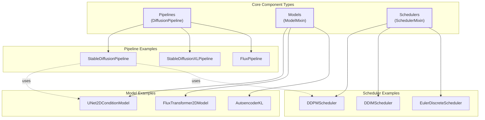
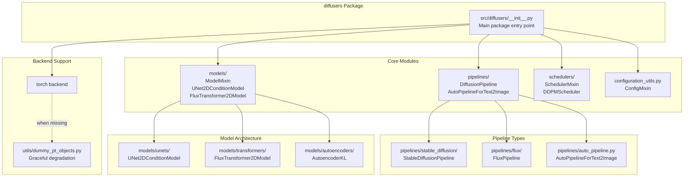
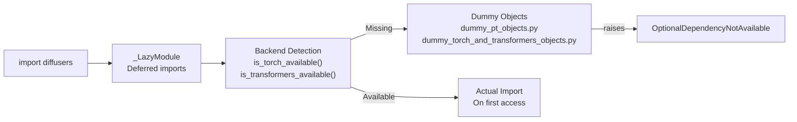
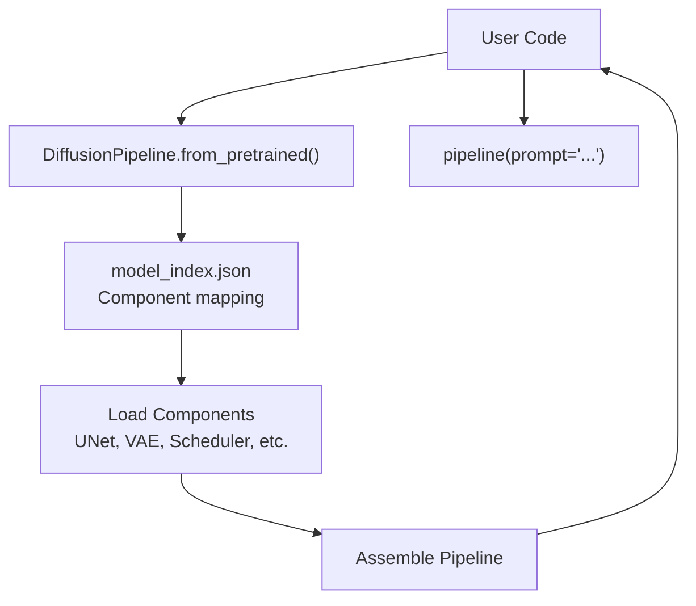
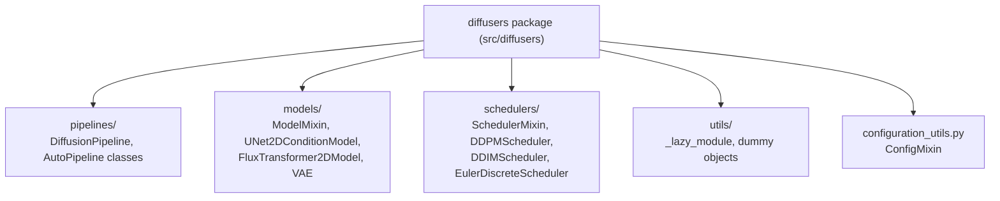

<!-- source: DeepWiki mcp.deepwiki.com · repo huggingface/diffusers · page 1 Introduction to Diffusers · fetched 2026-10-21 -->

# Introduction to Diffusers

<details>
<summary>Relevant source files</summary>

The following files were used as context for generating this wiki page:

- [README.md](README.md)
- [docs/source/en/_toctree.yml](docs/source/en/_toctree.yml)
- [src/diffusers/__init__.py](src/diffusers/__init__.py)
- [src/diffusers/models/README.md](src/diffusers/models/README.md)
- [src/diffusers/models/__init__.py](src/diffusers/models/__init__.py)
- [src/diffusers/models/autoencoders/__init__.py](src/diffusers/models/autoencoders/__init__.py)
- [src/diffusers/models/transformers/__init__.py](src/diffusers/models/transformers/__init__.py)
- [src/diffusers/pipelines/README.md](src/diffusers/pipelines/README.md)
- [src/diffusers/pipelines/__init__.py](src/diffusers/pipelines/__init__.py)
- [src/diffusers/pipelines/stable_diffusion/README.md](src/diffusers/pipelines/stable_diffusion/README.md)
- [src/diffusers/pipelines/stable_diffusion/__init__.py](src/diffusers/pipelines/stable_diffusion/__init__.py)
- [src/diffusers/schedulers/README.md](src/diffusers/schedulers/README.md)
- [src/diffusers/schedulers/__init__.py](src/diffusers/schedulers/__init__.py)
- [src/diffusers/utils/dummy_pt_objects.py](src/diffusers/utils/dummy_pt_objects.py)
- [src/diffusers/utils/dummy_torch_and_transformers_objects.py](src/diffusers/utils/dummy_torch_and_transformers_objects.py)

</details>


## Purpose and Scope

This document provides a high-level introduction to the `diffusers` library, a comprehensive Python toolkit for working with state-of-the-art diffusion models. This page covers the library's core purpose, fundamental architecture, and primary capabilities for both inference and training of diffusion models.

For detailed information about specific subsystems, see:
- **Architecture details**: [Architecture Overview](#1.1) — Explain the overall architecture of the library, including the module organization, lazy loading system, and backend abstraction.
- **Installation and basic usage**: [Getting Started](#1.2) — Guide users through installation and basic usage patterns, including simple text-to-image generation examples.
- **Package structure and dependencies**: [Package Structure and Dependencies](#1.3) — Document the package layout, dependency management, and extras groups for different use cases.
- **Core components**: [Core Components](#2)
- **Specific pipelines**: [Stable Diffusion Pipelines](#3)

---

## What is Diffusers?

**Diffusers** is a modular library designed to provide easy access to pretrained diffusion models for generating images, audio, video, and even 3D structures. The library is designed with a focus on usability, simplicity, and customizability over complex abstractions.

| Principle                     | Description                                                                                       |
|-------------------------------|-------------------------------------------------------------------------------------------------|
| **Usability over Performance** | Simple, intuitive APIs that prioritize ease of use while maintaining state-of-the-art capabilities [README.md:30-31]() |
| **Simple over Easy**           | Transparent, readable code where implementation details are accessible rather than hidden [README.md:30-31]()                 |
| **Customizability over Abstractions** | Modular components that can be mixed, matched, and extended [README.md:30-31]()                                                     |

The library supports both **inference** (generating outputs from pretrained models) and **training** (fine-tuning or training diffusion models from scratch).

**Sources:** [README.md:30-36]()

---

## Three Core Components

Diffusers is built around three fundamental, interchangeable component types:



### 1. Pipelines (`DiffusionPipeline`)

Pipelines are end-to-end workflows that combine models, schedulers, and other components (like text encoders from `transformers`) to perform specific tasks.

- **Base class**: `DiffusionPipeline` [src/diffusers/pipelines/pipeline_utils.py:56]() (referenced in [src/diffusers/pipelines/__init__.py:56]())
- **Key method**: `from_pretrained()` for loading pretrained models [README.md:68](), `__call__()` for running inference [README.md:70]().
- **Examples**: `StableDiffusionPipeline`, `StableDiffusionXLPipeline`, `FluxPipeline` [src/diffusers/pipelines/__init__.py:43-200]().

### 2. Models (`ModelMixin`)

Models are neural network architectures that perform the core denoising or generative operations. These include UNets, Transformers, VAEs, and ControlNets.

- **Base class**: `ModelMixin` [src/diffusers/models/__init__.py:89]()
- **Key types**:
  - Denoisers: e.g., `UNet2DConditionModel`
  - Transformers: e.g., `FluxTransformer2DModel`
  - VAEs: e.g., `AutoencoderKL`
  
  [src/diffusers/models/__init__.py:26-110]()

### 3. Schedulers (`SchedulerMixin`)

Schedulers orchestrate the diffusion process, managing noise schedules, the forward and reverse diffusion steps, and controlling generation quality/speed trade-offs.

- **Base class**: `SchedulerMixin` [src/diffusers/schedulers/__init__.py:83]()
- **Key methods**: `set_timesteps()`, `step()`, and noise management [README.md:82-91]()
- **Examples**: `DDPMScheduler`, `DDIMScheduler`, `EulerDiscreteScheduler` [src/diffusers/schedulers/__init__.py:40-85]().

**Sources:** [README.md:32-36](), [src/diffusers/pipelines/__init__.py:43-200](), [src/diffusers/models/__init__.py:26-110](), [src/diffusers/schedulers/__init__.py:40-85]()

---

## Library Architecture: Code Structure

The high-level organization of the library reflects distinct modular responsibilities:



### Module Organization

| Module              | Location                       | Purpose                          |
|---------------------|--------------------------------|---------------------------------|
| **Pipelines**       | `src/diffusers/pipelines/`     | End-to-end inference workflows [src/diffusers/pipelines/__init__.py:22-33]() |
| **Models**          | `src/diffusers/models/`        | Neural network architectures [src/diffusers/models/__init__.py:26-110]()       |
| **Schedulers**      | `src/diffusers/schedulers/`    | Diffusion process control [src/diffusers/schedulers/__init__.py:40-84]()       |
| **Configuration**   | `src/diffusers/configuration_utils.py` | Configuration management via `ConfigMixin` [src/diffusers/__init__.py:37]()     |
| **Utils**           | `src/diffusers/utils/`         | Import management, logging, dummy objects [src/diffusers/__init__.py:47-61]()    |

---

## Lazy Loading and Dependency Management

`diffusers` uses a **lazy loading system** to optimize import times and conditionally load components based on available dependencies (e.g., `torch`, `transformers`, `accelerate`). This system delays import of heavy or optional submodules until they are actually accessed, improving startup performance and giving clear error messages if dependencies are missing.



### Dummy Objects for Missing Dependencies

When optional dependencies are not installed, the library provides dummy proxy classes that raise informative errors if used, helping users quickly identify missing requirements.

Example: Classes in `dummy_torch_and_transformers_objects.py` (e.g., `Flux2AutoBlocks`) require both `torch` and `transformers` backends and will raise errors if either is absent [src/diffusers/utils/dummy_torch_and_transformers_objects.py:1-214]().

**Sources:** [src/diffusers/__init__.py:5-26](), [src/diffusers/utils/dummy_pt_objects.py:5-17](), [src/diffusers/utils/dummy_torch_and_transformers_objects.py:1-214]()

---

## Pipeline Loading and Execution Flow

The key entrypoint for end users is the `DiffusionPipeline` class, which supports loading complete pretrained diffusion systems easily:



### Task-Based Pipeline Selection via AutoPipeline

The library provides `AutoPipeline` classes that automatically select the appropriate pipeline class based on the checkpoint’s metadata, enabling users to interact with the simplest possible API.

| AutoPipeline Class              | Task            | Location                                          |
|-------------------------------|-----------------|-------------------------------------------------|
| `AutoPipelineForText2Image`    | Text-to-Image   | [src/diffusers/pipelines/auto_pipeline.py:146]() (referenced in [src/diffusers/pipelines/__init__.py:46]()) |
| `AutoPipelineForImage2Image`   | Image-to-Image  | [src/diffusers/pipelines/auto_pipeline.py:334]() (referenced in [src/diffusers/pipelines/__init__.py:44]()) |
| `AutoPipelineForInpainting`    | Inpainting      | [src/diffusers/pipelines/auto_pipeline.py:516]() (referenced in [src/diffusers/pipelines/__init__.py:45]()) |
| `AutoPipelineForText2Audio`    | Text-to-Audio   | [src/diffusers/pipelines/__init__.py:47]()      |

**Sources:** [src/diffusers/pipelines/__init__.py:43-48](), [src/diffusers/pipelines/auto_pipeline.py:146-516]()

---

## Quick Start Example

Generating an image from text requires only a few lines of code using pretrained pipelines:

```python
from diffusers import DiffusionPipeline
import torch

# Load a pretrained pipeline [README.md:68]
pipeline = DiffusionPipeline.from_pretrained(
    "stable-diffusion-v1-5/stable-diffusion-v1-5", 
    torch_dtype=torch.float16
)
pipeline.to("cuda")

# Generate an image with a text prompt [README.md:70]
image = pipeline("An image of a squirrel in Picasso style").images[0]
```

For advanced users, the library also exposes the underlying building blocks to construct custom diffusion workflows:

```python
from diffusers import DDPMScheduler, UNet2DModel
import torch
from PIL import Image

scheduler = DDPMScheduler.from_pretrained("google/ddpm-cat-256")
model = UNet2DModel.from_pretrained("google/ddpm-cat-256").to("cuda")
scheduler.set_timesteps(50)

sample_size = model.config.sample_size
noise = torch.randn((1, 3, sample_size, sample_size), device="cuda")
input = noise

for t in scheduler.timesteps:
    with torch.no_grad():
        noisy_residual = model(input, t).sample
        prev_noisy_sample = scheduler.step(noisy_residual, t, input).prev_sample
        input = prev_noisy_sample

image = (input / 2 + 0.5).clamp(0, 1)
image = image.cpu().permute(0, 2, 3, 1).numpy()[0]
image = Image.fromarray((image * 255).round().astype("uint8"))
image
```

**Sources:** [README.md:65-98]()

---

## Summary

Diffusers offers a clean, modular, and extensible framework to work with diffusion models effectively:

- **Modular Components**: Pipelines, Models, and Schedulers are distinct and swappable to customize workflows.
- **Lazy Loading**: Optimized import system with clear optional dependency behavior.
- **Pretrained Model Hub**: Seamless access to over 30,000 pretrained checkpoints.
- **Broad Task Support**: Text-to-image, image-to-image, inpainting, video, and audio generation pipelines.

For more detailed explanations, see the following child pages:
- [Architecture Overview](#1.1)
- [Getting Started](#1.2)
- [Package Structure and Dependencies](#1.3)

---

# Associating Common Terms to Code Entities

```mermaid
graph LR
    NL["Natural Language Space"]
    CE["Code Entity Space"]

    NL -->|"Diffusion Model Pipeline"\n("End-to-end system for inference")| CE_DiffusionPipeline[DiffusionPipeline]
    NL -->|"Scheduler"\n("Manages noise and timesteps")| CE_Scheduler[SchedulerMixin and subclasses]
    NL -->|"Neural Network Model"\n("Denoiser, encoder-decoder")| CE_Model[ModelMixin and subclasses]
    NL -->|"AutoPipeline"\n("Task-based pipeline selector")| CE_AutoPipeline[AutoPipelineForText2Image, etc.]
    NL -->|"Pretrained Model Hub"\n("Load weights easily")| CE_from_pretrained[from_pretrained() methods]

    CE_DiffusionPipeline --> CE_Model
    CE_DiffusionPipeline --> CE_Scheduler
    CE_DiffusionPipeline --> CE_from_pretrained
    CE_AutoPipeline --> CE_DiffusionPipeline
```

---

# Mapping Library Components to Code Modules



---

**Sources:**  
- [README.md:30-100]()  
- [src/diffusers/__init__.py:1-160]()  
- [src/diffusers/pipelines/__init__.py:20-200]()  
- [src/diffusers/models/__init__.py:10-110]()  
- [src/diffusers/schedulers/__init__.py:30-85]()  
- [src/diffusers/utils/dummy_torch_and_transformers_objects.py:1-214]()

---

