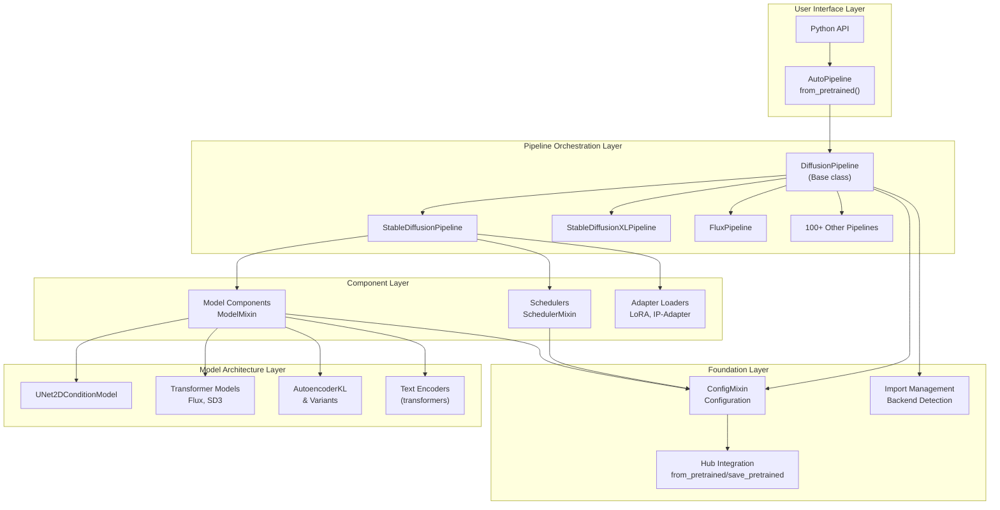
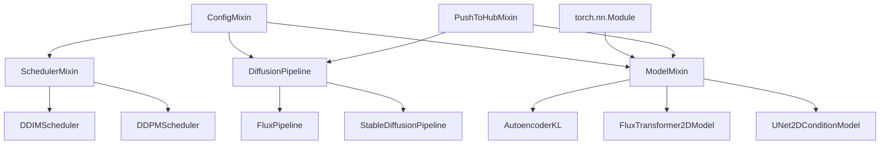
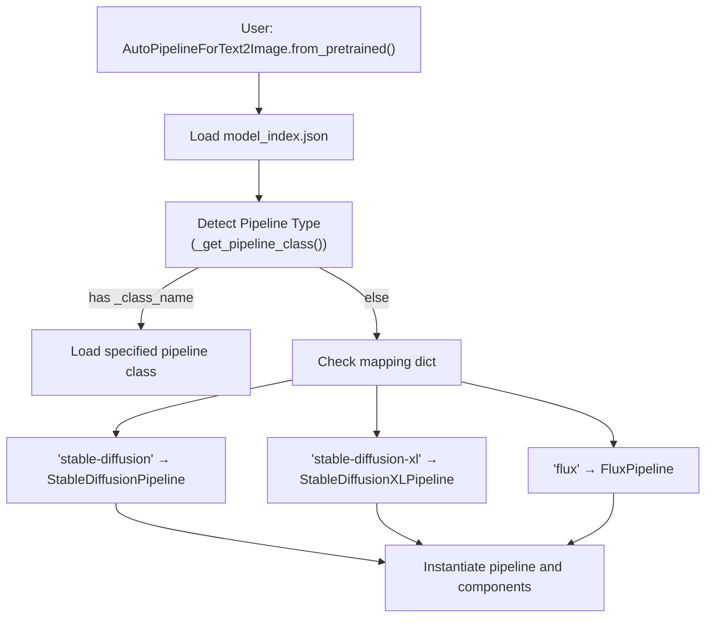
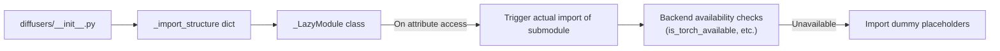
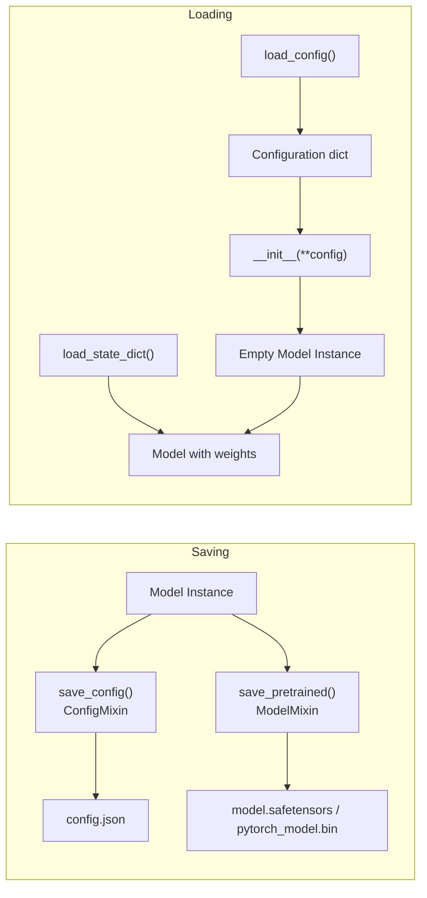

<!-- source: DeepWiki mcp.deepwiki.com · repo huggingface/diffusers · page 1.1 Architecture Overview · fetched 2026-10-21 -->

# Architecture Overview

<details>
<summary>Relevant source files</summary>

The following files were used as context for generating this wiki page:

- [README.md](README.md)
- [docs/source/en/_toctree.yml](docs/source/en/_toctree.yml)
- [src/diffusers/__init__.py](src/diffusers/__init__.py)
- [src/diffusers/models/README.md](src/diffusers/models/README.md)
- [src/diffusers/models/__init__.py](src/diffusers/models/__init__.py)
- [src/diffusers/models/autoencoders/__init__.py](src/diffusers/models/autoencoders/__init__.py)
- [src/diffusers/models/transformers/__init__.py](src/diffusers/models/transformers/__init__.py)
- [src/diffusers/pipelines/README.md](src/diffusers/pipelines/README.md)
- [src/diffusers/pipelines/__init__.py](src/diffusers/pipelines/__init__.py)
- [src/diffusers/pipelines/stable_diffusion/README.md](src/diffusers/pipelines/stable_diffusion/README.md)
- [src/diffusers/pipelines/stable_diffusion/__init__.py](src/diffusers/pipelines/stable_diffusion/__init__.py)
- [src/diffusers/schedulers/README.md](src/diffusers/schedulers/README.md)
- [src/diffusers/schedulers/__init__.py](src/diffusers/schedulers/__init__.py)
- [src/diffusers/utils/dummy_pt_objects.py](src/diffusers/utils/dummy_pt_objects.py)
- [src/diffusers/utils/dummy_torch_and_transformers_objects.py](src/diffusers/utils/dummy_torch_and_transformers_objects.py)

</details>


This page provides a high-level overview of the Diffusers library architecture, explaining how the major systems work together. It covers the core base classes, the pipeline execution model, model components, import and backend management, and configuration mechanisms. For detailed information on specific subsystems, refer to the linked sections.

---

## Architectural Layers

The Diffusers library is organized into distinct architectural layers with specialized roles:



**Explanation:**
- The **User Interface Layer** exposes a user-friendly API and automatic pipeline loaders.
- The **Pipeline Orchestration Layer** defines base and specialized pipeline classes handling end-to-end diffusion.
- The **Component Layer** manages modular model parts (models, schedulers, adapters).
- The **Model Architecture Layer** contains the concrete neural network model classes.
- The **Foundation Layer** includes configuration, serialization, model hub integration, and import backend abstractions.

**Sources:** [src/diffusers/pipelines/pipeline_utils.py:184-209](), [src/diffusers/models/modeling_utils.py:80-123](), [src/diffusers/__init__.py:36-62]()

---

## Core Base Classes

Diffusers is built on four fundamental base classes, which provide consistent interfaces for model loading, configuration, scheduling, and pipelines.

| Base Class        | Location                                  | Responsibilities                                                      |
|-------------------|-------------------------------------------|---------------------------------------------------------------------|
| `ConfigMixin`     | [configuration_utils.py:47-47]()          | Serialize/deserialize configuration. Support `from_config`, `save_config`. Auto-registers parameters during init. |
| `ModelMixin`      | [modeling_utils.py:82-82]()                | Extends `torch.nn.Module`. Handles model loading/saving, device management, gradient checkpointing.              |
| `SchedulerMixin`  | [scheduling_utils.py:53-53]()              | Scheduler config, timestep setting, noise schedule logic.                                                |
| `DiffusionPipeline` | [pipeline_utils.py:184-184]()            | Orchestrates pipeline components for inference. Extends `ConfigMixin` and `PushToHubMixin`.               |

### Inheritance Hierarchy



This hierarchy represents how configuration and pipeline orchestration extend model and scheduler abstractions, creating a modular, extensible system.

**Sources:** [src/diffusers/configuration_utils.py:47-47](), [src/diffusers/models/modeling_utils.py:80-123](), [src/diffusers/pipelines/pipeline_utils.py:184-209]()

---

## Pipeline System Architecture

The pipeline system provides the high-level, user-facing abstraction that unifies multiple components into easy-to-use diffusion pipelines.

### Component Registration within Pipelines

```mermaid
graph LR
    Pipeline["DiffusionPipeline Instance"]

    Pipeline -->|register_modules()| Components["Component Registry"]

    Components --> UNet["unet:<br/>UNet2DConditionModel"]
    Components --> VAE["vae:<br/>AutoencoderKL"]
    Components --> TextEnc["text_encoder:<br/>CLIPTextModel"]
    Components --> Tokenizer["tokenizer:<br/>CLIPTokenizer"]
    Components --> Scheduler["scheduler:<br/>DDIMScheduler"]

    Components -->|saved in| ConfigFile["model_index.json"]
```

- The `register_modules()` method registers components by string keys with their instances.
- Component library and class names are recorded in `model_index.json`, enabling reconstruction during `from_pretrained()` loading.
- This pattern allows pipelines to load complex multi-model systems seamlessly.

**Sources:** [src/diffusers/pipelines/pipeline_utils.py:210-224](), [src/diffusers/pipelines/pipeline_utils.py:240-372]()

### AutoPipeline Detection System

`AutoPipeline` classes implement an automated detection mechanism selecting the appropriate pipeline class for a given checkpoint based on the checkpoint’s configuration.



- The pipeline class is detected primarily by inspecting keys like `_class_name` or matching the checkpoint identifier with known pipeline mappings.
- This system supports multiple tasks like text-to-image, image-to-image, and inpainting by mapping auto pipeline classes accordingly.

**Sources:** [src/diffusers/pipelines/auto_pipeline.py:146-183](), [src/diffusers/pipelines/__init__.py:43-48]()

---

## Import and Backend Management

The library utilizes a lazy loading system and backend abstraction to handle optional dependencies and reduce import time.

### Lazy Loading System



- `_import_structure` declares submodules and exported symbols without importing them immediately.
- `_LazyModule` proxies attribute access and defers import until the symbol is actually used.
- Backend availability functions check for environments (like PyTorch, Accelerate) and conditionally load dummy objects if missing.
- Dummy objects raise `OptionalDependencyNotAvailable` errors only upon usage, not upon import.

**Sources:** [src/diffusers/__init__.py:36-62](), [src/diffusers/utils/import_utils.py:64-94]()

### Backend Abstraction

- When core backends such as PyTorch or Transformers are absent, dummy classes defined in files such as `dummy_pt_objects.py` or `dummy_torch_and_transformers_objects.py` replace real implementations.
- These dummy classes delay dependency errors to runtime, improving flexibility during partial installs or environment mismatches.
- This system ensures the same namespace and API surface are always exposed, easing development and distribution.

**Sources:** [src/diffusers/utils/import_utils.py:130-131](), [src/diffusers/utils/dummy_pt_objects.py:5-17](), [src/diffusers/utils/dummy_torch_and_transformers_objects.py:5-13]()

---

## Model Component System

Model components are modular and inherit from `ModelMixin`, providing standardized functionality for model lifecycle management.

### Model Categories and Examples

| Category           | Base / Mixin                      | Examples                              | Description                                     |
|--------------------|----------------------------------|-------------------------------------|------------------------------------------------|
| **UNet Models**     | `UNet2DConditionModel`            | Stable Diffusion 1.x/2.x, ControlNet| Core CNN backbone for denoising diffusion      |
| **Transformer Models** | `FluxTransformer2DModel`, `SD3Transformer2DModel` | Flux, SD3, PixArt                   | Transformer-based backbone models               |
| **Autoencoders**   | `AutoencoderKL`                   | Standard VAE, CogVideoX VAE          | Encoder-decoder for latent space representation|
| **Adapters**        | `ControlNetModel`, `T2IAdapter`   | ControlNet, T2I-Adapter              | Conditional control modules for pipelines      |

- The component model base classes add consistent load/save and device management capabilities on top of `torch.nn.Module`.
- Models are typically loaded from pretrained weights and used as submodules within pipelines.

**Sources:** [src/diffusers/models/__init__.py:26-110](), [src/diffusers/models/modeling_utils.py:82-123]()

---

## Scheduler System

Schedulers implement noise schedules and sampling algorithms controlling the diffusion or denoising process.

| Important Methods       | Description                                                                                  |
|------------------------|----------------------------------------------------------------------------------------------|
| `set_timesteps()`       | Initialize the sequence of timesteps used in denoising or sampling loops                    |
| `step()`               | Perform one denoising sampling step                                                          |
| `add_noise()`           | Add noise to input samples for training or inversion tasks                                  |

- All schedulers implement a consistent interface via `SchedulerMixin`.
- The system supports many scheduler variants with interchangeable implementations, enabling different generation behaviors.

**Sources:** [src/diffusers/schedulers/__init__.py:23-34](), [src/diffusers/schedulers/scheduling_utils.py:53-53]()

---

## Configuration and Serialization

The `ConfigMixin` class underpins the configuration and serialization mechanism enabling easy saving/loading of models, schedulers, and pipelines.



- ConfigMixin automatically stores constructor arguments in a dictionary.
- `save_config()` outputs JSON config files.
- `from_config()` instantiates models/pipelines directly from config dictionaries.
- The two-step load initializes a model first (config-only), then loads pretrained weights, allowing flexible model initialization.

**Sources:** [src/diffusers/configuration_utils.py:47-47](), [src/diffusers/models/modeling_utils.py:43-66]()

---

This architecture provides a flexible and extensible foundation to build, load, and run a variety of diffusion models and pipelines from pretrained components, while supporting multiple backends and optimization strategies.

# Additional Diagrams Bridging Natural Language Components to Code Entities

## Pipeline and Components Mapping

```mermaid
graph TD
    "Natural(Language Task)" -->|"uses"| "AutoPipelineForText2Image[from_pretrained()]"
    "AutoPipelineForText2Image" -->|"instantiates"| "StableDiffusionPipeline"
    "StableDiffusionPipeline" -->|"registers"| "UNet2DConditionModel[models/unet_2d_condition.py]"
    "StableDiffusionPipeline" -->|"registers"| "AutoencoderKL[models/autoencoders/autoencoder_kl.py]"
    "StableDiffusionPipeline" -->|"registers"| "CLIPTextModel[transformers]"
    "StableDiffusionPipeline" -->|"uses"| "DDIMScheduler[schedulers/scheduling_ddim.py]"
```

## Import and Backend Layer Detail

```mermaid
graph LR
    "diffusers/__init__.py" --> "_import_structure {modules and symbols}"
    "_import_structure" --> "_LazyModule (defer import)"
    "_LazyModule" --On access--> "Import submodule (e.g., models, pipelines)"
    "Import submodule" --> "Backend check (is_torch_available etc.)"
    "Backend check - failed" --> "Dummy objects - raise on usage"
```

---

**Sources:**  
- [src/diffusers/__init__.py:30-160]()  
- [src/diffusers/pipelines/pipeline_utils.py:184-372]()  
- [src/diffusers/pipelines/auto_pipeline.py:146-183]()  
- [src/diffusers/utils/dummy_pt_objects.py:1-60]()  
- [src/diffusers/utils/dummy_torch_and_transformers_objects.py:1-60]()  
- [src/diffusers/models/__init__.py:20-110]()  
- [src/diffusers/schedulers/__init__.py:20-80]()  
- [src/diffusers/configuration_utils.py:40-80]()

---

