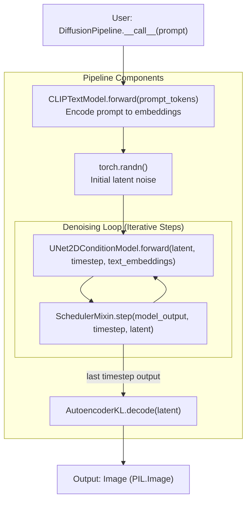
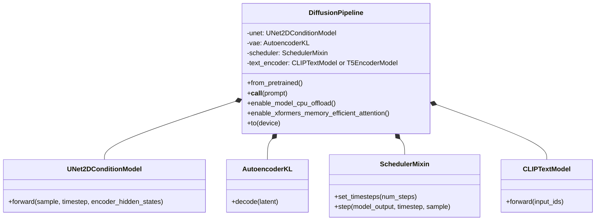

<!-- source: DeepWiki mcp.deepwiki.com · repo huggingface/diffusers · page 1.2 Getting Started · fetched 2026-10-21 -->

# Getting Started

<details>
<summary>Relevant source files</summary>

The following files were used as context for generating this wiki page:

- [docs/source/en/index.md](docs/source/en/index.md)
- [docs/source/en/installation.md](docs/source/en/installation.md)
- [docs/source/en/quantization/bitsandbytes.md](docs/source/en/quantization/bitsandbytes.md)
- [docs/source/en/quicktour.md](docs/source/en/quicktour.md)
- [docs/source/en/training/adapt_a_model.md](docs/source/en/training/adapt_a_model.md)
- [docs/source/en/training/overview.md](docs/source/en/training/overview.md)
- [docs/source/en/tutorials/basic_training.md](docs/source/en/tutorials/basic_training.md)
- [docs/source/en/using-diffusers/conditional_image_generation.md](docs/source/en/using-diffusers/conditional_image_generation.md)
- [docs/source/en/using-diffusers/depth2img.md](docs/source/en/using-diffusers/depth2img.md)
- [docs/source/en/using-diffusers/img2img.md](docs/source/en/using-diffusers/img2img.md)
- [docs/source/en/using-diffusers/inpaint.md](docs/source/en/using-diffusers/inpaint.md)
- [docs/source/en/using-diffusers/unconditional_image_generation.md](docs/source/en/using-diffusers/unconditional_image_generation.md)
- [docs/source/en/using-diffusers/write_own_pipeline.md](docs/source/en/using-diffusers/write_own_pipeline.md)
- [docs/source/ko/installation.md](docs/source/ko/installation.md)
- [docs/source/ko/optimization/fp16.md](docs/source/ko/optimization/fp16.md)
- [docs/source/ko/optimization/torch2.0.md](docs/source/ko/optimization/torch2.0.md)
- [docs/source/ko/training/adapt_a_model.md](docs/source/ko/training/adapt_a_model.md)
- [docs/source/ko/tutorials/basic_training.md](docs/source/ko/tutorials/basic_training.md)
- [docs/source/ko/using-diffusers/write_own_pipeline.md](docs/source/ko/using-diffusers/write_own_pipeline.md)
- [docs/source/zh/installation.md](docs/source/zh/installation.md)
- [examples/research_projects/intel_opts/textual_inversion_dfq/textual_inversion.py](examples/research_projects/intel_opts/textual_inversion_dfq/textual_inversion.py)
- [src/diffusers/quantizers/__init__.py](src/diffusers/quantizers/__init__.py)

</details>


## Purpose

This page guides you through installing the Diffusers library and running your first generation tasks. You'll learn how to load pretrained models, generate images and videos with a few lines of code, and understand the core library components. Diffusers is designed with a focus on usability, simplicity, and customizability [README.md:30-31]().

For the library's architecture and design principles, see [Architecture Overview](#1.1). For package structure and dependency management, see [Package Structure and Dependencies](#1.3).

---

## Installation

### Core Installation

Install Diffusers with PyTorch support using pip, which is the recommended method for most users [docs/source/en/installation.md:14-31]().

```bash
pip install --upgrade diffusers[torch] transformers
```

This command installs the Diffusers library along with essential dependencies such as PyTorch, Transformers, Accelerate, Safetensors, Pillow, and NumPy.

### Alternative Installation Methods

- **Conda (community-maintained):**

```bash
conda install -c conda-forge diffusers
```

- **Source installation (for latest development version):**

```bash
pip install accelerate
pip install git+https://github.com/huggingface/diffusers
```

> **Note:** Make sure to set up a Python 3.10+ environment and install PyTorch 2.6+ suitable for your hardware.

### Device Selection

Diffusers supports all accelerators that PyTorch supports, such as CUDA GPUs, Apple Silicon (via MPS), Intel GPUs (via XPU), and CPU. Specify the device when moving the pipeline:

```python
device = "cuda"  # or "mps", "xpu", "cpu"
pipeline.to(device)
```

To programmatically select the device at runtime, use the PyTorch accelerator API:

```python
import torch
device = torch.accelerator.current_accelerator().type if torch.accelerator.is_available() else "cpu"
```

### Cache Control and Telemetry

- Model weights and checkpoints download to a cache folder (default in your home directory). You can override this with environment variables:

```bash
export HF_HOME="/path/to/cache"
export HF_HUB_CACHE="/path/to/hub/cache"
```

- Telemetry data is collected when loading models from the Hub to improve reliability and prioritize features. Disable telemetry by:

```bash
export HF_HUB_DISABLE_TELEMETRY=1
```

**Sources:** [docs/source/en/installation.md:13-153]()

---

## Basic Usage Pattern: Loading and Running Pipelines

The Diffusers library offers a straightforward API for generating images, videos, and audio using pretrained diffusion pipelines. The core abstraction for inference is the `DiffusionPipeline` class, which bundles all relevant models and schedulers to provide a convenient interface.

### Loading a Pipeline

Use the `from_pretrained()` class method to load a pretrained model checkpoint; this automatically selects the appropriate pipeline subclass based on the checkpoint metadata (`model_index.json`).

```python
import torch
from diffusers import DiffusionPipeline

pipeline = DiffusionPipeline.from_pretrained(
    "stable-diffusion-v1-5/stable-diffusion-v1-5",
    torch_dtype=torch.float16,  # Use float16 for GPU acceleration
    variant="fp16"
)
pipeline.to("cuda")  # or use .to(device)
```

### Generating an Image: Simple Text-to-Image Example

Once loaded, generate an image by providing a text prompt:

```python
prompt = "A scenic landscape of mountains during sunrise, photorealistic, 4k"
image = pipeline(prompt).images[0]
image.save("output.png")
```

You can optionally set random seed generators for reproducibility:

```python
generator = torch.Generator("cuda").manual_seed(42)
image = pipeline(prompt, generator=generator).images[0]
```

---

### Core Components Involved

A typical text-to-image pipeline integrates several core model components:

- **Text Encoder** (`CLIPTextModel` or `T5EncoderModel`): encodes the prompt into embeddings
- **UNet Model** (`UNet2DConditionModel`): performs the denoising steps in latent space
- **Scheduler** (`SchedulerMixin`): guides the diffusion sampling process by scheduling noise steps
- **Autoencoder** (`AutoencoderKL`): decodes the final latent representation into a pixel image

---

### Data Flow Diagram for Text-to-Image Generation



This diagram illustrates how the user's text prompt enters the pipeline, is encoded to embeddings, then combined with initial noise to be denoised by the UNet model and scheduler iteratively. The final latent representation is decoded into an image.

**Sources:** [docs/source/en/using-diffusers/conditional_image_generation.md:13-44](), [docs/source/en/quicktour.md:50-67](), [src/diffusers/pipelines/README.md:7-15]()

---

## Popular Example: Text-to-Image Generation with Stable Diffusion v1.5

```python
import torch
from diffusers import AutoPipelineForText2Image

pipeline = AutoPipelineForText2Image.from_pretrained(
    "stable-diffusion-v1-5/stable-diffusion-v1-5",
    torch_dtype=torch.float16
).to("cuda")

prompt = "A fantasy castle on a cliff, sunset, highly detailed"
image = pipeline(prompt).images[0]
image.save("castle.png")
```

---

## Handling Larger Models and Optimizations

### Model CPU Offloading

To handle large models on limited GPU memory, use CPU offloading:

```python
pipeline.enable_model_cpu_offload()
```

This moves parts of the model to CPU when inactive, reducing peak GPU memory requirements.

### Efficient Attention

For improved inference speed and memory usage, enable efficient attention mechanisms if available:

```python
pipeline.enable_xformers_memory_efficient_attention()
```

Note: PyTorch 2.0+ includes native scaled dot-product attention that is efficient, so this call might be optional depending on your environment.

### Quantization

Diffusers supports loading models in quantized formats (4-bit or 8-bit) using interfaces like bitsandbytes:

```python
from diffusers.quantizers import PipelineQuantizationConfig

quant_config = PipelineQuantizationConfig(
    quant_backend="bitsandbytes_4bit",
    quant_kwargs={"load_in_4bit": True},
    components_to_quantize=["transformer", "text_encoder"],
)

pipeline = DiffusionPipeline.from_pretrained(
    "Qwen/Qwen-Image",
    quantization_config=quant_config,
    device_map="auto"
)
```

Quantization reduces memory footprints and may speed up inference with minimal quality loss.

---

## Advanced Usage: Manual Pipeline Deconstruction and Model Interaction

For users requiring custom control, you can instantiate and run individual pipeline components directly.

### Example: Manually running denoising loop with model and scheduler

```python
from diffusers import UNet2DModel, DDPMScheduler
import torch

# Load components (model and scheduler)
model = UNet2DModel.from_pretrained("google/ddpm-cat-256").to("cuda")
scheduler = DDPMScheduler.from_pretrained("google/ddpm-cat-256")
scheduler.set_timesteps(num_inference_steps=50)

# Prepare initial noise tensor with expected shape
sample = torch.randn((1, 3, model.config.sample_size, model.config.sample_size), device="cuda")

for t in scheduler.timesteps:
    with torch.no_grad():
        noise_pred = model(sample, t).sample
    sample = scheduler.step(noise_pred, t, sample).prev_sample

# Convert tensor to PIL image
from PIL import Image
image_tensor = (sample / 2 + 0.5).clamp(0, 1).cpu()
image = Image.fromarray((image_tensor[0].permute(1, 2, 0).numpy() * 255).round().astype("uint8"))
image.save("generated_cat.png")
```

This exemplifies the fundamental logic inside the pipeline’s `__call__`.

---

### Component Interaction Diagram for Manual Usage



This diagram clarifies the `DiffusionPipeline` encapsulates these core components and provides orchestrated behavior over them.

**Sources:** [docs/source/en/using-diffusers/write_own_pipeline.md:12-101](), [docs/source/en/quicktour.md:26-45](), [src/diffusers/pipelines/README.md:7-23]()

---

## Next Steps

After mastering installation and basic generation:

- Explore [AutoPipelines](./api/pipelines/auto_pipeline.md) like `AutoPipelineForText2Image` and `AutoPipelineForImage2Image` for task-specific pipelines.
- Customize diffusion process with different schedulers ([Schedulers](./using-diffusers/schedulers.md)) like DDIM, Euler, or UniPC for speed or quality tradeoffs.
- Utilize adapters like LoRA for fine-tuning small task-specific weights without full model retraining.
- Examine example scripts for training and fine-tuning models in the [examples](https://github.com/huggingface/diffusers/tree/main/examples) directory.

---

**Sources:**  
- [docs/source/en/installation.md]()  
- [docs/source/en/using-diffusers/conditional_image_generation.md]()  
- [docs/source/en/quicktour.md]()  
- [docs/source/en/using-diffusers/write_own_pipeline.md]()  
- [src/diffusers/pipelines/README.md]()

---

