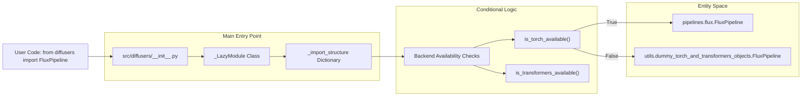
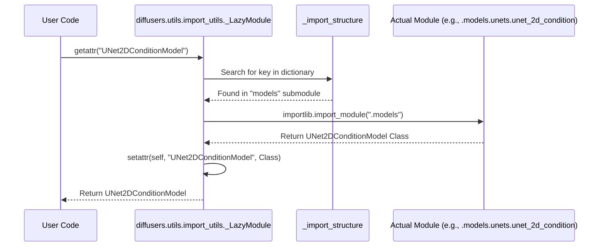
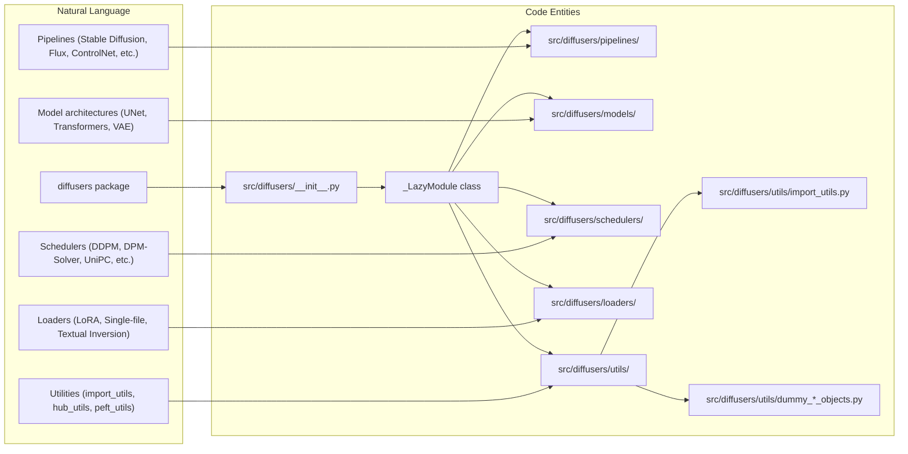

<!-- source: DeepWiki mcp.deepwiki.com · repo huggingface/diffusers · page 1.3 Package Structure and Dependencies · fetched 2026-10-21 -->

# Package Structure and Dependencies

<details>
<summary>Relevant source files</summary>

The following files were used as context for generating this wiki page:

- [examples/dreambooth/train_dreambooth.py](examples/dreambooth/train_dreambooth.py)
- [examples/dreambooth/train_dreambooth_flax.py](examples/dreambooth/train_dreambooth_flax.py)
- [examples/dreambooth/train_dreambooth_lora.py](examples/dreambooth/train_dreambooth_lora.py)
- [examples/text_to_image/train_text_to_image.py](examples/text_to_image/train_text_to_image.py)
- [examples/text_to_image/train_text_to_image_flax.py](examples/text_to_image/train_text_to_image_flax.py)
- [examples/text_to_image/train_text_to_image_lora.py](examples/text_to_image/train_text_to_image_lora.py)
- [examples/textual_inversion/textual_inversion.py](examples/textual_inversion/textual_inversion.py)
- [examples/textual_inversion/textual_inversion_flax.py](examples/textual_inversion/textual_inversion_flax.py)
- [examples/unconditional_image_generation/train_unconditional.py](examples/unconditional_image_generation/train_unconditional.py)
- [setup.py](setup.py)
- [src/diffusers/dependency_versions_table.py](src/diffusers/dependency_versions_table.py)
- [src/diffusers/utils/__init__.py](src/diffusers/utils/__init__.py)
- [src/diffusers/utils/constants.py](src/diffusers/utils/constants.py)
- [src/diffusers/utils/import_utils.py](src/diffusers/utils/import_utils.py)
- [src/diffusers/utils/testing_utils.py](src/diffusers/utils/testing_utils.py)

</details>


This document describes the organization of the Diffusers library codebase, its dependency management system, and how optional backend support is handled. For information about configuration systems and loading mechanisms, see [Configuration System](2.4) and [Loading and Saving](2.5). For backend-specific optimization details, see [Attention System](4.1).

## Purpose and Scope

Diffusers is structured as a modular library that supports multiple backends (PyTorch, ONNX, and specialized hardware) with graceful degradation when optional dependencies are missing. This document covers:

- Source directory layout and package organization
- Dependency specification and version management
- Lazy import system and dummy object generation
- Backend detection and conditional imports
- Installation configurations and extras

## Package Structure Overview

The Diffusers library follows a hierarchical package structure organized by functionality. The main source code resides in `src/diffusers/` with subpackages for different component types.

### Directory Structure

**Major Package Components Hierarchy**

```mermaid
graph TB
    Root["src/diffusers/"]
    
    Root --> Init["__init__.py<br/>(lazy imports)"]
    Root --> Utils["utils/<br/>(import_utils, testing_utils)"]
    Root --> Pipelines["pipelines/<br/>(100+ pipeline implementations)"]
    Root --> Models["models/<br/>(transformers, unets, vaes)"]
    Root --> Schedulers["schedulers/<br/>(20+ sampling algorithms)"]
    Root --> Loaders["loaders/<br/>(LoRA, single_file, textual_inversion)"]
    Root --> Guiders["guiders/<br/>(guidance implementations)"]
    Root --> Hooks["hooks/<br/>(optimization hooks)"]
    Root --> Quantizers["quantizers/<br/>(quantization configs)"]
    
    Pipelines --> StableDiffusion["stable_diffusion/<br/>(SD 1.x/2.x/3.x pipelines)"]
    Pipelines --> StableDiffusionXL["stable_diffusion_xl/<br/>(SDXL pipelines)"]
    Pipelines --> Flux["flux/<br/>(Flux pipelines)"]
    Pipelines --> ControlNet["controlnet/<br/>(ControlNet pipelines)"]
    Pipelines --> PAG["pag/<br/>(PAG pipelines)"]
    Pipelines --> OtherPipelines["...<br/>(60+ other pipeline folders)"]
    
    Models --> Transformers["transformers/<br/>(50+ transformer models)"]
    Models --> UNets["unets/<br/>(10+ UNet variants)"]
    Models --> Autoencoders["autoencoders/<br/>(20+ VAE variants)"]
    Models --> ControlNets["controlnets/<br/>(10+ ControlNet models)"]
    
    Utils --> ImportUtils["import_utils.py<br/>(backend detection)"]
    Utils --> DummyObjects["dummy_*_objects.py<br/>(auto-generated)"]
    Utils --> HubUtils["hub_utils.py"]
    Utils --> StateDict["state_dict_utils.py"]
```



| Package       | Purpose                         | Key Files                                                  |
|---------------|--------------------------------|------------------------------------------------------------|
| `pipelines/`  | End-to-end generation pipelines| 100+ pipeline implementations across 60+ subdirectories    |
| `models/`     | Neural network architectures   | `transformers/`, `unets/`, `autoencoders/`, `controlnets/` |
| `schedulers/` | Noise scheduling algorithms    | 20+ scheduler implementations                              |
| `loaders/`    | Model loading utilities        | `lora.py`, `single_file.py`, `ip_adapter.py`, `textual_inversion.py` |
| `utils/`      | Shared utilities               | `import_utils.py`, `hub_utils.py`, `peft_utils.py`, `torch_utils.py` [src/diffusers/utils/__init__.py:16-159]() |
| `quantizers/` | Quantization support           | `quantization_config.py`                                   |

**Sources:** [src/diffusers/utils/__init__.py:16-159](), [src/diffusers/utils/import_utils.py:1-26]()

### Import Structure Map

Diffusers employs a lazy import system with dynamic imports based on backend availability. This structure elegantly handles the availability of optional backends like PyTorch and Transformers and gracefully degrades if these are missing.

**Natural Language to Code Entity Mapping: Import Resolution**



This import structure enables the main `diffusers` package initialization to present a clean namespace while only loading heavy submodules upon access.

**Sources:** [src/diffusers/utils/import_utils.py:560-645](), [src/diffusers/utils/import_utils.py:1008-1023]()

## Dependency Management System

Diffusers uses a sophisticated dependency management strategy that supports multiple optional backends with graceful fallbacks when dependencies are missing.

### Core Dependencies

All base dependencies required for the library to function are defined in the `_deps` list inside `setup.py`. This includes packages for image processing, data loading, model components, schedulers, quantization, and logging.

Key dependencies include but are not limited to:

- `Pillow` for image handling
- `accelerate` for optimized training and device management
- `huggingface-hub` for model and dataset access
- `torch>=2.6` as the main deep learning backend
- `transformers>=4.41.2` for transformer architectures
- `safetensors` for efficient weight serialization
- Quantization packages such as `bitsandbytes`, `gguf`, `torchao`, `optimum_quanto`, and `nvidia_modelopt`
- Testing and development tools: `pytest`, `black`, `isort`

**Sources:** [setup.py:96-149](), [src/diffusers/dependency_versions_table.py:4-56]()

### Optional Backend Groups and Extras

Diffusers defines optional dependency sets (extras) to facilitate installation tailored to specific use cases:

| Extra Name      | Included Dependencies                         | Use Case / Purpose                         |
|-----------------|----------------------------------------------|-------------------------------------------|
| `torch`         | `torch>=2.6`, `accelerate>=0.31.0`           | Primary PyTorch backend                    |
| `training`      | `accelerate`, `datasets`, `peft>=0.17.0`, `tensorboard` | Full training and fine-tuning environment|
| `test`          | `pytest`, `transformers`, `scipy`, `librosa` | Testing infrastructure                     |
| `bitsandbytes`  | `bitsandbytes>=0.43.3`                       | 8-bit/4-bit quantization                   |
| `gguf`          | `gguf>=0.10.0`                               | GGUF quantization format                   |
| `torchao`       | `torchao>=0.15.0`                            | TorchAO quantization backend               |
| `optimum_quanto`| `optimum_quanto>=0.2.6`                      | Intel Quanto quantization                  |
| `nvidia_modelopt`| `nvidia_modelopt[hf]>=0.33.1`               | NVIDIA Model Optimization support          |

These extras groups can be installed via pip as:

```bash
pip install diffusers[training]
```

**Sources:** [setup.py:96-149](), [src/diffusers/dependency_versions_table.py:4-56]()

### Dependency Detection System

The library dynamically detects available dependencies at import time to enable or disable features, avoiding hard failures if optional packages are not installed.

Key function for detection uses `importlib.util.find_spec()` and the `importlib_metadata` library to determine package presence and version. This logic is found in `import_utils.py`:

```python
# Simplified check example for torch availability
if USE_TORCH in ENV_VARS_TRUE_AND_AUTO_VALUES and USE_TF not in ENV_VARS_TRUE_VALUES:
    _torch_available, _torch_version = _is_package_available("torch")
else:
    logger.info("Disabling PyTorch because USE_TORCH is set")
    _torch_available = False
    _torch_version = "N/A"

def is_torch_available():
    return _torch_available
```

This dynamic checking pattern is used for many optional components, including `transformers`, `safetensors`, `onnxruntime`, `opencv`, and various quantization backends.

**Sources:** [src/diffusers/utils/import_utils.py:61-94](), [src/diffusers/utils/import_utils.py:97-104]()

## Lazy Import System

To improve import times and reduce startup overhead, Diffusers implements a lazy import mechanism that defers actual module imports until an attribute is referenced.

### Lazy Module Implementation Flow

When a user accesses a symbol from the `diffusers` package, the request is intercepted by the `_LazyModule` class, which:

- Checks if the attribute exists in an import structure dictionary mapping submodules to their exported symbols.
- Lazily imports the targeted submodule using `importlib`.
- Caches the imported symbols in the lazy module instance to avoid repeated imports.

**Natural Language to Code Entity Mapping: Lazy Loading Flow**



This technique allows for controlled and efficient loading behavior, especially important in a large codebase with many optional dependencies.

**Sources:** [src/diffusers/utils/import_utils.py:1008-1023]()

### Dummy Objects for Graceful Degradation

When optional dependencies are not available, Diffusers inserts dummy objects in their place that raise informative errors if accessed. This prevents import-time errors and gives clear messages about missing dependencies.

A metaclass `DummyObject` is used to create these stand-in classes automatically. It checks required backends on attribute access and throws errors if they are not met.

```python
class DummyObject(type):
    """
    Metaclass for dummy objects. Raises an ImportError on attribute access if required backends are missing.
    """
    def __getattr__(cls, key):
        requires_backends(cls, cls._backends)
```

This pattern is applied broadly to substitute dummy pipelines, models, schedulers, and other components that depend on optional backends like PyTorch or Transformers.

**Sources:** [src/diffusers/utils/import_utils.py:943-1005](), [src/diffusers/utils/import_utils.py:1023]()

## Dependency Version Management

### Auto-Generated Version Table

To maintain consistency and ease of version checks, Diffusers contains an auto-generated `dependency_versions_table.py` file derived from `setup.py` dependencies. This table records canonical version specs of all relevant dependencies and is updated via the `make deps_table_update` command.

```python
# Example excerpt from dependency_versions_table.py
deps = {
    "Pillow": "Pillow",
    "accelerate": "accelerate>=0.31.0",
    "torch": "torch>=2.6",
    "transformers": "transformers>=4.41.2",
    "safetensors": "safetensors>=0.8.0",
}
```

This table can be imported and used anywhere in the codebase to query dependency versions programmatically, enabling conditional logic and improved compatibility management.

**Sources:** [src/diffusers/dependency_versions_table.py:1-56](), [setup.py:180-216]()

### Version Checking Utilities

The package provides helper functions such as `is_torch_version()` and `is_transformers_version()` that leverage `packaging.version` to compare installed package versions against required version strings.

These utilities support:

- Granular version gating within code
- Compatibility warnings or errors
- Seamless upgrades and deprecations

**Sources:** [src/diffusers/utils/import_utils.py:236-330]()

## Environment Variables

Diffusers supports several environment variables to control backend availability and import system behaviors:

| Variable           | Accepted Values                                | Purpose                                           |
|--------------------|------------------------------------------------|--------------------------------------------------|
| `USE_TORCH`        | `"1"`, `"ON"`, `"YES"`, `"TRUE"`, `"AUTO"`    | Enable or disable PyTorch backend support         |
| `USE_TF`           | `"1"`, `"ON"`, `"YES"`, `"TRUE"`, `"AUTO"`    | Enable or disable TensorFlow backend (rare use)  |
| `DIFFUSERS_SLOW_IMPORT` | `"1"`, `"ON"`, `"YES"`, `"TRUE"`           | Disable lazy import for debugging or profiling    |
| `USE_SAFETENSORS`  | `"1"`, `"ON"`, `"YES"`, `"TRUE"`, `"AUTO"`    | Control usage of safetensors package               |

These variables allow fine control over which backends are initialized and influence import-time decisions documented above.

**Sources:** [src/diffusers/utils/import_utils.py:47-55]()

---

# Summary Diagram Bridging Natural Language Space and Code Entity Space



**Sources:** Combination of all cited files above.

---

# Table of Installation Extras (illuminating use case to extras correspondence)

| Use Case               | Install Command             | Description                                  |
|------------------------|-----------------------------|----------------------------------------------|
| Base Diffusers install  | `pip install diffusers`     | Core dependencies only                        |
| Using PyTorch backend   | `pip install diffusers[torch]` | Enables PyTorch and accelerate backend       |
| Training models        | `pip install diffusers[training]` | Adds accelerate, datasets, peft, tensorboard |
| Testing & development  | `pip install diffusers[test]` | Includes pytest, transformers, librosa, etc.  |
| Quantization features  | `pip install diffusers[bitsandbytes]` | 8-bit/4-bit quantization backend              |
| GGUF quantization      | `pip install diffusers[gguf]` | Support for GGUF format                       |
| TorchAO quantization   | `pip install diffusers[torchao]` | TorchAO quantization                          |
| Intel Quanto quantization| `pip install diffusers[optimum_quanto]` | Intel Quanto quantization                     |
| NVIDIA ModelOpt        | `pip install diffusers[nvidia_modelopt]` | NVIDIA-specific optimizations                 |

This structured extras system helps keep installs lean for users with specific needs.

**Sources:** [setup.py:96-149]()

---

# Conclusion

The Diffusers library is a comprehensive and modular system architected for extensibility and optimized performance across diverse infrastructures. Its well-structured package layout, combined with dynamic dependency checking and lazy loading, enables users to efficiently deploy and extend state-of-the-art diffusion pipelines with minimal friction.

Embedded helper utilities and clearly defined extras groups make it easy to tailor the environment to specific development, training, or inference needs.

For more details about how components are loaded and interconnected, see related sections on [Configuration System](2.4), [Loading and Saving](2.5), and [Scheduler System](7).

---

# References

- `setup.py` lines 15-149 for dependency enumeration and extras configuration
- `src/diffusers/utils/__init__.py` for utility imports and module overview
- `src/diffusers/utils/import_utils.py` for lazy loading system, backend detection, and dummy object design
- `src/diffusers/dependency_versions_table.py` auto-generated version pinning table
- Various example training scripts demonstrating use of dependency groups and pipeline imports

**Sources:**  
[setup.py:15-149](), [src/diffusers/utils/__init__.py:16-159](), [src/diffusers/utils/import_utils.py:1-173,560-1023](), [src/diffusers/dependency_versions_table.py:1-56]()

---

