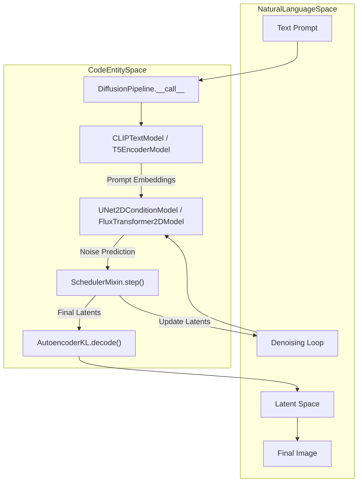
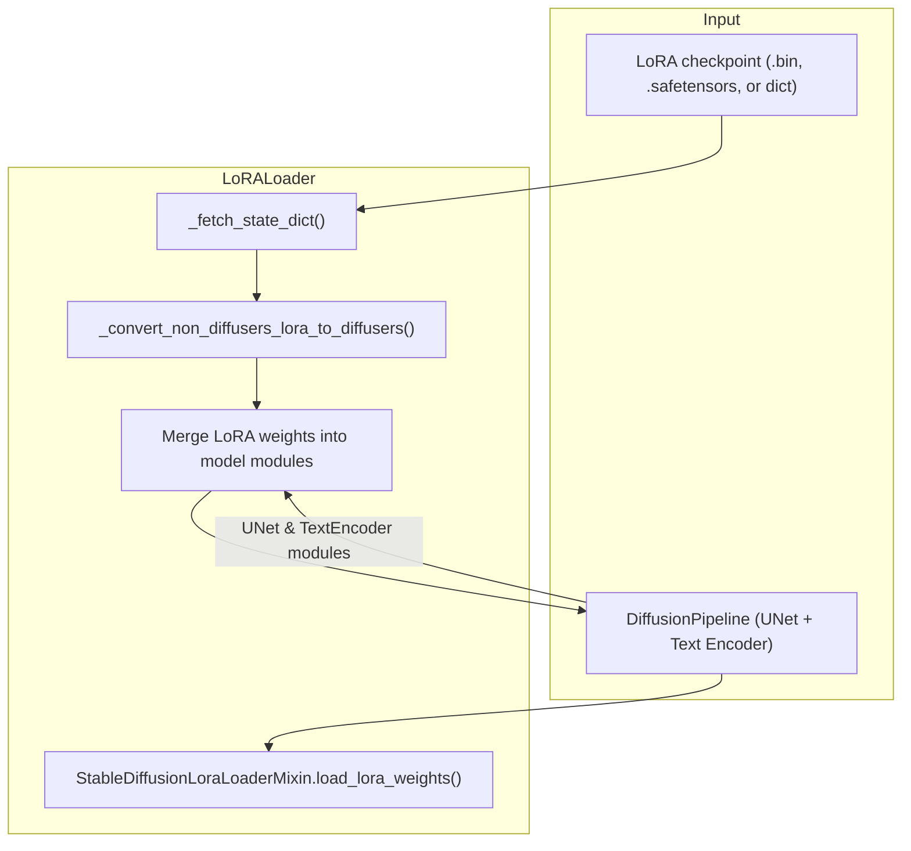
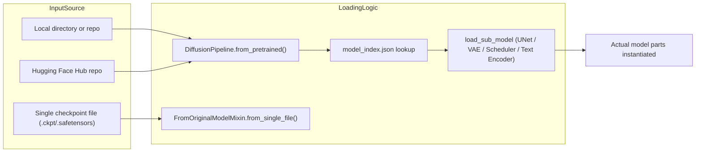
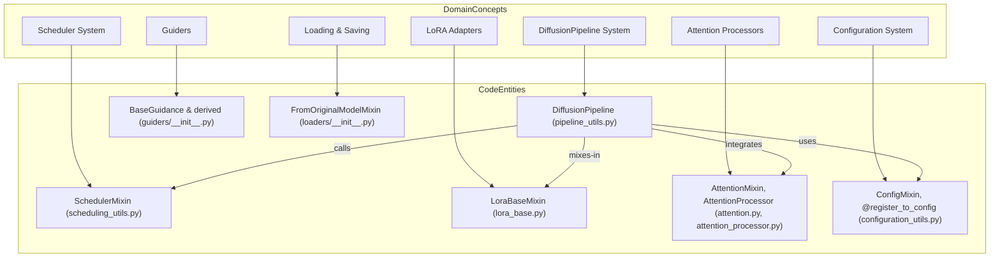

<!-- source: DeepWiki mcp.deepwiki.com · repo huggingface/diffusers · page 10 Glossary · fetched 2026-10-21 -->

# Glossary

Relevant source files

The following files were used as context for generating this wiki page:

- [README.md](README.md)
- [docs/source/en/_toctree.yml](docs/source/en/_toctree.yml)
- [docs/source/en/api/loaders/ip_adapter.md](docs/source/en/api/loaders/ip_adapter.md)
- [docs/source/en/api/loaders/lora.md](docs/source/en/api/loaders/lora.md)
- [docs/source/en/api/loaders/transformer_sd3.md](docs/source/en/api/loaders/transformer_sd3.md)
- [src/diffusers/__init__.py](src/diffusers/__init__.py)
- [src/diffusers/configuration_utils.py](src/diffusers/configuration_utils.py)
- [src/diffusers/loaders/__init__.py](src/diffusers/loaders/__init__.py)
- [src/diffusers/loaders/ip_adapter.py](src/diffusers/loaders/ip_adapter.py)
- [src/diffusers/loaders/lora_base.py](src/diffusers/loaders/lora_base.py)
- [src/diffusers/loaders/lora_conversion_utils.py](src/diffusers/loaders/lora_conversion_utils.py)
- [src/diffusers/loaders/lora_pipeline.py](src/diffusers/loaders/lora_pipeline.py)
- [src/diffusers/loaders/peft.py](src/diffusers/loaders/peft.py)
- [src/diffusers/loaders/unet.py](src/diffusers/loaders/unet.py)
- [src/diffusers/models/README.md](src/diffusers/models/README.md)
- [src/diffusers/models/__init__.py](src/diffusers/models/__init__.py)
- [src/diffusers/models/autoencoders/__init__.py](src/diffusers/models/autoencoders/__init__.py)
- [src/diffusers/models/transformers/__init__.py](src/diffusers/models/transformers/__init__.py)
- [src/diffusers/pipelines/README.md](src/diffusers/pipelines/README.md)
- [src/diffusers/pipelines/__init__.py](src/diffusers/pipelines/__init__.py)
- [src/diffusers/pipelines/stable_diffusion/README.md](src/diffusers/pipelines/stable_diffusion/README.md)
- [src/diffusers/pipelines/stable_diffusion/__init__.py](src/diffusers/pipelines/stable_diffusion/__init__.py)
- [src/diffusers/schedulers/README.md](src/diffusers/schedulers/README.md)
- [src/diffusers/schedulers/__init__.py](src/diffusers/schedulers/__init__.py)
- [src/diffusers/schedulers/scheduling_ddim.py](src/diffusers/schedulers/scheduling_ddim.py)
- [src/diffusers/schedulers/scheduling_ddpm.py](src/diffusers/schedulers/scheduling_ddpm.py)
- [src/diffusers/schedulers/scheduling_deis_multistep.py](src/diffusers/schedulers/scheduling_deis_multistep.py)
- [src/diffusers/schedulers/scheduling_dpmsolver_multistep.py](src/diffusers/schedulers/scheduling_dpmsolver_multistep.py)
- [src/diffusers/schedulers/scheduling_dpmsolver_multistep_inverse.py](src/diffusers/schedulers/scheduling_dpmsolver_multistep_inverse.py)
- [src/diffusers/schedulers/scheduling_dpmsolver_sde.py](src/diffusers/schedulers/scheduling_dpmsolver_sde.py)
- [src/diffusers/schedulers/scheduling_dpmsolver_singlestep.py](src/diffusers/schedulers/scheduling_dpmsolver_singlestep.py)
- [src/diffusers/schedulers/scheduling_euler_ancestral_discrete.py](src/diffusers/schedulers/scheduling_euler_ancestral_discrete.py)
- [src/diffusers/schedulers/scheduling_euler_discrete.py](src/diffusers/schedulers/scheduling_euler_discrete.py)
- [src/diffusers/schedulers/scheduling_heun_discrete.py](src/diffusers/schedulers/scheduling_heun_discrete.py)
- [src/diffusers/schedulers/scheduling_k_dpm_2_ancestral_discrete.py](src/diffusers/schedulers/scheduling_k_dpm_2_ancestral_discrete.py)
- [src/diffusers/schedulers/scheduling_k_dpm_2_discrete.py](src/diffusers/schedulers/scheduling_k_dpm_2_discrete.py)
- [src/diffusers/schedulers/scheduling_lms_discrete.py](src/diffusers/schedulers/scheduling_lms_discrete.py)
- [src/diffusers/schedulers/scheduling_pndm.py](src/diffusers/schedulers/scheduling_pndm.py)
- [src/diffusers/schedulers/scheduling_sasolver.py](src/diffusers/schedulers/scheduling_sasolver.py)
- [src/diffusers/schedulers/scheduling_sde_ve.py](src/diffusers/schedulers/scheduling_sde_ve.py)
- [src/diffusers/schedulers/scheduling_unipc_multistep.py](src/diffusers/schedulers/scheduling_unipc_multistep.py)
- [src/diffusers/schedulers/scheduling_utils.py](src/diffusers/schedulers/scheduling_utils.py)
- [src/diffusers/utils/dummy_pt_objects.py](src/diffusers/utils/dummy_pt_objects.py)
- [src/diffusers/utils/dummy_torch_and_transformers_objects.py](src/diffusers/utils/dummy_torch_and_transformers_objects.py)
- [src/diffusers/utils/peft_utils.py](src/diffusers/utils/peft_utils.py)
- [src/diffusers/utils/state_dict_utils.py](src/diffusers/utils/state_dict_utils.py)
- [tests/lora/test_lora_loader_utils.py](tests/lora/test_lora_loader_utils.py)
- [tests/lora/test_peft_utils.py](tests/lora/test_peft_utils.py)
- [tests/lora/utils.py](tests/lora/utils.py)

This glossary defines technical terms, architectural patterns, and domain-specific jargon used within the `diffusers` library. It is intended to help onboarding engineers navigate the codebase by connecting conceptual language to specific implementation details.

## Core Abstractions

### Pipeline
A high-level class that bundles multiple components (models, schedulers, processors) into a single end-to-end inference workflow.

- **Implementation**: All pipelines inherit from `DiffusionPipeline` [src/diffusers/pipelines/pipeline_utils.py:56-120]().
- **Component Management**: Components are registered via the class constructor signature and their metadata is stored/retrieved from a `model_index.json` file in the model repository.
- **Auto-Selection**: The `AutoPipeline` system (e.g., `AutoPipelineForText2Image`, `AutoPipelineForImage2Image`) automatically maps a model checkpoint to the correct pipeline class based on the `model_index.json` configuration [src/diffusers/pipelines/auto_pipeline.py:43-48]().
- **Inference**: The pipeline's `__call__` method coordinates tokenization, latent sampling, neural network denoising, scheduler stepping, and decoding back to images or audio.

### Scheduler
An algorithm managing the noise schedule and how model outputs transform the sample at each step of diffusion (both forward noise addition and reverse denoising).

- **Base Class**: `SchedulerMixin` [src/diffusers/schedulers/scheduling_utils.py:20-50]() — all schedulers implement its interface.
- **Key Method**: `step()` computes the denoised sample at the previous timestep $x_{t-1}$ given the current noisy input $x_t$ and model prediction. It handles the noise schedule math and variance [src/diffusers/schedulers/scheduling_ddpm.py:432-462]().
- **Configuration**: Schedulers use `ConfigMixin` and the `@register_to_config` decorator for hyperparameter persistence and loading [src/diffusers/schedulers/scheduling_ddpm.py:137-170]().
- **Popular Variants**: DDPM, DDIM, DPM-Solver, UniPC, Euler ancestral, each trading off speed and quality.

### Mixin
A programming pattern extensively used to add modular functionality (like LoRA support, configuration, or single-file loading) to classes without deep inheritance chains.

- **Examples**:
  - `LoraBaseMixin`: Adds LoRA weight loading/fusion behavior for adapters [src/diffusers/loaders/lora_base.py:30-80]().
  - `ModelMixin`: Base model class with weight loading/saving mechanisms [src/diffusers/models/modeling_utils.py:80-120]().
  - `ConfigMixin`: Provides config loading, saving, and parsing utilities [src/diffusers/configuration_utils.py:140-180]().

---

## Code-to-Entity Mapping

### Pipeline Inference Architecture

The diagram below illustrates the flow from a natural language prompt to the generation of an image, connecting conceptual terms to core classes and functions:

This flow encapsulates the forward pass for text-to-image generation where the scheduler manages sampling, the UNet performs denoising, and the autoencoder decodes latent vectors to images.

**Sources**: [src/diffusers/pipelines/pipeline_utils.py:56-120](), [src/diffusers/models/modeling_utils.py:80-120](), [src/diffusers/schedulers/scheduling_utils.py:20-50](), [src/diffusers/models/autoencoders/autoencoder_kl.py:10-70]()

---

### LoRA Adapter Loading Flow

LoRA (Low-Rank Adaptation) is a popular fine-tuning extension. The diagram below depicts the LoRA loading process and its integration into the main pipeline components:

The LoRA loading process involves fetching or receiving a LoRA checkpoint, optionally converting legacy formats, and merging them into the main UNet and/or text encoder modules in the pipeline. This behavior is implemented in the `StableDiffusionLoraLoaderMixin` class [src/diffusers/loaders/lora_pipeline.py:130-180](), leveraging utilities from `lora_conversion_utils.py`.

**Sources**: [src/diffusers/loaders/lora_pipeline.py:130-180](), [src/diffusers/loaders/lora_conversion_utils.py:15-168]()

---

## Technical Jargon & Abbreviations

| Term                      | Definition                                                                                                            | Code Pointer                                                        |
|---------------------------|-----------------------------------------------------------------------------------------------------------------------|-------------------------------------------------------------------|
| **Latents**               | The compressed latent-space representation of inputs (usually images) used internally by pipelines and autoencoders. | `AutoencoderKL` [src/diffusers/models/autoencoders/autoencoder_kl.py:10-70]() |
| **CFG**                   | Classifier-Free Guidance: A guidance technique mixing conditional and unconditional model outputs to improve fidelity. | `ClassifierFreeGuidance` [src/diffusers/__init__.py:175-190]()     |
| **LoRA**                  | Low-Rank Adaptation: A parameter-efficient fine-tuning method inserting trainable low-rank matrices into model layers. | `LoraBaseMixin` [src/diffusers/loaders/lora_base.py:30-90]()      |
| **PEFT**                  | Parameter-Efficient Fine-Tuning: Refers to the integration and use of the `peft` library for fine-tuning adapters.     | `is_peft_available` flag usage [src/diffusers/loaders/lora_pipeline.py:27-32]() |
| **State Dict**            | A dictionary mapping module parameter names to tensor weights, used for loading and saving model parameters.           | `state_dict` usage example [src/diffusers/loaders/lora_conversion_utils.py:31-156]() |
| **DDUF**                  | Distributed Diffusion Universal Format: A loading format supporting distributed model checkpointing.                   | Reference hints in model loading [src/diffusers/pipelines/pipeline_utils.py:30-80]() |
| **Offloading**            | Moving model weights and computation between devices (GPU/CPU/Disk) to optimize load and memory usage.                 | Mentioned in pipeline utilities [src/diffusers/pipelines/pipeline_utils.py:50-90]() |
| **Temb (Timestep Embedding)** | Embeddings representing the diffusion timestep, conditioning networks like UNet on the current step.               | Used in ResNet conditioning blocks [src/diffusers/models/resnet.py:40-55]() |
| **DiT**                   | Diffusion Transformer: A denoiser architecture based on transformer blocks rather than conventional UNet convolutional blocks. | `DiTTransformer2DModel` [src/diffusers/models/__init__.py:90-95]() |

---

## Component Loading System

The library implements a flexible loading mechanism that supports various storage backends, file formats, and model configurations. This includes support for local directories, Hugging Face Hub repos, single files like `.safetensors` or `.ckpt`, and more.

### Loading Logic Flow

The `DiffusionPipeline.from_pretrained()` manages the majority of pipeline loading by reading `model_index.json` which specifies architecture component names and directories. Single-file `.ckpt` or `.safetensors` models are loaded via the `FromOriginalModelMixin` which converts legacy checkpoints into compatible state dicts. After loading, components (UNet, VAE, Scheduler, Text Encoder) are assembled to create the pipeline instance [src/diffusers/pipelines/pipeline_utils.py:40-120](), [src/diffusers/loaders/lora_pipeline.py:120-170](), [src/diffusers/__init__.py:40-60]().

---

## Domain Concepts

### Attention Processors
The library abstracts attention layers into interchangeable "processors" to enable different backend implementations without changing model architecture:

- **Interface**: The `Attention` class encapsulates attention logic and supports multiple processor types [src/diffusers/models/attention_processor.py:40-80]().
- **AttentionMixin**: Adds methods to models to set or swap processors conveniently, e.g., switching between standard, xFormers, or Flash Attention [src/diffusers/models/attention.py:60-90]().
- **Specific Implementations**: E.g., `JointAttnProcessor2_0` used in Flux/Stable Diffusion 3 pipelines [src/diffusers/models/attention.py:20-40]().

### Configuration System
The library employs a mixin-based configuration system that cleanly separates architectural parameters from runtime state.

- **ConfigMixin**: Core utility for saving and loading configuration fields in a uniform way [src/diffusers/configuration_utils.py:140-200]().
- **@register_to_config**: A decorator that automatically captures constructor arguments into a `self.config` object on model or scheduler classes [src/diffusers/configuration_utils.py:20-40]().

### Guiders
Guiders are first-class objects encapsulating guidance algorithms that influence diffusion sampling, decoupled from pipelines.

- **Base Class**: `BaseGuidance` and derived classes provide interfaces for guidance logic [src/diffusers/__init__.py:170-190]().
- **Common Variants**: 
  - `ClassifierFreeGuidance` implements the standard CFG technique.
  - `PerturbedAttentionGuidance` modifies attention weights during inference.
  - `SkipLayerGuidance` supports layer skipping for optimization.

### Hooks & Caching
To optimize performance during inference, the library allows hooking into forward passes and caching intermediate computations:

- **FasterCache**: Caches outputs from earlier layers across diffusion steps to reduce computation [src/diffusers/__init__.py:185-195]().
- **PyramidAttentionBroadcast**: Applies an efficiency optimization for attention on video or large images [src/diffusers/__init__.py:190-200]().
- **Layer Skip**: Dynamically skips entire layers during denoising to speed up inference [src/diffusers/__init__.py:195-210]().

---

# Summary Diagram: Diffusers Concept to Code Entity Mapping

This diagram connects key domain concepts with their primary code entities to help locate source code for given concepts.

---

**Sources**:  
- [src/diffusers/pipelines/pipeline_utils.py:30-120]()  
- [src/diffusers/pipelines/auto_pipeline.py:40-60]()  
- [src/diffusers/loaders/lora_pipeline.py:130-180]()  
- [src/diffusers/loaders/lora_conversion_utils.py:15-168]()  
- [src/diffusers/schedulers/scheduling_utils.py:20-60]()  
- [src/diffusers/schedulers/scheduling_ddpm.py:130-170, 420-470]()  
- [src/diffusers/models/attention.py:20-90]()  
- [src/diffusers/models/attention_processor.py:30-80]()  
- [src/diffusers/configuration_utils.py:20-50, 140-200]()  
- [src/diffusers/__init__.py:170-190, 185-210]()  
- [src/diffusers/models/__init__.py:15-105]()