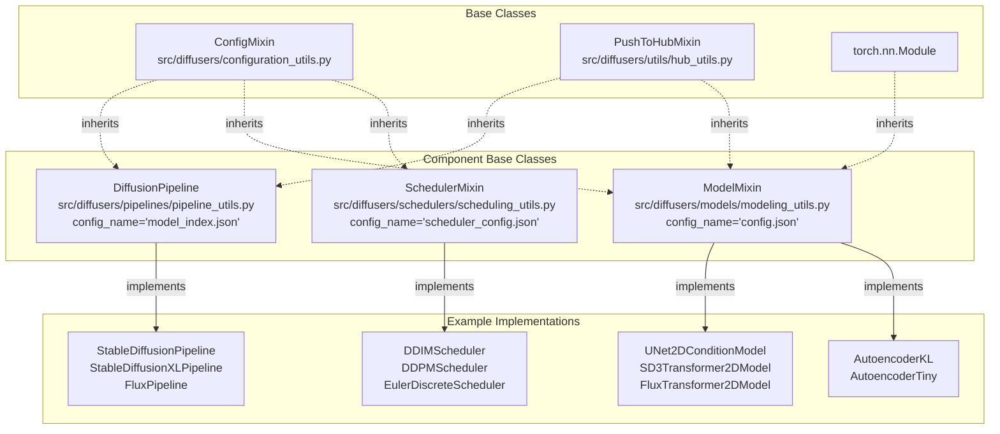
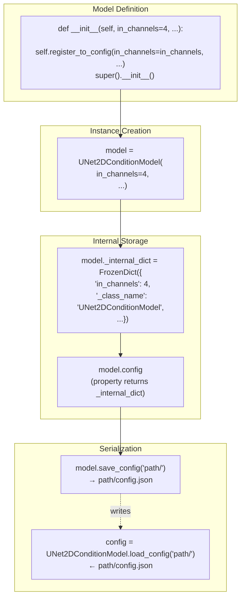

<!-- source: DeepWiki mcp.deepwiki.com · repo huggingface/diffusers · page 2 Core Components · fetched 2026-10-21 -->

# Core Components

<details>
<summary>Relevant source files</summary>

The following files were used as context for generating this wiki page:

- [src/diffusers/models/model_loading_utils.py](src/diffusers/models/model_loading_utils.py)
- [src/diffusers/models/modeling_utils.py](src/diffusers/models/modeling_utils.py)
- [src/diffusers/pipelines/pipeline_loading_utils.py](src/diffusers/pipelines/pipeline_loading_utils.py)
- [src/diffusers/pipelines/pipeline_utils.py](src/diffusers/pipelines/pipeline_utils.py)
- [src/diffusers/utils/hub_utils.py](src/diffusers/utils/hub_utils.py)
- [tests/models/test_modeling_common.py](tests/models/test_modeling_common.py)
- [tests/models/unets/test_models_unet_2d_condition.py](tests/models/unets/test_models_unet_2d_condition.py)
- [tests/pipelines/test_pipeline_utils.py](tests/pipelines/test_pipeline_utils.py)
- [tests/pipelines/test_pipelines.py](tests/pipelines/test_pipelines.py)
- [tests/pipelines/test_pipelines_common.py](tests/pipelines/test_pipelines_common.py)

</details>


The Diffusers library is built on a three-tier modular architecture consisting of **Pipelines**, **Models**, and **Schedulers**. This page explains how these core building blocks work together, their base classes, and the configuration system that enables their composition and interchangeability.

**Key Concepts:**
- **Pipelines** orchestrate the complete inference workflow by composing models and schedulers.
- **Models** implement neural network architectures such as UNet, Transformer, and VAE.
- **Schedulers** control the diffusion/denoising process via noise schedules.
- All components share a unified configuration system via `ConfigMixin`.
- Components can be loaded, saved, and shared through `from_pretrained()` and `save_pretrained()` methods.

---

## Three-Tier Architecture

The Diffusers library implements a modular architecture with three primary component types:

| Component Type | Base Class          | Purpose                                    | Config File           | PyTorch Module?        |
|----------------|---------------------|--------------------------------------------|-----------------------|------------------------|
| **Pipelines**  | `DiffusionPipeline` | Orchestrate inference, manage components   | `model_index.json`    | No                     |
| **Models**     | `ModelMixin`        | Neural networks (UNet, Transformer, VAE)  | `config.json`          | Yes (`torch.nn.Module`) |
| **Schedulers** | `SchedulerMixin`    | Noise schedules, denoising algorithms      | `scheduler_config.json`| No                     |

All three inherit from `ConfigMixin` for unified configuration management. Models and Pipelines additionally inherit from `PushToHubMixin` for Hugging Face Hub integration [src/diffusers/pipelines/pipeline_utils.py:198-234](), [src/diffusers/models/modeling_utils.py:50-82]().

### Component Type Hierarchy with Code Entities



**Sources:** [src/diffusers/pipelines/pipeline_utils.py:198-234](), [src/diffusers/models/modeling_utils.py:50-82]()

---

## Component Composition

Diffusion pipelines orchestrate multiple components to create complete inference workflows. The `DiffusionPipeline.register_modules()` method stores references to these components along with their class and library names. This information is serialized in the pipeline's `model_index.json` file, mapping each component to its corresponding Python class and enabling reproducible loading and saving of pipelines [src/diffusers/pipelines/pipeline_utils.py:210-230]().

### Pipeline Component Composition Pattern

```mermaid
graph TB
    subgraph "StableDiffusionPipeline Instance"
        Pipeline["pipeline = StableDiffusionPipeline(...)"]
        RegisterModules["register_modules(text_encoder=..., unet=..., vae=..., scheduler=...)"]
    end

    subgraph "Component Instances"
        TextEncoder["text_encoder\nCLIPTextModel\n(transformers)"]
        UNet["unet\nUNet2DConditionModel\n(diffusers.models)"]
        VAE["vae\nAutoencoderKL\n(diffusers.models)"]
        Scheduler["scheduler\nDDIMScheduler\n(diffusers.schedulers)"]
    end

    subgraph "model_index.json"
        ConfigJSON["'{\n  \"_class_name\": \"StableDiffusionPipeline\",\n  \"text_encoder\": [\"transformers\", \"CLIPTextModel\"],\n  \"unet\": [\"diffusers\", \"UNet2DConditionModel\"],\n  \"vae\": [\"diffusers\", \"AutoencoderKL\"],\n  \"scheduler\": [\"diffusers\", \"DDIMScheduler\"]\n}'"]
    end

    Pipeline --> RegisterModules
    RegisterModules -->|"Stores (library, class) info"| ConfigJSON
    RegisterModules -->|"Sets as attributes"| TextEncoder
    RegisterModules --> UNet
    RegisterModules --> VAE
    RegisterModules --> Scheduler
```

The pipeline registers these components as attributes which are then accessible during pipeline execution (`__call__` method), enabling flexible and modular inference setups.

**Sources:** [src/diffusers/pipelines/pipeline_utils.py:198-230](), [src/diffusers/pipelines/pipeline_loading_utils.py:88-113]()

---

## Base Class Responsibilities

Each core component type extends base classes providing uniform interfaces and features.

| Base Class         | Location                                    | Key Methods                                     | Purpose                                                                    |
|--------------------|---------------------------------------------|------------------------------------------------|---------------------------------------------------------------------------|
| `ConfigMixin`       | [src/diffusers/configuration_utils.py]()    | `save_config()`, `load_config()`, `register_to_config()` | Parameter serialization and config system; decorator `@register_to_config` |
| `PushToHubMixin`    | [src/diffusers/utils/hub_utils.py]()        | `push_to_hub()`, `save_pretrained()`            | Hugging Face Hub integration and model card management                    |
| `ModelMixin`        | [src/diffusers/models/modeling_utils.py]()  | `from_pretrained()`, `save_pretrained()`, `to()` | Neural network weights management, device placement                       |
| `DiffusionPipeline` | [src/diffusers/pipelines/pipeline_utils.py]() | `from_pretrained()`, `save_pretrained()`, `register_modules()` | Pipeline composition and inference orchestration                          |
| `SchedulerMixin`    | [src/diffusers/schedulers/scheduling_utils.py]() | `from_pretrained()`, `set_timesteps()`, `step()` | Noise scheduling and denoising step algorithms                           |

Each class builds upon `ConfigMixin` for config management, while pipelines and models integrate Hub support for sharing and versioning.

**Sources:** [src/diffusers/pipelines/pipeline_utils.py:198-234](), [src/diffusers/models/modeling_utils.py:50-82](), [src/diffusers/utils/hub_utils.py:66-110]()

---

## Configuration System

The unified configuration system is foundational across components, implemented via `ConfigMixin`. Components register their constructor parameters using the `@register_to_config` decorator which preserves initialization arguments in a `FrozenDict` stored in `self.config`. This enables seamless saving/loading of configurations alongside model weights.

### ConfigMixin Registration and Serialization



This config system standardizes how components save their hyperparameters and metadata, enabling consistent reproducibility and interoperability.

For details, see [Configuration System](#2.4).

**Sources:** [src/diffusers/pipelines/pipeline_utils.py:198-198](), [src/diffusers/models/modeling_utils.py:44-50]()

---

## Loading and Saving

The Diffusers library supports robust mechanisms for loading and saving all core components, abstracting complexities such as distributed checkpoint shards and variants.

- **Pipelines:** The main interface is `DiffusionPipeline.from_pretrained()` which loads the `model_index.json`, recursively fetches all components, supports sharded models, and handles variants like `fp16` [src/diffusers/pipelines/pipeline_utils.py:592-1450]().
- **Models:** Use `ModelMixin.from_pretrained()` to load standard model weights and config JSON files. It supports safetensors, sharded checkpoints, and automatic device mapping [src/diffusers/models/modeling_utils.py:50-82]().
- **Schedulers:** Use base scheduler from_pretrained methods to load scheduling parameters from their config files without weights.
- **Single-File Loading:** For legacy or alternative checkpoints (.ckpt, .safetensors) loading, the library provides specialized utilities for compatibility [src/diffusers/loaders/single_file_utils.py:62-157] (not shown).

Loading and saving integrates with the Hugging Face Hub and supports seamless model distribution and caching.

For details, see [Loading and Saving](#2.5).

**Sources:** [src/diffusers/pipelines/pipeline_utils.py:592-1450](), [src/diffusers/models/modeling_utils.py:50-82]()

---

## Device and Memory Management

Efficient device placement and memory usage are vital for large diffusion models. The library provides utilities and hooks:

- **Device Placement:** Components implement `.to(device)` for moving weights. Pipelines expose a `.to()` method to move all contained sub-modules [src/diffusers/pipelines/pipeline_utils.py:370-560]().
- **Dtype Management:** Utilities like `get_parameter_dtype` introspect model parameters, respecting hooks such as layerwise casting, to correctly determine and manage floating point precision [src/diffusers/models/modeling_utils.py:156-206]().
- **Offloading:** CPU offloading techniques like `enable_model_cpu_offload()` and `enable_sequential_cpu_offload()` reduce GPU memory by offloading model parts to CPU, controlled via pipeline hooks [src/diffusers/pipelines/pipeline_utils.py:1452-1480]().

These systems help run large models on limited hardware with manageable VRAM.

**Sources:** [src/diffusers/pipelines/pipeline_utils.py:370-560](), [src/diffusers/models/modeling_utils.py:156-206](), [src/diffusers/pipelines/pipeline_utils.py:1452-1480]()

---

## Summary of Subsystems and Links to Child Pages

For in-depth information on fundamental subsystems, consult the dedicated child pages:

- **[DiffusionPipeline System](#2.1)** — The `DiffusionPipeline` base class: component lifecycle, `model_index.json`, loading and saving mechanics.
- **[Model Components](#2.2)** — Core models such as UNet, Transformer, VAE, and the `ModelMixin` base class.
- **[Scheduler System](#2.3)** — The scheduler interface, compatibility system, and diffusion noise scheduling algorithms.
- **[Configuration System](#2.4)** — `ConfigMixin`, `FrozenDict`, the `@register_to_config` decorator, and config loading/saving methods.
- **[Loading and Saving](#2.5)** — Model and pipeline loading mechanisms from Hub, local, and DDUF formats, including state dict and sharded model handling.

---

This overview provides the fundamental building blocks from which all pipelines in the diffusers library are constructed, focusing on component modularity, configuration standardization, and efficient resource management.

**Sources:** [src/diffusers/pipelines/pipeline_utils.py:198-234, 592-1450](), [src/diffusers/models/modeling_utils.py:50-206](), [src/diffusers/pipelines/pipeline_loading_utils.py:88-113](), [src/diffusers/utils/hub_utils.py:66-110]()

---

