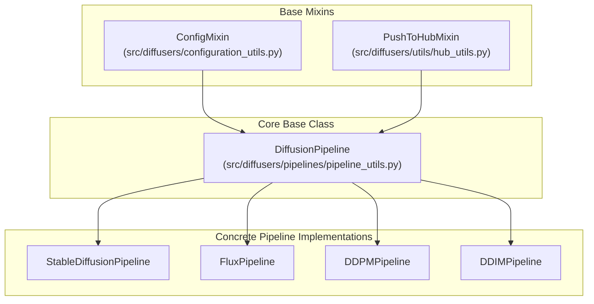
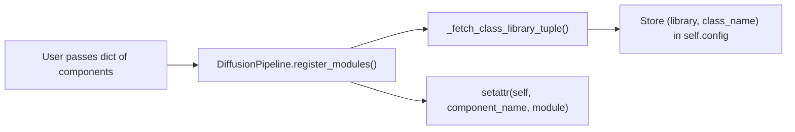
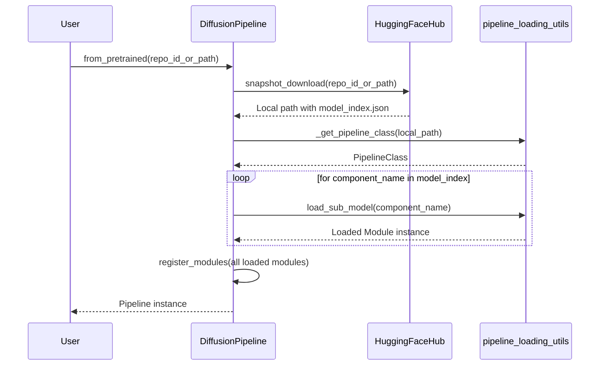
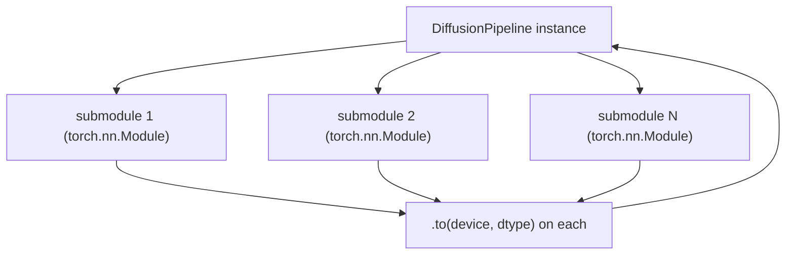

<!-- source: DeepWiki mcp.deepwiki.com · repo huggingface/diffusers · page 2.1 DiffusionPipeline System · fetched 2026-10-21 -->

# DiffusionPipeline System

<details>
<summary>Relevant source files</summary>

The following files were used as context for generating this wiki page:

- [docs/source/en/api/pipelines/pag.md](docs/source/en/api/pipelines/pag.md)
- [scripts/convert_pixart_alpha_to_diffusers.py](scripts/convert_pixart_alpha_to_diffusers.py)
- [src/diffusers/models/model_loading_utils.py](src/diffusers/models/model_loading_utils.py)
- [src/diffusers/models/modeling_utils.py](src/diffusers/models/modeling_utils.py)
- [src/diffusers/pipelines/allegro/pipeline_allegro.py](src/diffusers/pipelines/allegro/pipeline_allegro.py)
- [src/diffusers/pipelines/auto_pipeline.py](src/diffusers/pipelines/auto_pipeline.py)
- [src/diffusers/pipelines/pag/__init__.py](src/diffusers/pipelines/pag/__init__.py)
- [src/diffusers/pipelines/pag/pag_utils.py](src/diffusers/pipelines/pag/pag_utils.py)
- [src/diffusers/pipelines/pag/pipeline_pag_pixart_sigma.py](src/diffusers/pipelines/pag/pipeline_pag_pixart_sigma.py)
- [src/diffusers/pipelines/pipeline_loading_utils.py](src/diffusers/pipelines/pipeline_loading_utils.py)
- [src/diffusers/pipelines/pipeline_utils.py](src/diffusers/pipelines/pipeline_utils.py)
- [src/diffusers/pipelines/pixart_alpha/pipeline_pixart_alpha.py](src/diffusers/pipelines/pixart_alpha/pipeline_pixart_alpha.py)
- [src/diffusers/pipelines/pixart_alpha/pipeline_pixart_sigma.py](src/diffusers/pipelines/pixart_alpha/pipeline_pixart_sigma.py)
- [src/diffusers/utils/hub_utils.py](src/diffusers/utils/hub_utils.py)
- [tests/models/test_modeling_common.py](tests/models/test_modeling_common.py)
- [tests/models/unets/test_models_unet_2d_condition.py](tests/models/unets/test_models_unet_2d_condition.py)
- [tests/pipelines/test_pipeline_utils.py](tests/pipelines/test_pipeline_utils.py)
- [tests/pipelines/test_pipelines.py](tests/pipelines/test_pipelines.py)
- [tests/pipelines/test_pipelines_auto.py](tests/pipelines/test_pipelines_auto.py)
- [tests/pipelines/test_pipelines_common.py](tests/pipelines/test_pipelines_common.py)

</details>


## Purpose and Scope

The DiffusionPipeline System forms the foundational orchestration layer in the `diffusers` library, responsible for managing the complete lifecycle of diffusion models during inference and model management operations. This page documents the `DiffusionPipeline` base class, detailing its component registration system, the loading and saving lifecycle (`from_pretrained`, `save_pretrained`), device and dtype management, and explains the central role of the `model_index.json` manifest file in describing component relationships within a pipeline.

This system enables modular composition of diffusion pipelines where models like UNet, Transformer, VAE, text encoders, and schedulers are organized and unified into a single callable pipeline object.

---

## Architecture Overview

The central class in this system is `DiffusionPipeline`, which inherits from `ConfigMixin` (for configuration serialization/deserialization) and `PushToHubMixin` (for integration with the Hugging Face Hub) [src/diffusers/pipelines/pipeline_utils.py:198-214]().

### Class Hierarchy Diagram: Pipeline Inheritance and Composition



### Key Responsibilities

| Responsibility           | Description                                      | Related Method(s)                                  |
|--------------------------|------------------------------------------------|---------------------------------------------------|
| Component Management     | Register and track pipeline submodules (models, schedulers, etc.) | `register_modules()` [src/diffusers/pipelines/pipeline_utils.py:224]() |
| Model Loading           | Instantiate and load pretrained models from the Hub, local storage, or other formats | `from_pretrained()` [src/diffusers/pipelines/pipeline_utils.py:653]() |
| Model Saving            | Serialize pipeline and its components to disk | `save_pretrained()` [src/diffusers/pipelines/pipeline_utils.py:298]() |
| Device and Dtype Control | Manage device placement and precision for all pipeline components | `to()` [src/diffusers/pipelines/pipeline_utils.py:431]() |
| Progress Control        | Enable or disable progress bars during inference | `set_progress_bar_config()` [src/diffusers/pipelines/pipeline_utils.py:206]() |

**Sources:**  
[src/diffusers/pipelines/pipeline_utils.py:198-214](), [tests/pipelines/test_pipelines.py:43-64]()

---

## Component Registration System and `model_index.json`

### Conceptual Overview

The pipeline is composed of multiple submodules, such as the `unet`, `vae`, `scheduler`, or `text_encoder`. The `DiffusionPipeline` tracks these components in two main ways:

- Attributes on the pipeline instance matching component names (e.g., `self.unet`).
- Entries in the internal configuration (`self.config`) that map component names to tuples describing their origin `(library, class_name)`.

This dual registration occurs via the `register_modules()` method, which stores components and their associated class origins. This facilitates consistent saving, loading, and verification of pipeline structure.

The metadata about components, including the pipeline class and the components' classes and libraries, is stored on disk in a JSON manifest named `model_index.json` [src/diffusers/pipelines/pipeline_utils.py:216-234]().

### Code-Level Registration Flow Diagram



This system enables pipelines to introspect and maintain consistent metadata for all registered submodules.

---

### `model_index.json` Structure

The `model_index.json` file is a crucial artifact that defines the pipeline's modular architecture on disk. It includes:

- The `class` key: the full Python class name of the pipeline itself.
- The `library_name`: identifies the originating library for the pipeline class.
- A key for each component (e.g., `unet`, `vae`) that maps to a two-element array containing `[library_name, class_name]`.

Example (conceptual):

```json
{
  "class": "StableDiffusionPipeline",
  "library_name": "diffusers",
  "unet": ["diffusers", "UNet2DConditionModel"],
  "vae": ["diffusers", "AutoencoderKL"],
  "scheduler": ["diffusers", "PNDMScheduler"],
  "text_encoder": ["transformers", "CLIPTextModel"]
}
```

This manifest is both read and written by the pipeline to coordinate model component loading and saving.

**Sources:**  
[src/diffusers/pipelines/pipeline_utils.py:216-234](), [src/diffusers/pipelines/pipeline_utils.py:756-764]()

---

## Loading System: `from_pretrained`

The static method `from_pretrained` is the primary API for instantiating a pipeline from a pretrained repository or local directory.

### Overview of `from_pretrained` Lifecycle

The method handles the following steps for robust and flexible component loading:

1. **Path or Repo Resolution:**  
   Determines whether the path is:

   - A local directory.
   - A remote Hugging Face Hub model repository identified by `repo_id`.
   - A deprecated DDUF file format (now unsupported).

2. **Download and Cache:**  
   Uses `snapshot_download` internally to download the repo and cache files locally if needed.

3. **Pipeline Class Discovery:**  
   Read `model_index.json` and use `_get_pipeline_class()` to dynamically import and instantiate the correct pipeline class [src/diffusers/pipelines/pipeline_loading_utils.py:100]().

4. **Submodule Loading:**  
   Iterates over the components defined in `model_index.json`. Each component is loaded via the utility `load_sub_model()`, which:

   - Detects the library and class.
   - Calls that module's `from_pretrained()` if available, respecting variants, weights, and quantization options.

5. **Special Setup:**  
   Applies optional quantization, device map configurations, and other optimizations if the user requested them.

6. **Component Registration:**  
   Calls `register_modules()` to record loaded submodules into the pipeline instance and its config.

7. **Returns:**  
   The fully instantiated and prepared pipeline instance.

### Loading Flow Diagram



---

### Additional Loading Details

- Supports loading pipelines referencing components across multiple libraries (e.g., `transformers`, `diffusers`).
- Supports variants (e.g., `"fp16"`), and will verify compatibility of weight files (`safetensors` support).
- Accepts parameters for device mapping, quantization config, and local files only modes.
- Raises warnings or errors if deprecated formats or incompatible configs are detected.

**Sources:**  
[src/diffusers/pipelines/pipeline_utils.py:653-1147](), [src/diffusers/pipelines/pipeline_loading_utils.py:100-120]()

---

## Saving System: `save_pretrained`

The `save_pretrained` instance method persists the pipeline and all registered components to disk as a directory that can be then used for reloading.

### Save Procedure

1. **Directory Creation:**
   - Creates the target directory and subdirectories for each component (e.g., `unet/`, `vae/`, `scheduler/`) [src/diffusers/pipelines/pipeline_utils.py:335]().

2. **Saving Submodules:**
   - Iterates over all registered modules.
   - Calls their respective `save_pretrained` or custom saving if available.
   - Serializes configuration within these subfolders [src/diffusers/pipelines/pipeline_utils.py:368-394]().

3. **Writing `model_index.json`:**
   - Writes the manifest file that records the pipeline class and submodule mappings.
   - Ensures the file is always up-to-date for later loading [src/diffusers/pipelines/pipeline_utils.py:415]().

4. **Model Card Handling (Optional):**
   - Generates or updates a README model card description on disk using `load_or_create_model_card` with templating support [src/diffusers/pipelines/pipeline_utils.py:418]().

### Saving Flow Summary Table

| Step                  | Description                                 | Source Lines                                         |
|-----------------------|---------------------------------------------|-----------------------------------------------------|
| Setup target dirs     | Prepares root and component folders          | [pipeline_utils.py:335-355]()                        |
| Save each component   | Calls component’s `save_pretrained`          | [pipeline_utils.py:368-394]()                        |
| Write model_index.json| Dumps pipeline and components mapping into manifest | [pipeline_utils.py:412-426]()                        |
| Optionally model card | Generates README for model card (Hub upload) | [pipeline_utils.py:417-429]()                        |

**Sources:**  
[src/diffusers/pipelines/pipeline_utils.py:298-429](), [src/diffusers/utils/hub_utils.py:95-173]()

---

## Device and Dtype Management: `to()`

The pipeline exposes a unified `to()` method to move all registered submodules (models, schedulers, etc.) to a desired device (CPU, GPU, HPU) and optionally change dtype (e.g., to fp16).

### Implementation Summary

- Iterates all attributes of the pipeline that are `torch.nn.Module`.
- Calls `.to(device, dtype)` on each.
- Disallows usage if CPU offloading hooks (`sequential_cpu_offload` or `enable_model_cpu_offload`) are active, as it would conflict [src/diffusers/pipelines/pipeline_utils.py:501-508]().
- Special handling for models quantized with bitsandbytes (bfloat16 downgrading forbidden) [src/diffusers/pipelines/pipeline_utils.py:522-540]().
- Specific setup and environment variable checks for Habana Gaudi devices (HPU) to ensure compatibility [src/diffusers/pipelines/pipeline_utils.py:551-570]().

### Device Management Diagram: Pipeline Attributes to Device



**Sources:**  
[src/diffusers/pipelines/pipeline_utils.py:431-621]()

---

## Pipeline Execution Lifecycle: `__call__`

The core inference interface is implemented by overriding `__call__` in concrete pipeline subclasses (e.g., `StableDiffusionPipeline`).

### Typical Data Flow

1. **Input Processing:**
   - User inputs such as prompts are tokenized via `tokenizer`.
   - Text embeddings are generated by the `text_encoder`.

2. **Latent Initialization:**
   - Random noise latents are sampled on the target device.
   - If using img2img or similar pipelines, encode initial images through `vae.encode()`.

3. **Denoising / Iterative Sampling:**
   - The `scheduler` produces timesteps for diffusion.
   - Each step calls the `unet` or transformer to predict noise or residual.
   - The scheduler updates latents based on predictions and noise schedules.

4. **Decoding Final Output:**
   - Latents are decoded back into pixel space via `vae.decode()`.

5. **Post-Processing:**
   - Outputs are converted into final formats such as `PIL.Image` via `image_processor`.
   - Wrapper output classes like `ImagePipelineOutput` or `AudioPipelineOutput` encapsulate results [src/diffusers/pipelines/pipeline_utils.py:135-158]().

The base `DiffusionPipeline` class does not itself implement `__call__`, requiring subclasses to define pipeline-specific logic.

**Sources:**  
[src/diffusers/pipelines/pipeline_utils.py:135-158](), usage examples in [tests/pipelines/test_pipelines.py:120-180]()

---

## Summary Table: Core Lifecycle Methods in DiffusionPipeline

| Method                | Location                                   | Description                                                  |
|-----------------------|--------------------------------------------|--------------------------------------------------------------|
| `__init__`            | [pipeline_utils.py:198-223]()               | Initializes config and prepares component management.        |
| `register_modules`    | [pipeline_utils.py:224-234]()               | Registers components as instance attributes and updates config. |
| `save_pretrained`     | [pipeline_utils.py:298-429]()               | Saves pipeline and components, writes `model_index.json`.    |
| `to`                  | [pipeline_utils.py:431-621]()               | Moves all components to specified device and dtype.          |
| `from_pretrained`     | [pipeline_utils.py:653-1147]()              | Loads pipeline and components from checkpoint or Hub.        |
| `load_sub_model`      | [pipeline_loading_utils.py:109-130]()       | Utility to load individual models defined in `model_index.json`. |

---

## Concluding Remarks

The `DiffusionPipeline` system elegantly combines multiple model components into a unified pipeline object that can be seamlessly loaded from pretrained artifacts, manipulated on the device and dtype level, and saved back with complete metadata describing the modular architecture. The `model_index.json` manifest plays a key role in this system by encoding the component structure, aiding reproducibility and transparency.

Concrete implementations build on this foundation to support diverse diffusion models and usage patterns, encapsulating domain-specific inference logic.

---

**Sources:**

- `src/diffusers/pipelines/pipeline_utils.py:198-234, 298-429, 431-621, 653-1147`  
- `src/diffusers/pipelines/pipeline_loading_utils.py:95-130`  
- `src/diffusers/utils/hub_utils.py:90-173`  
- `tests/pipelines/test_pipelines.py:43-64, 120-180`

---

