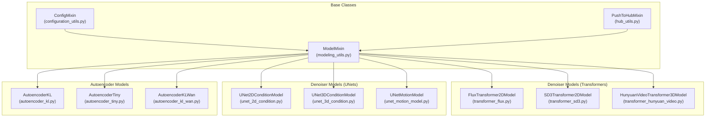
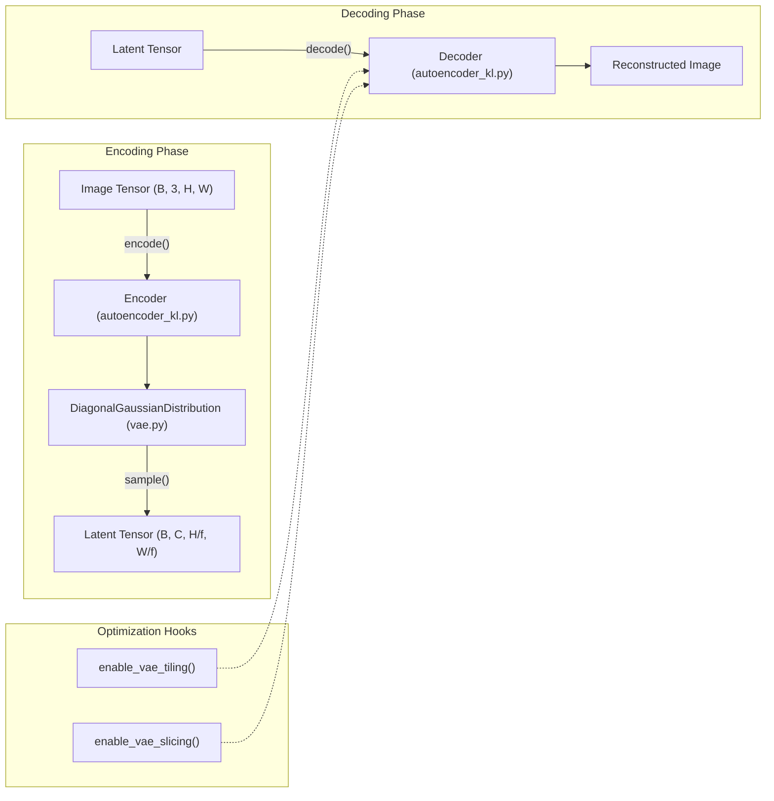
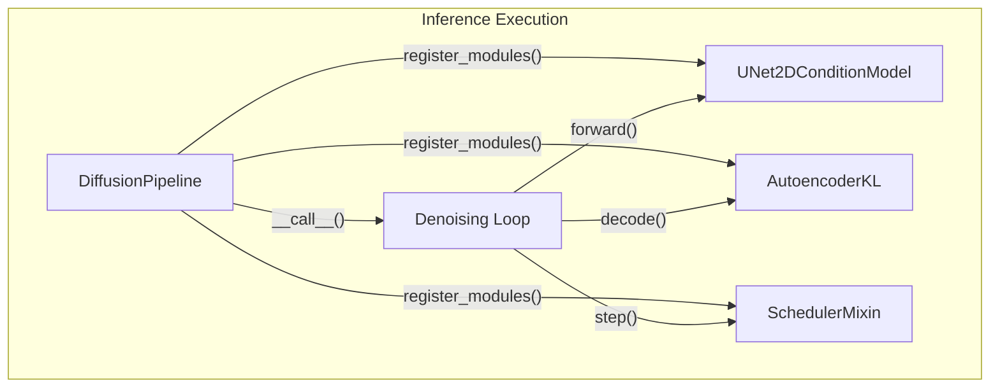

<!-- source: DeepWiki mcp.deepwiki.com · repo huggingface/diffusers · page 2.2 Model Components · fetched 2026-10-21 -->

# Model Components

Relevant source files

The following files were used as context for generating this wiki page:

- [docs/source/en/api/pipelines/animatediff.md](docs/source/en/api/pipelines/animatediff.md)
- [src/diffusers/models/model_loading_utils.py](src/diffusers/models/model_loading_utils.py)
- [src/diffusers/models/modeling_utils.py](src/diffusers/models/modeling_utils.py)
- [src/diffusers/models/transformers/transformer_2d.py](src/diffusers/models/transformers/transformer_2d.py)
- [src/diffusers/models/unets/unet_2d_blocks.py](src/diffusers/models/unets/unet_2d_blocks.py)
- [src/diffusers/models/unets/unet_2d_condition.py](src/diffusers/models/unets/unet_2d_condition.py)
- [src/diffusers/models/unets/unet_3d_blocks.py](src/diffusers/models/unets/unet_3d_blocks.py)
- [src/diffusers/models/unets/unet_3d_condition.py](src/diffusers/models/unets/unet_3d_condition.py)
- [src/diffusers/models/unets/unet_i2vgen_xl.py](src/diffusers/models/unets/unet_i2vgen_xl.py)
- [src/diffusers/models/unets/unet_motion_model.py](src/diffusers/models/unets/unet_motion_model.py)
- [src/diffusers/pipelines/animatediff/__init__.py](src/diffusers/pipelines/animatediff/__init__.py)
- [src/diffusers/pipelines/deprecated/versatile_diffusion/modeling_text_unet.py](src/diffusers/pipelines/deprecated/versatile_diffusion/modeling_text_unet.py)
- [src/diffusers/pipelines/pipeline_loading_utils.py](src/diffusers/pipelines/pipeline_loading_utils.py)
- [src/diffusers/pipelines/pipeline_utils.py](src/diffusers/pipelines/pipeline_utils.py)
- [src/diffusers/utils/hub_utils.py](src/diffusers/utils/hub_utils.py)
- [tests/models/test_modeling_common.py](tests/models/test_modeling_common.py)
- [tests/models/unets/test_models_unet_2d_condition.py](tests/models/unets/test_models_unet_2d_condition.py)
- [tests/pipelines/test_pipeline_utils.py](tests/pipelines/test_pipeline_utils.py)
- [tests/pipelines/test_pipelines.py](tests/pipelines/test_pipelines.py)
- [tests/pipelines/test_pipelines_common.py](tests/pipelines/test_pipelines_common.py)

## Purpose and Scope

This page documents the model component system in Diffusers, explaining the architecture, base classes, and types of neural network models used in diffusion pipelines. Model components are the core building blocks that perform the denoising, encoding, and decoding operations in diffusion models.

**Scope**: This page covers `ModelMixin`, core model architectures (UNet, Transformer, VAE), their variants, attention processors, and how these components integrate with pipelines.

---

## Model Component Architecture

Model components in Diffusers are organized into a hierarchical system with base classes providing common functionality and specialized classes implementing specific architectures.

### Model Hierarchy and Code Entities

This diagram associates high-level architectural roles with the specific code entities found in the Diffusers library.

**Sources**: [src/diffusers/models/modeling_utils.py:230-255](), [src/diffusers/models/unets/unet_2d_condition.py:75-77](), [src/diffusers/models/unets/unet_motion_model.py:44-44](), [tests/models/test_modeling_common.py:29-29](), [src/diffusers/loaders/single_file_model.py:139-178]()

---

## ModelMixin: The Base Class

`ModelMixin` is the foundational class from which all model components inherit. It provides essential functionality such as device management, saving/loading modules, gradient checkpointing, and memory optimization.

### Core Functionality of ModelMixin

| Feature                 | Method/Property                 | Description                                                                   |
|-------------------------|-------------------------------|-------------------------------------------------------------------------------|
| **Device Management**   | `to(device, ...)`, `.device`   | Moves models across devices and queries current device placement [modeling_utils.py:130-154]() |
| **Saving and Loading**  | `save_pretrained()`, `from_pretrained()` | Serialize and deserialize model state dictionaries to and from disk or Hub [modeling_utils.py:700-750]() |
| **Gradient Checkpointing** | `enable_gradient_checkpointing()` | Enables memory-saving recomputation of activations during training [modeling_utils.py:283-320]() |
| **Attention Backend**   | `set_attn_processor()`          | Configure different attention implementations (native, fused, xformers) [unet_motion_model.py:30-37]() |
| **Quantization**        | `DiffusersAutoQuantizer` support | Supports loading quantized models for lighter inference using bitsandbytes or TorchAO [modeling_utils.py:41-42]() |

### Saving and Loading Mechanics

- The `from_pretrained` method supports:
  - Device-aware loading using `device_map` and automatic device placement via `accelerate` integration, balancing memory across devices [model_loading_utils.py:68-115]().
  - Efficient weight loading with `low_cpu_mem_usage` avoiding RAM overuse [modeling_utils.py:118-121]().
  - Variants support (e.g., `fp16`) for loading reduced-precision weights [pipeline_loading_utils.py:110-143]().
  - Single-file checkpoint loading via mixin `FromOriginalModelMixin` and adapters [loaders/single_file_model.py:83-107]().

**Sources**: [src/diffusers/models/modeling_utils.py:230-600](), [src/diffusers/models/model_loading_utils.py:68-115](), [src/diffusers/pipelines/pipeline_loading_utils.py:110-143](), [src/diffusers/loaders/single_file_model.py:83-107]()

---

## Denoiser Models

Denoiser models are the neural networks that operate the reverse diffusion, predicting noise residuals to denoise latent representations at each timestep.

### UNet-Based Models

UNet architectures follow a U-shaped encoder-decoder design with skip connections.

- **UNet2DConditionModel**: The prototypical conditional 2D UNet used in Stable Diffusion, composed of several `DownBlock2D` and `UpBlock2D` layers integrating Residual blocks (`ResnetBlock2D`), self- and cross-attention modules [unet_2d_condition.py:75-136]().
  
- **UNet3DConditionModel**: Extends to video by incorporating temporal dimensions and spatio-temporal ResNet blocks, suitable for video denoising tasks [unet_3d_condition.py:50-100]().

- **UNetMotionModel**: Specialized UNet variant used for AnimateDiff to model motion dynamics in video generation, incorporating 3D transformer blocks and motion modules [unet_motion_model.py:63-141]().

### Transformer-Based Models

The library includes Transformer architectures designed as alternatives or supplements to UNets for diffusion.

- **FluxTransformer2DModel**: Implements a 2D Transformer architecture designed for joint processing of image features with flexible conditioning [transformer_flux.py]().

- **SD3Transformer2DModel**: A specialized 2D Transformer variant supporting cross-attention for conditioning [transformer_sd3.py]().

- **3D Transformer Models**: Such as `HunyuanVideoTransformer3DModel` and similar for modeling spatio-temporal dependencies in video generation [transformer_hunyuan_video.py]().

- **Class remapping**: The loading utilities automatically replace generic Transformer base classes with specialized subclasses based on configuration (`norm_type`), e.g., remapping `Transformer2DModel` to `DiTTransformer2DModel` or `PixArtTransformer2DModel` for specialized normalization [model_loading_utils.py:54-59]().

**Sources**: [src/diffusers/models/unets/unet_2d_condition.py:75-136](), [src/diffusers/models/unets/unet_motion_model.py:44-44](), [src/diffusers/models/unets/unet_3d_condition.py:50-100](), [tests/models/test_modeling_common.py:29-29](), [src/diffusers/models/model_loading_utils.py:54-59](), [src/diffusers/loaders/single_file_model.py:114-170]()

---

## Autoencoder (VAE) Models

Variational Autoencoders (VAEs) encode images into lower-dimensional latent spaces for efficient denoising and decode latent representations back into images.

### VAE Encoder-Decoder Data Flow

The encoding and decoding phases of VAE components are represented conceptually and mapped to implementations:

### Key VAE Variants

- **AutoencoderKL**: The primary VAE used in Stable Diffusion, supports KL divergence loss and latent space stochasticity [autoencoder_kl.py:40-44]().

- **AutoencoderTiny**: A lightweight autoencoder variant optimized for faster decoding and lower resource consumption [autoencoder_tiny.py:30-35]().
  
- **Video VAEs**: Specialized VAEs like `AutoencoderKLWan` designed for video data compression by capturing spatio-temporal features [loaders/single_file_model.py:130-178]().

**Sources**: [src/diffusers/models/autoencoders/autoencoder_kl.py:40-60](), [src/diffusers/models/autoencoders/vae.py:20-40](), [src/diffusers/pipelines/pipeline_utils.py:55-55](), [src/diffusers/models/autoencoders/autoencoder_tiny.py:30-35](), [src/diffusers/loaders/single_file_model.py:130-178]()

---

## Attention System

Attention mechanisms play a critical role in Transformer and UNet architectures, enabling conditional generation and dynamic feature weighting.

### Attention Processor Abstraction

Diffusers abstracts attention computations via the `AttentionProcessor` pattern to allow interchangeable backend implementations:

- **Native Scaled Dot Product Attention (SDPA)**: `AttnProcessor2_0` leverages PyTorch 2.0's native optimized `scaled_dot_product_attention` operator for performance improvements [attention_processor.py:56-56]().

- **Fused Attention Implementations**: `FusedAttnProcessor2_0` performs optimized fused projections and attention computation, further accelerating inference [attention_processor.py:56-56]().

- **Cross-Attention Conditioning Adapters**: `IPAdapterAttnProcessor` and `IPAdapterAttnProcessor2_0` inject image-based conditioning signals into cross-attention layers, enabling spatial conditioning such as face identity or IP adapters [tests/models/unets/test_models_unet_2d_condition.py:31-32]().

**Sources**: [src/diffusers/models/attention_processor.py:56-56](), [tests/models/unets/test_models_unet_2d_condition.py:31-32]()

---

## Memory Management and Offloading Strategies

Efficient memory usage is vital for large diffusion models. Diffusers integrates several strategies to optimize runtime memory footprint.

### Model Offloading Techniques

- **CPU Offload**: The method `enable_model_cpu_offload()` allows models to reside in CPU memory and move to GPU only during forward passes, saving GPU memory [pipeline_utils.py:202-207]().
  
- **Sequential CPU Offload**: Moves model layers one-by-one to GPU in sequence to minimize peak usage at some throughput cost [pipeline_loading_utils.py:56-60]().

- **Group Offloading**: The `GroupOffloading` feature divides models into groups (such as blocks) that are dynamically moved to and from the GPU during execution [modeling_utils.py:131-137](). This supports very large models which may not fit entirely in memory.

- **Disk-backed Offloading**: Large models can be offloaded to disk with memory-mapping to load weights on demand, enabling models bigger than system RAM [model_loading_utils.py:64-65]().

### Additional Memory Optimization

- Gradient checkpointing trades recomputation for GPU memory savings during training by enabling selective recomputation of activations [modeling_utils.py:283-320]().

- Attention backend selection and fused operators also contribute to runtime memory improvements.

**Sources**: [src/diffusers/pipelines/pipeline_utils.py:202-207](), [src/diffusers/models/modeling_utils.py:131-137](), [src/diffusers/models/model_loading_utils.py:64-65](), [src/diffusers/models/modeling_utils.py:283-320]()

---

## Integration with Pipelines

Models in Diffusers are registered as modular components of a `DiffusionPipeline`. The pipeline encapsulates model interaction and the diffusion process.

### Module Registration and Runtime Execution

`DiffusionPipeline` registers model components (UNet, VAE, scheduler, etc) via the method `register_modules()`. This registration enables the pipeline to call the models appropriately during the inference loop.

- The pipeline’s `__call__()` method executes the main denoising loop, coordinating model inference (`UNet.forward()`), noise scheduling (`Scheduler.step()`), and image reconstruction (`VAE.decode()`).

- This modular design allows pipelines to flexibly use different model classes and scheduler combinations.

**Sources**: [src/diffusers/pipelines/pipeline_utils.py:198-217](), [src/diffusers/pipelines/pipeline_loading_utils.py:84-103]()

---

# Summary

This page has detailed the core model components in Diffusers:

- `ModelMixin` as the foundational base class enabling model life-cycle management.

- Core architectures including:
  - UNet variants (`UNet2DConditionModel`, `UNet3DConditionModel`, `UNetMotionModel`).
  - Transformer-based models (FluxTransformer2D, SD3Transformer2D, HunyuanVideoTransformer3D).
  - Autoencoder-based compression and decoding with VAEs (`AutoencoderKL` and variants).

- Pluggable Attention Processor classes allowing backend swapping and advanced conditioning.

- Memory management via offloading, gradient checkpointing, and fused operations.

- Integration into the `DiffusionPipeline` allowing easy registration and inference orchestration.

Together, these components form the neural architecture backbone powering Diffusers pipelines for image and video diffusion generation.

---

**End of page**

**Sources:**

- src/diffusers/models/modeling_utils.py:130-255,283-320,700-750
- src/diffusers/models/unets/unet_2d_condition.py:75-136
- src/diffusers/models/unets/unet_motion_model.py:44-141
- src/diffusers/models/unets/unet_3d_condition.py:50-100
- src/diffusers/models/model_loading_utils.py:54-115
- src/diffusers/pipelines/pipeline_utils.py:198-217
- src/diffusers/pipelines/pipeline_loading_utils.py:84-143
- src/diffusers/models/attention_processor.py:56-56
- src/diffusers/models/autoencoders/autoencoder_kl.py:40-60
- src/diffusers/models/autoencoders/vae.py:20-40
- src/diffusers/models/autoencoders/autoencoder_tiny.py:30-35
- src/diffusers/loaders/single_file_model.py:83-178
- tests/models/test_modeling_common.py:29
- tests/models/unets/test_models_unet_2d_condition.py:31-32

---

