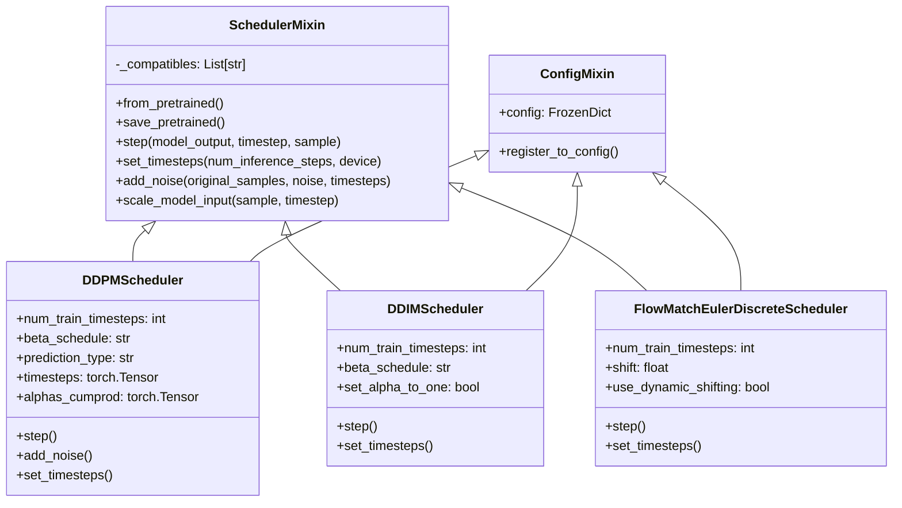
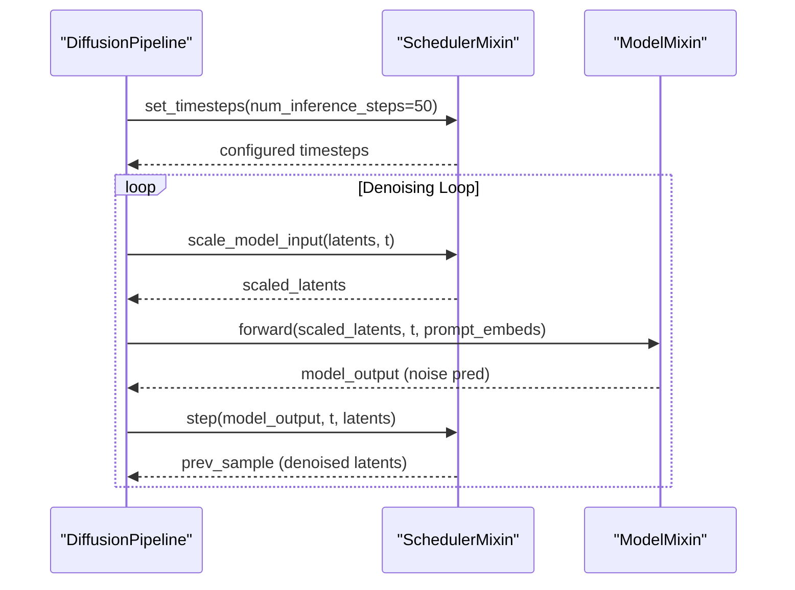
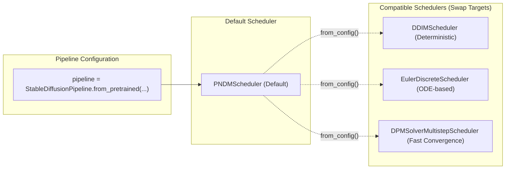

<!-- source: DeepWiki mcp.deepwiki.com · repo huggingface/diffusers · page 2.3 Scheduler System · fetched 2026-10-21 -->

# Scheduler System

<details>
<summary>Relevant source files</summary>

The following files were used as context for generating this wiki page:

- [src/diffusers/configuration_utils.py](src/diffusers/configuration_utils.py)
- [src/diffusers/schedulers/scheduling_ddim.py](src/diffusers/schedulers/scheduling_ddim.py)
- [src/diffusers/schedulers/scheduling_ddpm.py](src/diffusers/schedulers/scheduling_ddpm.py)
- [src/diffusers/schedulers/scheduling_deis_multistep.py](src/diffusers/schedulers/scheduling_deis_multistep.py)
- [src/diffusers/schedulers/scheduling_dpmsolver_multistep.py](src/diffusers/schedulers/scheduling_dpmsolver_multistep.py)
- [src/diffusers/schedulers/scheduling_dpmsolver_multistep_inverse.py](src/diffusers/schedulers/scheduling_dpmsolver_multistep_inverse.py)
- [src/diffusers/schedulers/scheduling_dpmsolver_sde.py](src/diffusers/schedulers/scheduling_dpmsolver_sde.py)
- [src/diffusers/schedulers/scheduling_dpmsolver_singlestep.py](src/diffusers/schedulers/scheduling_dpmsolver_singlestep.py)
- [src/diffusers/schedulers/scheduling_euler_ancestral_discrete.py](src/diffusers/schedulers/scheduling_euler_ancestral_discrete.py)
- [src/diffusers/schedulers/scheduling_euler_discrete.py](src/diffusers/schedulers/scheduling_euler_discrete.py)
- [src/diffusers/schedulers/scheduling_heun_discrete.py](src/diffusers/schedulers/scheduling_heun_discrete.py)
- [src/diffusers/schedulers/scheduling_k_dpm_2_ancestral_discrete.py](src/diffusers/schedulers/scheduling_k_dpm_2_ancestral_discrete.py)
- [src/diffusers/schedulers/scheduling_k_dpm_2_discrete.py](src/diffusers/schedulers/scheduling_k_dpm_2_discrete.py)
- [src/diffusers/schedulers/scheduling_lms_discrete.py](src/diffusers/schedulers/scheduling_lms_discrete.py)
- [src/diffusers/schedulers/scheduling_pndm.py](src/diffusers/schedulers/scheduling_pndm.py)
- [src/diffusers/schedulers/scheduling_sasolver.py](src/diffusers/schedulers/scheduling_sasolver.py)
- [src/diffusers/schedulers/scheduling_sde_ve.py](src/diffusers/schedulers/scheduling_sde_ve.py)
- [src/diffusers/schedulers/scheduling_unipc_multistep.py](src/diffusers/schedulers/scheduling_unipc_multistep.py)
- [src/diffusers/schedulers/scheduling_utils.py](src/diffusers/schedulers/scheduling_utils.py)

</details>


## Purpose and Scope

This document provides a detailed technical overview of the scheduler system within the Diffusers library. It explains the scheduler interface architecture, the compatibility and interchangeability mechanism between scheduler implementations, and how schedulers orchestrate the diffusion denoising process. The page targets developers wanting to understand or extend the scheduler system with a focus on code-level design, data flow, and core API methods.

For concrete scheduler algorithm details, see [7. Scheduler Deep Dive](). For integration with the broader pipeline system, see [2.1. DiffusionPipeline System]().

---

## System Overview

Schedulers in Diffusers define and control the discrete or continuous noise-removal process in diffusion models during training and inference. They encapsulate noise schedules, timestep samplings, input scaling, noise addition, and iterative denoising steps.

Schedulers enable a pluggable architecture allowing multiple sampling algorithms (DDPM, DDIM, Euler, DPMSolver, UniPC, etc.) to be interchanged seamlessly in pipelines without modifying pipeline code.

### Key Responsibilities of a Scheduler:

- Define beta and alpha noise schedules and related parameters for diffusion [example: betas defined between lines 145-154 in `scheduling_ddpm.py`]().
- Manage the inference timestep sequence, enabling different timestep spacings for sampling [lines 252-324 in `scheduling_ddpm.py`]().
- Implement the reverse diffusion denoising step performed each iteration through `step()` [lines 416-420 in `scheduling_ddpm.py`]().
- Scale inputs to the model depending on the timestep to maintain numerical stability [e.g., lines 279-285 in `scheduling_euler_discrete.py`]().
- Enable noise addition mechanisms for training or inversion — forward diffusion [lines 568-575 in `scheduling_ddpm.py`]().
- Declare compatibility to enable scheduler swapping inside pipelines.

### Scheduler Architecture and Data Flow

```mermaid
graph TB
    subgraph "DiffusionPipeline Layer"
        PIPE["DiffusionPipeline"]
    end
    
    subgraph "Scheduler Base Interface"
        MIXIN["SchedulerMixin (Base Class)"]
        CONFIG["ConfigMixin (Config Management)"]
    end
    
    subgraph "Scheduler Implementations"
        DDPM["DDPMScheduler (Stochastic)"]
        DDIM["DDIMScheduler (Deterministic)"]
        EULER["EulerDiscreteScheduler (ODE-based)"]
        DPM["DPMSolverMultistepScheduler (Fast Solver)"]
        UNIPC["UniPCMultistepScheduler (Unified Predictor-Corrector)"]
        LMS["LMSDiscreteScheduler (Linear Multistep)"]
        FLOW["FlowMatchEulerDiscreteScheduler (Flow Matching)"]
        OTHERS["20+ Other Schedulers"]
    end
    
    subgraph "Core Scheduler Methods"
        SET_TIMESTEPS["set_timesteps() - Configure inference steps"]
        STEP["step() - Perform denoising iteration"]
        ADD_NOISE["add_noise() - Add noise during training/inversion"]
        SCALE_INPUT["scale_model_input() - Input scaling for model"]
    end
    
    PIPE --> MIXIN
    MIXIN --> DDPM
    MIXIN --> DDIM
    MIXIN --> EULER
    MIXIN --> DPM
    MIXIN --> UNIPC
    MIXIN --> LMS
    MIXIN --> FLOW
    MIXIN --> OTHERS
    
    CONFIG --> MIXIN
    
    MIXIN --> SET_TIMESTEPS
    MIXIN --> STEP
    MIXIN --> ADD_NOISE
    MIXIN --> SCALE_INPUT
```



**Sources:**  
[src/diffusers/schedulers/scheduling_utils.py:65-153]()  
[src/diffusers/schedulers/scheduling_ddpm.py:137-177]()  
[src/diffusers/schedulers/scheduling_ddim.py:139-184]()  
[src/diffusers/schedulers/scheduling_flow_match_euler_discrete.py:48-86]()

---

## SchedulerMixin Interface

All scheduler classes inherit from a common base hierarchy combining:

- **SchedulerMixin**: Implements the common scheduler interface methods, loading/saving, and compatibility system.  
- **ConfigMixin**: Provides configuration serialization and registration support, enabling scheduler hyperparameters to be saved and restored.

### Base Class Structure and Attributes

| Component         | Purpose                                                    | Location                                  |
|-------------------|------------------------------------------------------------|-------------------------------------------|
| `SchedulerMixin`  | Base class for common scheduling interface and utilities  | `src/diffusers/schedulers/scheduling_utils.py:79-150`         |
| `ConfigMixin`     | Configuration management with `@register_to_config` decorator | `src/diffusers/configuration_utils.py:87-103`                 |
| `_compatibles`    | List of compatible scheduler class names for swapping     | e.g. `scheduling_pndm.py:116`            |
| `order`           | Integration order (numerical solver's order, e.g., 1 or 2) | e.g. `scheduling_pndm.py:117`             |

Schedulers define their compatibilities by listing strings from the `KarrasDiffusionSchedulers` enum for allowed swaps.

### Scheduler Class Relationships



**Sources:**  
[src/diffusers/schedulers/scheduling_utils.py:79-92]()  
[src/diffusers/schedulers/scheduling_ddpm.py:137-177]()  
[src/diffusers/schedulers/scheduling_ddim.py:139-184]()  
[src/diffusers/schedulers/scheduling_flow_match_euler_discrete.py:48-108]()

---

## Core Methods

### Common Interface Methods

Schedulers expose a consistent set of key methods relied upon by pipelines:

| Method           | Signature                                      | Description                                      | Example Location                                           |
|------------------|------------------------------------------------|------------------------------------------------|------------------------------------------------------------|
| `set_timesteps`  | `(num_inference_steps: int, device: str)`       | Initialize or configure timesteps for inference| [252-324 in scheduling_ddpm.py]()                          |
| `step`           | `(model_output, timestep, sample) -> SchedulerOutput` | Performs one denoising step                     | [416-420 in scheduling_ddpm.py]()                          |
| `add_noise`      | `(original_samples, noise, timesteps)`          | Adds noise to a clean sample (forward diffusion)| [568-575 in scheduling_ddpm.py]()                          |
| `scale_model_input` | `(sample, timestep) -> torch.Tensor`           | Scales model input based on timestep            | [279-285 in scheduling_euler_discrete.py]()                |

These methods are mandatory or commonly overridden by scheduler subclasses.

### Inference Denoising Loop Example



**Sources:**  
[src/diffusers/schedulers/scheduling_ddpm.py:235-254]()  
[src/diffusers/schedulers/scheduling_ddpm.py:416-560]()

---

### `set_timesteps()`

This method prepares the discrete timestep sequences to run reverse diffusion during inference. It must be called prior to sampling.

Schedulers support various `timestep_spacing` strategies:

| Strategy    | Description                            | Implementation snippet (example)                    |
|-------------|------------------------------------|--------------------------------------------------|
| `leading`   | Timesteps starting from the beginning of training range | `np.arange(0, num_steps) * step_ratio` [270-272] |
| `trailing`  | Timesteps starting from the end of training range       | `np.arange(num_train_timesteps, 0, -step_ratio)` [273-275] |
| `linspace`  | Evenly spaced timesteps over full range               | `np.linspace(0, num_train_timesteps-1, num_steps)` [267-269] |

This flexibility allows controlling sampling speed vs. quality trade-offs.

**Sources:**  
[src/diffusers/schedulers/scheduling_ddpm.py:252-324]()  
[src/diffusers/schedulers/scheduling_ddim.py:247-359]()

---

### `step()`

The critical reverse diffusion step that consumes the model's noise prediction and current noisy sample to produce a less-noisy sample estimate at the previous timestep.

- Returns a specialized output dataclass (e.g., `DDPMSchedulerOutput`) containing:  
  - `prev_sample`: The denoised sample for the next iteration.  
  - `pred_original_sample`: The predicted clean image (`x_0`) based on model output (optional and scheduler-dependent).

**SchedulerOutput example:**

```python
@dataclass
class DDPMSchedulerOutput(BaseOutput):
    prev_sample: torch.Tensor
    pred_original_sample: torch.Tensor | None = None
```

**Sources:**  
[src/diffusers/schedulers/scheduling_ddpm.py:31-47]()  
[src/diffusers/schedulers/scheduling_flow_match_euler_discrete.py:35-46]()

---

### `add_noise()`

Adds Gaussian noise to a clean sample according to the forward diffusion process. Used primarily during scheduler training or inversion setups.

---

### `scale_model_input()`

Adjusts the input to the denoising model depending on the current timestep, improving numerical stability or aligning with training conditions.

---

## Scheduler Interchangeability

### Compatibility System

Schedulers declare compatibility with other schedulers via the `_compatibles` class attribute, which is a list of strings representing scheduler names. This list consists mostly of members of the `KarrasDiffusionSchedulers` enum.

```python
# Example of _compatibles attribute
_compatibles = [e.name for e in KarrasDiffusionSchedulers]
```

This design allows swapping one scheduler implementation for another by reconstructing from shared configuration using `ConfigMixin.from_config()`.

The compatibility list generally includes major schedulers such as `DDIMScheduler`, `DDPMScheduler`, `PNDMScheduler`, `LMSDiscreteScheduler`, `EulerDiscreteScheduler`, `DPMSolverMultistepScheduler`, and many others.

### Scheduler Swapping Mechanism



This system ensures that pipelines can flexibly switch schedulers solely by config, enabling experimentation with new sampling algorithms or use-case-specific optimizations.

**Sources:**  
[src/diffusers/schedulers/scheduling_utils.py:94-153]()  
[src/diffusers/schedulers/scheduling_pndm.py:116-116]()  
[src/diffusers/schedulers/scheduling_utils.py:33-49]()

---

## Configuration and Noise Schedules

### Beta Schedules

Schedulers rely on beta schedules defining the discrete noise variance added per timestep during training. Several standard schedule types are implemented:

| Schedule Name       | Implementation Detail                                                                                  | Typical Use Case              |
|---------------------|-----------------------------------------------------------------------------------------------------|------------------------------|
| `linear`            | Linear interpolation between `beta_start` and `beta_end`                                             | Original DDPM standard        |
| `scaled_linear`     | Square of linear interpolation of square roots of betas                                              | Latent Diffusion / Stable Diffusion |
| `squaredcos_cap_v2` | Beta computed from a cosine alpha-bar function supporting improved noise scheduling                   | Improved diffusion models     |

The function `betas_for_alpha_bar` discretizes a cumulative alpha function to obtain betas supporting various transform types (`cosine`, `exp`, `laplace`). This function is widely reused among schedulers.

**Sources:**  
[src/diffusers/schedulers/scheduling_ddpm.py:48-97]()  
[src/diffusers/schedulers/scheduling_ddpm.py:179-197]()

---

### Prediction Types

Schedulers support different model output predictions, configurable via the `prediction_type` parameter:

| Type            | Meaning                                                      | Example Handling Location                                          |
|-----------------|--------------------------------------------------------------|------------------------------------------------------------------|
| `epsilon`       | Model predicts the added noise at current timestep           | Default in many schedulers [scheduling_ddpm.py:161-162]()        |
| `sample`        | Model directly predicts original clean sample `x_0`          | [scheduling_ddpm.py:162-163]()                                   |
| `v_prediction`  | Model predicts velocity (hybrid noise and sample)            | Used in Imagen Video paper variants [scheduling_ddpm.py:163-165]()|
| `flow_prediction` | Predicts a flow (used by flow matching schedulers)          | [scheduling_dpmsolver_multistep.py:144-147]()                    |

Schedulers convert model outputs according to prediction type for subsequent denoising calculations.

**Sources:**  
[src/diffusers/schedulers/scheduling_ddpm.py:161-165]()  
[src/diffusers/schedulers/scheduling_dpmsolver_multistep.py:144-147]()

---

## Specialized Utilities

### Beta Rescaling for Zero Terminal SNR

The utility function `rescale_zero_terminal_snr` rescales betas to guarantee a zero terminal signal-to-noise ratio at the final timestep, allowing generators to sample effectively from pure noise.

This approach follows algorithmic insights from the paper at https://huggingface.co/papers/2305.08891.

**Sources:**  
[src/diffusers/schedulers/scheduling_ddpm.py:101-134]()

---

### Alpha Bar Functions

The `betas_for_alpha_bar` utility generates beta noise schedules by discretizing an alpha cumulative product function \(\bar{\alpha}(t)\), supporting three transform types:

- cosine  
- exponential (exp)  
- laplace  

This function underpins noise schedules for many discrete schedulers (DDPM, DDIM, PNDM, DPMSolver).

**Sources:**  
[src/diffusers/schedulers/scheduling_ddpm.py:48-97]()  
[src/diffusers/schedulers/scheduling_ddim.py:51-101]()  
[src/diffusers/schedulers/scheduling_pndm.py:28-77]()  
[src/diffusers/schedulers/scheduling_dpmsolver_multistep.py:34-83]()  
[src/diffusers/schedulers/scheduling_unipc_multistep.py:34-83]()

---

### Adaptive Flow Matching with Resolution-based Shifting

State-of-the-art schedulers like `FlowMatchEulerDiscreteScheduler` improve stability by applying dynamic timestep shifting scaled relative to image resolution.

This mechanism modifies sampling behavior dynamically depending on resolution and uses exponential decay factors to calibrate noise schedules during inference.

**Sources:**  
[src/diffusers/schedulers/scheduling_flow_match_euler_discrete.py:58-69]()  
[src/diffusers/schedulers/scheduling_flow_match_euler_discrete.py:92-145]()

---

# Summary

The Diffusers scheduler system is a well-abstracted framework unifying diverse diffusion sampling strategies under a common interface defined by `SchedulerMixin` and `ConfigMixin`. Through configurable noise schedules, timestep management, and denoising steps, schedulers direct the iterative reconstruction of samples in diffusion pipelines.

The scheduler compatibility system facilitates seamless swapping, encouraging experimentation and rapid adoption of novel solvers. Key utilities for beta schedule generation and noise rescaling are shared across implementations, promoting consistency and efficiency.

Understanding this architecture is essential for extending diffusion pipelines with custom schedulers or optimizing existing sampling methods in the library.

---

# References and Sources

- `src/diffusers/schedulers/scheduling_utils.py:65-153`  
- `src/diffusers/schedulers/scheduling_ddpm.py:31-177, 252-575`  
- `src/diffusers/schedulers/scheduling_ddim.py:31-165`  
- `src/diffusers/schedulers/scheduling_pndm.py:28-150`  
- `src/diffusers/schedulers/scheduling_flow_match_euler_discrete.py:48-145`  
- `src/diffusers/schedulers/scheduling_dpmsolver_multistep.py:34-157`  
- `src/diffusers/configuration_utils.py:87-103`

---

