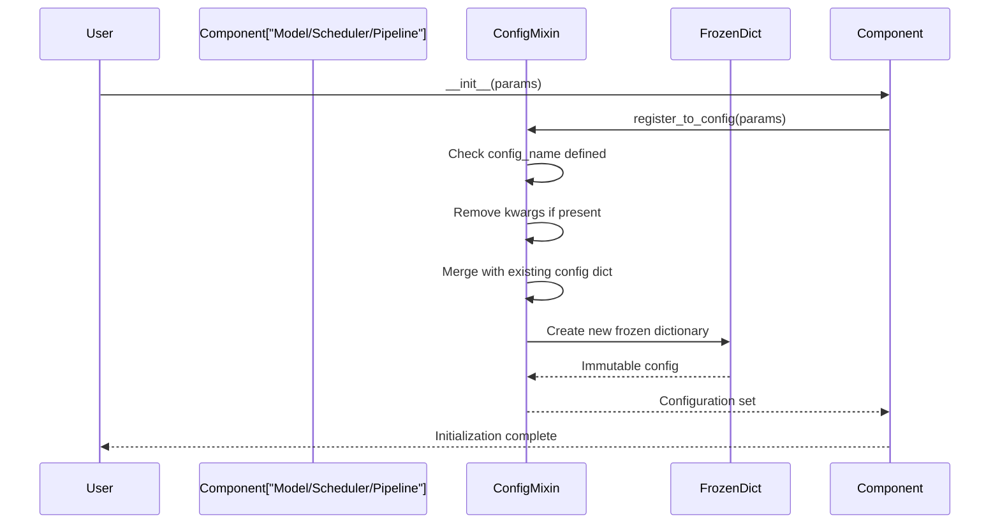
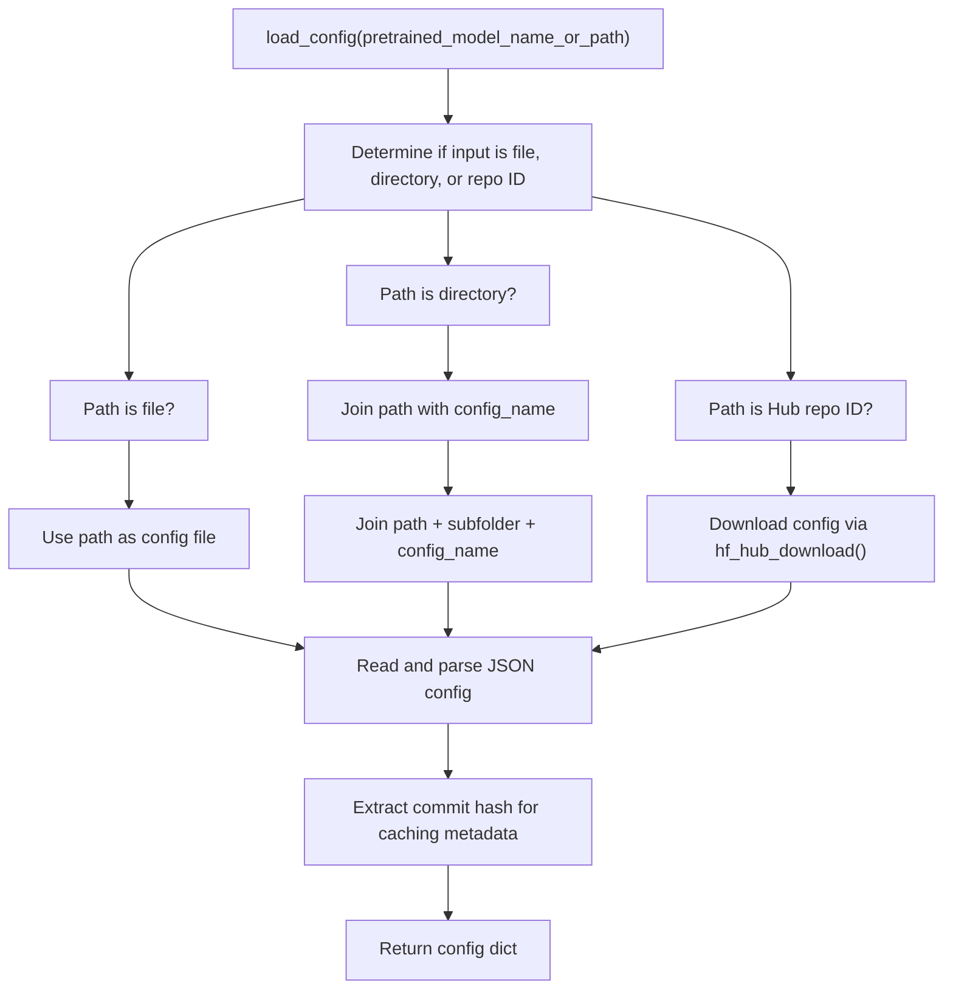
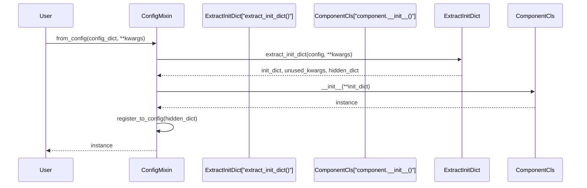
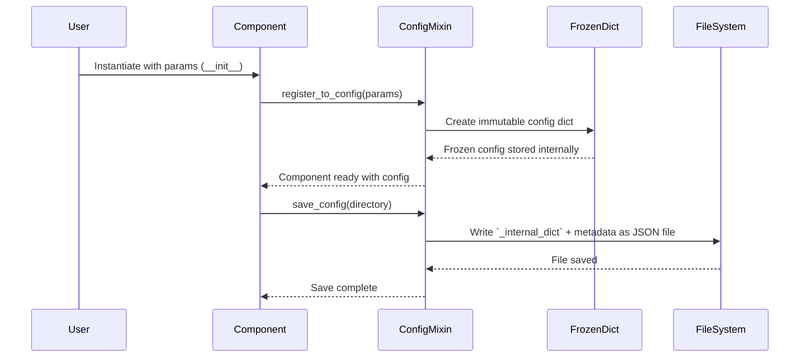

<!-- source: DeepWiki mcp.deepwiki.com · repo huggingface/diffusers · page 2.4 Configuration System · fetched 2026-10-21 -->

# Configuration System

<details>
<summary>Relevant source files</summary>

The following files were used as context for generating this wiki page:

- [src/diffusers/configuration_utils.py](src/diffusers/configuration_utils.py)
- [src/diffusers/image_processor.py](src/diffusers/image_processor.py)
- [src/diffusers/schedulers/scheduling_ddim.py](src/diffusers/schedulers/scheduling_ddim.py)
- [src/diffusers/schedulers/scheduling_ddpm.py](src/diffusers/schedulers/scheduling_ddpm.py)
- [src/diffusers/schedulers/scheduling_deis_multistep.py](src/diffusers/schedulers/scheduling_deis_multistep.py)
- [src/diffusers/schedulers/scheduling_dpmsolver_multistep.py](src/diffusers/schedulers/scheduling_dpmsolver_multistep.py)
- [src/diffusers/schedulers/scheduling_dpmsolver_multistep_inverse.py](src/diffusers/schedulers/scheduling_dpmsolver_multistep_inverse.py)
- [src/diffusers/schedulers/scheduling_dpmsolver_sde.py](src/diffusers/schedulers/scheduling_dpmsolver_sde.py)
- [src/diffusers/schedulers/scheduling_dpmsolver_singlestep.py](src/diffusers/schedulers/scheduling_dpmsolver_singlestep.py)
- [src/diffusers/schedulers/scheduling_euler_ancestral_discrete.py](src/diffusers/schedulers/scheduling_euler_ancestral_discrete.py)
- [src/diffusers/schedulers/scheduling_euler_discrete.py](src/diffusers/schedulers/scheduling_euler_discrete.py)
- [src/diffusers/schedulers/scheduling_heun_discrete.py](src/diffusers/schedulers/scheduling_heun_discrete.py)
- [src/diffusers/schedulers/scheduling_k_dpm_2_ancestral_discrete.py](src/diffusers/schedulers/scheduling_k_dpm_2_ancestral_discrete.py)
- [src/diffusers/schedulers/scheduling_k_dpm_2_discrete.py](src/diffusers/schedulers/scheduling_k_dpm_2_discrete.py)
- [src/diffusers/schedulers/scheduling_lms_discrete.py](src/diffusers/schedulers/scheduling_lms_discrete.py)
- [src/diffusers/schedulers/scheduling_pndm.py](src/diffusers/schedulers/scheduling_pndm.py)
- [src/diffusers/schedulers/scheduling_sasolver.py](src/diffusers/schedulers/scheduling_sasolver.py)
- [src/diffusers/schedulers/scheduling_sde_ve.py](src/diffusers/schedulers/scheduling_sde_ve.py)
- [src/diffusers/schedulers/scheduling_unipc_multistep.py](src/diffusers/schedulers/scheduling_unipc_multistep.py)
- [src/diffusers/schedulers/scheduling_utils.py](src/diffusers/schedulers/scheduling_utils.py)
- [src/diffusers/utils/logging.py](src/diffusers/utils/logging.py)
- [src/diffusers/utils/outputs.py](src/diffusers/utils/outputs.py)
- [tests/others/test_check_copies.py](tests/others/test_check_copies.py)
- [tests/others/test_check_support_list.py](tests/others/test_check_support_list.py)
- [tests/others/test_config.py](tests/others/test_config.py)
- [tests/others/test_ema.py](tests/others/test_ema.py)
- [tests/others/test_flashpack.py](tests/others/test_flashpack.py)
- [tests/others/test_hub_utils.py](tests/others/test_hub_utils.py)
- [tests/others/test_image_processor.py](tests/others/test_image_processor.py)
- [tests/others/test_outputs.py](tests/others/test_outputs.py)
- [tests/others/test_training.py](tests/others/test_training.py)
- [tests/others/test_utils.py](tests/others/test_utils.py)

</details>


## Purpose and Scope

The Configuration System provides the foundation for managing initialization parameters, serialization, and loading of all components in the Diffusers library. This system enables models, pipelines, and schedulers to save their settings to JSON files and reconstruct themselves from configuration dictionaries, facilitating model sharing via the Hugging Face Hub and ensuring reproducibility.

For information about loading pretrained models and saving, see [Loading and Saving](2.5). For scheduler-specific configuration, see [Scheduler System](2.3). For pipeline-specific configuration, see [DiffusionPipeline System](2.1).

## Overview

The configuration system is built around the `ConfigMixin` base class, which provides:

- Automatic parameter registration during initialization,
- Immutable configuration storage using `FrozenDict`,
- JSON serialization and deserialization of configurations,
- Hub integration for configuration downloading and caching,
- Instantiation from config dictionaries via `from_config` class method.

All major components (pipelines, models, schedulers) inherit from or utilize `ConfigMixin` to manage their configuration state.

Key components include:

| Component or Decorator       | Role                                                    | Location                                                     |
|-----------------------------|---------------------------------------------------------|--------------------------------------------------------------|
| `ConfigMixin`               | Base class managing configuration lifecycle             | `src/diffusers/configuration_utils.py:87-750`                |
| `FrozenDict`                | Immutable ordered dictionary for configuration storage  | `src/diffusers/configuration_utils.py:55-85`                 |
| `register_to_config`        | Decorator/method to auto-register `__init__` params     | Implicitly used via decorator on `__init__` in schedulers    |
| Configuration JSON files    | Persistent storage of configurations                     | `config.json`, `scheduler_config.json` etc.                  |

Sources: [src/diffusers/configuration_utils.py:55-726]()

---

## ConfigMixin Architecture

The `ConfigMixin` class is the core of configuration management, grouping all config parameters in an immutable `FrozenDict` named `_internal_dict`. It defines properties and methods for saving, loading, and instantiating configurations.

### Class Structure and Data Flow

```mermaid
graph TB
    subgraph "ConfigMixin [src/diffusers/configuration_utils.py:87]"
        C[ConfigMixin] --> ID[_internal_dict: FrozenDict]
        C --> CN[config_name: str]
        C --> RJ[to_json_string(), to_json_file()]
        C --> RS[save_config() / load_config()]
        C --> FC[from_config()]
    end
    subgraph "FrozenDict [src/diffusers/configuration_utils.py:55]"
        FD[FrozenDict] --> OD[OrderedDict]
        FD --> IMM[Immutable ops with exceptions]
    end
    
    ID --> FD
```

- `_internal_dict` wraps all registered arguments in a `FrozenDict`, ensuring immutability after initialization.
- `config_name` points to the default JSON filename when saving/loading.
- Serialization methods convert configs to/from JSON files or strings.
- `from_config()` allows creating component instances from a plain config dictionary.
- `FrozenDict` extends `OrderedDict` but forbids modification operations.

Sources: [src/diffusers/configuration_utils.py:55-85](), [src/diffusers/configuration_utils.py:87-726]()

---

## Configuration Registration

### `register_to_config` Decorator and Method

To automatically track initialization parameters, classes use the `@register_to_config` decorator on their `__init__` methods. This decorator:

- Captures parameters passed to `__init__`,
- Calls `register_to_config` method internally,
- Stores parameters in `_internal_dict` as a frozen dict.

Example usage in a scheduler:

```python
@register_to_config
def __init__(self, num_train_timesteps=1000, beta_start=0.0001, beta_end=0.02, ...):
    ...
```

Internally, `register_to_config` does:

- Validates presence of `config_name`,
- Removes the `kwargs` argument if present to handle deprecation,
- Merges new parameters with existing `_internal_dict`,
- Ensures `_internal_dict` is a `FrozenDict`.



This pattern is essential for all schedulers and models, such as `DDPMScheduler` and `DDIMScheduler`.

Sources:
[src/diffusers/configuration_utils.py:142-158](), [src/diffusers/schedulers/scheduling_ddpm.py:119-172](), [src/diffusers/schedulers/scheduling_ddim.py:139-165]()

### `FrozenDict` Class: Immutable Configuration Container

`FrozenDict` is a subclass of `OrderedDict` that prohibits mutation after construction, enforcing immutability for configuration storage. This prevents accidental modification of stored parameters.

| Method          | Behavior                                                                         |
|-----------------|----------------------------------------------------------------------------------|
| `__init__`      | Sets attributes as properties and marks the dict as frozen                      |
| `__setitem__`   | Raises Exception if tried to modify after frozen                                |
| `__delitem__`   | Raises Exception                                                                |
| `setdefault`    | Raises Exception                                                                |
| `pop`           | Raises Exception                                                                |
| `update`        | Raises Exception                                                                |
| `__setattr__`   | Raises Exception if frozen, prevents attribute changes after initialization      |

This guarantees configuration stability throughout an object's lifecycle.

Sources: [src/diffusers/configuration_utils.py:55-85]()

---

## Configuration Serialization and Deserialization

### Saving Configuration to JSON Files

`ConfigMixin` includes multiple methods for saving configurations, supporting both local filesystem and remote uploads.

| Method                  | Description                                      | Parameters                                   | Output                        |
|-------------------------|------------------------------------------------|----------------------------------------------|-------------------------------|
| `save_config`           | Save config JSON to a directory                 | `save_directory`, `push_to_hub`, `repo_id`  | JSON file saved locally or pushed to Hub |
| `to_json_file`           | Save config JSON to specified file path         | `json_file_path`                             | Writes JSON to file            |
| `to_json_string`         | Return the config as a JSON formatted string    | None                                         | JSON string                   |
| `to_diff_dict`           | Return only parameters differing from defaults  | None                                         | Dict of parameters differing from default |

`save_config` is used by components to persist their configuration as a JSON file named according to `config_name` (often `config.json`).

Additional metadata fields included in saved JSON:

- `_class_name`: class name of the component,
- `_diffusers_version`: version of the diffusers library at save time,
- `_module`: import path of the component.

Sources: [src/diffusers/configuration_utils.py:177-221](), [src/diffusers/configuration_utils.py:539-646]()

### Loading Configuration from JSON or Remote

The `load_config` class method handles loading JSON configuration from:

- Local files or directories,
- Hugging Face hub repositories,
- Subfolders inside repositories,
- Special Diffusion Data Universal Format (DDUF) archive files.

The loading logic is:



For archives (DDUF files), a helper method `_get_config_file_from_dduf` extracts the embedded JSON configuration.

Sources: [src/diffusers/configuration_utils.py:334-514](), [src/diffusers/configuration_utils.py:516-569]()

---

## Configuration-Based Instantiation

### `from_config` Class Method

`from_config` allows reconstructing components from a configuration dictionary or loaded JSON. It:

1. Extracts usable initialization arguments using `extract_init_dict`,
2. Invokes the class constructor with these arguments,
3. Applies any “hidden” parameters (those starting with `_`) to the internal config after instantiation,
4. Returns the instantiated component.



This method is crucial for enabling loading from saved configs or Hub repos.

Sources: [src/diffusers/configuration_utils.py:223-332](), [src/diffusers/configuration_utils.py:648-726]()

### `extract_init_dict`

This utility method divides a config dictionary into three parts:

| Part          | Meaning                                                                                               |
|---------------|-----------------------------------------------------------------------------------------------------|
| `init_dict`   | Parameters that match the class `__init__` signature (used as arguments for initialization).         |
| `unused_kwargs` | Parameters not appearing in `__init__` but present in config (possibly overrides).                   |
| `hidden_dict` | Parameters with keys starting with `_`; internal metadata or special flags not passed during init.   |

This enables a clean initialization while preserving extra metadata.

Sources: [src/diffusers/configuration_utils.py:648-726]()

---

## Configuration Attribute Access

To maintain API backward compatibility, `ConfigMixin` overrides `__getattr__` to allow deprecated direct access to config attributes on the object instance (e.g., accessing `scheduler.num_train_timesteps` instead of `scheduler.config.num_train_timesteps`). When such an attribute is accessed, a deprecation warning is emitted, and the value is fetched from `_internal_dict`.

This fosters migration toward explicit config usage without breaking existing code.

Sources: [src/diffusers/configuration_utils.py:159-175]()

---

## Advanced Configuration Features

### Configuration Differentiation: `to_diff_dict`

`to_diff_dict` returns only those parameters in the configuration that differ from class defaults. This supports minimal config saving by excluding default-valued parameters.

The internal steps are:

- Inspect the class `__init__` signature,
- Compare each config param to its default value,
- Keep only those that differ,
- Always include internal metadata parameters starting with `_`.

This method underpins efficient config persistence and transfer.

Sources: [src/diffusers/configuration_utils.py:607-646]()

### DDUF File Support

Special handling exists for Diffusion Data Universal Format (DDUF) archive files:

- DDUF archives combine model weights and configs,
- `load_config` detects such archives and extracts the relevant `config.json` internally,
- This supports unified checkpoint and configuration packaging.

Sources: [src/diffusers/configuration_utils.py:409-431](), [src/diffusers/configuration_utils.py:516-569]()

---

# Summary Diagram Bridging Natural Language to Code Entities

```mermaid
graph TD
    NL_ConfigSys["Natural Language: Configuration System"]

    NL_ConfigSys -->|Base class for configurations| Code_ConfigMixin["`ConfigMixin` (configuration_utils.py:87)"]
    NL_ConfigSys -->|Immutable config storage| Code_FrozenDict["`FrozenDict` (configuration_utils.py:55)"]
    NL_ConfigSys -->|Decorator to register __init__ args| Code_RegisterToConfig["`@register_to_config` (configuration_utils.py)"]
    NL_ConfigSys -->|Save/load configs as JSON| Code_SaveLoadConfig["`save_config()`, `load_config()` (configuration_utils.py:177, 334)"]
    NL_ConfigSys -->|Create from config dict| Code_FromConfig["`from_config()` (configuration_utils.py:223)"]

    Code_ConfigMixin --> Code_FrozenDict
    Code_ConfigMixin --> Code_RegisterToConfig
    Code_ConfigMixin --> Code_SaveLoadConfig
    Code_ConfigMixin --> Code_FromConfig
```

---

# Mermaid Diagram of Configuration Data Flow During Instantiation and Saving



---

# References & Sources

- `src/diffusers/configuration_utils.py:55-85, 87-750`
- `src/diffusers/schedulers/scheduling_ddpm.py:119-172`
- `src/diffusers/schedulers/scheduling_ddim.py:139-165`

---

