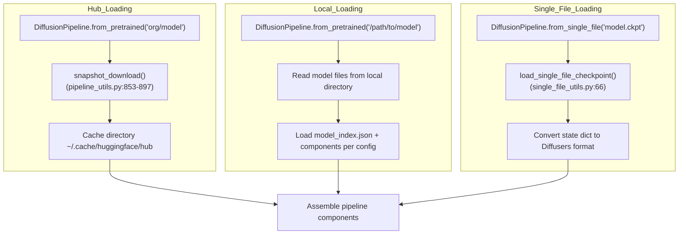
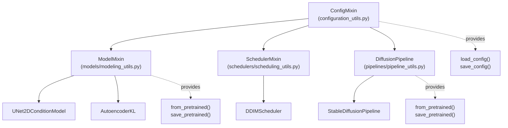
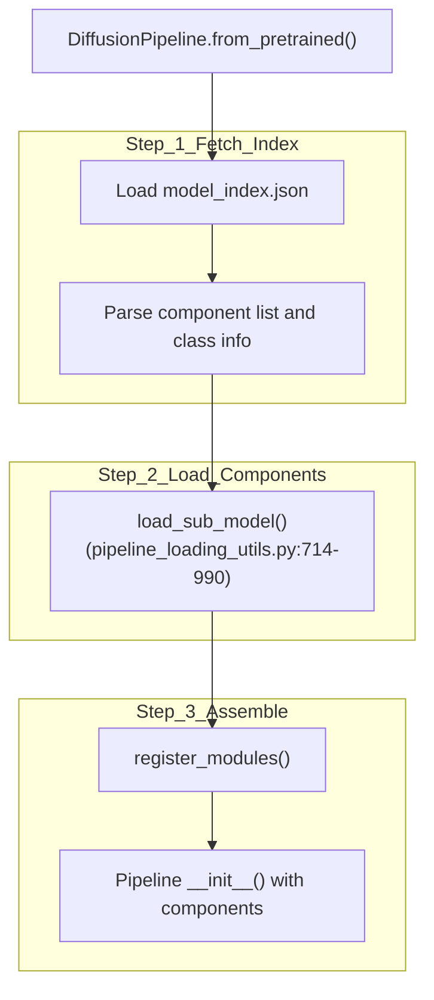
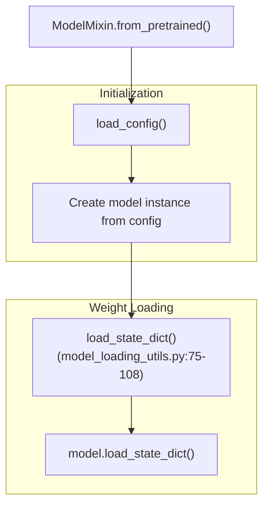
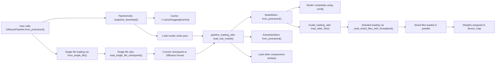
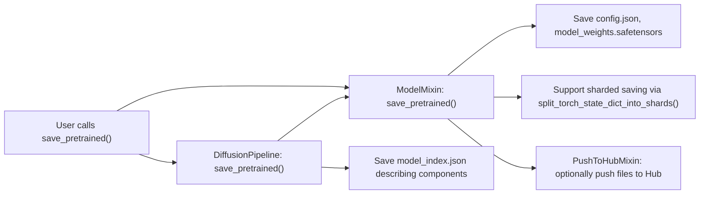

<!-- source: DeepWiki mcp.deepwiki.com · repo huggingface/diffusers · page 2.5 Loading and Saving · fetched 2026-10-21 -->

# Loading and Saving

<details>
<summary>Relevant source files</summary>

The following files were used as context for generating this wiki page:

- [docs/source/en/tutorials/autopipeline.md](docs/source/en/tutorials/autopipeline.md)
- [docs/source/en/using-diffusers/automodel.md](docs/source/en/using-diffusers/automodel.md)
- [docs/source/en/using-diffusers/callback.md](docs/source/en/using-diffusers/callback.md)
- [docs/source/en/using-diffusers/custom_pipeline_overview.md](docs/source/en/using-diffusers/custom_pipeline_overview.md)
- [docs/source/en/using-diffusers/legacy_checkpoints.md](docs/source/en/using-diffusers/legacy_checkpoints.md)
- [docs/source/en/using-diffusers/loading.md](docs/source/en/using-diffusers/loading.md)
- [docs/source/en/using-diffusers/other-formats.md](docs/source/en/using-diffusers/other-formats.md)
- [docs/source/en/using-diffusers/push_to_hub.md](docs/source/en/using-diffusers/push_to_hub.md)
- [docs/source/en/using-diffusers/reusing_seeds.md](docs/source/en/using-diffusers/reusing_seeds.md)
- [docs/source/en/using-diffusers/schedulers.md](docs/source/en/using-diffusers/schedulers.md)
- [docs/source/en/using-diffusers/weighted_prompts.md](docs/source/en/using-diffusers/weighted_prompts.md)
- [src/diffusers/models/model_loading_utils.py](src/diffusers/models/model_loading_utils.py)
- [src/diffusers/models/modeling_utils.py](src/diffusers/models/modeling_utils.py)
- [src/diffusers/pipelines/pipeline_loading_utils.py](src/diffusers/pipelines/pipeline_loading_utils.py)
- [src/diffusers/pipelines/pipeline_utils.py](src/diffusers/pipelines/pipeline_utils.py)
- [src/diffusers/utils/hub_utils.py](src/diffusers/utils/hub_utils.py)
- [tests/models/test_modeling_common.py](tests/models/test_modeling_common.py)
- [tests/models/unets/test_models_unet_2d_condition.py](tests/models/unets/test_models_unet_2d_condition.py)
- [tests/pipelines/test_pipeline_utils.py](tests/pipelines/test_pipeline_utils.py)
- [tests/pipelines/test_pipelines.py](tests/pipelines/test_pipelines.py)
- [tests/pipelines/test_pipelines_common.py](tests/pipelines/test_pipelines_common.py)

</details>


This document explains the loading and saving mechanisms in the Diffusers library. Diffusers supports loading models from three primary sources:

- **Hugging Face Hub** repositories
- **Local directories** containing saved pipeline/model files
- **Single checkpoint files** such as `.ckpt` or `.safetensors` files, including the legacy DDUF format (deprecated)

All loadable components, including models, schedulers, and pipelines, share a common interface built around `from_pretrained()` and `save_pretrained()`, enabling ease of use and consistent behavior.

**Key Topics Covered:**
- Loading pipelines and models from Hub, local, or single file sources
- State dict handling, conversion, and integrity checks
- Support for sharded checkpoints with indexing and parallel loading
- File format support (SafeTensors, PyTorch `.bin`, GGUF)
- Device mapping and optimized loading with Accelerate
- Legacy DDUF pipeline loading behavior and deprecation
- Saving models and pipelines back to disk or Hub

---

## Loading Sources and Entry Points

Diffusers supports three main loading paths for pipelines and models:

### 1. Hugging Face Hub Loading

Loading directly from a Hub repository by specifying a model ID downloads the necessary files using `huggingface_hub.snapshot_download()` and caches them locally. For example:

```python
pipe = DiffusionPipeline.from_pretrained("runwayml/stable-diffusion-v1-5")
```

- The method downloads the model repository files including the `model_index.json` which defines the pipeline components.
- Files are cached locally in the standard cache directory (e.g., `~/.cache/huggingface/hub`).
- Diffusers supports loading with device mapping and dtype specification to optimize for hardware.

### 2. Local Directory Loading

Loading from a directory containing saved files locally. This directory should mirror the Diffusers pipeline folder structure with a `model_index.json` specifying components:

```python
pipe = DiffusionPipeline.from_pretrained("/path/to/saved_pipeline")
```

- Diffusers will load the pipeline and its components from the local files without downloading anything.
- Useful for offline usage or for loading custom fine-tuned checkpoints.

### 3. Single Checkpoint File Loading

Loading models from a single checkpoint file (e.g., `.ckpt`, `.safetensors`). This is a more specialized use case enabling loading legacy or custom checkpoints:

```python
pipe = DiffusionPipeline.from_single_file("model.safetensors")
```

- Under the hood, the checkpoint state dictionary is converted to the required Diffusers format.
- This method supports `.ckpt` and `.safetensors` formats.
- DDUF (Diffusers Distributed Universal Format) loading from single archives was deprecated and removed.

### Loading Flow Diagram



**Sources:** [src/diffusers/pipelines/pipeline_utils.py:597-1105](), [src/diffusers/loaders/single_file_model.py:83-181](), [src/diffusers/loaders/single_file_utils.py:66-67]()

---

## The `from_pretrained()` / `save_pretrained()` Pattern

All core components—models, schedulers, and pipelines—in the Diffusers library implement a common loading and saving interface:

- `ConfigMixin` provides `load_config()` and `save_config()` methods for configuration.
- `ModelMixin` extends `ConfigMixin` with state dict handling and I/O for models.
- `SchedulerMixin` (not shown fully here) manages scheduler loading and saving.
- `DiffusionPipeline` integrates loading of all pipeline subcomponents.

### Class Hierarchy and Interfaces



- `from_pretrained()` typically takes a repo ID or local path, downloads or loads files, parses config, initializes model/pipeline class, loads weights, and returns an instantiated HuggingFace Diffusers object.
- Correspondingly, `save_pretrained()` saves weights, configs, and auxiliary files back to disk or Hub.

**Sources:** [src/diffusers/models/modeling_utils.py:233-255](), [src/diffusers/pipelines/pipeline_utils.py:198-214]()

---

## Pipeline Loading Architecture

### `model_index.json` Structure

A key file in pipeline directories is `model_index.json`. It describes pipeline components—e.g., `unet`, `vae`, `scheduler`—and maps them to specific model classes and subdirectories. The pipeline uses this to dynamically load and instantiate the correct classes.

### Pipeline Loading Flow



Each component module loads independently:
- Checks file formats, variants, and sharding.
- Loads model weights with device mapping and dtype options.
- Wraps components with transforms if needed.

**Sources:** [src/diffusers/pipelines/pipeline_utils.py:597-1105](), [src/diffusers/pipelines/pipeline_loading_utils.py:714-990]()

---

## Model Loading and Sharding

### Model Loading Flow via `ModelMixin.from_pretrained()`

This method orchestrates:

1. Loading config JSON to get model args.
2. Instantiating an empty model with those args.
3. Loading model weights from a checkpoint into a state dict.
4. Loading the state dict into the model.
5. Returning the model ready for inference or fine-tuning.



- Loading supports SafeTensors and PyTorch `.bin` formats with fallback.
- Supports legacy checkpoint conversion and model variant handling.
- Can load partial weights with warnings for missing keys.
  
### Sharded Checkpoints for Large Models

To handle large models that don't fit in a single file:

- The system looks for an index file like `diffusion_pytorch_model.safetensors.index.json`.
- The index maps parameters to sharded weight files.
- Diffusers loads shards in parallel using a thread pool for speed.
- Shards are assigned to devices according to the `device_map`.

Workflow:

1. `_fetch_index_file()` locates and loads the index that maps parameter names to shards.
2. `_load_shard_files_with_threadpool()` uses concurrent futures to load shard files in parallel.
3. `_load_shard_file()` assigns each shard's weights to target device memory.

**Sources:** [src/diffusers/models/model_loading_utils.py:656-723](), [src/diffusers/models/model_loading_utils.py:282-327]()

---

## File Format Support

### SafeTensors Format

- Diffusers prefers SafeTensors due to security, speed, and smaller memory footprint on loading.
- The `use_safetensors` flag in `from_pretrained()` controls format preference.
- Utility `is_safetensors_compatible()` detects whether all components have matching SafeTensors files.
- Diffusers can automatically fall back to `.bin` if `.safetensors` is not fully available for all components.

### Model Variants

- Models may have variants suffixes (e.g., `fp16`).
- The loader filters compatible files with `variant_compatible_siblings()` and regex filters.
- This allows loading mixed precision or quantized variants transparently.

### GGUF Format

- Diffusers supports GGUF quantized checkpoint format for specific quantizers.
- Loading uses specialized loaders to convert GGUF format to PyTorch weights.

---

## Advanced Loading Scenarios

### Low CPU Memory Usage Mode

- Enabled by default if PyTorch >= 1.9.0 and `accelerate` available.
- Instantiates the model on a meta device (zero-cost allocation).
- Loads weights one param at a time into CPU or device memory, thus minimizing peak RAM usage.
- Ideal for loading very large models on limited hardware.

### Device Mapping and Quantization

- Passing a `device_map` allows placing model parts on specified GPU(s) or CPU.
- The library integrates with `accelerate` to infer optimal device splits.
- Quantization-aware loading using `DiffusersAutoQuantizer` adapts weights for bitsandbytes or other quantizers.

### Group Offloading Support

- Uses `GroupOffloadingConfig` and `ModuleGroup` abstractions to offload groups of modules on demand.
- Relies on hooks that move parameters between CPU and CUDA dynamically.
- Employs `AlignDevicesHook` and `CpuOffload` modules from `accelerate` under the hood.
- Enables larger models to be loaded and run by offloading infrequently used weights.

---

## DDUF Files (Diffusers Distributed Universal Format)

Legacy pipeline packaging format packing all components into a single archive.

- `_download_dduf_file()` manages DDUF downloads and verifies hashes.
- `read_dduf_file()` accesses internal objects.
- **DDUF pipeline loading is deprecated and removed** — users should use the standard Diffusers directory format with `model_index.json`.
- Attempts to load DDUF files raise errors with guidance to switch to the new format.

**Sources:** [src/diffusers/pipelines/pipeline_loading_utils.py:1025-1080](), [src/diffusers/pipelines/pipeline_utils.py:770-781]()

---

## Summary of Key Functions and Their Locations

| Action                            | Function/Method                         | Source File and Lines                             |
|----------------------------------|---------------------------------------|--------------------------------------------------|
| Load Pipeline                    | `DiffusionPipeline.from_pretrained()` | src/diffusers/pipelines/pipeline_utils.py:597    |
| Load Single Checkpoint           | `load_single_file_checkpoint()`       | src/diffusers/loaders/single_file_utils.py:66    |
| Load Model Weights               | `ModelMixin.from_pretrained()`        | src/diffusers/models/modeling_utils.py:1213-1551|
| Load State Dict                 | `load_state_dict()`                    | src/diffusers/models/model_loading_utils.py:75   |
| Save Model or Pipeline          | `save_pretrained()`                    | src/diffusers/models/modeling_utils.py:651       |
| Sharded Model Loading            | `_load_shard_files_with_threadpool()` | src/diffusers/models/model_loading_utils.py:677  |
| Determine Device Map           | `_determine_device_map()`              | src/diffusers/models/model_loading_utils.py:68   |
| DDUF File Handling (deprecated) | `_download_dduf_file()`                 | src/diffusers/pipelines/pipeline_loading_utils.py:1025 |

---

# Developer-Oriented Diagram Bridging Natural Language and Code Entities

### Loading Mechanisms and Key Entities


*Bars indicate usage of modules and functions in loading workflows.*

### Saving Mechanisms and Key Entities



---

# Notes

- The loading code automatically handles many edge cases: format compatibility, multi-file shards, device mapping, and quantized variants.
- Parallel loading and low CPU memory techniques significantly speed up and reduce system requirements.
- SafeTensors is strongly preferred for security and loading performance.
- Legacy formats like DDUF are no longer supported; users should convert or save pipelines with the new directory structure.

---

# References for Further Reading

- Pipeline loading: `src/diffusers/pipelines/pipeline_utils.py` [597-1105]()
- Pipeline loading utils and sharded loading: `src/diffusers/pipelines/pipeline_loading_utils.py` [700-990, 1000-1080]()
- Model loading and state dict management: `src/diffusers/models/modeling_utils.py` [1213-1551]()
- State dict loading helpers: `src/diffusers/models/model_loading_utils.py` [50-120, 660-720]()
- Single file loading: `src/diffusers/loaders/single_file_utils.py` [60-100]()
- Hub integration and caching: `src/diffusers/pipelines/pipeline_utils.py` [850-905]()

---

This page documents the current, detailed internal mechanics of loading and saving, bridging from user actions to core code entities within the Diffusers codebase.  
For more conceptual usage guides, see the "Using Diffusers" documentation.  
For low-level module details, consult the referenced source files.

Sources:  
[src/diffusers/pipelines/pipeline_utils.py:597-1105](), [src/diffusers/models/modeling_utils.py:1213-1551](), [src/diffusers/models/model_loading_utils.py:656-723](), [src/diffusers/pipelines/pipeline_loading_utils.py:700-990](), [src/diffusers/loaders/single_file_utils.py:60-100]()

---

