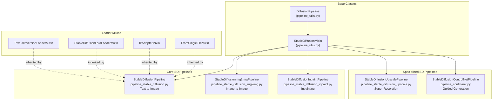
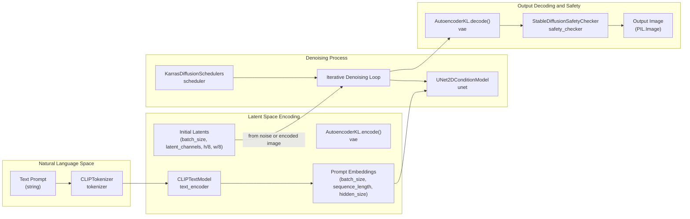

<!-- source: DeepWiki mcp.deepwiki.com · repo huggingface/diffusers · page 3 Stable Diffusion Pipelines · fetched 2026-10-21 -->

# Stable Diffusion Pipelines

Relevant source files

The following files were used as context for generating this wiki page:

- [src/diffusers/pipelines/controlnet/pipeline_controlnet.py](src/diffusers/pipelines/controlnet/pipeline_controlnet.py)
- [src/diffusers/pipelines/controlnet/pipeline_controlnet_img2img.py](src/diffusers/pipelines/controlnet/pipeline_controlnet_img2img.py)
- [src/diffusers/pipelines/controlnet/pipeline_controlnet_inpaint.py](src/diffusers/pipelines/controlnet/pipeline_controlnet_inpaint.py)
- [src/diffusers/pipelines/controlnet/pipeline_controlnet_inpaint_sd_xl.py](src/diffusers/pipelines/controlnet/pipeline_controlnet_inpaint_sd_xl.py)
- [src/diffusers/pipelines/controlnet/pipeline_controlnet_sd_xl.py](src/diffusers/pipelines/controlnet/pipeline_controlnet_sd_xl.py)
- [src/diffusers/pipelines/controlnet/pipeline_controlnet_sd_xl_img2img.py](src/diffusers/pipelines/controlnet/pipeline_controlnet_sd_xl_img2img.py)
- [src/diffusers/pipelines/stable_diffusion/pipeline_stable_diffusion.py](src/diffusers/pipelines/stable_diffusion/pipeline_stable_diffusion.py)
- [src/diffusers/pipelines/stable_diffusion/pipeline_stable_diffusion_depth2img.py](src/diffusers/pipelines/stable_diffusion/pipeline_stable_diffusion_depth2img.py)
- [src/diffusers/pipelines/stable_diffusion/pipeline_stable_diffusion_img2img.py](src/diffusers/pipelines/stable_diffusion/pipeline_stable_diffusion_img2img.py)
- [src/diffusers/pipelines/stable_diffusion/pipeline_stable_diffusion_inpaint.py](src/diffusers/pipelines/stable_diffusion/pipeline_stable_diffusion_inpaint.py)
- [src/diffusers/pipelines/stable_diffusion/pipeline_stable_diffusion_instruct_pix2pix.py](src/diffusers/pipelines/stable_diffusion/pipeline_stable_diffusion_instruct_pix2pix.py)
- [src/diffusers/pipelines/stable_diffusion/pipeline_stable_diffusion_upscale.py](src/diffusers/pipelines/stable_diffusion/pipeline_stable_diffusion_upscale.py)
- [src/diffusers/pipelines/stable_diffusion_xl/pipeline_stable_diffusion_xl.py](src/diffusers/pipelines/stable_diffusion_xl/pipeline_stable_diffusion_xl.py)
- [src/diffusers/pipelines/stable_diffusion_xl/pipeline_stable_diffusion_xl_img2img.py](src/diffusers/pipelines/stable_diffusion_xl/pipeline_stable_diffusion_xl_img2img.py)
- [src/diffusers/pipelines/stable_diffusion_xl/pipeline_stable_diffusion_xl_inpaint.py](src/diffusers/pipelines/stable_diffusion_xl/pipeline_stable_diffusion_xl_inpaint.py)
- [src/diffusers/pipelines/stable_diffusion_xl/pipeline_stable_diffusion_xl_instruct_pix2pix.py](src/diffusers/pipelines/stable_diffusion_xl/pipeline_stable_diffusion_xl_instruct_pix2pix.py)
- [src/diffusers/pipelines/t2i_adapter/pipeline_stable_diffusion_xl_adapter.py](src/diffusers/pipelines/t2i_adapter/pipeline_stable_diffusion_xl_adapter.py)

This document covers the Stable Diffusion pipeline family, which represents the most widely-used text-to-image models in the `diffusers` library. These pipelines implement various tasks such as text-to-image generation, image-to-image translation, inpainting, and super-resolution using the Stable Diffusion architecture based on latent diffusion models with `UNet2DConditionModel` and CLIP text encoders.

For information about the base `DiffusionPipeline` system that all pipelines inherit from, see [DiffusionPipeline System](#2.1). For details on the Stable Diffusion XL (SDXL) pipelines, see [Stable Diffusion XL Pipelines](#3.4).

## Overview

The Stable Diffusion pipeline family includes multiple specialized pipelines sharing a common architecture, optimized for different generation tasks. Each pipeline operates in the latent space of the images using a Variational Autoencoder (VAE), guided by a CLIP text encoder for prompt conditioning, and a UNet model for denoising steps controlled by a scheduler.

### Stable Diffusion Pipeline Family Structure

Sources:  
[src/diffusers/pipelines/stable_diffusion/pipeline_stable_diffusion.py:154-161](),  
[src/diffusers/pipelines/stable_diffusion/pipeline_stable_diffusion_img2img.py:182-189](),  
[src/diffusers/pipelines/stable_diffusion/pipeline_stable_diffusion_inpaint.py:128-135](),  
[src/diffusers/pipelines/controlnet/pipeline_controlnet.py:162-169]()

### Pipeline Variants Overview

| Pipeline Class                     | File                                   | Primary Task    | Input Requirements                 | Special Features             |
|----------------------------------|--------------------------------------|-----------------|----------------------------------|-----------------------------|
| `StableDiffusionPipeline`         | `pipeline_stable_diffusion.py`       | Text-to-Image   | Text prompt                       | Base Implementation          |
| `StableDiffusionImg2ImgPipeline`  | `pipeline_stable_diffusion_img2img.py` | Image-to-Image  | Text prompt + initial image       | `strength` parameter         |
| `StableDiffusionInpaintPipeline`  | `pipeline_stable_diffusion_inpaint.py` | Inpainting      | Text prompt + image + mask        | 9-channel UNet input         |
| `StableDiffusionUpscalePipeline`  | `pipeline_stable_diffusion_upscale.py` | Super-Resolution| Text prompt + low-res image       | `max_noise_level` parameter  |
| `StableDiffusionControlNetPipeline`| `pipeline_controlnet.py`             | Guided Generation| Text prompt + control image       | Spatial conditioning         |

Sources:  
[src/diffusers/pipelines/stable_diffusion/pipeline_stable_diffusion.py:154-161](),  
[src/diffusers/pipelines/stable_diffusion/pipeline_stable_diffusion_img2img.py:182-189](),  
[src/diffusers/pipelines/stable_diffusion/pipeline_stable_diffusion_inpaint.py:128-135](),  
[src/diffusers/pipelines/stable_diffusion/pipeline_stable_diffusion_upscale.py:78-84]()

---

## Common Architecture Components

All Stable Diffusion pipelines rely on a common set of model components cooperating to perform denoising in latent space during diffusion sampling.

### Core Model Components Diagram

Sources:  
[src/diffusers/pipelines/stable_diffusion/pipeline_stable_diffusion.py:200-211](),  
[src/diffusers/pipelines/stable_diffusion/pipeline_stable_diffusion.py:286-298]()

### Component Registration and Interfaces

Stable Diffusion pipelines register key components during initialization via `self.register_modules()`. These include:

- **vae**: `AutoencoderKL` for encoding and decoding images into/from latents.
- **text_encoder**: `CLIPTextModel` for turning prompts into embeddings.
- **tokenizer**: `CLIPTokenizer` to convert text into tokens.
- **unet**: `UNet2DConditionModel` to denoise latents guided by embeddings.
- **scheduler**: e.g., `KarrasDiffusionSchedulers` to control the noise schedule.
- **safety_checker** (optional): `StableDiffusionSafetyChecker` to detect NSFW content.

Sources:  
[src/diffusers/pipelines/stable_diffusion/pipeline_stable_diffusion.py:286-298](),  
[src/diffusers/pipelines/stable_diffusion/pipeline_stable_diffusion_inpaint.py:261-270]()

---

## Pipeline Mixins for Extensibility

Stable Diffusion pipelines utilize several mixins to modularize loading and extending capabilities:

| Mixin                          | Key Methods                         | Purpose                                 |
|--------------------------------|-----------------------------------|-----------------------------------------|
| `TextualInversionLoaderMixin`  | `load_textual_inversion()`          | Load learned textual inversion embeddings to extend prompt vocabulary |
| `StableDiffusionLoraLoaderMixin`| `load_lora_weights()`, `save_lora_weights()`| Load and save LoRA adapter weights for parameter-efficient finetuning |
| `IPAdapterMixin`               | `load_ip_adapter()`                 | Load image-based prompt conditioning adapters (IP-Adapter)            |
| `FromSingleFileMixin`          | `from_single_file()`                | Load legacy `.ckpt` or `.safetensors` weights in single files        |

These mixins allow pipelines to support powerful extensions like LoRA adapters, textual inversion embeddings, and image-conditioned prompt adapters without modifying core pipeline logic.

Sources:  
[src/diffusers/pipelines/stable_diffusion/pipeline_stable_diffusion.py:157-160](),  
[src/diffusers/pipelines/stable_diffusion/pipeline_stable_diffusion_inpaint.py:131-134]()

---

## Pipeline Variants and Their Roles

### 1. Base Pipeline Architecture

All Stable Diffusion pipelines fundamentally operate by iteratively denoising latent representations conditioned on prompt embeddings, followed by decoding to image space via the VAE decoder. The scheduler orchestrates the diffusion timesteps.

For a detailed explanation of this base architecture and inference flow, see [Base Pipeline Architecture](#3.1).

Sources:  
[src/diffusers/pipelines/stable_diffusion/pipeline_stable_diffusion.py:154-200]()

### 2. Text-to-Image Pipeline

The `StableDiffusionPipeline` generates images directly from text prompts. It transforms text into embeddings with the CLIP text encoder and initializes latents as pure noise. The denoising loop gradually refines this noise into meaningful image latents.

Features include classifier-free guidance for improved fidelity and optional safety checking post-decoding.

For more, see [Text-to-Image Pipeline](#3.2).

Sources:  
[src/diffusers/pipelines/stable_diffusion/pipeline_stable_diffusion.py:154-161](),  
[src/diffusers/pipelines/stable_diffusion/pipeline_stable_diffusion.py:332-350]()

### 3. Image-to-Image and Inpainting Pipelines

- **Image-to-Image** (`StableDiffusionImg2ImgPipeline`): Accepts an initial image in addition to the text prompt. The image is encoded into latents, and noise is added proportionally according to a `strength` parameter controlling the degree of transformation. The pipeline denoises to produce a modified image latent.

- **Inpainting** (`StableDiffusionInpaintPipeline`): Blends masked image regions guided by text prompts. Uses specialized 9-channel UNet inputs (original latent, masked latent, mask) to allow spatially-aware restoration and modification.

For details, refer to [Image-to-Image and Inpainting](#3.3).

Sources:  
[src/diffusers/pipelines/stable_diffusion/pipeline_stable_diffusion_img2img.py:182-189](),  
[src/diffusers/pipelines/stable_diffusion/pipeline_stable_diffusion_inpaint.py:128-135]()

### 4. Stable Diffusion XL Pipelines (SDXL)

SDXL pipelines extend the base architecture with:

- Dual CLIP text encoders (`CLIPTextModel` and `CLIPTextModelWithProjection`) for richer textual conditioning.
- Larger UNet models for enhanced capacity.
- Support for higher native resolutions.
- Additional conditioning parameters like `target_size` for flexible output dimensions.
- Variants covering text-to-image, img2img, and inpainting tasks within the SDXL framework.

For comprehensive details, see [Stable Diffusion XL Pipelines](#3.4).

Sources:  
[src/diffusers/pipelines/stable_diffusion_xl/pipeline_stable_diffusion_xl.py:170-176](),  
[src/diffusers/pipelines/stable_diffusion_xl/pipeline_stable_diffusion_xl_img2img.py:162-169]()

### 5. ControlNet and Conditional Generation

The `StableDiffusionControlNetPipeline` integrates one or multiple `ControlNetModel` instances to provide spatial conditioning signals such as edges, depth maps, or other control modalities. These models produce residual corrections that guide the UNet during denoising.

ControlNet pipelines modify the denoising step to incorporate these conditional residuals, enabling fine-grained, structure-aware image generation and editing.

For details, see [ControlNet and Conditional Generation](#3.5).

Sources:  
[src/diffusers/pipelines/controlnet/pipeline_controlnet.py:162-169](),  
[src/diffusers/pipelines/controlnet/pipeline_controlnet_sd_xl.py:182-189]()

### 6. Community and Specialized Pipelines

Additional pipelines include:

- **Super-Resolution** (`StableDiffusionUpscalePipeline`): Performs text-guided upscaling using latent diffusion trained with low-res conditioning.
- **Instruction-to-Image (Instruct Pix2Pix)**
- Community-adapted pipelines with optimizations such as TensorRT acceleration, regional prompting, and animation pipelines like AnimateDiff.

See [Community and Specialized Pipelines](#3.6) for more.

Sources:  
[src/diffusers/pipelines/stable_diffusion/pipeline_stable_diffusion_upscale.py:78-84](),  
[src/diffusers/pipelines/stable_diffusion_xl/pipeline_stable_diffusion_xl_instruct_pix2pix.py:149-156]()

---

## Utility Functions Shared Across Stable Diffusion Pipelines

### retrieve_timesteps()

A utility function to call a scheduler's `set_timesteps` method and retrieve timesteps for the diffusion process. Supports custom timesteps or custom sigmas and ensures scheduler compatibility.

### rescale_noise_cfg()

Adjusts the noise predictions during classifier-free guidance sampling to reduce overexposure and improve image quality, implementing advanced noise rescaling strategies.

### retrieve_latents()

Extracts latent samples from the output of a latent encoder. Supports both stochastic sampling (`sample_mode="sample"`) and deterministic mode (`sample_mode="argmax"`).

Sources:  
[src/diffusers/pipelines/stable_diffusion/pipeline_stable_diffusion.py:69-92, 95-151](),  
[src/diffusers/pipelines/stable_diffusion/pipeline_stable_diffusion_inpaint.py:55-65, 69-125](),  
[src/diffusers/pipelines/stable_diffusion_img2img.py:86-96]()

---

# System to Code Entity Mapping Diagram: Pipeline Classes and Related Code Files

```mermaid
graph TD
    NL["Natural Language Tasks and Features"]
    CP["Core Pipeline Classes"]
    LF["Loader Mixin Classes"]
    SF["Source Files"]

    NL --> |"Text-to-Image Generation"| StableDiffusionPipeline
    NL --> |"Image-to-Image Translation"| StableDiffusionImg2ImgPipeline
    NL --> |"Inpainting with Mask Guidance"| StableDiffusionInpaintPipeline
    NL --> |"Super-Resolution"| StableDiffusionUpscalePipeline
    NL --> |"Spatial Conditioning"| StableDiffusionControlNetPipeline

    CP[("StableDiffusionPipeline<br>(pipeline_stable_diffusion.py)")]
    CP --> |"inherits"| DiffusionPipeline
    CP --> |"uses"| TextualInversionLoaderMixin
    CP --> |"uses"| StableDiffusionLoraLoaderMixin
    CP --> |"uses"| IPAdapterMixin
    CP --> |"uses"| FromSingleFileMixin

    CP --> StableDiffusionImg2ImgPipeline[("StableDiffusionImg2ImgPipeline<br>(pipeline_stable_diffusion_img2img.py)")]
    CP --> StableDiffusionInpaintPipeline[("StableDiffusionInpaintPipeline<br>(pipeline_stable_diffusion_inpaint.py)")]
    CP --> StableDiffusionUpscalePipeline[("StableDiffusionUpscalePipeline<br>(pipeline_stable_diffusion_upscale.py)")]
    CP --> StableDiffusionControlNetPipeline[("StableDiffusionControlNetPipeline<br>(pipeline_controlnet.py)")]

    LF[("Loaders and Utilities Mixins")]
    LF --> |"Load textual inversion"| TextualInversionLoaderMixin
    LF --> |"Load LoRA adapters"| StableDiffusionLoraLoaderMixin
    LF --> |"Load IP Adapter"| IPAdapterMixin
    LF --> |"Load legacy .ckpt"| FromSingleFileMixin

    SF[("Source Files")]
    SF --> pipeline_stable_diffusion[("pipeline_stable_diffusion.py")]
    SF --> pipeline_stable_diffusion_img2img[("pipeline_stable_diffusion_img2img.py")]
    SF --> pipeline_stable_diffusion_inpaint[("pipeline_stable_diffusion_inpaint.py")]
    SF --> pipeline_stable_diffusion_upscale[("pipeline_stable_diffusion_upscale.py")]
    SF --> pipeline_controlnet[("pipeline_controlnet.py")]

    pipeline_stable_diffusion --> StableDiffusionPipeline
    pipeline_stable_diffusion_img2img --> StableDiffusionImg2ImgPipeline
    pipeline_stable_diffusion_inpaint --> StableDiffusionInpaintPipeline
    pipeline_stable_diffusion_upscale --> StableDiffusionUpscalePipeline
    pipeline_controlnet --> StableDiffusionControlNetPipeline
```

Sources:  
[src/diffusers/pipelines/stable_diffusion/pipeline_stable_diffusion.py:154-161](),  
[src/diffusers/pipelines/stable_diffusion/pipeline_stable_diffusion_img2img.py:182-189](),  
[src/diffusers/pipelines/stable_diffusion/pipeline_stable_diffusion_inpaint.py:128-135](),  
[src/diffusers/pipelines/stable_diffusion/pipeline_stable_diffusion_upscale.py:78-84](),  
[src/diffusers/pipelines/controlnet/pipeline_controlnet.py:162-169]()

---

# Summary

The Stable Diffusion pipeline family in the `diffusers` library provides a flexible, modular foundation for latent text-conditional image generation and editing workflows. By sharing core components like the VAE, UNet, CLIP text encoder, and schedulers, these pipelines efficiently implement varied tasks such as direct text-to-image synthesis, image-guided modifications, inpainting, and super-resolution.

Extensible mixins allow for advanced features like textual inversion, LoRA finetuning, and conditional adapters (IPAdapter, ControlNet). For the next level of detail on architecture and variant-specific implementations, consult the linked child pages:

- [Base Pipeline Architecture](#3.1)  
- [Text-to-Image Pipeline](#3.2)  
- [Image-to-Image and Inpainting](#3.3)  
- [Stable Diffusion XL Pipelines](#3.4)  
- [ControlNet and Conditional Generation](#3.5)  
- [Community and Specialized Pipelines](#3.6)

This structured approach enables users and developers to understand, customize, and extend the Stable Diffusion pipelines efficiently.

Sources: Entire above section citations combined.

---

