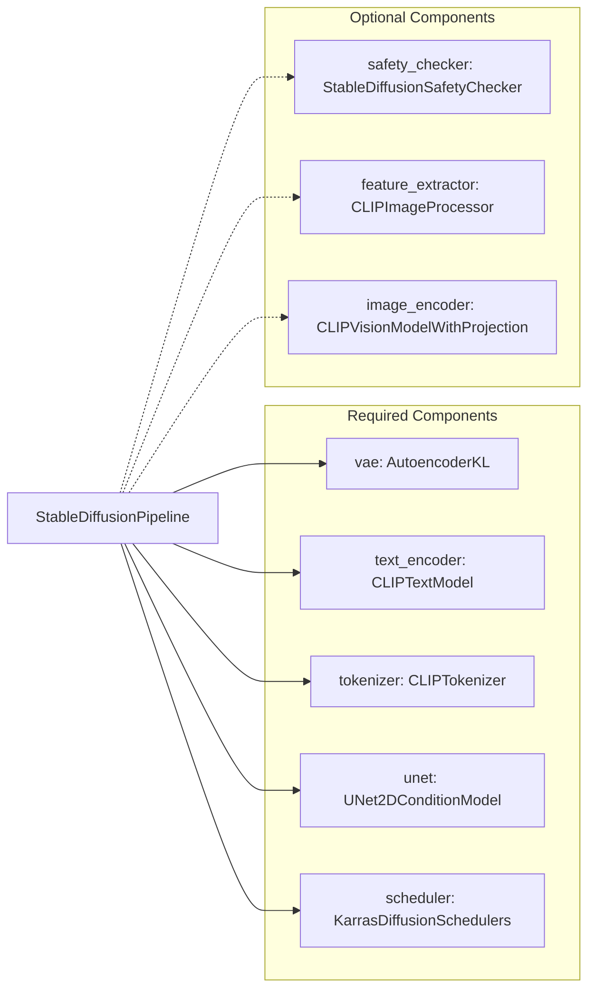
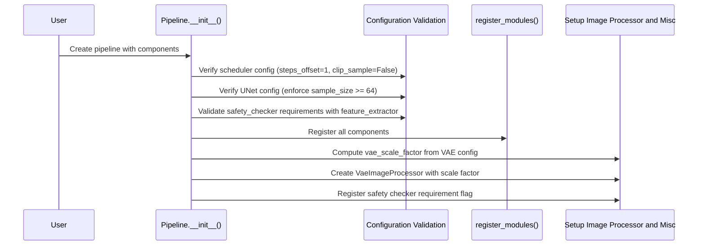
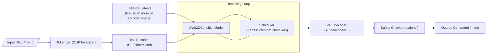

<!-- source: DeepWiki mcp.deepwiki.com · repo huggingface/diffusers · page 3.1 Base Pipeline Architecture · fetched 2026-10-21 -->

# Base Pipeline Architecture

<details>
<summary>Relevant source files</summary>

The following files were used as context for generating this wiki page:

- [src/diffusers/pipelines/controlnet/pipeline_controlnet.py](src/diffusers/pipelines/controlnet/pipeline_controlnet.py)
- [src/diffusers/pipelines/controlnet/pipeline_controlnet_img2img.py](src/diffusers/pipelines/controlnet/pipeline_controlnet_img2img.py)
- [src/diffusers/pipelines/controlnet/pipeline_controlnet_inpaint.py](src/diffusers/pipelines/controlnet/pipeline_controlnet_inpaint.py)
- [src/diffusers/pipelines/controlnet/pipeline_controlnet_inpaint_sd_xl.py](src/diffusers/pipelines/controlnet/pipeline_controlnet_inpaint_sd_xl.py)
- [src/diffusers/pipelines/controlnet/pipeline_controlnet_sd_xl.py](src/diffusers/pipelines/controlnet/pipeline_controlnet_sd_xl.py)
- [src/diffusers/pipelines/controlnet/pipeline_controlnet_sd_xl_img2img.py](src/diffusers/pipelines/controlnet/pipeline_controlnet_sd_xl_img2img.py)
- [src/diffusers/pipelines/ddim/pipeline_ddim.py](src/diffusers/pipelines/ddim/pipeline_ddim.py)
- [src/diffusers/pipelines/ddpm/pipeline_ddpm.py](src/diffusers/pipelines/ddpm/pipeline_ddpm.py)
- [src/diffusers/pipelines/dit/pipeline_dit.py](src/diffusers/pipelines/dit/pipeline_dit.py)
- [src/diffusers/pipelines/joyimage/pipeline_joyimage_edit.py](src/diffusers/pipelines/joyimage/pipeline_joyimage_edit.py)
- [src/diffusers/pipelines/latent_diffusion/pipeline_latent_diffusion.py](src/diffusers/pipelines/latent_diffusion/pipeline_latent_diffusion.py)
- [src/diffusers/pipelines/stable_diffusion/pipeline_stable_diffusion.py](src/diffusers/pipelines/stable_diffusion/pipeline_stable_diffusion.py)
- [src/diffusers/pipelines/stable_diffusion/pipeline_stable_diffusion_depth2img.py](src/diffusers/pipelines/stable_diffusion/pipeline_stable_diffusion_depth2img.py)
- [src/diffusers/pipelines/stable_diffusion/pipeline_stable_diffusion_img2img.py](src/diffusers/pipelines/stable_diffusion/pipeline_stable_diffusion_img2img.py)
- [src/diffusers/pipelines/stable_diffusion/pipeline_stable_diffusion_inpaint.py](src/diffusers/pipelines/stable_diffusion/pipeline_stable_diffusion_inpaint.py)
- [src/diffusers/pipelines/stable_diffusion/pipeline_stable_diffusion_instruct_pix2pix.py](src/diffusers/pipelines/stable_diffusion/pipeline_stable_diffusion_instruct_pix2pix.py)
- [src/diffusers/pipelines/stable_diffusion/pipeline_stable_diffusion_upscale.py](src/diffusers/pipelines/stable_diffusion/pipeline_stable_diffusion_upscale.py)
- [src/diffusers/pipelines/stable_diffusion_xl/pipeline_stable_diffusion_xl.py](src/diffusers/pipelines/stable_diffusion_xl/pipeline_stable_diffusion_xl.py)
- [src/diffusers/pipelines/stable_diffusion_xl/pipeline_stable_diffusion_xl_img2img.py](src/diffusers/pipelines/stable_diffusion_xl/pipeline_stable_diffusion_xl_img2img.py)
- [src/diffusers/pipelines/stable_diffusion_xl/pipeline_stable_diffusion_xl_inpaint.py](src/diffusers/pipelines/stable_diffusion_xl/pipeline_stable_diffusion_xl_inpaint.py)
- [src/diffusers/pipelines/stable_diffusion_xl/pipeline_stable_diffusion_xl_instruct_pix2pix.py](src/diffusers/pipelines/stable_diffusion_xl/pipeline_stable_diffusion_xl_instruct_pix2pix.py)
- [src/diffusers/pipelines/t2i_adapter/pipeline_stable_diffusion_xl_adapter.py](src/diffusers/pipelines/t2i_adapter/pipeline_stable_diffusion_xl_adapter.py)
- [tests/pipelines/ddim/test_ddim.py](tests/pipelines/ddim/test_ddim.py)
- [tests/pipelines/ddpm/test_ddpm.py](tests/pipelines/ddpm/test_ddpm.py)
- [tests/pipelines/dit/test_dit.py](tests/pipelines/dit/test_dit.py)
- [tests/pipelines/dreamlite/testing_utils.py](tests/pipelines/dreamlite/testing_utils.py)
- [tests/pipelines/joyimage/test_joyimage_edit.py](tests/pipelines/joyimage/test_joyimage_edit.py)
- [tests/pipelines/joyimage/test_joyimage_edit_plus.py](tests/pipelines/joyimage/test_joyimage_edit_plus.py)

</details>


This document explains the architectural foundation of Stable Diffusion (SD) pipelines in the Diffusers library. It provides an in-depth technical overview of the common components, design patterns, data flow, and key functions that form the core of all SD pipeline variants, including text-to-image, image-to-image, and inpainting pipelines.

The focus is on the essential building blocks shared across these pipelines: the Variational Autoencoder (VAE), UNet denoiser, text encoder, scheduler, and how they cooperate during inference.

For detailed usage of particular pipelines, see the sections on [Text-to-Image Pipeline](#3.2), [Image-to-Image and Inpainting](#3.3), and [Stable Diffusion XL Pipelines](#3.4). For the broader pipeline system architecture, see [DiffusionPipeline System (2.1)].

---

## Class Hierarchy and Mixin Architecture

All Stable Diffusion pipelines follow a class hierarchy combining core pipeline infrastructure with multiple mixin loading and utility classes to modularly add functionality.

### Inheritance Structure

```mermaid
graph TB
    ConfigMixin["ConfigMixin<br/>(configuration_utils.py)"]
    PushToHubMixin["PushToHubMixin<br/>(hub_utils.py)"]
    DiffusionPipeline["DiffusionPipeline<br/>(pipeline_utils.py)"]
    StableDiffusionMixin["StableDiffusionMixin<br/>(pipeline_utils.py)"]
    TextualInversionLoaderMixin["TextualInversionLoaderMixin<br/>(loaders)"]
    StableDiffusionLoraLoaderMixin["StableDiffusionLoraLoaderMixin<br/>(loaders)"]
    IPAdapterMixin["IPAdapterMixin<br/>(loaders)"]
    FromSingleFileMixin["FromSingleFileMixin<br/>(loaders)"]
    
    StableDiffusionPipeline["StableDiffusionPipeline<br/>(pipeline_stable_diffusion.py:154)"]
    StableDiffusionImg2ImgPipeline["StableDiffusionImg2ImgPipeline<br/>(pipeline_stable_diffusion_img2img.py:182)"]
    StableDiffusionInpaintPipeline["StableDiffusionInpaintPipeline<br/>(pipeline_stable_diffusion_inpaint.py:128)"]
    StableDiffusionUpscalePipeline["StableDiffusionUpscalePipeline<br/>(pipeline_stable_diffusion_upscale.py:78)"]
    
    ConfigMixin --> DiffusionPipeline
    PushToHubMixin --> DiffusionPipeline
    
    DiffusionPipeline --> StableDiffusionPipeline
    StableDiffusionMixin --> StableDiffusionPipeline
    TextualInversionLoaderMixin --> StableDiffusionPipeline
    StableDiffusionLoraLoaderMixin --> StableDiffusionPipeline
    IPAdapterMixin --> StableDiffusionPipeline
    FromSingleFileMixin --> StableDiffusionPipeline
    
    DiffusionPipeline --> StableDiffusionImg2ImgPipeline
    StableDiffusionMixin --> StableDiffusionImg2ImgPipeline
    TextualInversionLoaderMixin --> StableDiffusionImg2ImgPipeline
    StableDiffusionLoraLoaderMixin --> StableDiffusionImg2ImgPipeline
    IPAdapterMixin --> StableDiffusionImg2ImgPipeline
    FromSingleFileMixin --> StableDiffusionImg2ImgPipeline
    
    DiffusionPipeline --> StableDiffusionInpaintPipeline
    StableDiffusionMixin --> StableDiffusionInpaintPipeline
    TextualInversionLoaderMixin --> StableDiffusionInpaintPipeline
    StableDiffusionLoraLoaderMixin --> StableDiffusionInpaintPipeline
    IPAdapterMixin --> StableDiffusionInpaintPipeline
    FromSingleFileMixin --> StableDiffusionInpaintPipeline
```



- **ConfigMixin** (configuration_utils.py): Manages configuration loading, saving, and registration.
- **PushToHubMixin** (hub_utils.py): Enables integration for uploading model components to the Hugging Face Hub.
- **DiffusionPipeline** (pipeline_utils.py): Base class managing models and inference lifecycle.
- **StableDiffusionMixin** (pipeline_utils.py): Adds SD-specific methods like VAE encode/decode helpers.
- **TextualInversionLoaderMixin** (loaders): Supports textual inversion embeddings.
- **StableDiffusionLoraLoaderMixin** (loaders): Manages LoRA weight loading and fusion.
- **IPAdapterMixin** (loaders): Provides IP-Adapter support for image-based prompt conditioning.
- **FromSingleFileMixin** (loaders): Allows loading from legacy single checkpoint files.

**Sources:**  
[src/diffusers/pipelines/stable_diffusion/pipeline_stable_diffusion.py:154-161]()  
[src/diffusers/pipelines/stable_diffusion/pipeline_stable_diffusion_img2img.py:182-189]()  
[src/diffusers/pipelines/stable_diffusion/pipeline_stable_diffusion_inpaint.py:128-135]()  
[src/diffusers/pipelines/stable_diffusion/pipeline_stable_diffusion_upscale.py:78-84]()

---

## Core Components of the Stable Diffusion Pipeline

A Stable Diffusion pipeline is composed of several components that perform different roles in the generation process. These components are registered to the pipeline during initialization and orchestrated for inference.

### Required Core Components



- **VAE (AutoencoderKL)**  
  Encodes images into a latent space and decodes latents back into images. The latent space is typically lower dimensional, reducing computational cost.

- **Text Encoder (CLIPTextModel)**  
  Encodes text prompts into embeddings used for conditioning the diffusion model. Usually the frozen CLIP ViT model.

- **Tokenizer (CLIPTokenizer)**  
  Tokenizes input textual prompts for the text encoder.

- **UNet (UNet2DConditionModel)**  
  The core denoising neural network trained to iteratively refine noisy latents towards a clean latent matching the prompt.

- **Scheduler (KarrasDiffusionSchedulers)**  
  Controls the diffusion timestep schedule, noise addition, and denoising strategy during generation.

- **Optional Components**  
  - **Safety Checker (StableDiffusionSafetyChecker):** Checks outputs and filters unsafe content.  
  - **Feature Extractor (CLIPImageProcessor):** Preprocesses images for safety checker or other components.  
  - **Image Encoder (CLIPVisionModelWithProjection):** Used by some pipelines for additional image-conditioning.

**Sources:**  
[src/diffusers/pipelines/stable_diffusion/pipeline_stable_diffusion.py:175-193]()  
[src/diffusers/pipelines/stable_diffusion/pipeline_stable_diffusion.py:200-210]()

---

## Component Registration and Configuration Storage

The pipeline registers its components via the `register_modules()` method. This method performs two critical functions:

1. It registers the component instances as attributes on the pipeline object (e.g., `self.vae = vae`).
2. It stores metadata about each component’s library and class name into the pipeline configuration (`self.register_to_config(...)`). This metadata is used to serialize, reload, and instantiate the pipeline correctly.

The metadata stored allows preservation of architecture and compatibility information across save/load cycles.

### Example of Registration Logic

```python
def register_modules(self, **modules):
    for name, module in modules.items():
        if module is not None:
            # Extract library and class
            model_library = module.__module__.split(".")[0]
            model_class = module.__class__.__name__
            # Save to config for serialization
            self.register_to_config(**{name: (model_library, model_class)})
            # Set module attribute
            setattr(self, name, module)
```

**Note:** This dual system enables the `model_index.json` metadata file in saved pipelines, which stores fields like `_class_name`, `_diffusers_version`, and component entries like `"vae": ["diffusers", "AutoencoderKL"]`.

**Sources:**  
[src/diffusers/pipelines/stable_diffusion/pipeline_stable_diffusion.py:286-295]()  
[src/diffusers/pipelines/stable_diffusion/pipeline_stable_diffusion_upscale.py:151-161]()

---

## Pipeline Initialization and Validation

Upon instantiation, Stable Diffusion pipelines perform validation and setup of critical configurations and components.

### Initialization Steps



### Configuration Validation Details

- **Scheduler Checks**  
  Deprecated configuration flags like `steps_offset` (should be 1) and `clip_sample` (should be False) are verified. Deprecated values trigger warnings and may be auto-corrected.

- **UNet Validation**  
  The `sample_size` attribute of `unet.config` is checked. For older checkpoints, sample sizes less than 64 may cause artifacts, triggering warnings.

- **Safety Checker Validation**  
  If a safety checker is requested (`requires_safety_checker=True`), it verifies compatibility with the feature extractor. Disabling safety with this flag triggers warnings.

- **VAE Scaling Factor**  
  Some specialized pipelines (e.g., upscale) validate the VAE’s scaling factor config (e.g., 0.08333) and warn if inconsistent.

### Code Snippet: Initialization Sample

```python
def __init__(
    self,
    vae,
    text_encoder,
    tokenizer,
    unet,
    scheduler,
    safety_checker=None,
    feature_extractor=None,
    image_encoder=None,
    requires_safety_checker=False,
):
    # Validate scheduler config
    if self.scheduler.config.steps_offset != 1:
      # warn + fix deprecated config
    if self.scheduler.config.get("clip_sample", False):
      # warn + fix deprecated config
      
    # Validate unet sample_size
    if unet.config.sample_size < 64:
        logger.warning("Sample size too small, artifacts possible.")
    
    # Safety checker and feature extractor validation
    if requires_safety_checker and safety_checker is None:
        logger.warning("Safety checker is required but disabled.")
    if safety_checker is not None and feature_extractor is None:
        raise ValueError("Feature extractor required if safety checker is present.")
    
    # Register all components
    self.register_modules(
        vae=vae,
        text_encoder=text_encoder,
        tokenizer=tokenizer,
        unet=unet,
        scheduler=scheduler,
        safety_checker=safety_checker,
        feature_extractor=feature_extractor,
        image_encoder=image_encoder,
    )

    # Setup VAE scale factor and processor
    self.vae_scale_factor = 2 ** (len(self.vae.config.block_out_channels) - 1)
    self.image_processor = VaeImageProcessor(vae_scale_factor=self.vae_scale_factor)
    
    self.register_to_config(requires_safety_checker=requires_safety_checker)
```

**Sources:**  
[src/diffusers/pipelines/stable_diffusion/pipeline_stable_diffusion.py:200-298]()  
[src/diffusers/pipelines/stable_diffusion/pipeline_stable_diffusion_upscale.py:133-150]()  
[src/diffusers/pipelines/stable_diffusion/pipeline_stable_diffusion_inpaint.py:188-256]()

---

## Common Utilities and Helper Functions

Stable Diffusion pipelines share various utility functions to handle data preparation and inference tasks.

| Function Name       | Purpose                                                                                                   | File and Lines                      |
|---------------------|-----------------------------------------------------------------------------------------------------------|-----------------------------------|
| `retrieve_timesteps` | Sets the scheduler timesteps based on `num_inference_steps`, or custom `timesteps`/`sigmas` if provided. Handles scheduler compatibility. | [pipeline_stable_diffusion.py:95-151]() |
| `retrieve_latents`  | Extracts latent tensors from VAE encoder outputs, supporting `latent_dist.sample()` and mode.              | [pipeline_stable_diffusion_img2img.py:86-96]() and also copied in inpaint/ and base pipelines |
| `rescale_noise_cfg` | Applies noise rescaling in classifier-free guidance (CFG) to reduce overexposure and improve image quality.| [pipeline_stable_diffusion.py:69-92]()   |

These utilities are reused and sometimes overridden with slight modifications in related SD pipelines.

---

## Device and Memory Management

To optimize memory usage on devices, pipelines specify CPU offloading sequences to offload model parts progressively.

| Pipeline                     | `model_cpu_offload_seq`                  | Notes                                 |
|------------------------------|-----------------------------------------|-------------------------------------|
| StableDiffusionPipeline       | `"text_encoder->image_encoder->unet->vae"` | Standard text-to-image offload order |
| StableDiffusionImg2ImgPipeline| `"text_encoder->image_encoder->unet->vae"` | Same as text-to-image                 |
| StableDiffusionInpaintPipeline| `"text_encoder->image_encoder->unet->vae"` | Same sequence for inpainting tasks    |
| StableDiffusionUpscalePipeline| `"text_encoder->unet->vae"`               | Upscale pipeline has no image_encoder |

Some components are marked as optional and excluded from auto offloading (e.g., `safety_checker`).

```python
_optional_components = ["safety_checker", "feature_extractor", "image_encoder"]
_exclude_from_cpu_offload = ["safety_checker"]
```

**Sources:**  
[src/diffusers/pipelines/stable_diffusion/pipeline_stable_diffusion.py:195-197]()  
[src/diffusers/pipelines/stable_diffusion/pipeline_stable_diffusion_upscale.py:114-116]()  
[src/diffusers/pipelines/stable_diffusion/pipeline_stable_diffusion_img2img.py:222-226]()  
[src/diffusers/pipelines/stable_diffusion/pipeline_stable_diffusion_inpaint.py:168-172]()

---

## Inference Data Flow Overview

The inference flow in Stable Diffusion pipelines typically follows these stages:

1. **Text Encoding**:  
   Input prompts are tokenized and encoded by the CLIP text encoder into embeddings (`prompt_embeds`), optionally with classifier-free guidance prompting.

2. **Latent Initialization**:  
   For text-to-image, latents are initialized as Gaussian noise tensors. For image-to-image or inpainting, latents may be obtained by VAE-encoding input images and possibly masked.

3. **Denoising Loop** (iterative steps):  
   - At each timestep, the noisy latents and text embeddings are passed to the UNet model, which predicts noise residuals.  
   - Noise predictions are optionally processed via guidance rescaling or classifier-free guidance logic.  
   - The scheduler uses the noise predictions to step latents backwards, refining toward clean latents.

4. **Decoding and Postprocessing**:  
   After all denoising steps, latents are decoded by the VAE decoder into images. Outputs may be passed through the safety checker and optional watermarking before returning.

### Mermaid Diagram: End-to-End Data Flow with Key Components



**Sources:**  
[src/diffusers/pipelines/stable_diffusion/pipeline_stable_diffusion.py:154-400]() (inferred from class and functions)

---

## Mapping Natural Language Components to Code Entities

This diagram associates conceptual components in Stable Diffusion pipelines with their exact code implementations in Diffusers.

```mermaid
graph TD
    NL_VAE["Variational Autoencoder (VAE)"]
    NL_UNet["UNet Denoiser"]
    NL_TextEncoder["Text Encoder (CLIP)"]
    NL_Scheduler["Diffusion Scheduler"]
    NL_Tokenizer["Tokenizer (CLIP)"]
    NL_SafetyChecker["Safety Checker (optional)"]
    
    CD_VAE["`AutoencoderKL` (src/diffusers/models/autoencoder_kl.py)"]
    CD_UNet["`UNet2DConditionModel` (src/diffusers/models/unet_2d_condition.py)"]
    CD_TextEncoder["`CLIPTextModel` (transformers)"]
    CD_Scheduler["`KarrasDiffusionSchedulers` (src/diffusers/schedulers/karras.py)"]
    CD_Tokenizer["`CLIPTokenizer` (transformers)"]
    CD_SafetyChecker["`StableDiffusionSafetyChecker` (src/diffusers/pipelines/stable_diffusion/safety_checker.py)"]
    
    NL_VAE --> CD_VAE
    NL_UNet --> CD_UNet
    NL_TextEncoder --> CD_TextEncoder
    NL_Scheduler --> CD_Scheduler
    NL_Tokenizer --> CD_Tokenizer
    NL_SafetyChecker --> CD_SafetyChecker
```

---

## Summary of Key Pipeline Class: `StableDiffusionPipeline`

The `StableDiffusionPipeline` class, implemented in `src/diffusers/pipelines/stable_diffusion/pipeline_stable_diffusion.py` from line 154, is the canonical text-to-image pipeline.

- Inherits from multiple mixins for loading LoRA, IP-adapters, textual inversion, and single-file checkpoints.
- Registers essential components: vae, text_encoder, tokenizer, unet, scheduler.
- Has optional components like safety_checker, feature_extractor, and image_encoder.
- Defines utility methods such as `rescale_noise_cfg` for guided diffusion.
- Registers device offloading order as `"text_encoder->image_encoder->unet->vae"`.
- Supports configuration validation to ensure consistency in scheduler and UNet parameters.

Very similar structural patterns hold for the Img2Img, Inpainting, and Upscale pipelines with adaptation to their unique input/output formats.

---

# References

- `src/diffusers/pipelines/stable_diffusion/pipeline_stable_diffusion.py:154-298`  
- `src/diffusers/pipelines/stable_diffusion/pipeline_stable_diffusion_img2img.py:80-100`  
- `src/diffusers/pipelines/stable_diffusion/pipeline_stable_diffusion_inpaint.py:128-256`  
- `src/diffusers/pipelines/stable_diffusion/pipeline_stable_diffusion_upscale.py:78-161`  
- `src/diffusers/image_processor.py:82-118`  
- `src/diffusers/loaders/ip_adapter.py`  
- `src/diffusers/loaders/lora_pipeline.py`  
- `src/diffusers/utils/torch_utils.py`  

---

This concludes the detailed explanation of the Base Pipeline Architecture for Stable Diffusion in the Diffusers library.

---

