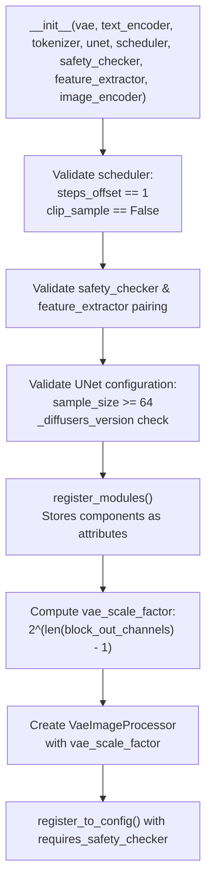
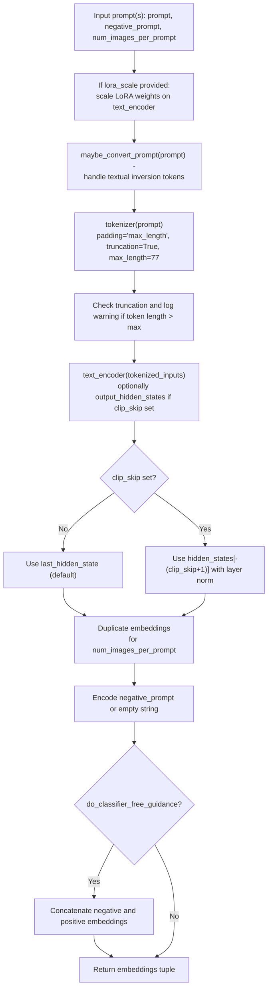
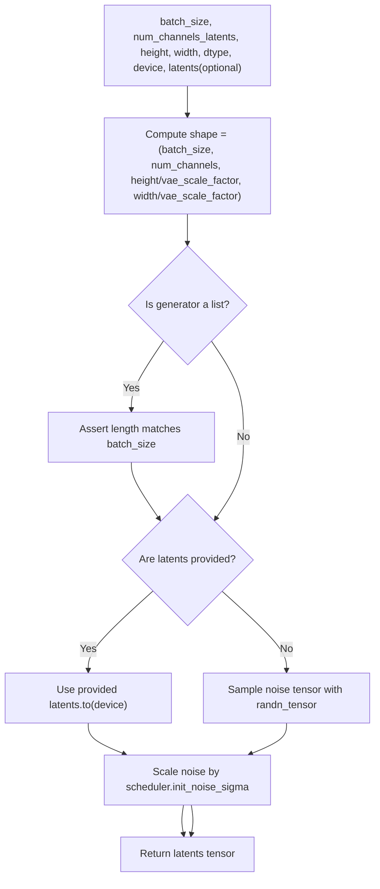
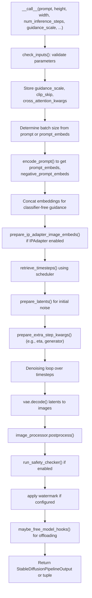
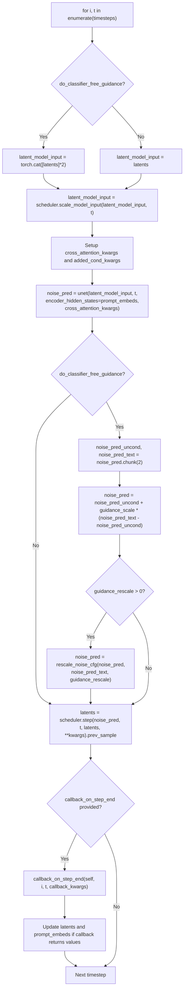
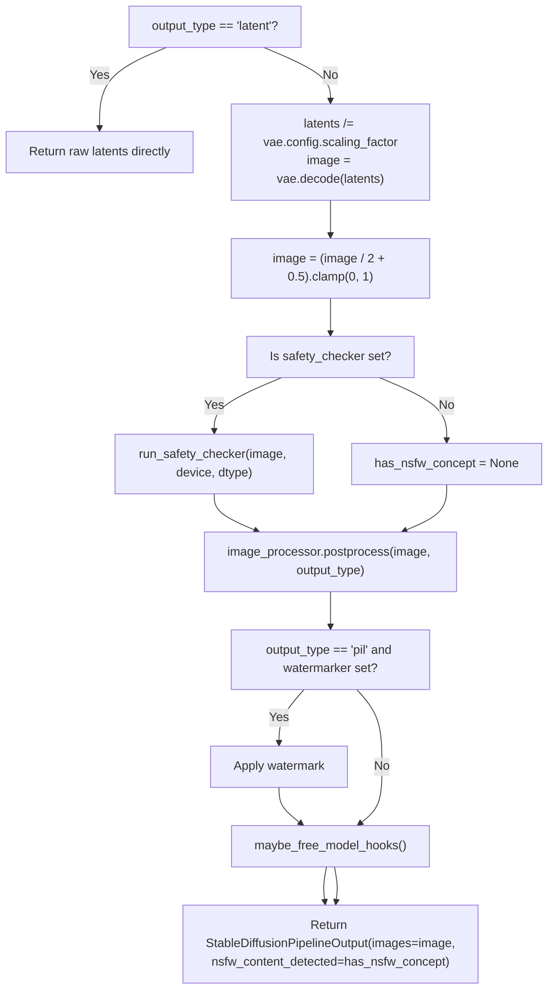
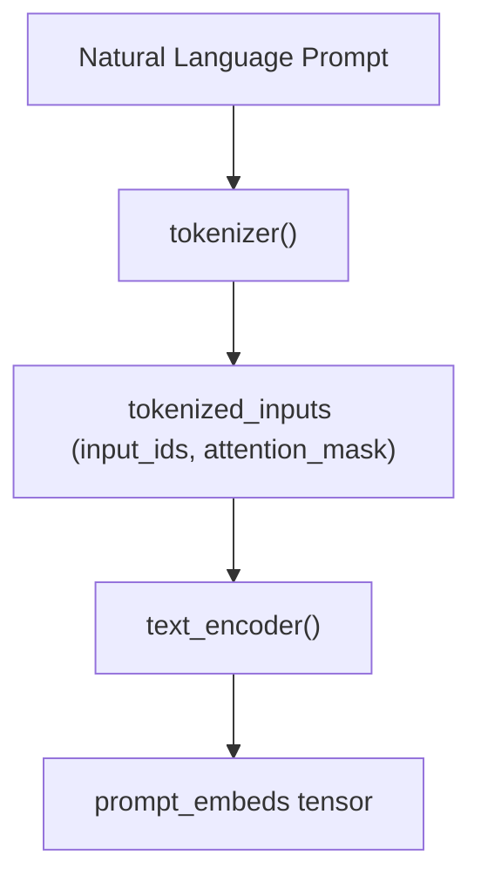
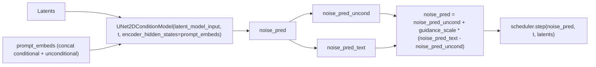

<!-- source: DeepWiki mcp.deepwiki.com · repo huggingface/diffusers · page 3.2 Text-to-Image Pipeline · fetched 2026-10-21 -->

# Text-to-Image Pipeline

<details>
<summary>Relevant source files</summary>

The following files were used as context for generating this wiki page:

- [src/diffusers/pipelines/controlnet/pipeline_controlnet.py](src/diffusers/pipelines/controlnet/pipeline_controlnet.py)
- [src/diffusers/pipelines/controlnet/pipeline_controlnet_img2img.py](src/diffusers/pipelines/controlnet/pipeline_controlnet_img2img.py)
- [src/diffusers/pipelines/controlnet/pipeline_controlnet_inpaint.py](src/diffusers/pipelines/controlnet/pipeline_controlnet_inpaint.py)
- [src/diffusers/pipelines/controlnet/pipeline_controlnet_inpaint_sd_xl.py](src/diffusers/pipelines/controlnet/pipeline_controlnet_inpaint_sd_xl.py)
- [src/diffusers/pipelines/controlnet/pipeline_controlnet_sd_xl.py](src/diffusers/pipelines/controlnet/pipeline_controlnet_sd_xl.py)
- [src/diffusers/pipelines/controlnet/pipeline_controlnet_sd_xl_img2img.py](src/diffusers/pipelines/controlnet/pipeline_controlnet_sd_xl_img2img.py)
- [src/diffusers/pipelines/stable_diffusion/pipeline_stable_diffusion.py](src/diffusers/pipelines/stable_diffusion/pipeline_stable_diffusion.py)
- [src/diffusers/pipelines/stable_diffusion/pipeline_stable_diffusion_depth2img.py](src/diffusers/pipelines/stable_diffusion/pipeline_stable_diffusion_depth2img.py)
- [src/diffusers/pipelines/stable_diffusion/pipeline_stable_diffusion_img2img.py](src/diffusers/pipelines/stable_diffusion/pipeline_stable_diffusion_img2img.py)
- [src/diffusers/pipelines/stable_diffusion/pipeline_stable_diffusion_inpaint.py](src/diffusers/pipelines/stable_diffusion/pipeline_stable_diffusion_inpaint.py)
- [src/diffusers/pipelines/stable_diffusion/pipeline_stable_diffusion_instruct_pix2pix.py](src/diffusers/pipelines/stable_diffusion/pipeline_stable_diffusion_instruct_pix2pix.py)
- [src/diffusers/pipelines/stable_diffusion/pipeline_stable_diffusion_upscale.py](src/diffusers/pipelines/stable_diffusion/pipeline_stable_diffusion_upscale.py)
- [src/diffusers/pipelines/stable_diffusion_xl/pipeline_stable_diffusion_xl.py](src/diffusers/pipelines/stable_diffusion_xl/pipeline_stable_diffusion_xl.py)
- [src/diffusers/pipelines/stable_diffusion_xl/pipeline_stable_diffusion_xl_img2img.py](src/diffusers/pipelines/stable_diffusion_xl/pipeline_stable_diffusion_xl_img2img.py)
- [src/diffusers/pipelines/stable_diffusion_xl/pipeline_stable_diffusion_xl_inpaint.py](src/diffusers/pipelines/stable_diffusion_xl/pipeline_stable_diffusion_xl_inpaint.py)
- [src/diffusers/pipelines/stable_diffusion_xl/pipeline_stable_diffusion_xl_instruct_pix2pix.py](src/diffusers/pipelines/stable_diffusion_xl/pipeline_stable_diffusion_xl_instruct_pix2pix.py)
- [src/diffusers/pipelines/t2i_adapter/pipeline_stable_diffusion_xl_adapter.py](src/diffusers/pipelines/t2i_adapter/pipeline_stable_diffusion_xl_adapter.py)
- [tests/pipelines/stable_diffusion/test_stable_diffusion.py](tests/pipelines/stable_diffusion/test_stable_diffusion.py)
- [tests/pipelines/stable_diffusion/test_stable_diffusion_img2img.py](tests/pipelines/stable_diffusion/test_stable_diffusion_img2img.py)
- [tests/pipelines/stable_diffusion/test_stable_diffusion_inpaint.py](tests/pipelines/stable_diffusion/test_stable_diffusion_inpaint.py)
- [tests/pipelines/stable_diffusion/test_stable_diffusion_instruction_pix2pix.py](tests/pipelines/stable_diffusion/test_stable_diffusion_instruction_pix2pix.py)
- [tests/pipelines/stable_diffusion_2/test_stable_diffusion.py](tests/pipelines/stable_diffusion_2/test_stable_diffusion.py)
- [tests/pipelines/stable_diffusion_2/test_stable_diffusion_depth.py](tests/pipelines/stable_diffusion_2/test_stable_diffusion_depth.py)
- [tests/pipelines/stable_diffusion_2/test_stable_diffusion_inpaint.py](tests/pipelines/stable_diffusion_2/test_stable_diffusion_inpaint.py)
- [tests/pipelines/stable_diffusion_2/test_stable_diffusion_latent_upscale.py](tests/pipelines/stable_diffusion_2/test_stable_diffusion_latent_upscale.py)
- [tests/pipelines/stable_diffusion_2/test_stable_diffusion_upscale.py](tests/pipelines/stable_diffusion_2/test_stable_diffusion_upscale.py)
- [tests/pipelines/stable_diffusion_2/test_stable_diffusion_v_pred.py](tests/pipelines/stable_diffusion_2/test_stable_diffusion_v_pred.py)
- [tests/pipelines/stable_unclip/test_stable_unclip.py](tests/pipelines/stable_unclip/test_stable_unclip.py)
- [tests/pipelines/stable_unclip/test_stable_unclip_img2img.py](tests/pipelines/stable_unclip/test_stable_unclip_img2img.py)

</details>


## Purpose and Scope

The Text-to-Image Pipeline implements the core text-guided image generation workflow using Stable Diffusion models. This pipeline converts textual prompts into images by encoding text inputs, performing iterative denoising in a latent space, and decoding the final latents into pixel space.

This document specifically covers the `StableDiffusionPipeline` class, which is the primary implementation supporting text-to-image synthesis. For related pipelines supporting image-to-image or inpainting generation, see [3.3]() and other pipeline pages. For core pipeline architecture concepts and subsystems, refer to [2.1]().

## Pipeline Component Architecture

The `StableDiffusionPipeline` is composed of five main neural components, a scheduler, image processors, and optional modules. These components interact to perform the diffusion process conditioned on text embeddings.

**Component Composition Diagram:**

```mermaid
graph TB
    subgraph "StableDiffusionPipeline"
        Pipeline["StableDiffusionPipeline<br/>__init__, __call__"]
    end

    subgraph "Neural Network Components"
        Tokenizer["tokenizer<br/>CLIPTokenizer"]
        TextEncoder["text_encoder<br/>CLIPTextModel"]
        UNet["unet<br/>UNet2DConditionModel"]
        VAE["vae<br/>AutoencoderKL"]
        SafetyChecker["safety_checker<br/>StableDiffusionSafetyChecker"]
    end

    subgraph "Scheduler"
        Scheduler["scheduler<br/>KarrasDiffusionSchedulers"]
    end

    subgraph "Image Processing"
        FeatureExtractor["feature_extractor<br/>CLIPImageProcessor"]
        ImageProcessor["image_processor<br/>VaeImageProcessor"]
    end

    subgraph "Optional"
        ImageEncoder["image_encoder<br/>CLIPVisionModelWithProjection"]
    end

    Pipeline --> Tokenizer
    Pipeline --> TextEncoder
    Pipeline --> UNet
    Pipeline --> VAE
    Pipeline --> Scheduler
    Pipeline --> SafetyChecker
    Pipeline --> FeatureExtractor
    Pipeline --> ImageProcessor
    Pipeline -.optional.-> ImageEncoder

    TextEncoder -.uses.-> Tokenizer
    SafetyChecker -.uses.-> FeatureExtractor
```

The pipeline inherits functionality from several mixin classes, enabling modular extension:

| Mixin Class                         | Role                                             | Notable Methods                       |
|-----------------------------------|-------------------------------------------------|-------------------------------------|
| `DiffusionPipeline`               | Base class for diffusion pipelines              | `from_pretrained`, `save_pretrained`, `to` |
| `StableDiffusionMixin`            | Stable Diffusion specific utilities              | Shared internal helper methods       |
| `TextualInversionLoaderMixin`    | Loading and applying textual inversion embeddings| `load_textual_inversion`             |
| `StableDiffusionLoraLoaderMixin` | Loading and saving LoRA weights                  | `load_lora_weights`, `save_lora_weights` |
| `IPAdapterMixin`                  | Loading IP-Adapter for image conditioning        | `load_ip_adapter`                    |
| `FromSingleFileMixin`             | Loading models from `.ckpt` files                | `from_single_file`                   |

**Sources:** [src/diffusers/pipelines/stable_diffusion/pipeline_stable_diffusion.py:154-161]()

## Pipeline Initialization

During construction, the pipeline registers all components and performs validation to ensure compatibility and configuration correctness.

### Initialization Flow



The `vae_scale_factor` is crucial to map spatial resolutions between pixel space and latent space (typically 8 for Stable Diffusion v1.x).

**Sources:** [src/diffusers/pipelines/stable_diffusion/pipeline_stable_diffusion.py:195-298]()

### Component Registration Example

The pipeline registers components for use throughout inference and serialization:

```python
self.register_modules(
    vae=vae,
    text_encoder=text_encoder,
    tokenizer=tokenizer,
    unet=unet,
    scheduler=scheduler,
    safety_checker=safety_checker,
    feature_extractor=feature_extractor,
    image_encoder=image_encoder,
)
```

**Sources:** [src/diffusers/pipelines/stable_diffusion/pipeline_stable_diffusion.py:286-295]()

### VAE Scale Factor Details

| Latent Shape Dimension | Pixel Dimension | Scale Factor |
|-----------------------|-----------------|-------------|
| 64 × 64               | 512 × 512       | 8           |
| 128 × 128             | 1024 × 1024     | 8           |
| 96 × 64               | 768 × 512       | 8           |

The scale factor corresponds to the downsampling by the number of encoder blocks:

```python
vae_scale_factor = 2 ** (len(vae.config.block_out_channels) - 1)
```

**Sources:** [src/diffusers/pipelines/stable_diffusion/pipeline_stable_diffusion.py:296-297]()

## Text Encoding Flow

The prompt text is tokenized and embedded through the CLIP text encoder to produce conditioning embeddings for the diffusion model.

### Text Encoding Process



### Implementation Details

- Prompts are tokenized to length 77 tokens with truncation.
- If `clip_skip` is set, embeddings are taken from earlier transformer layers of CLIP instead of the final output.
- LoRA scaling (for fine-tuned adapters) is applied before encoding and undone after.
- When classifier-free guidance is used (`guidance_scale > 1`), embeddings for both positive and negative prompts are prepared and concatenated.

### Tokenizer and Text Encoder

- Uses `CLIPTokenizer` and `CLIPTextModel` from the Transformers library.
- Supports batching prompts and repeating embeddings for multiple images per prompt.

**Sources:** [src/diffusers/pipelines/stable_diffusion/pipeline_stable_diffusion.py:332-512]()

## Latent Preparation

The generation starts from a tensor of latents initialized with Gaussian noise scaled according to the scheduler.

### Latent Initialization Flow



- Latents are shape `(batch_size, unet.in_channels, height//vae_scale_factor, width//vae_scale_factor)`.
- Noise is scaled by `scheduler.init_noise_sigma`.
- Providing precomputed latents enables reproducibility and control over generation.

**Sources:** [src/diffusers/pipelines/stable_diffusion/pipeline_stable_diffusion.py:694-714]()

## Generation Loop (`__call__` Method)

The most critical function, `__call__`, implements the entire diffusion process, from prompt input to image output.

### Generation Pipeline Flow



### Input Validation

- `height` and `width` must be divisible by 8.
- Must provide either `prompt` or `prompt_embeds` (but not both).
- `negative_prompt` and `negative_prompt_embeds` must have matching shape.
- Callback steps must be positive integers.
- `ip_adapter_image` and `ip_adapter_image_embeds` cannot both be supplied simultaneously.

**Sources:** [src/diffusers/pipelines/stable_diffusion/pipeline_stable_diffusion.py:625-692]()

### Denoising Loop Detailed Flow



### Classifier-Free Guidance (CFG)

- Performs inference on concatenated latents and embeddings (conditional and unconditional).
- The noise prediction is computed as:

  ```python
  noise_pred = noise_pred_uncond + guidance_scale * (noise_pred_text - noise_pred_uncond)
  ```

- CFG strengthens adherence to the text prompt at the cost of reduced diversity.

### Guidance Rescaling

- Fixes overexposure and "washed out" images by rescaling the guided noise tensor to match the unconditional noise statistics.
- Implemented by the `rescale_noise_cfg` function:

  ```python
  std_text = noise_pred_text.std(dim=[1,...], keepdim=True)
  std_cfg = noise_cfg.std(dim=[1,...], keepdim=True)
  noise_pred_rescaled = noise_cfg * (std_text / std_cfg)
  noise_cfg = guidance_rescale * noise_pred_rescaled + (1 - guidance_rescale) * noise_cfg
  ```

- The method comes from the paper "[Common Diffusion Noise Schedules and Sample Steps are Flawed](https://huggingface.co/papers/2305.08891)".

### Scheduler Step

- Updates the latent sample given the predicted noise and timestep.
- Supports various schedulers (DDIM, Euler, LMS, DPM-Solver, UniPC).
- Returns `prev_sample` used for the next denoising iteration.

**Sources:** [src/diffusers/pipelines/stable_diffusion/pipeline_stable_diffusion.py:780-1001](), [src/diffusers/pipelines/stable_diffusion/pipeline_stable_diffusion.py:69-92]()

## Post-Processing and Output

Once the denoising is complete, outputs are decoded and optionally safety-checked before returning to users.

### Post-Processing Flow



### VAE Decoding

- Latents are unscaled by dividing by a factor (`vae.config.scaling_factor`, typically ≈0.18215).
- Decoded through `vae.decode` to pixel space; outputs values in [-1, 1].
- Converted to [0, 1] range for visualization.

### Safety Checker

- The `StableDiffusionSafetyChecker` assesses generated images for inappropriate content.
- Uses CLIP image features from `feature_extractor` plus the safety model classifier.
- Detected NSFW images can be flagged or replaced appropriately.

### Image Processor

- Converts PyTorch tensors into requested output types:
  - `"pil"`: PIL images.
  - `"np"`: NumPy arrays.
  - `"pt"`: raw PyTorch tensors.
  - `"latent"`: raw latent tensors without decoding.

### Watermarking and Memory Management

- Optional invisible watermarking can be applied on output images.
- Models can be offloaded from GPU to CPU after inference with `maybe_free_model_hooks()` to optimize memory footprint.

**Sources:** [src/diffusers/pipelines/stable_diffusion/pipeline_stable_diffusion.py:581-1001](), [src/diffusers/image_processor.py:128-149]()

## Key Parameters

### Main `__call__` Arguments

| Parameter                | Type                         | Default          | Description                                                     |
|--------------------------|------------------------------|------------------|-----------------------------------------------------------------|
| `prompt`                 | `str` or `List[str]`         | Required         | The text prompt(s) to guide the image generation.               |
| `height`, `width`        | `int`                        | `unet.config.sample_size * 8` | Output image height and width (divisible by 8).          |
| `num_inference_steps`    | `int`                        | 50               | Number of denoising steps in the diffusion process.             |
| `guidance_scale`         | `float`                      | 7.5              | Strength of classifier-free guidance (CFG).                    |
| `negative_prompt`        | `str` or `List[str]`         | None             | Text prompts to discourage during generation (unconditional).  |
| `num_images_per_prompt`  | `int`                        | 1                | Number of images to generate per prompt.                        |
| `eta`                    | `float`                      | 0.0              | DDIM scheduler eta parameter controlling stochasticity.        |
| `generator`              | `torch.Generator`            | None             | Pseudo-random generator for sampling noise.                     |
| `latents`                | `torch.Tensor`               | None             | Optional pretrained latent tensor for reproducible outputs.    |
| `output_type`            | `str`                        | `"pil"`          | Output format: `"pil"`, `"np"`, `"pt"`, or `"latent"`.         |
| `return_dict`            | `bool`                      | True             | Return a pipeline output object or tuple.                       |
| `callback_on_step_end`   | `Callable`                   | None             | Callback after each denoising step, for custom intermediate logic. |
| `cross_attention_kwargs` | `dict`                       | None             | Additional kwargs passed to UNet attention layers.             |
| `guidance_rescale`       | `float`                      | 0.0              | Rescaling factor for classifier-free guidance noise prediction.|
| `clip_skip`              | `int` or `None`              | None             | Number of CLIP layers to skip when encoding text.              |

**Sources:** [src/diffusers/pipelines/stable_diffusion/pipeline_stable_diffusion.py:780-807]()

### Properties Reflecting Internal State

| Property                  | From                              | Description                              |
|---------------------------|----------------------------------|------------------------------------------|
| `guidance_scale`          | `self._guidance_scale`            | Current CFG guidance scale value.         |
| `guidance_rescale`        | `self._guidance_rescale`          | Current CFG rescaling factor.              |
| `clip_skip`               | `self._clip_skip`                 | Number of CLIP layers to skip.              |
| `do_classifier_free_guidance` | Computed as `guidance_scale > 1` | Whether CFG is active.                  |
| `cross_attention_kwargs`  | `self._cross_attention_kwargs`   | Cross-attention layer kwargs.             |
| `num_timesteps`           | `self._num_timesteps`             | Number of timesteps in current generation. |
| `interrupt`               | `self._interrupt`                 | Flag to abort generation early.          |

**Sources:** [src/diffusers/pipelines/stable_diffusion/pipeline_stable_diffusion.py:747-776]()

## Advanced Features

### Custom Timesteps and Sigmas

Users can override default scheduler timesteps by providing a list of timesteps or sigmas:

```python
# Custom timesteps example
timesteps = [999, 800, 600, 400, 200, 100, 50, 0]
image = pipe(prompt, timesteps=timesteps).images[0]

# Custom sigmas example (for sigma-based schedulers)
sigmas = [14.615, 6.475, 3.861, 2.697, 1.886, 0.0]
image = pipe(prompt, sigmas=sigmas).images[0]
```

This flexibility supports experimental schedulers and non-standard inference strategies.

**Sources:** [src/diffusers/pipelines/stable_diffusion/pipeline_stable_diffusion.py:95-151]()

### IP-Adapter Integration

If an IP-Adapter is loaded:

- Image embeddings are generated via an image encoder (`CLIPVisionModelWithProjection`).
- These embeddings are passed to the UNet as `added_cond_kwargs` to condition the generation on images.
- Supports multimodal conditioning by combining text and image embeddings.

**Sources:** [src/diffusers/pipelines/stable_diffusion/pipeline_stable_diffusion.py:538-581]()

### Callback System

The pipeline supports an optional callback called after every diffusion step:

```python
def callback(pipe, step_index, timestep, callback_kwargs):
    latents = callback_kwargs["latents"]
    # Custom logic to alter latents or embeddings
    return {"latents": modified_latents}

image = pipe(
    prompt,
    callback_on_step_end=callback,
    callback_on_step_end_tensor_inputs=["latents", "prompt_embeds"]
).images[0]
```

This allows custom intermediate processing or early stopping during generation.

**Sources:** [src/diffusers/pipelines/stable_diffusion/pipeline_stable_diffusion.py:967-978]()

### LoRA Weight Scaling

- When fine-tuned LoRA weights are applied, the pipeline scales these weights during prompt encoding based on `lora_scale`.
- Uses either `scale_lora_layers()` from PEFT backend or legacy `adjust_lora_scale_text_encoder()`.
- After encoding, the LoRA scales are reverted to restore original weights.

**Sources:** [src/diffusers/pipelines/stable_diffusion/pipeline_stable_diffusion.py:373-382](), [src/diffusers/pipelines/stable_diffusion/pipeline_stable_diffusion.py:507-510]()

## Memory Optimization

### Model Offloading Sequence

The pipeline specifies an order to offload models to CPU to optimize GPU memory:

```python
model_cpu_offload_seq = "text_encoder->image_encoder->unet->vae"
```

The safety checker is excluded from offloading by configuration to avoid runtime issues.

### Gradient-Free Generation

All calls to `__call__` are decorated with `@torch.no_grad()`, ensuring gradients are not computed and memory usage is minimized during inference.

### Optional Components

The pipeline can operate without some components (`safety_checker`, `feature_extractor`, `image_encoder`), making them optional and saving memory when not used.

**Sources:** [src/diffusers/pipelines/stable_diffusion/pipeline_stable_diffusion.py:195-197]()

## Example Usages

### Basic Text-to-Image Generation

```python
from diffusers import StableDiffusionPipeline
import torch

pipe = StableDiffusionPipeline.from_pretrained(
    "stable-diffusion-v1-5/stable-diffusion-v1-5",
    torch_dtype=torch.float16,
)
pipe = pipe.to("cuda")

prompt = "a photo of an astronaut riding a horse on mars"
image = pipe(prompt).images[0]
image.save("astronaut.png")
```

### Negative Prompting to Reduce Unwanted Features

```python
image = pipe(
    prompt="a beautiful landscape",
    negative_prompt="blurry, low quality, watermark",
    guidance_scale=7.5,
).images[0]
```

### Reproducible Generation

```python
generator = torch.Generator(device="cuda").manual_seed(42)
image = pipe(
    prompt="a futuristic cityscape at dusk",
    generator=generator,
    num_inference_steps=50,
).images[0]
```

### Using Guidance Rescaling to Improve Image Quality

```python
image = pipe(
    prompt="a detailed portrait of a knight",
    guidance_scale=15.0,
    guidance_rescale=0.7,  # Helps mitigate overexposure
).images[0]
```

**Sources:** [src/diffusers/pipelines/stable_diffusion/pipeline_stable_diffusion.py:52-66](), [src/diffusers/pipelines/stable_diffusion/pipeline_stable_diffusion.py:69-92]()

---

# Appendix: Linking Concepts to Code Entities

### Prompt Encoding: From Natural Language to Code



- `tokenizer()`: `self.tokenizer()` converts text to token IDs with truncation and padding.
- `text_encoder()`: `self.text_encoder()` embeds tokens to fixed-length vectors.
- `prompt_embeds`: Embedding tensor used for conditioning the UNet.

**Sources:** [src/diffusers/pipelines/stable_diffusion/pipeline_stable_diffusion.py:350-420]()

### Classifier-Free Guidance Integration



- UNet forward pass uses concatenated latents and embeddings.
- Noise predictions are split and recombined via guidance formula.
- Scheduler updates the latents accordingly.

**Sources:** [src/diffusers/pipelines/stable_diffusion/pipeline_stable_diffusion.py:897-965]()

---

This concludes the detailed documentation of the `StableDiffusionPipeline` text-to-image pipeline implementation in the Diffusers library.

**Sources:**  
- [src/diffusers/pipelines/stable_diffusion/pipeline_stable_diffusion.py:1-1018]()

---

