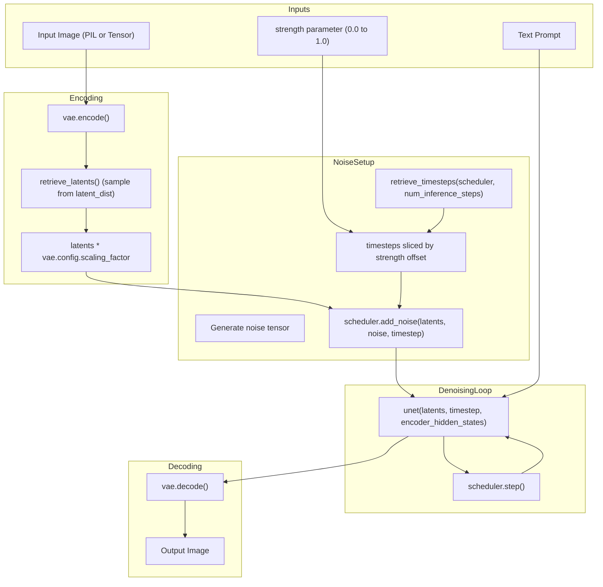
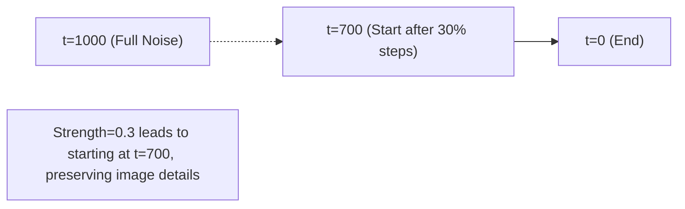
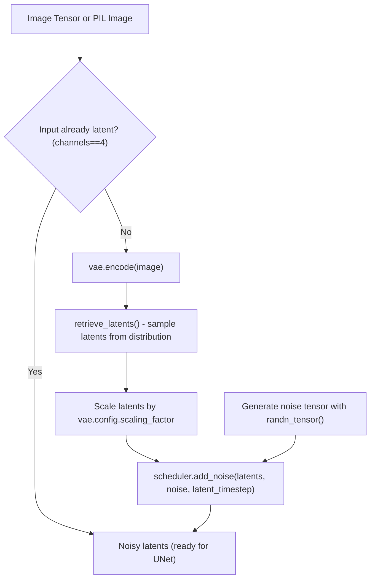
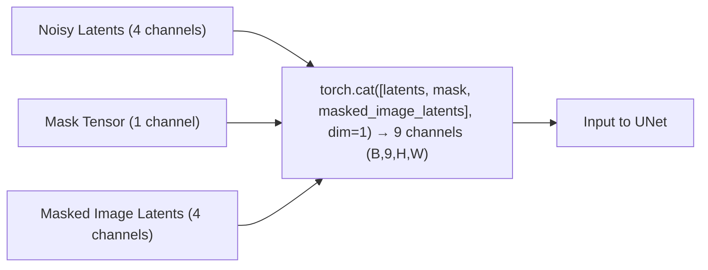
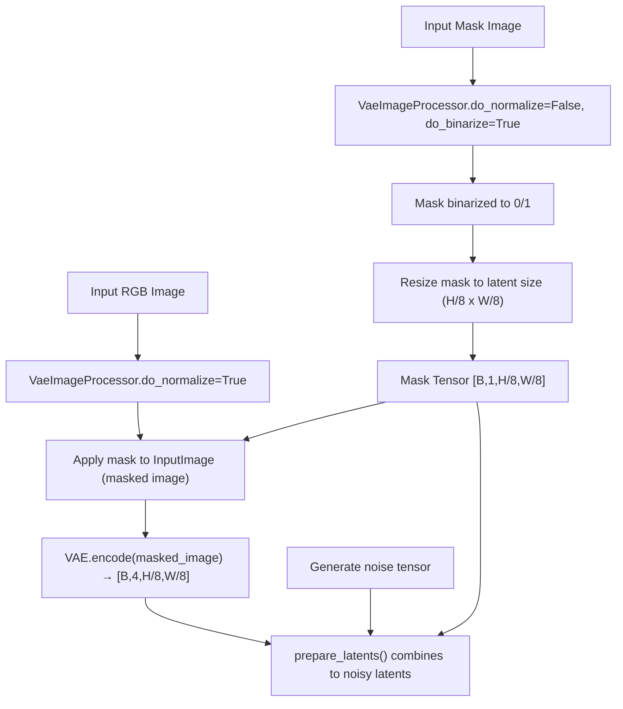
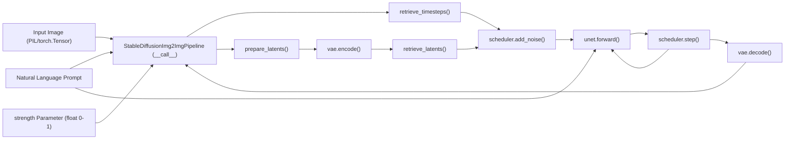
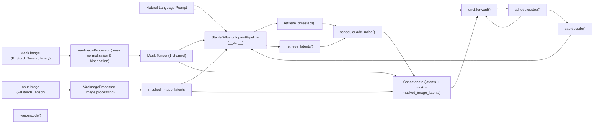

<!-- source: DeepWiki mcp.deepwiki.com · repo huggingface/diffusers · page 3.3 Image-to-Image and Inpainting · fetched 2026-10-21 -->

# Image-to-Image and Inpainting

<details>
<summary>Relevant source files</summary>

The following files were used as context for generating this wiki page:

- [docs/source/en/training/overview.md](docs/source/en/training/overview.md)
- [docs/source/en/tutorials/basic_training.md](docs/source/en/tutorials/basic_training.md)
- [docs/source/en/using-diffusers/conditional_image_generation.md](docs/source/en/using-diffusers/conditional_image_generation.md)
- [docs/source/en/using-diffusers/depth2img.md](docs/source/en/using-diffusers/depth2img.md)
- [docs/source/en/using-diffusers/img2img.md](docs/source/en/using-diffusers/img2img.md)
- [docs/source/en/using-diffusers/inpaint.md](docs/source/en/using-diffusers/inpaint.md)
- [docs/source/en/using-diffusers/unconditional_image_generation.md](docs/source/en/using-diffusers/unconditional_image_generation.md)
- [docs/source/en/using-diffusers/write_own_pipeline.md](docs/source/en/using-diffusers/write_own_pipeline.md)
- [docs/source/ko/optimization/fp16.md](docs/source/ko/optimization/fp16.md)
- [docs/source/ko/tutorials/basic_training.md](docs/source/ko/tutorials/basic_training.md)
- [docs/source/ko/using-diffusers/write_own_pipeline.md](docs/source/ko/using-diffusers/write_own_pipeline.md)
- [examples/research_projects/intel_opts/textual_inversion_dfq/textual_inversion.py](examples/research_projects/intel_opts/textual_inversion_dfq/textual_inversion.py)
- [src/diffusers/pipelines/controlnet/pipeline_controlnet.py](src/diffusers/pipelines/controlnet/pipeline_controlnet.py)
- [src/diffusers/pipelines/controlnet/pipeline_controlnet_img2img.py](src/diffusers/pipelines/controlnet/pipeline_controlnet_img2img.py)
- [src/diffusers/pipelines/controlnet/pipeline_controlnet_inpaint.py](src/diffusers/pipelines/controlnet/pipeline_controlnet_inpaint.py)
- [src/diffusers/pipelines/controlnet/pipeline_controlnet_inpaint_sd_xl.py](src/diffusers/pipelines/controlnet/pipeline_controlnet_inpaint_sd_xl.py)
- [src/diffusers/pipelines/controlnet/pipeline_controlnet_sd_xl.py](src/diffusers/pipelines/controlnet/pipeline_controlnet_sd_xl.py)
- [src/diffusers/pipelines/controlnet/pipeline_controlnet_sd_xl_img2img.py](src/diffusers/pipelines/controlnet/pipeline_controlnet_sd_xl_img2img.py)
- [src/diffusers/pipelines/stable_diffusion/pipeline_stable_diffusion.py](src/diffusers/pipelines/stable_diffusion/pipeline_stable_diffusion.py)
- [src/diffusers/pipelines/stable_diffusion/pipeline_stable_diffusion_depth2img.py](src/diffusers/pipelines/stable_diffusion/pipeline_stable_diffusion_depth2img.py)
- [src/diffusers/pipelines/stable_diffusion/pipeline_stable_diffusion_img2img.py](src/diffusers/pipelines/stable_diffusion/pipeline_stable_diffusion_img2img.py)
- [src/diffusers/pipelines/stable_diffusion/pipeline_stable_diffusion_inpaint.py](src/diffusers/pipelines/stable_diffusion/pipeline_stable_diffusion_inpaint.py)
- [src/diffusers/pipelines/stable_diffusion/pipeline_stable_diffusion_instruct_pix2pix.py](src/diffusers/pipelines/stable_diffusion/pipeline_stable_diffusion_instruct_pix2pix.py)
- [src/diffusers/pipelines/stable_diffusion/pipeline_stable_diffusion_upscale.py](src/diffusers/pipelines/stable_diffusion/pipeline_stable_diffusion_upscale.py)
- [src/diffusers/pipelines/stable_diffusion_xl/pipeline_stable_diffusion_xl.py](src/diffusers/pipelines/stable_diffusion_xl/pipeline_stable_diffusion_xl.py)
- [src/diffusers/pipelines/stable_diffusion_xl/pipeline_stable_diffusion_xl_img2img.py](src/diffusers/pipelines/stable_diffusion_xl/pipeline_stable_diffusion_xl_img2img.py)
- [src/diffusers/pipelines/stable_diffusion_xl/pipeline_stable_diffusion_xl_inpaint.py](src/diffusers/pipelines/stable_diffusion_xl/pipeline_stable_diffusion_xl_inpaint.py)
- [src/diffusers/pipelines/stable_diffusion_xl/pipeline_stable_diffusion_xl_instruct_pix2pix.py](src/diffusers/pipelines/stable_diffusion_xl/pipeline_stable_diffusion_xl_instruct_pix2pix.py)
- [src/diffusers/pipelines/t2i_adapter/pipeline_stable_diffusion_xl_adapter.py](src/diffusers/pipelines/t2i_adapter/pipeline_stable_diffusion_xl_adapter.py)

</details>


This page documents the implementation details of the Stable Diffusion image-to-image (img2img) and inpainting pipelines. These pipelines extend the text-to-image paradigm by conditioning generation not only on prompts but also on input images and masks, enabling tasks such as image modification and targeted region filling.

---

## Pipeline Variants Overview

The following are core pipelines supporting image-conditioned diffusion in the HuggingFace Diffusers library:

| Pipeline Class                         | Task                       | Key Parameter(s)     | Input Requirements                        |
|--------------------------------------|----------------------------|----------------------|-------------------------------------------|
| `StableDiffusionImg2ImgPipeline`     | Image-to-Image transformation | `strength` (0.0–1.0)  | Input image + text prompt                  |
| `StableDiffusionInpaintPipeline`     | Image inpainting           | `mask_image`           | Input image + mask + text prompt           |
| `StableDiffusionUpscalePipeline`     | Image super-resolution    | `max_noise_level`      | Low-resolution image + text prompt         |
| `StableDiffusionXLImg2ImgPipeline`   | SDXL image-to-image       | `strength`             | Image + prompt (dual text encoders)        |
| `StableDiffusionXLInpaintPipeline`   | SDXL inpainting           | `mask_image`           | Image + mask + prompt                       |

All these pipelines extend the foundational Stable Diffusion architecture with modifications to inputs and latent preparation to suit their specific tasks.

**Sources**:  
[src/diffusers/pipelines/stable_diffusion/pipeline_stable_diffusion_img2img.py:182-189](),  
[src/diffusers/pipelines/stable_diffusion/pipeline_stable_diffusion_inpaint.py:128-135](),  
[src/diffusers/pipelines/stable_diffusion/pipeline_stable_diffusion_upscale.py:78-84](),  
[src/diffusers/pipelines/stable_diffusion_xl/pipeline_stable_diffusion_xl_img2img.py:186-192](),  
[src/diffusers/pipelines/stable_diffusion_xl/pipeline_stable_diffusion_xl_inpaint.py:170-177]()

---

## Image-to-Image Pipeline

### Architecture and Data Flow

The `StableDiffusionImg2ImgPipeline` performs image transformation conditioned on a source image and prompt. It follows this flow:



The pipeline encodes the input image into the latent space with the VAE encoder, scales it, then adds noise determined by the `strength` parameter.

### The `strength` Parameter and Timestep Scheduling

The `strength` parameter (0.0 to 1.0) controls how much the original image influences the final output, effectively controlling the diffusion process start timestep:

- `strength = 0.0`: Output is identical to the input image (no changes)
- `strength = 1.0`: The pipeline performs full denoising from pure noise (like text-to-image)

The pipeline calculates an offset in the scheduler timestep sequence proportional to `strength` to determine where denoising should start:

```python
timesteps, num_inference_steps = retrieve_timesteps(
    self.scheduler, num_inference_steps, device, timesteps, sigmas
)
offset = int(num_inference_steps * strength)
timesteps = timesteps[offset:]
latent_timestep = timesteps[0]
```

This slicing means the latent encoding is noised to the state at `latent_timestep`; only the remaining timesteps are denoised. This is the core to controlling "strength" of the image-to-image generation.



**Sources**:  
[src/diffusers/pipelines/stable_diffusion/pipeline_stable_diffusion_img2img.py:820-840](),  
[src/diffusers/pipelines/stable_diffusion/pipeline_stable_diffusion_img2img.py:123-153]()

### Latent Preparation and Noise Addition

The method `prepare_latents()` manages:

- Encoding images to latents via `vae.encode()`
- Using `retrieve_latents()` to sample latent tensors from VAE encoder output distributions
- Scaling latents by VAE config's scaling factor
- Adding random noise at the latent timestep based on scheduler
- Handling input images already in latent form (latent shape check)

This ensures the diffusion denoiser starts from the correct noisy latent state corresponding to the `strength`.



**Sources**:  
[src/diffusers/pipelines/stable_diffusion/pipeline_stable_diffusion_img2img.py:735-798](),  
[src/diffusers/pipelines/stable_diffusion/pipeline_stable_diffusion_img2img.py:86-96]()

---

## Inpainting Pipeline

### 9-Channel Input to UNet

Unlike text-to-image or img2img, inpainting UNet models accept 9-channel input tensors instead of the standard 4. This is composed of:

- 4 channels: Noisy latents (diffusion latent state)
- 1 channel: Mask (binary mask defining inpainting region)
- 4 channels: Masked image latents (original image latents masked outside mask region)

These three tensors are concatenated along the channel dimension before input to UNet:



This design ensures the UNet can see the original pixel info within the masked region and focus on reconstructing it while leaving other regions unchanged.

During pipeline initialization, a check is usually performed to ensure the UNet model's first convolution layer expects 9 channels:

```python
if unet.config.in_channels != 9:
    logger.warning("UNet is not configured for 9-channel inpainting input.")
```

**Sources**:  
[src/diffusers/pipelines/stable_diffusion/pipeline_stable_diffusion_inpaint.py:245-260]()

### Mask Processing Workflow

The inpainting pipeline processes the input mask image and the masked image as follows:

1. The `VaeImageProcessor` is used to preprocess the input image and mask separately.
2. The mask is normalized, binarized (values 0 or 1), and resized to latent resolution (typically 1/8th of image resolution).
3. The original image is masked by setting pixels outside the mask to zero, then encoded via the VAE encoder into masked image latents.
4. Noise is added to the latents similarly to image-to-image pipelines.



**Sources**:  
[src/diffusers/pipelines/stable_diffusion/pipeline_stable_diffusion_inpaint.py:675-735](),  
[src/diffusers/pipelines/stable_diffusion/pipeline_stable_diffusion_inpaint.py:125-161]()

---

## Key Utility Functions

### `retrieve_latents`

Common helper to extract latent tensors from VAE encoder outputs. It supports multiple output types like:

- `latent_dist` (a `DiagonalGaussianDistribution`): samples latents stochastically
- `latents` attribute directly (deterministic latents)

Raises an error if latent data is inaccessible.

```python
def retrieve_latents(encoder_output: torch.Tensor, generator=None, sample_mode="sample"):
    if hasattr(encoder_output, "latent_dist") and sample_mode == "sample":
        return encoder_output.latent_dist.sample(generator)
    elif hasattr(encoder_output, "latent_dist") and sample_mode == "argmax":
        return encoder_output.latent_dist.mode()
    elif hasattr(encoder_output, "latents"):
        return encoder_output.latents
    else:
        raise AttributeError("Could not access latents of provided encoder_output")
```

**Sources**:  
[src/diffusers/pipelines/stable_diffusion/pipeline_stable_diffusion_img2img.py:86-96]()

### `retrieve_timesteps`

Configures the scheduler timesteps for inference and returns the active timestep sequence and count. Supports custom timesteps or sigmas overrides.

```python
def retrieve_timesteps(scheduler, num_inference_steps=None, device=None, timesteps=None, sigmas=None, **kwargs):
    # Validates and sets scheduler timesteps based on arguments.
    # Returns tuple (timesteps tensor, number of inference steps).
```

This is used by img2img and inpainting pipelines to generate the proper diffusion step schedule, particularly for strength slicing in img2img.

**Sources**:  
[src/diffusers/pipelines/stable_diffusion/pipeline_stable_diffusion.py:95-151](),  
[src/diffusers/pipelines/stable_diffusion/pipeline_stable_diffusion_img2img.py:123-153]()

### `rescale_noise_cfg`

Used to adjust noise scales during classifier-free guidance to improve image quality and prevent overexposure artifacts.

```python
def rescale_noise_cfg(noise_cfg, noise_pred_text, guidance_rescale=0.0):
    std_text = noise_pred_text.std(dim=list(range(1, noise_pred_text.ndim)), keepdim=True)
    std_cfg = noise_cfg.std(dim=list(range(1, noise_cfg.ndim)), keepdim=True)
    noise_pred_rescaled = noise_cfg * (std_text / std_cfg)
    noise_cfg = guidance_rescale * noise_pred_rescaled + (1 - guidance_rescale) * noise_cfg
    return noise_cfg
```

**Sources**:  
[src/diffusers/pipelines/stable_diffusion/pipeline_stable_diffusion.py:69-92]()

---

## Diagram: From Natural Language to Img2Img Code Entities



---

## Diagram: From Natural Language to Inpainting Code Entities



---

# Summary

This page detailed the image-to-image and inpainting pipelines for Stable Diffusion within the diffusers library. Key points include:

- The img2img pipeline uses a `strength` parameter to control how strongly the input image is preserved vs re-generated, by offsetting diffusion timesteps.
- Latents are prepared by encoding images with a VAE and adding noise at the appropriate timestep before denoising.
- Inpainting pipelines require a 9-channel input to the UNet formed by concatenating the noisy latents, mask, and masked image latents.
- The mask undergoes normalization, binarization, and resizing handled by the VaeImageProcessor.
- Shared utility functions, such as `retrieve_latents` and `retrieve_timesteps`, centralize key data preparation steps.

Understanding these elements equips engineers to customize and extend image-conditioned Stable Diffusion deployment for creative editing and restoration tasks.

---

# References / Sources

- `src/diffusers/pipelines/stable_diffusion/pipeline_stable_diffusion_img2img.py` (lines 50-260, 720-950)  
- `src/diffusers/pipelines/stable_diffusion/pipeline_stable_diffusion_inpaint.py` (lines 120-170, 245-280, 670-755)  
- `src/diffusers/pipelines/stable_diffusion/pipeline_stable_diffusion.py` (lines 60-160)  
- `src/diffusers/pipelines/stable_diffusion/pipeline_stable_diffusion_upscale.py` (lines 70-130)  
- `src/diffusers/pipelines/stable_diffusion_xl/pipeline_stable_diffusion_xl_img2img.py` (lines 150-190)  
- `src/diffusers/pipelines/stable_diffusion_xl/pipeline_stable_diffusion_xl_inpaint.py` (lines 160-180)

---

