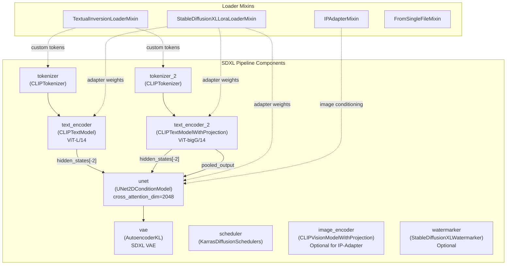
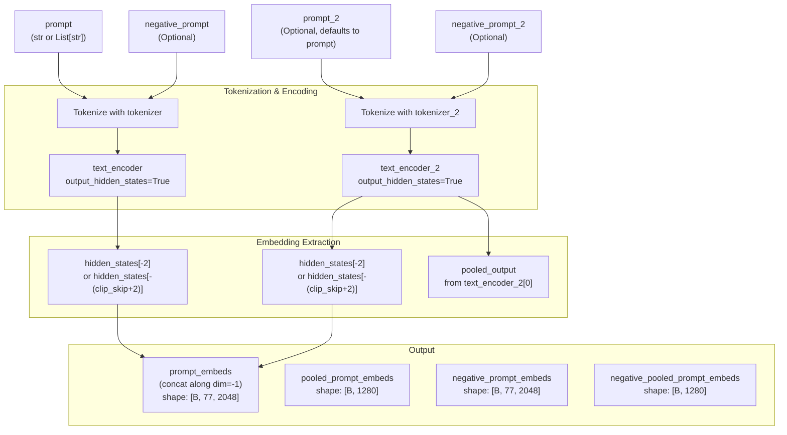
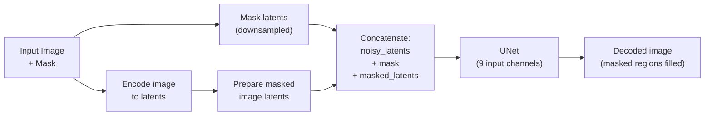
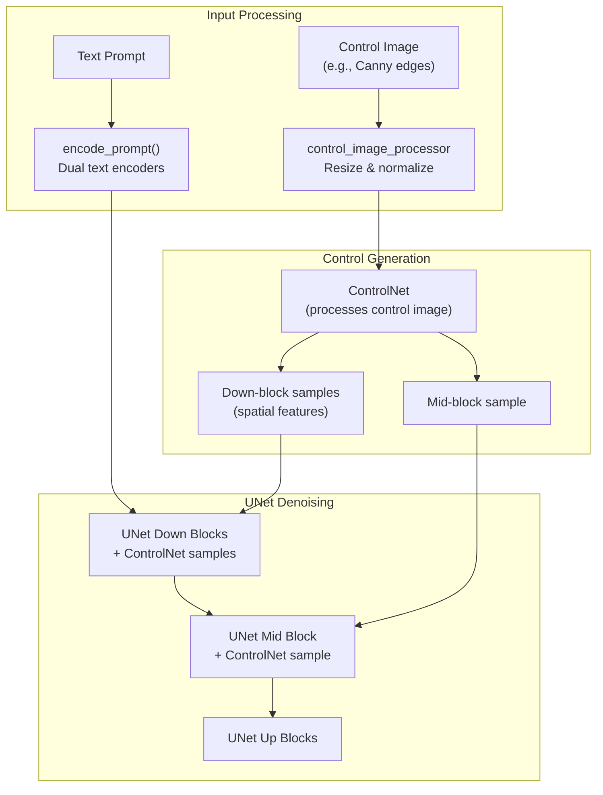

<!-- source: DeepWiki mcp.deepwiki.com · repo huggingface/diffusers · page 3.4 Stable Diffusion XL Pipelines · fetched 2026-10-21 -->

# Stable Diffusion XL Pipelines

<details>
<summary>Relevant source files</summary>

The following files were used as context for generating this wiki page:

- [src/diffusers/pipelines/controlnet/pipeline_controlnet.py](src/diffusers/pipelines/controlnet/pipeline_controlnet.py)
- [src/diffusers/pipelines/controlnet/pipeline_controlnet_img2img.py](src/diffusers/pipelines/controlnet/pipeline_controlnet_img2img.py)
- [src/diffusers/pipelines/controlnet/pipeline_controlnet_inpaint.py](src/diffusers/pipelines/controlnet/pipeline_controlnet_inpaint.py)
- [src/diffusers/pipelines/controlnet/pipeline_controlnet_inpaint_sd_xl.py](src/diffusers/pipelines/controlnet/pipeline_controlnet_inpaint_sd_xl.py)
- [src/diffusers/pipelines/controlnet/pipeline_controlnet_sd_xl.py](src/diffusers/pipelines/controlnet/pipeline_controlnet_sd_xl.py)
- [src/diffusers/pipelines/controlnet/pipeline_controlnet_sd_xl_img2img.py](src/diffusers/pipelines/controlnet/pipeline_controlnet_sd_xl_img2img.py)
- [src/diffusers/pipelines/stable_diffusion/pipeline_stable_diffusion.py](src/diffusers/pipelines/stable_diffusion/pipeline_stable_diffusion.py)
- [src/diffusers/pipelines/stable_diffusion/pipeline_stable_diffusion_depth2img.py](src/diffusers/pipelines/stable_diffusion/pipeline_stable_diffusion_depth2img.py)
- [src/diffusers/pipelines/stable_diffusion/pipeline_stable_diffusion_img2img.py](src/diffusers/pipelines/stable_diffusion/pipeline_stable_diffusion_img2img.py)
- [src/diffusers/pipelines/stable_diffusion/pipeline_stable_diffusion_inpaint.py](src/diffusers/pipelines/stable_diffusion/pipeline_stable_diffusion_inpaint.py)
- [src/diffusers/pipelines/stable_diffusion/pipeline_stable_diffusion_instruct_pix2pix.py](src/diffusers/pipelines/stable_diffusion/pipeline_stable_diffusion_instruct_pix2pix.py)
- [src/diffusers/pipelines/stable_diffusion/pipeline_stable_diffusion_upscale.py](src/diffusers/pipelines/stable_diffusion/pipeline_stable_diffusion_upscale.py)
- [src/diffusers/pipelines/stable_diffusion_xl/pipeline_stable_diffusion_xl.py](src/diffusers/pipelines/stable_diffusion_xl/pipeline_stable_diffusion_xl.py)
- [src/diffusers/pipelines/stable_diffusion_xl/pipeline_stable_diffusion_xl_img2img.py](src/diffusers/pipelines/stable_diffusion_xl/pipeline_stable_diffusion_xl_img2img.py)
- [src/diffusers/pipelines/stable_diffusion_xl/pipeline_stable_diffusion_xl_inpaint.py](src/diffusers/pipelines/stable_diffusion_xl/pipeline_stable_diffusion_xl_inpaint.py)
- [src/diffusers/pipelines/stable_diffusion_xl/pipeline_stable_diffusion_xl_instruct_pix2pix.py](src/diffusers/pipelines/stable_diffusion_xl/pipeline_stable_diffusion_xl_instruct_pix2pix.py)
- [src/diffusers/pipelines/t2i_adapter/pipeline_stable_diffusion_xl_adapter.py](src/diffusers/pipelines/t2i_adapter/pipeline_stable_diffusion_xl_adapter.py)
- [tests/pipelines/controlnet/test_controlnet.py](tests/pipelines/controlnet/test_controlnet.py)
- [tests/pipelines/controlnet/test_controlnet_img2img.py](tests/pipelines/controlnet/test_controlnet_img2img.py)
- [tests/pipelines/controlnet/test_controlnet_inpaint.py](tests/pipelines/controlnet/test_controlnet_inpaint.py)
- [tests/pipelines/controlnet/test_controlnet_sdxl.py](tests/pipelines/controlnet/test_controlnet_sdxl.py)
- [tests/pipelines/stable_diffusion_xl/test_stable_diffusion_xl.py](tests/pipelines/stable_diffusion_xl/test_stable_diffusion_xl.py)
- [tests/pipelines/stable_diffusion_xl/test_stable_diffusion_xl_adapter.py](tests/pipelines/stable_diffusion_xl/test_stable_diffusion_xl_adapter.py)
- [tests/pipelines/stable_diffusion_xl/test_stable_diffusion_xl_img2img.py](tests/pipelines/stable_diffusion_xl/test_stable_diffusion_xl_img2img.py)
- [tests/pipelines/stable_diffusion_xl/test_stable_diffusion_xl_inpaint.py](tests/pipelines/stable_diffusion_xl/test_stable_diffusion_xl_inpaint.py)

</details>


This document covers the Stable Diffusion XL (SDXL) pipeline family, which represents the second-generation architecture of Stable Diffusion models with significant improvements over v1.x. SDXL pipelines support higher resolution generation (default 1024×1024), integrate dual text encoders for enhanced prompt understanding, and include additional conditioning mechanisms such as image encoders and aesthetic scoring.

For in-depth details on the base Stable Diffusion pipelines (v1.x/v2.x), refer to [Base Pipeline Architecture](#3.1) and [Text-to-Image Pipeline](#3.2). For specialized ControlNet integration details beyond SDXL, see [ControlNet and Conditional Generation](#3.5).

---

## Architecture Overview

Stable Diffusion XL introduces several key architectural improvements:

| Feature                     | SD v1.x/v2.x         | SDXL                                       |
|-----------------------------|----------------------|--------------------------------------------|
| **Text Encoders**           | Single CLIP ViT-L/14 | Dual: CLIP ViT-L/14 + OpenCLIP ViT-bigG/14 |
| **Text Embedding Dimension**| 768                  | 2048 (concatenated embeddings)              |
| **Pooled Embeddings**       | Not used             | Pooled output from second encoder           |
| **Default Resolution**      | 512×512              | 1024×1024                                   |
| **UNet Channels**           | 320, 640, 1280, 1280 | 320, 640, 1280                              |
| **Additional Conditioning** | Timestep only        | Timestep + crop coordinates + target size + aesthetic score |
| **VAE**                    | SD VAE               | SDXL VAE (improved)                         |

The dual text encoder system significantly improves the semantic understanding of complex prompts by combining complementary representations from two different CLIP models.

**Sources:** [src/diffusers/pipelines/stable_diffusion_xl/pipeline_stable_diffusion_xl.py:191-221](), [src/diffusers/pipelines/stable_diffusion_xl/pipeline_stable_diffusion_xl.py:239-252]()

---

## Component Architecture



The SDXL pipeline combines multiple components:

- **Dual tokenizers and text encoders:** For prompt processing, these produce concatenated embeddings.
- **UNet:** Conditioned on combined embeddings for denoising latent representations.
- **VAE:** Encodes and decodes images in latent space.
- **Scheduler:** Controls the diffusion timestep schedule.
- **Image encoder:** Optional CLIP Vision model used for IP-Adapter image conditioning.
- **Loader Mixins:** Enable textual inversion embeddings, LoRA adapters, IP-Adapters, and `.ckpt` checkpoint compatibility.

All SDXL pipelines inherit from `DiffusionPipeline` with added mixins for loader extensibility.

**Sources:** [src/diffusers/pipelines/stable_diffusion_xl/pipeline_stable_diffusion_xl.py:170-177](), [src/diffusers/pipelines/stable_diffusion_xl/pipeline_stable_diffusion_xl.py:255-265]()

---

## Dual Text Encoder System

A core innovation in SDXL is the use of dual text encoders to process prompts and negative prompts separately, yielding richer combined embeddings.



### Method Details

- **Tokenization:** Each prompt and negative prompt is tokenized with its respective tokenizer (`tokenizer` for first encoder and `tokenizer_2` for second), with a max token length of 77 tokens [src/diffusers/pipelines/stable_diffusion_xl/pipeline_stable_diffusion_xl.py:328-348]().

- **Encoding:** Both text encoders are executed with `output_hidden_states=True` to access the penultimate hidden layers from transformer blocks [src/diffusers/pipelines/stable_diffusion_xl/pipeline_stable_diffusion_xl.py:350-375]().

- **Hidden State Extraction:** The embeddings are extracted from the second-last hidden layer (`hidden_states[-2]`). The `clip_skip` parameter allows offset to earlier hidden states for aesthetic tuning, typically offset of 2 for SDXL [src/diffusers/pipelines/stable_diffusion_xl/pipeline_stable_diffusion_xl.py:407-419]().

- **Concatenation:** The hidden states from the two encoders are concatenated along the embedding dimension, resulting in tensors of shape `[batch_size, sequence_length, 768 + 1280 = 2048]` [src/diffusers/pipelines/stable_diffusion_xl/pipeline_stable_diffusion_xl.py:421-423]().

- **Pooled Output:** The second encoder also outputs a pooled embedding from its CLS token, providing a global sentence-level representation (`pooled_prompt_embeds`) used for additional conditioning [src/diffusers/pipelines/stable_diffusion_xl/pipeline_stable_diffusion_xl.py:425-426]().

- **Negative Prompts:** The process is mirrored for negative prompts, used in classifier-free guidance.

- **Empty Prompt Handling:** When `force_zeros_for_empty_prompt` is enabled, empty negative prompts produce zero embeddings, a technique to enhance generation quality [src/diffusers/pipelines/stable_diffusion_xl/pipeline_stable_diffusion_xl.py:461-465]().

This dual-encoder setup enhances semantic richness and robustness in prompt understanding, contributing to SDXL’s improved generation fidelity.

**Sources:** [src/diffusers/pipelines/stable_diffusion_xl/pipeline_stable_diffusion_xl.py:283-537](), [src/diffusers/pipelines/stable_diffusion_xl/pipeline_stable_diffusion_xl.py:407-419]()

---

## Additional Conditioning: `add_time_ids`

SDXL’s UNet receives augmented conditioning in the form of a tensor named `add_time_ids`, encoding additional generation context beyond the diffusion timestep. This tensor contains 6 to 8 elements, representing:

| Index | Content              | Description                                          |
|-------|----------------------|------------------------------------------------------|
| 0-1   | `original_size`      | Height and width of the original training image      |
| 2-3   | `crops_coords_top_left` | Coordinates of the top-left corner of crop (if any) |
| 4-5   | `target_size`        | Target output height and width                        |
| 6     | `aesthetic_score` (optional) | A scalar aesthetic quality score (for refiner models) |
| 7     | `negative_aesthetic_score` (optional) | Negative aesthetic score                            |

These values are concatenated with the timestep embedding vector and passed to the UNet for denoising, enabling the model to adapt its generation based on image composition and quality targets.

The method `_get_add_time_ids` constructs this tensor dynamically for each generation call [src/diffusers/pipelines/stable_diffusion_xl/pipeline_stable_diffusion_xl.py:824-872]().

**Sources:** [src/diffusers/pipelines/stable_diffusion_xl/pipeline_stable_diffusion_xl.py:824-872]()

---

## Pipeline Variants

### StableDiffusionXLPipeline (Text-to-Image)

This is the primary SDXL pipeline for generating images from text prompts.

**Key parameters:**

- `prompt` / `prompt_2`: Primary and secondary textual descriptions (second defaults to first).
- `negative_prompt` / `negative_prompt_2`: Optional negative prompts for classifier-free guidance.
- `height` / `width`: Output resolution, defaulting to 1024×1024.
- `num_inference_steps`: Number of diffusion denoising steps (default 50).
- `guidance_scale`: Strength of classifier-free guidance (default 5.0).
- `guidance_rescale`: Guidance rescaling factor to mitigate overexposure (default 0.0).

The pipeline accepts additional keyword arguments facilitating control over guidance rescaling, latent space precision, and scheduler customization [src/diffusers/pipelines/stable_diffusion_xl/pipeline_stable_diffusion_xl.py:170-177](), [src/diffusers/pipelines/stable_diffusion_xl/pipeline_stable_diffusion_xl.py:539-1068]().

---

### StableDiffusionXLImg2ImgPipeline

This variant applies controlled image-to-image translation with prompts guiding the generation.

- **Inputs:** Accepts an initial image which is encoded into latent space by the VAE.
- **Denoising strength:** Parameterizes how much noise is added and thus how drastically the image changes (from 0 to 1).
- **Latent encoding:** Utilizes VAE latent distribution sampling.
- **Timestep handling:** Supports `strength` and `denoising_start` to precisely control diffusion noise scheduling, useful for refiner-style pipelines.

This pipeline’s forward pass performs encoding of the input image into latents with scaling by VAE’s configured scaling factor, adds noise corresponding to the desired strength and denoising start, and runs the denoising step with classifier-free guidance on combined embeddings [src/diffusers/pipelines/stable_diffusion_xl/pipeline_stable_diffusion_xl_img2img.py:188-195](), [src/diffusers/pipelines/stable_diffusion_xl/pipeline_stable_diffusion_xl_img2img.py:686-770]().

---

### StableDiffusionXLInpaintPipeline

Facilitates image inpainting with text-guided generation restricted to masked regions while preserving unmasked areas.

**Inputs:**

- `image`: The initial image to be inpainted.
- `mask_image`: Binary mask defining regions to modify (white) and regions to preserve (black).
- `strength`: Controls denoising strength for masked regions.

**Processing flow:**



The UNet input has 9 channels structured as:

- 4 channels: noisy latent image.
- 1 channel: mask latent (resized to latent resolution).
- 4 channels: latent of the original masked image.

This composite input enables the model to inpaint only specified regions while maintaining context and coherence with the original image [src/diffusers/pipelines/stable_diffusion_xl/pipeline_stable_diffusion_xl_inpaint.py:215-222](), [src/diffusers/pipelines/stable_diffusion_xl/pipeline_stable_diffusion_xl_inpaint.py:783-922]().

---

## ControlNet Integration

SDXL supports advanced ControlNet integration for spatial conditioning via additional control images (edge maps, sketches, depth, etc.).

### StableDiffusionXLControlNetPipeline



- **ControlNets:** Accepts one or multiple `ControlNetModel` instances to provide fine-grained spatial conditioning.
- **Control image:** Inputs are processed and resized to the expected resolution before feeding into ControlNet.
- **Control scaling:** `controlnet_conditioning_scale` parameter controls the strength of ControlNet influence.
- **Multi-ControlNet:** Multiple ControlNets are combined via `MultiControlNetModel` for composite conditioning [src/diffusers/pipelines/controlnet/pipeline_controlnet_sd_xl.py:180-229](), [src/diffusers/pipelines/controlnet/pipeline_controlnet_sd_xl.py:1070-1152]().

---

## InstructPix2Pix for SDXL

`StableDiffusionXLInstructPix2PixPipeline` allows instruction-based image editing with the SDXL architecture.

- Supports separate `image_guidance_scale` to modulate adherence to the input image structure.
- The UNet is expanded to accept 8 input channels: 4 noisy latents + 4 encoded initial image latents.
- Guidance computation combines three predictions: unconditional, text-conditional, and image-conditional with respective guidance scales.

This pipeline offers powerful editing driven by natural language instructions over images [src/diffusers/pipelines/stable_diffusion_xl/pipeline_stable_diffusion_xl_instruct_pix2pix.py:113-167](), [src/diffusers/pipelines/stable_diffusion_xl/pipeline_stable_diffusion_xl_instruct_pix2pix.py:670-685]()

---

## Common Utilities and Helper Functions

- **`retrieve_timesteps`**: Used across SDXL pipelines, enables flexible timestep scheduling for inference, supporting standard, custom timesteps, or sigmas [src/diffusers/pipelines/stable_diffusion_xl/pipeline_stable_diffusion_xl.py:111-167]().

- **`retrieve_latents`**: Encodes images into latents via the VAE with support for stochastic sampling modes ("sample" or "argmax") [src/diffusers/pipelines/stable_diffusion_xl/pipeline_stable_diffusion_xl_img2img.py:115-126]().

- **`rescale_noise_cfg`**: Implements noise guidance rescaling following recent research to reduce overexposure by adjusting prediction standard deviations [src/diffusers/pipelines/stable_diffusion_xl/pipeline_stable_diffusion_xl.py:84-107]().

- **Watermarking:** Optional invisible watermarking via `StableDiffusionXLWatermarker` is activated if the corresponding library is available, embedding invisible marks for provenance [src/diffusers/pipelines/stable_diffusion_xl/pipeline_stable_diffusion_xl.py:53-55](), [src/diffusers/pipelines/stable_diffusion_xl/pipeline_stable_diffusion_xl.py:276-281]().

---

## Configuration and Runtime Behavior

### Model CPU Offloading Sequence

To optimize memory usage, SDXL pipelines specify an ordered sequence for model CPU offloading:

```
text_encoder -> text_encoder_2 -> image_encoder -> unet -> vae
```

This ensures memory-efficient loading and inference on limited hardware [src/diffusers/pipelines/stable_diffusion_xl/pipeline_stable_diffusion_xl.py:223]().

### Optional Components

The pipelines declare optional components (e.g., watermarker, safety checker, feature extractor, image encoder) to allow partial or customized loading [src/diffusers/pipelines/stable_diffusion_xl/pipeline_stable_diffusion_xl.py:224-231]().

### Callback Tensor Inputs

The pipelines expose tensors accessible or modifiable by inference callbacks, including:

- Latents
- Prompt embeddings
- Added text embeddings
- Additional time conditioning IDs (`add_time_ids`)

This enables advanced control during the inference lifecycle [src/diffusers/pipelines/stable_diffusion_xl/pipeline_stable_diffusion_xl.py:232-237]().

---

# Summary

Stable Diffusion XL pipelines combine:

- Dual text encoders generating high-dimensional concatenated prompt embeddings.
- Enhanced conditioning through additional metadata tensors (`add_time_ids`).
- Support for higher resolution output (typically 1024×1024).
- Flexible pipeline variants: text-to-image, image-to-image, inpainting.
- Optional integration with ControlNet for spatial conditioning and with IP-Adapters for image-based prompt conditioning.
- Advanced loading mixins for LoRA, textual inversion, IP-Adapters, and `.ckpt` files.
- Utility methods to handle noise rescaling, timestep retrieval, and latent encoding adaptively.

This modular design improves generation fidelity, flexibility, and control, forming the foundation for next-generation diffusion-based generative models.

---

**Sources:**

- `src/diffusers/pipelines/stable_diffusion_xl/pipeline_stable_diffusion_xl.py:170-537, 824-872`  
- `src/diffusers/pipelines/stable_diffusion_xl/pipeline_stable_diffusion_xl_img2img.py:188-195, 686-770`  
- `src/diffusers/pipelines/stable_diffusion_xl/pipeline_stable_diffusion_xl_inpaint.py:215-222, 783-922`  
- `src/diffusers/pipelines/controlnet/pipeline_controlnet_sd_xl.py:180-229, 1070-1152`  
- `src/diffusers/pipelines/stable_diffusion_xl/pipeline_stable_diffusion_xl_instruct_pix2pix.py:113-167, 670-685`

---

