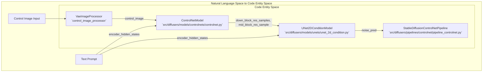
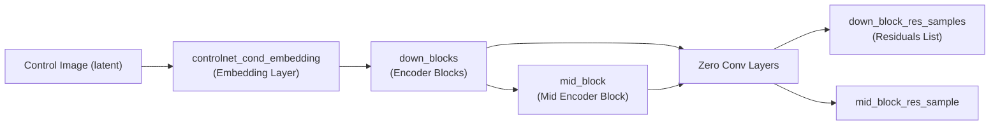
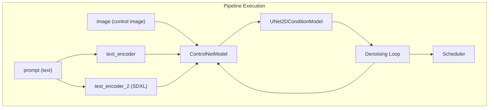
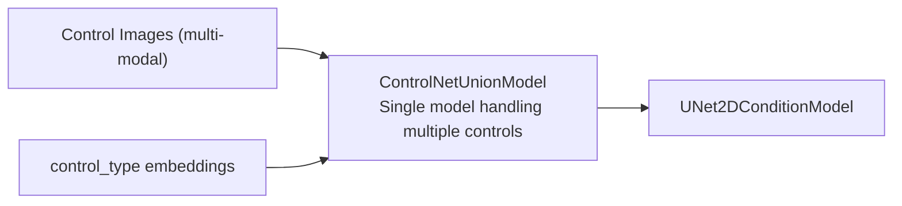

<!-- source: DeepWiki mcp.deepwiki.com · repo huggingface/diffusers · page 3.5 ControlNet and Conditional Generation · fetched 2026-10-21 -->

# ControlNet and Conditional Generation

<details>
<summary>Relevant source files</summary>

The following files were used as context for generating this wiki page:

- [docs/source/en/api/models/controlnet_union.md](docs/source/en/api/models/controlnet_union.md)
- [docs/source/en/api/pipelines/controlnet_union.md](docs/source/en/api/pipelines/controlnet_union.md)
- [docs/source/en/api/pipelines/ledits_pp.md](docs/source/en/api/pipelines/ledits_pp.md)
- [src/diffusers/models/adapter.py](src/diffusers/models/adapter.py)
- [src/diffusers/models/controlnets/__init__.py](src/diffusers/models/controlnets/__init__.py)
- [src/diffusers/models/controlnets/controlnet_union.py](src/diffusers/models/controlnets/controlnet_union.py)
- [src/diffusers/models/controlnets/multicontrolnet.py](src/diffusers/models/controlnets/multicontrolnet.py)
- [src/diffusers/models/controlnets/multicontrolnet_union.py](src/diffusers/models/controlnets/multicontrolnet_union.py)
- [src/diffusers/pipelines/controlnet/pipeline_controlnet_union_inpaint_sd_xl.py](src/diffusers/pipelines/controlnet/pipeline_controlnet_union_inpaint_sd_xl.py)
- [src/diffusers/pipelines/controlnet/pipeline_controlnet_union_sd_xl.py](src/diffusers/pipelines/controlnet/pipeline_controlnet_union_sd_xl.py)
- [src/diffusers/pipelines/controlnet/pipeline_controlnet_union_sd_xl_img2img.py](src/diffusers/pipelines/controlnet/pipeline_controlnet_union_sd_xl_img2img.py)
- [src/diffusers/pipelines/ledits_pp/__init__.py](src/diffusers/pipelines/ledits_pp/__init__.py)
- [src/diffusers/pipelines/ledits_pp/pipeline_leditspp_stable_diffusion.py](src/diffusers/pipelines/ledits_pp/pipeline_leditspp_stable_diffusion.py)
- [src/diffusers/pipelines/ledits_pp/pipeline_leditspp_stable_diffusion_xl.py](src/diffusers/pipelines/ledits_pp/pipeline_leditspp_stable_diffusion_xl.py)
- [src/diffusers/pipelines/ledits_pp/pipeline_output.py](src/diffusers/pipelines/ledits_pp/pipeline_output.py)
- [src/diffusers/pipelines/t2i_adapter/pipeline_stable_diffusion_adapter.py](src/diffusers/pipelines/t2i_adapter/pipeline_stable_diffusion_adapter.py)
- [tests/pipelines/controlnet/test_controlnet.py](tests/pipelines/controlnet/test_controlnet.py)
- [tests/pipelines/controlnet/test_controlnet_img2img.py](tests/pipelines/controlnet/test_controlnet_img2img.py)
- [tests/pipelines/controlnet/test_controlnet_inpaint.py](tests/pipelines/controlnet/test_controlnet_inpaint.py)
- [tests/pipelines/controlnet/test_controlnet_sdxl.py](tests/pipelines/controlnet/test_controlnet_sdxl.py)
- [tests/pipelines/ledits_pp/test_ledits_pp_stable_diffusion.py](tests/pipelines/ledits_pp/test_ledits_pp_stable_diffusion.py)
- [tests/pipelines/ledits_pp/test_ledits_pp_stable_diffusion_xl.py](tests/pipelines/ledits_pp/test_ledits_pp_stable_diffusion_xl.py)
- [tests/pipelines/stable_diffusion_xl/test_stable_diffusion_xl.py](tests/pipelines/stable_diffusion_xl/test_stable_diffusion_xl.py)
- [tests/pipelines/stable_diffusion_xl/test_stable_diffusion_xl_adapter.py](tests/pipelines/stable_diffusion_xl/test_stable_diffusion_xl_adapter.py)
- [tests/pipelines/stable_diffusion_xl/test_stable_diffusion_xl_img2img.py](tests/pipelines/stable_diffusion_xl/test_stable_diffusion_xl_img2img.py)
- [tests/pipelines/stable_diffusion_xl/test_stable_diffusion_xl_inpaint.py](tests/pipelines/stable_diffusion_xl/test_stable_diffusion_xl_inpaint.py)

</details>


## Purpose and Scope

This document explains the integration of ControlNet and T2I-Adapter within Stable Diffusion pipelines to enable spatial conditioning and conditional image generation. ControlNet extends the diffusion model by adding dedicated conditioning networks to guide the denoising process using control images (edges, depth, poses, segmentation, etc.), maintaining the text-to-image capability while introducing strong spatial constraints.

The page details the ControlNet architecture, processing flows, key parameters for control guidance, and elaborates on the T2I-Adapter as a lightweight alternative. Pipeline variants including SDXL and Union ControlNet are covered.

---

## ControlNet Architecture

### Core Concept

ControlNet is a trainable copy of the UNet encoder that processes a conditioning image and injects spatial features at various UNet encoder stages as residual additions. This enables fine-grained spatial control over the diffusion process while leveraging textual prompts.



This pipeline enables simultaneous processing of prompt embeddings and control image features to guide the latent diffusion at each denoising step.

**Sources:**  
[src/diffusers/pipelines/controlnet/pipeline_controlnet.py:162-250](), [src/diffusers/pipelines/controlnet/pipeline_controlnet_sd_xl.py:94-102]()

### ControlNetModel Structure

The `ControlNetModel` closely mirrors the UNet's encoder blocks. It takes the control image as input, processes it through:

- `down_blocks`: Encoder blocks producing residual features at multiple scales.
- `mid_block`: Central block producing mid-level residual features.
- `controlnet_cond_embedding`: Conditioning embedding for the control image.

Outputs are passed through zero convolution layers to initialize residuals near zero and produce residual features for UNet skip connections.



These residual samples are then added to the corresponding UNet feature maps to modulate the denoising, allowing spatial conditioning controlled by the additional image input.

**Sources:**  
[src/diffusers/pipelines/controlnet/pipeline_controlnet.py:850-950](), [src/diffusers/pipelines/controlnet/pipeline_controlnet_sd_xl.py:1000-1100]()

### MultiControlNetModel

To support multiple ControlNet models simultaneously (e.g., for conditioning on several control images or data types), the library provides `MultiControlNetModel`. It aggregates outputs from a list of ControlNet models by weighted summation of their residual outputs.

The pipeline automatically wraps multiple ControlNet instances in `MultiControlNetModel`:

```python
# auto-wrap multiple controlnets
if isinstance(controlnet, (list, tuple)):
    controlnet = MultiControlNetModel(controlnet)
```

This enables multi-modal spatial guidance seamlessly.

**Sources:**  
[src/diffusers/pipelines/controlnet/pipeline_controlnet.py:269-275](), [src/diffusers/pipelines/controlnet/pipeline_controlnet_sd_xl.py:269-275]()

---

## Control Image Processing

### VaeImageProcessor for ControlNet

Control images are preprocessed with a dedicated processor instance (`control_image_processor`), typically a `VaeImageProcessor` configured with:

- `do_convert_rgb=True` to ensure 3 channels even for greyscale maps.
- `do_normalize=False`, because control inputs are generally expected in [0,1] float range.
- Resize and center crop to the target resolution matching the generation size.

This preserves spatial fidelity required for effective conditioning.

**Sources:**  
[src/diffusers/pipelines/controlnet/pipeline_controlnet.py:285-288](), [src/diffusers/pipelines/controlnet/pipeline_controlnet_sd_xl.py:285-288]()

### Control Image Preparation with CFG Handling

Before conditioning, control images are batched and duplicated for classifier-free guidance (CFG):

```python
def prepare_control_image(
    self,
    image,
    width,
    height,
    batch_size,
    num_images_per_prompt,
    device,
    dtype,
    do_classifier_free_guidance=False,
    guess_mode=False,
):
    # Preprocess image using control_image_processor
    image = self.control_image_processor.preprocess(
        image, height=height, width=width
    ).to(dtype=torch.float32)
    
    # Repeat image for batch_size and num_images_per_prompt
    image = image.repeat(batch_size, 1, 1, 1)
    image = image.repeat_interleave(num_images_per_prompt, dim=0)
    
    # For classifier-free guidance, concatenate zero tensor for unconditional pass
    if do_classifier_free_guidance:
        if guess_mode:
            # Concatenate zeros (same shape) for unconditional ControlNet input
            image = torch.cat([torch.zeros_like(image), image])
        else:
            # Concatenate unconditional conditioning from prompt
            image = torch.cat([image, image])
    
    # Move image to target device and dtype
    image = image.to(device=device, dtype=dtype)
    return image
```

This mechanism efficiently manages unconditional and conditional branches required for CFG.

**Sources:**  
[src/diffusers/pipelines/controlnet/pipeline_controlnet.py:620-670](), [src/diffusers/pipelines/controlnet/pipeline_controlnet_sd_xl.py:750-800]()

---

## Control Guidance Parameters

ControlNet pipelines provide parameters controlling the strength and schedule of the conditioning:

| Parameter                    | Type                   | Default | Explanation                                                                                       |
|------------------------------|------------------------|---------|-------------------------------------------------------------------------------------------------|
| `controlnet_conditioning_scale` | `float` or `List[float]` | 1.0     | Weighting factor(s) scaling ControlNet residual contributions. Supports list for multiple ControlNets. |
| `control_guidance_start`       | `float` (fraction 0-1)   | 0.0     | Fraction of total denoising steps when ControlNet guidance begins applying.                       |
| `control_guidance_end`         | `float` (fraction 0-1)   | 1.0     | Fraction of total denoising steps when ControlNet guidance stops applying.                        |
| `guess_mode`                   | `bool`                    | False   | If True, ControlNet ignores text prompts for unconditional prediction ("guess" mode).            |

During the denoising loop, a timestep index ratio is computed to decide whether to apply ControlNet guidance for the current step. For example:

```python
for i, t in enumerate(timesteps):
    control_step_ratio = i / len(timesteps)
    # Apply ControlNet only if within start/end guidance windows
    if (control_step_ratio >= control_guidance_start and 
        control_step_ratio <= control_guidance_end):
        
        down_block_res_samples, mid_block_res_sample = self.controlnet(
            latent_model_input,
            t,
            encoder_hidden_states=prompt_embeds,
            controlnet_cond=control_image,
            conditioning_scale=controlnet_conditioning_scale,
            return_dict=False,
        )
    else:
        down_block_res_samples, mid_block_res_sample = None, None
    
    # UNet forward with or without ControlNet residuals
    noise_pred = self.unet(
        latent_model_input,
        t,
        encoder_hidden_states=prompt_embeds,
        down_block_additional_residuals=down_block_res_samples,
        mid_block_additional_residual=mid_block_res_sample,
        return_dict=False,
    )[0]
```

This design allows flexible scheduling of ControlNet influence over the diffusion steps.

**Sources:**  
[src/diffusers/pipelines/controlnet/pipeline_controlnet.py:900-1000](), [src/diffusers/pipelines/controlnet/pipeline_controlnet_sd_xl.py:1000-1100]()

---

## ControlNet Pipeline Variants

### Text-to-Image Pipeline with ControlNet

`StableDiffusionControlNetPipeline` and `StableDiffusionXLControlNetPipeline` extend the text-to-image Stable Diffusion pipelines by integrating ControlNet conditioning.

The generation flow involves:

- Encoding the prompt with text encoders (SDXL notably uses two encoders).
- Preprocessing and encoding the control image.
- Setting scheduler timesteps.
- Running the denoising loop where ControlNet residuals are injected into UNet at specified guidance strength and schedule.



This design allows flexible multi-modal conditionings: natural language, images, and spatial cues.

**Sources:**  
[src/diffusers/pipelines/controlnet/pipeline_controlnet.py:162-286](), [src/diffusers/pipelines/controlnet/pipeline_controlnet_sd_xl.py:1-117]()

### Image-to-Image and Inpainting with ControlNet

Specialized pipelines derive from the base ControlNet pipeline for image-to-image or inpainting tasks:

- `StableDiffusionControlNetImg2ImgPipeline` and `StableDiffusionXLControlNetImg2ImgPipeline` use an input image encoded as latents that are refined with ControlNet guidance, enabling guided image variations conditioned on control maps.  

- `StableDiffusionControlNetInpaintPipeline` and `StableDiffusionXLControlNetInpaintPipeline` add mask-based inpainting support, blending inpainting semantics with ControlNet spatial control.

These pipelines manage an expanded input state including the initial image or masked image plus control image, modifying UNet input accordingly.

**Sources:**  
[src/diffusers/pipelines/controlnet/pipeline_controlnet_img2img.py](), [src/diffusers/pipelines/controlnet/pipeline_controlnet_inpaint.py](),  
[src/diffusers/pipelines/controlnet/pipeline_controlnet_sd_xl_img2img.py](), [src/diffusers/pipelines/controlnet/pipeline_controlnet_inpaint_sd_xl.py]()

---

## ControlNet Union: Multi-Conditioning Model

The `ControlNetUnionModel` introduces a unified control architecture that integrates multiple control types (e.g., canny edges, depth, pose) into a single model checkpoint, removing the need for multiple separate ControlNets.

- It uses conditioning embeddings to select or blend among control modalities within one network.
- Supported by pipelines such as `StableDiffusionXLControlNetUnionPipeline`.

This reduces memory footprint and simplifies deployment when multiple spatial conditions are desired simultaneously.



**Sources:**  
[src/diffusers/models/controlnets/controlnet_union.py](), [src/diffusers/pipelines/controlnet/pipeline_controlnet_union_sd_xl.py]()

---

## T2I-Adapter: Lightweight Conditional Adapter

The T2I-Adapter provides a lightweight alternative to full ControlNet conditioning.

- Instead of mirroring the UNet encoder entirely, it uses a smaller adapter network generating additive features.
- Added directly to UNet encoder feature maps.
- Benefits from significantly fewer parameters and faster inference.
- Implemented as `T2IAdapter` model class.
- Supports multi-adapter fusion via `MultiAdapter` for combining multiple adapters with weighting.

| Feature           | ControlNet             | T2I-Adapter           |
|-------------------|-----------------------|-----------------------|
| Model Size        | Large (Full encoder)   | Smaller (Adapter only) |
| Integration       | Residuals added to UNet blocks | Features added to UNet encoder |
| Inference Speed   | Slower                | Faster                |
| Multi-adapter Support | Complex, multiple ControlNets | MultiAdapter supports weighted fusion |

**Sources:**  
[src/diffusers/pipelines/t2i_adapter/pipeline_stable_diffusion_xl_adapter.py](), [src/diffusers/models/adapter.py]()

---

## Usage and Best Practices

### Memory and Performance

- ControlNet uses additional large networks; enabling model offloading or sequential CPU offload is recommended to manage GPU memory.

```python
pipe.enable_model_cpu_offload()
# or for more granular control
pipe.enable_sequential_cpu_offload()
```

- Be mindful of batch sizes and the number of ControlNets used simultaneously, as these influence VRAM requirements heavily.

### Multi-ControlNet Conditioning

- When using multiple ControlNets, `controlnet_conditioning_scale` accepts a list of floats, one per ControlNet, allowing fine control over each guidance source's influence.

```python
controlnet_conditioning_scale = [0.7, 1.0, 0.5]  # scales for multiple ControlNets
```

---

# Summary

The integration of ControlNet facilitates spatial conditioning in Stable Diffusion pipelines by augmenting the denoising UNet with trainable auxiliary networks that process conditioning images. The pipelines support multiple guidance parameters controlling the strength and timing of ControlNet influence, with extensions for SDXL, image-to-image, inpainting, and union models.

The T2I-Adapter offers a lightweight alternative with faster inference but reduced capacity, using adapter features added directly to UNet components.

Together, these mechanisms enable controlled, conditioned image generation melding textual and spatial constraints, expanding the generation possibilities of diffusion models in the diffusers library.

---

**Sources:**  
- [src/diffusers/pipelines/controlnet/pipeline_controlnet.py:1-300]()  
- [src/diffusers/pipelines/controlnet/pipeline_controlnet_sd_xl.py:1-200]()  
- [src/diffusers/pipelines/controlnet/pipeline_controlnet_img2img.py]()  
- [src/diffusers/pipelines/controlnet/pipeline_controlnet_inpaint.py]()  
- [src/diffusers/pipelines/controlnet/pipeline_controlnet_union_sd_xl.py]()  
- [src/diffusers/models/adapter.py:28-109]()  
- [src/diffusers/pipelines/t2i_adapter/pipeline_stable_diffusion_adapter.py:50-130]()

---

