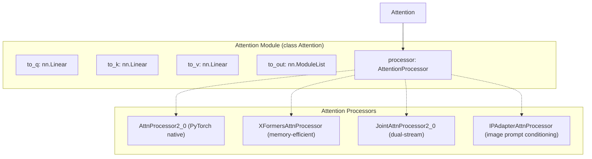

<!-- source: DeepWiki mcp.deepwiki.com · repo huggingface/diffusers · page 4 Model Architecture · fetched 2026-10-21 -->

# Model Architecture

Relevant source files

The following files were used as context for generating this wiki page:

- [src/diffusers/models/attention.py](src/diffusers/models/attention.py)
- [src/diffusers/models/attention_processor.py](src/diffusers/models/attention_processor.py)
- [src/diffusers/models/embeddings.py](src/diffusers/models/embeddings.py)
- [src/diffusers/models/normalization.py](src/diffusers/models/normalization.py)
- [src/diffusers/models/resnet.py](src/diffusers/models/resnet.py)

## Purpose and Scope

This page provides a high-level overview of the neural network architectures powering the diffusion models supported by the `diffusers` library. It introduces the principal architecture families, key building blocks, and how they interrelate. For technical details on specific architectural components, links to dedicated child pages are provided.

This document targets advanced users and developers who want to understand the model design at the subsystem level without diving into implementation minutiae.

---

## Core Model Types

The `diffusers` library primarily features two core model architecture paradigms for diffusion models:

- **UNet-Based Models:** Encoder-decoder style convolutional models with skip connections processing image/video features across multiple resolutions.
- **Transformer-Based Models:** Attention-centric models leveraging self-attention, cross-attention, and feed-forward layers with rich conditioning.

### Overview Diagram: Model Families and Key Building Blocks

```mermaid
graph TB
    subgraph "UNet-Based Models"
        UNet2D["UNet2DConditionModel<br/>src/diffusers/models/unets/unet_2d_condition.py"]
        UNet3D["UNet3DConditionModel<br/>src/diffusers/models/unets/unet_3d_condition.py"]
        I2VGen["I2VGenXLUNet<br/>src/diffusers/models/unets/unet_i2vgen_xl.py"]
    end
    
    subgraph "Transformer-Based Models"
        Transformer2D["Transformer2DModel<br/>src/diffusers/models/transformers/transformer_2d.py"]
        FluxTransformer["FluxTransformer2DModel<br/>src/diffusers/models/transformers/transformer_flux.py"]
        CogVideoX["CogVideoXTransformer3DModel<br/>src/diffusers/models/transformers/cogvideox_transformer_3d.py"]
        PriorTransformer["PriorTransformer<br/>src/diffusers/models/transformers/prior_transformer.py"]
    end
    
    subgraph "Shared Building Blocks"
        Attention["Attention<br/>src/diffusers/models/attention_processor.py"]
        ResNet["ResnetBlock2D<br/>src/diffusers/models/resnet.py"]
        Embeddings["Embeddings<br/>src/diffusers/models/embeddings.py"]
        Norm["Normalization Layers<br/>src/diffusers/models/normalization.py"]
    end
    
    UNet2D --> Attention
    UNet2D --> ResNet
    
    Transformer2D --> Attention
    Transformer2D --> Embeddings
    FluxTransformer --> Attention
    
    Attention --> Norm
    ResNet --> Norm
```

**UNet-Based Models** use hierarchical convolutional blocks (ResNet variants) and attention modules in an encoder-decoder layout with skip connections. These are favored in image and video diffusion, including Stable Diffusion 1.x, 2.x, SDXL, and various video UNets. They incorporate timestep and class conditioning via normalization layers.  
[Source: src/diffusers/models/__init__.py:26-110](), [src/diffusers/models/resnet.py:43-147]()

**Transformer-Based Models** employ stacks of transformer blocks composed of self-attention, cross-attention, and feed-forward sublayers, often with rotary embeddings and adaptive normalizations for timestep conditioning. They power text-conditioned image models such as SD3 and Flux, as well as video transformers like CogVideoX.  
[Source: src/diffusers/models/__init__.py:84-110](), [src/diffusers/models/attention.py:39-120]()

---

## Attention System

Attention mechanisms are fundamental to both UNet and Transformer architectures in `diffusers`. The library uses a flexible **attention processor** pattern allowing dynamic backend swapping for efficient computation, including native PyTorch, xFormers, and Flash Attention.

### Attention Architecture and Processor Pattern

The class `Attention` implements multi-headed attention supporting self-attention and cross-attention. Parameters control the number of heads, key/value head configurations (Multi-Head, Multi-Query, Grouped Query Attention), bias usage, and normalization. The computation can be dynamically dispatched to various processor backends for performance gains.  
[Source: src/diffusers/models/attention_processor.py:52-139](), [src/diffusers/models/attention.py:39-97]()

For a deep dive into the processor pattern, individual implementations, and integration, see the child page [Attention System](#4.1).

---

## Transformer Blocks

Transformer blocks combine attention with feed-forward networks and normalization layers, forming the building blocks of the Transformer-based diffusion models.

- **BasicTransformerBlock:** Implements the standard block with self-attention, cross-attention, and feed-forward layers arranged sequentially.  
- **JointTransformerBlock:** Supports joint streams for latents and conditions (e.g., in SD3/Flux), handling interactions via dual-stream attention.

These blocks incorporate conditioning via adaptive normalization and support fused query-key-value projections for efficiency.  
[Source: src/diffusers/models/attention.py:39-168]()

See the child page [Transformer Blocks](#4.2) for thorough explanation and code references.

---

## ResNet and Convolutional Blocks

ResNet blocks are core components for UNet architectures providing convolutional feature extraction with residual connections and conditioning mechanisms.

- **ResnetBlock2D:** Standard 2D residual block with optional upsampling/downsampling. Supports conditioning with timestep embeddings via normalization layers.  
- **ResnetBlockCondNorm2D:** Uses normalization layers that directly incorporate conditioning signals (e.g., timestep embeddings) for improved control and expressiveness.  
- **Temporal and Spatio-Temporal Variants:** Specialized blocks handle temporal dimensions for video diffusion models via 3D convolutions or temporal convolutions.

They rely on adaptive group normalization or spatial normalization and can include dropout and nonlinear activations like SiLU or Swish.  
[Source: src/diffusers/models/resnet.py:43-147]()

Explore architectural variants and detailed implementations in [ResNet and Convolutional Blocks](#4.3).

---

## Embeddings

Embeddings inject positional and temporal information into diffusion models to preserve spatial and temporal structure.

- **Timestep Embeddings:** Sinusoidal embeddings encode the diffusion time step information. Generated by the `get_timestep_embedding` function that produces sinusoidal frequency encodings.  
- **Positional Embeddings:** Support 1D, 2D, and 3D sinusoidal embeddings for spatial grids and temporal sequences to situate tokens or image patches in space-time.  
- **Rotary Embeddings (RoPE):** Applied in transformer attention to provide relative positional information via rotations in embedding space.

Combined embeddings enable models to attend properly across spatial and temporal dimensions and handle conditioning signals effectively.  
[Source: src/diffusers/models/embeddings.py:27-152](), [src/diffusers/models/attention.py:25-26]()

For comprehensive coverage, see [Embeddings](#4.4).

---

## Normalization Layers

Normalization stabilizes training and conditions model activations on external embeddings such as timesteps or class labels.

- **AdaLayerNorm:** Extends LayerNorm by incorporating timestep embeddings to produce scale and shift parameters for adaptive normalization.  
- **AdaLayerNormZero:** Adds gating mechanisms that predict multiplicative gates in addition to affine parameters, enabling fine-grained control over residual contributions.  
- **SD35AdaLayerNormZeroX:** A variant designed specifically for Stable Diffusion 3.5 models for enhanced conditioning.

These normalization modules are integral to conditioning signal injection in both transformer and UNet architectures.  
[Source: src/diffusers/models/normalization.py:27-171]()

More details are available in [Normalization Layers](#4.5).

---

## Autoencoders and VAE

Diffusion models operate in latent spaces produced by autoencoders that compress high-dimensional inputs like images or videos.

- **AutoencoderKL:** The primary variational autoencoder (VAE) class used for encoding images into latent diffusion representations and decoding them back to pixels.  
- **AutoencoderTiny:** A distilled, lightweight VAE for fast preview or low-resource settings.  
- **Video VAE Variants:** Specialized VAEs like `AutoencoderKLCogVideoX`, `AutoencoderKLHunyuanVideo`, and `AutoencoderKLWan` handle 3D latent spaces for video generation.

The encode-decode interface and latent scaling mechanisms allow seamless integration of autoencoders with diffusion processes.  
[Source: src/diffusers/models/__init__.py:31-59]()

Refer to the child page [Autoencoders and VAE](#4.6) for detailed architecture and usage.

---

## Attention Backend Dispatch and Parallelism

The library supports multiple attention backends for performance optimization, dynamically dispatching attention computations according to the hardware and execution environment using the `attention_dispatch` module.

It also provides integration hooks for context parallelism and distributed inference, facilitating scalable deployment on modern hardware.

For a detailed overview, see [Attention Backend Dispatch and Parallelism](#4.7).

---

# Summary

The model architecture subsystem in `diffusers` comprises sophisticated building blocks carefully designed for flexible and scalable diffusion model development:

- UNet and Transformer architectures form the backbone.
- Attention is modularly implemented with pluggable processors supporting multiple efficient backends.
- ResNet and convolutional blocks provide spatial and temporal processing.
- Embeddings encode position and timestep information for conditioning.
- Adaptive layer normalization variants enable conditioning signal fusion.
- Autoencoders translate between pixel and latent spaces for efficient diffusion.
- Attention dispatch modules enable performant execution on diverse hardware.

This modular design enables the construction, training, and deployment of diverse diffusion models across image and video domains.

---

# References to Child Pages

- [Attention System](#4.1)
- [Transformer Blocks](#4.2)
- [ResNet and Convolutional Blocks](#4.3)
- [Embeddings](#4.4)
- [Normalization Layers](#4.5)
- [Autoencoders and VAE](#4.6)
- [Attention Backend Dispatch and Parallelism](#4.7)

---

# Code Sources

- src/diffusers/models/__init__.py:26-110  
- src/diffusers/models/attention_processor.py:52-139  
- src/diffusers/models/attention.py:39-168  
- src/diffusers/models/resnet.py:43-147  
- src/diffusers/models/embeddings.py:27-152  
- src/diffusers/models/normalization.py:27-171  
- src/diffusers/models/__init__.py:31-59

---

