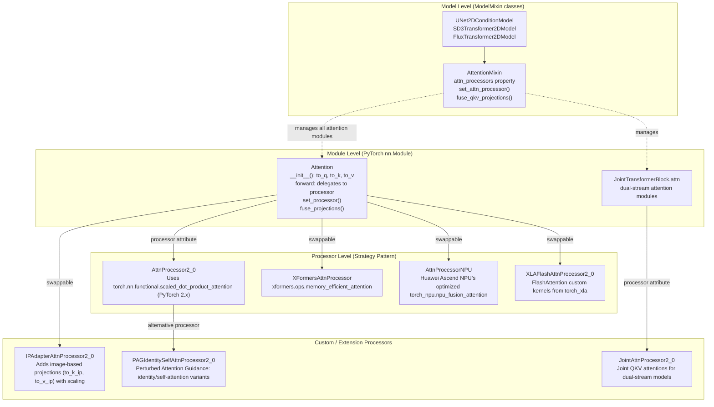
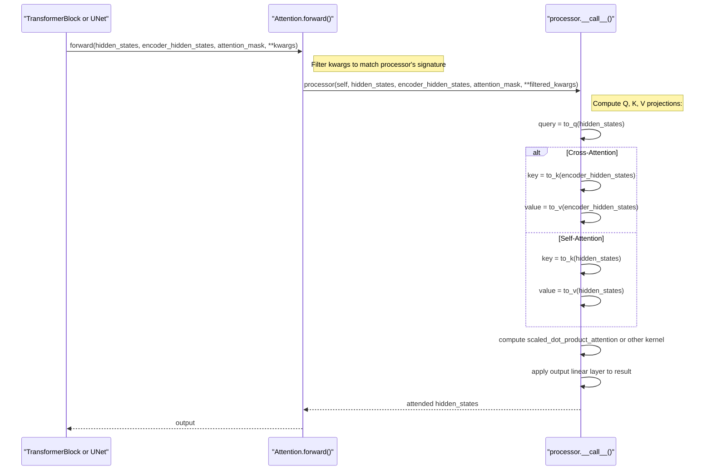

<!-- source: DeepWiki mcp.deepwiki.com · repo huggingface/diffusers · page 4.1 Attention System · fetched 2026-10-21 -->

# Attention System

<details>
<summary>Relevant source files</summary>

The following files were used as context for generating this wiki page:

- [docs/source/en/api/pipelines/lumina2.md](docs/source/en/api/pipelines/lumina2.md)
- [examples/dreambooth/README_lumina2.md](examples/dreambooth/README_lumina2.md)
- [examples/dreambooth/test_dreambooth_lora_lumina2.py](examples/dreambooth/test_dreambooth_lora_lumina2.py)
- [scripts/convert_lumina_to_diffusers.py](scripts/convert_lumina_to_diffusers.py)
- [src/diffusers/models/attention.py](src/diffusers/models/attention.py)
- [src/diffusers/models/attention_processor.py](src/diffusers/models/attention_processor.py)
- [src/diffusers/models/embeddings.py](src/diffusers/models/embeddings.py)
- [src/diffusers/models/normalization.py](src/diffusers/models/normalization.py)
- [src/diffusers/models/resnet.py](src/diffusers/models/resnet.py)
- [src/diffusers/models/transformers/transformer_lumina2.py](src/diffusers/models/transformers/transformer_lumina2.py)
- [src/diffusers/pipelines/lumina/__init__.py](src/diffusers/pipelines/lumina/__init__.py)
- [src/diffusers/pipelines/lumina2/__init__.py](src/diffusers/pipelines/lumina2/__init__.py)
- [src/diffusers/pipelines/lumina2/pipeline_lumina2.py](src/diffusers/pipelines/lumina2/pipeline_lumina2.py)
- [tests/models/test_attention_processor.py](tests/models/test_attention_processor.py)
- [tests/models/transformers/test_models_transformer_ltx.py](tests/models/transformers/test_models_transformer_ltx.py)
- [tests/models/transformers/test_models_transformer_lumina.py](tests/models/transformers/test_models_transformer_lumina.py)
- [tests/models/transformers/test_models_transformer_lumina2.py](tests/models/transformers/test_models_transformer_lumina2.py)
- [tests/models/transformers/test_models_transformer_mochi.py](tests/models/transformers/test_models_transformer_mochi.py)
- [tests/models/transformers/test_models_transformer_omnigen.py](tests/models/transformers/test_models_transformer_omnigen.py)
- [tests/models/transformers/test_models_transformer_sana.py](tests/models/transformers/test_models_transformer_sana.py)
- [tests/pipelines/lumina2/test_pipeline_lumina2.py](tests/pipelines/lumina2/test_pipeline_lumina2.py)

</details>


## Purpose and Scope

The Attention System is the core mechanism for computing attention in diffusion models within the Diffusers library. It enables a flexible and modular architecture that allows switching between multiple attention implementations optimized for different hardware backends or research extensions. This modular design supports native PyTorch attention, memory efficient kernels like xFormers and Flash Attention, and specialized attention processors for features like LoRA, IP-Adapter, and Perturbed Attention Guidance (PAG).

This page details:

- The `Attention` module and its internal design.
- The pluggable `AttentionProcessor` pattern with various implementations (native PyTorch, xformers, flash attention).
- The integration helpers (`AttentionMixin`, `AttentionModuleMixin`).
- The attention forward data flow.
- The dispatcher system for backend selection.
- Common attention processor implementations.

For usage of attention within transformers, see the Transformer Blocks page [4.2]. For LoRA attention processors and integration, see the LoRA system page [6.1].

---

## Core Architecture

### Overview

The Attention System is designed around three core components:

1. **`Attention`**: The primary PyTorch `nn.Module` implementing cross/self-attention layers and defining query, key, value projections along with output projection. It delegates attention computation to a pluggable processor.  
2. **`AttentionProcessor`**: An abstract callable interface representing a concrete attention implementation (e.g., native PyTorch, xFormers, Flash Attention). Allows flexible switching of attention algorithm/backend without changing attention module code.  
3. **`AttentionMixin` / `AttentionModuleMixin`**: Classes providing model-wide or module-level management of attention processors, including utilities to set processors, fuse QKV projections, and configure backend execution.

The modular pattern enables runtime swapping and customization of attention computation (e.g., enabling xformers kernels only for certain layers), and supports custom processors for advanced conditioning and prompt injection.

---

### Attention System Components Mapping



**Sources:**  
[src/diffusers/models/attention_processor.py:52-139](),  
[src/diffusers/models/attention.py:39-120](),  
[src/diffusers/models/attention_processor.py:920-1090]()

---

## Attention Module

The `Attention` class encapsulates a cross/self-attention mechanism suitable for multi-head attention. It supports:

- Cross-attention using separate `encoder_hidden_states`.
- Multi-head attention (MHA), multi-query attention (MQA), and grouped query attention (GQA).
- Integration with multiple backend processors.
- Optional additional KV projections for extended conditioning (used in some specialized architectures).

### Constructor Parameters (Select Highlights)

| Parameter                  | Description                                                   |
|----------------------------|---------------------------------------------------------------|
| `query_dim`                | Number of channels in the query tensor                        |
| `cross_attention_dim`      | Dimensionality of encoder hidden states for cross-attention (if None, use `query_dim`) |
| `heads`                   | Number of attention heads (default 8)                         |
| `kv_heads`                | Number of key/value heads. If `None`, set to `heads`. Controls type: MHA (kv_heads=heads), MQA (kv_heads=1), or GQA (kv_heads between) |
| `dim_head`                | Dimensionality per head (default 64)                          |
| `bias`                    | Use bias in linear projections (default False)                |
| `processor`               | `AttentionProcessor` instance to delegate computation (default chosen based on torch version) |
| `norm_q`, `norm_k`        | Optional normalization layers applied on query and key after projection (LayerNorm / RMSNorm / FP32LayerNorm) |
| `add_k_proj`, `add_v_proj`| Additional key/value projections used in joint or extended attention patterns |
| `scale_qk`                | Scale query-key dot products by sqrt of dim_head (default True) |

### Internal Dimensions

- `inner_dim = dim_head * heads` (output dim of query projection, total channels)
- `inner_kv_dim = dim_head * kv_heads` (dim for key/value projections, possibly fewer heads for KV)

### Projections

- `to_q`: Projects query inputs to `(batch_size, seq_len, inner_dim)`
- `to_k`, `to_v`: Project encoding hidden states (or hidden states in self-attention) to `(batch_size, seq_len, inner_kv_dim)`
- `to_out`: Output linear projection layers

Extended conditioning modules may define:

- `add_k_proj`, `add_v_proj`: Additional projections for supplementary key-value conditioning

### Attention Norms

Optional norm layers (`norm_q`, `norm_k`) may be attached to query/key projections depending on the configuration.

### Processor Attribute

Each `Attention` instance holds a `processor` callable attribute, which implements the actual attention computation at the forward pass. By default, this is set to `AttnProcessor2_0` if PyTorch 2.x is available, otherwise legacy `AttnProcessor`.

---

**Sources:**  
[src/diffusers/models/attention_processor.py:52-307]()

---

## Attention Forward Pass Flow

The `forward()` method of the `Attention` module serves as a wrapper that prepares inputs and delegates the computation to the configured `processor`.

Below is the high-level flow of a forward pass inside the `Attention` module:



This delegation enables independently optimized attention implementations by swapping the `processor` attribute with various processor classes.

---

**Sources:** [src/diffusers/models/attention_processor.py:567-611](), [src/diffusers/models/attention_processor.py:920-1090]()

---

## Attention Dispatch and Backend Selection

Diffusers supports dispatching attention computation to multiple highly optimized backend implementations through an experimental attention dispatcher system.

### Supported Backends

| Backend Name | Implementation Description                               |
|--------------|----------------------------------------------------------|
| `native`     | PyTorch native `torch.nn.functional.scaled_dot_product_attention` kernel |
| `flash`      | FlashAttention tiled kernels optimized for minimal memory I/O  |
| `flex`       | PyTorch FlexAttention memory-efficient implementation    |
| `sage`       | SageAttention optimized for low-bit quantized inference (int8/fp8) |
| `xformers`   | xFormers memory-efficient attention kernels              |

### Setting Backend

The backend can be set globally for a model or per module:

```python
model.set_attention_backend("flash")
```

The `AttentionModuleMixin.set_attention_backend()` manages validation and setting of the backend string and propagates the change to the processor chosen by the dispatcher.

The dispatcher reads the target backend and hardware availability to instantiate the corresponding `AttentionProcessor` for each attention module.

---

**Sources:**  
[src/diffusers/models/attention_dispatch.py:25-30](),  
[src/diffusers/models/attention.py:161-170]()

---

## AttentionMixin and AttentionModuleMixin

### AttentionMixin (Model Level)

- Provides the `attn_processors` property returning a dict of all instantiated attention processors in the model, keyed by module weight name.
- Implements `set_attn_processor()` method to set the attention processor(s) for all attention modules in the model.
- Facilitates fusion and unfusion of QKV projections through `fuse_qkv_projections()` and `unfuse_qkv_projections()`.

This mixin is used in major models (UNet, transformers) that contain multiple attention layers, enabling uniform processor management.

### AttentionModuleMixin (Module Level)

- Each attention module (like `Attention`) inherits or composes this mixin for instance-level control.
- Implements `set_processor()` and `get_processor()` methods.
- Allows setting the attention backend by name with `set_attention_backend()`.

---

**Sources:**  
[src/diffusers/models/attention.py:39-170]()

---

## Attention Processor System

### Standard Built-in Processors

- **`AttnProcessor2_0`**: Uses PyTorch 2.0+ native `scaled_dot_product_attention` kernel for efficient attention [src/diffusers/models/attention_processor.py:920-1090]()  
- **`AttnProcessorNPU`**: Specialized processor that runs attention on Huawei Ascend NPUs using `torch_npu.npu_fusion_attention` kernel [src/diffusers/models/attention_processor.py:1092-1178]()  
- **`XLAFlashAttnProcessor2_0`**: Uses TPU-optimized custom FlashAttention kernels available in `torch_xla` experimental [src/diffusers/models/attention_processor.py:1648-1744]()

### Custom / Extension Processors

- **`IPAdapterAttnProcessor2_0`**: Extends standard attention by injecting additional key/value projections (`to_k_ip`, `to_v_ip`) and scaling in attention computations for image-based conditioning [src/diffusers/models/attention_processor.py:3392-3550]()  
- **`JointAttnProcessor2_0`**: Implements joint attention on combined streams used in models like SD3 and Flux for dual-modality token attention [src/diffusers/models/attention_processor.py:4550-4750]()  
- **`PAGIdentitySelfAttnProcessor2_0`**: Implements perturbed attention guidance by replacing self-attention with identity maps or perturbed scores [src/diffusers/models/attention_processor.py:5302-5400]()

The processor system allows defining customized attention behaviors under the common `AttentionProcessor` interface, useful for research or model extensions.

---

**Sources:** [src/diffusers/models/attention_processor.py:920-5600]()

---

## Optimization and Parallelism Notes

### QKV Fusion

The system supports fusing query, key, value projections to reduce kernel calls and improve throughput:

- For self-attention, query, key, value projections are fused.
- For cross-attention, key and value projections are fused.

Fusion is controlled via the methods:

- `AttentionMixin.fuse_qkv_projections()` (model-wide)
- `AttentionModuleMixin.fuse_projections()` (module-level)

### Context Parallelism

For optimizing very long sequences, advanced context parallelism is supported via hook systems (`ContextParallelSplitHook` and `ContextParallelGatherHook`). This supports methods like ring attention and ulysses attention by partitioning input and gathering outputs from distributed devices.

Detailed parallelism mechanisms allow scaling attention computations across multi-device or distributed setups.

---

## Summary

The Diffusers Attention System provides a modular, extensible, and high-performance attention mechanism designed for state-of-the-art diffusion model architectures. By decoupling the attention interface (`Attention` module) from the implementation (`AttentionProcessor`), it supports various hardware-optimized kernels, research extensions, and flexible backend management. This design is essential for offering best-in-class performance with the ability to rapidly experiment with novel attention methods.

---

# Appendix: Example Attention Processor Interface (Conceptual)

```python
class AttentionProcessor:
    def __call__(
        self,
        attn_module: Attention,
        hidden_states: torch.Tensor,
        encoder_hidden_states: torch.Tensor | None,
        attention_mask: torch.Tensor | None = None,
        **kwargs
    ) -> torch.Tensor:
        # Implement kernel-specific attention computation here
        ...
```

`Attention.forward()` calls `self.processor(self, hidden_states, encoder_hidden_states, attention_mask, **kwargs)`

---

# References to Source Files

- `src/diffusers/models/attention_processor.py:52-139,920-1090,1092-1178,1648-1744,3392-3550,4550-4750,5302-5400`  
- `src/diffusers/models/attention.py:39-170`  
- `src/diffusers/models/attention_dispatch.py:25-30,68-192`

---

