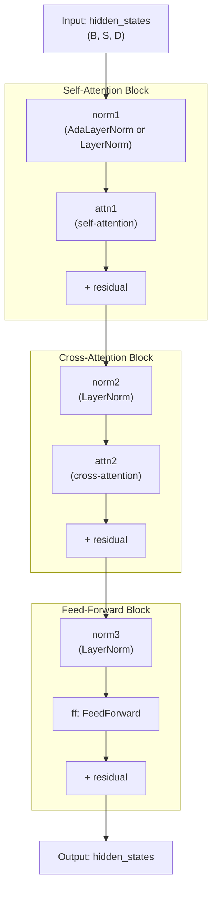
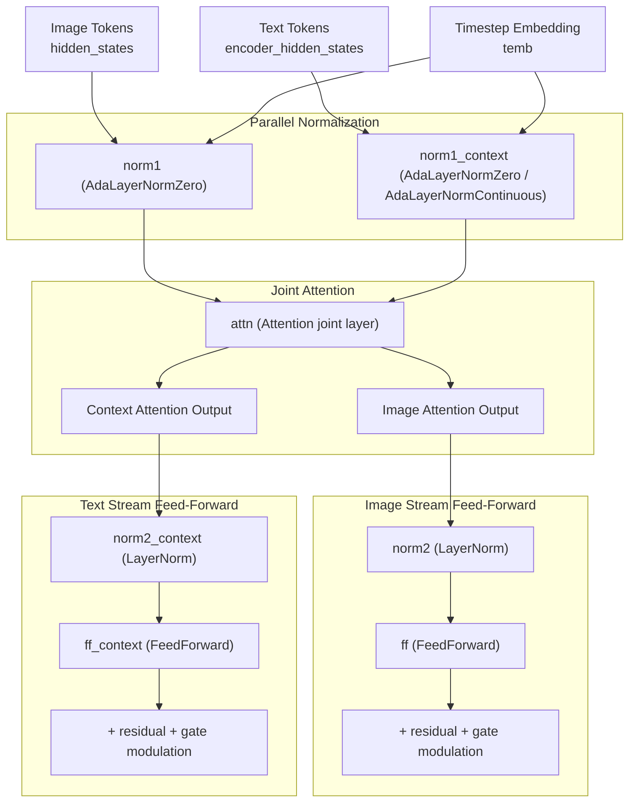
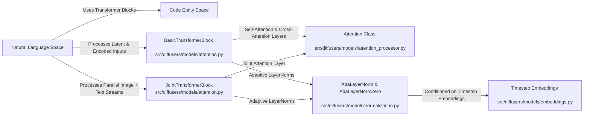
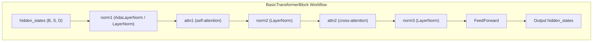

<!-- source: DeepWiki mcp.deepwiki.com · repo huggingface/diffusers · page 4.2 Transformer Blocks · fetched 2026-10-21 -->

# Transformer Blocks

Relevant source files

The following files were used as context for generating this wiki page:

- [docs/source/en/api/pipelines/aura_flow.md](docs/source/en/api/pipelines/aura_flow.md)
- [docs/source/en/api/pipelines/stable_audio.md](docs/source/en/api/pipelines/stable_audio.md)
- [src/diffusers/models/attention.py](src/diffusers/models/attention.py)
- [src/diffusers/models/attention_processor.py](src/diffusers/models/attention_processor.py)
- [src/diffusers/models/embeddings.py](src/diffusers/models/embeddings.py)
- [src/diffusers/models/normalization.py](src/diffusers/models/normalization.py)
- [src/diffusers/models/resnet.py](src/diffusers/models/resnet.py)
- [src/diffusers/models/transformers/auraflow_transformer_2d.py](src/diffusers/models/transformers/auraflow_transformer_2d.py)
- [src/diffusers/models/transformers/pixart_transformer_2d.py](src/diffusers/models/transformers/pixart_transformer_2d.py)
- [tests/models/transformers/test_models_dit_transformer2d.py](tests/models/transformers/test_models_dit_transformer2d.py)
- [tests/models/transformers/test_models_pixart_transformer2d.py](tests/models/transformers/test_models_pixart_transformer2d.py)
- [tests/models/transformers/test_models_prior.py](tests/models/transformers/test_models_prior.py)
- [tests/models/transformers/test_models_transformer_allegro.py](tests/models/transformers/test_models_transformer_allegro.py)
- [tests/models/transformers/test_models_transformer_aura_flow.py](tests/models/transformers/test_models_transformer_aura_flow.py)
- [tests/models/transformers/test_models_transformer_cogvideox.py](tests/models/transformers/test_models_transformer_cogvideox.py)
- [tests/models/transformers/test_models_transformer_cogview3plus.py](tests/models/transformers/test_models_transformer_cogview3plus.py)
- [tests/models/transformers/test_models_transformer_cogview4.py](tests/models/transformers/test_models_transformer_cogview4.py)
- [tests/models/transformers/test_models_transformer_consisid.py](tests/models/transformers/test_models_transformer_consisid.py)
- [tests/models/transformers/test_models_transformer_latte.py](tests/models/transformers/test_models_transformer_latte.py)
- [tests/models/transformers/test_models_transformer_sd3.py](tests/models/transformers/test_models_transformer_sd3.py)

Transformer blocks are the fundamental building blocks used in modern transformer-based diffusion models. They integrate multi-head attention mechanisms (self-attention and cross-attention) with feed-forward networks and adaptive normalization layers to process latent and conditioning embeddings during the denoising process. This page details the main transformer block architectures implemented in Diffusers, with a focus on `BasicTransformerBlock` and `JointTransformerBlock`.

---

## Block Types and Architecture

The Diffusers library provides several transformer block variants tailored for different model families and architectures:

```mermaid
graph TB
    subgraph "Transformer Block Hierarchy"
        TransformerBlock["Transformer Block<br/>(Abstract Concept)"]
        BasicBlock["BasicTransformerBlock<br/>src/diffusers/models/attention.py (752-941)"]
        JointBlock["JointTransformerBlock<br/>src/diffusers/models/attention.py (580-748)"]
    end
    
    subgraph "BasicTransformerBlock Structure"
        BasicNorm1["norm1: AdaLayerNorm / LayerNorm"]
        BasicAttn1["attn1: Attention<br/>(self-attention)"]
        BasicNorm2["norm2: LayerNorm"]
        BasicAttn2["attn2: Attention<br/>(cross-attention)"]
        BasicNorm3["norm3: LayerNorm"]
        BasicFF["ff: FeedForward"]
    end
    
    subgraph "JointTransformerBlock Structure"
        JointNorm1["norm1: AdaLayerNormZero"]
        JointNorm1Context["norm1_context: AdaLayerNormZero / AdaLayerNormContinuous"]
        JointAttn["attn: Attention (joint attention)"]
        JointNorm2["norm2: LayerNorm"]
        JointFF["ff: FeedForward"]
        JointNorm2Context["norm2_context: LayerNorm"]
        JointFFContext["ff_context: FeedForward"]
    end
    
    TransformerBlock --> BasicBlock
    TransformerBlock --> JointBlock
    
    BasicBlock --> BasicNorm1
    BasicBlock --> BasicAttn1
    BasicBlock --> BasicNorm2
    BasicBlock --> BasicAttn2
    BasicBlock --> BasicNorm3
    BasicBlock --> BasicFF
    
    JointBlock --> JointNorm1
    JointBlock --> JointNorm1Context
    JointBlock --> JointAttn
    JointBlock --> JointNorm2
    JointBlock --> JointFF
    JointBlock --> JointNorm2Context
    JointBlock --> JointFFContext
```

| Block Type              | Purpose                                      | Typical Usage                           | Key Features                                  |
|------------------------|----------------------------------------------|---------------------------------------|-----------------------------------------------|
| BasicTransformerBlock   | Standard transformer block with sequential self- and cross-attention | UNet-based models (e.g. SD 1.x, SD 2.x, SDXL) | Separate self-attention, cross-attention, and feed-forward layers; flexible normalization options |
| JointTransformerBlock   | Multi-stream transformer block with joint attention over image and text tokens | MMDiT models (e.g. Stable Diffusion 3 family) | Parallel processing of image and text streams; joint attention layer; dual feed-forward networks and normalization |

Sources: [src/diffusers/models/attention.py:580-941](), [src/diffusers/models/attention_processor.py:52-139]()

---

## BasicTransformerBlock

### Architecture and Forward Pass

The `BasicTransformerBlock` represents a traditional transformer architecture. It processes the input hidden states through a sequence of:

1. **Self-Attention Layer**: Attends over the hidden states themselves.
2. **Cross-Attention Layer**: Attends over external conditioning embeddings (e.g., encoded text).
3. **Feed-Forward Network**: Applies position-wise transformations.

Each layer follows a pre-normalization scheme (normalization before attention or feed-forward) with residual connections.

At each residual addition, the block sums the layer output with its input, preserving gradients and supporting deep architectures.

### Initialization and Normalization Types

- The block supports different normalization types controlled by the `norm_type` parameter:
  - `"layer_norm"`: standard `LayerNorm`.
  - `"ada_norm"`: adaptive layer norm that incorporates timestep embeddings for conditioning.
  - `"ada_norm_zero"`: zero-initialized adaptive norm used in some models for stable conditioning [src/diffusers/models/normalization.py:130-172]().
  - `"ada_norm_continuous"`: continuous adaptive norm that can modulate conditioning signals during denoising.

- The conditioning embedding (usually timestep embeddings) is fed into the adaptive normalization layers to compute scaling and shifting parameters.

- Attention layers use the `Attention` class, supporting multi-head self- and cross-attention, with optional upcasting and normalization variants [src/diffusers/models/attention_processor.py:52-139]().

Sources: [src/diffusers/models/attention.py:752-941](), [src/diffusers/models/normalization.py:27-172](), [src/diffusers/models/attention_processor.py:52-139]()

---

## JointTransformerBlock

### Motivation and Architecture

The `JointTransformerBlock` is designed for the MMDiT (Multi-Modal Diffusion Transformer) architecture. It simultaneously processes image and text tokens in two parallel streams while leveraging a joint attention layer where both streams attend to each other.

This block contains components for:

- Separate adaptive normalization layers for image and context (text) tokens.
- A **joint attention** layer that processes the normalized image and text tokens together.
- Separate feed-forward networks and layer norms for image and text streams.
- Optional gating mechanisms that modulate residual connections.

### Data Flow Diagram

### Context Pre-Only Mode

- When the `context_pre_only=True` flag is set (e.g., in the last layers of Stable Diffusion 3), the block performs normalization and attention on the context stream but **skips its feed-forward network**.
- This is useful for optimizing inference and training by modifying the interaction dynamics between image and text streams.

Sources: [src/diffusers/models/attention.py:580-748](), [src/diffusers/models/attention.py:696-747]()

---

## Key Classes and Functions

### `BasicTransformerBlock` (`src/diffusers/models/attention.py`, lines ~752-941)

- Implements the sequential self-attention, cross-attention, and feed-forward layers with residual connections.
- Supports different normalization strategies via a configurable `norm_type`.
- Uses `Attention` layers to implement multi-head self- and cross-attention.
- Supports gradient checkpointing for memory efficiency [src/diffusers/models/attention.py:953]().

### `JointTransformerBlock` (`src/diffusers/models/attention.py`, lines ~580-748)

- Implements the dual-stream processing with joint attention for image and text token interaction.
- Uses `AdaLayerNormZero` for adaptive normalization conditioned on timestep embeddings.
- Includes gating mechanisms for modulating residual paths.
- Supports a context pre-only mode for skipping certain computations in the context stream.

### `Attention` class (`src/diffusers/models/attention_processor.py`, lines 52-151)

- Core attention mechanism supporting multi-head attention and cross attention.
- Supports different attention processors for optimized implementations.
- Handles query, key, and value projections with optional biases, dropout, and scaling.
- Allows configuring various normalization and bias options.

---

## Component Integration and Data Flow

To clarify how the natural language inputs and code entities relate in the context of transformer blocks:

---

These diagrams illustrate the crucial connections mapping user-facing concepts and inputs to the corresponding classes and layers in the codebase.

---

## Summary

Transformer blocks in Diffusers handle complex attention and conditioning mechanisms critical for high-quality diffusion model performance:

- The `BasicTransformerBlock` encapsulates standard sequential transformer layers with configurable normalization.
- The `JointTransformerBlock` enables parallel multi-stream processing and joint attention, crucial for models like Stable Diffusion 3.
- Both leverage adaptive normalization layers (`AdaLayerNorm`, `AdaLayerNormZero`) to incorporate timestep and conditioning signals effectively.
- Attention computation is delegated to the `Attention` class and its processors, ensuring flexibility and optimization.
- Gradient checkpointing and feed-forward chunking optimizations support scalability for large models.

Understanding these blocks is essential for developing, modifying, or debugging transformer-centric diffusion models within the Diffusers library.

---

# References

- BasicTransformerBlock and JointTransformerBlock implementations: `src/diffusers/models/attention.py` [580-941]()
- Attention mechanism: `src/diffusers/models/attention_processor.py` [52-151]()
- Adaptive normalization layers: `src/diffusers/models/normalization.py` [27-172]()
- Timestep embeddings conditioning: `src/diffusers/models/embeddings.py` [27-78]()

Sources:  
[src/diffusers/models/attention.py:580-941](),  
[src/diffusers/models/attention_processor.py:52-151](),  
[src/diffusers/models/normalization.py:27-172](),  
[src/diffusers/models/embeddings.py:27-78]()

---

