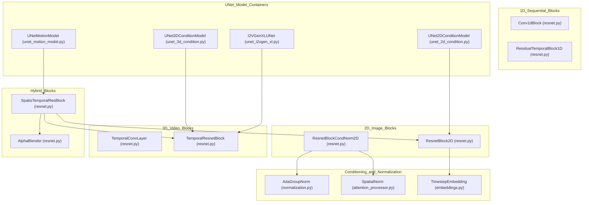
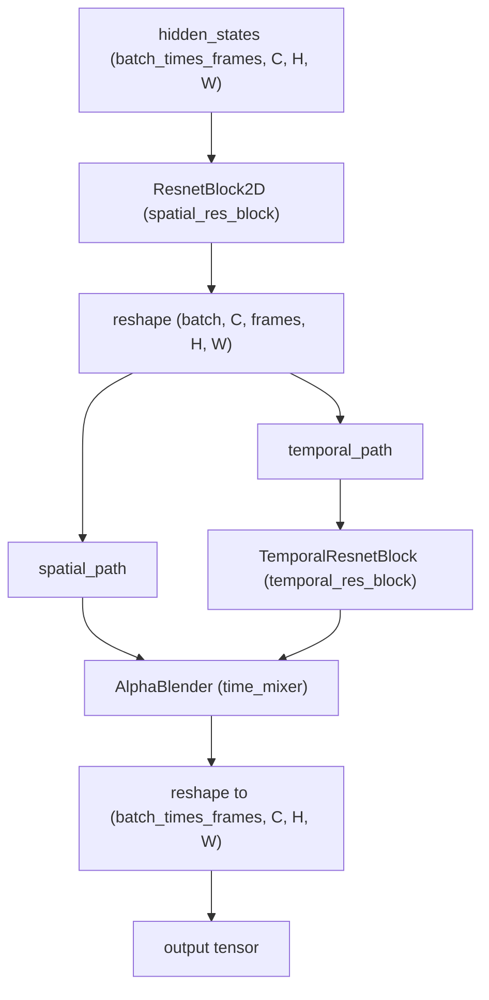
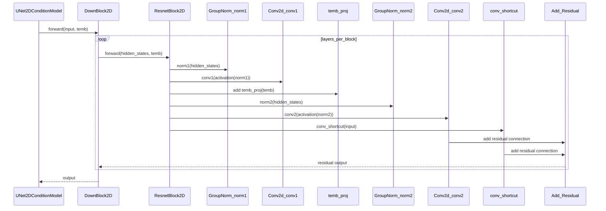

<!-- source: DeepWiki mcp.deepwiki.com · repo huggingface/diffusers · page 4.3 ResNet and Convolutional Blocks · fetched 2026-10-21 -->

# ResNet and Convolutional Blocks

<details>
<summary>Relevant source files</summary>

The following files were used as context for generating this wiki page:

- [docs/source/en/api/pipelines/animatediff.md](docs/source/en/api/pipelines/animatediff.md)
- [src/diffusers/models/attention.py](src/diffusers/models/attention.py)
- [src/diffusers/models/attention_processor.py](src/diffusers/models/attention_processor.py)
- [src/diffusers/models/embeddings.py](src/diffusers/models/embeddings.py)
- [src/diffusers/models/normalization.py](src/diffusers/models/normalization.py)
- [src/diffusers/models/resnet.py](src/diffusers/models/resnet.py)
- [src/diffusers/models/transformers/transformer_2d.py](src/diffusers/models/transformers/transformer_2d.py)
- [src/diffusers/models/unets/unet_2d_blocks.py](src/diffusers/models/unets/unet_2d_blocks.py)
- [src/diffusers/models/unets/unet_2d_condition.py](src/diffusers/models/unets/unet_2d_condition.py)
- [src/diffusers/models/unets/unet_3d_blocks.py](src/diffusers/models/unets/unet_3d_blocks.py)
- [src/diffusers/models/unets/unet_3d_condition.py](src/diffusers/models/unets/unet_3d_condition.py)
- [src/diffusers/models/unets/unet_i2vgen_xl.py](src/diffusers/models/unets/unet_i2vgen_xl.py)
- [src/diffusers/models/unets/unet_motion_model.py](src/diffusers/models/unets/unet_motion_model.py)
- [src/diffusers/pipelines/animatediff/__init__.py](src/diffusers/pipelines/animatediff/__init__.py)
- [src/diffusers/pipelines/deprecated/versatile_diffusion/modeling_text_unet.py](src/diffusers/pipelines/deprecated/versatile_diffusion/modeling_text_unet.py)

</details>


This document covers the residual network (ResNet) and convolutional block implementations used throughout the Diffusers model architecture layer. These blocks serve as the fundamental building blocks for UNet-based and some Transformer-based diffusion models, handling spatial feature extraction, temporal modeling, and time-conditioned transformations.

**Scope**: This page focuses on the concrete implementations of ResNet blocks, convolutional layers, and their variants for 2D images, 1D sequences, and 3D video data. For information about the attention mechanisms that complement these blocks, see [Attention System](4.1). For embeddings that condition these blocks, see [Embeddings](4.4). For normalization layer details, see [Normalization Layers](4.5).

## Overview

ResNet blocks in Diffusers provide the convolutional backbone for processing spatial and temporal features in diffusion models. The library implements multiple variants tailored for different modalities and conditioning strategies:

| Block Type                 | Dimensionality | Primary Use Case             | Key Features                                   |
|----------------------------|----------------|-----------------------------|------------------------------------------------|
| `ResnetBlock2D`            | 2D             | Standard image UNet blocks  | GroupNorm, time embedding injection             |
| `ResnetBlockCondNorm2D`    | 2D             | Conditional models          | Adaptive GroupNorm and SpatialNorm conditioning |
| `Conv1dBlock`              | 1D             | Sequential/RL tasks          | Conv1d + GroupNorm + activation                 |
| `ResidualTemporalBlock1D`  | 1D             | Temporal sequences          | Time-conditioned residual Conv1d block          |
| `TemporalConvLayer`        | 3D             | Video frame mixing          | Temporal-only Conv3d with identity init         |
| `TemporalResnetBlock`      | 3D             | Video temporal processing   | 3D Conv ResNet block with time conditioning      |
| `SpatioTemporalResBlock`   | 2D+3D          | Video generation (SVD)      | Spatial-Temporal hybrid with learned blending    |

These blocks serve as the core computational units inside UNet variants for tasks ranging from still image generation to video and animation.

Sources: [src/diffusers/models/resnet.py:43-798]()

## Architecture Hierarchy

The following diagram maps high-level architectural concepts to specific code entities implemented in `resnet.py` and related UNet block files to clarify their relationships.



Sources: [src/diffusers/models/resnet.py:43-798](), [src/diffusers/models/unets/unet_2d_condition.py:76-150](), [src/diffusers/models/unets/unet_3d_condition.py:62-126](), [src/diffusers/models/unets/unet_motion_model.py:50-150](), [src/diffusers/models/unets/unet_i2vgen_xl.py:96-148]()

## ResnetBlock2D: Standard 2D ResNet Block

`ResnetBlock2D` is the principal ResNet block in Diffusers, widely used as the backbone convolutional block for UNet-based stable diffusion models. It consists of:

- Two 2D convolution layers with GroupNorm normalization.
- Conditioning through time embeddings (`temb`).
- Optional upsampling/downsampling inside the block.
- Skip connections with optional 1x1 conv projection when input/output channels differ.

### Structure Diagram

```mermaid
graph LR
    Input["input_tensor"] --> Norm1["GroupNorm_norm1"]
    Norm1 --> Act1["nonlinearity"]
    Act1 --> Up["upsample_(optional)"]
    Up --> Conv1["Conv2d_conv1"]
    Conv1 --> TimeEmbProjection["add temb_proj(temb)"]
    TimeEmbProjection --> Norm2["GroupNorm_norm2"]
    Norm2 --> Act2["nonlinearity"]
    Act2 --> Dropout["Dropout"]
    Dropout --> Conv2["Conv2d_conv2"]
    
    Input --> Shortcut["conv_shortcut_(if_needed)"]
    Shortcut --> Add["add residual"]
    Conv2 --> Add
    Add --> Scale["scale output by output_scale_factor"]
    Scale --> Output["output_tensor"]
```



Sources: [src/diffusers/models/resnet.py:189-373]()

### Key Parameters

| Parameter            | Description                                                          |
|----------------------|----------------------------------------------------------------------|
| `in_channels`        | Number of input feature channels                                     |
| `out_channels`       | Number of output feature channels for first conv layer               |
| `temb_channels`      | Channels in the time embedding vector (usually 512)                  |
| `time_embedding_norm`| Conditioning norm type: `"default"` (additive) or `"scale_shift"`     |
| `up` / `down`        | Boolean flags to optionally upsample or downsample inside the block  |
| `output_scale_factor`| Float scaling factor applied to output (often 1.0 or 1/√2)            |

Sources: [src/diffusers/models/resnet.py:220-242]()

### Time Embedding Conditioning

Two modes support time embedding conditioning — used for denoising steps in diffusion:

- **Default Additive Mode**
  ```python
  hidden_states = hidden_states + temb
  hidden_states = self.norm2(hidden_states)
  ```
- **Scale-Shift Mode** (modulates scale and shift after norm)
  ```python
  time_scale, time_shift = torch.chunk(temb, 2, dim=1)
  hidden_states = self.norm2(hidden_states)
  hidden_states = hidden_states * (1 + time_scale) + time_shift
  ```

Scale-shift conditioning provides a stronger adaptive modulation of features.

Sources: [src/diffusers/models/resnet.py:343-361]()

### Upsampling / Downsampling

`ResnetBlock2D` optionally integrates upsampling/downsampling layers, which are based on `Upsample2D` and `Downsample2D` classes. This allows spatial scaling within the block and supports stable diffusion architectures needing multi-scale features.

Sources: [src/diffusers/models/resnet.py:129-134]()

## ResnetBlockCondNorm2D: Conditional Normalization Variant

`ResnetBlockCondNorm2D` is a ResNet block variant that directly incorporates conditioning info into the normalization layers. This block is used in more conditioning-sensitive models like Versatile Diffusion.

### Normalization Modes

| Mode         | Norm used                     | Description                                  |
|--------------|------------------------------|----------------------------------------------|
| `"ada_group"`| `AdaGroupNorm`               | Adaptive group normalization conditioned by time embedding |
| `"spatial"`  | `SpatialNorm` (from attention_processor.py) | Spatial conditioning per location           |

```python
if time_embedding_norm == "ada_group":
    norm1 = AdaGroupNorm(temb_channels, in_channels, groups)
elif time_embedding_norm == "spatial":
    norm1 = SpatialNorm(in_channels, temb_channels)
else:
    raise ValueError(...)
```

Sources: [src/diffusers/models/resnet.py:43-121]()

### Forward Pass

Forward pass applies conditioning as:

1. Normalize input with `norm1`, conditioned on `temb`.
2. Apply activation and first convolution.
3. Normalize with `norm2` with conditioning.
4. Apply dropout and second convolution.
5. Add skip connection via shortcut conv if needed.

This conditioning through normalization allows stronger integration with control signals than the additive approach in `ResnetBlock2D`.

Sources: [src/diffusers/models/resnet.py:148-187]()

## 1D Temporal Blocks

### Conv1dBlock

A modular 1D convolution block with:

- Conv1d layer
- GroupNorm normalization (using 4D input adaptation)
- Activation function

Used in sequential or reinforcement learning contexts with time series data.

Sources: [src/diffusers/models/resnet.py:377-421]()

### ResidualTemporalBlock1D

Implements a residual temporal block with two `Conv1dBlock`s and time embedding conditioning injected via linear projection and added after the first conv block.

Sources: [src/diffusers/models/resnet.py:424-469]()

## 3D Temporal Blocks

For video and spatio-temporal data, Diffusers offers blocks using 3D convolutions focusing on temporal feature mixing.

### TemporalConvLayer

`TemporalConvLayer` applies temporal-only 3D convolutions (kernel shape `(3,1,1)`), effectively mixing information across frames while preserving spatial resolution.

- The last convolution is initialized as identity (`conv4.weight` zeroed), enabling the layer to start as an identity transform and learn temporal mixing progressively.
- Used in text-to-video models like ModelScope.

Sources: [src/diffusers/models/resnet.py:471-540]()

### TemporalResnetBlock

A 3D ResNet block extending 2D ResNet blocks into the temporal domain:

- Uses 3D `Conv3d` with kernel `(3,1,1)` for temporal convolutions.
- Incorporates time embedding conditioning injected through a linear projection.
- Employs residual connections and GroupNorm.

Sources: [src/diffusers/models/resnet.py:542-632]()

## SpatioTemporalResBlock: Hybrid Architecture

Designed for video diffusion with spatial-temporal feature modeling in Stable Video Diffusion (SVD).

### Architecture Diagram



### AlphaBlender

A module that blends spatial and temporal representations using various strategies:

- `"fixed"`: static blending coefficient.
- `"learned"`: trainable scalar with sigmoid activation.
- `"learned_with_images"`: additionally uses an image-only indicator to disable temporal mixing for static frames.

This enables flexible mixing of temporal and spatial features to leverage motion while preserving frame-level quality.

Sources: [src/diffusers/models/resnet.py:635-798]()

## Implementation and Data Flow in UNet

An example data flow of `ResnetBlock2D` inside a 2D UNet downsampling block:



Sources: [src/diffusers/models/unets/unet_2d_condition.py:76-150](), [src/diffusers/models/unets/unet_2d_blocks.py:78-91](), [src/diffusers/models/resnet.py:320-373]()

## Performance Considerations

- Upsampling in `ResnetBlock2D` invokes `.contiguous()` when batch size is large (≥64) to avoid PyTorch memory fragmentation issues [src/diffusers/models/resnet.py:332-336]().
- FIR filter-based upsampling/downsampling implemented as `FirUpsample2D` and `FirDownsample2D` support aliased-free resampling [src/diffusers/models/resnet.py:25-41]().
- The `TemporalConvLayer`'s identity initialization facilitates stable learning of temporal correlations by starting from a no-op baseline.

---

This page encapsulates the key residual and convolutional components implemented in the Diffusers codebase underpinning core UNet architectures for image and video diffusion models.

Sources:  
[src/diffusers/models/resnet.py:43-798](),  
[src/diffusers/models/unets/unet_2d_condition.py:76-150](),  
[src/diffusers/models/unets/unet_3d_condition.py:62-126](),  
[src/diffusers/models/unets/unet_motion_model.py:50-150](),  
[src/diffusers/models/unets/unet_i2vgen_xl.py:96-148](),  
[src/diffusers/models/attention_processor.py:24-40](),  
[src/diffusers/models/normalization.py:27-171]()

---

