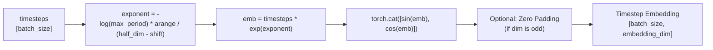
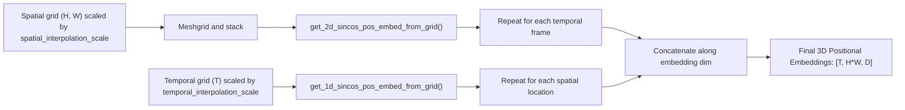
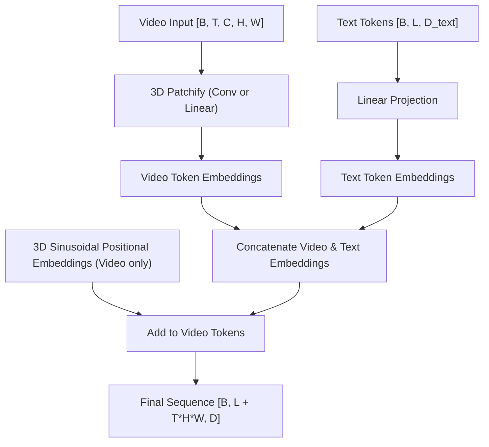

<!-- source: DeepWiki mcp.deepwiki.com · repo huggingface/diffusers · page 4.4 Embeddings · fetched 2026-10-21 -->

# Embeddings

<details>
<summary>Relevant source files</summary>

The following files were used as context for generating this wiki page:

- [src/diffusers/models/attention.py](src/diffusers/models/attention.py)
- [src/diffusers/models/attention_processor.py](src/diffusers/models/attention_processor.py)
- [src/diffusers/models/embeddings.py](src/diffusers/models/embeddings.py)
- [src/diffusers/models/normalization.py](src/diffusers/models/normalization.py)
- [src/diffusers/models/resnet.py](src/diffusers/models/resnet.py)

</details>


This page documents the embedding systems in the `diffusers` library. Embeddings encode positional information (spatial, temporal, and spatio-temporal), conditioning signals (timesteps, class labels, image sizes), and convert input data (images/videos) into patch-based token representations suitable for transformer and attention-based architectures.

For information about normalization layers that use embeddings for conditioning, see [Normalization Layers](#4.5). For information about how embeddings integrate with attention mechanisms, see [Attention System](#4.1) and [Transformer Blocks](#4.2).

## Overview

Embeddings in diffusion models serve three primary purposes:

1.  **Timestep Conditioning**: Encode the scalar diffusion timestep as a continuous signal that conditions the denoising process via adaptive normalization or cross-attention.
2.  **Positional Encoding**: Provide spatial and temporal position information to attention layers, either through additive sinusoidal encodings or multiplicative rotary embeddings (RoPE).
3.  **Input Transformation**: Convert high-dimensional images and videos into flattened sequences of projected patches.

All primary embedding implementations are located in [src/diffusers/models/embeddings.py]().

## Embedding Type Taxonomy

The following diagram maps the high-level embedding categories to their specific code implementations:

```mermaid
graph TB
    subgraph "Timestep_Conditioning"
        TimestepSinusoidal["get_timestep_embedding()<br/>Sinusoidal Encoding"]
        TimestepCombined["CombinedTimestepLabelEmbeddings<br/>Timestep + Class Labels"]
        TimestepSize["PixArtAlphaCombinedTimestepSizeEmbeddings<br/>Timestep + Size + Aspect Ratio"]
        TimestepMLP["TimestepEmbedding<br/>MLP Projection Layer"]
    end
    
    subgraph "Positional_Embeddings"
        Sinusoidal1D["get_1d_sincos_pos_embed_from_grid()<br/>1D Sinusoidal"]
        Sinusoidal2D["get_2d_sincos_pos_embed()<br/>2D Sinusoidal"]
        Sinusoidal3D["get_3d_sincos_pos_embed()<br/>3D Sinusoidal (Video)"]
        
        Rotary1D["get_1d_rotary_pos_embed()<br/>1D RoPE"]
        Rotary2D["get_2d_rotary_pos_embed()<br/>2D RoPE"]
        Rotary3D["get_3d_rotary_pos_embed()<br/>3D RoPE (Video)"]
    end
    
    subgraph "Patch_Embeddings"
        PatchEmbed["PatchEmbed<br/>Standard Image to Patches"]
        LuminaPatch["LuminaPatchEmbed<br/>Lumina-T2X Linear Projection"]
        CogVideoPatch["CogVideoXPatchEmbed<br/>Video Patches + Text Tokens"]
        CogView3Patch["CogView3PlusPatchEmbed<br/>Image Patches + Text Tokens"]
    end
    
    Embeddings["Embedding Systems"]
    
    Embeddings --> TimestepSinusoidal
    Embeddings --> TimestepCombined
    Embeddings --> TimestepSize
    
    Embeddings --> Sinusoidal1D
    Embeddings --> Sinusoidal2D
    Embeddings --> Sinusoidal3D
    Embeddings --> Rotary1D
    Embeddings --> Rotary2D
    Embeddings --> Rotary3D
    
    Embeddings --> PatchEmbed
    Embeddings --> LuminaPatch
    Embeddings --> CogVideoPatch
    Embeddings --> CogView3Patch
```



**Sources:** [src/diffusers/models/embeddings.py:27-1154](), [src/diffusers/models/normalization.py:24-25]()

## Timestep Embeddings

Timestep embeddings encode the scalar diffusion process timestep into a high-dimensional vector.

### Sinusoidal Timestep Encoding
The `get_timestep_embedding()` function implements the sinusoidal encoding used in DDPM. It generates a vector of size `embedding_dim` where the first half contains sine components and the second half contains cosine components. The embedding can optionally flip the sine and cosine order, and apply scaling factors to frequencies and overall magnitude to adjust the representation for different model scales or timestep ranges [src/diffusers/models/embeddings.py:27-78]().



### Combined and Adaptive Conditioning
Specialized classes handle multi-modal conditioning by combining timesteps with other metadata:

| Class                          | Functionality                                                 | File Reference                               |
|-------------------------------|---------------------------------------------------------------|----------------------------------------------|
| `CombinedTimestepLabelEmbeddings`   | Concatenates timestep embeddings with learned class label embeddings. | [src/diffusers/models/normalization.py:24]() |
| `PixArtAlphaCombinedTimestepSizeEmbeddings` | Combines timestep with image resolution and aspect ratio metadata.     | [src/diffusers/models/normalization.py:24]() |
| `TimestepEmbedding`            | An MLP stack (Linear -> Activation -> Linear) that projects sinusoidal timesteps to a desired dimension. | [src/diffusers/models/embeddings.py:371-409]() |

### Integration with Normalization

Timestep embeddings are typically consumed by adaptive normalization layers such as `AdaLayerNorm` and `AdaLayerNormZero`. These layers take timestep embeddings and use them to predict scale and shift parameters that modulate the hidden states in attention and feed-forward blocks, allowing the model to condition on the diffusion step effectively.

For instance, `AdaLayerNormZero` expands the embedding into six tensors (`shift_msa`, `scale_msa`, `gate_msa`, `shift_mlp`, `scale_mlp`, `gate_mlp`) to modulate multiple parts of the Transformer block [src/diffusers/models/normalization.py:130-171]().

**Sources:** [src/diffusers/models/embeddings.py:27-78,371-409](), [src/diffusers/models/normalization.py:27-172]()

## Positional Embeddings (Sinusoidal)

Positional embeddings encode spatial and temporal positional information for input tokens, essential for attention mechanisms to capture positional context.

### 1D Sinusoidal Embeddings
Function `get_1d_sincos_pos_embed_from_grid()` generates 1D sinusoidal embeddings based on a coordinate grid, which is used as a building block in higher-dimensional embeddings [src/diffusers/models/embeddings.py:514-561]().

### 2D Sinusoidal Embeddings
The function `get_2d_sincos_pos_embed()` generates 2D position embeddings for images by creating a mesh grid over height and width dimensions and applying 1D sinusoidal embedding on each axis. The outputs are concatenated to form the final 2D positional embedding tensor with a shape corresponding to `(num_patches, embedding_dim)` [src/diffusers/models/embeddings.py:221-319]().

With support for interpolation, the model can rescale positional embeddings for images of different resolutions by scaling coordinate grids accordingly. This supports zero-shot generalization to novel image sizes during inference [src/diffusers/models/embeddings.py:85-86]().

### 3D Sinusoidal Embeddings for Video
For video data, `get_3d_sincos_pos_embed()` extends the sinusoidal embeddings to three dimensions: temporal (frames), height, and width spatial dimensions.

- The embedding dimension is split, with about 75% allocated to spatial dimensions and 25% to temporal.
- Separate 1D sinusoidal embeddings are computed for the temporal axis.
- The spatial embeddings are generated using 2D sinusoidal embeddings and then repeated over the temporal frames.
- The temporal and spatial embeddings are concatenated to form the final 3D positional embedding tensor of shape `[temporal_size, spatial_size[0] * spatial_size[1], embed_dim]`.

This function supports both NumPy and PyTorch output formats [src/diffusers/models/embeddings.py:81-152]().



**Sources:** [src/diffusers/models/embeddings.py:81-319]()

## Rotary Positional Embeddings (RoPE)

Rotary embeddings encode relative positions by applying complex rotations to the query and key vectors in attention, without requiring an explicit absolute positional embedding vector.

### RoPE Variants
- **1D RoPE:** Supports sequences by applying rotations across one dimension.
- **2D RoPE:** Extends RoPE to two spatial dimensions for images.
- **3D RoPE:** For video data, incorporates temporal and spatial rotations by partitioning the embedding dimension among temporal, height, and width axes appropriately.

The 3D RoPE splits the embedding channels into temporal and spatial blocks as follows:

| Component  | Embedding Dimension Allocation            |
|------------|-------------------------------------------|
| Temporal   | embed_dim // 4                            |
| Height     | (embed_dim // 4) * 3 // 2                 |
| Width      | (embed_dim // 4) * 3 // 2                 |

This enables encoding relative positions along all three axes in video tensors [src/diffusers/models/embeddings.py:831-1154]().

RoPE is applied usually inside attention query and key computations, modifying the projected vectors before the scaled dot product operation, to impart positional biases implicitly [src/diffusers/models/attention_processor.py:52-150]().

**Sources:** [src/diffusers/models/embeddings.py:831-1154](), [src/diffusers/models/attention_processor.py:52-150]()

## Patch Embeddings

Patch embeddings convert input image or video data into flattened token sequences suitable for processing by Transformer and attention layers.

### PatchEmbed Class
The `PatchEmbed` class projects image data into patches using a 2D convolution:

- Uses `nn.Conv2d` with kernel and stride equal to the `patch_size` parameter.
- The convolution projects input latent features of shape `[B, C, H, W]` into a sequence of patches `[B, N, embed_dim]` where N is the number of patches.
- Supports optional appending of a learnable `[cls_token]`.
- Adds fixed 2D sinusoidal positional embeddings to patches.
- Supports cropping or interpolating positional embeddings to accommodate variable input sizes at inference time (e.g., SD3 / Flux cropping logic) [src/diffusers/models/embeddings.py:459-584]().

### Specialized Patch Embeddings for Video with Text Conditioning

#### CogVideoXPatchEmbed

This patch embedder handles multi-modal input combining video and text:

- Text tokens are projected via a linear layer.
- Video frames are patchified either through Conv3D (`patchify_method="conv"`) or linear projection (`patchify_method="linear"`), with support for downsampling.
- Text and video embeddings are concatenated along the sequence dimension.
- 3D sinusoidal positional embeddings are added only to the video part of the sequence.
- Optionally supports dropout.

This design facilitates transformer architectures that jointly process video and text sequences by embedding and fusing both modalities efficiently [src/diffusers/models/embeddings.py:641-772]().



**Sources:** [src/diffusers/models/embeddings.py:459-772]()

## Data Flow: Input to Attention

The typical flow of embeddings from input through patch embedding, timestep conditioning, normalization, and finally to attention layers is illustrated below for a transformer-based diffusion model:

```mermaid
graph TD
    subgraph "Patching_Stage"
        ImgLatents["Latents [B, C, H, W]"] --> PE["`PatchEmbed.forward()`"]
        PE --> Patches["Patches [B, N, D_embed]"]
    end

    subgraph "Conditioning_Stage"
        Timesteps["Timestep Tensor"] --> TSE["`get_timestep_embedding()`"]
        TSE --> TMlp["`TimestepEmbedding` (MLP)"]
        TMlp --> TEmbed["Conditioning Vector [B, D_cond]"]
    end

    subgraph "Normalization_Stage"
        TEmbed -.-> AdaLN["`AdaLayerNormZero` modulates normalization with TEmbed"]
        Patches --> AdaLN --> NormOut["Normalized Patch Embeddings"]
    end

    subgraph "Attention_Block"
        NormOut --> Attn["`Attention.forward()`"]
        Attn --> RoPE["Apply Rotary Embeddings (RoPE) to Q, K"]
        RoPE --> AttnOut["Attention Output"]
    end
```

This illustrates how:

- Raw input latents are patchified into tokens.
- The denoising timestep is embedded sinusoidally and projected via an MLP.
- The timestep embedding conditions the normalization layer.
- Normalized embeddings enter the attention block.
- Rotary positional embeddings are multiplied into attention queries and keys.

All these embedding components cooperate to provide rich conditioning signals and positional information for the diffusion model [src/diffusers/models/attention_processor.py:52-139](), [src/diffusers/models/embeddings.py:459-584](), [src/diffusers/models/normalization.py:130-171]().

---

**Sources:**  
[src/diffusers/models/embeddings.py:27-1154]()  
[src/diffusers/models/normalization.py:24-171]()  
[src/diffusers/models/attention_processor.py:52-150]()

---

