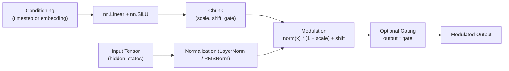
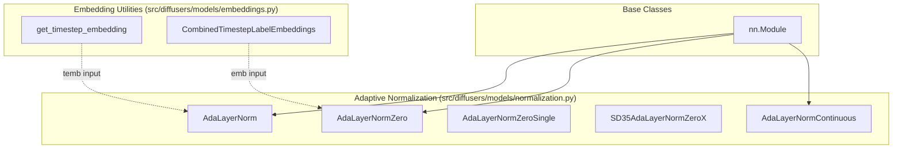
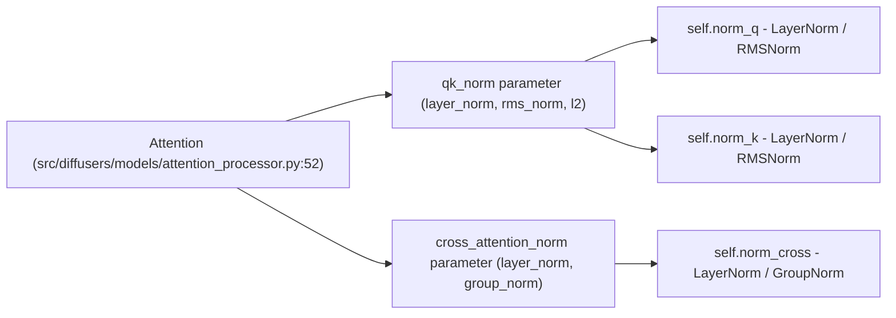

<!-- source: DeepWiki mcp.deepwiki.com · repo huggingface/diffusers · page 4.5 Normalization Layers · fetched 2026-10-21 -->

# Normalization Layers

<details>
<summary>Relevant source files</summary>

The following files were used as context for generating this wiki page:

- [src/diffusers/models/attention.py](src/diffusers/models/attention.py)
- [src/diffusers/models/attention_processor.py](src/diffusers/models/attention_processor.py)
- [src/diffusers/models/embeddings.py](src/diffusers/models/embeddings.py)
- [src/diffusers/models/normalization.py](src/diffusers/models/normalization.py)
- [src/diffusers/models/resnet.py](src/diffusers/models/resnet.py)

</details>


This page documents the normalization layer implementations used throughout diffusion model architectures in the `diffusers` library. These layers apply adaptive normalization that conditions on timestep and other embeddings, which is essential for the diffusion process.

For information about attention mechanisms that use these normalization layers, see [Attention System](). For details on transformer blocks that integrate normalization, see [Transformer Blocks](). For embedding layers that feed into normalization, see [Embeddings]().

## Purpose and Scope

Normalization layers in diffusion models serve two primary functions:

1.  **Standard normalization**: Stabilizing activations during training and inference (LayerNorm, GroupNorm, RMSNorm) [src/diffusers/models/normalization.py:84-93](), [src/diffusers/models/normalization.py:511-568]().
2.  **Adaptive normalization**: Modulating network behavior based on conditioning signals like timestep embeddings [src/diffusers/models/normalization.py:27-81](), [src/diffusers/models/normalization.py:130-171]().

The adaptive variants are critical for diffusion models because they allow the network to adjust its behavior at different noise levels during the denoising process. This page covers all normalization implementations in `src/diffusers/models/normalization.py` and their integration patterns.

---

## Adaptive Normalization Architecture

Adaptive normalization layers follow a common pattern: they normalize the input and then apply affine transformations derived from conditioning embeddings. The conditioning signal (typically a timestep embedding) controls scale and shift parameters that modulate the normalized features.

### Adaptive Normalization Data Flow



In this flow, the conditioning input (like a timestep embedding) is projected through a non-linearity and a linear layer to produce modulation parameters. These parameters (scale, shift, and sometimes gate) are used to adaptively modulate the normalized input features.

Sources: [src/diffusers/models/normalization.py:27-81](), [src/diffusers/models/normalization.py:130-171]()

---

## Core Normalization Classes

The library provides several base normalization implementations that are used throughout the codebase.

### Standard Normalization Types

| Class                   | Normalization Type | Key Features                              | Use Cases                      |
|-------------------------|--------------------|-----------------------------------------|--------------------------------|
| `nn.LayerNorm`           | Layer              | Standard PyTorch LayerNorm               | General in transformer blocks  |
| `RMSNorm`                | RMS                | Elementwise affine; optional bias       | Modern transformers (SD3, Flux)|
| `MochiRMSNorm`           | RMS                | Always FP32 precision                    | Mochi video model              |
| `FP32LayerNorm`          | Layer              | Forces FP32 precision for stability     | Mixed precision stability      |
| `GlobalResponseNorm`     | Channel            | ConvNeXt-v2 style normalization         | Convolutional architectures    |
| `LpNorm`                 | Lp                 | Configurable p-norm                      | Query/key normalization        |

Sources: [src/diffusers/models/normalization.py:84-93](), [src/diffusers/models/normalization.py:511-568](), [src/diffusers/models/normalization.py:573-599](), [src/diffusers/models/normalization.py:601-619](), [src/diffusers/models/normalization.py:621-631]()

### RMSNorm Implementation Overview

`RMSNorm` normalizes inputs by their root mean square rather than mean and variance. The implementation uses FP32 computations for numerical stability but returns output in the original input dtype. It includes device-specific optimizations for Torch NPU if available.

Sources: [src/diffusers/models/normalization.py:511-568]()

---

## AdaLayerNorm Variants

Adaptive Layer Normalization (AdaLayerNorm) layers condition normalization on external signals such as timestep or combined timestep-label embeddings. The "Zero" variants start their gating parameters at zero, enabling smoother residual updates during training.

### Relationship Among AdaLayerNorm Classes and Conditioning Embeddings



Sources: [src/diffusers/models/normalization.py:27-171](), [src/diffusers/models/embeddings.py:27-78]()

---

### AdaLayerNorm

`AdaLayerNorm` is the foundational adaptive layer normalization that modulates features with scale and shift parameters derived from timestep-conditioned embeddings.

- **Initialization Parameters:**
  - `embedding_dim`: Dimension of conditioning embedding.
  - `num_embeddings` (optional): Size of embedding dictionary for learnable embeddings.
  - `output_dim` (optional): Output dimension; defaults to `2 * embedding_dim` for scale and shift.
  - `chunk_dim`: Dimension along which to split modulation parameters (0 or 1).

- **Forward Flow:**

  1. If `num_embeddings` is set, timesteps are embedded via `nn.Embedding`.
  2. Conditioning embedding (`temb`) passed through SiLU and linear layer producing `output_dim`.
  3. Output is chunked to `scale` and `shift` tensors.
  4. `LayerNorm` is applied to input tensor.
  5. Output modulation: `norm(x) * (1 + scale) + shift`.

This allows the network to adapt its activations conditioned on timestep-specific embeddings.

Sources: [src/diffusers/models/normalization.py:27-81]()

---

### AdaLayerNormZero

This variant, often called AdaLN-Zero, produces 6 modulation parameters for finer-grained control and introduces gating, initialized to zero for stable warm-up.

- **Modulation Parameters:**
  
  - For self-attention (MSA): `shift_msa, scale_msa, gate_msa`.
  - For feed-forward/MLP: `shift_mlp, scale_mlp, gate_mlp`.

- **Inputs:**
  - `x` (input tensor),
  - `timestep`,
  - optionally `class_labels`, `hidden_dtype`.

- **Output:**
  - Modulated tensor `x` with attention gates returned for subsequent layers.

- **Behavior:**
  
  Uses combined timestep-label embeddings (via `CombinedTimestepLabelEmbeddings`) if provided [src/diffusers/models/normalization.py:130-171]().

Sources: [src/diffusers/models/normalization.py:130-171]()

---

### SD35AdaLayerNormZeroX

Stable Diffusion 3.5 employs a specialized normalization producing 9 modulation parameters, supporting dual self-attention streams. These parameters extend those in AdaLayerNormZero for richer control in complex architectures.

- **Modulation splits:**
  - First MSA: `shift_msa, scale_msa, gate_msa`.
  - MLP: `shift_mlp, scale_mlp, gate_mlp`.
  - Second MSA: `shift_msa2, scale_msa2, gate_msa2`.

- Uses `nn.LayerNorm` without learned affine parameters.

Sources: [src/diffusers/models/normalization.py:96-128]()

---

### AdaLayerNormContinuous

Targets continuous conditioning scenarios where embeddings vary within ranges rather than discrete index positions, suitable for SD3 and Flux models.

- Takes continuous conditioning embedding as input.
- Produces scale and shift without gates.
- Normalizes using `nn.LayerNorm`.
- Can use `chunk_dim=1` for special demultiplexing suited to some models.

Sources: [src/diffusers/models/normalization.py:308-353]()

---

## Model-Specific Normalizations

### CogVideoXLayerNormZero

This layer jointly normalizes video frames and text embeddings in the CogVideoX video diffusion model, outputting separate scale, shift, and gate parameters for each modality.

Parameters are split as:

- Video stream: `shift, scale, gate`.
- Text encoder stream: `enc_shift, enc_scale, enc_gate`.

Sources: [src/diffusers/models/normalization.py:449-471]()

---

### CogView3PlusAdaLayerNormZeroTextImage

CogView3Plus models process text and image streams jointly, producing 12 modulation parameters (6 each for image and text). It uses separate `nn.LayerNorm` normalizers (`norm_x` for images, `norm_c` for text).

Sources: [src/diffusers/models/normalization.py:404-447]()

---

## Integration with Attention Blocks

Normalization layers are integrated into attention mechanisms, particularly in the `Attention` class (`src/diffusers/models/attention_processor.py`) which supports several normalization modes configurable by arguments:

```mermaid
graph TD
    AttnInit["Attention.__init__"]

    subgraph "Q/K Normalization"
        QKNormParam["qk_norm parameter"]
        NormQ["self.norm_q (nn.LayerNorm or RMSNorm)"]
        NormK["self.norm_k (nn.LayerNorm or RMSNorm)"]
    end

    subgraph "Cross-Attention Normalization"
        CrossNormParam["cross_attention_norm parameter"]
        NormCross["self.norm_cross (LayerNorm or GroupNorm)"]
    end

    AttnInit --> QKNormParam
    QKNormParam -->| "layer_norm" | NormQ
    QKNormParam -->| "rms_norm" | NormQ
    QKNormParam -->| "l2" | NormQ

    AttnInit --> CrossNormParam
    CrossNormParam -->| "layer_norm" | NormCross
    CrossNormParam -->| "group_norm" | NormCross
```

- **Query-Key normalization (`qk_norm`)** supports:
  - `"layer_norm"`: standard LayerNorm on query and key [src/diffusers/models/attention_processor.py:193-194]().
  - `"rms_norm"`: RMSNorm variant [src/diffusers/models/attention_processor.py:205-206]().
  - `"l2"`: LpNorm with p=2 [src/diffusers/models/attention_processor.py:217-218]().

- **Cross-attention normalization (`cross_attention_norm`)** supports:
  - `"layer_norm"`: LayerNorm with shape matching encoder states [src/diffusers/models/attention_processor.py:221-222]().
  - `"group_norm"`: GroupNorm with specified groups [src/diffusers/models/attention_processor.py:224-228]().

This normalization conditioning helps stabilize cross-attention computations and is optionally configured via attention layer initialization parameters.

Sources: [src/diffusers/models/attention_processor.py:192-241]()

---

## AdaGroupNorm for Convolutional Blocks

`AdaGroupNorm` extends GroupNorm with adaptive affine modulation from conditioning embeddings. This is predominantly used in convolutional ResNet blocks of the UNet architecture.

- The embedding (`emb`) is linearly projected to twice the number of channels, reshaped to `(B, 2*C, 1, 1)` to allow spatial broadcasting.
- The normalized tensor is modulated: `norm(x) * (1 + scale) + shift`.
- `AdaGroupNorm` supports integration of timestep embeddings or other conditioning signals.

Example usage is found in the `ResnetBlockCondNorm2D` class where `AdaGroupNorm` layers integrate the timestep embedding (`temb`) to condition normalization adaptively [src/diffusers/models/normalization.py:270-306](), [src/diffusers/models/resnet.py:106-107]().

Sources: [src/diffusers/models/normalization.py:270-306](), [src/diffusers/models/resnet.py:106-107]()

---

## Precision and Numerical Stability Considerations

For numerical stability, certain normalization classes operate internally in FP32 precision, especially important in mixed-precision training and inference.

- **FP32LayerNorm**: Casts inputs and layer norm parameters to float32 before applying layer normalization, casting back to original dtype on return [src/diffusers/models/normalization.py:84-93]().
- **RMSNorm**: Computes variance in FP32 precision for accuracy then casts back to input dtype [src/diffusers/models/normalization.py:542-567]().
- **MochiRMSNorm**: A variant that always performs operations in FP32 without back casting, used for high-precision video models [src/diffusers/models/normalization.py:573-599]().

---

# Summary Diagrams Connecting Concepts to Code

### AdaLayerNorm and Conditioning Embeddings

```mermaid
graph LR
    A[Input Tensor]
    Temb[get_timestep_embedding (src/diffusers/models/embeddings.py:27-78)]
    Emb["CombinedTimestepLabelEmbeddings<br/>(src/diffusers/models/embeddings.py)"]
    AdaLN["AdaLayerNorm<br/>(src/diffusers/models/normalization.py:27-81)"]
    AdaLNZero["AdaLayerNormZero<br/>(src/diffusers/models/normalization.py:130-171)"]

    Temb --> AdaLN
    Emb --> AdaLNZero
    A --> AdaLN
    A --> AdaLNZero
    AdaLN --> OutputAdaLN["Modulated Output (scale, shift)"]
    AdaLNZero --> OutputAdaLNZero["Modulated Output + Gates"]
```

### Integration with Attention Class



---

# References

- Adaptive normalization classes and conditioning embeddings are implemented and detailed in [`src/diffusers/models/normalization.py:27-171`]() and [`src/diffusers/models/embeddings.py:27-78`]().

- Attention layer normalization integrations and options are found in [`src/diffusers/models/attention_processor.py:192-241`]().

- `AdaGroupNorm` and its use in residual blocks with conditional normalization is implemented in [`src/diffusers/models/normalization.py:270-306`](), and utilized by [`src/diffusers/models/resnet.py:106-107`](). 

- Numerical stability enhancements in precision-sensitive layer norms are detailed in [`src/diffusers/models/normalization.py:84-93`](), [`src/diffusers/models/normalization.py:511-568`](), and [`src/diffusers/models/normalization.py:573-599`]().

---

