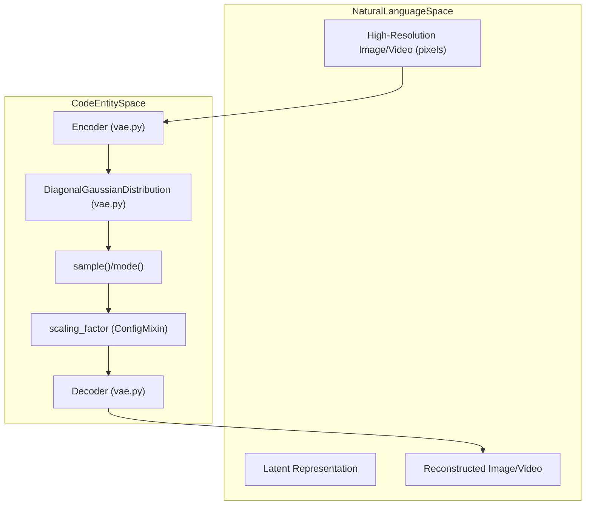
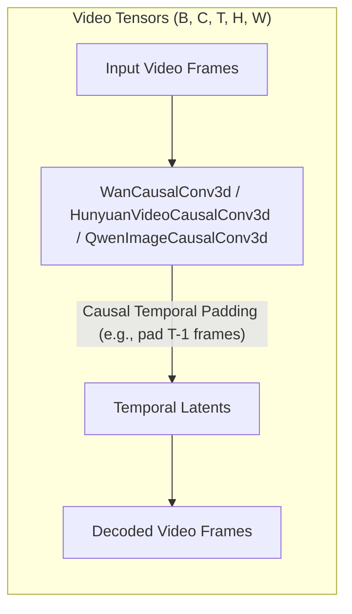
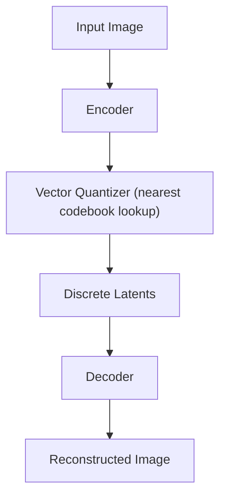
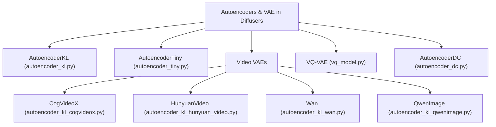

<!-- source: DeepWiki mcp.deepwiki.com · repo huggingface/diffusers · page 4.6 Autoencoders and VAE · fetched 2026-10-21 -->

# Autoencoders and VAE

<details>
<summary>Relevant source files</summary>

The following files were used as context for generating this wiki page:

- [docs/source/en/api/models/longcat_image_transformer2d.md](docs/source/en/api/models/longcat_image_transformer2d.md)
- [docs/source/en/api/pipelines/longcat_image.md](docs/source/en/api/pipelines/longcat_image.md)
- [src/diffusers/models/autoencoders/autoencoder_asym_kl.py](src/diffusers/models/autoencoders/autoencoder_asym_kl.py)
- [src/diffusers/models/autoencoders/autoencoder_dc.py](src/diffusers/models/autoencoders/autoencoder_dc.py)
- [src/diffusers/models/autoencoders/autoencoder_kl.py](src/diffusers/models/autoencoders/autoencoder_kl.py)
- [src/diffusers/models/autoencoders/autoencoder_kl_allegro.py](src/diffusers/models/autoencoders/autoencoder_kl_allegro.py)
- [src/diffusers/models/autoencoders/autoencoder_kl_cosmos.py](src/diffusers/models/autoencoders/autoencoder_kl_cosmos.py)
- [src/diffusers/models/autoencoders/autoencoder_kl_hunyuan_video.py](src/diffusers/models/autoencoders/autoencoder_kl_hunyuan_video.py)
- [src/diffusers/models/autoencoders/autoencoder_kl_hunyuanimage.py](src/diffusers/models/autoencoders/autoencoder_kl_hunyuanimage.py)
- [src/diffusers/models/autoencoders/autoencoder_kl_hunyuanimage_refiner.py](src/diffusers/models/autoencoders/autoencoder_kl_hunyuanimage_refiner.py)
- [src/diffusers/models/autoencoders/autoencoder_kl_hunyuanvideo15.py](src/diffusers/models/autoencoders/autoencoder_kl_hunyuanvideo15.py)
- [src/diffusers/models/autoencoders/autoencoder_kl_ltx.py](src/diffusers/models/autoencoders/autoencoder_kl_ltx.py)
- [src/diffusers/models/autoencoders/autoencoder_kl_magvit.py](src/diffusers/models/autoencoders/autoencoder_kl_magvit.py)
- [src/diffusers/models/autoencoders/autoencoder_kl_mochi.py](src/diffusers/models/autoencoders/autoencoder_kl_mochi.py)
- [src/diffusers/models/autoencoders/autoencoder_kl_qwenimage.py](src/diffusers/models/autoencoders/autoencoder_kl_qwenimage.py)
- [src/diffusers/models/autoencoders/autoencoder_kl_temporal_decoder.py](src/diffusers/models/autoencoders/autoencoder_kl_temporal_decoder.py)
- [src/diffusers/models/autoencoders/autoencoder_kl_wan.py](src/diffusers/models/autoencoders/autoencoder_kl_wan.py)
- [src/diffusers/models/autoencoders/autoencoder_tiny.py](src/diffusers/models/autoencoders/autoencoder_tiny.py)
- [src/diffusers/models/autoencoders/consistency_decoder_vae.py](src/diffusers/models/autoencoders/consistency_decoder_vae.py)
- [src/diffusers/models/autoencoders/vae.py](src/diffusers/models/autoencoders/vae.py)
- [src/diffusers/models/autoencoders/vq_model.py](src/diffusers/models/autoencoders/vq_model.py)
- [src/diffusers/models/transformers/transformer_longcat_image.py](src/diffusers/models/transformers/transformer_longcat_image.py)
- [src/diffusers/models/transformers/transformer_temporal.py](src/diffusers/models/transformers/transformer_temporal.py)
- [src/diffusers/models/unets/unet_2d.py](src/diffusers/models/unets/unet_2d.py)
- [src/diffusers/models/vq_model.py](src/diffusers/models/vq_model.py)
- [src/diffusers/pipelines/longcat_image/__init__.py](src/diffusers/pipelines/longcat_image/__init__.py)
- [src/diffusers/pipelines/longcat_image/pipeline_longcat_image.py](src/diffusers/pipelines/longcat_image/pipeline_longcat_image.py)
- [src/diffusers/pipelines/longcat_image/pipeline_longcat_image_edit.py](src/diffusers/pipelines/longcat_image/pipeline_longcat_image_edit.py)
- [src/diffusers/pipelines/wan/pipeline_wan_animate.py](src/diffusers/pipelines/wan/pipeline_wan_animate.py)
- [tests/models/autoencoders/__init__.py](tests/models/autoencoders/__init__.py)
- [tests/models/autoencoders/test_models_asymmetric_autoencoder_kl.py](tests/models/autoencoders/test_models_asymmetric_autoencoder_kl.py)
- [tests/models/autoencoders/test_models_autoencoder_cosmos.py](tests/models/autoencoders/test_models_autoencoder_cosmos.py)
- [tests/models/autoencoders/test_models_autoencoder_dc.py](tests/models/autoencoders/test_models_autoencoder_dc.py)
- [tests/models/autoencoders/test_models_autoencoder_hunyuan_video.py](tests/models/autoencoders/test_models_autoencoder_hunyuan_video.py)
- [tests/models/autoencoders/test_models_autoencoder_kl.py](tests/models/autoencoders/test_models_autoencoder_kl.py)
- [tests/models/autoencoders/test_models_autoencoder_kl_cogvideox.py](tests/models/autoencoders/test_models_autoencoder_kl_cogvideox.py)
- [tests/models/autoencoders/test_models_autoencoder_kl_kvae.py](tests/models/autoencoders/test_models_autoencoder_kl_kvae.py)
- [tests/models/autoencoders/test_models_autoencoder_kl_ltx2_audio.py](tests/models/autoencoders/test_models_autoencoder_kl_ltx2_audio.py)
- [tests/models/autoencoders/test_models_autoencoder_kl_temporal_decoder.py](tests/models/autoencoders/test_models_autoencoder_kl_temporal_decoder.py)
- [tests/models/autoencoders/test_models_autoencoder_ltx2_video.py](tests/models/autoencoders/test_models_autoencoder_ltx2_video.py)
- [tests/models/autoencoders/test_models_autoencoder_ltx_video.py](tests/models/autoencoders/test_models_autoencoder_ltx_video.py)
- [tests/models/autoencoders/test_models_autoencoder_magvit.py](tests/models/autoencoders/test_models_autoencoder_magvit.py)
- [tests/models/autoencoders/test_models_autoencoder_mochi.py](tests/models/autoencoders/test_models_autoencoder_mochi.py)
- [tests/models/autoencoders/test_models_autoencoder_oobleck.py](tests/models/autoencoders/test_models_autoencoder_oobleck.py)
- [tests/models/autoencoders/test_models_autoencoder_tiny.py](tests/models/autoencoders/test_models_autoencoder_tiny.py)
- [tests/models/autoencoders/test_models_autoencoder_wan.py](tests/models/autoencoders/test_models_autoencoder_wan.py)
- [tests/models/autoencoders/test_models_consistency_decoder_vae.py](tests/models/autoencoders/test_models_consistency_decoder_vae.py)
- [tests/models/autoencoders/test_models_ltx2_diffusion_decoder.py](tests/models/autoencoders/test_models_ltx2_diffusion_decoder.py)
- [tests/models/autoencoders/test_models_vq.py](tests/models/autoencoders/test_models_vq.py)
- [tests/models/autoencoders/testing_utils.py](tests/models/autoencoders/testing_utils.py)
- [tests/models/transformers/test_models_transformer_z_image.py](tests/models/transformers/test_models_transformer_z_image.py)
- [tests/models/unets/__init__.py](tests/models/unets/__init__.py)
- [tests/models/unets/test_models_unet_1d.py](tests/models/unets/test_models_unet_1d.py)
- [tests/models/unets/test_models_unet_2d.py](tests/models/unets/test_models_unet_2d.py)
- [tests/models/unets/test_models_unet_3d_condition.py](tests/models/unets/test_models_unet_3d_condition.py)
- [tests/models/unets/test_models_unet_controlnetxs.py](tests/models/unets/test_models_unet_controlnetxs.py)
- [tests/models/unets/test_models_unet_motion.py](tests/models/unets/test_models_unet_motion.py)
- [tests/models/unets/test_models_unet_spatiotemporal.py](tests/models/unets/test_models_unet_spatiotemporal.py)

</details>


Autoencoders in the `diffusers` library provide a standardized way to encode images or videos into a compressed latent space and decode them back. This page documents several architectural variants, including the standard KL-constrained autoencoder (`AutoencoderKL`), tiny autoencoders (`AutoencoderTiny`), video-specific temporal VAEs (CogVideoX, HunyuanVideo, Wan), and Vector Quantized VAE (VQ-VAE), highlighting their encode/decode interfaces and the usage of latent scaling.

---

## Core Architecture and Interface

All VAEs in the library are built around the `AutoencoderMixin` base, which provides essential encoding and decoding interfaces for compression and reconstruction.

### Encode and Decode Interface

| Method            | Input                               | Output                  | Description                                                                                 |
| ----------------- | --------------------------------- | ----------------------- | ------------------------------------------------------------------------------------------- |
| `encode`          | Input image or video tensor        | `AutoencoderKLOutput` or analog | Encodes input pixels to a latent space represented by a distribution (usually Gaussian).   |
| `decode`          | Latent tensor                      | `DecoderOutput`         | Decodes latent representations back into pixel space samples.                              |
| `enable_tiling`   | —                                 | —                       | Allows tiled processing to reduce memory usage for large inputs by chunking and blending.  |
| `enable_slicing`  | —                                 | —                       | Allows slicing latent batches for memory optimization during encode/decode.                 |

The latent output is typically a `DiagonalGaussianDistribution` allowing stochastic sampling or mode selection. During inference, latents are scaled with a `scaling_factor` (and optionally shifted) to standardize the latent distribution for diffusion modeling.

### Latent Scaling and Shifting

- **Scaling Factor (`scaling_factor`)**: A float parameter used to scale latents to have unit variance, improving numerical stability and training convergence of diffusion models.
  
  Encoded latents are multiplied by this factor before input to the diffusion model. During decoding, latents are inversely scaled to restore the original range.
  
- **Shift Factor (`shift_factor`)**: Some models (e.g., tiny or SD3 VAEs) additionally apply a shift to the latent distribution to better center it.

These factors are typically part of the model config and affect the `encode` and `decode` workflows.

---

### VAE System Overview

This diagram illustrates the data flow from input pixels to latent space and back, showing key entities and their relationships.



_Sources: [src/diffusers/models/autoencoders/vae.py:26-152](), [src/diffusers/models/autoencoders/autoencoder_kl.py:36-128]()_

---

## AutoencoderKL (Standard VAE)

The `AutoencoderKL` is the main convolutional VAE architecture used in many Stable Diffusion models. It implements an encoder-decoder design with KL regularization on the latent distribution.

### Implementation Details

- **Encoder**: 
  - Sequentially downsamples using configurable `down_block_types` (typically `DownEncoderBlock2D`).
  - Includes a middle block with optional attention layers.
  - Outputs a tensor used to parameterize a diagonal Gaussian distribution in latent space (two channels per latent dimension for mean and log-variance).
- **Quantization Layers**:
  - The convolution layers `quant_conv` and `post_quant_conv` convert encoded features to Gaussian parameters and back.
- **Decoder**:
  - Mirrors the encoder with `up_block_types` (e.g., `UpDecoderBlock2D`) to reconstruct images from latents.
- **Scaling**:
  - Uses a `scaling_factor` (default 0.18215) for latent normalization.
- **Mixed Precision Support**:
  - Can `force_upcast` to float32 for numerical stability in high-resolution or precision-sensitive applications (e.g., SDXL).

### Typical Usage

- `encode(sample)`: returns a `DiagonalGaussianDistribution`, from which latents are sampled and scaled.
- `decode(latents)`: applies inverse scaling and reconstructs the image.

```python
autoencoder = AutoencoderKL(...)
distribution = autoencoder.encode(image)
latents = distribution.sample() * autoencoder.config.scaling_factor
reconstruction = autoencoder.decode(latents / autoencoder.config.scaling_factor).sample
```

_Sources: [src/diffusers/models/autoencoders/autoencoder_kl.py:36-128](), [src/diffusers/models/autoencoders/vae.py:62-190]()_

---

## Video VAE Variants

Video autoencoders extend the 2D convolutional VAEs with the temporal dimension and causal convolution to respect temporal ordering for autoregressive or frame-wise generation.

### CogVideoX and Mochi Video VAEs

- Use 3D causal convolutions (`CogVideoXCausalConv3d`) to maintain temporal causality.
- `MochiResnetBlock3D` applies 3D group-normalization chunked over frames for memory efficiency.
- Temporal downsampling and upsampling incorporate stride and kernel shapes with causal padding.
- `CogVideoXSafeConv3d` manages memory by chunking input sequences to prevent OOM errors.

### Wan Video VAE

- Implements custom 3D downsampling (`AvgDown3D`) and upsampling (`DupUp3D`).
- `WanCausalConv3d` supports cached feature concatenation (`cache_x`) for faster sequential inference.
- Temporal feature expansion and spatial downscaling are carefully controlled.

### HunyuanVideo VAE

- Similar 3D causal conv mechanism (`HunyuanVideoCausalConv3d`).
- Causal upsampling splits the first frame and other frames to preserve causality by interpolating separately.
- Utilizes specialized 3D ResNet blocks and causal downsampling.

### Qwen-Image VAE

- A fine-tuned downstream of Wan Video VAE.
- Uses `QwenImageCausalConv3d` and an enhanced resampling module supporting causal convolution and feature caching.

### Timeline Dataflow in Video VAE



_Sources: [src/diffusers/models/autoencoders/autoencoder_kl_wan.py:34-174](), [src/diffusers/models/autoencoders/autoencoder_kl_hunyuan_video.py:46-118](), [src/diffusers/models/autoencoders/autoencoder_kl_qwenimage.py:40-82](), [src/diffusers/models/autoencoders/autoencoder_kl_cogvideox.py:36-146]()_

---

## AutoencoderTiny (Distilled Lightweight VAE)

The `AutoencoderTiny` presents a drastically simplified VAE designed for fast inference with constrained resources. It replaces typical ResNet blocks and attention modules with smaller, simpler building blocks like `AutoencoderTinyBlock`.

- Uses simpler and fewer layers for encode and decode.
- Utilizes latent magnitude and shift normalization rather than classical KL-divergence scaling.
- Suitable for real-time or preview-quality generation at the cost of fidelity.

_Sources: [src/diffusers/models/autoencoders/autoencoder_tiny.py:40-145]()_

---

## VQ-VAE (Vector Quantized Variational Autoencoder)

The VQ-VAE diverges from the continuous latent distribution paradigm by mapping encoder features to discrete codebook indices.

- **Encoder**: Outputs latent features which are quantized against a learned embedding codebook.
- **Quantizer**: Replaces features with nearest embeddings to form discrete latent tokens.
- **Decoder**: Maps quantized latents back to image space.
- Includes a `commit_loss` ensuring the encoder output stays close to codebook vectors.



_Sources: [src/diffusers/models/vq_model.py:18-29](), [src/diffusers/models/autoencoders/vae.py:46-59]()_

---

## Specialized Architectures

### AutoencoderDC (Discrete/Continuous Hybrid)

- Integrates `EfficientViTBlock` containing the `SanaMultiscaleLinearAttention`.
- Utilizes pixel unshuffle (`DCDownBlock2d`) and pixel shuffle (`DCUpBlock2d`) operations for resolution manipulation.
- Designed for efficient training with hybrid attention blocks optimizing spatial and channel complexity.

_Sources: [src/diffusers/models/autoencoders/autoencoder_dc.py:64-198]()_

### Temporal Decoder VAEs

- Add a temporal convolutional decoder stage to improve temporal smoothness of video latents.
- Useful for video or sequential data tasks requiring better temporal coherence.

---

## Advanced Features

### Tiling and Slicing for Memory Efficiency

VAEs can consume large GPU memory when processing high-res images or long videos. To mitigate this:

- **Tiling (`enable_tiling()`)**: Splits input into tiles processed independently. Later, results are merged with overlapping windows to reconstruct the full image.
- **Slicing (`enable_slicing()`)**: Processes smaller chunks of batches or sequences sequentially to limit peak memory usage.

These methods are especially essential in high-resolution pipelines like SDXL or video VAE pipelines.

### Mixed Precision and Upcasting

To avoid numerical precision loss (e.g., black images or artifacts), some VAEs support forced operation in `float32` (upcasting), especially for stable image quality at high resolutions:

- Controlled by `force_upcast` config parameter.
- Typically applied in decoders which are sensitive to precision.

---

# Summary Table of Key Autoencoder Classes

| System / Model             | Code Entity                 | Purpose / Notes                                  |
|---------------------------|----------------------------|--------------------------------------------------|
| AutoencoderKL             | `AutoencoderKL` [autoencoder_kl.py] | Standard VAE; convolutional encoder/decoder; KL regularized with latent scaling. |
| AutoencoderTiny           | `AutoencoderTiny` [autoencoder_tiny.py] | Lightweight distilled VAE variant for fast inference. |
| Video VAE CogVideoX       | `CogVideoXCausalConv3d` [autoencoder_kl_cogvideox.py] | 3D causal conv blocks for temporal video modeling, supports chunked memory management. |
| Video VAE HunyuanVideo    | `HunyuanVideoCausalConv3d` [autoencoder_kl_hunyuan_video.py] | 3D causal convolutions and up/downsampling with causal masking. |
| Video VAE Wan             | `WanCausalConv3d` [autoencoder_kl_wan.py] | Feature caching 3D causal convs, custom avg downsampling and duplication upsampling. |
| Video VAE Qwen-Image      | `QwenImageCausalConv3d` [autoencoder_kl_qwenimage.py] | Fine-tuned Wan Video VAE variant with causal convs and resampling incorporating cache. |
| VQ-VAE                   | `VQModel` [vq_model.py]                 | Vector quantized autoencoder with discrete latent codes and commit losses. |
| AutoencoderDC             | `AutoencoderDC` [autoencoder_dc.py]     | Hybrid discrete/continuous VAE with EfficientViT blocks and pixel shuffle/unshuffle resampling. |

---

# Diagrams Bridging Models to Code Entities

### Mapping Natural Language Models to Code Classes



### Encode/Decode Workflow in `AutoencoderKL`

```mermaid
flowchart LR
    Input["Input Image/Video"] --> encode_fn["AutoencoderKL.encode()"]
    encode_fn --> distribution["DiagonalGaussianDistribution"]
    distribution --> sample_or_mode["sample() / mode()"]
    sample_or_mode --> scale_latents["Multiply by scaling_factor"]
    scale_latents --> latent_tensor["Latent Tensor"]
    latent_tensor --> unscale_latents["Divide by scaling_factor"]
    unscale_latents --> decode_fn["AutoencoderKL.decode()"]
    decode_fn --> Output["Reconstructed Image/Video"]
```



---

# References and Sources

- AutoencoderKL and base VAE components: [src/diffusers/models/autoencoders/autoencoder_kl.py:36-128](), [src/diffusers/models/autoencoders/vae.py:62-190]()
- Wan VAE and `WanCausalConv3d`: [src/diffusers/models/autoencoders/autoencoder_kl_wan.py:34-174]()
- Hunyuan Video VAE: [src/diffusers/models/autoencoders/autoencoder_kl_hunyuan_video.py:46-118]()
- Qwen-Image VAE: [src/diffusers/models/autoencoders/autoencoder_kl_qwenimage.py:40-174]()
- CogVideoX VAE causal convs: [src/diffusers/models/autoencoders/autoencoder_kl_cogvideox.py:36-146]()
- AutoencoderTiny: [src/diffusers/models/autoencoders/autoencoder_tiny.py:40-145]()
- VQ-VAE: [src/diffusers/models/vq_model.py:18-29](), [src/diffusers/models/autoencoders/vae.py:46-59]()
- AutoencoderDC: [src/diffusers/models/autoencoders/autoencoder_dc.py:64-198]()
- Utility and interface base classes: [src/diffusers/models/autoencoders/vae.py:25-59]()

This page documents the detailed implementations and interfaces of autoencoders and variational autoencoders used throughout `diffusers`, describing how different model variants conform to a shared coding pattern for encoding, decoding, and latent manipulation.

---

