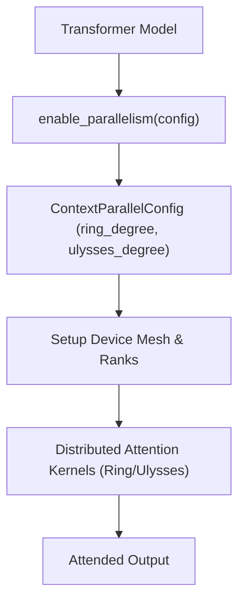
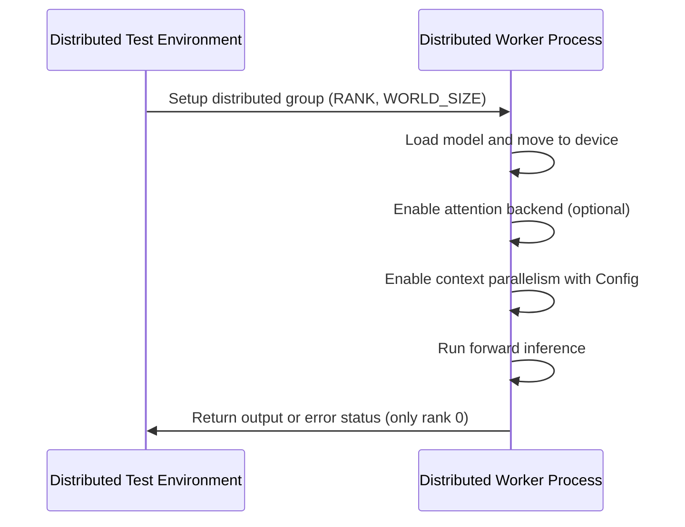
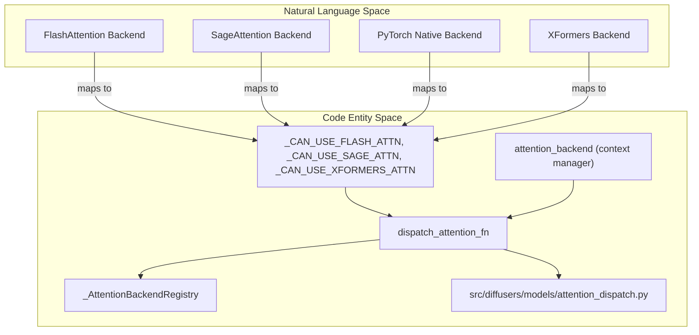
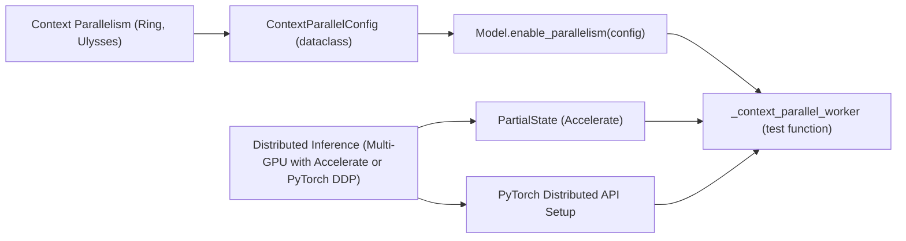

<!-- source: DeepWiki mcp.deepwiki.com · repo huggingface/diffusers · page 4.7 Attention Backend Dispatch and Parallelism · fetched 2026-10-21 -->

# Attention Backend Dispatch and Parallelism

<details>
<summary>Relevant source files</summary>

The following files were used as context for generating this wiki page:

- [.ai/skills/diffusers-cli/run.md](.ai/skills/diffusers-cli/run.md)
- [docker/diffusers-cli-cuda/Dockerfile](docker/diffusers-cli-cuda/Dockerfile)
- [docs/source/en/api/models/anyflow_far_transformer3d.md](docs/source/en/api/models/anyflow_far_transformer3d.md)
- [docs/source/en/api/models/anyflow_transformer3d.md](docs/source/en/api/models/anyflow_transformer3d.md)
- [docs/source/en/api/parallel.md](docs/source/en/api/parallel.md)
- [docs/source/en/api/pipelines/anyflow.md](docs/source/en/api/pipelines/anyflow.md)
- [docs/source/en/modular_diffusers/modular_pipeline.md](docs/source/en/modular_diffusers/modular_pipeline.md)
- [docs/source/en/optimization/attention_backends.md](docs/source/en/optimization/attention_backends.md)
- [docs/source/en/optimization/fp16.md](docs/source/en/optimization/fp16.md)
- [docs/source/en/training/distributed_inference.md](docs/source/en/training/distributed_inference.md)
- [docs/source/en/using-diffusers/cli.md](docs/source/en/using-diffusers/cli.md)
- [docs/source/zh/using-diffusers/anyflow.md](docs/source/zh/using-diffusers/anyflow.md)
- [scripts/convert_anyflow_to_diffusers.py](scripts/convert_anyflow_to_diffusers.py)
- [src/diffusers/commands/run.py](src/diffusers/commands/run.py)
- [src/diffusers/hooks/context_parallel.py](src/diffusers/hooks/context_parallel.py)
- [src/diffusers/models/_modeling_parallel.py](src/diffusers/models/_modeling_parallel.py)
- [src/diffusers/models/attention_dispatch.py](src/diffusers/models/attention_dispatch.py)
- [src/diffusers/models/transformers/transformer_anyflow.py](src/diffusers/models/transformers/transformer_anyflow.py)
- [src/diffusers/models/transformers/transformer_anyflow_far.py](src/diffusers/models/transformers/transformer_anyflow_far.py)
- [src/diffusers/models/transformers/transformer_qwenimage.py](src/diffusers/models/transformers/transformer_qwenimage.py)
- [src/diffusers/pipelines/qwenimage/__init__.py](src/diffusers/pipelines/qwenimage/__init__.py)
- [tests/models/test_attention_dispatch.py](tests/models/test_attention_dispatch.py)
- [tests/models/testing_utils/attention.py](tests/models/testing_utils/attention.py)
- [tests/models/testing_utils/ip_adapter.py](tests/models/testing_utils/ip_adapter.py)
- [tests/models/testing_utils/lora.py](tests/models/testing_utils/lora.py)
- [tests/models/testing_utils/parallelism.py](tests/models/testing_utils/parallelism.py)
- [tests/models/testing_utils/utils.py](tests/models/testing_utils/utils.py)
- [tests/models/transformers/test_models_transformer_anyflow.py](tests/models/transformers/test_models_transformer_anyflow.py)
- [tests/models/transformers/test_models_transformer_anyflow_far.py](tests/models/transformers/test_models_transformer_anyflow_far.py)
- [tests/models/transformers/test_models_transformer_flux2.py](tests/models/transformers/test_models_transformer_flux2.py)
- [tests/models/transformers/test_models_transformer_joyimage.py](tests/models/transformers/test_models_transformer_joyimage.py)
- [tests/models/transformers/test_models_transformer_qwenimage.py](tests/models/transformers/test_models_transformer_qwenimage.py)
- [tests/modular_pipelines/test_modular_pipeline_cache.py](tests/modular_pipelines/test_modular_pipeline_cache.py)
- [tests/modular_pipelines/test_modular_pipeline_loading.py](tests/modular_pipelines/test_modular_pipeline_loading.py)
- [tests/modular_pipelines/testing_utils/loading.py](tests/modular_pipelines/testing_utils/loading.py)
- [tests/pipelines/anyflow/test_anyflow_far.py](tests/pipelines/anyflow/test_anyflow_far.py)

</details>


This page documents the `attention_dispatch` module within the Diffusers library, which is responsible for managing and selecting optimized attention backends, enabling context parallelism hooks, and supporting distributed inference strategies. The primary goal of this module is to provide a unified and flexible interface for attention computations that can automatically leverage hardware-accelerated kernels, distribute workloads efficiently across GPUs, and improve the speed and memory efficiency of diffusion model inference.

---

## Overview and Purpose

- **Attention Backend Dispatch**: Routes attention computation to the most efficient backend available on the user's environment, with support for FlashAttention, SageAttention, native PyTorch, XFormers, and other hardware-specific kernels.
- **Context Parallelism Support**: Implements hooks and configurations to split attention computations across multiple devices in a ring or Ulysses pattern with automatic communication.
- **Distributed Inference**: Provides utilities that integrate with PyTorch distributed and Hugging Face Accelerate to run pipelines efficiently over multiple GPUs.

The dispatch and parallelism system abstracts away the complexity of choosing the best low-level attention kernel or parallelization scheme, giving users seamless high-performance execution.

---

## Attention Backends and Dispatch System

Attention mechanisms are a core computational pattern in transformer architectures. The Diffusers library supports multiple optimized attention implementations, each suited for different hardware and deployment scenarios.

### Available Attention Backends

| Backend Name    | Description                                          | Key Feature                                   |
|-----------------|------------------------------------------------------|-----------------------------------------------|
| FlashAttention  | Memory-coalescing and recomputation optimized kernel | Minimizes memory reads/writes via tiling and recomputation |
| SageAttention   | Quantized int8 and mixed-precision attention kernel | Improves performance with int8 quantization  |
| Native PyTorch  | PyTorch's built-in scaled dot product attention       | Baseline implementation                       |
| XFormers        | Memory-efficient various attention kernels            | Supports multiple kernel variants and hardware |
| Torch Kernels   | Additional optimized kernels (Flex, Torch NPU, XLA) | Hardware-specific fused kernels                |

The system dynamically detects availability of these backends based on Torch and hardware versions, loading native packages if installed, and falling back to others with graceful warnings. It defines flags like `_CAN_USE_FLASH_ATTN`, `_CAN_USE_SAGE_ATTN`, and `_CAN_USE_XFORMERS_ATTN` to track viability.

### Backend Availability and Imports

- Attempts to import FlashAttention and FlashAttention3 under version constraints.
- Import SageAttention kernels with version guard.
- Imports experimental kernels like FlexAttention, Torch NPU Attention, and Torch XLA Flash Attention.
- Fallbacks disable the backend gracefully and log warnings in case of import errors or ABI mismatches.

### Dispatch Mechanism

The central function is `dispatch_attention_fn(query, key, value, ...)` which is called to perform attention computation. This function selects the best backend algorithm at runtime, considering:

- Hardware capabilities
- Tensor properties (dtype, device)
- User-configured backend override or context manager (see below)
- Environmental configuration variables for debugging and trust

The dispatcher exposes:

- A backend registry `_AttentionBackendRegistry` mapping backend names to implementations.
- Environment variables:
  - `DIFFUSERS_ATTN_BACKEND` to set the global backend override.
  - `DIFFUSERS_ATTN_CHECKS` enabling debugging checks on tensor shapes, types, devices.
  - `DIFFUSERS_TRUST_REMOTE_KERNELS` to opt into running untrusted kernel code downloaded from the Hugging Face Hub.

### Attention Backend Context Manager

Users can temporarily set the attention backend within a Python context using:

```python
from diffusers.models.attention_dispatch import attention_backend

with attention_backend("_flash_3_hub"):
    output = model(...inputs...)
```

This allows switching backends selectively for specific runs or parts of a pipeline.

### Debugging and Validation

When enabled via environment variable, the dispatch applies various checks before execution:

- Tensor device matching
- Data type compatibility (e.g., float16 or bfloat16 expected)
- Input shape validation, including causal mask contraindications

This helps catch potential errors in using unsupported backends early.

---

## Context Parallelism Hooks and Config

Context parallelism is an experimental feature for splitting transformer attention computations across multiple GPUs, improving memory efficiency and inference speed especially for large sequences.

### Key Concepts

- **ContextParallelConfig**: Data class describing degrees of parallelism in two dimensions—`ring_degree` and `ulysses_degree`.
- **Ring Attention**: Splits sequence across devices, iteratively passing key-value chunks in a ring. Lower memory usage, overlapping compute and communication.
- **Ulysses Attention**: Each device computes local QKV and all-gathers KV chunks to compute full attention in one pass. Higher memory use but reduced latency.

### Context Parallel Config (`_modeling_parallel.py`)

- Validates parameters to ensure at least one degree > 1.
- Supports flags for converting outputs to fp32 for stability.
- Allows "anything" modes for arbitrary sequence lengths or head counts.
- Accepts provided custom device mesh for integration with other parallelism (FSDP, Tensor Parallelism).
- Maintains internal state for rank and mesh during setup.

### Enabling Context Parallelism on Models

Models supporting context parallelism expose methods typically similar to:

```python
model.enable_parallelism(config=context_parallel_config)
```

This instructs the model to hook the distributed attention computations accordingly.

### Worker Functions for Distributed Tests

The `tests/models/testing_utils/parallelism.py` file defines worker functions like `_context_parallel_worker` that:

- Setup distributed process groups and device assignments
- Load models and move to device
- Set attention backend if specified
- Enable context parallelism with provided config
- Run forward passes and collect outputs/errors for test validation

This verifies the correctness and stability of parallel attention across multiple processes and devices.

---

## Distributed Inference Support

Diffusers supports running model inference distributed over multiple GPUs for:

- Handling large models that exceed single-GPU memory
- Increasing throughput by batch splitting among GPUs

### Integration with Accelerate

The Accelerate library simplifies distributed inference setup:

- Creates a distributed environment and assigns devices per process (`PartialState`)
- Handles prompt splitting for inference among processes
- Example usage:

```python
from accelerate import PartialState
distributed_state = PartialState()
pipeline.to(distributed_state.device)

with distributed_state.split_between_processes(["prompt1", "prompt2"]) as prompt:
    image = pipeline(prompt).images[0]
```

See `docs/source/en/training/distributed_inference.md` for more details.

### PyTorch DistributedDataParallel

Alternatively, users can leverage PyTorch's native `torch.distributed`:

- Initialize process groups manually with rank and world size
- Spawn multiple processes each pinned to a GPU
- Each process handles part of the workload or a prompt batch

Example outline:

```python
import torch.distributed as dist

def run(rank, world_size):
    dist.init_process_group("nccl", rank=rank, world_size=world_size)
    pipeline.to(rank)
    prompt = get_prompt_for_rank(rank)
    output = pipeline(prompt).images[0]
```

The process spawning and runtime commands are also documented in `docs/source/en/training/distributed_inference.md`.

### Device Mapping

`device_map` argument supports automatic or manual component-to-GPU placement to facilitate model sharding during distributed inference. The balanced and explicit dict variants are supported.

### CLI Integration

The `diffusers-cli run` command supports device mapping, dtype specification, and attention backend selection, integrating distributed inference modalities natively with the CLI interface.

---

## Data Flow and Key Functions

Below is a simplified view of the attention dispatch data flow and context integration.

### Attention Dispatch Flow

```mermaid
flowchart TD
  Q[Query Tensor] --> Dispatch[dispatch_attention_fn]
  K[Key Tensor] --> Dispatch
  V[Value Tensor] --> Dispatch
  Dispatch --> BackendSelector{Select Backend}
  
  subgraph Available Backends
    Flash[FlashAttention] 
    Sage[SageAttention] 
    Native[Native (PyTorch)] 
    Xformers[XFormers]
  end

  BackendSelector -->|If flash available| Flash
  BackendSelector -->|If sage available| Sage
  BackendSelector -->|Fallback| Native
  BackendSelector -->|If xformers enabled| Xformers
  Flash --> Output[Attention Output Tensor]
  Sage --> Output
  Native --> Output
  Xformers --> Output
```

### Context Parallelism Integration



### Distributed Inference Setup in Testing (Worker Functions)



---

## Important Classes and Functions

| Class/Function                            | File                            | Summary                                                           |
|------------------------------------------|--------------------------------|-------------------------------------------------------------------|
| `dispatch_attention_fn`                   | `models/attention_dispatch.py` | Main dispatcher function selecting attention backend at runtime  |
| `_AttentionBackendRegistry`               | `models/attention_dispatch.py` | Registry managing backend implementations and selection          |
| `attention_backend` (context manager)    | `models/attention_dispatch.py` | Temporarily sets attention backend in context                     |
| `ContextParallelConfig`                   | `models/_modeling_parallel.py` | Dataclass specifying context parallelism configuration           |
| `_context_parallel_worker`                | `tests/models/testing_utils/parallelism.py` | Worker function for distributed testing of context parallelism |
| Accelerate Integration                    | `docs/training/distributed_inference.md` | Example usage of distributed inference with Accelerate            |
| PyTorch DDP Integration                   | `docs/training/distributed_inference.md` | Example usage of PyTorch Distributed DataParallel for inference    |

---

## Environment Variables and Runtime Configuration

| Env Variable             | Purpose                                                                                       |
|--------------------------|-----------------------------------------------------------------------------------------------|
| `DIFFUSERS_ATTN_BACKEND` | Force selecting a specific attention backend globally                                         |
| `DIFFUSERS_ATTN_CHECKS`  | Enable runtime validation checks on tensors before attention calls for debugging              |
| `DIFFUSERS_TRUST_REMOTE_KERNELS` | Trust unvetted kernels from Hugging Face Hub, enabling loading of remote attention kernels |

---

## Usage Examples

### Setting Attention Backend on a Model

```python
pipeline = QwenImagePipeline.from_pretrained("Qwen/Qwen-Image", dtype=torch.bfloat16, device_map="cuda")
pipeline.transformer.set_attention_backend("_flash_3_hub")
image = pipeline("prompt").images[0]
```

### Using Attention Backend With Context Manager

```python
from diffusers.models.attention_dispatch import attention_backend

with attention_backend("_flash_3_hub"):
    image = pipeline("prompt").images[0]
```

### Distributed Inference with Accelerate

```python
from accelerate import PartialState

distributed_state = PartialState()
pipeline.to(distributed_state.device)

with distributed_state.split_between_processes(["a dog", "a cat"]) as prompt:
    result = pipeline(prompt).images[0]
    result.save(f"result_{distributed_state.process_index}.png")
```

---

## Summary

- The `attention_dispatch` module is the central system for managing multiple efficient attention implementations with seamless runtime selection.
- Context parallelism support allows splitting transformer attention computations across multiple GPUs for improved memory and speed.
- Distributed inference is supported via Hugging Face Accelerate and PyTorch distributed backend with utilities and documented examples.
- Environment variables allow users fine control over dispatch behavior and kernel trust.
- The Diffusers CLI and model classes expose convenient APIs to configure attention backends and parallelism strategies.

This flexible design empowers Diffusers pipelines and models to maximize hardware efficiency and scale inference systematically.

---

# Appendix: Mermaid Diagrams Bridging Concepts to Code Entities

## Diagram 1: Attention Backend Dispatch Overview



## Diagram 2: Context Parallelism and Distributed Inference



---

# Sources

- `src/diffusers/models/attention_dispatch.py:1-178`  
- `src/diffusers/models/_modeling_parallel.py:1-144`  
- `tests/models/testing_utils/parallelism.py:1-204`  
- `docs/source/en/training/distributed_inference.md:1-166`  
- `docs/source/en/optimization/attention_backends.md:1-134`  
- `src/diffusers/commands/run.py:1-173`

---

