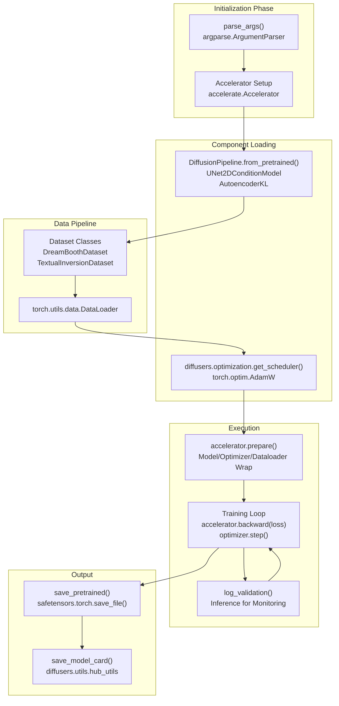
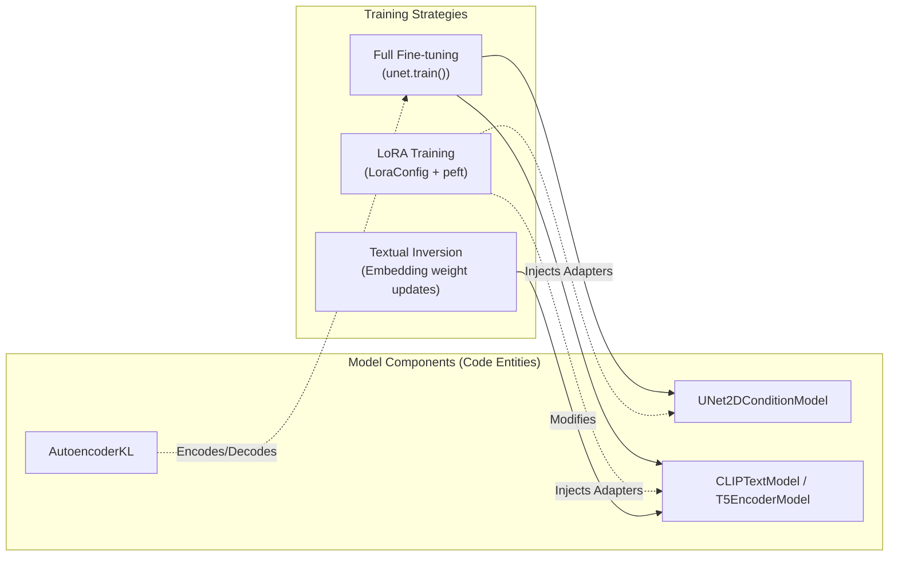

<!-- source: DeepWiki mcp.deepwiki.com · repo huggingface/diffusers · page 5 Training and Fine-tuning · fetched 2026-10-21 -->

# Training and Fine-tuning

Relevant source files

The following files were used as context for generating this wiki page:

- [examples/README.md](examples/README.md)
- [examples/dreambooth/train_dreambooth.py](examples/dreambooth/train_dreambooth.py)
- [examples/dreambooth/train_dreambooth_flax.py](examples/dreambooth/train_dreambooth_flax.py)
- [examples/dreambooth/train_dreambooth_lora.py](examples/dreambooth/train_dreambooth_lora.py)
- [examples/reinforcement_learning/README.md](examples/reinforcement_learning/README.md)
- [examples/reinforcement_learning/diffusion_policy.py](examples/reinforcement_learning/diffusion_policy.py)
- [examples/reinforcement_learning/run_diffuser_locomotion.py](examples/reinforcement_learning/run_diffuser_locomotion.py)
- [examples/text_to_image/train_text_to_image.py](examples/text_to_image/train_text_to_image.py)
- [examples/text_to_image/train_text_to_image_flax.py](examples/text_to_image/train_text_to_image_flax.py)
- [examples/text_to_image/train_text_to_image_lora.py](examples/text_to_image/train_text_to_image_lora.py)
- [examples/textual_inversion/textual_inversion.py](examples/textual_inversion/textual_inversion.py)
- [examples/textual_inversion/textual_inversion_flax.py](examples/textual_inversion/textual_inversion_flax.py)
- [examples/unconditional_image_generation/train_unconditional.py](examples/unconditional_image_generation/train_unconditional.py)
- [setup.py](setup.py)
- [src/diffusers/dependency_versions_table.py](src/diffusers/dependency_versions_table.py)
- [src/diffusers/utils/__init__.py](src/diffusers/utils/__init__.py)
- [src/diffusers/utils/constants.py](src/diffusers/utils/constants.py)
- [src/diffusers/utils/import_utils.py](src/diffusers/utils/import_utils.py)
- [src/diffusers/utils/testing_utils.py](src/diffusers/utils/testing_utils.py)

## Purpose and Scope

This document covers the training and fine-tuning infrastructure in the `diffusers` library, including training scripts, dataset implementations, optimization techniques, and validation workflows. The training system enables users to:

- Fine-tune pre-trained diffusion models on custom datasets.
- Perform parameter-efficient fine-tuning using LoRA and DoRA.
- Personalize models with DreamBooth and Textual Inversion.
- Train specialized models like ControlNet and T2I-Adapter.

For detailed information on specific methods, see the following child pages:
- [Training Scripts Overview](#5.1) — Overview of the training script architecture and Accelerate integration.
- [DreamBooth Training](#5.2) — Personalizing models with few images using prior preservation.
- [LoRA Training](#5.3) — Parameter-efficient fine-tuning for SDXL, SD3, and Flux.
- [Textual Inversion](#5.4) — Learning new concepts through custom token embeddings.
- [Training Infrastructure](#5.5) — Data loading, logging, validation, and distributed training utilities.

---

## Training Script Architecture

All training scripts in the `examples/` directory follow a consistent architecture pattern that integrates model loading, dataset preparation, training loop execution, and validation using the `accelerate` library.

### Common Script Structure

The following diagram maps the high-level training stages to specific code entities and functions found in the standard training scripts.

**Sources:** [examples/dreambooth/train_dreambooth.py:807-1200](), [examples/text_to_image/train_text_to_image.py:528-1045](), [examples/textual_inversion/textual_inversion.py:190-250]()

### Script Categories

| Script Type           | Purpose                           | Example Script                   | Parameters Trained                                           |
|----------------------|---------------------------------|---------------------------------|------------------------------------------------------------|
| **Full Fine-tuning**   | Train all model parameters       | `train_text_to_image.py`         | `UNet2DConditionModel`, optionally Text Encoder            |
| **DreamBooth**         | Few-shot subject personalization | `train_dreambooth.py`            | UNet + Text Encoder with prior preservation                 |
| **LoRA Fine-tuning**   | Parameter-efficient adaptation   | `train_text_to_image_lora.py`    | Low-rank matrices injected via `peft`                       |
| **DreamBooth LoRA**    | Personalization with LoRA        | `train_dreambooth_lora.py`       | LoRA adapters in UNet/Text Encoder                          |
| **Textual Inversion**  | Learn new concept embeddings     | `textual_inversion.py`           | `text_encoder.get_input_embeddings()`                       |
| **Unconditional**      | Train from scratch/Fine-tune     | `train_unconditional.py`         | `UNet2DModel`                                               |
| **Flax/JAX Support**   | TPUs and High-performance        | `train_text_to_image_flax.py`    | `FlaxUNet2DConditionModel`                                  |

**Sources:** [examples/dreambooth/train_dreambooth.py:1-60](), [examples/text_to_image/train_text_to_image_lora.py:16-58](), [examples/textual_inversion/textual_inversion.py:1-60](), [examples/unconditional_image_generation/train_unconditional.py:1-30](), [examples/text_to_image/train_text_to_image_flax.py:40-46]()

---

## Training Methods Overview

### Conceptual Model to Code Mapping

This diagram illustrates how different training strategies interact with the core code components of a diffusion system.

**Sources:** [examples/dreambooth/train_dreambooth_lora.py:38-56](), [examples/textual_inversion/textual_inversion.py:175-188](), [src/diffusers/training_utils.py:22-24]()

### Method Comparison

| Method             | Parameters            | Memory            | Training Time | Use Case                              |
|--------------------|----------------------|-------------------|---------------|-------------------------------------|
| **Full Fine-tuning** | All (~1B)            | High (24GB+)      | Slow          | Domain adaptation (e.g., Anime, Medical) |
| **LoRA**            | ~1M - 10M             | Low (12GB)        | Fast          | Style transfer, specific character learning |
| **DreamBooth**      | All (~1B)              | High (24GB+)      | Medium        | Subject personalization (3-5 images)      |
| **Textual Inversion** | ~1k–4k params         | Minimal (8GB)      | Very Fast     | Single concept/object learning          |

For details on method-specific logic, see [DreamBooth Training](#5.2), [LoRA Training](#5.3), and [Textual Inversion](#5.4).

---

## Dataset Implementation

### DreamBoothDataset Class

The `DreamBoothDataset` handles loading "instance" images that represent the subject to learn. It optionally loads "class" images to enable prior preservation, helping the model retain knowledge about general concepts during fine-tuning. The dataset uses image transformations powered by `torchvision.transforms` and applies tokenization with the pipeline's tokenizer.

**Implementation:** [examples/dreambooth/train_dreambooth.py:611-707]()

### TextualInversionDataset

For textual inversion training, this specialized dataset generates samples by applying textual templates (e.g., `"a photo of a {}"`) with a `placeholder_token` to learn custom token embeddings. It supports multiple PIL interpolation modes for image resizing to ensure high-quality inputs.

**Implementation:** [examples/textual_inversion/textual_inversion.py:507-590](), [examples/textual_inversion/textual_inversion.py:65-80]()

---

## Training Infrastructure

### Accelerate Integration

All training scripts utilize Hugging Face's `accelerate.Accelerator` for enabling distributed training, mixed precision (FP16/BF16), and seamless device management. The core call to `accelerator.prepare()` wraps the models, optimizers, and dataloaders, facilitating multi-GPU and mixed precision training without extra boilerplate.

**Sources:** [examples/dreambooth/train_dreambooth.py:814-858](), [examples/text_to_image/train_text_to_image.py:546-579]()

### Key Training Utilities

Standardized patterns and helper classes are provided in `diffusers.training_utils`:

- **Signal-to-Noise Ratio Weighting:** The `compute_snr` utility adjusts loss terms to rebalance training as prescribed in "Min-SNR Diffusion Training" literature, improving training stability and quality [src/diffusers/training_utils.py:81-115]().

- **Exponential Moving Average (EMA):** `EMAModel` maintains a smoothed average of model weights during training, which is critical for improved inference stability and avoiding overfitting [src/diffusers/training_utils.py:26](), [examples/text_to_image/train_text_to_image.py:48]().

- **Learning Rate Scheduling:** The function `get_scheduler` provides many popular LR schedules such as cosine, linear, and constant with warmup to adapt training dynamics to different use cases [examples/dreambooth/train_dreambooth.py:55]().

- **Memory Management:** Functions like `free_memory` are used during validation phases to clear GPU caches effectively, helping reduce fragmentation and avoid out-of-memory errors [examples/dreambooth/train_dreambooth_lora.py:61]().

---

## Validation and Monitoring

### log_validation Function

This function is invoked periodically during training to generate image samples using the current model checkpoint wrapped inside a `DiffusionPipeline` instance. It supports generating images from validation prompts or evaluating fixed images for img2img scenarios. Outputs are logged for visualization in TensorBoard or Weights & Biases (`wandb`), helping monitor qualitative model improvements during training.

**Sources:**  
- DreamBooth: [examples/dreambooth/train_dreambooth.py:116-205]()  
- Text-to-image: [examples/text_to_image/train_text_to_image.py:141-197]()  
- Textual Inversion: [examples/textual_inversion/textual_inversion.py:123-172]()

### Model Card Generation

After training, `save_model_card` is used to create a model card (`README.md`) in the output folder or repository. This card summarizes the training hyperparameters, dataset details, and provides example images produced by the model. It uses helper functions from `diffusers.utils.hub_utils` to manage metadata, tags, and repository integration for HuggingFace Hub.

**Sources:**  
- DreamBooth: [examples/dreambooth/train_dreambooth.py:72-113]()  
- Text-to-image: [examples/text_to_image/train_text_to_image.py:69-139]()  
- Textual Inversion: [examples/textual_inversion/textual_inversion.py:90-121]()

---

This page provides a high-level overview of diffusers’ training and fine-tuning ecosystem. For deeper technical details and code walkthroughs, please consult the dedicated child pages listed above.

---

