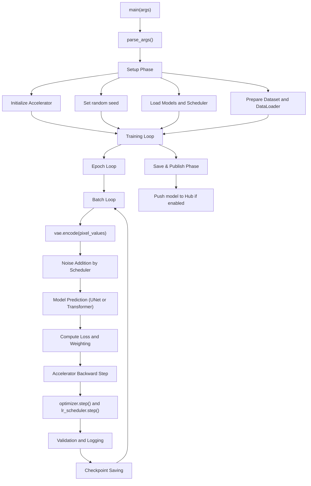
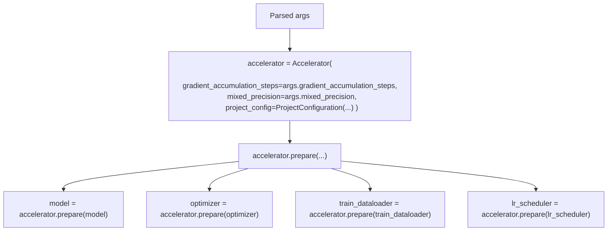
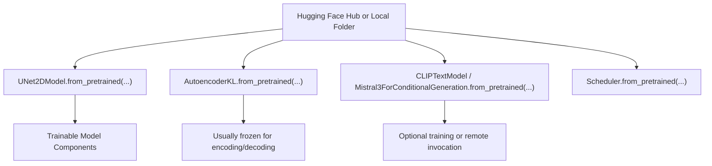
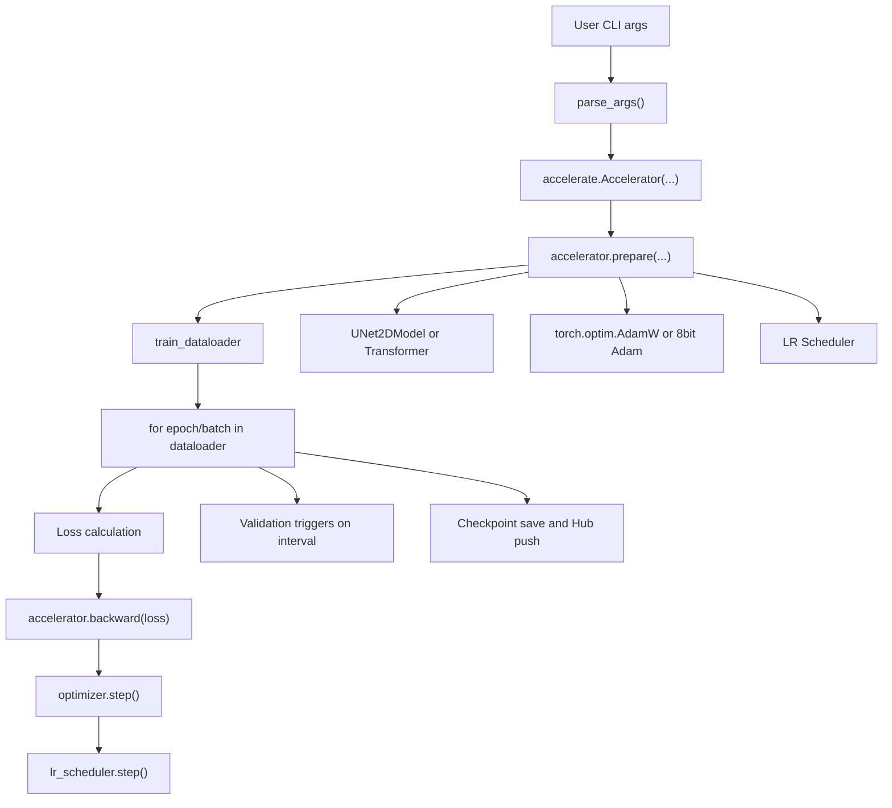

<!-- source: DeepWiki mcp.deepwiki.com · repo huggingface/diffusers · page 5.1 Training Scripts Overview · fetched 2026-10-21 -->

# Training Scripts Overview

Relevant source files

The following files were used as context for generating this wiki page:

- [examples/README.md](examples/README.md)
- [examples/reinforcement_learning/README.md](examples/reinforcement_learning/README.md)
- [examples/reinforcement_learning/diffusion_policy.py](examples/reinforcement_learning/diffusion_policy.py)
- [examples/reinforcement_learning/run_diffuser_locomotion.py](examples/reinforcement_learning/run_diffuser_locomotion.py)
- [examples/research_projects/dreambooth_inpaint/train_dreambooth_inpaint.py](examples/research_projects/dreambooth_inpaint/train_dreambooth_inpaint.py)
- [examples/research_projects/dreambooth_inpaint/train_dreambooth_inpaint_lora.py](examples/research_projects/dreambooth_inpaint/train_dreambooth_inpaint_lora.py)
- [examples/research_projects/intel_opts/textual_inversion/textual_inversion_bf16.py](examples/research_projects/intel_opts/textual_inversion/textual_inversion_bf16.py)
- [examples/research_projects/multi_subject_dreambooth/train_multi_subject_dreambooth.py](examples/research_projects/multi_subject_dreambooth/train_multi_subject_dreambooth.py)
- [examples/research_projects/onnxruntime/README.md](examples/research_projects/onnxruntime/README.md)
- [examples/research_projects/onnxruntime/text_to_image/README.md](examples/research_projects/onnxruntime/text_to_image/README.md)
- [examples/research_projects/onnxruntime/text_to_image/train_text_to_image.py](examples/research_projects/onnxruntime/text_to_image/train_text_to_image.py)
- [examples/research_projects/onnxruntime/textual_inversion/README.md](examples/research_projects/onnxruntime/textual_inversion/README.md)
- [examples/research_projects/onnxruntime/textual_inversion/textual_inversion.py](examples/research_projects/onnxruntime/textual_inversion/textual_inversion.py)
- [examples/research_projects/onnxruntime/unconditional_image_generation/README.md](examples/research_projects/onnxruntime/unconditional_image_generation/README.md)
- [examples/research_projects/onnxruntime/unconditional_image_generation/train_unconditional.py](examples/research_projects/onnxruntime/unconditional_image_generation/train_unconditional.py)
- [examples/unconditional_image_generation/README.md](examples/unconditional_image_generation/README.md)

## Purpose and Scope

This document provides a comprehensive overview of the architecture, common coding patterns, and integration with the [🤗 Accelerate](https://github.com/huggingface/accelerate) library underlying the training scripts in the Diffusers repository. Training scripts are primarily located under the `examples/` directory and serve as self-contained, easy-to-tweak educational examples demonstrating how to fine-tune and train diffusion models on various tasks. These scripts emphasize clarity and beginner-friendliness rather than state-of-the-art optimization techniques [examples/README.md:16-29]().

This page acts as a foundation for understanding the training codebase, supplementing specialized training methods such as DreamBooth, LoRA, and textual inversion described in other sections.

---

## Common Script Structure

Training scripts across Diffusers share a consistent structure that organizes the workflow into input argument parsing, environment setup, model and dataset loading, training, validation, checkpointing, and optionally pushing models to the Hugging Face Hub.

### Typical Execution Flow

The training process generally follows this sequence:

This flow abstracts all core training activities, ensuring scripts accommodate distributed training, mixed precision, and checkpointing [examples/dreambooth/train_dreambooth_lora_flux2.py:190-230](), [examples/dreambooth/train_dreambooth_lora_flux2.py:113-188](), [examples/README.md:37-45]().

### Argument Parsing and Configuration

Each script implements a `parse_args()` function that provides a comprehensive set of CLI arguments controlling:

| Category         | Common Arguments                                         | Purpose                                                                                     |
|------------------|----------------------------------------------------------|---------------------------------------------------------------------------------------------|
| Model and Tokenizer | `--pretrained_model_name_or_path`, `--tokenizer_name`    | Load pretrained components from Hugging Face Hub or local checkpoint                         |
| Dataset          | `--dataset_name`, `--train_data_dir`, `--resolution`, `--center_crop`, `--random_flip` | Configure dataset source, input image size, and augmentation                                |
| Training         | `--train_batch_size`, `--num_epochs`, `--max_train_steps`, `--gradient_accumulation_steps` | Core training parameters and scheduling                                                    |
| Optimization     | `--learning_rate`, `--lr_scheduler`, `--lr_warmup_steps`, `--use_8bit_adam`, `--adam_beta1`, `--adam_beta2` | Control optimization algorithm and learning rate schedule                                  |
| Precision and Performance | `--mixed_precision`, `--gradient_checkpointing`, `--scale_lr`               | Half-precision training and memory-saving techniques                                       |
| Validation       | `--validation_prompt`, `--num_validation_images`, `--validation_epochs` | Periodic validation during training                                                        |
| Output and Logging | `--output_dir`, `--push_to_hub`, `--overwrite_output_dir`, `--logger` | Save model/checkpoint outputs and logging configuration                                    |

Typical argument parsing infrastructure is extensive and tailored for each training type, but consistent in exposing these critical categories [examples/dreambooth/train_dreambooth_lora_flux2.py:35-90](), [examples/research_projects/onnxruntime/text_to_image/train_text_to_image.py:117-190]().

---

## Integration with 🤗 Accelerate

All training scripts leverage the `Accelerator` class from the `accelerate` library to enable streamlined multi-GPU, mixed precision, and distributed training with minimal user intervention.

### Accelerator Initialization and Usage

The `Accelerator` is configured early in the setup phase with parameters such as gradient accumulation steps and mixed precision mode set from script arguments.

The `prepare` method wraps data loaders, models, optimizers, and schedulers to handle device placement, distributed synchronization, mixed precision casting, and efficient gradient accumulation. This enables code to remain largely framework-agnostic [examples/dreambooth/train_dreambooth_lora_flux2.py:52-54](), [examples/README.md:37-45]().

---

## Training Utilities and Helper Functions

The training scripts commonly employ helper utilities defined in `src/diffusers/training_utils.py`:

- **`set_seed(seed)`**: Sets Python random, NumPy, and PyTorch generators' seeds for reproducible training [src/diffusers/training_utils.py:61-79]().
  
- **`compute_snr(noise_scheduler, timesteps)`**: Calculates signal-to-noise ratio for weighting losses, useful for Min-SNR loss strategies [src/diffusers/training_utils.py:81-115]().
  
- **`EMAModel`**: Implements exponential moving average weight tracking to stabilize training [tests/others/test_ema.py:30-43]().
  
- **`compute_confidence_aware_loss`**: Specialized loss function combining supervised loss and confidence-based penalty (used in certain classification head training) [src/diffusers/training_utils.py:118-182]().

These utilities are used broadly to improve stability, reproducibility, and extensibility of training workflows.

---

## Model and Component Loading

### Loading Pretrained Models and Scheduler

Training scripts utilize the Hugging Face `from_pretrained()` mechanism across core components to load pretrained weights:

- **UNet / Transformer models** for the diffusion network (e.g. `UNet2DModel`, `Flux2Transformer2DModel`)  
- **Autoencoder models** (e.g. `AutoencoderKL`) for latent space encoding/decoding  
- **Text encoders** (e.g. `CLIPTextModel`, `Mistral3ForConditionalGeneration`) for conditioning  
- **Schedulers** (e.g. `DDPMScheduler`, `DPMSolverMultistepScheduler`, `FlowMatchEulerDiscreteScheduler`) to define the noise diffusion process.

Visualized as:

This pattern allows scripts to be flexible about which components to fine-tune versus keep frozen. Advanced options include remotely offloading large text encoders and caching latents to minimize memory footprint [examples/dreambooth/train_dreambooth_lora_flux2.py:69-75](), [examples/dreambooth/README_flux2.md:105-134]().

---

## Memory Optimization Strategies

Several options are supported across scripts to reduce GPU memory pressure:

| Strategy                | Description                                                                                           | Example Option                 |
|-------------------------|---------------------------------------------------------------------------------------------------|-------------------------------|
| Remote Text Encoder     | Compute text encoder embeddings remotely via API, avoiding model loading                           | `--remote_text_encoder`        |
| CPU Offloading          | Offload rarely used components (e.g., VAE, Text Encoder) to CPU memory dynamically                 | `--offload`                   |
| Latent Caching          | Pre-encode images into latents and discard the VAE from GPU                                      | `--cache_latents`             |
| Quantization            | Use lower precision numeric formats in weights and optimizer (e.g., FP8, NF4)                      | `--do_fp8_training`, `--bnb_quantization_config_path` |
| Gradient Checkpointing  | Recompute intermediate activations on backward pass to save memory                                | `--gradient_checkpointing`    |

These strategies enable larger batch sizes or bigger models on given hardware at the expense of increased compute or complexity [examples/dreambooth/README_flux2.md:101-141]().

---

## Optimizers and Learning Rate Schedulers

### Optimization Choices

- Default optimizers generally use `torch.optim.AdamW` for stable convergence.
- Memory-efficient optimizer variants, such as 8-bit Adam from `bitsandbytes`, are optionally enabled using `--use_8bit_adam`.
- Some scripts support advanced optimizers like Prodigy and custom schedulers.
- Optimizer construction and scheduler fetching typically use the utility `get_scheduler` from `diffusers.optimization` to harmonize supported scheduler types.

### Learning Rate Scheduler

Common scheduler strategies supported include:

- **linear**
- **cosine**
- **cosine_with_restarts**
- **polynomial**
- **constant**
- **constant_with_warmup**

These are configured via CLI (`--lr_scheduler`) and integrated into the training loop to update learning rate per step [examples/dreambooth/train_dreambooth_lora_flux2.py:31-32,75-77]().

---

## Validation, Logging, and Checkpointing

Periodic validation is performed during training to monitor model performance. Common practices include:

- Building an inference pipeline from the current model checkpoint using `DiffusionPipeline.from_pretrained()` or specialized pipeline like `StableDiffusionPipeline`.
- Generating images based on validation prompts at intervals specified by the user.
- Logging generated samples to trackers such as TensorBoard or Weights & Biases for visualization.
- Saving intermediate models and checkpoints regularly for fault tolerance and model versioning.
- Optionally pushing checkpoints and trained models to the Hugging Face Hub if enabled.

Typical helper functions involved in validation and logging are found in the example scripts, such as `log_validation()` [examples/research_projects/onnxruntime/text_to_image/train_text_to_image.py:67-115](), [examples/research_projects/multi_subject_dreambooth/train_multi_subject_dreambooth.py:53-153](), [examples/research_projects/onnxruntime/textual_inversion/textual_inversion.py:118-160]().

---

# Bridging Natural Language Concepts to Core Training Code

Below are detailed diagrams that connect abstract concepts described in most documentation or user guides to the corresponding key code entities found in the training scripts.

### Diagram 1: From Natural Language Training Concepts to Code Entities

```mermaid
graph TB
    NAT["Natural Language Training Concepts"]

    NAT --> DataPrep["Dataset loading and preprocessing"]
    NAT --> ModelLoad["Loading pretrained diffusion models"]
    NAT --> TrainingLoop["Epoch and batch processing"]
    NAT --> Optimizer["Optimization and LR scheduling"]
    NAT --> Validation["Validation and logging"]
    NAT --> AcceleratorInterop["Accelerate integration for distributed training"]

    DataPrep --> DatasetDef["Dataset Class (e.g., DreamBoothDataset)"]
    DataPrep --> Dataloader["PyTorch DataLoader"]

    ModelLoad --> ModelFromPretrained["from_pretrained() calls"]
    ModelLoad --> ComponentClasses["UNet, VAE, TextEncoder, Scheduler classes"]

    TrainingLoop --> BatchProcessing["for batch in dataloader"]
    TrainingLoop --> ForwardPass["vae.encode() → noise_scheduler.add_noise() → unet(latents, t)"]
    TrainingLoop --> LossComputation["compute_loss_weighting_for_sd3() or compute_snr_loss()"]

    Optimizer --> AdamOpt["torch.optim.AdamW or bitsandbytes.Adam8bit"]
    Optimizer --> Scheduler["get_scheduler()"]

    Validation --> ValFunc["log_validation()"]

    AcceleratorInterop --> AcceleratorInit["accelerator = Accelerator()"]
    AcceleratorInterop --> PrepareWrap["accelerator.prepare(model, optimizer, dataloader)"]
```

### Diagram 2: Mapping Accelerate Workflow to Training Codebase

---

## Summary

This overview captures the key aspects of the Diffusers training scripts architecture:

- A consistent, modular training flow enabling extensibility and maintainability.
- Rich argument parsing supporting flexible customization for different tasks.
- Deep integration with 🤗 Accelerate for distributed and mixed precision training.
- Standardized usages of pretrained component loading via the Hugging Face ecosystem.
- Robust training utilities for reproducibility, loss computations, and model stabilization.
- Strategies for memory and optimizer management tuned for large diffusion models.
- Validation and logging facilities integrated with popular tracking tools.
  
This foundation is leveraged by all specific training recipe scripts, including DreamBooth, LoRA fine-tuning, and textual inversion, and facilitates collaborative community extension.

---

### Sources

- [examples/README.md:16-29]()  
- [examples/dreambooth/train_dreambooth_lora_flux2.py:35-90,113-188,190-230]()  
- [examples/research_projects/onnxruntime/text_to_image/train_text_to_image.py:67-115,117-190]()  
- [examples/research_projects/multi_subject_dreambooth/train_multi_subject_dreambooth.py:53-153]()  
- [examples/research_projects/onnxruntime/textual_inversion/textual_inversion.py:118-160]()  
- [src/diffusers/training_utils.py:61-182]()  
- [tests/others/test_ema.py:30-43]()  
- [examples/dreambooth/README_flux2.md:101-141]()  
- [examples/dreambooth/train_dreambooth_lora_flux2.py:31-32,52-54,69-75,76-77,80]()  
- [examples/dreambooth/README_z_image.md:107-109,145-146]()

---

