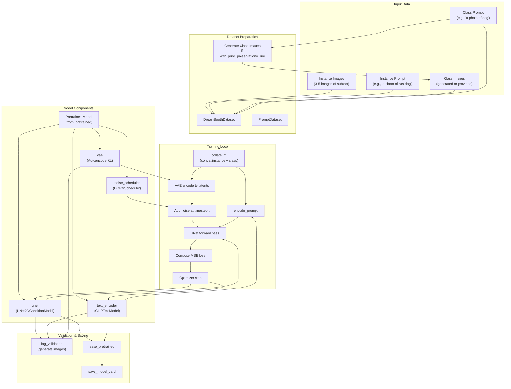
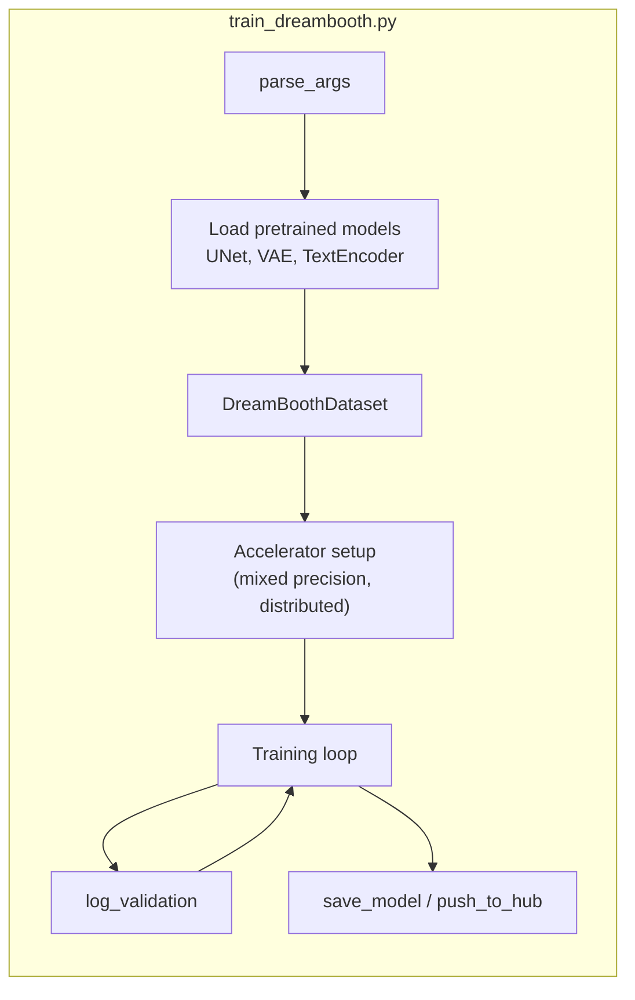
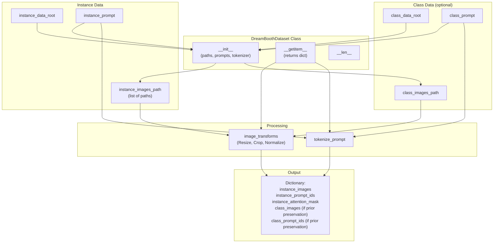
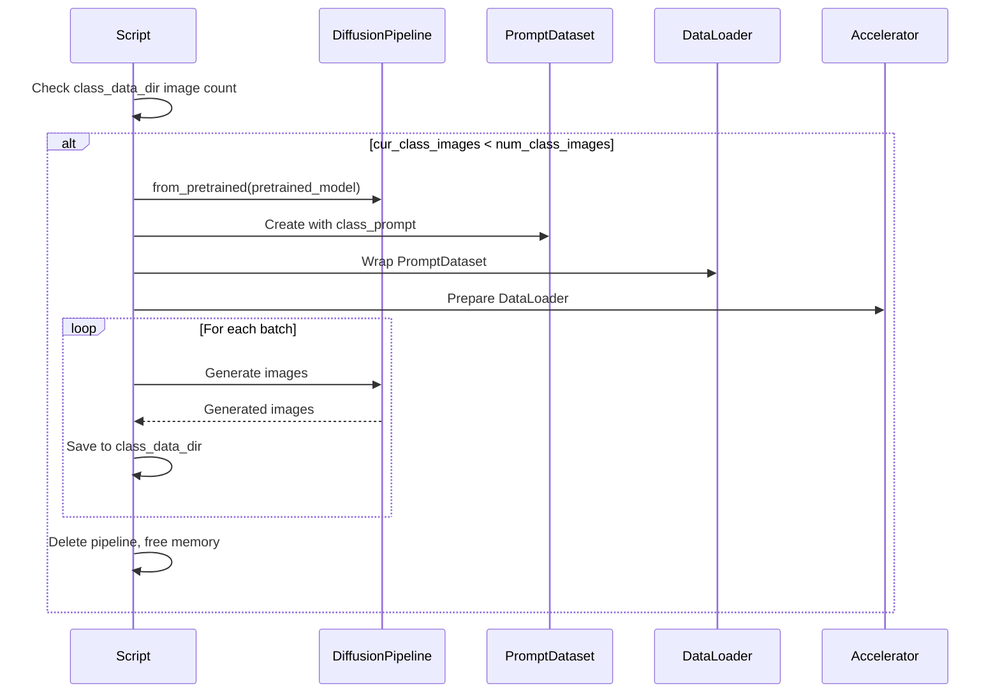
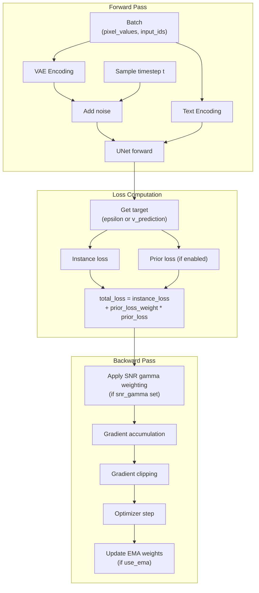
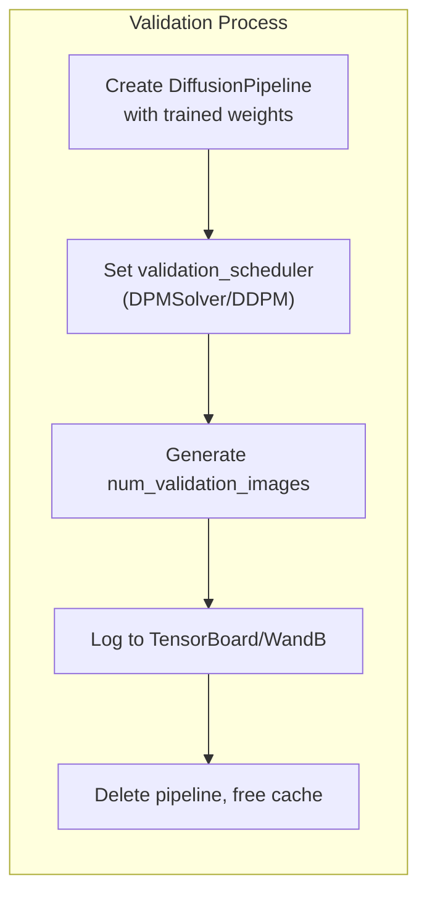
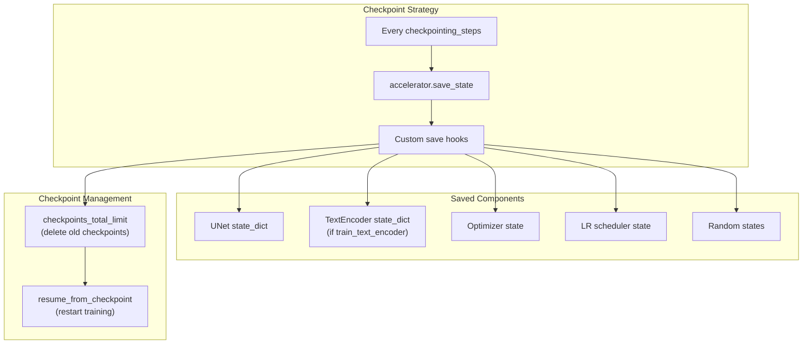

<!-- source: DeepWiki mcp.deepwiki.com · repo huggingface/diffusers · page 5.2 DreamBooth Training · fetched 2026-10-21 -->

# DreamBooth Training

<details>
<summary>Relevant source files</summary>

The following files were used as context for generating this wiki page:

- [examples/advanced_diffusion_training/README.md](examples/advanced_diffusion_training/README.md)
- [examples/advanced_diffusion_training/README_flux.md](examples/advanced_diffusion_training/README_flux.md)
- [examples/advanced_diffusion_training/requirements.txt](examples/advanced_diffusion_training/requirements.txt)
- [examples/advanced_diffusion_training/requirements_flux.txt](examples/advanced_diffusion_training/requirements_flux.txt)
- [examples/advanced_diffusion_training/test_dreambooth_lora_flux_advanced.py](examples/advanced_diffusion_training/test_dreambooth_lora_flux_advanced.py)
- [examples/consistency_distillation/README.md](examples/consistency_distillation/README.md)
- [examples/consistency_distillation/README_sdxl.md](examples/consistency_distillation/README_sdxl.md)
- [examples/consistency_distillation/requirements.txt](examples/consistency_distillation/requirements.txt)
- [examples/consistency_distillation/test_lcm_lora.py](examples/consistency_distillation/test_lcm_lora.py)
- [examples/dreambooth/README.md](examples/dreambooth/README.md)
- [examples/dreambooth/README_flux.md](examples/dreambooth/README_flux.md)
- [examples/dreambooth/README_sdxl.md](examples/dreambooth/README_sdxl.md)
- [examples/dreambooth/requirements.txt](examples/dreambooth/requirements.txt)
- [examples/dreambooth/requirements_flax.txt](examples/dreambooth/requirements_flax.txt)
- [examples/dreambooth/requirements_flux.txt](examples/dreambooth/requirements_flux.txt)
- [examples/dreambooth/requirements_sdxl.txt](examples/dreambooth/requirements_sdxl.txt)
- [examples/dreambooth/test_dreambooth_flux.py](examples/dreambooth/test_dreambooth_flux.py)
- [examples/dreambooth/test_dreambooth_lora_edm.py](examples/dreambooth/test_dreambooth_lora_edm.py)
- [examples/dreambooth/test_dreambooth_lora_flux.py](examples/dreambooth/test_dreambooth_lora_flux.py)
- [examples/dreambooth/train_dreambooth.py](examples/dreambooth/train_dreambooth.py)
- [examples/dreambooth/train_dreambooth_flax.py](examples/dreambooth/train_dreambooth_flax.py)
- [examples/dreambooth/train_dreambooth_lora.py](examples/dreambooth/train_dreambooth_lora.py)
- [examples/text_to_image/README.md](examples/text_to_image/README.md)
- [examples/text_to_image/README_sdxl.md](examples/text_to_image/README_sdxl.md)
- [examples/text_to_image/requirements.txt](examples/text_to_image/requirements.txt)
- [examples/text_to_image/requirements_flax.txt](examples/text_to_image/requirements_flax.txt)
- [examples/text_to_image/requirements_sdxl.txt](examples/text_to_image/requirements_sdxl.txt)
- [examples/text_to_image/train_text_to_image.py](examples/text_to_image/train_text_to_image.py)
- [examples/text_to_image/train_text_to_image_flax.py](examples/text_to_image/train_text_to_image_flax.py)
- [examples/text_to_image/train_text_to_image_lora.py](examples/text_to_image/train_text_to_image_lora.py)
- [examples/textual_inversion/README.md](examples/textual_inversion/README.md)
- [examples/textual_inversion/requirements.txt](examples/textual_inversion/requirements.txt)
- [examples/textual_inversion/requirements_flax.txt](examples/textual_inversion/requirements_flax.txt)
- [examples/textual_inversion/textual_inversion.py](examples/textual_inversion/textual_inversion.py)
- [examples/textual_inversion/textual_inversion_flax.py](examples/textual_inversion/textual_inversion_flax.py)
- [examples/unconditional_image_generation/train_unconditional.py](examples/unconditional_image_generation/train_unconditional.py)
- [setup.py](setup.py)
- [src/diffusers/dependency_versions_table.py](src/diffusers/dependency_versions_table.py)
- [src/diffusers/utils/__init__.py](src/diffusers/utils/__init__.py)
- [src/diffusers/utils/constants.py](src/diffusers/utils/constants.py)
- [src/diffusers/utils/import_utils.py](src/diffusers/utils/import_utils.py)
- [src/diffusers/utils/testing_utils.py](src/diffusers/utils/testing_utils.py)

</details>


DreamBooth training enables personalization of diffusion models by fine-tuning them on a small set of images (typically 3-5) of a specific subject. This allows the model to generate new images of that subject in different contexts while maintaining the subject's identity. For general LoRA training techniques, see [LoRA Training](#5.3). For textual inversion-based personalization, see [Textual Inversion](#5.4).

## Overview

DreamBooth works by fine-tuning the entire UNet (or specific layers via LoRA) using a unique identifier token in the prompt (e.g., "a photo of [V] dog"). The key innovation is **prior preservation loss**, which prevents the model from forgetting how to generate the broader class (e.g., "dog") by mixing class images into the training batch.

The library provides specialized training scripts for various architectures:
- [examples/dreambooth/train_dreambooth.py]() - Full fine-tuning for Stable Diffusion 1.5/2.1.
- [examples/dreambooth/train_dreambooth_lora.py]() - LoRA-based DreamBooth for SD 1.5/2.1 [examples/dreambooth/train_dreambooth_lora.py:1-78]().
- [examples/dreambooth/train_dreambooth_lora_sdxl.py]() - Specialized script for SDXL [examples/dreambooth/train_dreambooth_lora_sdxl.py:1-61]().
- [examples/dreambooth/train_dreambooth_lora_sd3.py]() - Support for Stable Diffusion 3/3.5 [examples/dreambooth/train_dreambooth_lora_sd3.py:90-97]().
- [examples/advanced_diffusion_training/train_dreambooth_lora_sdxl_advanced.py]() - Advanced SDXL training with features like Pivotal Tuning [examples/advanced_diffusion_training/train_dreambooth_lora_sdxl_advanced.py:160-172]().

Sources: [examples/dreambooth/train_dreambooth.py:1-67](), [examples/dreambooth/train_dreambooth_lora.py:1-78](), [examples/dreambooth/train_dreambooth_lora_sd3.py:1-76]()

## DreamBooth Training Workflow



**Workflow: DreamBooth Training Pipeline**

Sources: [examples/dreambooth/train_dreambooth.py:807-1456]()

## Core Concepts

### Instance vs Class Images

| Concept | Description | Example |
|---------|-------------|---------|
| **Instance Images** | Photos of the specific subject to personalize | 3-5 images of your dog |
| **Instance Prompt** | Prompt with unique identifier for the subject | `"a photo of sks dog"` |
| **Class Images** | Images representing the general class | 100+ images of various dogs |
| **Class Prompt** | Generic prompt for the class | `"a photo of dog"` |
| **Unique Identifier** | Rare token to represent the subject | `sks`, `V`, `xyz123` |

The unique identifier should be a rare token (checked via `tokenizer.encode()`) to avoid colliding with existing concepts in the model's vocabulary.

Sources: [examples/dreambooth/train_dreambooth.py:260-302]()

### Prior Preservation Loss

Prior preservation prevents catastrophic forgetting by including class images in training. The total loss combines instance and class losses:

```
total_loss = instance_loss + prior_loss_weight * prior_loss
```

When `--with_prior_preservation` is enabled:
1. Class images are generated if fewer than `--num_class_images` exist in `--class_data_dir` [examples/dreambooth/train_dreambooth.py:860-906]().
2. Class images are generated using the base model with `--class_prompt` [examples/dreambooth/train_dreambooth.py:745-759]().
3. During training, each batch contains both instance and class images concatenated [examples/dreambooth/train_dreambooth.py:710-742]().
4. Loss is computed separately for instance and class predictions [examples/dreambooth/train_dreambooth.py:1387-1422]().
5. The `--prior_loss_weight` (default 1.0) balances the two objectives [examples/dreambooth/train_dreambooth.py:291]().

Sources: [examples/dreambooth/train_dreambooth.py:860-906](), [examples/dreambooth/train_dreambooth.py:1387-1422]()

## Training Scripts

### Full DreamBooth Training



**Script: train_dreambooth.py Structure**

The main script [examples/dreambooth/train_dreambooth.py]() trains by:
- Freezing VAE parameters: `vae.requires_grad_(False)` [examples/dreambooth/train_dreambooth.py:1009]().
- Optionally training text encoder with `--train_text_encoder` [examples/dreambooth/train_dreambooth.py:329-332]().
- Using `Accelerator` for distributed training and mixed precision [examples/dreambooth/train_dreambooth.py:818-823]().
- Implementing gradient checkpointing to save memory [examples/dreambooth/train_dreambooth.py:1043-1047]().

Sources: [examples/dreambooth/train_dreambooth.py:807-1456]()

### LoRA DreamBooth Training

The LoRA variant [examples/dreambooth/train_dreambooth_lora.py]() reduces memory and compute by training low-rank adapter matrices.

**Key Differences from Full Training:**

| Aspect | Full Training | LoRA Training |
|--------|---------------|---------------|
| **Parameters trained** | All UNet/TextEncoder weights | Low-rank adapter matrices |
| **Memory usage** | ~24GB VRAM | ~12GB VRAM |
| **Training speed** | Slower | Faster |
| **Output format** | Full model checkpoint | Adapter weights only |
| **Learning rate** | `5e-6` (default) | `5e-4` (default) |
| **Rank parameter** | N/A | `--rank` (default 4) |

The LoRA integration uses the PEFT library [examples/dreambooth/train_dreambooth_lora.py:38-39](). It injects LoRA layers into target modules such as `to_k`, `to_q`, `to_v`.

Sources: [examples/dreambooth/train_dreambooth_lora.py:38-39]()

## DreamBoothDataset



**Dataset: DreamBoothDataset Structure**

The `DreamBoothDataset` class [examples/dreambooth/train_dreambooth.py:611-707]() handles:

1. **Instance Image Loading**: Reads images from `instance_data_root`, applies EXIF transpose [examples/dreambooth/train_dreambooth.py:652-653]().
2. **Image Transforms**: Resize to `--resolution`, center/random crop, normalize to [-1, 1] [examples/dreambooth/train_dreambooth.py:633-640]().
3. **Prompt Tokenization**: Tokenizes prompts with optional custom `tokenizer_max_length` [examples/dreambooth/train_dreambooth.py:688-701]().
4. **Prior Preservation**: If enabled, includes class images by cycling through class data [examples/dreambooth/train_dreambooth.py:674-678]().
5. **Dataset Length**: Maximum of instance and class image counts when using prior preservation [examples/dreambooth/train_dreambooth.py:666-669]().

The `collate_fn` [examples/dreambooth/train_dreambooth.py:710-742]() concatenates instance and class examples into a single batch for efficient training.

Sources: [examples/dreambooth/train_dreambooth.py:611-742]()

## Class Image Generation

When prior preservation is enabled and insufficient class images exist:



**Sequence: Class Image Generation**

The generation process [examples/dreambooth/train_dreambooth.py:860-906]():
1. Instantiates a `DiffusionPipeline` with the base model [examples/dreambooth/train_dreambooth.py:873-879]().
2. Creates a `PromptDataset` with `class_prompt` repeated `num_new_images` times [examples/dreambooth/train_dreambooth.py:745-759]().
3. Generates images in batches using `sample_batch_size` [examples/dreambooth/train_dreambooth.py:887-891]().
4. Saves images with SHA1 hash in filename to prevent duplicates [examples/dreambooth/train_dreambooth.py:898-902]().
5. Cleans up pipeline to free GPU memory before training [examples/dreambooth/train_dreambooth.py:904-906]().

Sources: [examples/dreambooth/train_dreambooth.py:860-906](), [examples/dreambooth/train_dreambooth.py:745-759]()

## Training Loop

### Main Training Step



**Diagram: Training Step Components**

The training loop [examples/dreambooth/train_dreambooth.py:1228-1422]() implements:

1. **Text Encoding**: `encode_prompt()` generates prompt embeddings [examples/dreambooth/train_dreambooth.py:789-804]().
2. **VAE Encoding**: Converts pixel values to latent space, scaled by `vae.config.scaling_factor` [examples/dreambooth/train_dreambooth.py:1309-1311]().
3. **Noise Addition**: Samples timestep `t` and adds noise via `noise_scheduler.add_noise()` [examples/dreambooth/train_dreambooth.py:1326-1330]().
4. **Prediction**: UNet predicts noise residual or velocity based on `prediction_type` [examples/dreambooth/train_dreambooth.py:1345-1350]().
5. **Loss Calculation**:
   - With prior preservation: Split predictions and compute separate losses [examples/dreambooth/train_dreambooth.py:1387-1422]().
   - SNR gamma weighting: Rebalances loss across timesteps [examples/dreambooth/train_dreambooth.py:1356-1363]().
   - Offset noise: Improves dark/light image generation [examples/dreambooth/train_dreambooth.py:1335-1343]().

Sources: [examples/dreambooth/train_dreambooth.py:1228-1422]()

### Prior Preservation Loss Implementation

```python
# Split batch into instance and class parts
model_pred, model_pred_prior = torch.chunk(model_pred, 2, dim=0)
target, target_prior = torch.chunk(target, 2, dim=0)

# Compute instance loss
loss = F.mse_loss(model_pred.float(), target.float(), reduction="mean")

# Compute prior loss
prior_loss = F.mse_loss(model_pred_prior.float(), target_prior.float(), reduction="mean")

# Combine with weight
loss = loss + args.prior_loss_weight * prior_loss
```

Sources: [examples/dreambooth/train_dreambooth.py:1387-1422]()

## Command Line Arguments

### Essential Arguments

| Argument | Type | Default | Description |
|----------|------|---------|-------------|
| `--pretrained_model_name_or_path` | str | required | Base model from Hub or local path |
| `--instance_data_dir` | str | required | Folder with subject images |
| `--instance_prompt` | str | required | Prompt with unique identifier |
| `--output_dir` | str | `"dreambooth-model"` | Output directory for checkpoints |
| `--resolution` | int | 512 | Training image resolution |
| `--train_batch_size` | int | 4 | Batch size per device |
| `--learning_rate` | float | 5e-6 | Learning rate for optimizer |
| `--max_train_steps` | int | None | Total training steps (overrides epochs) |
| `--num_train_epochs` | int | 1 | Number of training epochs |

Sources: [examples/dreambooth/train_dreambooth.py:232-345]()

### Prior Preservation Arguments

| Argument | Type | Default | Description |
|----------|------|---------|-------------|
| `--with_prior_preservation` | flag | False | Enable prior preservation loss |
| `--class_data_dir` | str | None | Folder for class images |
| `--class_prompt` | str | None | Generic class prompt |
| `--num_class_images` | int | 100 | Minimum class images to generate |
| `--prior_loss_weight` | float | 1.0 | Weight for prior preservation loss |
| `--sample_batch_size` | int | 4 | Batch size for class image generation |

Sources: [examples/dreambooth/train_dreambooth.py:287-302]()

## Validation and Monitoring

### Validation During Training

The `log_validation()` function [examples/dreambooth/train_dreambooth.py:116-205]() generates sample images during training.



**Validation Flow**

Configuration:
- `--validation_prompt`: Prompt for generating validation images [examples/dreambooth/train_dreambooth.py:470]().
- `--num_validation_images`: Number of images to generate (default 4) [examples/dreambooth/train_dreambooth.py:474]().
- `--validation_steps`: Run validation every N steps (default 100) [examples/dreambooth/train_dreambooth.py:479]().
- `--validation_scheduler`: Scheduler for inference (default `"DPMSolverMultistepScheduler"`) [examples/dreambooth/train_dreambooth.py:484]().

The validation temporarily creates a pipeline with current training weights, generates images, logs them to experiment trackers, and cleans up to free memory.

Sources: [examples/dreambooth/train_dreambooth.py:116-205](), [examples/dreambooth/train_dreambooth.py:470-490]()

## Model Saving and Checkpointing

### Checkpoint Saving



**Checkpoint Management**

The script uses custom save/load hooks [examples/dreambooth/train_dreambooth.py:954-988]():

```python
def save_model_hook(models, weights, output_dir):
    for model in models:
        sub_dir = "unet" if isinstance(model, type(unwrap_model(unet))) else "text_encoder"
        model.save_pretrained(os.path.join(output_dir, sub_dir))
        weights.pop()
```

Sources: [examples/dreambooth/train_dreambooth.py:954-988]()

### Final Model Saving

After training completes, the script:

1. **Unwraps models** from Accelerator wrappers [examples/dreambooth/train_dreambooth.py:1456]().
2. **Saves components separately**:
   - UNet: `unet.save_pretrained(os.path.join(output_dir, "unet"))` [examples/dreambooth/train_dreambooth.py:1456]().
   - Text Encoder: `text_encoder.save_pretrained(os.path.join(output_dir, "text_encoder"))` [examples/dreambooth/train_dreambooth.py:1456]().
3. **Creates pipeline**: Uses `DiffusionPipeline.from_pretrained()` to verify and save a complete pipeline [examples/dreambooth/train_dreambooth.py:1456]().
4. **Generates model card**: `save_model_card()` records training info and sample images [examples/dreambooth/train_dreambooth.py:72-113]().
5. **Pushes to Hub**: If `--push_to_hub` is enabled [examples/dreambooth/train_dreambooth.py:1456]().

Sources: [examples/dreambooth/train_dreambooth.py:1456]()

## Usage Examples

### Basic DreamBooth Training

```bash
accelerate launch examples/dreambooth/train_dreambooth.py \
  --pretrained_model_name_or_path="runwayml/stable-diffusion-v1-5" \
  --instance_data_dir="./my_dog" \
  --instance_prompt="a photo of sks dog" \
  --output_dir="./dreambooth-sks-dog" \
  --resolution=512 \
  --train_batch_size=1 \
  --gradient_accumulation_steps=1 \
  --learning_rate=5e-6 \
  --max_train_steps=400
```

### Advanced Models (SDXL & SD3)

For SDXL models, use [examples/dreambooth/train_dreambooth_lora_sdxl.py](). It supports advanced features like dual text encoders and high resolution [examples/dreambooth/train_dreambooth_lora_sdxl.py:1-61]().

For SD3, use [examples/dreambooth/train_dreambooth_lora_sd3.py](). It manages multiple text encoders (CLIP-L, CLIP-G, T5) [examples/dreambooth/train_dreambooth_lora_sd3.py:173-183]() and uses `compute_loss_weighting_for_sd3` [examples/dreambooth/train_dreambooth_lora_sd3.py:60]().

Sources: [examples/dreambooth/train_dreambooth_lora_sdxl.py:1-61](), [examples/dreambooth/train_dreambooth_lora_sd3.py:173-183]()

## Memory Optimization Techniques

| Technique | Flag | Memory Savings | Speed Impact |
|-----------|------|----------------|--------------|
| **Gradient Checkpointing** | `--gradient_checkpointing` | ~30-40% | -20% slower |
| **Mixed Precision (fp16)** | `--mixed_precision="fp16"` | ~50% | Faster |
| **xformers Attention** | `--enable_xformers_memory_efficient_attention` | ~20% | Faster |
| **Gradient Accumulation** | `--gradient_accumulation_steps=4` | Allows larger effective batch | Neutral |
| **8-bit Adam** | `--use_8bit_adam` | ~20% optimizer memory | Slightly slower |
| **Pre-compute Embeddings** | `--pre_compute_text_embeddings` | Removes text encoder from memory | Faster |

Sources: [examples/dreambooth/train_dreambooth.py:384-387](), [examples/dreambooth/train_dreambooth.py:514-515](), [examples/dreambooth/train_dreambooth.py:1043-1047]()

---

