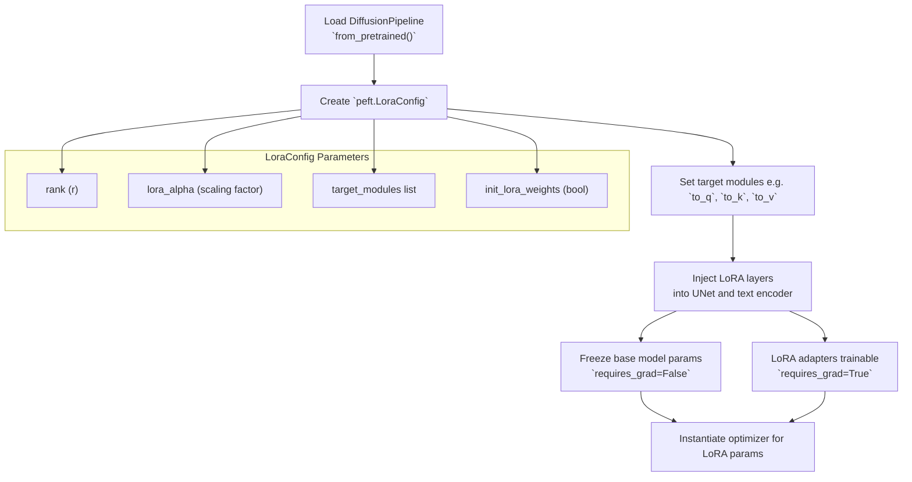
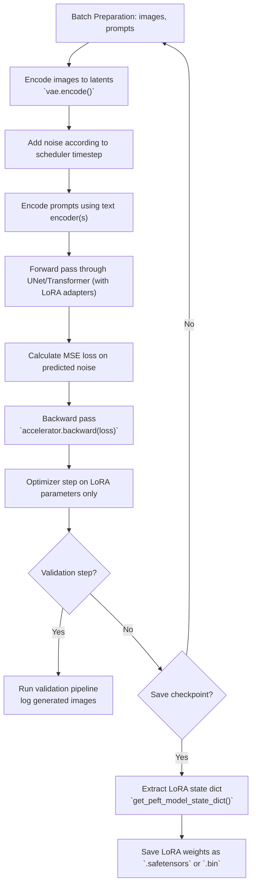

<!-- source: DeepWiki mcp.deepwiki.com · repo huggingface/diffusers · page 5.3 LoRA Training · fetched 2026-10-21 -->

# LoRA Training

<details>
<summary>Relevant source files</summary>

The following files were used as context for generating this wiki page:

- [.ai/.claude-plugin/plugin.json](.ai/.claude-plugin/plugin.json)
- [.ai/.codex-plugin/plugin.json](.ai/.codex-plugin/plugin.json)
- [.ai/plugin.json](.ai/plugin.json)
- [.ai/references/code_style.md](.ai/references/code_style.md)
- [.ai/references/models.md](.ai/references/models.md)
- [.ai/references/modular.md](.ai/references/modular.md)
- [.ai/references/pipelines.md](.ai/references/pipelines.md)
- [.ai/references/pitfalls.md](.ai/references/pitfalls.md)
- [.ai/references/review-rules.md](.ai/references/review-rules.md)
- [docs/source/en/api/models/autoencoder_oobleck.md](docs/source/en/api/models/autoencoder_oobleck.md)
- [docs/source/en/api/models/krea2_transformer2d.md](docs/source/en/api/models/krea2_transformer2d.md)
- [docs/source/en/api/models/stable_audio_transformer.md](docs/source/en/api/models/stable_audio_transformer.md)
- [docs/source/en/api/schedulers/cosine_dpm.md](docs/source/en/api/schedulers/cosine_dpm.md)
- [docs/source/en/training/controlnet.md](docs/source/en/training/controlnet.md)
- [docs/source/en/training/custom_diffusion.md](docs/source/en/training/custom_diffusion.md)
- [docs/source/en/training/instructpix2pix.md](docs/source/en/training/instructpix2pix.md)
- [docs/source/en/training/kandinsky.md](docs/source/en/training/kandinsky.md)
- [docs/source/en/training/lora.md](docs/source/en/training/lora.md)
- [docs/source/en/training/sdxl.md](docs/source/en/training/sdxl.md)
- [docs/source/en/training/t2i_adapters.md](docs/source/en/training/t2i_adapters.md)
- [docs/source/en/training/text2image.md](docs/source/en/training/text2image.md)
- [docs/source/en/training/unconditional_training.md](docs/source/en/training/unconditional_training.md)
- [docs/source/en/using-diffusers/controlling_generation.md](docs/source/en/using-diffusers/controlling_generation.md)
- [examples/advanced_diffusion_training/train_dreambooth_lora_flux_advanced.py](examples/advanced_diffusion_training/train_dreambooth_lora_flux_advanced.py)
- [examples/advanced_diffusion_training/train_dreambooth_lora_sd15_advanced.py](examples/advanced_diffusion_training/train_dreambooth_lora_sd15_advanced.py)
- [examples/advanced_diffusion_training/train_dreambooth_lora_sdxl_advanced.py](examples/advanced_diffusion_training/train_dreambooth_lora_sdxl_advanced.py)
- [examples/controlnet/train_controlnet.py](examples/controlnet/train_controlnet.py)
- [examples/controlnet/train_controlnet_flax.py](examples/controlnet/train_controlnet_flax.py)
- [examples/controlnet/train_controlnet_sdxl.py](examples/controlnet/train_controlnet_sdxl.py)
- [examples/custom_diffusion/train_custom_diffusion.py](examples/custom_diffusion/train_custom_diffusion.py)
- [examples/dreambooth/README_krea2.md](examples/dreambooth/README_krea2.md)
- [examples/dreambooth/README_qwen.md](examples/dreambooth/README_qwen.md)
- [examples/dreambooth/README_sd3.md](examples/dreambooth/README_sd3.md)
- [examples/dreambooth/requirements_krea2.txt](examples/dreambooth/requirements_krea2.txt)
- [examples/dreambooth/test_dreambooth_lora_qwenimage.py](examples/dreambooth/test_dreambooth_lora_qwenimage.py)
- [examples/dreambooth/test_dreambooth_lora_sd3.py](examples/dreambooth/test_dreambooth_lora_sd3.py)
- [examples/dreambooth/test_dreambooth_sd3.py](examples/dreambooth/test_dreambooth_sd3.py)
- [examples/dreambooth/train_dreambooth_flux.py](examples/dreambooth/train_dreambooth_flux.py)
- [examples/dreambooth/train_dreambooth_lora_flux.py](examples/dreambooth/train_dreambooth_lora_flux.py)
- [examples/dreambooth/train_dreambooth_lora_krea2.py](examples/dreambooth/train_dreambooth_lora_krea2.py)
- [examples/dreambooth/train_dreambooth_lora_lumina2.py](examples/dreambooth/train_dreambooth_lora_lumina2.py)
- [examples/dreambooth/train_dreambooth_lora_qwen_image.py](examples/dreambooth/train_dreambooth_lora_qwen_image.py)
- [examples/dreambooth/train_dreambooth_lora_sana.py](examples/dreambooth/train_dreambooth_lora_sana.py)
- [examples/dreambooth/train_dreambooth_lora_sd3.py](examples/dreambooth/train_dreambooth_lora_sd3.py)
- [examples/dreambooth/train_dreambooth_lora_sdxl.py](examples/dreambooth/train_dreambooth_lora_sdxl.py)
- [examples/dreambooth/train_dreambooth_sd3.py](examples/dreambooth/train_dreambooth_sd3.py)
- [examples/flux-control/README.md](examples/flux-control/README.md)
- [examples/flux-control/requirements.txt](examples/flux-control/requirements.txt)
- [examples/flux-control/train_control_flux.py](examples/flux-control/train_control_flux.py)
- [examples/flux-control/train_control_lora_flux.py](examples/flux-control/train_control_lora_flux.py)
- [examples/instruct_pix2pix/train_instruct_pix2pix.py](examples/instruct_pix2pix/train_instruct_pix2pix.py)
- [examples/instruct_pix2pix/train_instruct_pix2pix_sdxl.py](examples/instruct_pix2pix/train_instruct_pix2pix_sdxl.py)
- [examples/kandinsky2_2/text_to_image/train_text_to_image_decoder.py](examples/kandinsky2_2/text_to_image/train_text_to_image_decoder.py)
- [examples/kandinsky2_2/text_to_image/train_text_to_image_lora_decoder.py](examples/kandinsky2_2/text_to_image/train_text_to_image_lora_decoder.py)
- [examples/kandinsky2_2/text_to_image/train_text_to_image_lora_prior.py](examples/kandinsky2_2/text_to_image/train_text_to_image_lora_prior.py)
- [examples/kandinsky2_2/text_to_image/train_text_to_image_prior.py](examples/kandinsky2_2/text_to_image/train_text_to_image_prior.py)
- [examples/t2i_adapter/train_t2i_adapter_sdxl.py](examples/t2i_adapter/train_t2i_adapter_sdxl.py)
- [examples/text_to_image/train_text_to_image_lora_sdxl.py](examples/text_to_image/train_text_to_image_lora_sdxl.py)
- [examples/text_to_image/train_text_to_image_sdxl.py](examples/text_to_image/train_text_to_image_sdxl.py)
- [src/diffusers/models/transformers/transformer_krea2.py](src/diffusers/models/transformers/transformer_krea2.py)
- [src/diffusers/pipelines/krea2/__init__.py](src/diffusers/pipelines/krea2/__init__.py)
- [src/diffusers/pipelines/krea2/pipeline_krea2.py](src/diffusers/pipelines/krea2/pipeline_krea2.py)

</details>


This document covers LoRA (Low-Rank Adaptation) training in the `diffusers` library, enabling parameter-efficient fine-tuning of diffusion models. LoRA training introduces small trainable adapter parameters into pre-trained models, keeping original weights frozen. This yields significant improvements in memory usage, training speed, and storage efficiency.

For LoRA loading and inference usage, see [LoRA System (#6.1)]. For general training infrastructure, see [Training Infrastructure (#5.5)].


## LoRA Training Overview

LoRA is a low-rank adaptation technique that decomposes weight updates into low-rank matrices, drastically reducing trainable parameter count. Instead of fine-tuning all model parameters, LoRA adds trainable adapters that adjust the model's behavior, leveraging the frozen foundation.

### Key Advantages

| Aspect              | Full Fine-tuning         | LoRA Training                         |
|---------------------|-------------------------|-------------------------------------|
| Trainable Parameters | 100% of model           | <1% of model (0.1%–1%)               |
| Memory Usage         | Full model in optimizer | Only adapter weights in optimizer    |
| Training Speed      | Baseline                | 1.5–2× faster                       |
| Storage             | Full checkpoint (~4–8 GB) | Adapter weights only (~10–100 MB)   |
| Multiple Adaptations | Separate full models    | Multiple small adapters              |


### LoRA Training Scripts in `diffusers`

The `diffusers` library provides dedicated LoRA training scripts targeting various diffusion model variants, including SDXL, SD3, Flux, and Qwen-Image.

| Script                                           | Purpose                                | Target Models                                 |
|-------------------------------------------------|--------------------------------------|-----------------------------------------------|
| `examples/dreambooth/train_dreambooth_lora.py`  | DreamBooth with LoRA                  | Stable Diffusion                              |
| `examples/dreambooth/train_dreambooth_lora_sdxl.py` | Subject-driven fine-tuning with LoRA | Stable Diffusion XL (SDXL)                    |
| `examples/dreambooth/train_dreambooth_lora_sd3.py`  | SD3-specific DreamBooth LoRA           | Stable Diffusion 3 (SD3)                      |
| `examples/dreambooth/train_dreambooth_lora_flux.py` | Flux-specific DreamBooth LoRA           | Flux pipeline models                          |
| `examples/text_to_image/train_text_to_image_lora.py` | Standard text-to-image LoRA             | Stable Diffusion                              |
| `examples/text_to_image/train_text_to_image_lora_sdxl.py` | General text-to-image LoRA training     | Stable Diffusion XL (SDXL)                    |
| `examples/advanced_diffusion_training/train_dreambooth_lora_sdxl_advanced.py` | Advanced SDXL LoRA features             | SDXL                                          |

These scripts leverage the HuggingFace `peft` library to inject LoRA adapters and handle parameter-efficient training.

**Sources:**  
[examples/dreambooth/train_dreambooth_lora_sdxl.py:1-42](),  
[examples/text_to_image/train_text_to_image_lora_sdxl.py:1-60](),  
[examples/dreambooth/train_dreambooth_lora_sd3.py:1-70](),  
[examples/dreambooth/train_dreambooth_lora_flux.py:1-90](),  
[examples/advanced_diffusion_training/train_dreambooth_lora_sdxl_advanced.py:1-60]()


## Training Architecture

LoRA training integrates the PEFT (`peft`) library to inject trainable low-rank adapter layers into existing frozen diffusion model components.

### Training Setup Flow

The initialization logic typically involves:

- Loading a pretrained diffusion pipeline.
- Creating a `LoraConfig` specifying adapter parameters (rank, scaling, target modules).
- Injecting LoRA adapters into specific model modules in UNet and optionally text encoders.
- Freezing original model weights while enabling gradient updates on LoRA parameters.
- Creating an optimizer for only the LoRA parameters.



This setup enables efficient training that modifies only a small subspace of parameters.

**Sources:**  
[examples/text_to_image/train_text_to_image_lora_sdxl.py:36-42](),  
[examples/dreambooth/train_dreambooth_lora_sdxl.py:38-42](),  
[examples/dreambooth/train_dreambooth_lora.py:38-42]()  


### Adapter Injection Process

LoRA adapters are inserted inside attention projection layers, typically targeting the query, key, value, and output projection linear layers in transformers within the UNet and text encoder.

```mermaid
graph TB
    subgraph "Base Model Components"
        A["UNet2DConditionModel<br/>(diffusers.models.unet_2d_condition)"]
        B["CLIPTextModel<br/>(transformers.CLIPTextModel)"]
        C["FluxTransformer2DModel<br/>(diffusers.models.transformers.flux_transformer_2d)"]
    end
    
    subgraph "LoRA Configuration"
        D["`peft.LoraConfig`<br/>(rank, alpha, target_modules)"]
        E["Target modules: e.g., `to_q`, `to_k`, `to_v`, `to_out.0`"]
        F["Transformer attention targets: `attn.to_q`, `attn.to_k`, `attn.to_v`"]
    end
    
    subgraph "Injected Adapter Layers"
        G["LoRA low-rank layers:<br/>`lora_A` (in_features × rank)"]
        H["LoRA low-rank layers:<br/>`lora_B` (rank × out_features)"]
        I["Scaling: `lora_alpha / rank`"]
    end
    
    subgraph "Training Parameter States"
        J["base model params: `requires_grad=False`"]
        K["LoRA layers: `requires_grad=True`"]
    end
    
    A --> D
    B --> D
    C --> D
    D --> E
    D --> F
    E --> G & H
    F --> G & H
    G & H --> I
    A --> J
    G & H --> K
```

Adapters are typically two small linear layers decomposing weight updates: `lora_A` projects input features to a low-rank space, and `lora_B` reconstructs projected outputs. The scaling factor `lora_alpha / rank` balances update magnitudes.

**Sources:**  
[examples/dreambooth/train_dreambooth_lora_sdxl.py:60-71](),  
[examples/text_to_image/train_text_to_image_lora_sdxl.py:36-45](),  
[examples/dreambooth/train_dreambooth_lora.py:38-45]()  


## Training Process

The LoRA training loop leverages standard diffusion training with specific adjustments: only LoRA parameters receive gradients and optimizer updates.

### Training Loop Structure

The major steps of a LoRA training iteration:



The training involves freezing the base model parameters and updating only the LoRA injected weights. Validation periodically generates images for visual inspection, and checkpoints save only LoRA adapter weights.

**Sources:**  
[examples/text_to_image/train_text_to_image_lora_sdxl.py:125-163](),  
[examples/dreambooth/train_dreambooth_lora_sdxl.py:179-211](),  
[examples/text_to_image/train_text_to_image_lora.py:110-149]()  


### Key Training Components

- **Optimizer:** Only trainable LoRA parameters (with `requires_grad=True`) are passed to the optimizer, typically AdamW.

- **SNR Weighting:** Optional Minimum-SNR weighting is applied to the loss to stabilize training [examples/text_to_image/train_text_to_image_lora_sdxl.py:55-56]().

- **Mixed Precision:** Training can use `fp16` or `bf16` mixed precision. Utilities like `cast_training_params` keep LoRA weights in `float32` for stability while casting the base model [examples/dreambooth/train_dreambooth_lora_sdxl.py:64-65]().

- **Schedulers:** Advanced schedulers such as `FlowMatchEulerDiscreteScheduler` are used for SD3 models to optimize flow matching-based objectives [examples/dreambooth/train_dreambooth_lora_sd3.py:51-54]().

- **Accelerator:** Uses `accelerate` for multi-GPU, mixed precision, and distributed training support.

**Sources:**  
[examples/text_to_image/train_text_to_image_lora_sdxl.py:55-56](),  
[examples/dreambooth/train_dreambooth_lora_sdxl.py:64-65](),  
[examples/dreambooth/train_dreambooth_lora_sd3.py:51-54]()  


## Advanced LoRA Variants

### DoRA (Weight-Decomposed LoRA)

- DoRA decomposes LoRA weights into magnitude (norm) and direction parts for enhanced learning stability.
- Supported in DreamBooth and text-to-image LoRA scripts via a `--use_dora` flag.
- Requires `peft` version `>=0.9.0`.
- When enabled, training adapts to use decomposed parameters.

### Text Encoder Fine-tuning

- LoRA adapters can be applied to the text encoder transformer blocks (`CLIPTextModel` for SD/SDXL, `CLIPTextModelWithProjection` for SDXL).
- Enabled via `--train_text_encoder` flag.
- Loading and saving adapter weights into text encoders handled by utilities like `_set_state_dict_into_text_encoder`.

### Model-Specific Features (Flux, SD3, SDXL)

- SD3 LoRA training supports loss weighting strategies (`compute_loss_weighting_for_sd3`) and timestep sampling strategies (`compute_density_for_timestep_sampling`) to improve convergence.
- Flux training integrates with specialized `FluxTransformer2DModel` and pipeline variants.
- Advanced SDXL training scripts support pivotal tuning, token abstraction, and multi-text-encoder adapters.
  
**Sources:**  
[examples/dreambooth/train_dreambooth_lora_sdxl.py:100-120](),  
[examples/text_to_image/train_text_to_image_lora_sdxl.py:178-183](),  
[examples/dreambooth/train_dreambooth_lora_sd3.py:59-62](),  
[examples/advanced_diffusion_training/train_dreambooth_lora_sdxl_advanced.py:120-160]()  


## Summary

LoRA training scripts in `diffusers` provide a flexible and efficient means to fine-tune large diffusion models on new concepts or datasets with minimal overhead. They combine PEFT adapters with custom training loops, scheduler support, mixed precision training, and validation utilities to achieve high quality and fast adaptation for:

- Stable Diffusion XL (SDXL),
- Stable Diffusion 3 (SD3),
- Flux pipelines,
- Qwen-Image pipelines,
- And more.

---

# Appendix: LoRA Training Script Relationship Diagram

```mermaid
flowchart TB

subgraph "Natural Language Space"
    SDXL["Stable Diffusion XL"]
    SD3["Stable Diffusion 3"]
    FLUX["Flux Pipeline"]
    QWEN["Qwen-Image Pipeline"]
end

subgraph "Script Files"
    SDXL_SCRIPT["train_dreambooth_lora_sdxl.py"]
    SDXL_ADVANCED_SCRIPT["train_dreambooth_lora_sdxl_advanced.py"]
    SD3_SCRIPT["train_dreambooth_lora_sd3.py"]
    FLUX_SCRIPT["train_dreambooth_lora_flux.py"]
    T2I_LORA_SCRIPT["train_text_to_image_lora_sdxl.py"]
    QWEN_SCRIPT["train_dreambooth_lora_qwen_image.py"]
end

SDXL --> SDXL_SCRIPT
SDXL --> SDXL_ADVANCED_SCRIPT
SD3 --> SD3_SCRIPT
FLUX --> FLUX_SCRIPT
QWEN --> QWEN_SCRIPT

T2I_LORA_SCRIPT -.-> SDXL_SCRIPT

note right of SDXL_SCRIPT
  General SDXL
  LoRA training
end

note right of SDXL_ADVANCED_SCRIPT
  Advanced features like
  pivotal tuning, token
  abstraction
end

note right of SD3_SCRIPT
  SD3-specific
  LoRA training
end

note right of FLUX_SCRIPT
  Flux Diffusers LoRA
  training
end

note right of QWEN_SCRIPT
  Qwen-Image LoRA training
end
```

---

# Appendix: Core Code Entities in LoRA Training

```mermaid
flowchart TB

subgraph "Code Entities"
    PEFT_LORACONFIG["peft.LoraConfig"]
    DIFF_PIPELINE["diffusers.DiffusionPipeline"]
    UNET_MODEL["diffusers.UNet2DConditionModel"]
    TEXT_ENCODER["transformers.CLIPTextModel / CLIPTextModelWithProjection"]
    LOADER_MIXIN["diffusers.loaders.StableDiffusionLoraLoaderMixin"]
    OPTIMIZER["torch.optim.AdamW"]
    TRAIN_UTILS["_set_state_dict_into_text_encoder()"]
    SCHEDULER["diffusers.optimization.get_scheduler()"]
end

DIFF_PIPELINE --> UNET_MODEL
DIFF_PIPELINE --> TEXT_ENCODER
DIFF_PIPELINE -- "Add adapters via" --> PEFT_LORACONFIG
PEFT_LORACONFIG -- "Used in" --> UNET_MODEL
PEFT_LORACONFIG -- "Used in" --> TEXT_ENCODER
UNET_MODEL --> OPTIMIZER
TEXT_ENCODER --> OPTIMIZER
TRAIN_UTILS --> TEXT_ENCODER
SCHEDULER --> DIFF_PIPELINE

note right of PEFT_LORACONFIG
  Defines adapter
  configs: rank,
  alpha, modules.
end

note right of LOADER_MIXIN
  Helper Mixin
  for loading LoRA
  weights efficiently.
end
```

---

# References

- [examples/dreambooth/train_dreambooth_lora_sdxl.py:1-206]()
- [examples/advanced_diffusion_training/train_dreambooth_lora_sdxl_advanced.py:1-181]()
- [examples/text_to_image/train_text_to_image_lora_sdxl.py:1-198]()
- [examples/dreambooth/train_dreambooth_lora_sd3.py:1-195]()
- [examples/dreambooth/train_dreambooth_lora_flux.py:1-206]()
- [examples/text_to_image/train_text_to_image_lora.py:1-195]()

---

