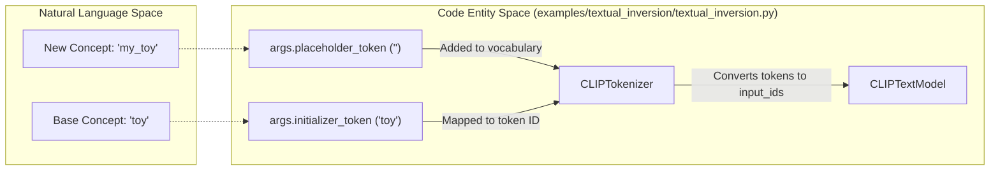
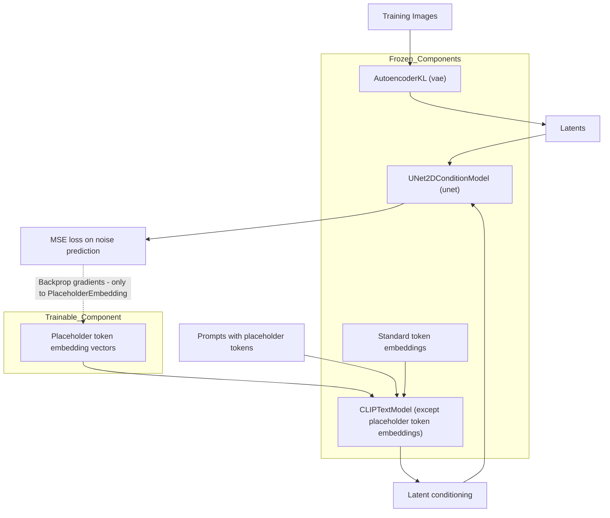
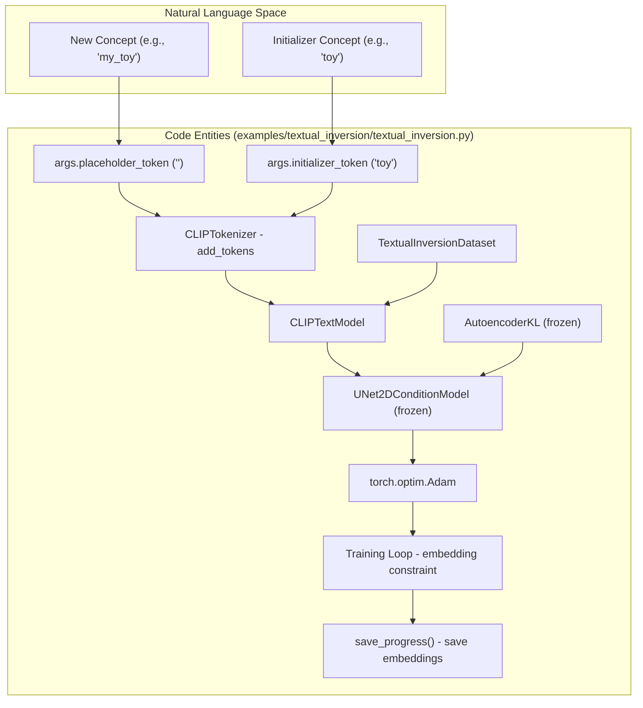
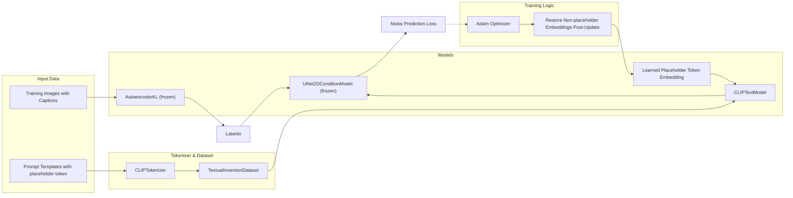

<!-- source: DeepWiki mcp.deepwiki.com · repo huggingface/diffusers · page 5.4 Textual Inversion · fetched 2026-10-21 -->

# Textual Inversion

<details>
<summary>Relevant source files</summary>

The following files were used as context for generating this wiki page:

- [examples/dreambooth/README.md](examples/dreambooth/README.md)
- [examples/dreambooth/requirements.txt](examples/dreambooth/requirements.txt)
- [examples/dreambooth/requirements_flax.txt](examples/dreambooth/requirements_flax.txt)
- [examples/dreambooth/train_dreambooth.py](examples/dreambooth/train_dreambooth.py)
- [examples/dreambooth/train_dreambooth_flax.py](examples/dreambooth/train_dreambooth_flax.py)
- [examples/dreambooth/train_dreambooth_lora.py](examples/dreambooth/train_dreambooth_lora.py)
- [examples/text_to_image/README.md](examples/text_to_image/README.md)
- [examples/text_to_image/README_sdxl.md](examples/text_to_image/README_sdxl.md)
- [examples/text_to_image/requirements.txt](examples/text_to_image/requirements.txt)
- [examples/text_to_image/requirements_flax.txt](examples/text_to_image/requirements_flax.txt)
- [examples/text_to_image/requirements_sdxl.txt](examples/text_to_image/requirements_sdxl.txt)
- [examples/text_to_image/train_text_to_image.py](examples/text_to_image/train_text_to_image.py)
- [examples/text_to_image/train_text_to_image_flax.py](examples/text_to_image/train_text_to_image_flax.py)
- [examples/text_to_image/train_text_to_image_lora.py](examples/text_to_image/train_text_to_image_lora.py)
- [examples/textual_inversion/README.md](examples/textual_inversion/README.md)
- [examples/textual_inversion/requirements.txt](examples/textual_inversion/requirements.txt)
- [examples/textual_inversion/requirements_flax.txt](examples/textual_inversion/requirements_flax.txt)
- [examples/textual_inversion/textual_inversion.py](examples/textual_inversion/textual_inversion.py)
- [examples/textual_inversion/textual_inversion_flax.py](examples/textual_inversion/textual_inversion_flax.py)
- [examples/unconditional_image_generation/train_unconditional.py](examples/unconditional_image_generation/train_unconditional.py)
- [setup.py](setup.py)
- [src/diffusers/dependency_versions_table.py](src/diffusers/dependency_versions_table.py)
- [src/diffusers/utils/__init__.py](src/diffusers/utils/__init__.py)
- [src/diffusers/utils/constants.py](src/diffusers/utils/constants.py)
- [src/diffusers/utils/import_utils.py](src/diffusers/utils/import_utils.py)
- [src/diffusers/utils/testing_utils.py](src/diffusers/utils/testing_utils.py)

</details>


Textual Inversion is a parameter-efficient training technique designed to teach diffusion models new concepts by learning custom token embeddings within the text encoder's vocabulary. Instead of fine-tuning entire model weights, as with DreamBooth [5.2]() or LoRA [5.3]() training, Textual Inversion updates only a small set of embedding vectors corresponding to new placeholder tokens while keeping all other model parameters frozen. This makes training exceptionally fast and memory-efficient.

With as few as 3-5 example images per new concept, this method allows users to personalize text-to-image models to recognize new objects, styles, or individuals. The learned embeddings are compact and portable, enabling reuse across compatible models.

---

## Purpose and Scope

This page details the implementation of textual inversion training within the diffusers codebase. It covers:

- How custom token embeddings are introduced and trained.
- The training data flow and dataset handling.
- Key classes and functions enabling optimization of embeddings.
- Integration of placeholder and initializer tokens.
- Strategies for memory efficiency.
- Saving/loading learned embeddings and resulting models.
- Flax/JAX support status.

For shared training utilities and infrastructure, refer to [5.5](). For alternative fine-tuning methods, see DreamBooth [5.2]() and LoRA [5.3]().

---

## Core Concepts

### Placeholder and Initializer Tokens

Textual Inversion operates by expanding the tokenizer’s vocabulary with a new **placeholder token** representing the novel concept the user wants to teach the model. This token acts as a unique identifier for the learned concept in prompts.

The embedding for this placeholder token is initialized from an existing **initializer token** in the vocabulary. This initializer token is typically semantically related to the concept, providing a meaningful starting point for optimization.

#### Natural Language to Code Entity Space - Token Initialization


Sources: [examples/textual_inversion/textual_inversion.py:239-247](), [examples/textual_inversion/textual_inversion.py:664-688]()

### Multiple Embedding Vectors per Token

To enhance expressive capacity, the script supports learning multiple embedding vectors per placeholder token using the `--num_vectors` argument. When `num_vectors > 1`, multiple token vectors are introduced for a single concept as `{placeholder_token}`, `{placeholder_token}_1`, `{placeholder_token}_2`, etc. All specified vectors are initialized identically from the initializer token's embeddings.

This mechanism allows the embedding to capture more nuanced semantic information for the concept.

Sources: [examples/textual_inversion/textual_inversion.py:204-208](), [examples/textual_inversion/textual_inversion.py:667-674]()

---

## Training Architecture

### What Components Are Trained vs. Frozen

In textual inversion training, **only the placeholder token embeddings** in the text encoder’s input embedding layer are updated via backpropagation. All other model parameters—including the U-Net, VAE, standard token embeddings, and the rest of the text encoder—are frozen with gradients disabled.

This training design reduces memory usage and computational cost drastically, as only a small embedding subset is optimized.

#### Data Flow and Component Mutability


Sources: [examples/textual_inversion/textual_inversion.py:689-731](), [examples/textual_inversion/textual_inversion.py:844-891]()

### Template-Based Prompt Generation

Training uses template prompts containing the placeholder token to ensure the embedding captures the concept in diverse linguistic contexts. Templates vary based on whether learning an object or style.

At each training iteration, a template is randomly sampled and the placeholder token is inserted, e.g., `"a photo of a {}"`. This diversity helps the model ground the embedding robustly.

Sources: [examples/textual_inversion/textual_inversion.py:454-504](), [examples/textual_inversion/textual_inversion.py:557-558]()

---

## Dataset and Data Loading

### `TextualInversionDataset` Class

This class implements the dataset interface for textual inversion training, with features:

| Feature | Description | Role in Training |
|---------|-------------|------------------|
| Repetition via `repeats` | Repeats small datasets multiple times to match desired training steps | Compensates for typically small training sets (3-5 images) |
| Image Loading & Resizing | Uses PIL with dynamic interpolation settings (`PIL_INTERPOLATION`) to resize images to the training resolution | Standardizes input image size |
| Augmentations | Random horizontal flips enabled optionally (e.g. for style learning) | Augments data diversity |
| Prompt Encoding | Tokenizes randomly selected training templates with placeholder token | Generates input IDs for the text encoder |

The dataset returns image tensors and tokenized input IDs suitable for the model.

Sources: [examples/textual_inversion/textual_inversion.py:507-590]()

---

## Training Process

### Controlled Embedding Updates

Critical to textual inversion is restricting gradient updates *only* to the placeholder token embeddings. The script:

1. Stores a copy of the original embeddings before the optimizer step.
2. Performs the optimizer step that updates embeddings globally.
3. Restores the original embeddings for all tokens **except** the placeholder token IDs, ensuring only those embeddings change.

This guards against accidental changes to other embeddings due to optimizer operations.

#### Training Loop Overview (simplified flow)

```mermaid
sequenceDiagram
    participant Data as TextualInversionDataset
    participant TextEnc as CLIPTextModel
    participant UNet as UNet2DConditionModel
    participant Opt as Optimizer
    
    Data->>TextEnc: input_ids with placeholder tokens
    TextEnc->>UNet: encoder_hidden_states (conditioning)
    UNet->>UNet: noise prediction & loss computation
    UNet->>Opt: backward()
    Opt->>TextEnc: step() (updates embeddings)
    Note over TextEnc: Restore original embeddings except for placeholder token IDs
```
Sources: [examples/textual_inversion/textual_inversion.py:897-915](), [examples/textual_inversion/textual_inversion.py:987-996]()

### Memory Optimization Techniques

To enable training large models on limited hardware, several memory-saving strategies are employed:

- **Gradient Checkpointing**: Both U-Net and text encoder use gradient checkpointing to trade compute for memory (`unet.enable_gradient_checkpointing()`, `text_encoder.gradient_checkpointing_enable()`) [examples/textual_inversion/textual_inversion.py:756-758]().

- **Mixed Precision**: The script supports `fp16` or `bf16` mixed precision using `accelerate` for faster training with reduced memory [examples/textual_inversion/textual_inversion.py:603-608]().

- **XFormers**: Optionally enables efficient attention with `unet.enable_xformers_memory_efficient_attention()` to lower VRAM usage and speed up training [examples/textual_inversion/textual_inversion.py:749]().

---

## Saving and Loading Embeddings

Textual inversion outputs are saved as minimal embedding files or full pipelines:

| Saving Method | Implementation Details | Usage/Benefits |
|---------------|------------------------|----------------|
| **Safetensors binary** | `safetensors.torch.save_file` with embedding tensors keyed by placeholder token | Secure, fast loading, recommended for lightweight embedding files |
| **PyTorch .bin** | `torch.save` for legacy compatibility | Older standard serialization |
| **Full Pipeline Save** | `pipeline.save_pretrained()` stores all components including modified text encoder | Enables easy reuse of the entire model with learned concepts integrated |

The helper function `save_progress` handles embedding extraction and serialization.

Sources: [examples/textual_inversion/textual_inversion.py:175-188](), [examples/textual_inversion/textual_inversion.py:1024]()

---

## Flax/JAX Implementation

Note that JAX/Flax support for textual inversion was removed in diffusers version 0.40.0. The older `textual_inversion_flax.py` script used Flax models (`FlaxCLIPTextModel`, `FlaxAutoencoderKL`, `FlaxUNet2DConditionModel`) and leveraged `jax.pmap` and `flax.jax_utils.replicate` to distribute training across accelerators for speed and memory efficiency.

Users wanting to experiment with JAX must use diffusers versions <= 0.39.x.

Sources: [examples/textual_inversion/textual_inversion_flax.py:1-681](), [examples/textual_inversion/README.md:123-156]()

---

# Summary Diagram: From NLP Concept to Code Entities in Textual Inversion Training



---

# Summary Diagram: Textual Inversion Training Data Flow and Control Logic



---

# References to Relevant Files and Lines

- Training script main logic: `examples/textual_inversion/textual_inversion.py:180-1030`  
- Dataset class: `examples/textual_inversion/textual_inversion.py:507-590`  
- Training loop and embedding update constraint: `examples/textual_inversion/textual_inversion.py:897-996`  
- Saving embeddings: `examples/textual_inversion/textual_inversion.py:175-188`, `1104-1146`  
- Token initialization and multi-vector handling: `examples/textual_inversion/textual_inversion.py:204-208`, `664-688`  
- Flax/JAX version (deprecated): `examples/textual_inversion/textual_inversion_flax.py:1-682`  
- Template prompts and augmentation logic: `examples/textual_inversion/textual_inversion.py:454-558`  

---

---

