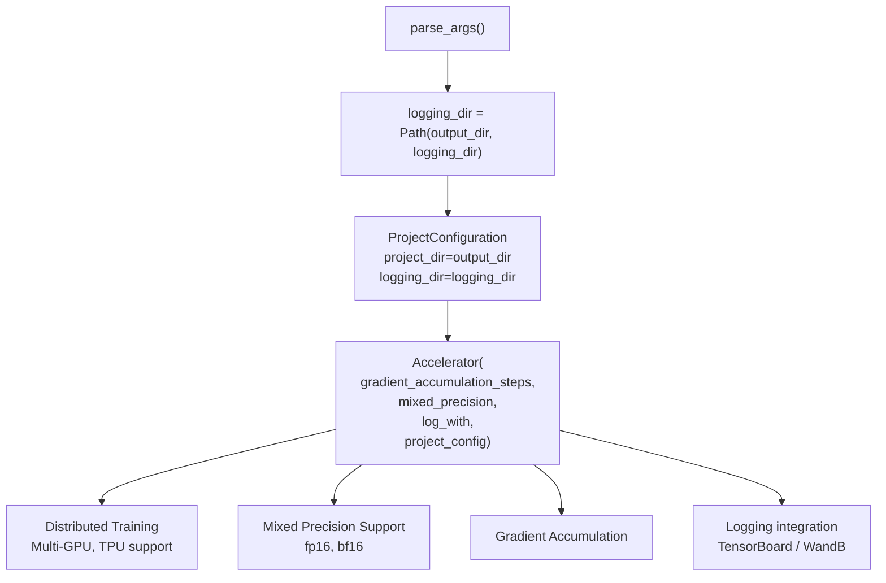
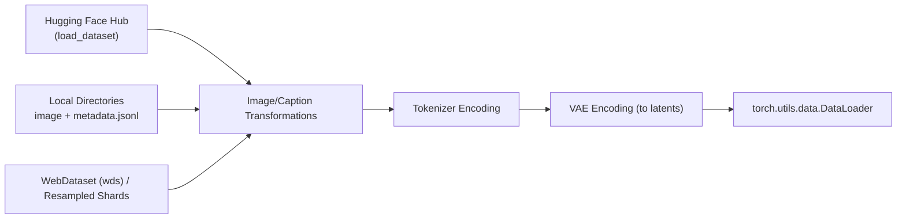
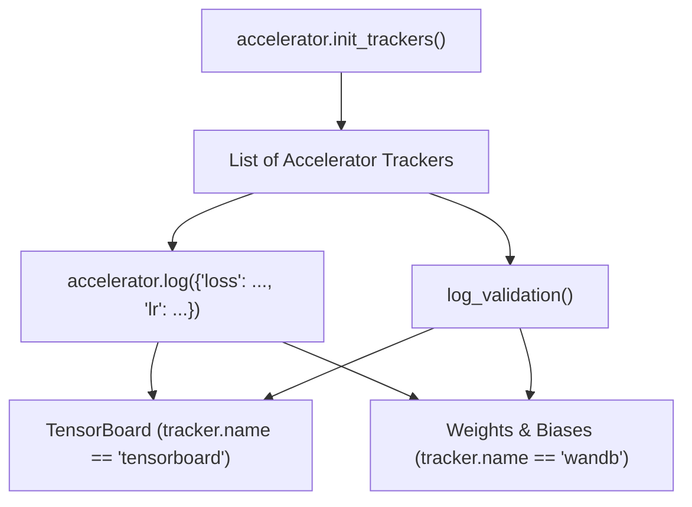
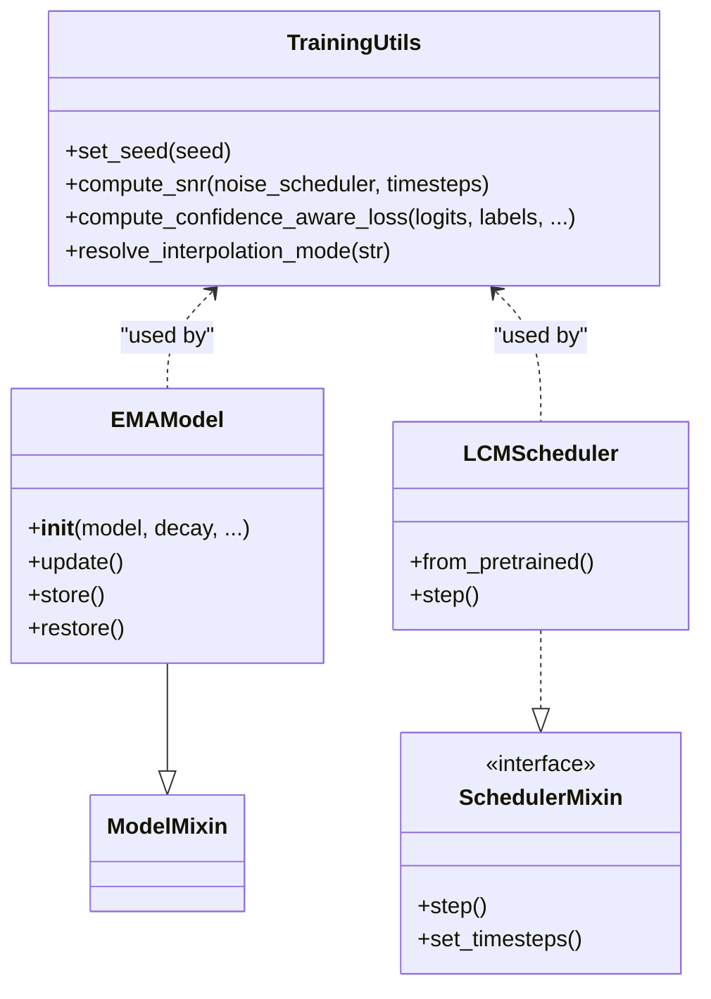

<!-- source: DeepWiki mcp.deepwiki.com · repo huggingface/diffusers · page 5.5 Training Infrastructure · fetched 2026-10-21 -->

# Training Infrastructure

<details>
<summary>Relevant source files</summary>

The following files were used as context for generating this wiki page:

- [examples/consistency_distillation/train_lcm_distill_lora_sd_wds.py](examples/consistency_distillation/train_lcm_distill_lora_sd_wds.py)
- [examples/consistency_distillation/train_lcm_distill_lora_sdxl.py](examples/consistency_distillation/train_lcm_distill_lora_sdxl.py)
- [examples/consistency_distillation/train_lcm_distill_lora_sdxl_wds.py](examples/consistency_distillation/train_lcm_distill_lora_sdxl_wds.py)
- [examples/consistency_distillation/train_lcm_distill_sd_wds.py](examples/consistency_distillation/train_lcm_distill_sd_wds.py)
- [examples/consistency_distillation/train_lcm_distill_sdxl_wds.py](examples/consistency_distillation/train_lcm_distill_sdxl_wds.py)
- [examples/controlnet/README_flux.md](examples/controlnet/README_flux.md)
- [examples/controlnet/README_sd3.md](examples/controlnet/README_sd3.md)
- [examples/controlnet/requirements_flux.txt](examples/controlnet/requirements_flux.txt)
- [examples/controlnet/requirements_sd3.txt](examples/controlnet/requirements_sd3.txt)
- [examples/controlnet/train_controlnet_flux.py](examples/controlnet/train_controlnet_flux.py)
- [examples/controlnet/train_controlnet_sd3.py](examples/controlnet/train_controlnet_sd3.py)
- [examples/dreambooth/README_flux2.md](examples/dreambooth/README_flux2.md)
- [examples/dreambooth/README_z_image.md](examples/dreambooth/README_z_image.md)
- [examples/dreambooth/test_dreambooth_lora_flux2_klein.py](examples/dreambooth/test_dreambooth_lora_flux2_klein.py)
- [examples/dreambooth/train_dreambooth_lora_flux2.py](examples/dreambooth/train_dreambooth_lora_flux2.py)
- [examples/dreambooth/train_dreambooth_lora_flux2_img2img.py](examples/dreambooth/train_dreambooth_lora_flux2_img2img.py)
- [examples/dreambooth/train_dreambooth_lora_flux2_klein.py](examples/dreambooth/train_dreambooth_lora_flux2_klein.py)
- [examples/dreambooth/train_dreambooth_lora_flux2_klein_img2img.py](examples/dreambooth/train_dreambooth_lora_flux2_klein_img2img.py)
- [examples/dreambooth/train_dreambooth_lora_flux_kontext.py](examples/dreambooth/train_dreambooth_lora_flux_kontext.py)
- [examples/dreambooth/train_dreambooth_lora_z_image.py](examples/dreambooth/train_dreambooth_lora_z_image.py)
- [src/diffusers/models/autoencoders/autoencoder_kl_ltx2.py](src/diffusers/models/autoencoders/autoencoder_kl_ltx2.py)
- [src/diffusers/modular_pipelines/z_image/before_denoise.py](src/diffusers/modular_pipelines/z_image/before_denoise.py)
- [src/diffusers/optimization.py](src/diffusers/optimization.py)
- [src/diffusers/pipelines/deprecated/stable_diffusion_diffedit/pipeline_stable_diffusion_diffedit.py](src/diffusers/pipelines/deprecated/stable_diffusion_diffedit/pipeline_stable_diffusion_diffedit.py)
- [src/diffusers/pipelines/ltx2/connectors.py](src/diffusers/pipelines/ltx2/connectors.py)
- [src/diffusers/pipelines/ltx2/latent_upsampler.py](src/diffusers/pipelines/ltx2/latent_upsampler.py)
- [src/diffusers/pipelines/ltx2/vocoder.py](src/diffusers/pipelines/ltx2/vocoder.py)
- [src/diffusers/training_utils.py](src/diffusers/training_utils.py)
- [tests/pipelines/ltx2/test_ltx2_connectors.py](tests/pipelines/ltx2/test_ltx2_connectors.py)

</details>


This page documents the infrastructure components that support training and fine-tuning diffusion models in the `diffusers` library. This includes Exponential Moving Average (EMA) mechanisms, comprehensive data loading utilities especially for large-scale and distributed training, logging systems supporting TensorBoard and WandB, validation workflows, consistency distillation (LCM) support, and distributed training integration.

For details on specific training strategies such as DreamBooth, LoRA, and Textual Inversion, see pages 5.2, 5.3, and 5.4 respectively. For training script architecture and common patterns, see page 5.1.

---

## Accelerate Framework Integration

All training scripts in the library leverage the [Accelerate](https://huggingface.co/docs/accelerate/index) framework to provide a unified, hardware-agnostic interface for distributed training, mixed precision, gradient accumulation, and logging. This yields seamless support for multi-GPU, TPU, and CPU environments with minimal code modifications.

### Core Classes and Setup

- **ProjectConfiguration**: Manages output directories, logging folders, and checkpointing.
- **Accelerator**: Central runtime class managing device placement, distributed training, mixed precision, and hooks into logging backends such as TensorBoard and WandB.



**Explanation:**

- Training scripts start by parsing arguments and preparing logging directories.
- `ProjectConfiguration` initializes with output and logging paths.
- The `Accelerator` wraps the training logic and provides handles to distributed training features and logging services.

**Sources:**  
[examples/dreambooth/train_dreambooth_lora_flux2.py:52-54](), [examples/consistency_distillation/train_lcm_distill_sd_wds.py:39-41](), [src/diffusers/training_utils.py:48-50]()

---

## Distributed Training and Hardware Optimization

The infrastructure supports advanced distributed training techniques and hardware optimizations:

- **Fully Sharded Data Parallel (FSDP):** Uses `torch.distributed.fsdp.FullyShardedDataParallel` for sharding model states across devices to reduce memory usage [src/diffusers/training_utils.py:17-25]().
- **DeepSpeed ZeRO-3:** Integration for zero redundancy optimizer states to fit larger models in GPU memory [src/diffusers/training_utils.py:45-46]().
- **8-bit and 4-bit Optimizers:** Support for reduced precision optimizers (e.g., via `bitsandbytes` or `prodigyopt`) to enable large model training on limited hardware [examples/dreambooth/train_dreambooth_lora_flux2.py:30-31]().
- **ONNX Runtime (ORT) Training:** Specialized examples leverage `ORTModule` and mixed precision optimizers for accelerated training [examples/research_projects/onnxruntime/unconditional_image_generation/train_unconditional.py:17-18]().
- **XFormers Attention:** Optional memory-efficient attention backends are enabled to reduce VRAM footprint [examples/research_projects/onnxruntime/unconditional_image_generation/train_unconditional.py:28]().

---

## Data Loading System

Efficient and scalable data loading is critical for large diffusion model training. The infrastructure supports multiple input dataset formats and flexible preprocessing pipelines.

### Core Dataset Architectures



**Details:**

- **Hugging Face Datasets:** Used for convenient access to public datasets with `load_dataset()` that supports streaming or local caching [examples/research_projects/onnxruntime/unconditional_image_generation/train_unconditional.py:15]().
- **Local ImageFolder Loading:** Supports loading from local directories with images and accompanying metadata files containing captions and additional info.
- **WebDataset:** For large-scale training, `webdataset` format is used with sharding, resampling, and efficient pipelining. It employs grouping of files into samples, on-the-fly decoding, filtering (e.g., by resolution and watermark presence), and transformations [examples/consistency_distillation/train_lcm_distill_sd_wds.py:124-185]().
- **Aspect Ratio Bucketing:** Advanced loaders group samples by aspect ratio buckets for improved training stability and performance on variable resolution data, leveraged in SDXL and Flux training [examples/dreambooth/train_dreambooth_lora_flux2.py:83-85]().
- **Transformations:** Use torchvision transforms including resizing, cropping, normalization, and tensor conversion.

---

## Logging and Monitoring

The training infrastructure leverages Accelerate's tracker system for unified logging experience, supporting both TensorBoard and WandB.

### Logging Architecture



- **Scalar Metrics:** Loss, learning rate, and other scalar metrics are logged during training steps.
- **Validation Images:** The `log_validation` function generates images from the current model state and logs them as grids. Supports both TensorBoard image grids and WandB image collections.

### Validation Image Logging

Validation periodically generates images conditioned on held-out prompts or images, allowing monitoring of model quality during training.

- The function loads current or finalized model weights into a `DiffusionPipeline` (e.g., `StableDiffusionPipeline`, `Flux2Pipeline`, or `StableDiffusion3ControlNetPipeline`).
- For each validation prompt/image, it runs inference with optional torch autocast.
- Images are converted to NumPy arrays and logged:
  - **TensorBoard:** Uses `writer.add_images()` to log as NHWC arrays.
  - **WandB:** Wraps images in `wandb.Image` with captions for interactive dashboards.

**Example usage from validation utilities:**

```python
for tracker in accelerator.trackers:
    if tracker.name == "tensorboard":
        tracker.writer.add_images(...)
    elif tracker.name == "wandb":
        tracker.log(...)
```

**Sources:**  
[examples/dreambooth/train_dreambooth_lora_flux2.py:190-222](), [examples/consistency_distillation/train_lcm_distill_lora_sdxl.py:107-196](), [examples/controlnet/train_controlnet_sd3.py:71-189]()

---

## Training Utilities

The `diffusers.training_utils` module provides essential utilities for training diffusion models, including EMA, loss functions, seed setting, and distributed-related helpers.

### Exponential Moving Average (EMA) Model

EMA maintains a shadow copy of model weights that is updated as an exponential moving average of the parameters during training. EMA weights often improve performance and stability at test time.

- Maintains a separate EMA parameter copy.
- Updates EMA weights every training step.
- Provides easy switching between EMA and model weights for evaluation and checkpointing.

**Usage:**  
EMA is wrapped around models in training scripts and updated per optimization step.

### Key Function: `set_seed(seed: int)`

- Sets the random seed for Python `random`, NumPy, PyTorch, and optionally torch's NPU backend.
- Enables reproducible training runs.

### Signal-to-Noise Ratio (SNR) Computation

- Function to compute SNR based on scheduler alphas cumprod and timestep tensors.
- Useful for implementing Min-SNR loss weighting strategies that enhance training convergence.

### Confidence-Aware Loss

- A combined loss for sequence models applying cross-entropy along with a confidence penalty on well-predicted tokens.

### Interpolation Resolution Helper

- Converts string identifiers like `"bilinear"` to corresponding `torchvision.transforms.InterpolationMode`.
- Provides consistent interpolation selection in training data pipelines.

---

## Consistency Distillation (LCM)

The library supports latent consistency model (LCM) distillation, a technique that distills diffusion models with specialized loss weighting and data handling strategies.

- Uses specialized schedulers (`LCMScheduler`) and sampling methods for LCM training.
- Implements data filtering and grouping helpers for webdataset samples.
- Provides training scripts integrating these components with Accelerate and logging.

**Sources:**  
[examples/consistency_distillation/train_lcm_distill_sd_wds.py](), [examples/consistency_distillation/train_lcm_distill_lora_sdxl.py]()

---

## Checkpoint and Model Card Management

The infrastructure facilitates model saving and loading with various formats, supporting full pipelines and adapter weights.

### Model Card Generation

- Training scripts auto-generate detailed model cards (`README.md`) including:
  - Model description and usage.
  - Licensing.
  - Trigger words.
  - Validation images.
- Cards are saved locally or pushed to the Hugging Face Hub.

### State Dict Conversion

- Utilities convert state dict keys between PyTorch raw checkpoints and diffusers' format.
- Support for PEFT adapters like LoRA: extracting and loading adapter weights independently of main models.

---

## Summary Diagram: From Natural Language/Samples to Training Components and Code Entities

```mermaid
graph TD
    NL["Natural Language Prompts & Images"]
    Dataset["Dataset & DataLoader<br/>(Hub, Local, WebDataset)"]
    Tokenizer["Tokenizer & Text Processing"]
    Transformations["Image Transformations & Augmentation"]
    LatentEncoder["VAE.encode() to Latents"]
    BatchLoader["torch.utils.data.DataLoader"]

    Model["Model (UNet / Transformer / ControlNet)"]
    Scheduler["Noise Scheduler (DDPM, LCM)"]
    Optimizer["Optimizer & LR Scheduler (AdamW, Cosine)"]
    EMA["Exponential Moving Average"]
    Accelerator["Accelerate Accelerator<br/>(Distributed Training, Mixed Precision)"]
    
    Logger["Logging System<br/>(TensorBoard / WandB)"]
    Validator["Validation & log_validation()"]

    # Flow
    NL --> Dataset --> Transformations --> Tokenizer --> LatentEncoder --> BatchLoader
    BatchLoader --> Model
    Model --> EMA
    Model --> Optimizer
    Model --> Scheduler
    Model --> Accelerator
    Accelerator --> Logger
    Accelerator --> Validator
```

---

## Summary Diagram: Training Utility Functions and Classes in Code



---

## Sources Summary

- **Accelerate & Distributed Training:** [src/diffusers/training_utils.py:17-50](), [examples/dreambooth/train_dreambooth_lora_flux2.py:52-54]()
- **Data Loading & Datasets:** [examples/consistency_distillation/train_lcm_distill_sd_wds.py:124-185](), [examples/dreambooth/train_dreambooth_lora_flux2.py:75-90]()
- **Logging & Validation:** [examples/dreambooth/train_dreambooth_lora_flux2.py:190-222](), [examples/consistency_distillation/train_lcm_distill_lora_sdxl.py:100-188](), [examples/controlnet/train_controlnet_sd3.py:71-189]()
- **Training Utilities & EMA:** [src/diffusers/training_utils.py:61-115](), [examples/research_projects/onnxruntime/unconditional_image_generation/train_unconditional.py:26-50]()
- **Model Saving and Checkpointing:** [examples/dreambooth/train_dreambooth_lora_flux2.py:113-188](), [src/diffusers/training_utils.py:31-33]()

This documentation covers the complete training infrastructure catering to high-performance and distributed training of diffusion-based generative models within the `diffusers` ecosystem.

---

