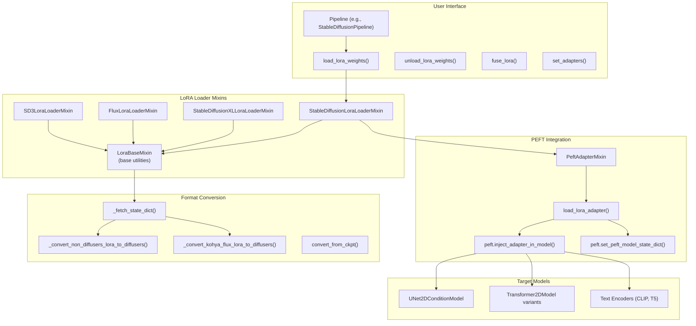
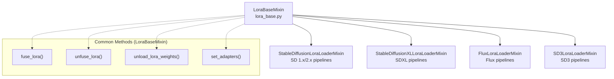
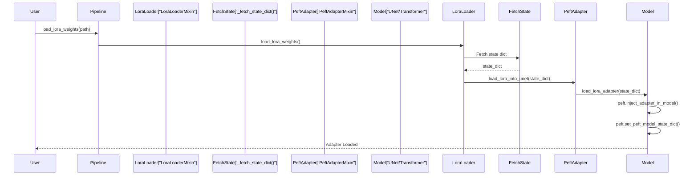

<!-- source: DeepWiki mcp.deepwiki.com · repo huggingface/diffusers · page 6 Extensions and Adapters · fetched 2026-10-21 -->

# Extensions and Adapters

Relevant source files

The following files were used as context for generating this wiki page:

- [docs/source/en/api/loaders/ip_adapter.md](docs/source/en/api/loaders/ip_adapter.md)
- [docs/source/en/api/loaders/lora.md](docs/source/en/api/loaders/lora.md)
- [docs/source/en/api/loaders/transformer_sd3.md](docs/source/en/api/loaders/transformer_sd3.md)
- [src/diffusers/loaders/__init__.py](src/diffusers/loaders/__init__.py)
- [src/diffusers/loaders/ip_adapter.py](src/diffusers/loaders/ip_adapter.py)
- [src/diffusers/loaders/lora_base.py](src/diffusers/loaders/lora_base.py)
- [src/diffusers/loaders/lora_conversion_utils.py](src/diffusers/loaders/lora_conversion_utils.py)
- [src/diffusers/loaders/lora_pipeline.py](src/diffusers/loaders/lora_pipeline.py)
- [src/diffusers/loaders/peft.py](src/diffusers/loaders/peft.py)
- [src/diffusers/loaders/unet.py](src/diffusers/loaders/unet.py)
- [src/diffusers/utils/peft_utils.py](src/diffusers/utils/peft_utils.py)
- [src/diffusers/utils/state_dict_utils.py](src/diffusers/utils/state_dict_utils.py)
- [tests/lora/test_lora_loader_utils.py](tests/lora/test_lora_loader_utils.py)
- [tests/lora/test_peft_utils.py](tests/lora/test_peft_utils.py)
- [tests/lora/utils.py](tests/lora/utils.py)

This document covers the adapter and extension systems in Diffusers that enable parameter-efficient fine-tuning and model customization. These systems allow users to modify model behavior by loading small adapter weights (typically <200MB) instead of full model checkpoints (typically multiple GBs).

**Purpose**: Document the various extension mechanisms for customizing and adapting pretrained models without full retraining, linking to child pages for each adapter type.

---

## Overview

Extensions and adapters in Diffusers provide infrastructure for customizing pretrained models efficiently and flexibly, avoiding the computational cost of full retraining. The key mechanisms currently supported include:

- **LoRA (Low-Rank Adaptation):** Allows loading and managing low-rank weight matrices that adapt pretrained models, typically targeting the UNet denoiser and text encoders. This system supports multi-adapter fusion, unloading, and hotswapping.  
  _For details, see [LoRA System](#6.1)._

- **IP-Adapter:** Implements image-based prompt conditioning by injecting specialized image projection layers and corresponding attention processors into the UNet architecture.  
  _For details, see [IP-Adapter System](#6.2)._

- **Format Conversion:** Supports seamless conversion between Diffusers native adapter formats and popular community formats including Kohya-ss, Fal, ComfyUI, ONNX, and others. This enables interoperability and reuse of a wide variety of checkpoints.  
  _For details, see [Checkpoint Conversion](#6.3)._

- **PEFT Integration:** Leverages the external PEFT library for parameter-efficient fine-tuning by integrating with PEFT adapters, providing mixins for managing multiple adapters, activation, and hotswapping.  
  _For details, see [PEFT Integration](#6.4)._

- **Single File Loading:** Enables loading of models and adapters directly from single checkpoint files like `.ckpt` or `.safetensors`, auto-detecting formats and applying appropriate loading strategies.  
  _For details, see [Single File Loading](#6.5)._

- **Memory and Device Management:** Provides strategies for memory optimization during loading and inference of adapters, including quantization support (GGUF, bitsandbytes), CPU/disk offloading, and group offloading to balance resource use.  
  _For details, see [Memory and Device Management](#6.6)._

**Diagram: High-level adapter system architecture**

Sources: [src/diffusers/loaders/lora_pipeline.py:147-166](), [src/diffusers/loaders/lora_base.py:37-48](), [src/diffusers/loaders/peft.py:57-82]()

---

## LoRA Loading System Architecture

The core extension mechanism in Diffusers for adapting pretrained models is the LoRA system. LoRA allows inserting and fine-tuning low-rank matrices that modify key model modules, enabling lightweight and efficient adaptations.

### Base Mixin Hierarchy

The foundational class is the `LoraBaseMixin` [src/diffusers/loaders/lora_base.py:37-162](), which provides common methods for:

- Loading LoRA weights  
- Fusing and unfusing adapter layers  
- Enabling, disabling, and removing LoRA layers  
- Managing multiple loaded adapters  

Specialized loader mixins extend this base to handle specific model architectures and pipeline variants:

- `StableDiffusionLoraLoaderMixin` — targets the standard Stable Diffusion UNet and CLIP text encoder combination [src/diffusers/loaders/lora_pipeline.py:133-173]()  
- `StableDiffusionXLLoraLoaderMixin` — adds support for SDXL pipelines with dual text encoders  
- `FluxLoraLoaderMixin` — targets Flux pipelines using Transformer-based denoisers and multiple text encoders  
- `SD3LoraLoaderMixin` — supports Stable Diffusion 3 pipelines with three text encoders  

Each mixin incorporates strategies to load, fuse, and manage LoRA weights according to the underlying model architecture.

**Diagram: LoRA mixin class hierarchy**

Sources: [src/diffusers/loaders/lora_base.py:37-162](), [src/diffusers/loaders/lora_pipeline.py:133-631]()

---

## Format Conversion and Checkpoint Loading

Diffusers supports loading LoRA weights from various community formats through a comprehensive format conversion system:

- Conversion utilities automatically transform non-Diffusers LoRA checkpoints to the Diffusers format. This covers Kohya-ss, Fal, and other popular training scripts. The key function `_convert_non_diffusers_lora_to_diffusers` performs this translation [src/diffusers/loaders/lora_conversion_utils.py:158-170]().
- Specialized converters handle formats used in Flux pipelines and other variant models, for example `_convert_kohya_flux_lora_to_diffusers` [src/diffusers/loaders/lora_pipeline.py:41-65]().
- Video-oriented adapters such as HunyuanVideo and LTX-Video have dedicated conversion logic.
- The single-file loading mechanism (`FromSingleFileMixin`) supports loading weights directly from `.ckpt` or `.safetensors` files, including format auto-detection [src/diffusers/loaders/__init__.py:153]().

This conversion allows users to leverage a vast ecosystem of pretrained adapters across different tooling.

Sources: [src/diffusers/loaders/lora_conversion_utils.py:158-170](), [src/diffusers/loaders/lora_pipeline.py:41-65]()

---

## PEFT Integration

The PEFT (Parameter-Efficient Fine-Tuning) library is integrated into Diffusers via the `PeftAdapterMixin` [src/diffusers/loaders/peft.py:56-141](). This mixin provides:

- Loading LoRA adapters saved or trained with PEFT (`load_lora_adapter`)  
- Activating, deactivating, and managing multiple adapters on models  
- Hotswapping adapters for fast swapping without recompilation in compiled models  
- Helpers to handle low-memory loading and scale adjustments  

When using PEFT integration, LoRA weights are injected as adapters into the underlying model modules (e.g., the UNet or transformer text encoder) via PEFT utility functions, which add or replace the adapted layers dynamically.

**Diagram: Adapter injection sequence using PEFT**

Sources: [src/diffusers/loaders/peft.py:75-141](), [src/diffusers/loaders/lora_pipeline.py:143-166]()

---

## Image Conditioning and IP-Adapter

IP-Adapter provides an alternative extension mechanism focused on improving image-based prompt conditioning rather than modifying network weights:

- The `IPAdapterMixin` [src/diffusers/loaders/ip_adapter.py:55-135]() encapsulates methods to load multiple IP-Adapters, which inject learnable image projection embeddings.
- These adapters add novel attention processors into the UNet's attention layers to incorporate image conditioning signals [src/diffusers/loaders/unet.py:25-32]().
- Supported projection types include various specialized modules (e.g., FaceID, Plus, Full, MultiIPAdapter).
- IP-Adapter weights are loaded and integrated into the model in a modular fashion, allowing the simultaneous use of multiple image-conditioned adapters.

This system provides complementary conditioning mechanisms alongside traditional LoRA and text prompt conditioning.

Sources: [src/diffusers/loaders/ip_adapter.py:55-135](), [src/diffusers/loaders/unet.py:25-32]()

---

## Memory and Device Management

Efficient memory and device resource management is essential when loading and using adapters. Diffusers includes features such as:

- **Quantization Aware Loading:** Automatic detection and dequantization of weights quantized with bitsandbytes (4-bit, 8-bit) or GGUF formats during LoRA loading, preventing errors and improving efficiency [src/diffusers/loaders/lora_pipeline.py:84-134]().
- **Low CPU Memory Usage Mode:** An option (`low_cpu_mem_usage`) that speeds up loading by initializing only the adapter weights without unnecessary random parameter creation, reducing peak memory usage [src/diffusers/loaders/lora_pipeline.py:172-176]().
- **Group Offloading:** Integration with group offloading utilities allows distributing model components and adapters across devices or memory hierarchies to balance the load and maximize capacity [tests/lora/utils.py:30-40]().
- **Compatibility with Accelerate & BitsAndBytes:** Works seamlessly with acceleration backends and quantization extensions to provide a scalable inference and training experience.

These mechanisms are especially important for handling large models and multiple adapters simultaneously.

Sources: [src/diffusers/loaders/lora_pipeline.py:84-134](), [src/diffusers/loaders/peft.py:26-40](), [tests/lora/utils.py:30-40]()

---

This page serves as the top-level overview of extensions and adapters in Diffusers. Each major extension mechanism has its dedicated child page covering technical details, usage patterns, and API documentation:

- [LoRA System](#6.1) — Deep dive into LoRA loading, fusion, multi-adapter support, format conversion, and PEFT integration  
- [IP-Adapter System](#6.2) — Document IP-Adapter for image-based prompt conditioning and its integration with pipelines  
- [Checkpoint Conversion](#6.3) — Explain conversion utilities and the scripts/ directory for transforming between model formats  
- [PEFT Integration](#6.4) — Document PEFT library integration, PeftAdapterMixin, and parameter-efficient fine-tuning patterns  
- [Single File Loading](#6.5) — Explain loading models from single checkpoint files (.ckpt, .safetensors) and format detection  
- [Memory and Device Management](#6.6) — Document group offloading, CPU/disk offloading, quantization (GGUF, BitsAndBytes, TorchAO), and memory optimization strategies

Please refer to these child pages for all implementation specifics and user guides.

---

# End of Extensions and Adapters

---

