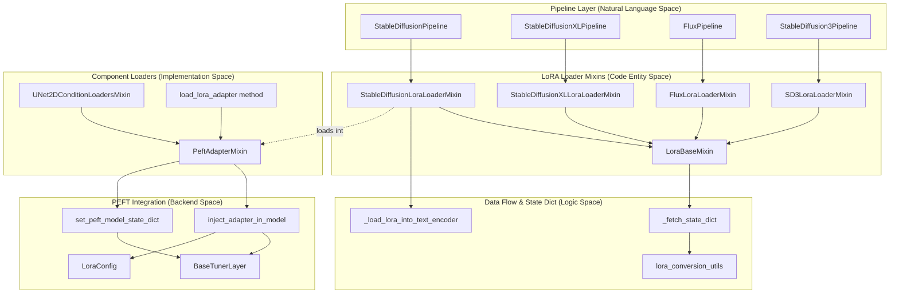
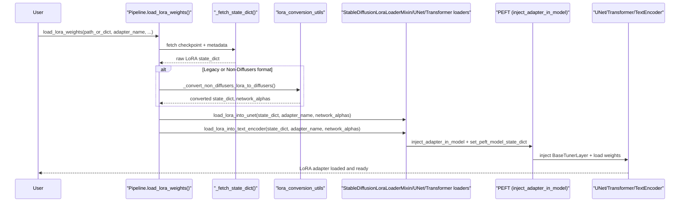

<!-- source: DeepWiki mcp.deepwiki.com · repo huggingface/diffusers · page 6.1 LoRA System · fetched 2026-10-21 -->

# LoRA System

Relevant source files

The following files were used as context for generating this wiki page:

- [docs/source/en/api/loaders/ip_adapter.md](docs/source/en/api/loaders/ip_adapter.md)
- [docs/source/en/api/loaders/lora.md](docs/source/en/api/loaders/lora.md)
- [docs/source/en/api/loaders/transformer_sd3.md](docs/source/en/api/loaders/transformer_sd3.md)
- [examples/dreambooth/test_dreambooth_lora_sana.py](examples/dreambooth/test_dreambooth_lora_sana.py)
- [src/diffusers/loaders/__init__.py](src/diffusers/loaders/__init__.py)
- [src/diffusers/loaders/ip_adapter.py](src/diffusers/loaders/ip_adapter.py)
- [src/diffusers/loaders/lora_base.py](src/diffusers/loaders/lora_base.py)
- [src/diffusers/loaders/lora_conversion_utils.py](src/diffusers/loaders/lora_conversion_utils.py)
- [src/diffusers/loaders/lora_pipeline.py](src/diffusers/loaders/lora_pipeline.py)
- [src/diffusers/loaders/peft.py](src/diffusers/loaders/peft.py)
- [src/diffusers/loaders/unet.py](src/diffusers/loaders/unet.py)
- [src/diffusers/utils/peft_utils.py](src/diffusers/utils/peft_utils.py)
- [src/diffusers/utils/state_dict_utils.py](src/diffusers/utils/state_dict_utils.py)
- [tests/lora/test_lora_layers_mochi.py](tests/lora/test_lora_layers_mochi.py)
- [tests/lora/test_lora_layers_sana.py](tests/lora/test_lora_layers_sana.py)
- [tests/lora/test_lora_layers_sd3.py](tests/lora/test_lora_layers_sd3.py)
- [tests/lora/test_lora_loader_utils.py](tests/lora/test_lora_loader_utils.py)
- [tests/lora/test_peft_utils.py](tests/lora/test_peft_utils.py)
- [tests/lora/utils.py](tests/lora/utils.py)
- [tests/pipelines/sana/test_sana.py](tests/pipelines/sana/test_sana.py)
- [tests/pipelines/sana/test_sana_controlnet.py](tests/pipelines/sana/test_sana_controlnet.py)
- [tests/pipelines/sana/test_sana_sprint.py](tests/pipelines/sana/test_sana_sprint.py)
- [tests/pipelines/sana/test_sana_sprint_img2img.py](tests/pipelines/sana/test_sana_sprint_img2img.py)

The LoRA (Low-Rank Adaptation) System provides infrastructure for loading, managing, and applying parameter-efficient fine-tuning (PEFT) adapters to diffusion models within the Diffusers library. This system enables users to load compact LoRA weight files (typically ~3-100MB) that modify model behavior without replacing the entire base model. It supports multiple adapter formats, simultaneous multi-adapter usage, fusion of LoRA weights, hotswapping for compiled models, and PEFT integration to leverage the efficient training and inference mechanisms.

---

## Architecture Overview

The LoRA system architecture is organized using mixins, integration with the PEFT library, and a conversion layer to handle multiple LoRA formats. Pipeline classes incorporate LoRA loading capabilities via dedicated mixins, while LoRA layers are managed internally by PEFT's components.

### LoRA System Entity Mapping

This diagram connects the natural language concepts and user-facing pipeline classes with the underlying code entities, illustrating the responsibilities and data flow in the LoRA system:

**Explanation:**

- The **pipeline classes** (`StableDiffusionPipeline`, `StableDiffusionXLPipeline`, Flux, SD3 pipelines) include LoRA loading mixins.
- LoRA loader mixins (`StableDiffusionLoraLoaderMixin`, etc.) inherit from a base mixin `LoraBaseMixin` to provide shared utilities.
- The mixins call into component loaders for the UNet and text encoder (and transformers), which internally utilize the `PeftAdapterMixin` to interact with the PEFT backend.
- Data flow starts from fetching state dictionaries via `_fetch_state_dict`, optionally converting non-Diffusers formats (`lora_conversion_utils`), then injecting adapters into models using PEFT's `inject_adapter_in_model` and loading state dicts.
- The PEFT library provides core LoRA tuner layers (`BaseTunerLayer`) and configuration (`LoraConfig`).

**Sources:** [src/diffusers/loaders/lora_pipeline.py:133-1462](), [src/diffusers/loaders/lora_base.py:34-48](), [src/diffusers/loaders/peft.py:57-80]()

---

## Core Classes and Their Roles

This section outlines the key classes and their primary responsibilities in the LoRA system.

| Class | Purpose | Module Location |
|-------|---------|-----------------|
| `LoraBaseMixin` | Base mixin providing shared utilities for fusing, unfusing, enabling, disabling, unloading, and managing multiple LoRA adapters within a pipeline. | [src/diffusers/loaders/lora_base.py:37-1119]() |
| `StableDiffusionLoraLoaderMixin` | Handles loading, injecting, saving LoRA weights for Stable Diffusion (UNet and CLIPTextEncoder). | [src/diffusers/loaders/lora_pipeline.py:133-592]() |
| `StableDiffusionXLLoraLoaderMixin` | Specialized loader mixin for SDXL with dual text encoders and wider architecture. | [src/diffusers/loaders/lora_pipeline.py:590-670]() |
| `SD3LoraLoaderMixin` | Loader mixin for Stable Diffusion 3 pipelines leveraging Transformer-based denoisers and three text encoders. | [src/diffusers/loaders/lora_pipeline.py:890-920]() |
| `FluxLoraLoaderMixin` | Loader mixin designed for Flux pipelines integrating transformer and adapted text encoders. | [src/diffusers/loaders/lora_pipeline.py:1175-1215]() |
| `PeftAdapterMixin` | Direct integration with the PEFT library for managing LoRA adapters, including loading, activating, hotswapping, and saving adapters on individual models. | [src/diffusers/loaders/peft.py:45-520]() |

### Key Methods and Responsibilities

#### LoraBaseMixin

- `fuse_lora()`  
  Permanently merges LoRA adapter weights into the base model's original weights, enhancing inference speed by removing adapter overhead.  
  See [src/diffusers/loaders/lora_base.py:810-887]()

- `unfuse_lora()`  
  Reverts fusion, restoring original model weights by subtracting fused LoRA contributions.  
  See [src/diffusers/loaders/lora_base.py:889-933]()

- `unload_lora_weights()`  
  Completely removes all loaded LoRA adapters from the model.  
  See [src/diffusers/loaders/lora_base.py:614-656]()

- `enable_lora()` / `disable_lora()`  
  Enable or disable LoRA effect in loaded adapters without unloading.  
  See [src/diffusers/loaders/lora_base.py:725-776]()

- `set_adapters(adapter_names)`  
  Activates a specific subset of loaded adapters by name, allowing multi-adapter interpolation and selective enabling.  
  See [src/diffusers/loaders/lora_base.py:689-753]()

- `get_active_adapters()` / `get_list_adapters()`  
  Returns the currently active adapters or the list of all loaded adapters.

#### StableDiffusionLoraLoaderMixin

- `load_lora_weights(pretrained_model_name_or_path_or_dict, adapter_name=None, hotswap=False, ...)`  
  Main method for loading LoRA weights from a model repo, local path, or state dict into `unet` and `text_encoder`. Supports multiple adapters with unique names and hotswap mode for compiled models.  
  See [src/diffusers/loaders/lora_pipeline.py:143-280]()

- `lora_state_dict(pretrained_model_name_or_path_or_dict, ...)`  
  Helper to fetch and convert the raw LoRA state dictionary, handling different source formats.  
  See [src/diffusers/loaders/lora_pipeline.py:251-293]()

- `load_lora_into_unet(lora_state_dict, adapter_name, network_alphas, ...)`  
  Injects LoRA weights into UNet component using PEFT methods.  
  See [src/diffusers/loaders/lora_pipeline.py:375-420]()

- `load_lora_into_text_encoder(lora_state_dict, adapter_name, network_alphas, ...)`  
  Injects LoRA weights into text encoder component.  
  See [src/diffusers/loaders/lora_pipeline.py:420-459]()

- `save_lora_weights(save_directory, adapter_name=None, ...)`  
  Saves currently loaded LoRA adapters for UNet and text encoder to disk, creating compatible checkpoint files.  
  See [src/diffusers/loaders/lora_pipeline.py:472-532]()

#### PeftAdapterMixin

- `load_lora_adapter(pretrained_model_name_or_path_or_dict, prefix="transformer", hotswap=False, ...)`  
  Load LoRA weights into a single model component (e.g., UNet or transformer) using PEFT backend injection, supporting hotswapping.  
  See [src/diffusers/loaders/peft.py:79-141]()

- `save_lora_adapter(output_dir, adapter_name="default", ...)`  
  Save the LoRA adapter state dict from the component.  
  See [src/diffusers/loaders/peft.py:383-477]()

---

## LoRA Loading Workflow and Data Flow

The LoRA loading pipeline involves multiple stages from raw checkpoint sourcing through format conversion, to PEFT adapter injection.

### State Dict Conversion and Format Detection

- Raw checkpoints can arrive in multiple formats (Diffusers native, Kohya/A1111, Flux, BFL, HunyuanVideo, and more).
- Conversion logic inspects key patterns to recognize format type.
- `_convert_non_diffusers_lora_to_diffusers` adapts keys to Diffusers conventions and extracts alpha scaling parameters.
- Additional SGM and block mapping utilities remap legacy UNet block references to Diffusers format.
- This process ensures LoRA weights are aligned with model architecture keys before injection.

**Sources:** [src/diffusers/loaders/lora_pipeline.py:143-300](), [src/diffusers/loaders/lora_conversion_utils.py:31-150](), [src/diffusers/loaders/lora_conversion_utils.py:158-320]()

---

## Adapter Management and Multi-Adapter Support

The system tracks multiple LoRA adapters simultaneously, allowing activation, deactivation, fusion, and querying.

- Each loaded adapter is identified by a unique `adapter_name`, defaulting to `"default_{i}"`.
- Loaders maintain adapter metadata including scaling alphas and rank information.
- Users can select adapters to activate with `set_adapters(adapter_names)` to toggle partial or combined impact.
- `get_active_adapters()` returns the adapter(s) applied currently.
- Utilities exist to unload specific adapters or all adapters from the model.
- Backend PEFT handles multi-adapter runtime through named adapter layers.

**Sources:** [src/diffusers/loaders/lora_base.py:689-810](), [src/diffusers/loaders/lora_pipeline.py:143-250]()

---

## Fusion and Unfusion of LoRA Weights

To optimize inference, LoRA adapters can be **fused** into the base model weights permanently, eliminating run-time overhead.

### Fusion

- `fuse_lora()` merges LoRA adjustments into original model parameters.
- For text encoders, fusion is performed classically by calling `merge()` on PEFT tuner layers.
- A scaling factor (`lora_scale`) controls the intensity of LoRA influence during fusion.
- Supports safe fusion option to check for NaNs before merging.
- Fusion improves speed but disables online enabling/disabling until unfused.

### Unfusion

- `unfuse_lora()` reverses fusion by restoring original weights and removing LoRA contributions.
- Allows toggling back to adapter runtime mode.

Both fusion and unfusion are available at pipeline-level and component-level.

**Sources:** [src/diffusers/loaders/lora_base.py:68-115](), [src/diffusers/loaders/lora_base.py:810-933]()

---

## Hotswapping LoRA Adapters in Compiled Models

Torch 2.0's `torch.compile()` enables runtime performance optimizations but complicates dynamic weight swapping.

The LoRA system supports **hotswapping** adapters efficiently:

- Call `pipeline.enable_lora_hotswap(target_rank)` before loading adapters to prepare for hotswap.
- `target_rank` indicates max adapter rank for internal buffer sizing.
- Load adapters with `hotswap=True` to replace existing adapter weights without recompiling.
- Internally calls PEFT's `hotswap_adapter_from_state_dict()` to update weights in-place.
- Significantly improves runtime workflow with single compiled model instance supporting efficient adapter changes.

**Sources:** [src/diffusers/loaders/lora_pipeline.py:173-192](), [src/diffusers/loaders/peft.py:279-341]()

---

## Memory Optimizations and Quantized Weight Support

### Low CPU Memory Usage Mode

- When `low_cpu_mem_usage=True` is enabled (default if compatible), LoRA loading skips initializing random weights and only loads pretrained LoRA weights.
- Reduces peak CPU RAM usage and speeds up loading.

### Quantization Compatibility

- `_maybe_dequantize_weight_for_expanded_lora()` detects if weights are quantized (bitsandbytes 4-bit/8-bit or GGUF).
- Performs runtime dequantization using backend-specific helpers.
- Ensures precision safety when integrating quantized LoRA weights.

### Device Offloading

- The system detects Accelerate offloading hooks (e.g., `AlignDevicesHook`, `CpuOffload`) that can interfere with inplace updates.
- Temporarily removes such hooks during LoRA weight injection and reinstalls afterward to avoid device mismatch issues.

**Sources:** [src/diffusers/loaders/lora_pipeline.py:84-131](), [src/diffusers/loaders/lora_base.py:401-459]()

---

## Saving LoRA Weights

LoRA weights are saved either pipeline-wide (UNet + text encoder) or component-wise via PEFT.

### Pipeline-Level Saving

- `save_lora_weights(save_directory, adapter_name=None, ...)`  
  Aggregates UNet and text encoder LoRA states, prefixes keys to avoid collisions, and saves to disk in `.bin` or `.safetensors` format.  
  Uses utility `_pack_dict_with_prefix()` to flatten and merge state dicts.

### Component-Level Saving

- Inside `PeftAdapterMixin`, `save_lora_adapter()` extracts PEFT adapter state dict from a single model component.
- Saves adapter weights alongside configuration.

These utilities support checkpoint interoperability and downstream reuse.

**Sources:** [src/diffusers/loaders/lora_pipeline.py:472-532](), [src/diffusers/loaders/peft.py:383-477](), [src/diffusers/loaders/lora_base.py:935-950]()

---

# Summary

The LoRA system in Diffusers is a mature, flexible framework enabling parameter-efficient fine-tuning and inference customization through LoRA adapters. Its architecture bridges user-friendly pipeline interfaces, backend PEFT integration, and robust multi-format compatibility. Features such as multi-adapter management, fusion, hotswapping, and memory optimizations ensure broad applicability and efficient performance for diverse generation tasks.

---

**Complete Sources**:  
- [src/diffusers/loaders/lora_pipeline.py:1-1462]()  
- [src/diffusers/loaders/lora_conversion_utils.py:1-343]()  
- [src/diffusers/loaders/lora_base.py:1-1119]()  
- [src/diffusers/loaders/peft.py:1-520]()  
- [src/diffusers/loaders/unet.py:54-145]() (for UNet loader context)

---

