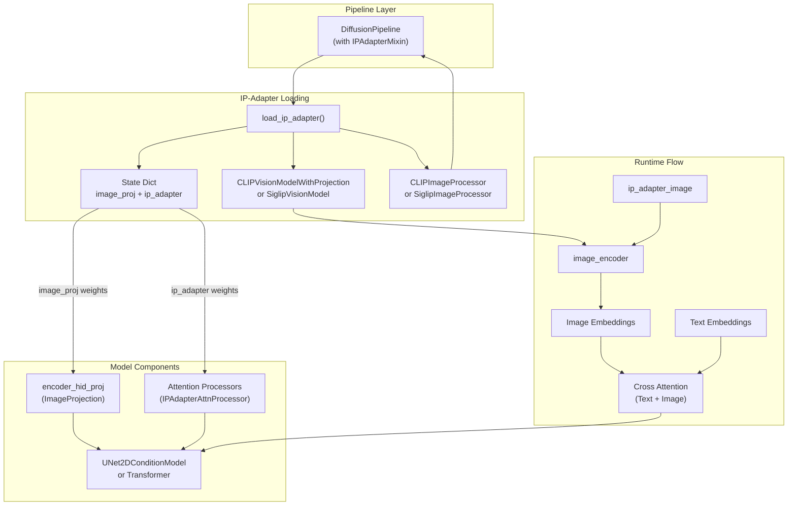
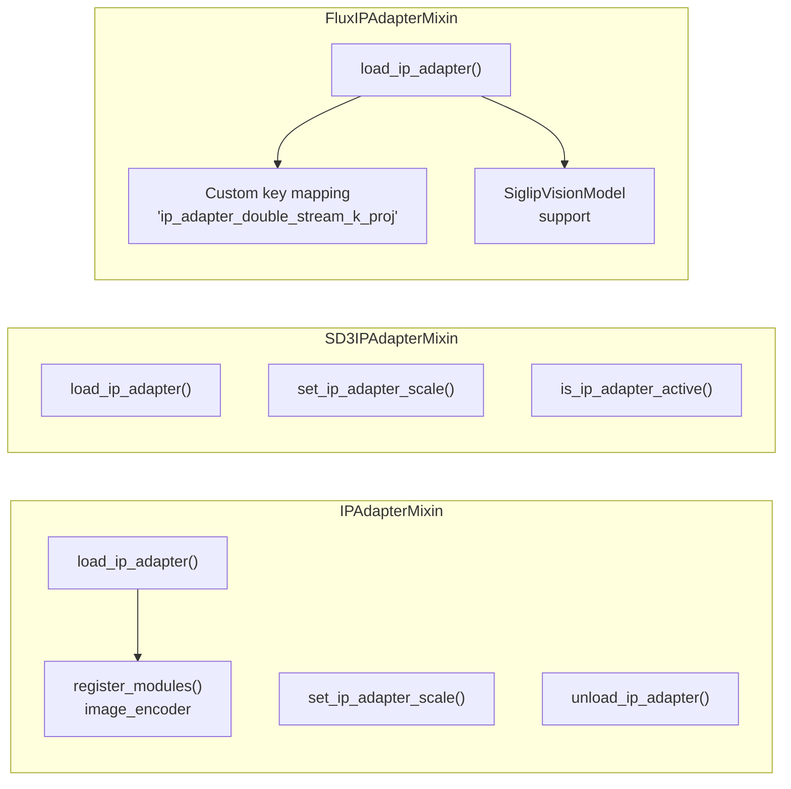
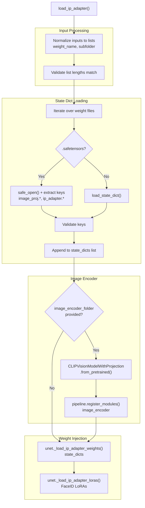
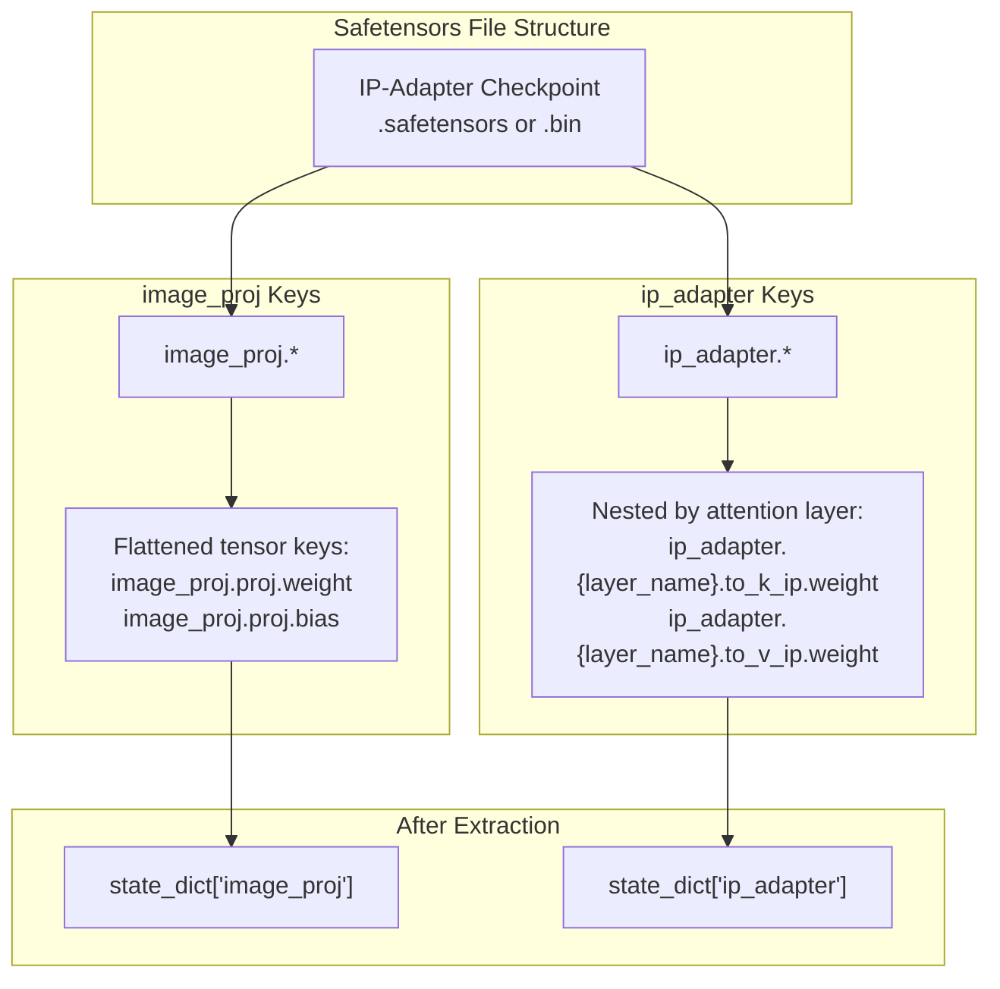
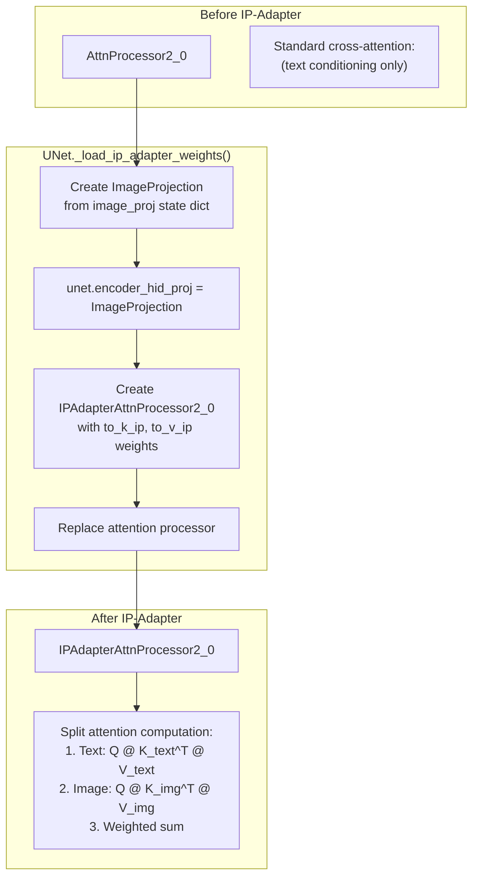
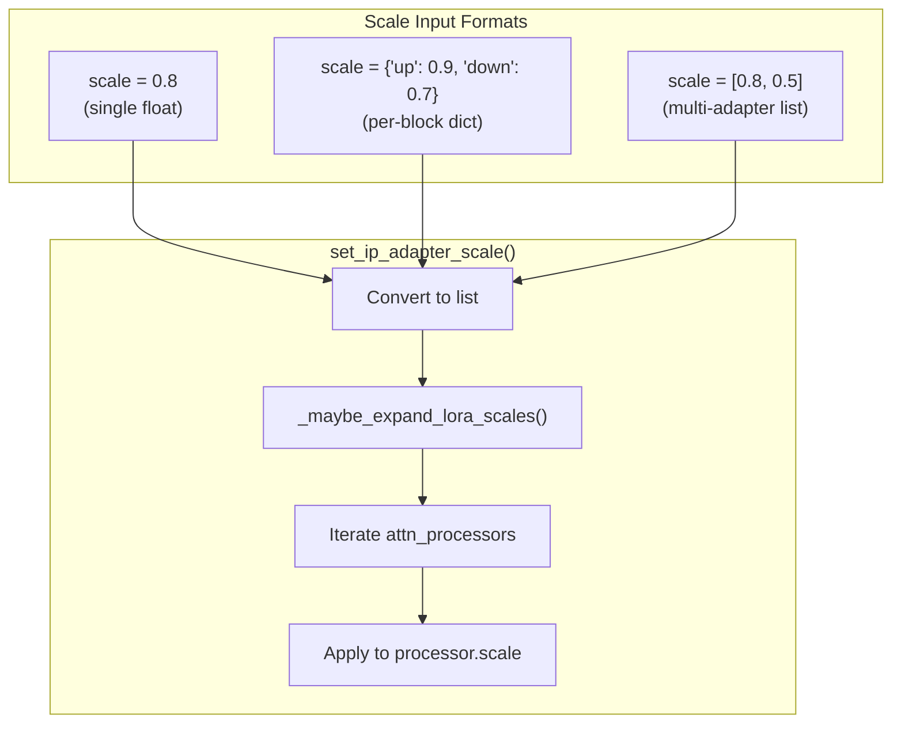
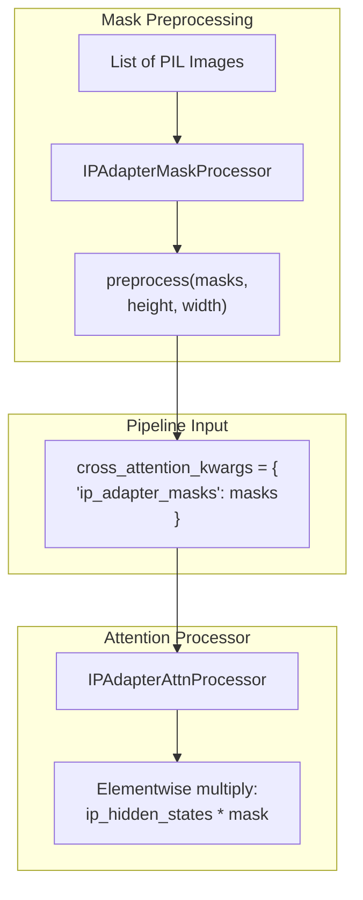

<!-- source: DeepWiki mcp.deepwiki.com · repo huggingface/diffusers · page 6.2 IP-Adapter System · fetched 2026-10-21 -->

# IP-Adapter System

Relevant source files

The following files were used as context for generating this wiki page:

- [docs/source/en/api/loaders/ip_adapter.md](docs/source/en/api/loaders/ip_adapter.md)
- [docs/source/en/api/loaders/lora.md](docs/source/en/api/loaders/lora.md)
- [docs/source/en/api/loaders/transformer_sd3.md](docs/source/en/api/loaders/transformer_sd3.md)
- [docs/source/en/api/models/hidream_image_transformer.md](docs/source/en/api/models/hidream_image_transformer.md)
- [docs/source/en/api/pipelines/hidream.md](docs/source/en/api/pipelines/hidream.md)
- [src/diffusers/loaders/__init__.py](src/diffusers/loaders/__init__.py)
- [src/diffusers/loaders/ip_adapter.py](src/diffusers/loaders/ip_adapter.py)
- [src/diffusers/loaders/lora_base.py](src/diffusers/loaders/lora_base.py)
- [src/diffusers/loaders/lora_conversion_utils.py](src/diffusers/loaders/lora_conversion_utils.py)
- [src/diffusers/loaders/lora_pipeline.py](src/diffusers/loaders/lora_pipeline.py)
- [src/diffusers/loaders/peft.py](src/diffusers/loaders/peft.py)
- [src/diffusers/loaders/unet.py](src/diffusers/loaders/unet.py)
- [src/diffusers/models/transformers/transformer_bria.py](src/diffusers/models/transformers/transformer_bria.py)
- [src/diffusers/models/transformers/transformer_hidream_image.py](src/diffusers/models/transformers/transformer_hidream_image.py)
- [src/diffusers/pipelines/hidream_image/pipeline_hidream_image.py](src/diffusers/pipelines/hidream_image/pipeline_hidream_image.py)
- [src/diffusers/pipelines/hunyuan_video/pipeline_hunyuan_video_image2video.py](src/diffusers/pipelines/hunyuan_video/pipeline_hunyuan_video_image2video.py)
- [src/diffusers/pipelines/pag/pipeline_pag_controlnet_sd_xl_img2img.py](src/diffusers/pipelines/pag/pipeline_pag_controlnet_sd_xl_img2img.py)
- [src/diffusers/pipelines/stable_diffusion/pipeline_stable_diffusion_latent_upscale.py](src/diffusers/pipelines/stable_diffusion/pipeline_stable_diffusion_latent_upscale.py)
- [src/diffusers/utils/peft_utils.py](src/diffusers/utils/peft_utils.py)
- [src/diffusers/utils/state_dict_utils.py](src/diffusers/utils/state_dict_utils.py)
- [tests/lora/test_lora_loader_utils.py](tests/lora/test_lora_loader_utils.py)
- [tests/lora/test_peft_utils.py](tests/lora/test_peft_utils.py)
- [tests/lora/utils.py](tests/lora/utils.py)
- [tests/pipelines/hidream_image/test_pipeline_hidream.py](tests/pipelines/hidream_image/test_pipeline_hidream.py)
- [tests/pipelines/hunyuan_image_21/test_hunyuanimage.py](tests/pipelines/hunyuan_image_21/test_hunyuanimage.py)
- [tests/pipelines/hunyuan_video/test_hunyuan_image2video.py](tests/pipelines/hunyuan_video/test_hunyuan_image2video.py)
- [tests/pipelines/hunyuan_video/test_hunyuan_skyreels_image2video.py](tests/pipelines/hunyuan_video/test_hunyuan_skyreels_image2video.py)
- [tests/pipelines/hunyuan_video/test_hunyuan_video_framepack.py](tests/pipelines/hunyuan_video/test_hunyuan_video_framepack.py)
- [tests/pipelines/hunyuan_video1_5/test_hunyuan_1_5.py](tests/pipelines/hunyuan_video1_5/test_hunyuan_1_5.py)
- [tests/pipelines/hunyuandit/test_hunyuan_dit.py](tests/pipelines/hunyuandit/test_hunyuan_dit.py)
- [tests/pipelines/ip_adapters/test_ip_adapter_stable_diffusion.py](tests/pipelines/ip_adapters/test_ip_adapter_stable_diffusion.py)

The IP-Adapter system enables image-based prompt conditioning within diffusion pipelines by integrating lightweight adapter modules that inject image feature conditioning alongside the conventional text embeddings during the denoising process. These adapters introduce additional cross-attention layers inside the model (UNet or Transformer) to process features extracted from reference images, allowing generation to be guided by images without full model retraining. 

IP-Adapters are typically lightweight (~100MB), operate by extending the attention mechanism, and keep the base model frozen. They complement other extension mechanisms such as LoRA [see section 6.1] and checkpoint conversion [see section 6.3].

---

## Architecture Overview

IP-Adapters operate within the diffusion pipeline in two main phases:

- **Loading phase:** IP-Adapter weights are loaded from checkpoints (usually `.safetensors` or PyTorch `.bin`) including image projection weights and attention processor adjustments. An optional image encoder (e.g., CLIPVisionModelWithProjection) is loaded and registered alongside pipeline components.

- **Runtime phase:** The adapter processes an input image into image embeddings, which are then injected via modified attention processors during the model’s cross-attention steps, alongside the text embeddings.

### System Components

1. **Image Encoder & Feature Extractor**  
   - Image encoder module extracts image hidden states—commonly `transformers.CLIPVisionModelWithProjection` or `SiglipVisionModel` from the Transformers library.  
   - Feature extractor preprocesses input images (e.g., normalization, resizing).  
   - Both are registered as pipeline components.

2. **Image Projection Layer**  
   - A lightweight `ImageProjection` module that projects image encoder hidden states to a suitable dimension for conditioning.  
   - Various projections are available to handle variants like FaceID or "Plus" models.

3. **Attention Processors**  
   - Modified attention modules (`IPAdapterAttnProcessor2_0` or specialized variants) that compute two separate cross-attentions:  
     - Text conditioning attention  
     - Image conditioning attention   
   - Outputs are combined by weighted summation controlled by a scaling factor.

4. **Pipeline Integration**  
   - The base `DiffusionPipeline` is extended with an `IPAdapterMixin` which manages IP-Adapter weight loading, scale setting, image encoder registration, and state dict processing.

### Diagram: IP-Adapter System Architecture

Sources: [src/diffusers/loaders/ip_adapter.py:55-147](), [docs/source/en/using-diffusers/ip_adapter.md:13-63]()

---

## Mixin Classes for IP-Adapter Support

The IP-Adapter system is modularized into several pipeline mixin classes tailored for different diffusion pipeline variants and model architectures. These mixins add the functionality for loading, interacting with, and scaling IP-Adapters:

| Class Name           | Pipeline Type                        | Notes                                                                                          |
|----------------------|------------------------------------|------------------------------------------------------------------------------------------------|
| `IPAdapterMixin`       | Standard Stable Diffusion and SDXL  | Core functionality for loading IP-Adapters, image encoder components, and scale control. [src/diffusers/loaders/ip_adapter.py:55-572]() |
| `SD3IPAdapterMixin`    | Stable Diffusion 3 (SD3)            | Specialized handling for SD3 Joint Attention using `SD3IPAdapterJointAttnProcessor2_0`. Transforms attention processor state dict keys. [src/diffusers/loaders/ip_adapter.py:1086-1134]() |
| `FluxIPAdapterMixin`   | Flux family pipelines                | Introduces custom mapping for double/single stream blocks in Flux UNet; supports SiglipVisionModel encoders. [src/diffusers/loaders/ip_adapter.py:1134]() |

### Diagram: IP-Adapter Mixin Classes and Key Functions

Sources: [src/diffusers/loaders/ip_adapter.py:55-1134](), [docs/source/en/api/loaders/ip_adapter.md:20-29]()

---

## Loading Workflow for IP-Adapters

The primary method to load IP-Adapters is the `load_ip_adapter()` function in the mixins. It supports loading one or multiple IP-Adapter weight files with flexible folder, weight name, and encoder options.

### Input Normalization

- Inputs like `weight_name`, `subfolder`, and `pretrained_model_name_or_path_or_dict` can be provided as lists to support loading multiple adapters simultaneously.  
- The method normalizes these inputs internally to consistent lists and validates their lengths.

### Checkpoint Weight Loading

- Supports weights stored in `.safetensors` (preferred) or legacy PyTorch `.bin` formats.  
- Extracts two sub-state dicts from the weights: `image_proj.*` and `ip_adapter.*` keys.

### Image Encoder Handling

- If `image_encoder_folder` is specified (default `"image_encoder"`), the image encoder model is loaded via Transformers `.from_pretrained()` method.  
- The image encoder is registered as a pipeline module for runtime inference on input images.

### Weight Injection into Models

- The `state_dicts` for `image_proj` and `ip_adapter` weights are loaded into the UNet or transformer via:  
  - `_load_ip_adapter_weights()` for core projection & attention processor weights.  
  - `_load_ip_adapter_loras()` for FaceID LoRA weights if applicable.

### Diagram: load_ip_adapter() Execution Flow

Key method arguments include:

| Parameter Name                           | Description                                                                                         |
|----------------------------------------|-------------------------------------------------------------------------------------------------|
| `pretrained_model_name_or_path_or_dict` | Model identifier, local path, or a state dictionary to load adapters from.                        |
| `weight_name`                          | Filename(s) of the IP-Adapter weights (list or string).                                        |
| `image_encoder_folder`                 | Optional folder or path where the image encoder weights are stored. Default is `"image_encoder"`. |
| `low_cpu_mem_usage`                    | Option to reduce CPU RAM usage by lazy loading weights.                                         |

Sources: [src/diffusers/loaders/ip_adapter.py:59-250]()

---

## IP-Adapter Checkpoint Format and Conversion

### Checkpoint Structure

IP-Adapter checkpoints contain weights organized mainly in two namespaces:

- `image_proj.*`: Contains projection weights for the image encoder hidden states. Example keys:  
  - `image_proj.proj.weight`  
  - `image_proj.proj.bias`
  
- `ip_adapter.*`: Contains weights for the modified attention processors associated with each attention layer. Example keys:  
  - `ip_adapter.{layer_name}.to_k_ip.weight`  
  - `ip_adapter.{layer_name}.to_v_ip.weight`

These keys are loaded into pipeline models and converted or mapped as needed depending on the underlying model architecture (UNet or Transformer-based).

### Conversion for Transformers

- **Flux models** require conversion of the `image_proj` keys and remapping of attention processor keys to multi-stream blocks (double-stream/single-stream).  
- **Stable Diffusion 3 (SD3)** models require conversion of attention processor keys into specialized `SD3IPAdapterJointAttnProcessor2_0` processors and also incorporate timestep embeddings into image projections.

### Diagram: IP-Adapter State Dict Structure

Sources: [src/diffusers/loaders/ip_adapter.py:178-195](), [src/diffusers/loaders/transformer_flux.py:37-88](), [src/diffusers/loaders/transformer_sd3.py:30-86]()

---

## Attention Processor Injection and Replacement

At loading time, standard attention processors inside the UNet or Transformer model are replaced with IP-Adapter aware versions, which calculate cross-attention both for text and image features.

### How It Works

1. The image projection weights are wrapped in an `ImageProjection` module (`encoder_hid_proj`) and assigned within the UNet or Transformer model.

2. For each attention layer that supports IP-Adapter, an `IPAdapterAttnProcessor2_0` instance is created and initialized with the `ip_adapter.*` weights.

3. The original attention processor (e.g., `AttnProcessor2_0`) is replaced in the model with the new IP-Adapter processor.

4. During inference, the IP-Adapter processor performs two separate scaled dot-product attentions:

   - Text conditioning (query @ key_text^T @ value_text)  
   - Image conditioning (query @ key_img^T @ value_img)  

   The outputs are combined using a scaling factor (`scale`) that controls the relative influence of image conditioning.

### Diagram: Attention Processor Transformation

### Available Attention Processor Variants

- **`IPAdapterAttnProcessor2_0`**: Uses PyTorch's efficient `scaled_dot_product_attention` to compute separate image and text attentions.  
- **`SD3IPAdapterJointAttnProcessor2_0`**: Handles joint attention for SD3 models, supporting `norm_ip` and image hidden states.  
- **`FluxIPAdapterAttnProcessor`**: Specialized for Flux UNet's dual-stream blocks.

Sources: [src/diffusers/loaders/ip_adapter.py:41-49](), [src/diffusers/loaders/transformer_sd3.py:69-74](), [src/diffusers/loaders/transformer_flux.py:122-140]()

---

## Scaling Control for IP-Adapters

The `set_ip_adapter_scale()` method controls how strongly image conditioning influences the generation by adjusting a scale factor inside each attention processor.

### Behavior and Supported Inputs

- Accepts a single float (e.g., `0.8`), a dictionary specifying block-wise scales (e.g., `{'up': 0.9, 'down': 0.7}`), or a list of floats for multi-adapter setups.

- Internally, scales are expanded and aligned with loaded adapters and attention processors using `_maybe_expand_lora_scales()` utility.

- Setting scale to zero disables IP-Adapter conditioning (text-only).

- Typical scale values:  
  - `0.5` for balanced image and text influence  
  - `1.0` for full image conditioning dominance

### Diagram: set_ip_adapter_scale() Input Processing

Sources: [src/diffusers/loaders/ip_adapter.py:252-303](), [docs/source/en/using-diffusers/ip_adapter.md:22-39]()

---

## Regional Masking Support

IP-Adapters support region-specific conditioning via binary masks that specify which spatial regions receive each adapter’s influence. 

- `IPAdapterMaskProcessor` preprocesses PIL mask images into tensors.

- Masks are passed to the pipeline through `cross_attention_kwargs` using the key `'ip_adapter_masks'`.

- During attention, the mask is used to element-wise multiply the IP adapter hidden states, enabling localized image conditioning.

### Diagram: IP-Adapter Masking Flow

Sources: [src/diffusers/image_processor.py:35](), [tests/pipelines/ip_adapters/test_ip_adapter_stable_diffusion.py:143-157](), [docs/source/en/api/loaders/ip_adapter.md:30-32]()

---

## Specialized Image Projection Layers

The IP-Adapter system supports multiple specialized image projection layers depending on the model variant and usage scenario:

| Projection Class                | Description                                                                                   | Usage                                             |
|--------------------------------|-----------------------------------------------------------------------------------------------|---------------------------------------------------|
| `ImageProjection`              | Baseline projection layer for mapping image features to latent space.                         | Standard IP-Adapter conditioning.                  |
| `IPAdapterFaceIDImageProjection` | Specialized projection using face embedding from FaceID models.                               | FaceID IP-Adapter variants.                         |
| `IPAdapterPlusImageProjection`  | Uses full CLIP hidden states (not just pooled vector) for projection in "Plus" IP-Adapters.    | "Plus" variants of IP-Adapter.                      |
| `IPAdapterTimeImageProjection`  | Augments projection with timestep embeddings, used in SD3 models.                             | SD3 IP-Adapter integration.                         |

These classes reside in `src/diffusers/models/embeddings.py` and are loaded and assigned inside the UNet or Transformer by the IP-Adapter loading process.

Sources: [src/diffusers/loaders/unet.py:25-32](), [src/diffusers/loaders/transformer_sd3.py:16-17](), [src/diffusers/loaders/transformer_sd3.py:139-146]()

---

# Summary

The IP-Adapter system extends diffusion pipelines with lightweight image-based prompt adapters through the following mechanisms:

- Loading and registering image encoder components and adapter weights.  
- Injecting specialized image projection layers into the model.  
- Replacing attention processors to integrate image and text conditioning via cross-attention.  
- Providing flexible scaling and masking controls for blending and local application of image guidance.

This system integrates cleanly with existing pipelines via mixins (`IPAdapterMixin`, `SD3IPAdapterMixin`, `FluxIPAdapterMixin`) and supports multi-adapter configurations and regional conditioning with masks, enabling advanced image-based conditioning in text-to-image and other generation pipelines.

---

# References to Code

- IP-Adapter mixins and loading: [src/diffusers/loaders/ip_adapter.py:55-572](), [src/diffusers/loaders/ip_adapter.py:1086-1134]()  
- Attention processors: [src/diffusers/loaders/ip_adapter.py:41-49](), [src/diffusers/loaders/transformer_sd3.py:69-74](), [src/diffusers/loaders/transformer_flux.py:122-140]()  
- Image projection layers: [src/diffusers/loaders/unet.py:25-32](), [src/diffusers/loaders/transformer_sd3.py:139-146]()  
- Mask processing: [src/diffusers/image_processor.py:35](), [tests/pipelines/ip_adapters/test_ip_adapter_stable_diffusion.py:143-157]()

---

