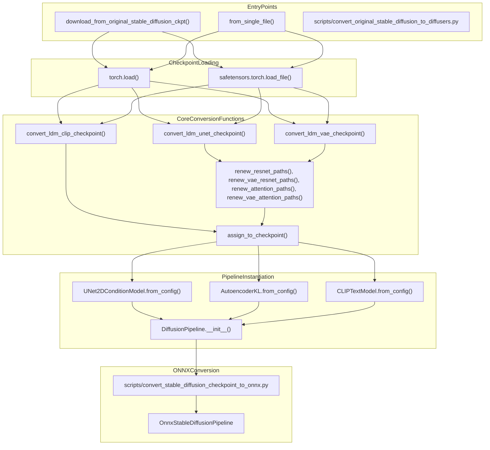
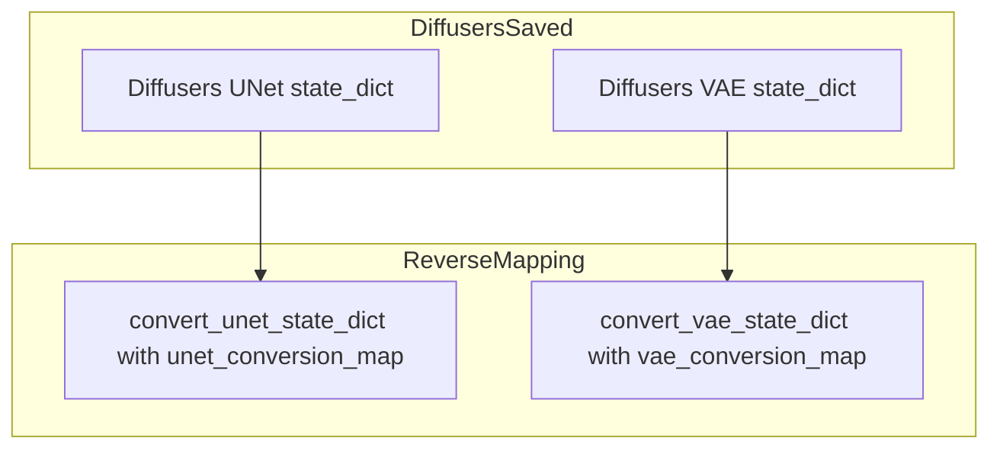

<!-- source: DeepWiki mcp.deepwiki.com · repo huggingface/diffusers · page 6.3 Checkpoint Conversion · fetched 2026-10-21 -->

# Checkpoint Conversion

<details>
<summary>Relevant source files</summary>

The following files were used as context for generating this wiki page:

- [examples/community/checkpoint_merger.py](examples/community/checkpoint_merger.py)
- [examples/community/clip_guided_stable_diffusion.py](examples/community/clip_guided_stable_diffusion.py)
- [examples/community/clip_guided_stable_diffusion_img2img.py](examples/community/clip_guided_stable_diffusion_img2img.py)
- [examples/community/latent_consistency_img2img.py](examples/community/latent_consistency_img2img.py)
- [examples/community/latent_consistency_interpolate.py](examples/community/latent_consistency_interpolate.py)
- [examples/research_projects/instructpix2pix_lora/README.md](examples/research_projects/instructpix2pix_lora/README.md)
- [examples/research_projects/instructpix2pix_lora/train_instruct_pix2pix_lora.py](examples/research_projects/instructpix2pix_lora/train_instruct_pix2pix_lora.py)
- [examples/research_projects/intel_opts/README.md](examples/research_projects/intel_opts/README.md)
- [examples/research_projects/intel_opts/inference_bf16.py](examples/research_projects/intel_opts/inference_bf16.py)
- [examples/research_projects/intel_opts/textual_inversion/README.md](examples/research_projects/intel_opts/textual_inversion/README.md)
- [examples/research_projects/promptdiffusion/README.md](examples/research_projects/promptdiffusion/README.md)
- [examples/research_projects/promptdiffusion/convert_original_promptdiffusion_to_diffusers.py](examples/research_projects/promptdiffusion/convert_original_promptdiffusion_to_diffusers.py)
- [examples/research_projects/promptdiffusion/pipeline_prompt_diffusion.py](examples/research_projects/promptdiffusion/pipeline_prompt_diffusion.py)
- [examples/research_projects/promptdiffusion/promptdiffusioncontrolnet.py](examples/research_projects/promptdiffusion/promptdiffusioncontrolnet.py)
- [scripts/conversion_ldm_uncond.py](scripts/conversion_ldm_uncond.py)
- [scripts/convert_dance_diffusion_to_diffusers.py](scripts/convert_dance_diffusion_to_diffusers.py)
- [scripts/convert_diffusers_to_original_sdxl.py](scripts/convert_diffusers_to_original_sdxl.py)
- [scripts/convert_diffusers_to_original_stable_diffusion.py](scripts/convert_diffusers_to_original_stable_diffusion.py)
- [scripts/convert_gligen_to_diffusers.py](scripts/convert_gligen_to_diffusers.py)
- [scripts/convert_if.py](scripts/convert_if.py)
- [scripts/convert_original_audioldm2_to_diffusers.py](scripts/convert_original_audioldm2_to_diffusers.py)
- [scripts/convert_original_audioldm_to_diffusers.py](scripts/convert_original_audioldm_to_diffusers.py)
- [scripts/convert_original_controlnet_to_diffusers.py](scripts/convert_original_controlnet_to_diffusers.py)
- [scripts/convert_original_musicldm_to_diffusers.py](scripts/convert_original_musicldm_to_diffusers.py)
- [scripts/convert_original_stable_diffusion_to_diffusers.py](scripts/convert_original_stable_diffusion_to_diffusers.py)
- [scripts/convert_stable_diffusion_checkpoint_to_onnx.py](scripts/convert_stable_diffusion_checkpoint_to_onnx.py)
- [scripts/convert_vae_pt_to_diffusers.py](scripts/convert_vae_pt_to_diffusers.py)
- [scripts/convert_versatile_diffusion_to_diffusers.py](scripts/convert_versatile_diffusion_to_diffusers.py)
- [scripts/convert_vq_diffusion_to_diffusers.py](scripts/convert_vq_diffusion_to_diffusers.py)
- [scripts/convert_zero123_to_diffusers.py](scripts/convert_zero123_to_diffusers.py)
- [src/diffusers/pipelines/deprecated/stable_diffusion_variants/pipeline_onnx_stable_diffusion_inpaint_legacy.py](src/diffusers/pipelines/deprecated/stable_diffusion_variants/pipeline_onnx_stable_diffusion_inpaint_legacy.py)
- [src/diffusers/pipelines/onnx_utils.py](src/diffusers/pipelines/onnx_utils.py)
- [src/diffusers/pipelines/stable_diffusion/convert_from_ckpt.py](src/diffusers/pipelines/stable_diffusion/convert_from_ckpt.py)
- [src/diffusers/pipelines/stable_diffusion/pipeline_onnx_stable_diffusion.py](src/diffusers/pipelines/stable_diffusion/pipeline_onnx_stable_diffusion.py)
- [src/diffusers/pipelines/stable_diffusion/pipeline_onnx_stable_diffusion_img2img.py](src/diffusers/pipelines/stable_diffusion/pipeline_onnx_stable_diffusion_img2img.py)
- [src/diffusers/pipelines/stable_diffusion/pipeline_onnx_stable_diffusion_inpaint.py](src/diffusers/pipelines/stable_diffusion/pipeline_onnx_stable_diffusion_inpaint.py)
- [src/diffusers/pipelines/stable_diffusion/pipeline_onnx_stable_diffusion_upscale.py](src/diffusers/pipelines/stable_diffusion/pipeline_onnx_stable_diffusion_upscale.py)
- [tests/others/test_check_dummies.py](tests/others/test_check_dummies.py)

</details>


## Purpose and Scope

This document details the checkpoint conversion utilities and scripts within the Diffusers library, specifically focusing on converting between different model checkpoint formats such as LDM (Latent Diffusion Model), Kohya, ComfyUI, and ONNX formats. These utilities bridge diverse model formats to the standardized Diffusers pipeline-compatible format, enabling improved interoperability and ease of use.

The coverage includes:

- Conversion core functions and utilities for LDM and VAE checkpoints
- Bidirectional conversion between original Stable Diffusion checkpoints and Diffusers format
- ONNX export and pipeline adaptations
- Specialized conversions for ControlNet and other variants
- Scripts in the `scripts/` directory facilitating these various transformations

For adapters and parameter-efficient fine-tuning format conversions, please see [LoRA System (6.1)](6.1).

## Overview

Model checkpoints across diffusion use cases exist in various formats:

- **LDM/CompVis (`.ckpt`, `.safetensors`)**: Monolithic checkpoint files containing possibly combined UNet, VAE, and CLIP text encoder weights used in original Stable Diffusion releases.
- **Diffusers format**: Modular format separating model components into directories with explicit naming conventions such as `unet/diffusion_pytorch_model.safetensors`.
- **ONNX format**: Serialized ONNX models optimized for inference with ONNX Runtime.
- Other community-developed formats (e.g., Kohya, ComfyUI) that the community often uses for training and fine-tuning.

The conversion system provides:

- Utilities to map state dict keys between formats
- Config inference/generation from original YAML configurations
- Wrappers around checkpoint loading supporting `.ckpt`, `.safetensors`, PyTorch, or remote downloads
- Scripts to automate and customize conversion workflows

## Architecture Overview



Sources:  
[src/diffusers/pipelines/stable_diffusion/convert_from_ckpt.py:10-192](),  
[scripts/convert_original_stable_diffusion_to_diffusers.py:25-181](),  
[scripts/convert_stable_diffusion_checkpoint_to_onnx.py:1-183](),  
[src/diffusers/pipelines/stable_diffusion/pipeline_onnx_stable_diffusion.py:1-143]()

## Conversion Process

### Core Conversion Functions

The core checkpoint conversion functions are centered on transforming state dictionaries from the LDM-style Stable Diffusion checkpoints into the Diffusers format with correctly renamed keys and updated hierarchical structure.

- `convert_ldm_unet_checkpoint` handles renaming and reshaping for the UNet model weights.
- `convert_ldm_vae_checkpoint` handles the VAE encoder and decoder weights.
- `convert_ldm_clip_checkpoint` converts the CLIP text encoder weights.

These functions use helper utilities to update nested layer naming conventions and map legacy resnet and attention module parameter names to corresponding Diffusers names.

### Key Utility Functions for Path Renaming

- `shave_segments(path, n)` trims prefix or suffix segments in dot-delimited state dict keys for flexible renaming.
- `renew_resnet_paths(old_list)` maps UNet ResNet blocks from legacy names to Diffusers names (`in_layers.0` → `norm1`, `skip_connection` → `conv_shortcut`, etc.).
- `renew_vae_resnet_paths(old_list)` performs similar renaming for VAE ResNet blocks.
- `renew_attention_paths(old_list)` and `renew_vae_attention_paths(old_list)` adapt attention layer parameter names.

These utilities return mappings from old keys to new keys, which are then assigned in new checkpoints.

### Assignment and Splitting of Parameters

The pivotal `assign_to_checkpoint(paths, checkpoint, old_checkpoint, ...)` function:

- Applies the path renaming mappings
- Splits composite weight tensors for query/key/value attention weights into separate tensors as expected by Diffusers
- Incorporates additional custom replacements for nested module hierarchy

This function finalizes the remapping of weights into the Diffusers checkpoint format.

### UNet Conversion Highlights

`convert_ldm_unet_checkpoint` also handles:

- Reshaping and splitting weights associated with cross-attention layers, remapping bias/weight tensors
- Specific translation of `time_embed` parameters to the Diffusers `time_embedding`
- Handling keys under `input_blocks`, `middle_block`, and `output_blocks` to support nested UNet architecture

### VAE Conversion Highlights

`convert_ldm_vae_checkpoint`:

- Handles encoder and decoder down and up blocks with proper renaming
- Corrects attention parameter keys accordingly for VAE attention blocks
- Ensures shortcut and residual blocks are renamed and reshaped as required by Diffusers

### Text Encoder Conversion

`convert_ldm_clip_checkpoint` converts the text encoder weights:

- Uses a list of mappings for transformer stack modules
- Remaps residual blocks (`resblocks.` → `text_model.encoder.layers.`)
- Adjusts group normalization and attention projection keys for compatibility

These steps ensure that the CLIP text encoder is usable by the Diffusers pipeline.

Sources:  
[src/diffusers/pipelines/stable_diffusion/convert_from_ckpt.py:70-192](),  
[src/diffusers/pipelines/stable_diffusion/convert_from_ckpt.py:393-866]()

## Bidirectional Conversion

### Diffusers to Original LDM Format

Diffusers support exporting converted pipelines back to the original monolithic checkpoint format to maintain compatibility with legacy tools and workflows.

This reverse conversion is implemented primarily in the script `scripts/convert_diffusers_to_original_stable_diffusion.py`. It includes mappings to revert Diffusers key names back to legacy LDM conventions.

- `convert_unet_state_dict()` maps Diffusers UNet keys to the LDM counterparts using fixed mapping lists and hierarchical renaming.
- `convert_vae_state_dict()` handles VAE key remapping similarly.

This process enables exporting individual component checkpoints back to the `.ckpt` format for reuse.



Sources:  
[scripts/convert_diffusers_to_original_stable_diffusion.py:1-206]()

## ONNX Conversion Utilities

The script `scripts/convert_stable_diffusion_checkpoint_to_onnx.py` enables converting Diffusers pipelines into the ONNX format suitable for optimized inference with ONNX Runtime.

Key features:

- Export of text encoder, UNet, VAE encoder, and decoder models to ONNX.
- Support for dynamic input axes to handle various batch sizes and sequence lengths.
- Option to export in half precision (`float16`) with CUDA for efficient deployment.
- The exported ONNX models are structured to work with the ONNX-based pipeline classes in `src/diffusers/pipelines/stable_diffusion/pipeline_onnx_stable_diffusion.py` and siblings (`pipeline_onnx_stable_diffusion_img2img.py`, `pipeline_onnx_stable_diffusion_inpaint.py`, etc.).

This ONNX conversion pipeline forms the basis for hardware-accelerated and third-party tool compatible deployment options.

Sources:  
[scripts/convert_stable_diffusion_checkpoint_to_onnx.py:1-183](),  
[src/diffusers/pipelines/stable_diffusion/pipeline_onnx_stable_diffusion.py:1-143]()

## Conversion Scripts in `scripts/` Directory

The repository includes several user-facing scripts facilitating checkpoint conversion workflows:

| Script Name                                      | Purpose / Description                                                                                      |
|-------------------------------------------------|------------------------------------------------------------------------------------------------------------|
| `scripts/convert_original_stable_diffusion_to_diffusers.py` | Converts original Stable Diffusion `.ckpt` or `.safetensors` files to Diffusers pipeline format. Supports config inference, EMA extraction, ControlNet flagging, and pipeline class customization. |
| `scripts/convert_diffusers_to_original_stable_diffusion.py` | Converts Diffusers pipelines back to original Stable Diffusion checkpoint formats for interoperability with legacy tools. |
| `scripts/convert_stable_diffusion_checkpoint_to_onnx.py`    | Converts Diffusers checkpoints into exportable ONNX models for accelerated inference pipelines.            |
| `scripts/convert_vae_pt_to_diffusers.py`                      | Converts standalone VAE PyTorch checkpoints to Diffusers AutoencoderKL format with proper weight mappings.  |
| `scripts/convert_original_controlnet_to_diffusers.py`         | Converts ControlNet-only checkpoints into Diffusers-compatible ControlNet modules.                         |
| `scripts/convert_zero123_to_diffusers.py`                     | Converts viewpoint-conditioned diffusion models (Zero123) to Diffusers format.                            |
| `scripts/convert_versatile_diffusion_to_diffusers.py`         | Converts multi-flow Versatile Diffusion models to Diffusers.                                              |
| `scripts/convert_original_audioldm_to_diffusers.py`           | Handles AudioLDM checkpoint conversion.                                                                  |

These scripts automate boilerplate and complex mapping logic, drastically simplifying model adoption and migration.

### Example: `convert_original_stable_diffusion_to_diffusers.py`

- Parses command-line arguments for checkpoint paths, original YAML config files, precision options, and output paths.
- Detects and loads `.ckpt` or `.safetensors` checkpoint files using PyTorch or safetensors.
- Calls `download_from_original_stable_diffusion_ckpt()` to handle the core conversion process.
- Supports loading stable unCLIP models and ControlNet variants with flags.
- Optionally outputs converted pipelines in safetensors format.

### Conversion Workflow Illustration

```
Original SD .ckpt/safetensors 
       ↓ load and parse
download_from_original_stable_diffusion_ckpt()
       ↓ convert_ldm_unet_checkpoint(), convert_ldm_vae_checkpoint(), convert_ldm_clip_checkpoint()
Modular Diffusers state_dict per component
       ↓ instantiate UNet2DConditionModel, AutoencoderKL, CLIPTextModel
Diffusers Pipeline ready for use or save_pretrained
```

Sources:  
[scripts/convert_original_stable_diffusion_to_diffusers.py:1-181](),  
[src/diffusers/pipelines/stable_diffusion/convert_from_ckpt.py:10-192]()

## Specialized Conversion Utilities and Community Tools

### ControlNet Conversion

`download_controlnet_from_original_ckpt` in the `convert_from_ckpt.py` module supports ControlNet-only checkpoint conversion by remapping their weights to Diffusers ControlNetModel formats.

### VAE Conversion from Standalone `.pt`

The helper `custom_convert_ldm_vae_checkpoint` (in `scripts/convert_vae_pt_to_diffusers.py`) converts older or standalone VAE PyTorch `.pt` checkpoints into Diffusers VAE format with correct naming and reshaping.

### Checkpoint Merger

The community-contributed script `examples/community/checkpoint_merger.py` allows merging multiple Diffusers pipelines by interpolating weights (e.g., sigmoid or inverse sigmoid interpolation) to create blended checkpoints.

### Others

Conversions exist for other architectures like Zero123, AudioLDM, and Versatile Diffusion that differ in model structure and require customized mapping.

Sources:  
[scripts/convert_vae_pt_to_diffusers.py:1-141](),  
[examples/community/checkpoint_merger.py:15-160](),  
[scripts/convert_original_controlnet_to_diffusers.py:1-109]()

---

This checkpoint conversion system provides robust, technically detailed, and extensible utilities and scripts to enable seamless migration and interoperability between various diffusion model checkpoint formats and the Diffusers ecosystem.

# Summary Table of Key Conversion Functions

| Function                            | Purpose                                     | File and Lines                        |
|-----------------------------------|---------------------------------------------|-------------------------------------|
| `download_from_original_stable_diffusion_ckpt` | Main entry point for converting LDM ckpt to Diffusers pipeline | `src/diffusers/pipelines/stable_diffusion/convert_from_ckpt.py:160-228` |
| `convert_ldm_unet_checkpoint`     | Converts original UNet state dict keys to Diffusers keys      | `src/diffusers/pipelines/stable_diffusion/convert_from_ckpt.py:393-641` |
| `convert_ldm_vae_checkpoint`      | Converts VAE encoder/decoder keys and structure                | `src/diffusers/pipelines/stable_diffusion/convert_from_ckpt.py:644-748` |
| `convert_ldm_clip_checkpoint`     | Converts CLIP text encoder keys                                | `src/diffusers/pipelines/stable_diffusion/convert_from_ckpt.py:801-862` |
| `assign_to_checkpoint`             | Applies global renaming and key splitting during conversion    | `src/diffusers/pipelines/stable_diffusion/convert_from_ckpt.py:169-264` |
| `convert_unet_state_dict`          | Reverse mapping (Diffusers → LDM) for UNet                    | `scripts/convert_diffusers_to_original_stable_diffusion.py:92-109` |
| `convert_vae_state_dict`           | Reverse mapping (Diffusers → LDM) for VAE                      | `scripts/convert_diffusers_to_original_stable_diffusion.py:179-206` |
| `onnx_export`                     | Exports models to ONNX format with dynamic axes and precision | `scripts/convert_stable_diffusion_checkpoint_to_onnx.py:31-68`        |

# References

- Conversion core code and helpers: `src/diffusers/pipelines/stable_diffusion/convert_from_ckpt.py`  
- Conversion scripts: `scripts/convert_original_stable_diffusion_to_diffusers.py`, `scripts/convert_diffusers_to_original_stable_diffusion.py`, `scripts/convert_stable_diffusion_checkpoint_to_onnx.py`  
- ONNX pipeline: `src/diffusers/pipelines/stable_diffusion/pipeline_onnx_stable_diffusion.py`  
- Community scripts: `examples/community/checkpoint_merger.py`  
- VAE conversion utility: `scripts/convert_vae_pt_to_diffusers.py`  

---

This completes the technical overview of the checkpoint conversion capabilities and scripts in the Diffusers library.

---

