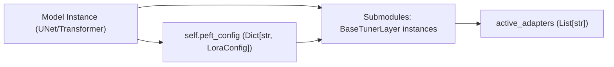
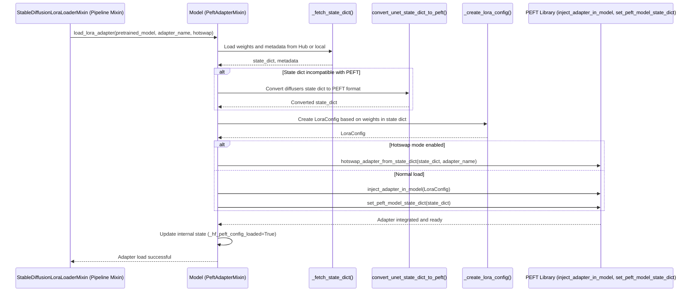
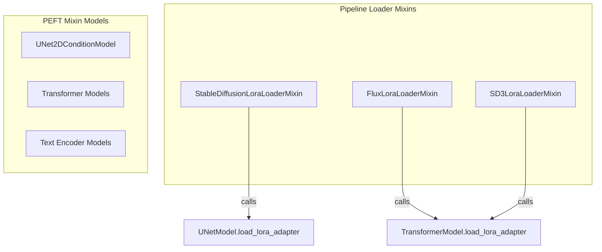
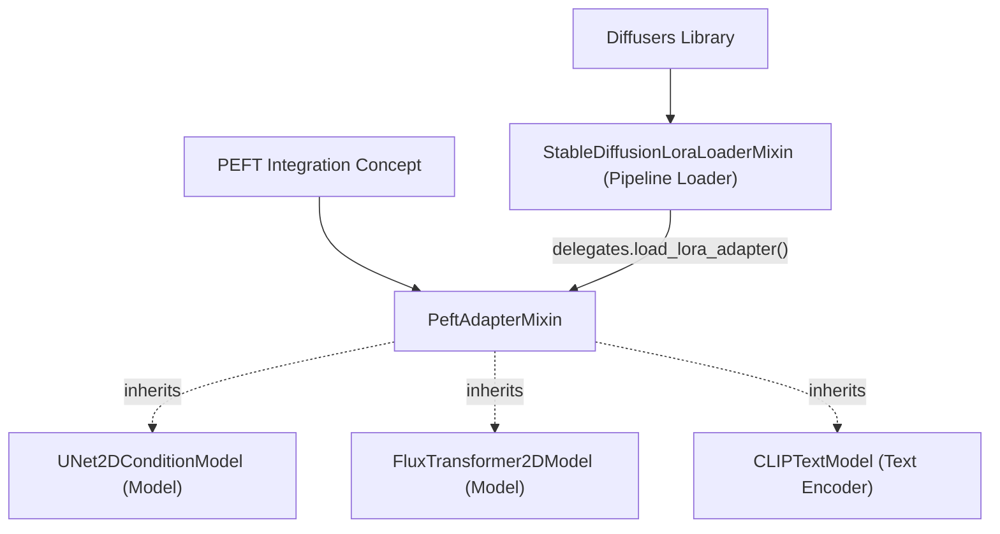

<!-- source: DeepWiki mcp.deepwiki.com · repo huggingface/diffusers · page 6.4 PEFT Integration · fetched 2026-10-21 -->

# PEFT Integration

<details>
<summary>Relevant source files</summary>

The following files were used as context for generating this wiki page:

- [docs/source/en/api/loaders/ip_adapter.md](docs/source/en/api/loaders/ip_adapter.md)
- [docs/source/en/api/loaders/lora.md](docs/source/en/api/loaders/lora.md)
- [docs/source/en/api/loaders/textual_inversion.md](docs/source/en/api/loaders/textual_inversion.md)
- [docs/source/en/api/loaders/transformer_sd3.md](docs/source/en/api/loaders/transformer_sd3.md)
- [docs/source/en/api/pipelines/latent_consistency_models.md](docs/source/en/api/pipelines/latent_consistency_models.md)
- [docs/source/en/api/pipelines/stable_diffusion/stable_diffusion_xl.md](docs/source/en/api/pipelines/stable_diffusion/stable_diffusion_xl.md)
- [docs/source/en/training/dreambooth.md](docs/source/en/training/dreambooth.md)
- [docs/source/en/training/text_inversion.md](docs/source/en/training/text_inversion.md)
- [docs/source/en/tutorials/using_peft_for_inference.md](docs/source/en/tutorials/using_peft_for_inference.md)
- [docs/source/en/using-diffusers/controlnet.md](docs/source/en/using-diffusers/controlnet.md)
- [docs/source/en/using-diffusers/dreambooth.md](docs/source/en/using-diffusers/dreambooth.md)
- [docs/source/en/using-diffusers/ip_adapter.md](docs/source/en/using-diffusers/ip_adapter.md)
- [docs/source/en/using-diffusers/legacy_adapters.md](docs/source/en/using-diffusers/legacy_adapters.md)
- [src/diffusers/loaders/__init__.py](src/diffusers/loaders/__init__.py)
- [src/diffusers/loaders/ip_adapter.py](src/diffusers/loaders/ip_adapter.py)
- [src/diffusers/loaders/lora_base.py](src/diffusers/loaders/lora_base.py)
- [src/diffusers/loaders/lora_conversion_utils.py](src/diffusers/loaders/lora_conversion_utils.py)
- [src/diffusers/loaders/lora_pipeline.py](src/diffusers/loaders/lora_pipeline.py)
- [src/diffusers/loaders/peft.py](src/diffusers/loaders/peft.py)
- [src/diffusers/loaders/unet.py](src/diffusers/loaders/unet.py)
- [src/diffusers/utils/peft_utils.py](src/diffusers/utils/peft_utils.py)
- [src/diffusers/utils/state_dict_utils.py](src/diffusers/utils/state_dict_utils.py)
- [tests/lora/test_lora_loader_utils.py](tests/lora/test_lora_loader_utils.py)
- [tests/lora/test_peft_utils.py](tests/lora/test_peft_utils.py)
- [tests/lora/utils.py](tests/lora/utils.py)

</details>


## Purpose and Scope

This page documents the integration of the PEFT (Parameter-Efficient Fine-Tuning) library within the Diffusers codebase. The PEFT integration provides a standardized, efficient mechanism for loading, managing, and utilizing LoRA adapters in Diffusers models, enabling parameter-efficient fine-tuning and inference.

The integration is built around the `PeftAdapterMixin` class, which equips model classes—such as UNet or Transformer modules—with advanced adapter functionality including multi-adapter loading, fusion, enabling/disabling adapters, and low-memory loading optimizations.

PEFT integration requires the `peft` library (version >= 0.9.0) and sets up seamless interoperability between Diffusers and PEFT state dict formats and configuration.

**Sources:**  
[src/diffusers/loaders/peft.py:1-141](), [src/diffusers/utils/peft_utils.py:15-184](), [src/diffusers/loaders/lora_pipeline.py:21-33]()

---

## Architecture Overview

PEFT integration acts as a bridge connecting Diffusers model components to the PEFT adapter mechanisms. It exposes mixins that inject adapter management logic at the model level, while pipeline-level loader mixins delegate LoRA loading to these model methods.

### Main Components and Data Flow

```mermaid
graph TB
  %% Natural Language / Pipeline Layer
  subgraph "Pipeline Layer"
    StableDiffusionLoraLoaderMixin
    FluxLoraLoaderMixin
    SD3LoraLoaderMixin
    StableDiffusionXLLoraLoaderMixin
    LTX2LoraLoaderMixin
  end

  %% Model layer with PEFT integration
  subgraph "Model Layer"
    UNet2DConditionModel
    FluxTransformer2DModel
    TextEncoder[Text Encoders (CLIPTextModel, T5EncoderModel)]
  end

  %% PEFT integration methods
  subgraph "PEFT Integration (src/diffusers/loaders/peft.py)"
    PeftAdapterMixin
    load_lora_adapter["load_lora_adapter()"]
    save_lora_adapter["save_lora_adapter()"]
    set_adapters["set_adapters()"]
    enable_disable["enable_adapters(), disable_adapters()"]
  end

  %% PEFT library interactions
  subgraph "PEFT Library"
    inject_adapter["inject_adapter_in_model()"]
    set_state_dict["set_peft_model_state_dict()"]
    get_state_dict["get_peft_model_state_dict()"]
    LoraConfig["peft.LoraConfig"]
    BaseTunerLayer["BaseTunerLayer (adapter layers)"]
  end

  %% State dict conversion utilities
  subgraph "State Dict Conversion (src/diffusers/utils/peft_utils.py & loaders/lora_conversion_utils.py)"
    convert_unet_to_peft["convert_unet_state_dict_to_peft()"]
    create_lora_config["_create_lora_config()"]
    convert_non_diffusers["convert_non_diffusers_lora_to_diffusers()"]
  end

  %% Connections
  StableDiffusionLoraLoaderMixin --> load_lora_adapter
  FluxLoraLoaderMixin --> load_lora_adapter
  SD3LoraLoaderMixin --> load_lora_adapter
  StableDiffusionXLLoraLoaderMixin --> load_lora_adapter
  LTX2LoraLoaderMixin --> load_lora_adapter

  UNet2DConditionModel -.inherits.-> PeftAdapterMixin
  FluxTransformer2DModel -.inherits.-> PeftAdapterMixin
  TextEncoder -.inherits.-> PeftAdapterMixin

  PeftAdapterMixin --> load_lora_adapter
  PeftAdapterMixin --> save_lora_adapter
  PeftAdapterMixin --> set_adapters
  PeftAdapterMixin --> enable_disable

  load_lora_adapter --> convert_unet_to_peft
  load_lora_adapter --> create_lora_config
  load_lora_adapter --> inject_adapter
  load_lora_adapter --> set_state_dict
  save_lora_adapter --> get_state_dict

  create_lora_config --> LoraConfig
  inject_adapter --> BaseTunerLayer
  set_state_dict --> BaseTunerLayer
```

This layering enables:

- Pipeline loader mixins managing LoRA weights loading for the entire pipeline.
- Model classes handling adapters on individual components (UNet, Transformer, Text Encoder) using `PeftAdapterMixin`.
- Adapter weights and configs converted and mapped between Diffusers and PEFT expected formats.
- PEFT library performing injection of adapter layers in the model during loading.

**Sources:**  
[src/diffusers/loaders/peft.py:55-141](), [src/diffusers/loaders/lora_pipeline.py:130-165](), [src/diffusers/utils/peft_utils.py:1-184]()

---

## Core Component: PeftAdapterMixin

The `PeftAdapterMixin` class encapsulates all PEFT-related functionality making a model PEFT-capable.

### Key Responsibilities

- Load and save LoRA adapters with support for different formats.
- Enable activation and deactivation of adapters at runtime.
- Fuse adapters into base model weights for inference speedup.
- Manage multiple adapters and their scale weights concurrently.
- Support hotswapping adapters to avoid recompilation in `torch.compile`.
- Provide device management for adapter parameters.
- Track adapter metadata such as rank and alpha parameters.

### Important Attributes

| Attribute                           | Description                                           |
|-----------------------------------|-------------------------------------------------------|
| `_hf_peft_config_loaded`           | Flag indicating if a PEFT adapter has been loaded    |
| `_prepare_lora_hotswap_kwargs`     | Args used for preparing hotswap in compiled contexts |
| `_SET_ADAPTER_SCALE_FN_MAPPING`    | Model types mapped to scale handlers (e.g., UNet expanders) |

### Important Methods Summary

| Method                       | Description                                                      | Highlights                                         |
|------------------------------|-----------------------------------------------------------------|---------------------------------------------------|
| `load_lora_adapter()`         | Loads a LoRA adapter from various sources and injects it        | Handles PEFT format conversion, config creation, and injection. Supports hotswap. |
| `save_lora_adapter()`         | Saves the adapter weights to disk                               | Supports safe serialization                        |
| `set_adapters()`              | Activate specific adapters and set their weights                | Supports multiple adapters                         |
| `enable_adapters()`           | Enables all loaded adapters                                     |                                                   |
| `disable_adapters()`          | Disables all adapters                                           |                                                   |
| `get_active_adapters()`       | Returns a list of active adapter names                          |                                                   |
| `get_list_adapters()`         | Returns all adapter names loaded in the model                   |                                                   |
| `delete_adapters()`           | Deletes specified adapters from the model                       |                                                   |
| `set_lora_device()`           | Moves adapter weights to a designated device                    | Useful for device management and offloading       |

### Adapter Metadata and Model State

Internally, the model keeps a dictionary mapping adapter names to `LoraConfig` objects provided by PEFT, and `BaseTunerLayer` modules are inserted into submodules for the actual adapters.



The `BaseTunerLayer` modules contain LoRA parameters like `lora_A.weight` and `lora_B.weight`, which hold the adapted low-rank weights.

**Sources:**  
[src/diffusers/loaders/peft.py:56-233](), [tests/lora/utils.py:40-53]()

---

## Adapter Loading Flow

Loading a LoRA adapter with `PeftAdapterMixin.load_lora_adapter()` involves several key stages:



### Stage Details

1. **State Dict Fetching**  
   `_fetch_state_dict()` loads model weights from the Hub or local directories, supporting `.bin` and `.safetensors` formats transparently.

2. **State Dict Conversion**  
   The state dictionary might not be directly compatible with PEFT's format, which expects keys like `lora_A.*` and `lora_B.*`. Functions like `convert_unet_state_dict_to_peft()` or `_convert_non_diffusers_lora_to_diffusers()` convert legacy or third-party formats to PEFT's standard.

3. **LoRA Config Creation**  
   `_create_lora_config()` inspects the shape of LoRA weights to determine the adapter rank, target modules, and alpha parameters, constructing a PEFT `LoraConfig` object.

4. **Adapter Injection and State Setting**  
   PEFT's `inject_adapter_in_model()` wraps submodules with LoRA adapters; `set_peft_model_state_dict()` populates those adapter layers with weights from the state dict.

5. **Hotswapping**  
   When using `hotswap=True` for compiled models (via `torch.compile`), the adapter replaces existing adapter weights without triggering model re-compilation.

**Sources:**  
[src/diffusers/loaders/peft.py:79-400](), [src/diffusers/utils/peft_utils.py:150-184](), [src/diffusers/loaders/lora_pipeline.py:133-165]()

---

## Integration with Pipeline Loaders

Diffusers pipeline classes provide loader mixins such as `StableDiffusionLoraLoaderMixin` or `FluxLoraLoaderMixin`, which implement pipeline-specific LoRA loading methods. These loader mixins delegate internally to the model classes' `PeftAdapterMixin.load_lora_adapter`.

### Pipeline to Model Delegation



For example, `StableDiffusionLoraLoaderMixin.load_lora_weights` calls `self.unet.load_lora_adapter` and `self.text_encoder.load_lora_adapter` internally.

**Sources:**  
[src/diffusers/loaders/lora_pipeline.py:133-175](), [src/diffusers/loaders/peft.py:70-85]()

---

## State Dict Key Mapping

Because LoRA adapters come from diverse training frameworks and formats, Diffusers includes key mapping utilities for converting between Diffusers, PEFT, and non-Diffusers LoRA state dict formats.

### Common Mappings:

| Conversion Function                             | Description                         |
|------------------------------------------------|-----------------------------------|
| `convert_unet_state_dict_to_peft()`            | Diffusers UNet LoRA → PEFT format |
| `_convert_non_diffusers_lora_to_diffusers()`   | Various non-Diffusers formats → Diffusers format |
| `convert_sai_sd_control_lora_state_dict_to_peft()` | Specialized Lora formats → PEFT format |

These utilities ensure that any LoRA checkpoint given to the `load_lora_adapter` method is transformed and loaded properly.

**Sources:**  
[src/diffusers/loaders/lora_conversion_utils.py:150-170](), [src/diffusers/utils/state_dict_utils.py:40-135]()

---

## Advanced Features

### Multi-Adapter Management

The PEFT integration allows models to concurrently load multiple adapters and perform blended inference with weighted adapter activations. The method `set_adapters(adapter_names, adapter_weights)` controls which adapters are active and their relative weights.

This supports complex workflows such as:

- Activating multiple adapters simultaneously.
- Mixing different concepts/styles.
- Dynamic enabling/disabling of adapters.

### Low CPU Memory Usage Mode

When loading adapters, the flag `low_cpu_mem_usage=True` (requires PEFT >= 0.13.1 and Transformers > 4.45.2) optimizes loading by skipping unnecessary random weight initialization of adapters. This results in more efficient memory usage, especially on CPU, by only loading the raw LoRA weights.

### Hotswapping Adapters

Hotswapping allows replacing the LoRA adapter weights in-place with minimal overhead, which is essential for workflows where models are compiled (e.g., `torch.compile`). This feature prevents the model from needing to recompile when changing adapters.

Use `pipeline.enable_lora_hotswap(target_rank)` before loading an adapter with `hotswap=True` to prepare the model for hotswapping.

### Adapter Fusion

Adapter fusion integrates LoRA weights directly into the base model weights for maximum inference speed and memory efficiency. The method `fuse_lora()` performs this operation.

For text encoders, specialized fusion methods like `fuse_text_encoder_lora()` handle merging adapter parameters safely.

---

## Offloading and Memory Management

The PEFT integration ensures that when loading adapter weights, CPU offloading hooks (from Accelerate) are temporarily disabled to avoid conflicts during weight transfers. This is managed by `_optionally_disable_offloading()`.

---

## Testing Infrastructure

PEFT adapter features are extensively tested using the `PeftLoraLoaderMixinTests` class in the testing suite. This provides:

- Validation that LoRA layers are correctly injected (`check_if_lora_correctly_set`).
- Consistency checks for loading/unloading LoRA adapters.
- Tests for multi-adapter scenarios and scale management.

---

# Appendix: Summary Diagram Bridging Natural Language "PEFT Integration" to Code Entities



---

# References

- `PeftAdapterMixin` implementation: [src/diffusers/loaders/peft.py:56-550]()
- LoRA pipeline loader example: [src/diffusers/loaders/lora_pipeline.py:130-165]()
- PEFT utilities: [src/diffusers/utils/peft_utils.py:15-184]()
- LoRA conversion utilities: [src/diffusers/loaders/lora_conversion_utils.py:1-170]()
- Testing utilities: [tests/lora/utils.py:30-90]()

---

This page provides a comprehensive overview of how PEFT adapters are integrated and managed in Diffusers for parameter-efficient fine-tuning and inference. It maps the natural language concepts of PEFT to precise code entities and workflows, supporting developers in extending and using the system efficiently.

---

