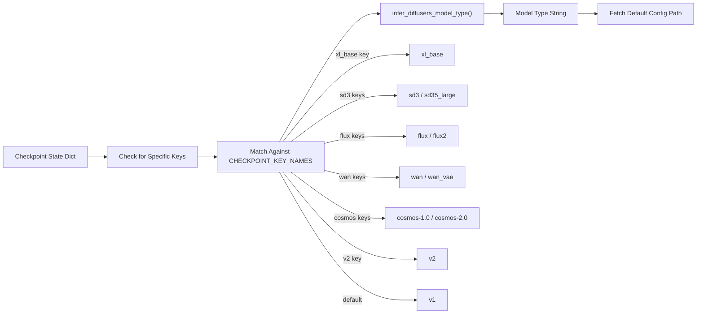
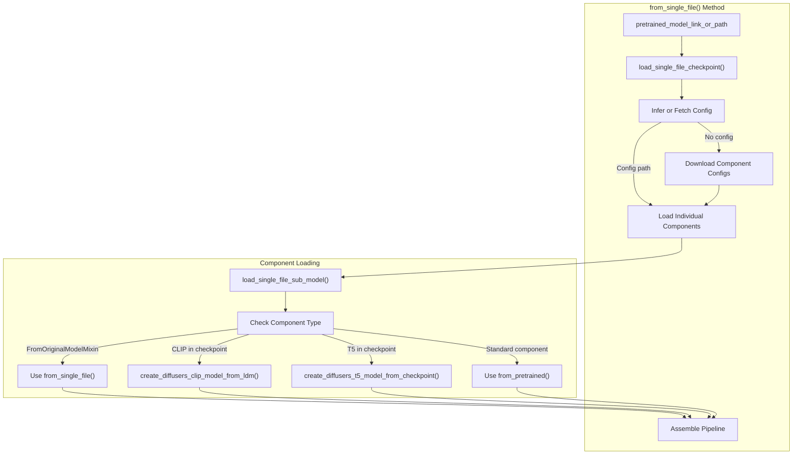

<!-- source: DeepWiki mcp.deepwiki.com · repo huggingface/diffusers · page 6.5 Single File Loading · fetched 2026-10-21 -->

# Single File Loading

<details>
<summary>Relevant source files</summary>

The following files were used as context for generating this wiki page:

- [src/diffusers/loaders/single_file.py](src/diffusers/loaders/single_file.py)
- [src/diffusers/loaders/single_file_model.py](src/diffusers/loaders/single_file_model.py)
- [src/diffusers/loaders/single_file_utils.py](src/diffusers/loaders/single_file_utils.py)
- [src/diffusers/loaders/textual_inversion.py](src/diffusers/loaders/textual_inversion.py)
- [src/diffusers/quantizers/bitsandbytes/bnb_quantizer.py](src/diffusers/quantizers/bitsandbytes/bnb_quantizer.py)
- [tests/quantization/bnb/test_4bit.py](tests/quantization/bnb/test_4bit.py)
- [tests/quantization/bnb/test_mixed_int8.py](tests/quantization/bnb/test_mixed_int8.py)
- [tests/quantization/gguf/test_gguf.py](tests/quantization/gguf/test_gguf.py)

</details>


## Purpose and Scope

Single File Loading enables loading diffusion models from standalone checkpoint files (`.ckpt`, `.safetensors`, `.gguf`) rather than from the standard Diffusers directory structure with separate component files. This system automatically detects the model type, converts checkpoint state dicts from original formats to Diffusers format, and resolves configuration requirements.

For information about loading from Diffusers-format directories with `model_index.json`, see [Loading and Saving](#2.5). For checkpoint conversion between formats, see [Checkpoint Conversion](#6.3).

---

## System Architecture

```mermaid
graph TB
    subgraph "Entry Points"
        FSF["FromSingleFileMixin.from_single_file()"]
        FOM["FromOriginalModelMixin.from_single_file()"]
    end
    
    subgraph "File Loading"
        LSF["load_single_file_checkpoint()"]
        LoadState["load_state_dict()"]
        SafeTensors["SafeTensors Loader"]
        PyTorchLoader["torch.load()"]
    end
    
    subgraph "Model Detection"
        IDM["infer_diffusers_model_type()"]
        FDC["fetch_diffusers_config()"]
        KeyNames["CHECKPOINT_KEY_NAMES"]
    end
    
    subgraph "Conversion"
        ConvertUNet["convert_ldm_unet_checkpoint()"]
        ConvertVAE["convert_ldm_vae_checkpoint()"]
        ConvertCLIP["create_diffusers_clip_model_from_ldm()"]
        ConvertSD3["convert_sd3_transformer_checkpoint_to_diffusers()"]
        ConvertFlux["convert_flux_transformer_checkpoint_to_diffusers()"]
        ConvertWan["convert_wan_transformer_to_diffusers()"]
        ConvertOthers["Other Converters"]
    end
    
    subgraph "Configuration"
        ConfigMap["Config Mapping Functions"]
        DefaultPaths["DIFFUSERS_DEFAULT_PIPELINE_PATHS"]
        LoadConfig["load_config()"]
    end
    
    FSF --> LSF
    FOM --> LSF
    LSF --> LoadState
    LoadState --> SafeTensors
    LoadState --> PyTorchLoader
    
    LSF --> IDM
    IDM --> KeyNames
    IDM --> FDC
    FDC --> DefaultPaths
    
    FOM --> ConvertUNet
    FOM --> ConvertVAE
    FOM --> ConvertSD3
    FOM --> ConvertFlux
    FOM --> ConvertWan
    FSF --> ConvertCLIP
    
    FDC --> LoadConfig
    ConfigMap --> LoadConfig
```



**System Components:**
- **Entry Points**: `FromSingleFileMixin` for pipelines [src/diffusers/loaders/single_file.py:266-531](), `FromOriginalModelMixin` for individual models [src/diffusers/loaders/single_file_model.py:231-531]().
- **File Loading**: Handles `.ckpt`, `.safetensors`, and `.gguf` formats via `load_single_file_checkpoint()` [src/diffusers/loaders/single_file_utils.py:453-531]().
- **Model Detection**: Inspects checkpoint keys to determine model architecture using `CHECKPOINT_KEY_NAMES` [src/diffusers/loaders/single_file_utils.py:62-157]().
- **Conversion**: Translates original checkpoint formats to Diffusers state dicts using specific mapping functions like `convert_ldm_unet_checkpoint()` [src/diffusers/loaders/single_file_model.py:88-89]() and `convert_wan_transformer_to_diffusers()` [src/diffusers/loaders/single_file_model.py:155-157]().
- **Configuration**: Resolves model configs from checkpoints or default repositories in `DIFFUSERS_DEFAULT_PIPELINE_PATHS` [src/diffusers/loaders/single_file_utils.py:159-240]().

Sources: [src/diffusers/loaders/single_file.py:266-531](), [src/diffusers/loaders/single_file_model.py:231-531](), [src/diffusers/loaders/single_file_utils.py:453-531](), [src/diffusers/loaders/single_file_utils.py:62-240]()

---

## Model Type Detection

The system uses a key-based detection mechanism to identify the model architecture from checkpoint contents:



**Detection Process:**

1. **Key Inspection**: Function checks for presence of specific keys in the checkpoint state dict [src/diffusers/loaders/single_file_utils.py:583-818]().
2. **Pattern Matching**: Keys are compared against `CHECKPOINT_KEY_NAMES` dictionary mapping model types to identifying keys [src/diffusers/loaders/single_file_utils.py:62-157]().
3. **Type Inference**: `infer_diffusers_model_type()` returns a string identifier (e.g., `"xl_base"`, `"sd3"`, `"flux"`, `"wan"`) [src/diffusers/loaders/single_file_utils.py:583-818]().
4. **Config Resolution**: Type string maps to default Diffusers repository path in `DIFFUSERS_DEFAULT_PIPELINE_PATHS` [src/diffusers/loaders/single_file_utils.py:159-240]().

**Key Detection Dictionary Structure (Partial):**

| Model Type | Detection Key Examples |
|------------|----------------|
| `v2` | `model.diffusion_model.input_blocks.2.1.transformer_blocks.0.attn2.to_k.weight` [src/diffusers/loaders/single_file_utils.py:64-64]() |
| `xl_base` | `conditioner.embedders.1.model.transformer.resblocks.9.mlp.c_proj.bias` [src/diffusers/loaders/single_file_utils.py:65-65]() |
| `sd3` | `joint_blocks.0.context_block.adaLN_modulation.1.bias` [src/diffusers/loaders/single_file_utils.py:88-88]() |
| `flux` | `double_blocks.0.img_attn.norm.key_norm.scale` [src/diffusers/loaders/single_file_utils.py:107-107]() |
| `wan` | `model.diffusion_model.head.modulation` [src/diffusers/loaders/single_file_utils.py:136-136]() |
| `cosmos-1.0` | `net.x_embedder.proj.1.weight` [src/diffusers/loaders/single_file_utils.py:142-142]() |
| `ltx-video` | `model.diffusion_model.patchify_proj.weight` [src/diffusers/loaders/single_file_utils.py:111-111]() |

Sources: [src/diffusers/loaders/single_file_utils.py:62-157](), [src/diffusers/loaders/single_file_utils.py:583-818]()

---

## Pipeline Loading: FromSingleFileMixin

The `FromSingleFileMixin` provides single file loading capability for pipeline classes. It manages the full process of loading a single checkpoint file, detecting the model type, resolving configuration, and loading each component into the pipeline.



**Loading Flow:**

1. **Checkpoint Loading**: Loads single file checkpoint data using `load_single_file_checkpoint()` [src/diffusers/loaders/single_file.py:314-314]().
2. **Config Resolution**:
   - If no explicit config is given, infer config type from checkpoint using `fetch_diffusers_config()` [src/diffusers/loaders/single_file.py:384-390]().
   - Downloads or retrieves individual component configs from the Hub repository or local path [src/diffusers/loaders/single_file.py:406-413]().
3. **Component Processing**: Iterates over each pipeline component required by the pipeline class [src/diffusers/loaders/single_file.py:481-483]().
4. **Component Loading Strategies**:
   - For components inheriting `FromOriginalModelMixin`, calls their `from_single_file()` method [src/diffusers/loaders/single_file.py:96-113]().
   - For CLIP models embedded in the checkpoint, calls `create_diffusers_clip_model_from_ldm()` [src/diffusers/loaders/single_file.py:115-124]().
   - For T5 models embedded, calls `create_diffusers_t5_model_from_checkpoint()` [src/diffusers/loaders/single_file.py:126-134]().
   - Other components are loaded using the standard `from_pretrained()` method [src/diffusers/loaders/single_file.py:175-176]().
5. **Pipeline Assembly**: Constructs the pipeline object by combining loaded components [src/diffusers/loaders/single_file.py:527-527]().

Sources: [src/diffusers/loaders/single_file.py:273-531](), [src/diffusers/loaders/single_file.py:52-178]()

---

## Model Loading: FromOriginalModelMixin

Individual model classes support single file loading through the `FromOriginalModelMixin`. This Mixin manages loading models from single checkpoint files by handling conversion and configuration internally.

```mermaid
graph TB
    subgraph "Model Classes"
        UNet2D["UNet2DConditionModel"]
        VAE["AutoencoderKL"]
        ControlNet["ControlNetModel"]
        SD3Trans["SD3Transformer2DModel"]
        FluxTrans["FluxTransformer2DModel"]
        WanTrans["WanTransformer3DModel"]
        Others["30+ Model Classes"]
    end
    
    subgraph "from_single_file() Logic"
        LoadCkpt["Load Checkpoint via load_single_file_checkpoint()"]
        GetMapping["Retrieve checkpoint_mapping_fn and config_mapping_fn"]
        ConfigPath["Resolve or generate config"]
        ConvertState["Convert original checkpoint to Diffusers format"]
        CreateModel["Instantiate model with config"]
        LoadWeights["Load converted weights into model"]
    end
    
    subgraph "SINGLE_FILE_LOADABLE_CLASSES"
        MapEntry["Registry Entry"]
        CheckpointFn["checkpoint_mapping_fn"]
        ConfigFn["config_mapping_fn"]
        DefaultSubfolder["default_subfolder"]
    end
    
    UNet2D -.->|"inherits"| FromOM["FromOriginalModelMixin"]
    VAE -.->|"inherits"| FromOM
    ControlNet -.->|"inherits"| FromOM
    SD3Trans -.->|"inherits"| FromOM
    FluxTrans -.->|"inherits"| FromOM
    WanTrans -.->|"inherits"| FromOM
    
    FromOM --> LoadCkpt
    LoadCkpt --> GetMapping
    GetMapping --> MapEntry
    MapEntry --> CheckpointFn
    MapEntry --> ConfigFn
    MapEntry --> DefaultSubfolder
    
    GetMapping --> ConfigPath
    ConfigPath --> CreateModel
    CheckpointFn --> ConvertState
    ConvertState --> LoadWeights
    LoadWeights --> CreateModel
```



**Supported Model Classes (Partial List):**

| Model Class               | Checkpoint Mapping Function                           | Default Subfolder |
|---------------------------|------------------------------------------------------|-------------------|
| `UNet2DConditionModel`    | `convert_ldm_unet_checkpoint()` [src/diffusers/loaders/single_file_model.py:88-89]()      | `unet`            |
| `AutoencoderKL`           | `convert_ldm_vae_checkpoint()` [src/diffusers/loaders/single_file_model.py:96-96]()       | `vae`             |
| `ControlNetModel`         | `convert_controlnet_checkpoint()` [src/diffusers/loaders/single_file_model.py:101-101]()  | -                 |
| `SD3Transformer2DModel`   | `convert_sd3_transformer_checkpoint_to_diffusers()` [src/diffusers/loaders/single_file_model.py:105-106]() | `transformer`     |
| `FluxTransformer2DModel`  | `convert_flux_transformer_checkpoint_to_diffusers()` [src/diffusers/loaders/single_file_model.py:115-117]()    | `transformer`     |
| `WanTransformer3DModel`   | `convert_wan_transformer_to_diffusers()` [src/diffusers/loaders/single_file_model.py:163-165]()               | `transformer`     |
| `CosmosTransformer3DModel`| `convert_cosmos_transformer_checkpoint_to_diffusers()` [src/diffusers/loaders/single_file_model.py:186-188]() | `transformer`     |
| `LTXVideoTransformer3DModel` | `convert_ltx_transformer_checkpoint_to_diffusers()` [src/diffusers/loaders/single_file_model.py:127-129]() | `transformer`     |

**Loading Process:**

1. **Validation**: Checks the model class is registered in the `SINGLE_FILE_LOADABLE_CLASSES` dictionary [src/diffusers/loaders/single_file_model.py:284-290]().
2. **Checkpoint Loading**: Loads raw checkpoint with `load_single_file_checkpoint()` [src/diffusers/loaders/single_file_model.py:347-347]().
3. **Configuration**:
   - Uses `original_config` parameter if provided, invoking a config mapping function to generate a Diffusers config [src/diffusers/loaders/single_file_model.py:410-413]().
   - Otherwise fetches default config repository path inferred from checkpoint via `fetch_diffusers_config()` [src/diffusers/loaders/single_file_model.py:384-392]().
4. **Checkpoint Conversion**: Applies the model-specific conversion function to translate original checkpoint keys and tensor shapes to Diffusers format [src/diffusers/loaders/single_file_model.py:465-465]().
5. **Model Instantiation**: Creates an instance of the model with the resolved config [src/diffusers/loaders/single_file_model.py:475-485]().
6. **Weights Loading**: Loads the converted state dict into the model, handling device mapping, emptying caches, and possibly quantization instrumentation [src/diffusers/loaders/single_file_model.py:513-524]().

Sources: [src/diffusers/loaders/single_file_model.py:83-198](), [src/diffusers/loaders/single_file_model.py:238-531]()

---

## Checkpoint Conversion System

A key subsystem of Single File Loading is the checkpoint conversion system. Different original checkpoint formats use different key names and tensor layouts that must be translated into the Diffusers state dict format before loading.

**Attention Weight Reshaping:**

- The function `conv_attn_to_linear()` converts Conv2D 1x1 attention weights commonly used in some LDM models into 2D Linear layer weights expected by Diffusers.
- It ensures the tensor dimensions conform to the expected input shape for transformers.

**Example Key Mapping Highlights:**

| Model Family              | Detection Key Example                                            |
|---------------------------|------------------------------------------------------------------|
| Stable Diffusion v1       | `model.diffusion_model.output_blocks.11.0.skip_connection.weight` [src/diffusers/loaders/single_file_utils.py:63-63]() |
| SDXL Base                 | `conditioner.embedders.1.model.transformer.resblocks.9.mlp.c_proj.bias` [src/diffusers/loaders/single_file_utils.py:65-65]() |
| SD3                       | `joint_blocks.0.context_block.adaLN_modulation.1.bias` [src/diffusers/loaders/single_file_utils.py:88-88]() |
| Flux                      | `double_blocks.0.img_attn.norm.key_norm.scale` [src/diffusers/loaders/single_file_utils.py:107-107]() |
| Wan                       | `model.diffusion_model.head.modulation` [src/diffusers/loaders/single_file_utils.py:136-136]() |

These keys provide evidence to identify model type and inform how to convert checkpoint weights correctly.

Sources: [src/diffusers/loaders/single_file_utils.py:62-157](), [src/diffusers/loaders/single_file_utils.py:838-850]()

---

## Configuration Resolution

When loading from a single checkpoint, the system manages configuration in these scenarios:

- **Original Config Provided**: The loader uses the `original_config` parameter to load a legacy or original format config file (YAML/JSON) and then converts it into the Diffusers config format using mapping functions.
- **Auto-Detection**: Without original config, the loader infers the model type from the checkpoint keys (`infer_diffusers_model_type()`), then retrieves a default Diffusers config from the relevant Hugging Face repository.
- **Explicit Config Path**: If a `config` path or directory is provided, it is used directly for loading component configuration.

The `DIFFUSERS_DEFAULT_PIPELINE_PATHS` dictionary maps detected model types to canonical Diffusers config repositories:

| Detected Type | Default Diffusers Repository                           |
|---------------|-------------------------------------------------------|
| `v1`          | `stable-diffusion-v1-5/stable-diffusion-v1-5`         |
| `v2`          | `stabilityai/stable-diffusion-2-1-base`                |
| `xl_base`     | `stabilityai/stable-diffusion-xl-base-1.0`             |
| `sd3`         | `stabilityai/stable-diffusion-3-medium-diffusers`      |
| `flux`        | `black-forest-labs/FLUX.1-dev`                         |
| `wan`         | `Wan-Video/Wan2.1-T2V-14B-Diffusers`                   |

This mapping allows the components to be loaded with consistent and up-to-date configuration by default.

Sources: [src/diffusers/loaders/single_file_utils.py:159-240](), [src/diffusers/loaders/single_file_model.py:376-428](), [src/diffusers/loaders/single_file.py:384-471]()

---

## Special Cases and Format Support

### URL Loading

The loading system supports loading checkpoints directly from URLs pointing to Hugging Face Hub files:

- A regular expression extracts the repository ID and filename from the URL [src/diffusers/loaders/single_file_utils.py:394-436]().
- The checkpoint file is downloaded with `_get_model_file()` and cached locally [src/diffusers/loaders/single_file_utils.py:461-464]().
- The checkpoint is then loaded from cache, enabling transparent use of URLs as single file inputs [src/diffusers/loaders/single_file_utils.py:482-482]().

This allows users to directly load checkpoints hosted online without manual download.

Sources: [src/diffusers/loaders/single_file_utils.py:394-436](), [src/diffusers/loaders/single_file_utils.py:453-491]()

---

## Usage Examples

### Loading Pipeline from Single File

```python
from diffusers import StableDiffusionPipeline
import torch

# Load a pipeline directly from a .safetensors checkpoint with fp16 dtype
pipe = StableDiffusionPipeline.from_single_file(
    "path/to/model.safetensors",
    torch_dtype=torch.float16
)
```

### Loading Individual Model

```python
from diffusers import UNet2DConditionModel

# Load UNet from checkpoint file and provide original config path for conversion
unet = UNet2DConditionModel.from_single_file(
    "path/to/checkpoint.ckpt",
    original_config="path/to/config.yaml"
)
```

Sources: [src/diffusers/loaders/single_file.py:323-343](), [src/diffusers/loaders/single_file_model.py:294-299]()

---

## Error Handling

The single file loading system includes precise error handling for common loading errors:

| Error Type       | Trigger Condition                                                   | Exception Class / Behavior               |
|------------------|--------------------------------------------------------------------|-----------------------------------------|
| Missing Component | Component weights missing in checkpoint for requested submodel    | Raises `SingleFileComponentError` [src/diffusers/loaders/single_file.py:171-173]() |
| Invalid Model    | Model class not registered in `SINGLE_FILE_LOADABLE_CLASSES`       | Raises `ValueError` [src/diffusers/loaders/single_file_model.py:284-290]()  |
| Config Conflict  | Both `config` and `original_config` arguments are provided        | Raises `ValueError` [src/diffusers/loaders/single_file_model.py:304-307]()  |
| Missing Config   | No config provided and unable to infer config from checkpoint type | Raises `ValueError` [src/diffusers/loaders/single_file.py:320-323]()        |

This ensures user errors and unsupported scenarios are reported clearly for troubleshooting.

Sources: [src/diffusers/loaders/single_file_utils.py:397-401](), [src/diffusers/loaders/single_file_model.py:304-307](), [src/diffusers/loaders/single_file.py:171-323]()

---

# Summary

The Single File Loading system in Diffusers provides an integrated mechanism to load diffusion model components from standalone checkpoint files, covering official `.ckpt` and `.safetensors` formats. It automatically detects model type by key inspection within checkpoints, applies conversion functions to translate legacy or variant checkpoint formats to the Diffusers modular format, and reconciles configuration requirements by inferring or downloading the correct config files. This design supports both entire pipeline loading via `FromSingleFileMixin` and individual model component loading via `FromOriginalModelMixin`. It significantly eases the transition from non-Diffusers checkpoint formats, enabling users to transparently load models within the Diffusers ecosystem.

Sources: [src/diffusers/loaders/single_file.py](), [src/diffusers/loaders/single_file_model.py](), [src/diffusers/loaders/single_file_utils.py]()

---

