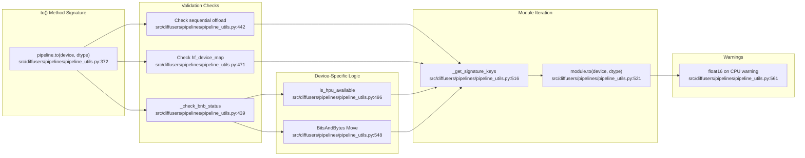
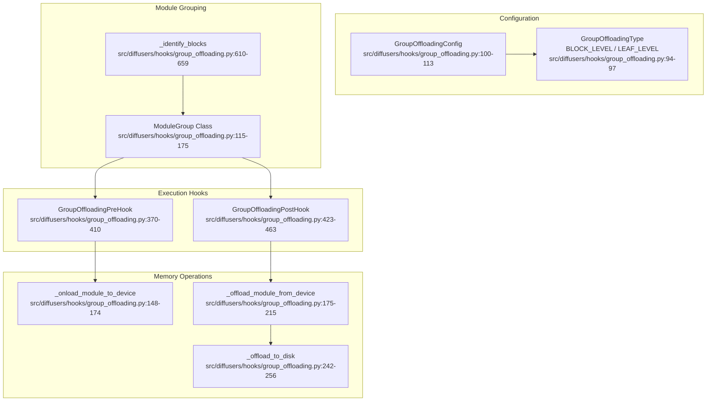
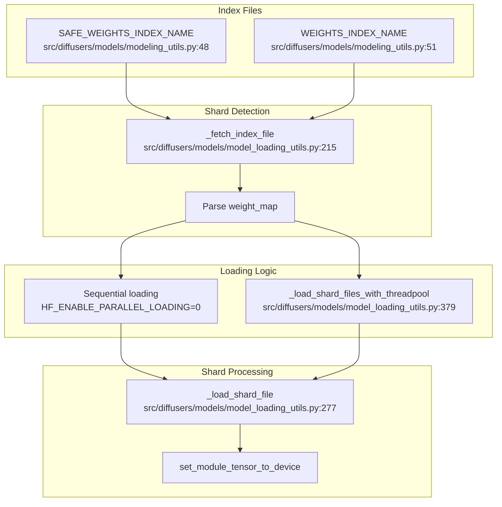

<!-- source: DeepWiki mcp.deepwiki.com · repo huggingface/diffusers · page 6.6 Memory and Device Management · fetched 2026-10-21 -->

# Memory and Device Management

Relevant source files

The following files were used as context for generating this wiki page:

- [docs/source/en/api/models/wan_animate_transformer_3d.md](docs/source/en/api/models/wan_animate_transformer_3d.md)
- [docs/source/en/api/pipelines/bria_fibo.md](docs/source/en/api/pipelines/bria_fibo.md)
- [docs/source/en/api/pipelines/wan.md](docs/source/en/api/pipelines/wan.md)
- [docs/source/en/api/quantization.md](docs/source/en/api/quantization.md)
- [docs/source/en/optimization/memory.md](docs/source/en/optimization/memory.md)
- [docs/source/en/quantization/gguf.md](docs/source/en/quantization/gguf.md)
- [docs/source/en/quantization/nunchaku.md](docs/source/en/quantization/nunchaku.md)
- [docs/source/en/quantization/overview.md](docs/source/en/quantization/overview.md)
- [docs/source/en/quantization/quanto.md](docs/source/en/quantization/quanto.md)
- [docs/source/en/quantization/torchao.md](docs/source/en/quantization/torchao.md)
- [scripts/convert_wan_to_diffusers.py](scripts/convert_wan_to_diffusers.py)
- [src/diffusers/guiders/magnitude_aware_guidance.py](src/diffusers/guiders/magnitude_aware_guidance.py)
- [src/diffusers/hooks/group_offloading.py](src/diffusers/hooks/group_offloading.py)
- [src/diffusers/models/transformers/transformer_chronoedit.py](src/diffusers/models/transformers/transformer_chronoedit.py)
- [src/diffusers/pipelines/deprecated/unidiffuser/modeling_uvit.py](src/diffusers/pipelines/deprecated/unidiffuser/modeling_uvit.py)
- [src/diffusers/pipelines/wan/__init__.py](src/diffusers/pipelines/wan/__init__.py)
- [src/diffusers/quantizers/auto.py](src/diffusers/quantizers/auto.py)
- [src/diffusers/quantizers/base.py](src/diffusers/quantizers/base.py)
- [src/diffusers/quantizers/gguf/gguf_quantizer.py](src/diffusers/quantizers/gguf/gguf_quantizer.py)
- [src/diffusers/quantizers/gguf/utils.py](src/diffusers/quantizers/gguf/utils.py)
- [src/diffusers/quantizers/nunchaku/utils.py](src/diffusers/quantizers/nunchaku/utils.py)
- [src/diffusers/quantizers/quantization_config.py](src/diffusers/quantizers/quantization_config.py)
- [src/diffusers/quantizers/quanto/quanto_quantizer.py](src/diffusers/quantizers/quanto/quanto_quantizer.py)
- [src/diffusers/quantizers/torchao/torchao_quantizer.py](src/diffusers/quantizers/torchao/torchao_quantizer.py)
- [tests/conftest.py](tests/conftest.py)
- [tests/hooks/test_group_offloading.py](tests/hooks/test_group_offloading.py)
- [tests/models/testing_utils/__init__.py](tests/models/testing_utils/__init__.py)
- [tests/models/testing_utils/quantization.py](tests/models/testing_utils/quantization.py)
- [tests/models/transformers/test_models_transformer_flux.py](tests/models/transformers/test_models_transformer_flux.py)
- [tests/pipelines/testing_utils/quantization.py](tests/pipelines/testing_utils/quantization.py)
- [tests/quantization/torchao/test_torchao.py](tests/quantization/torchao/test_torchao.py)
- [tests/single_file/test_model_wan_autoencoder_single_file.py](tests/single_file/test_model_wan_autoencoder_single_file.py)
- [tests/single_file/test_model_wan_transformer3d_single_file.py](tests/single_file/test_model_wan_transformer3d_single_file.py)
- [tests/testing_utils.py](tests/testing_utils.py)
- [utils/generate_model_tests.py](utils/generate_model_tests.py)

This page documents memory and device management in Diffusers, covering techniques to efficiently run diffusion models under memory constraints and across different hardware accelerators. Topics include device placement, CPU/disk offloading, quantization (GGUF, BitsAndBytes, TorchAO), device mapping, and memory optimization strategies.

For model loading mechanisms, see [Loading and Saving](#2.5). For training-specific memory optimizations, see [Training Infrastructure](#5.5).

---

## Overview of Memory and Device Management

Diffusers provides multiple strategies for managing memory and device placement, ranging from simple device movement to sophisticated offloading and quantization techniques. These strategies enable running large models on consumer hardware and optimizing inference performance.

### Memory Management Architecture

```mermaid
graph TB
    subgraph "User Interface"
        Pipeline["DiffusionPipeline<br/>src/diffusers/pipelines/pipeline_utils.py:184"]
        Model["ModelMixin<br/>src/diffusers/models/modeling_utils.py:586"]
    end
    
    subgraph "Device Management"
        ToMethod["to() method<br/>src/diffusers/pipelines/pipeline_utils.py:372-574"]
        DeviceProperty["device property<br/>src/diffusers/pipelines/pipeline_utils.py:576-589"]
        DtypeProperty["dtype property<br/>src/diffusers/pipelines/pipeline_utils.py:591-604"]
    end
    
    subgraph "Offloading Strategies"
        SeqOffload["enable_sequential_cpu_offload<br/>AlignDevicesHook"]
        ModelOffload["enable_model_cpu_offload<br/>CpuOffload"]
        GroupOffload["enable_group_offloading<br/>src/diffusers/hooks/group_offloading.py:1-112"]
        DiskOffload["Disk Offloading<br/>ModuleGroup._offload_to_disk<br/>src/diffusers/hooks/group_offloading.py:242-256"]
    end
    
    subgraph "Quantization"
        GGUFQuant["GGUF Quantization<br/>src/diffusers/quantizers/gguf/gguf_quantizer.py"]
        BnBQuant["BitsAndBytes Quantization<br/>src/diffusers/quantizers/quantization_config.py:171-240"]
        TorchAOQuant["TorchAO Quantization<br/>src/diffusers/quantizers/torchao/torchao_quantizer.py"]
    end
    
    subgraph "Device Mapping"
        DeviceMap["_determine_device_map<br/>model_loading_utils.py:68"]
        BalancedMap["Balanced strategy"]
        CustomMap["Custom device maps"]
    end
    
    subgraph "Optimization"
        LayerwiseCast["enable_layerwise_casting<br/>src/diffusers/models/modeling_utils.py:435"]
        LowMemUsage["_LOW_CPU_MEM_USAGE_DEFAULT<br/>src/diffusers/models/modeling_utils.py:120"]
    end
    
    Pipeline --> ToMethod
    Pipeline --> SeqOffload
    Pipeline --> ModelOffload
    Model --> ToMethod
    Model --> GroupOffload
    Model --> LayerwiseCast
    
    ToMethod --> DeviceProperty
    ToMethod --> DtypeProperty
    
    GroupOffload --> DiskOffload
    
    DeviceMap --> BalancedMap
    DeviceMap --> CustomMap
    
    GGUFQuant --> LowMemUsage
    BnBQuant --> LowMemUsage
```

**Key Components and Device Management Flow**

This diagram shows the main entry points for memory and device management and how they relate to different strategies.

Sources: [src/diffusers/pipelines/pipeline_utils.py:184-604](), [src/diffusers/models/modeling_utils.py:120-586](), [src/diffusers/hooks/group_offloading.py:1-112]()

---

## Device Management

Device management controls where model components are placed and how they are moved between devices (CPU, CUDA, XPU, NPU, HPU, MPS, etc.).

### The `to()` Method

The primary interface for device placement is the `to()` method, available on both `DiffusionPipeline` and `ModelMixin`. It supports moving model components across devices and casts dtypes when necessary.

**Device Movement Flow in `to()` Method**

The method validates the target device/dtype, checks for incompatible configurations, handles device-specific setup, and moves all modules accordingly.

Sources: [src/diffusers/pipelines/pipeline_utils.py:372-574]()

### Device and Dtype Properties

- The `device` property on pipelines returns the `torch.device` of the first module found via `_get_signature_keys()` or defaults to CPU.
- The `dtype` property similarly returns the data type of the first found module or defaults to `torch.float32`.
- Models with group offloading expose `get_parameter_device()` which queries group offloading metadata to get the onload device for parameters.

Sources: [src/diffusers/pipelines/pipeline_utils.py:576-604](), [src/diffusers/models/modeling_utils.py:131-156]()

---

## Memory Offloading Strategies

Offloading enables moving parts of a model between devices dynamically to reduce peak memory use, allowing large model inference on limited resources.

### Offloading Strategy Comparison

| Strategy                | Implementation          | Behavior                                                                   | Resource Usage          |
|-------------------------|-------------------------|----------------------------------------------------------------------------|------------------------|
| **Sequential CPU Offload** | `AlignDevicesHook`       | Moves model modules one at a time during forward pass                      | Lowest GPU memory, Slow |
| **Model CPU Offload**      | `CpuOffload`             | Offloads full large modules (e.g., UNet) after computation                 | Medium GPU memory, Fast |
| **Group Offloading**       | `GroupOffloadingConfig`  | Groups model blocks or leaves to offload batches                           | Highly configurable     |
| **Disk Offloading**        | `_offload_to_disk`       | Offloads parameters to disk in safetensors file, trades speed for low RAM   | Lowest RAM, Very Slow   |

Sources: [src/diffusers/pipelines/pipeline_utils.py:442-493](), [src/diffusers/hooks/group_offloading.py:100-256]()

### Group Offloading Implementation

Group offloading manages device placement for sets of modules grouped as "blocks" or "leaf nodes" with efficient non-blocking transfers.

**Group Offloading Architecture**

- `GroupOffloadingConfig` defines onload/offload devices, offload types (block or leaf level), non-blocking semantics, and optionally disk path for offload [src/diffusers/hooks/group_offloading.py:100-113].
- `ModuleGroup` aggregates modules, parameters, buffers, and manages CUDA streams for efficient transfers [src/diffusers/hooks/group_offloading.py:115-175].
- The system inserts pre/post forward hooks (`GroupOffloadingPreHook` and `GroupOffloadingPostHook`) to load modules to device just-in-time and offload after usage.
- When `offload_to_disk_path` is set, parameters are saved to disk in safetensors to minimize RAM usage, later reloaded as needed.

Sources: [src/diffusers/hooks/group_offloading.py:94-789](), [src/diffusers/models/modeling_utils.py:520-586]()

---

## Quantization Systems

Quantization reduces model size and memory use by lowering numeric precision of weight tensors. Diffusers supports multiple quantization backends managed through config classes.

### Quantization Backends Overview

| Backend          | Description                                          | Key Config Class                  | Main Quantizer Class                |
|------------------|------------------------------------------------------|---------------------------------|------------------------------------|
| GGUF             | LLaMA .gguf format quantization & dequant in CPU   | `GGUFQuantizationConfig`         | `GGUFDiffusersQuantizer` (gguf_quantizer.py) |
| BitsAndBytes      | 4-bit/8-bit quantization using bitsandbytes library  | `BitsAndBytesConfig` (also transformers') | Custom Linear Layer Replacements     |
| TorchAO          | PyTorch AO (torchao) weight-only & dynamic quant    | `TorchAoConfig`                  | `TorchAoHfQuantizer` (torchao_quantizer.py)    |

---

### GGUF (GGML Unified Format)

- GGUF provides quantization formats for LLaMA-style models.
- Diffusers includes `GGUFLinear`, a custom linear layer that performs on-the-fly dequantization in the forward pass and seamlessly replaces `torch.nn.Linear` layers on loading.
- `GGUFParameter` is a special parameter class wrapping quantized tensors.
- Loading and state dict handling replace the usual linear layers with these quantized versions automatically.

Sources: [src/diffusers/quantizers/gguf/gguf_quantizer.py](), [src/diffusers/quantizers/gguf/utils.py]()

---

### BitsAndBytes Quantization

- Controlled via `BitsAndBytesConfig` dataclass.
- Supports 8-bit quantization (`load_in_8bit=True`) and 4-bit quantization (`load_in_4bit=True`).
- 4-bit quantization supports `bnb_4bit_quant_type` (e.g., `"nf4"`) and `bnb_4bit_compute_dtype` for weighted computations.
- Quantized layers are replaced by bnb custom linear layers for efficient inference.
- Commonly used in large models for substantial memory savings while maintaining reasonable accuracy.

Sources: [src/diffusers/quantizers/quantization_config.py:171-240](), [tests/models/testing_utils/quantization.py]()

---

### TorchAO Quantization

- Integration with PyTorch's AO (torchao) library offers multiple weight-only and weight+dynamic activation quantization configs (int4, int8, float8, etc.).
- `TorchAoConfig` wraps a `torchao` base config (e.g., `Int4WeightOnlyConfig`).
- TorchAO tensors are special with internal attributes (e.g., `.qdata`, `.scale`) that require special handling.
- Diffusers uses `_swap_torchao_tensor` and `_restore_torchao_tensor` to move such tensors across devices while preserving their internal state.
- Supports device offloading and CPU/disk offload seamlessly integrated with group offloading.
- TorchAO quantization supports hardware acceleration and `torch.compile` for speedups.

Sources: [src/diffusers/quantizers/torchao/torchao_quantizer.py](), [src/diffusers/hooks/group_offloading.py:38-85](), [tests/quantization/torchao/test_torchao.py]()

---

## Device Mapping and Sharded Loading

Device mapping distributes model components across multiple devices to optimize memory and performance.

- The `device_map` argument controls how pipeline/model components are assigned devices (e.g., `"balanced"`, `"auto"` or custom dict mappings).
- Sharded checkpoints allow loading checkpoints in parts, reducing peak memory during loading.
- Diffusers supports loading shards sequentially or in parallel using a thread pool controlled by environment variables.

Sources: [src/diffusers/models/modeling_utils.py:48-51](), [docs/source/en/optimization/memory.md:30-59]()

---

## Memory Optimization Techniques

### Layerwise Casting

- Layers can be stored in low precision (e.g., float16), then cast to higher precision (e.g., float32) selectively during computation.
- Diffusers supports attaching hooks to modules to enable layerwise casting automatically.
- Some modules (e.g., positional embeddings) are typically excluded from casting for precision reasons.

### Low CPU Memory Usage

- The `low_cpu_mem_usage=True` flag supported in offloading and loading allows initializing models with empty weights and loading parameters directly to device instead of loading fully in CPU and then moving.
- This avoids memory duplication and reduces peak CPU RAM usage during loading.

Sources: [src/diffusers/hooks/group_offloading.py:100-144](), [docs/source/en/optimization/fp16.md:109-150]()

---

# Summary

Diffusers implements a comprehensive memory and device management framework involving:

- Flexible `to()` methods for device/dtype movement.
- Multiple offloading strategies: sequential CPU offload, model CPU offload, group offloading with pre/post hooks, and optional disk offload.
- Support for advanced quantization methods with GGUF, BitsAndBytes, and TorchAO backends to reduce memory footprint and speed up inference.
- Device mapping and sharded checkpoint loading to optimize distributed workloads and lower runtime memory.
- Memory optimization such as layerwise casting and low CPU memory usage flags.
  
These features collectively enable running state-of-the-art diffusion models on limited and heterogeneous hardware efficiently.

Sources:  
[src/diffusers/pipelines/pipeline_utils.py:372-604](),  
[src/diffusers/models/modeling_utils.py:120-586](),  
[src/diffusers/hooks/group_offloading.py:1-789](),  
[src/diffusers/quantizers/gguf/gguf_quantizer.py](),  
[src/diffusers/quantizers/gguf/utils.py](),  
[src/diffusers/quantizers/quantization_config.py:171-240](),  
[src/diffusers/quantizers/torchao/torchao_quantizer.py](),  
[tests/quantization/torchao/test_torchao.py]()

---

