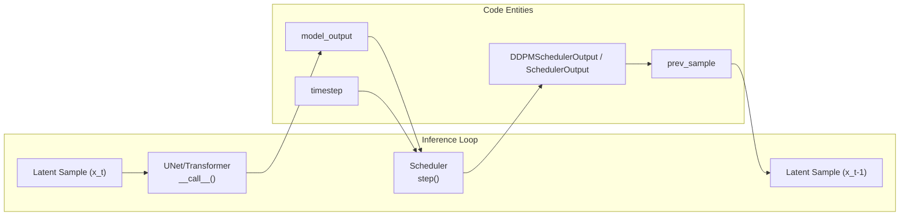

<!-- source: DeepWiki mcp.deepwiki.com · repo huggingface/diffusers · page 7 Scheduler Deep Dive · fetched 2026-10-21 -->

# Scheduler Deep Dive

Relevant source files

The following files were used as context for generating this wiki page:

- [src/diffusers/configuration_utils.py](src/diffusers/configuration_utils.py)
- [src/diffusers/schedulers/scheduling_ddim.py](src/diffusers/schedulers/scheduling_ddim.py)
- [src/diffusers/schedulers/scheduling_ddpm.py](src/diffusers/schedulers/scheduling_ddpm.py)
- [src/diffusers/schedulers/scheduling_deis_multistep.py](src/diffusers/schedulers/scheduling_deis_multistep.py)
- [src/diffusers/schedulers/scheduling_dpmsolver_multistep.py](src/diffusers/schedulers/scheduling_dpmsolver_multistep.py)
- [src/diffusers/schedulers/scheduling_dpmsolver_multistep_inverse.py](src/diffusers/schedulers/scheduling_dpmsolver_multistep_inverse.py)
- [src/diffusers/schedulers/scheduling_dpmsolver_sde.py](src/diffusers/schedulers/scheduling_dpmsolver_sde.py)
- [src/diffusers/schedulers/scheduling_dpmsolver_singlestep.py](src/diffusers/schedulers/scheduling_dpmsolver_singlestep.py)
- [src/diffusers/schedulers/scheduling_euler_ancestral_discrete.py](src/diffusers/schedulers/scheduling_euler_ancestral_discrete.py)
- [src/diffusers/schedulers/scheduling_euler_discrete.py](src/diffusers/schedulers/scheduling_euler_discrete.py)
- [src/diffusers/schedulers/scheduling_heun_discrete.py](src/diffusers/schedulers/scheduling_heun_discrete.py)
- [src/diffusers/schedulers/scheduling_k_dpm_2_ancestral_discrete.py](src/diffusers/schedulers/scheduling_k_dpm_2_ancestral_discrete.py)
- [src/diffusers/schedulers/scheduling_k_dpm_2_discrete.py](src/diffusers/schedulers/scheduling_k_dpm_2_discrete.py)
- [src/diffusers/schedulers/scheduling_lms_discrete.py](src/diffusers/schedulers/scheduling_lms_discrete.py)
- [src/diffusers/schedulers/scheduling_pndm.py](src/diffusers/schedulers/scheduling_pndm.py)
- [src/diffusers/schedulers/scheduling_sasolver.py](src/diffusers/schedulers/scheduling_sasolver.py)
- [src/diffusers/schedulers/scheduling_sde_ve.py](src/diffusers/schedulers/scheduling_sde_ve.py)
- [src/diffusers/schedulers/scheduling_unipc_multistep.py](src/diffusers/schedulers/scheduling_unipc_multistep.py)
- [src/diffusers/schedulers/scheduling_utils.py](src/diffusers/schedulers/scheduling_utils.py)

## Purpose and Scope

This document provides comprehensive technical documentation of the scheduler system in the `diffusers` library. Schedulers control the diffusion process by managing noise schedules, timestep sequences, and the iterative denoising steps during both training and inference. This page covers scheduler architecture, common interfaces, noise schedule types, and the mathematical foundations of different sampling algorithms.

For details on specific scheduler families, see the following child pages:

- [Scheduler Base and Interface](#7.1) — Document `SchedulerMixin`, the common interface, and the scheduler compatibility system.
- [DDPM and DDIM](#7.2) — Explain the foundational DDPM and DDIM schedulers, including their forward and reverse diffusion processes.
- [Advanced Schedulers](#7.3) — Document advanced schedulers including DPM-Solver, UniPC, Euler variants, and flow matching schedulers.
- [Noise Schedules and Timesteps](#7.4) — Explain beta schedules, timestep spacing strategies, sigma transformations (Karras, exponential), flow matching, and noise addition for training.

---

## Scheduler System Architecture

The scheduler system is structured around a robust base class hierarchy designed to provide common capabilities while enabling varied scheduler behaviors for different diffusion sampling strategies.

### Core Class Hierarchy and Scheduler Families

All schedulers inherit from two foundational classes:

- `ConfigMixin` (from `diffusers.configuration_utils`): Manages configuration persistence using the `@register_to_config` decorator to store hyperparameters transparently.
- `SchedulerMixin` (from `diffusers.schedulers.scheduling_utils`): Implements common functionality such as loading from pretrained configurations, saving, and compatibility management.

This inheritance ensures a consistent and extensible scheduler interface across the library.

The high-level view of main scheduler classes and their organization in code is illustrated below:

**Code Entity Space: Scheduler Classes**

```mermaid
graph TB
    ConfigMixin["ConfigMixin<br/>(diffusers.configuration_utils)"]
    SchedulerMixin["SchedulerMixin<br/>(diffusers.schedulers.scheduling_utils)"]

    subgraph "Core Schedulers"
        DDPM["DDPMScheduler<br/>(scheduling_ddpm.py)"]
        DDIM["DDIMScheduler<br/>(scheduling_ddim.py)"]
        PNDM["PNDMScheduler<br/>(scheduling_pndm.py)"]
    end

    subgraph "Discrete/Karras Schedulers"
        Euler["EulerDiscreteScheduler<br/>(scheduling_euler_discrete.py)"]
        EulerA["EulerAncestralDiscreteScheduler<br/>(scheduling_euler_ancestral_discrete.py)"]
        LMS["LMSDiscreteScheduler<br/>(scheduling_lms_discrete.py)"]
    end

    subgraph "Advanced Solvers"
        DPMSolverMulti["DPMSolverMultistepScheduler<br/>(scheduling_dpmsolver_multistep.py)"]
        DPMSolverSingle["DPMSolverSinglestepScheduler<br/>(scheduling_dpmsolver_singlestep.py)"]
        UniPC["UniPCMultistepScheduler<br/>(scheduling_unipc_multistep.py)"]
        DEIS["DEISMultistepScheduler<br/>(scheduling_deis_multistep.py)"]
    end

    ConfigMixin --> SchedulerMixin
    SchedulerMixin --> DDPM
    SchedulerMixin --> DDIM
    SchedulerMixin --> PNDM
    SchedulerMixin --> Euler
    SchedulerMixin --> EulerA
    SchedulerMixin --> LMS
    SchedulerMixin --> DPMSolverMulti
    SchedulerMixin --> DPMSolverSingle
    SchedulerMixin --> UniPC
    SchedulerMixin --> DEIS
```

**Sources:**  
[src/diffusers/schedulers/scheduling_utils.py:33-49](), [src/diffusers/schedulers/scheduling_utils.py:74-93](), [src/diffusers/configuration_utils.py:88-103]()

---

## Base Classes and Common Interface

### SchedulerMixin and ConfigMixin

The core scheduler functionality stems from `SchedulerMixin` which provides:

- Loading and saving methods for scheduler configurations using the Hugging Face Hub.
- Compatibility declarations for interchangeable scheduler implementations within pipelines.
- Integration with `ConfigMixin` for configuration management (e.g., storing `num_train_timesteps`, `beta_schedule` values).

Schedulers register constructor parameters for easy serialization and deserialization using the decorator pattern (`@register_to_config`). This allows user-facing APIs to manipulate scheduler settings transparently while ensuring all important parameters are saved in `scheduler_config.json`.

Many schedulers specify compatibility with the `KarrasDiffusionSchedulers` enum, aiding pipeline interoperability.

For more in-depth interface details, see the child page: [Scheduler Base and Interface](#7.1).

**Sources:**  
[src/diffusers/schedulers/scheduling_utils.py:74-153](), [src/diffusers/configuration_utils.py:143-159](), [src/diffusers/schedulers/scheduling_pndm.py:116-117](), [src/diffusers/schedulers/scheduling_ddpm.py:137-150]()

---

### The Step Interface

The scheduler's primary functional interface is its `step()` method. This method:

- Accepts the model's current output (commonly predicted noise or velocity).
- Accepts the current latent sample and timestep.
- Computes the previous sample in the diffusion chain (often denoted as \( x_{t-1} \)).
- Returns a structured output (e.g., `DDPMSchedulerOutput` or a generic `SchedulerOutput`) encapsulating the new latent and optionally the denoised predicted sample \( x_0 \).

This interface allows the scheduler to implement a denoising step for various diffusion algorithms, abstracting sampling details away from the pipeline.

**Natural Language to Code Entity Mapping: Sampling Loop**

The `step()` method implementation differs per scheduler depending on the underlying sampling algorithm.

**Sources:**  
[src/diffusers/schedulers/scheduling_ddpm.py:31-46](), [src/diffusers/schedulers/scheduling_ddpm.py:462-568](), [src/diffusers/schedulers/scheduling_ddim.py:384-514](), [src/diffusers/schedulers/scheduling_utils.py:61-73]()

---

## Scheduler Families

### Foundational Schedulers: DDPM and DDIM

- **DDPMScheduler**: Implements the original diffusion process and reverse denoising as presented in Denoising Diffusion Probabilistic Models (DDPMs). It uses a Markovian forward process with a predefined beta schedule and a corresponding reverse denoising sampler [src/diffusers/schedulers/scheduling_ddpm.py:137-181]().

- **DDIMScheduler**: Extends DDPM by allowing non-Markovian sampling, enabling deterministic and faster sampling through skipping steps while maintaining sample quality. It offers an alternative interpretation of the forward and reverse process and interacts with beta schedules similarly to DDPM [src/diffusers/schedulers/scheduling_ddim.py:139-195]().

Both schedulers compute beta schedules via discretizing a continuous function \(\alpha_{\bar{t}}\) representing the cumulative noise reduction over diffusion steps using `betas_for_alpha_bar` [src/diffusers/schedulers/scheduling_ddpm.py:48-71]().

For detailed workings, see the child page: [DDPM and DDIM](#7.2).

**Sources:**  
[src/diffusers/schedulers/scheduling_ddpm.py:48-97](), [src/diffusers/schedulers/scheduling_ddpm.py:137-181](), [src/diffusers/schedulers/scheduling_ddim.py:139-195]()

---

### Advanced Solvers

Modern schedulers leverage numerical methods optimized for fast and accurate solving of diffusion ODEs or SDEs:

- **DPMSolverMultistepScheduler** and **DPMSolverSinglestepScheduler**: High-order solver variants offering faster sampling with fewer steps via multistep or single-step methods based on dedicated mathematical solvers for diffusion processes [src/diffusers/schedulers/scheduling_dpmsolver_multistep.py:123-170](), [src/diffusers/schedulers/scheduling_dpmsolver_singlestep.py:88-136]().

- **UniPCMultistepScheduler**: A recent framework providing highly efficient, training-free sampling, improving accuracy by using polynomial correction terms in the multistep method [src/diffusers/schedulers/scheduling_unipc_multistep.py:123-170]().

- **DEISMultistepScheduler**: Implements a fast, high-order multistep solver designed for ODE-based diffusion models to achieve high fidelity with fewer function evaluations [src/diffusers/schedulers/scheduling_deis_multistep.py:86-140]().

These advanced schedulers commonly support varying algorithm and solver types, prediction modes, and thresholding techniques to optimize sampling quality and speed.

For comprehensive details, see the child page: [Advanced Schedulers](#7.3).

**Sources:**  
[src/diffusers/schedulers/scheduling_dpmsolver_multistep.py:123-170](), [src/diffusers/schedulers/scheduling_unipc_multistep.py:123-170](), [src/diffusers/schedulers/scheduling_deis_multistep.py:86-140]()

---

## Noise Schedules and Timesteps

Schedulers critically depend on noise distributions and timestep management to control how noise is added and removed during diffusion.

Key aspects include:

- **Beta Schedules:** Define stepwise noise variances, with common presets like `"linear"`, `"scaled_linear"`, and `"squaredcos_cap_v2"` (cosine schedule). These can be computed using the `betas_for_alpha_bar` function, which discretizes continuous alpha curves representing cumulative noise decay [src/diffusers/schedulers/scheduling_ddpm.py:48-71]().

- **Timestep Spacing Strategies:** Methods for selecting sub-sequences of timesteps during inference. Strategies include `"linspace"` (uniform spacing), `"leading"`, and `"trailing"`. How timesteps are spaced influences the tradeoff between inference speed and quality [src/diffusers/schedulers/scheduling_euler_discrete.py:177-180]().

- **Sigma Transformations:** Continuous noise levels ("sigmas") used in some schedulers (like Karras-based ones) transform discrete beta schedules into noise magnitudes via functions like exponential or Karras sigmas. This is crucial for certain sampling procedures and enables noise schedules adapted to the model's noise scales [src/diffusers/schedulers/scheduling_lms_discrete.py:122-125]().

- **Zero Terminal SNR Rescaling:** Some schedulers apply `rescale_zero_terminal_snr` to beta schedules to ensure the final timestep has zero signal-to-noise ratio, improving numerical stability and sampling quality, based on recent research [src/diffusers/schedulers/scheduling_ddim.py:103-136]().

For extensive explanations and implementations, see the child page: [Noise Schedules and Timesteps](#7.4).

**Sources:**  
[src/diffusers/schedulers/scheduling_ddpm.py:48-97](), [src/diffusers/schedulers/scheduling_ddim.py:103-136](), [src/diffusers/schedulers/scheduling_lms_discrete.py:144-160](), [src/diffusers/schedulers/scheduling_euler_discrete.py:177-180]()

---

## Summary of Core Methods in Schedulers

| Method            | Role                                                                 | Primary File Reference                          |
|-------------------|----------------------------------------------------------------------|------------------------------------------------|
| `set_timesteps`   | Configures the sequence of timesteps used for sampling based on the number of inference steps | [scheduling_ddim.py:334-382]()                  |
| `scale_model_input` | Optionally scales the model input (e.g., for noise normalization)   | [scheduling_euler_discrete.py:440-457]()        |
| `step`            | Generates the previous latent sample \(x_{t-1}\) given model output and current sample | [scheduling_ddpm.py:462-568]()                   |
| `add_noise`       | Adds noise to a clean sample during training at a specified timestep | [scheduling_ddpm.py:570-610]()                   |

These methods define the interaction pattern between diffusion models and their schedulers, enabling flexible execution of diverse diffusion sampling algorithms.

**Sources:**  
[src/diffusers/schedulers/scheduling_ddpm.py:462-610](), [src/diffusers/schedulers/scheduling_ddim.py:334-382](), [src/diffusers/schedulers/scheduling_euler_discrete.py:440-457]()

---

This parent page introduces the key components and architectural layout of the scheduler system. For detailed descriptions, mathematical formulations, and code deep-dives, refer to the respective child pages listed upfront.

---

