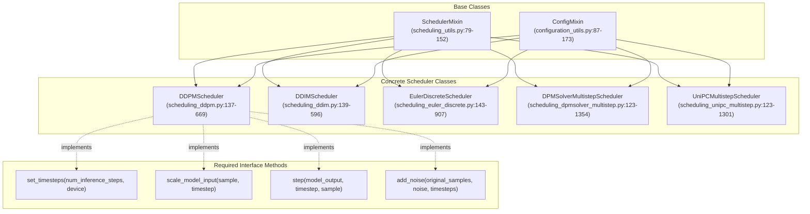
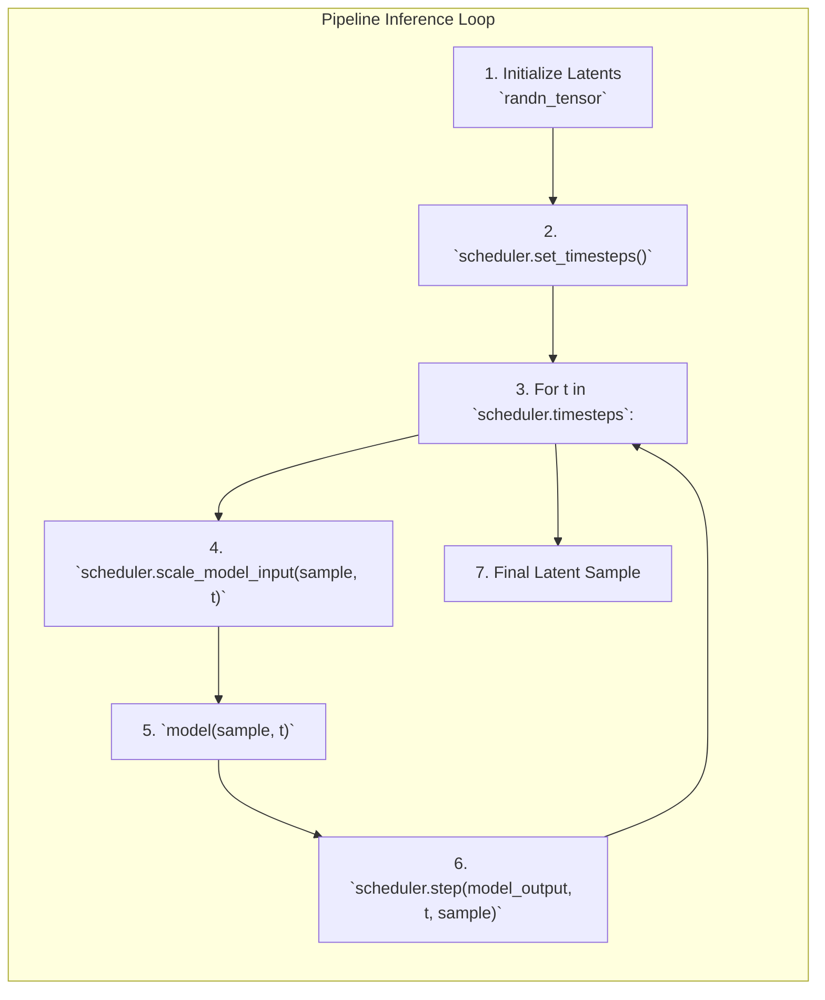
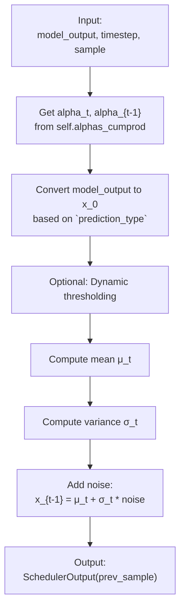
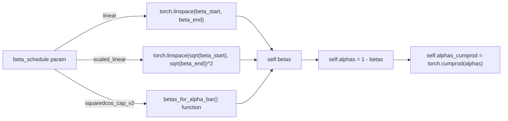
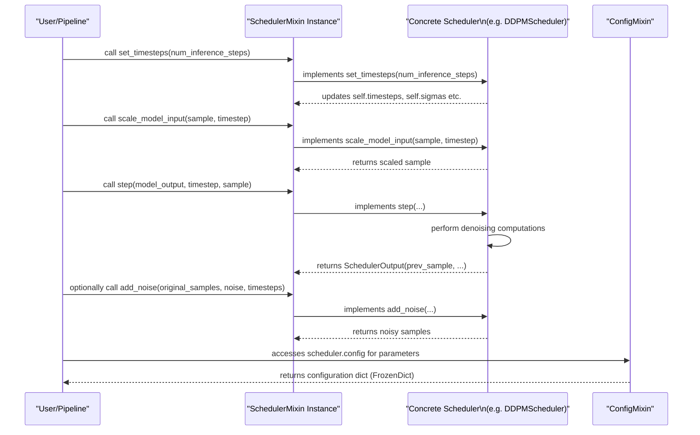

<!-- source: DeepWiki mcp.deepwiki.com · repo huggingface/diffusers · page 7.1 Scheduler Base and Interface · fetched 2026-10-21 -->

# Scheduler Base and Interface

<details>
<summary>Relevant source files</summary>

The following files were used as context for generating this wiki page:

- [src/diffusers/configuration_utils.py](src/diffusers/configuration_utils.py)
- [src/diffusers/schedulers/scheduling_ddim.py](src/diffusers/schedulers/scheduling_ddim.py)
- [src/diffusers/schedulers/scheduling_ddpm.py](src/diffusers/schedulers/scheduling_ddpm.py)
- [src/diffusers/schedulers/scheduling_deis_multistep.py](src/diffusers/schedulers/scheduling_deis_multistep.py)
- [src/diffusers/schedulers/scheduling_dpmsolver_multistep.py](src/diffusers/schedulers/scheduling_dpmsolver_multistep.py)
- [src/diffusers/schedulers/scheduling_dpmsolver_multistep_inverse.py](src/diffusers/schedulers/scheduling_dpmsolver_multistep_inverse.py)
- [src/diffusers/schedulers/scheduling_dpmsolver_sde.py](src/diffusers/schedulers/scheduling_dpmsolver_sde.py)
- [src/diffusers/schedulers/scheduling_dpmsolver_singlestep.py](src/diffusers/schedulers/scheduling_dpmsolver_singlestep.py)
- [src/diffusers/schedulers/scheduling_euler_ancestral_discrete.py](src/diffusers/schedulers/scheduling_euler_ancestral_discrete.py)
- [src/diffusers/schedulers/scheduling_euler_discrete.py](src/diffusers/schedulers/scheduling_euler_discrete.py)
- [src/diffusers/schedulers/scheduling_heun_discrete.py](src/diffusers/schedulers/scheduling_heun_discrete.py)
- [src/diffusers/schedulers/scheduling_k_dpm_2_ancestral_discrete.py](src/diffusers/schedulers/scheduling_k_dpm_2_ancestral_discrete.py)
- [src/diffusers/schedulers/scheduling_k_dpm_2_discrete.py](src/diffusers/schedulers/scheduling_k_dpm_2_discrete.py)
- [src/diffusers/schedulers/scheduling_lms_discrete.py](src/diffusers/schedulers/scheduling_lms_discrete.py)
- [src/diffusers/schedulers/scheduling_pndm.py](src/diffusers/schedulers/scheduling_pndm.py)
- [src/diffusers/schedulers/scheduling_sasolver.py](src/diffusers/schedulers/scheduling_sasolver.py)
- [src/diffusers/schedulers/scheduling_sde_ve.py](src/diffusers/schedulers/scheduling_sde_ve.py)
- [src/diffusers/schedulers/scheduling_unipc_multistep.py](src/diffusers/schedulers/scheduling_unipc_multistep.py)
- [src/diffusers/schedulers/scheduling_utils.py](src/diffusers/schedulers/scheduling_utils.py)
- [tests/schedulers/test_scheduler_deis.py](tests/schedulers/test_scheduler_deis.py)
- [tests/schedulers/test_scheduler_dpm_multi.py](tests/schedulers/test_scheduler_dpm_multi.py)
- [tests/schedulers/test_scheduler_dpm_single.py](tests/schedulers/test_scheduler_dpm_single.py)
- [tests/schedulers/test_scheduler_euler.py](tests/schedulers/test_scheduler_euler.py)
- [tests/schedulers/test_scheduler_heun.py](tests/schedulers/test_scheduler_heun.py)
- [tests/schedulers/test_scheduler_kdpm2_ancestral.py](tests/schedulers/test_scheduler_kdpm2_ancestral.py)
- [tests/schedulers/test_scheduler_kdpm2_discrete.py](tests/schedulers/test_scheduler_kdpm2_discrete.py)
- [tests/schedulers/test_scheduler_lms.py](tests/schedulers/test_scheduler_lms.py)
- [tests/schedulers/test_scheduler_unipc.py](tests/schedulers/test_scheduler_unipc.py)

</details>


This document covers the base classes, interfaces, and common patterns that all schedulers in the Diffusers library share. It explains the `SchedulerMixin` base class, standard interface methods (`set_timesteps`, `scale_model_input`, `step`, `add_noise`), configuration management, and how schedulers integrate with pipelines.

For detailed information about specific scheduler implementations and their mathematical formulations, see [DDPM and DDIM](#7.2) and [Advanced Schedulers](#7.3). For noise schedule configuration details, see [Noise Schedules and Timesteps](#7.4).

---

## Scheduler Architecture Overview

All schedulers in Diffusers inherit from two base classes: `SchedulerMixin` and `ConfigMixin`. This dual inheritance provides both scheduler-specific functionality (loading/saving, compatibility checks) and configuration management (parameter storage, serialization).

### Class Hierarchy and Relationships

The following diagram maps the logical components of the scheduler system to their corresponding code entities:



**Sources:** [src/diffusers/schedulers/scheduling_utils.py:79-152](), [src/diffusers/schedulers/scheduling_ddpm.py:137-142](), [src/diffusers/schedulers/scheduling_ddim.py:139-144](), [src/diffusers/configuration_utils.py:87-173]()

---

## SchedulerMixin Base Class

The `SchedulerMixin` class provides foundational functionality shared by all schedulers. It handles serialization, deserialization, and compatibility management between different scheduler implementations.

### Key Attributes

| Attribute        | Type           | Description                                                                          |
|------------------|----------------|--------------------------------------------------------------------------------------|
| `config_name`    | `str`          | Filename for scheduler configuration file (`"scheduler_config.json"`).              |
| `_compatibles`   | `List[str]`    | List of compatible scheduler class names to enable flexible loading/swapping.       |
| `has_compatibles`| `bool`         | Whether compatibility checking is enabled (typically `True`).                       |

### Loading and Saving

- `SchedulerMixin.from_pretrained()` loads a scheduler from a pretrained configuration (local or Hub).
- This method supports arguments for cache control, subfolder selection, and unused keyword arguments.
- Internally it uses `from_config` and `load_config` utilities to instantiate the scheduler.
- This supports loading any compatible scheduler indicated by `_compatibles`.

### Compatibility System

Schedulers declare compatibility to allow switching between schedulers with shared noise schedule assumptions. This is done via the `_compatibles` class attribute, typically populated from the `KarrasDiffusionSchedulers` enum.

Example:

```python
class DDPMScheduler(SchedulerMixin, ConfigMixin):
    _compatibles = [e.name for e in KarrasDiffusionSchedulers]
```

This design allows pipelines to seamlessly switch schedulers or use auto-classes like `AutoScheduler` to instantiate compatible schedulers.

**Sources:** [src/diffusers/schedulers/scheduling_utils.py:34-52,79-152](), [src/diffusers/schedulers/scheduling_ddpm.py:137-180]()

---

## Standard Interface Methods

All schedulers implement a consistent interface to interact with pipelines. The main methods are:

- `set_timesteps(num_inference_steps, device=None)`: To configure the discrete timesteps for sampling.
- `scale_model_input(sample, timestep)`: Optionally scales the input sample before passing to the model.
- `step(model_output, timestep, sample, ...)`: Computes the denoised sample for the previous timestep.
- `add_noise(original_samples, noise, timesteps)`: Adds noise to samples following the forward diffusion process.

### Denoising Loop Integration

This diagram maps the scheduler methods to typical diffusion pipeline inference loop steps:



**Sources:** [src/diffusers/schedulers/scheduling_ddpm.py:252-577](), [src/diffusers/utils/torch_utils.py:26-26](), [src/diffusers/schedulers/scheduling_euler_discrete.py:233-255]()

---

### `set_timesteps`

- Configures the discrete time steps (`self.timesteps`) for the denoising process.
- Supports different `timestep_spacing` options (e.g., `"linspace"`, `"leading"`, `"trailing"`).
- Handles mapping from the full training timestep set to the inference steps.
- Must be called prior to the inference loop.

---

### `scale_model_input`

- Defines how to preprocess the input noisy sample before feeding it into the model.
- For many schedulers, this is a no-op and returns the sample unmodified.
- For others, especially sigma-based schedulers, this scales the sample by factors dependent on timestep or noise level.

---

### `step`

`step` is the core denoising function:

1. Takes current model output, current timestep, and current sample.
2. Converts the model output to predict the original clean sample (`x_0`) or noise depending on `prediction_type`.
3. Uses the scheduler's noise schedule (`alphas`, `betas`) to compute the mean and variance of the posterior distribution for the previous timestep.
4. Optionally performs dynamic thresholding for numerical stability.
5. Returns the previous timestep sample (`prev_sample`), usually wrapped in a SchedulerOutput dataclass.

The schematic flow for `step`:



---

### `add_noise`

- Performs the forward diffusion process: adds noise to clean samples per the noise schedule.
- Usually called during training data preparation or noisy sample generation.
- Implements the formula: `noisy_sample = sqrt(alpha_prod) * original_sample + sqrt(1 - alpha_prod) * noise`

---

## Configuration Management

Schedulers leverage the `ConfigMixin` system to manage and serialize configuration parameters.

- The `@register_to_config` decorator on a scheduler's `__init__` automatically records the constructor parameters.
- Configuration is stored in a `FrozenDict` accessible via `scheduler.config`.
- Supports saving and loading via JSON config files (`scheduler_config.json`).
- Enables reproducibility and switching between schedulers or their variants.

---

### Noise Schedule Initialization Pattern

Almost all schedulers calculate their noise schedules (`betas`, `alphas`, `alphas_cumprod`) at initialization, controlled by parameters like `num_train_timesteps`, `beta_start`, `beta_end`, and the chosen `beta_schedule`.

Common beta schedules include:

- **Linear**: linearly spaced between `beta_start` and `beta_end`.
- **Scaled Linear**: linear in sqrt-space, squared afterwards for smoother interpolation.
- **Squared Cosine (squaredcos_cap_v2)**: based on a cosine function for the cumulative noise schedule.

The following flow captures this schedule initialization:



The helper function `betas_for_alpha_bar` discretizes alpha schedules based on continuous functions such as the cosine schedule and variants.

---

### Zero Terminal SNR Rescaling

Some schedulers implement `rescale_zero_terminal_snr` to adjust betas so that the terminal signal-to-noise ratio is zero at the final timestep, improving model generation stability and fidelity.

This usually happens as an optional post-processing step during schedule initialization.

---

## Structured Output Types

Schedulers return information from their `step` functions in structured dataclasses derived from `BaseOutput`. This enables standardized access to the key output elements.

| SchedulerOutput Type         | File                            | Fields                                  |
|-----------------------------|--------------------------------|-----------------------------------------|
| `SchedulerOutput`            | `scheduling_utils.py`           | `prev_sample`                           |
| `DDPMSchedulerOutput`        | `scheduling_ddpm.py`            | `prev_sample`, `pred_original_sample`  |
| `DDIMSchedulerOutput`        | `scheduling_ddim.py`            | `prev_sample`, `pred_original_sample`  |
| `LMSDiscreteSchedulerOutput` | `scheduling_lms_discrete.py`    | `prev_sample`, `pred_original_sample`  |
| `SdeVeOutput`                | `scheduling_sde_ve.py`          | `prev_sample`, `prev_sample_mean`      |

---

# Summary Diagram: Natural Language to Code Entities

This sequence diagram maps the natural language scheduler interface to code entities and files.



---

# References and Sources

- Base scheduler utilities and mixin: [src/diffusers/schedulers/scheduling_utils.py:79-152]()
- DDPM Scheduler and beta schedule helpers: [src/diffusers/schedulers/scheduling_ddpm.py:30-163,137-668]()
- DDIM Scheduler: [src/diffusers/schedulers/scheduling_ddim.py:20-165,139-595]()
- ConfigMixin and configuration utilities: [src/diffusers/configuration_utils.py:87-173]()
- LMSDiscrete, EulerDiscrete, DPMSolverMultistep, UniPCMultistep schedulers (for interface consistency): various [src/diffusers/schedulers/*.py]()
- Noise beta calculation helpers `betas_for_alpha_bar` and `rescale_zero_terminal_snr`: multiple schedulers, e.g., [src/diffusers/schedulers/scheduling_ddpm.py:48-97,101-134]()

---

This completes the comprehensive technical documentation for the Scheduler base class and interface in the Diffusers library.

---

